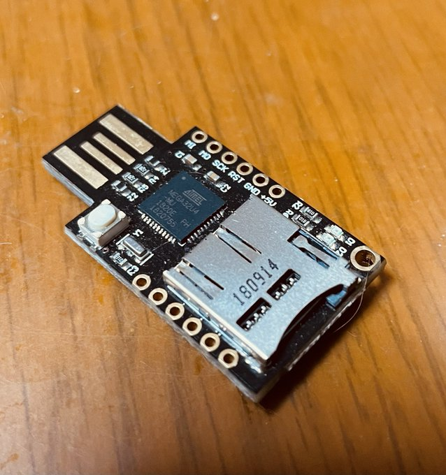
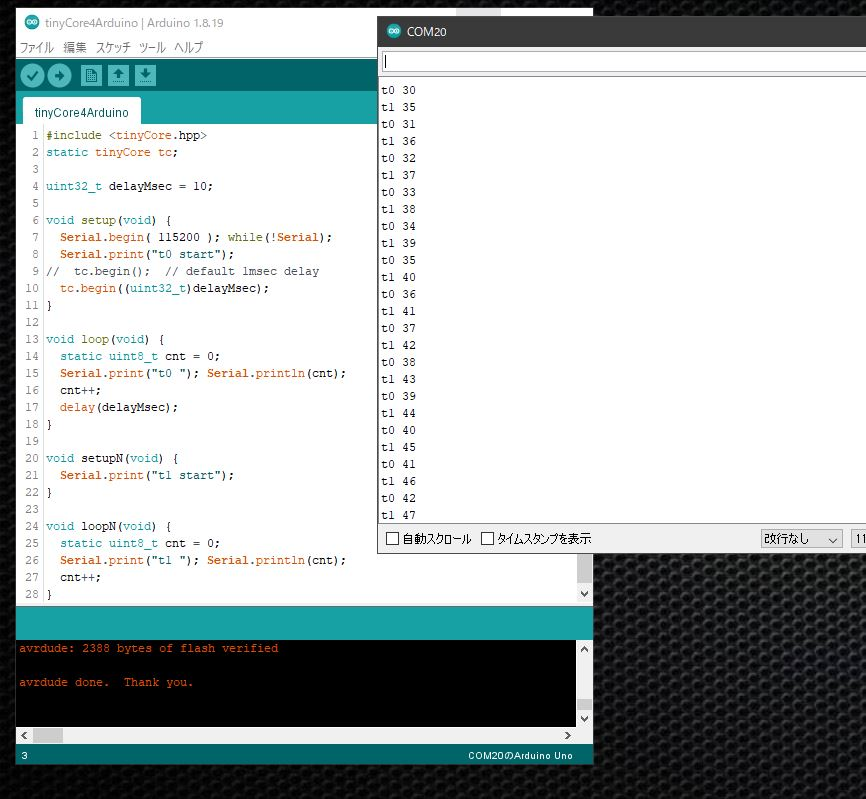

# RP2040のsetup1/loop1が素敵なので Arduino でも使えるように実装してみたよっ

2022年6月23日 15:41



# はじめに

こんにちわ リナちゃん@chrmlinux03 です
前回投稿させて頂いた
[RP2040のsetup1/loop1が素敵なので M5Stack/ESP32 にも実装してみたよっ](../m5stack-setup1loop1/) 
が好評だったので
古き良き友人Arduinoにも同じライブラリで使えるように実装したよ

# 変更点
シングルコアなので今回はMsTimer2割り込みを使って動くようにしてみた
++MsTimer2(ミリ秒単位で指定するタイマ)++

# 前提条件
coreが1個しかない
あまり初心者の方々の手を煩わせたくない
前回と大体同じような仕様で


# 完成形

```c++:tinyCore4Arduino.ino
#include <tinyCore.hpp>

static tinyCore tc;

uint32_t delayMsec = 10;

void setup(void) {
  Serial.begin( 115200 ); while(!Serial);  
  tc.begin(delayMsec);
  // cpu1 で実行したい初期化を記述
}

void loop(void) {
  // cpu1 で実行したい内容を記述
  delay(delayMsec);
}

void setupN(void) {
  // cpu0 で実行したい初期化を記述
}

void loopN(void) {
  // cpu0 で実行したい内容を記述
}
```
++**導入方法**
[github tinyCore](https://github.com/chrmlinux/tinyCore)
もしくは ライブラリーマネージャーから 'tinyCore' で検索++

# 動作例



# Arduino leonard(ATMEGA32U4)では動くの？
動きましたぁ

<blockquote class="twitter-tweet" data-theme="dark"><a href="https://twitter.com/chrmlinux03/status/1540130457383477249"></a></blockquote>
<script async src="https://platform.twitter.com/widgets.js" charset="utf-8"></script>

# 最後に
Arduino IDE を使い Arduinoで開発されている方々
さらに上のスーパLチカを目指して
是非こちらをお使いくださいませっ
よろしくお願い申し上げます

<div class="like-wrap"><div data-lyket-type="like" data-lyket-template="twitter" data-lyket-namespace="linalog" data-lyket-color-icon="#b5e853" data-lyket-color-primary="#b5e853" data-lyket-color-text="#eaeaea" data-lyket-color-secondary="#2b2b2b" data-lyket-id="arduino-setup1loop1"></div></div>
