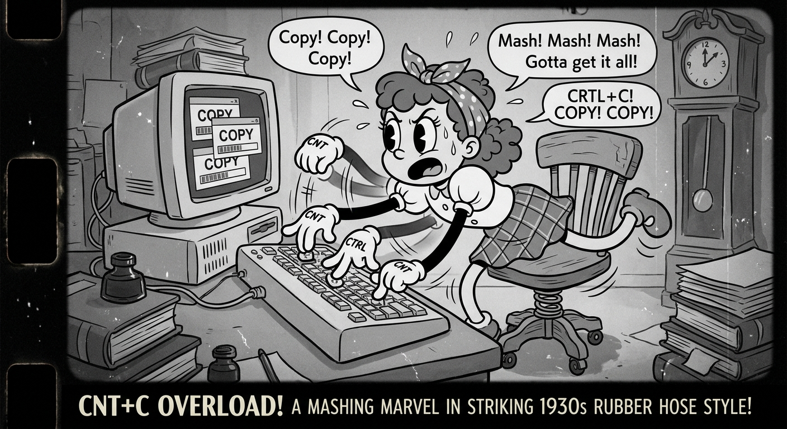

# [M5Stack]CardKB2にCNT+Cを実装する[3分ハッキング最終回]

2026年11月16日 16:49



# CardKB2 に Ctrl+C を追加した

## はじめに
M5Stack の CardKB2（Unit CardKB2）は、42キーの小さなキーボードユニットです。I2C でホストに繋ぐキーボードとして売られています。

手に取って使ってみると、ターミナル用途で致命的な問題がありました。**Ctrl キーがない**のです。キーとして存在しないだけでなく、Fn との組み合わせのようなレイヤーにも Ctrl は割り当てられていません。つまり、素のままでは Ctrl+C が打てません。シェルでコマンドを打ち間違えても、中断できないキーボードでした。

キーが物理的に足りないので、普通ならここで諦めるところです。ところが、このキーボードには続きがありました。

## 実は、キーボードに CPU が載っていた

CardKB2 の中身は ESP32-C61 です。RISC-V の CPU に Wi-Fi 6 と BLE まで載った、立派なマイコンです。「I2C キーボード」として売られているので見落としがちですが、実態は無線付きの小さなコンピュータでした。

さらに嬉しいことに、M5Stack は工場出荷ファームウェアのソースコードを GitHub で公開しています（M5Unit-CardKB2-UserDemo）。ESP-IDF 製で、USB-C から自分のビルドを書き込むことができます。

つまりこのキーボードは、**中身のプログラムを書き換えられるキーボード**だったのです。キーが足りなければ、ファームウェア側でキー入力の解釈を変えてしまえばいい。Ctrl がない問題は、改造で解決できる問題になりました。

## 純正ファームウェアのキー処理

改造の前に、純正ファームウェアのキー処理をソースで確認しました。

- キーは 4×11 のマトリクスで読み取られ、42個のキーが配置されています
- 文字レイヤーは通常面と SYM 面の2つで、Aa キーが Caps（大文字固定）の切り替えです
- Fn キーとの組み合わせには、Fn+1 = ESC、Fn+Z/X/C/D = 矢印キー（BLE HID モードのみ有効）が割り当てられています
- 動作モードは I2C / UART / BLE HID / ESP-NOW の4つで、Fn+Sym+数字で切り替えます
- 本体の RGB LED が状態表示を兼ねていて、Fn 押下中は赤、Caps 中は緑、Sym 中は青に光ります

この仕組みのどこを探しても、やはり Ctrl はありませんでした。

## 設計：Fn の単独タップにワンショット Ctrl を割り当てる

物理キーは増やせないので、未使用の操作を探しました。そこで目を付けたのが、**Fn キーを単独で押して離す操作（タップ）**です。Fn は常に他のキーと組み合わせて使うものとして設計されていて、単独タップには何の機能も割り当てられていませんでした。

設計は次のとおりです。

- Fn を単独タップすると「ワンショット Ctrl」が有効になり、LED が黄色に光る
- 次に押した英字キーが、Ctrl+その文字として送られる（1回で解除）
- もう一度 Fn をタップするとキャンセルできる

ワンショット（sticky key）方式にしたのは、42キーしかない小さなキーボードで Ctrl と文字を同時押しするのは現実的ではないためです。片手で順に押していけます。

## 仕組みの詳細

変更したのは、工場ファームウェアの `app_factory.c` の1ファイルだけです。

### タップの判定

フラグを2つ追加しました。

- `fn_used`：Fn 押下中に他のキーが押されたら立つフラグ
- `ctrl_oneshot`：ワンショット Ctrl が有効かどうか

Fn が押された時点で `fn_used` をクリアし、Fn を離した時点で `fn_used` が立っていなければ「組み合わせには使われなかった＝単独タップ」と判定して、`ctrl_oneshot` を反転させます。Fn+1 で ESC を打ったような通常の組み合わせ操作では、タップ判定には引っかかりません。

### LED 表示

LED の色は各状態の OR で決まっています（赤 = Fn、緑 = Caps、青 = Sym）。ワンショット Ctrl の有効中は赤と緑を両方点けるようにしたので、黄色に光ります。既存の色の約束を崩さずに、新しい状態を1色追加できました。

### 制御コードへの変換

キーの送信処理（I2C / BLE HID モードの文字出力）で、ワンショット Ctrl が有効な間は次の文字キーを横取りします。

- 英字であれば、文字コードに `& 0x1F` を適用して制御コード化します。C なら 0x03、つまり Ctrl+C です
- I2C モードでは、制御コードのバイトそのものをキーキューに送ります
- BLE HID モードでは、LeftCtrl 修飾（0x01）と英字のキーコード（0x04 + 英字の位置）を組み合わせた HID レポートを送ります
- 変換は1回限りで、キーリピートでは再変換しません

`& 0x1F` という規則のおかげで、Ctrl+C 以外も自動的についてきます。**Ctrl+I = Tab、Ctrl+M = Enter、Ctrl+H = バックスペース、Ctrl+[ = ESC** です。純正ファームウェアには Tab キーもなかったので、これは嬉しい副産物でした。

## コード
```c++
//==============================================
// Includes
//==============================================
#include "app_factory.h"
#include "app_production_test.h"
#include "bsp_keyboard.h"
#include "bsp_rgb_led.h"
#include "bsp_blehid.h"
#include "bsp_uart.h"
#include "bsp_i2c.h"
#include "bsp_espnow.h"
#include "esp_err.h"
#include "esp_log.h"
#include "nvs.h"
#include <string.h>

//===================================================================================================
// Global State / Queues
//===================================================================================================

static const char *TAG = "app/factory";

app_mode_t g_mode = MODE_I2C;
QueueHandle_t mode_queue = NULL;

typedef struct {
    int button_index;
    button_event_t event;
    bool is_repeat;
} key_event_t;

#define KEY_EVENT_QUEUE_SIZE  32
static QueueHandle_t key_event_queue = NULL;

// Aa / Fn / Sym 状态
static bool caps_one_time = false;
static bool caps_locked = false;
static bool caps_hold = false;
static bool pending_click = false;
static bool fn_pressed = false;
static bool sym_pressed = false;  // Sym 键按下状态（用于组合键检测）
static bool sym_mode = false;     // Sym 模式开关状态（用于符号输入）
static bool ctrl_oneshot = false; // ワンショットCtrl（Fn単独タップで切替、次の英字キーを制御コード化する）
static bool fn_used = false;      // Fn押下中に他のキーが押されたか（単独タップの判定用）
static TaskHandle_t led_delay_task_handle = NULL;

// 按键保持功能
#define MAX_KEY_INDEX  44
#define KEY_REPEAT_DELAY_MS     300  // 首次重复延迟：300ms
#define KEY_REPEAT_INTERVAL_MS  50   // 重复间隔：50ms
static bool key_pressed[MAX_KEY_INDEX] = {0};
static uint32_t key_press_time[MAX_KEY_INDEX] = {0};
static uint32_t key_last_repeat_time[MAX_KEY_INDEX] = {0};
static TaskHandle_t key_repeat_task_handle = NULL;

//===================================================================================================
// RGB Indicator Task
//===================================================================================================

// RGB 指示任务
typedef enum {
    RGB_CMD_SET_STATE = 0,
    RGB_CMD_BLINK_WHITE,
} rgb_cmd_type_t;

typedef struct {
    rgb_cmd_type_t type;
    uint8_t r;
    uint8_t g;
    uint8_t b;
    uint8_t times;
} rgb_cmd_t;

static QueueHandle_t rgb_cmd_queue = NULL;
static TaskHandle_t rgb_task_handle = NULL;

//===================================================================================================
// Keymap Tables
//===================================================================================================
// 按键映射表（ASCII）
static const uint8_t keymap_normal[4][11] = {
    {0x31, 0x32, 0x33, 0x34, 0x35, 0x36, 0x37, 0x38, 0x39, 0x30, 0x00},
    {0x71, 0x77, 0x65, 0x72, 0x74, 0x79, 0x75, 0x69, 0x6F, 0x70, 0x08},
    {0x41, 0x61, 0x73, 0x64, 0x66, 0x67, 0x68, 0x6A, 0x6B, 0x6C, 0x0A},
    {0x46, 0x53, 0x7A, 0x78, 0x63, 0x76, 0x62, 0x6E, 0x6D, 0x20, 0x00}
};

static const uint8_t keymap_sym[4][11] = {
    {0x21, 0x40, 0x23, 0x24, 0x25, 0x5E, 0x26, 0x2A, 0x28, 0x29, 0x00},
    {0x7E, 0x60, 0x3F, 0x5C, 0x2F, 0x7C, 0x5F, 0x2D, 0x2B, 0x3D, 0x08},
    {0x41, 0x7B, 0x7D, 0x5E, 0x5B, 0x5D, 0x22, 0x27, 0x3B, 0x3A, 0x0A},
    {0x46, 0x53, 0x5A, 0x58, 0x43, 0x3C, 0x3E, 0x2C, 0x2E, 0x20, 0x00}
};

//===================================================================================================
// Forward Declarations
//===================================================================================================
static bool app_get_key_char(int button_index, char *out_char);
static void app_process_key_event(key_event_t *key_event);
static void app_mode_apply(app_mode_t new_mode, bool save_nvs);

//===================================================================================================
// LED Helpers
//===================================================================================================
static bool app_is_caps_active(void)
{
    return caps_one_time || caps_locked || caps_hold;
}

static void rgb_indicator_task(void *arg)
{
    uint8_t current_r = 0;
    uint8_t current_g = 0;
    uint8_t current_b = 0;

    while (1) {
        rgb_cmd_t cmd;
        if (xQueueReceive(rgb_cmd_queue, &cmd, portMAX_DELAY) != pdTRUE) {
            continue;
        }

        switch (cmd.type) {
            case RGB_CMD_SET_STATE:
                current_r = cmd.r;
                current_g = cmd.g;
                current_b = cmd.b;
                bsp_rgb_led_set_color(current_r, current_g, current_b);
                break;
            case RGB_CMD_BLINK_WHITE:
                for (uint8_t i = 0; i < cmd.times; i++) {
                    bsp_rgb_led_set_color(255, 255, 255);
                    vTaskDelay(pdMS_TO_TICKS(200));
                    bsp_rgb_led_set_color(0, 0, 0);
                    vTaskDelay(pdMS_TO_TICKS(200));
                }
                bsp_rgb_led_set_color(current_r, current_g, current_b);
                break;
            default:
                break;
        }
    }
}

static void app_update_led_state(void)
{
    // Fn -- Red，Caps -- Green，Sym -- Blue
    uint8_t r = (fn_pressed || ctrl_oneshot) ? 255 : 0;
    uint8_t g = (app_is_caps_active() || ctrl_oneshot) ? 255 : 0;
    uint8_t b = sym_mode ? 255 : 0;
    rgb_cmd_t cmd = {
        .type = RGB_CMD_SET_STATE,
        .r = r,
        .g = g,
        .b = b,
        .times = 0
    };
    if (rgb_cmd_queue != NULL) {
        xQueueSend(rgb_cmd_queue, &cmd, 0);
    }
}

static void app_led_blink_white(uint8_t times)
{
    rgb_cmd_t cmd = {
        .type = RGB_CMD_BLINK_WHITE,
        .r = 0,
        .g = 0,
        .b = 0,
        .times = times
    };
    if (rgb_cmd_queue != NULL) {
        xQueueSend(rgb_cmd_queue, &cmd, 0);
    }
}

//===================================================================================================
// Mode / NVS Helpers
//===================================================================================================
static uint8_t app_mode_to_blink_count(app_mode_t mode)
{
    switch (mode) {
        case MODE_I2C:
            return 1;
        case MODE_UART:
            return 2;
        case MODE_ESPNOW:
            return 3;
        case MODE_BLEHID:
            return 4;
        case MODE_PRODTEST:
            return 5;
        case MODE_NONE:
        default:
            return 0;
    }
}

static const char *app_mode_to_string(app_mode_t mode)
{
    switch (mode) {
        case MODE_NONE:
            return "NONE";
        case MODE_I2C:
            return "I2C";
        case MODE_UART:
            return "UART";
        case MODE_ESPNOW:
            return "ESP-NOW";
        case MODE_BLEHID:
            return "BLE-HID";
        case MODE_PRODTEST:
            return "PRODTEST";
        default:
            return "UNKNOWN";
    }
}

static void app_print_mode(app_mode_t mode)
{
    printf("Unit CardKB2 MODE: %s\r\n", app_mode_to_string(mode));
}

static void app_print_key_event(int key_id, bool pressed)
{
    // 获取按键字符（如果有）
    char key_char = 0;
    bool has_char = app_get_key_char(key_id, &key_char);

    // ワンショットCtrlが有効な間は、モニタ表示も制御コードとして見せる（表示のみ）
    if (pressed && ctrl_oneshot && has_char &&
        ((key_char >= 'a' && key_char <= 'z') || (key_char >= 'A' && key_char <= 'Z'))) {
        key_char = (char)(key_char & 0x1F);
    }
    
    if (has_char && key_char >= 32 && key_char <= 126) {
        // 可打印字符
        printf("KEY[%2d] '%c' %s\r\n", key_id, key_char, pressed ? "PRESS" : "RELEASE");
    } else if (has_char) {
        // 控制字符
        const char *ctrl_name = "";
        switch (key_char) {
            case 0x08: ctrl_name = "BS";    break;
            case 0x09: ctrl_name = "TAB";   break;
            case 0x0A: ctrl_name = "LF";    break;
            case 0x0D: ctrl_name = "CR";    break;
            case 0x20: ctrl_name = "SPACE"; break;
            case 0x1B: ctrl_name = "ESC";   break;
            default:   ctrl_name = "CTRL";  break;
        }
        printf("KEY[%2d] %s %s\r\n", key_id, ctrl_name, pressed ? "PRESS" : "RELEASE");
    } else {
        // 特殊功能键（Aa/Fn/Sym等）
        const char *key_name = "";
        if (key_id == KEY_AA_TOGGLE) {
            key_name = "Aa";
        } else if (key_id == KEY_FN) {
            key_name = "Fn";
        } else if (key_id == KEY_SYM) {
            key_name = "Sym";
        } else if (key_id == KEY_DEL) {
            key_name = "Del";
        } else if (key_id == KEY_ENTER) {
            key_name = "Enter";
        } else if (key_id == KEY_SPACE) {
            key_name = "Space";
        } else {
            key_name = "?";
        }
        printf("KEY[%2d] %s %s\r\n", key_id, key_name, pressed ? "PRESS" : "RELEASE");
    }
}

static void app_save_mode_to_nvs(app_mode_t mode)
{
    if (mode != MODE_I2C && mode != MODE_UART && mode != MODE_BLEHID && mode != MODE_ESPNOW) {
        return;
    }

    nvs_handle_t handle;
    if (nvs_open("cardkb2", NVS_READWRITE, &handle) != ESP_OK) {
        return;
    }

    uint8_t value = (uint8_t)mode;
    if (nvs_set_u8(handle, "mode", value) == ESP_OK) {
        nvs_commit(handle);
    }
    nvs_close(handle);
}

static app_mode_t app_load_mode_from_nvs(void)
{
    nvs_handle_t handle;
    uint8_t value = (uint8_t)MODE_I2C;
    if (nvs_open("cardkb2", NVS_READONLY, &handle) == ESP_OK) {
        if (nvs_get_u8(handle, "mode", &value) != ESP_OK) {
            value = (uint8_t)MODE_I2C;
        }
        nvs_close(handle);
    }
    if (value == MODE_NONE || value >= MODE_MAX) {
        return MODE_I2C;
    }
    if (value == MODE_I2C || value == MODE_UART || value == MODE_BLEHID || value == MODE_ESPNOW) {
        return (app_mode_t)value;
    }
    return MODE_I2C;
}

//===================================================================================================
// Output Helpers (UART / ESP-NOW)
//===================================================================================================
static void app_send_uart_frame(uint8_t key_id, bool pressed)
{
    uint8_t frame[5];
    frame[0] = 0xAA;
    frame[1] = 0x03;
    frame[2] = key_id;
    frame[3] = pressed ? 0x01 : 0x02;
    frame[4] = (uint8_t)((frame[1] + frame[2] + frame[3]) & 0xFF);
    bsp_uart_send(frame, sizeof(frame));
}

static void app_send_espnow_frame(uint8_t key_id, bool pressed)
{
    uint8_t frame[5];
    frame[0] = 0xAA;
    frame[1] = 0x03;
    frame[2] = key_id;
    frame[3] = pressed ? 0x01 : 0x02;
    frame[4] = (uint8_t)((frame[1] + frame[2] + frame[3]) & 0xFF);
    bsp_espnow_send(frame, sizeof(frame));
}

//===================================================================================================
// Key Handling Helpers
//===================================================================================================
static bool app_is_special_key(int button_index)
{
    return (button_index == KEY_AA_TOGGLE || button_index == KEY_FN || button_index == KEY_SYM);
}

static bool app_is_repeatable_key(int button_index)
{
    if (button_index < 0 || button_index >= MAX_KEY_INDEX) {
        return false;
    }
    return !app_is_special_key(button_index);
}

static bool app_get_key_char(int button_index, char *out_char)
{
    if (button_index < 0 || button_index >= MAX_KEY_INDEX || out_char == NULL) {
        return false;
    }

    if (app_is_special_key(button_index)) {
        return false;
    }

    int row = button_index / 11;
    int col = button_index % 11;
    if (row < 0 || row >= 4 || col < 0 || col >= 11) {
        return false;
    }

    uint8_t key_char = sym_mode ? keymap_sym[row][col] : keymap_normal[row][col];
    if (key_char == 0) {
        return false;
    }

    if (!sym_mode && app_is_caps_active() && key_char >= 0x61 && key_char <= 0x7A) {
        key_char = (uint8_t)(key_char - 0x61 + 0x41);
    }

    *out_char = (char)key_char;
    return true;
}

static void app_clear_caps_one_time(void)
{
    if (caps_one_time) {
        caps_one_time = false;
        app_update_led_state();
    }
}

//===================================================================================================   
// Tasks
//===================================================================================================
static void led_delay_task(void *arg)
{
    while (1) {
        vTaskSuspend(NULL);
        vTaskDelay(pdMS_TO_TICKS(300));
        if (pending_click) {
            pending_click = false;
            app_update_led_state();
        }
    }
}

static void key_repeat_task(void *arg)
{
    while (1) {
        uint32_t current_time = xTaskGetTickCount() * portTICK_PERIOD_MS;
        for (int i = 0; i < MAX_KEY_INDEX; i++) {
            if (!app_is_repeatable_key(i)) {
                continue;
            }
            if (key_pressed[i] && key_press_time[i] > 0) {
                bool should_repeat = false;
                if (key_last_repeat_time[i] == 0) {
                    uint32_t elapsed = current_time - key_press_time[i];
                    if (elapsed >= KEY_REPEAT_DELAY_MS) {
                        should_repeat = true;
                    }
                } else {
                    uint32_t elapsed = current_time - key_last_repeat_time[i];
                    if (elapsed >= KEY_REPEAT_INTERVAL_MS) {
                        should_repeat = true;
                    }
                }

                if (should_repeat && key_event_queue != NULL) {
                    key_event_t evt = {
                        .button_index = i,
                        .event = BUTTON_PRESS_DOWN,
                        .is_repeat = true
                    };
                    xQueueSend(key_event_queue, &evt, 0);
                    key_last_repeat_time[i] = current_time;
                }
            }
        }
        vTaskDelay(pdMS_TO_TICKS(KEY_REPEAT_INTERVAL_MS));
    }
}

static void ble_hid_event_callback(ble_hid_state_t state)
{
    if (state == BLE_HID_STATE_CONNECTED) {
        printf("BLE-HID connected\r\n");
    } else if (state == BLE_HID_STATE_DISCONNECTED) {
        printf("BLE-HID disconnected\r\n");
        // 断开连接时清除所有按键状态，防止自动输入
        for (int i = 0; i < MAX_KEY_INDEX; i++) {
            key_pressed[i] = false;
            key_press_time[i] = 0;
            key_last_repeat_time[i] = 0;
        }
        // 挂起按键重复任务
        if (key_repeat_task_handle != NULL) {
            vTaskSuspend(key_repeat_task_handle);
        }
    }
}

//===================================================================================================
// Mode Switch / Key Processing
//===================================================================================================
static void app_mode_apply(app_mode_t new_mode, bool save_nvs)
{
    if (new_mode == MODE_NONE || new_mode >= MODE_MAX) {
        return;
    }

    if (g_mode == MODE_PRODTEST) {
        app_production_test_set_enabled(false);
        app_production_test_deinit();
    }

    bsp_i2c_deinit();
    bsp_uart_deinit();
    bsp_blehid_deinit();
    if (bsp_espnow_is_initialized()) {
        bsp_espnow_deinit();
    }

    g_mode = new_mode;
    switch (g_mode) {
        case MODE_I2C:
            bsp_i2c_init();
            break;
        case MODE_UART:
            bsp_uart_init();
            break;
        case MODE_ESPNOW:
            bsp_espnow_init();
            break;
        case MODE_BLEHID:
            bsp_blehid_register_event_cb(ble_hid_event_callback);
            if (bsp_blehid_init() == ESP_OK) {
                bsp_blehid_start_advertising();
            }
            break;
        case MODE_PRODTEST:
            bsp_uart_init();
            app_production_test_init();
            app_production_test_set_enabled(true);
            break;
        default:
            break;
    }

    // Fix: reset modifier state and refresh LED on mode switch (avoids leaking Sym/Fn into new mode)
    sym_mode      = false;
    sym_pressed   = false;
    fn_pressed    = false;
    caps_one_time = false;
    caps_locked   = false;
    caps_hold     = false;
    app_update_led_state();

    if (save_nvs) {
        app_save_mode_to_nvs(g_mode);
    }

    app_print_mode(g_mode);
    app_led_blink_white(app_mode_to_blink_count(g_mode));
}

void app_key_event_cb(button_event_data_t *event_data)
{
    if (key_event_queue != NULL) {
        key_event_t evt = {
            .button_index = event_data->button_index,
            .event = event_data->event,
            .is_repeat = false
        };
        BaseType_t xHigherPriorityTaskWoken = pdFALSE;
        xQueueSendFromISR(key_event_queue, &evt, &xHigherPriorityTaskWoken);
        portYIELD_FROM_ISR(xHigherPriorityTaskWoken);
    }
}

static void app_process_key_event(key_event_t *key_event)
{
    bool is_press = (key_event->event == BUTTON_PRESS_DOWN);
    bool is_release = (key_event->event == BUTTON_PRESS_UP);
    uint32_t current_time = xTaskGetTickCount() * portTICK_PERIOD_MS;

    // 更新按键保持状态
    if (key_event->button_index < MAX_KEY_INDEX) {
        if (is_press) {
            key_pressed[key_event->button_index] = true;
            key_press_time[key_event->button_index] = current_time;
            key_last_repeat_time[key_event->button_index] = 0;
        } else if (is_release) {
            key_pressed[key_event->button_index] = false;
            key_press_time[key_event->button_index] = 0;
            key_last_repeat_time[key_event->button_index] = 0;
        }
    }

    // 控制按键重复任务
    if (key_repeat_task_handle != NULL) {
        bool has_pressed_key = false;
        for (int i = 0; i < MAX_KEY_INDEX; i++) {
            if (key_pressed[i]) {
                has_pressed_key = true;
                break;
            }
        }
        if (has_pressed_key) {
            vTaskResume(key_repeat_task_handle);
        } else {
            vTaskSuspend(key_repeat_task_handle);
        }
    }

    // USB 串口输出按键事件（仅真实按下/释放）
    if ((is_press || is_release) && !key_event->is_repeat) {
        app_print_key_event(key_event->button_index, is_press);
    }

    // Fn 押下中に他のキーが押されたら、組み合わせとして使ったことを記録する
    if (is_press && fn_pressed && key_event->button_index != KEY_FN) {
        fn_used = true;
    }

    // Fn + Sym + 数字键切换模式（仅按下事件，忽略重复）
    if (is_press && !key_event->is_repeat && fn_pressed && sym_pressed) {
        app_mode_t new_mode;
        switch (key_event->button_index) {
            case 0:  // Fn + Sym + 1
                new_mode = MODE_I2C;
                break;
            case 1:  // Fn + Sym + 2
                new_mode = MODE_UART;
                break;
            case 2:  // Fn + Sym + 3
                new_mode = MODE_ESPNOW;
                break;
            case 3:  // Fn + Sym + 4
                new_mode = MODE_BLEHID;
                break;
            default:
                new_mode = MODE_MAX;
                break;
        }
        if (new_mode < MODE_MAX && mode_queue != NULL) {
            xQueueSend(mode_queue, &new_mode, 0);
            return;
        }
    }

    // Fn + 1 = ESC 键（仅按下事件，忽略重复）
    if (is_press && !key_event->is_repeat && fn_pressed && !sym_pressed && key_event->button_index == KEY_ESC) {
        uint8_t esc_char = 0x1B;
        if (g_mode == MODE_I2C) {
            bsp_i2c_add_key(esc_char);  // ESC ASCII 码
        } else if (g_mode == MODE_BLEHID) {
            if (bsp_blehid_is_connected()) {
                bsp_blehid_send_keycode(0, USB_HID_KEY_ESC);
            }
        } else if (g_mode == MODE_UART) {
            // Fix: send framed ESC (host parser expects 5-byte KEY_ID + KEY_STATE frame)
            app_send_uart_frame(KEY_ESC, true);
        }
        return;
    }

    // UART / ESP-NOW 模式：按键索引 + 状态帧
    if (is_press || is_release) {
        if (g_mode == MODE_UART) {
            app_send_uart_frame((uint8_t)key_event->button_index, is_press);
        } else if (g_mode == MODE_ESPNOW) {
            app_send_espnow_frame((uint8_t)key_event->button_index, is_press);
        }
    }

    // Fix: consume caps one-shot in UART/ESP-NOW modes when an alphabetic key is pressed
    // (originally only handled in I2C/BLEHID ASCII paths — see app_clear_caps_one_time call below)
    if (is_press && !key_event->is_repeat && !fn_pressed &&
        (g_mode == MODE_UART || g_mode == MODE_ESPNOW)) {
        char c = 0;
        if (app_get_key_char(key_event->button_index, &c) &&
            ((c >= 0x41 && c <= 0x5A) || (c >= 0x61 && c <= 0x7A))) {
            app_clear_caps_one_time();
        }
    }

    // 产测模式：通过 UART 上报按键事件
    if (g_mode == MODE_PRODTEST && (is_press || is_release)) {
        bsp_uart_printf("+KEY:%d,%d\r\n", key_event->button_index, key_event->event);
    }

    // 处理 Aa 键事件
    if (key_event->button_index == KEY_AA_TOGGLE) {
        switch (key_event->event) {
            case BUTTON_PRESS_DOWN:
                if (!caps_locked) {
                    caps_hold = true;
                    app_update_led_state();
                }
                return;
            case BUTTON_PRESS_UP:
                if (!caps_locked && caps_hold) {
                    pending_click = true;
                    caps_hold = false;
                    if (led_delay_task_handle != NULL) {
                        vTaskResume(led_delay_task_handle);
                    }
                } else if (!caps_locked) {
                    caps_hold = false;
                    app_update_led_state();
                }
                return;
            case BUTTON_LONG_PRESS_START:
                return;
            case BUTTON_LONG_PRESS_UP:
                if (!caps_locked) {
                    caps_hold = false;
                    app_update_led_state();
                }
                return;
            case BUTTON_SINGLE_CLICK:
                pending_click = false;
                if (caps_locked) {
                    caps_locked = false;
                    caps_one_time = false;
                } else {
                    caps_one_time = true;
                    caps_locked = false;
                }
                app_update_led_state();
                return;
            case BUTTON_DOUBLE_CLICK:
                pending_click = false;
                caps_locked = !caps_locked;
                caps_one_time = false;
                app_update_led_state();
                return;
            default:
                break;
        }
    }

    // 处理 Fn 键
    if (key_event->button_index == KEY_FN) {
        if (is_press) {
            fn_pressed = true;
            fn_used = false;
        } else if (is_release) {
            fn_pressed = false;
            // 単独タップ（組み合わせに使わなかった）→ ワンショットCtrlを切り替える
            if (!fn_used) {
                ctrl_oneshot = !ctrl_oneshot;
            }
        }
        app_update_led_state();
        return;
    }

    // 处理方向键（Fn + D/Z/X/C）
    // 注意：需要处理重复事件，以便长按时也能连续发送方向键
    if (is_press && fn_pressed) {
        switch (key_event->button_index) {
            case KEY_UP:  // Fn+D = 上方向键
                if (g_mode == MODE_BLEHID) {
                    if (bsp_blehid_is_connected()) {
                        bsp_blehid_send_keycode(0, USB_HID_KEY_UP);
                    }
                }
                return;
                
            case KEY_LEFT:  // Fn+Z = 左方向键
                if (g_mode == MODE_BLEHID) {
                    if (bsp_blehid_is_connected()) {
                        bsp_blehid_send_keycode(0, USB_HID_KEY_LEFT);
                    }
                }
                return;
                
            case KEY_DOWN:  // Fn+X = 下方向键
                if (g_mode == MODE_BLEHID) {
                    if (bsp_blehid_is_connected()) {
                        bsp_blehid_send_keycode(0, USB_HID_KEY_DOWN);
                    }
                }
                return;
                
            case KEY_RIGHT:  // Fn+C = 右方向键
                if (g_mode == MODE_BLEHID) {
                    if (bsp_blehid_is_connected()) {
                        bsp_blehid_send_keycode(0, USB_HID_KEY_RIGHT);
                    }
                }
                return;
                
            default:
                break;
        }
    }

    // 处理 Sym 键
    if (key_event->button_index == KEY_SYM) {
        if (is_press) {
            sym_pressed = true;
        } else if (is_release) {
            sym_pressed = false;
        }
        // 单击切换符号模式（仅在非组合键时）
        if (key_event->event == BUTTON_SINGLE_CLICK && !fn_pressed) {
            sym_mode = !sym_mode;
            app_update_led_state();
        }
        // 如果 Fn 未按下，更新 LED 状态
        if (!fn_pressed) {
            app_update_led_state();
        }
        return;
    }

    // I2C / BLE HID 模式：输出 ASCII
    if (is_press && (g_mode == MODE_I2C || g_mode == MODE_BLEHID)) {
        char key_char = 0;
        if (app_get_key_char(key_event->button_index, &key_char)) {
            // ワンショットCtrl：次の英字キーを制御コードとして送る（1回で解除）
            bool ctrl = false;
            if (ctrl_oneshot && !key_event->is_repeat) {
                ctrl_oneshot = false;
                app_update_led_state();
                if ((key_char >= 'a' && key_char <= 'z') ||
                    (key_char >= 'A' && key_char <= 'Z')) {
                    ctrl = true;
                }
            }

            if (g_mode == MODE_I2C) {
                bsp_i2c_add_key((uint8_t)(ctrl ? (key_char & 0x1F) : key_char));
            } else if (g_mode == MODE_BLEHID) {
                if (bsp_blehid_is_connected()) {
                    if (ctrl) {
                        uint8_t base = (key_char >= 'a' && key_char <= 'z')
                                           ? (uint8_t)(key_char - 'a')
                                           : (uint8_t)(key_char - 'A');
                        bsp_blehid_send_keycode(USB_HID_MODIFIER_LEFT_CTRL,
                                                (uint8_t)(0x04 + base));
                    } else {
                        bsp_blehid_send_key(key_char);
                    }
                }
            }

            if (!key_event->is_repeat &&
                ((key_char >= 0x41 && key_char <= 0x5A) || (key_char >= 0x61 && key_char <= 0x7A))) {
                app_clear_caps_one_time();
            }
        }
    }
}

void app_mode_switch(void *arg)
{
    app_mode_t last = MODE_MAX;
    while (1) {
        app_mode_t new_mode;
        if (xQueueReceive(mode_queue, &new_mode, portMAX_DELAY) == pdTRUE) {
            if (new_mode == last) {
                continue;
            }
            bool save_nvs = (new_mode != MODE_PRODTEST);
            app_mode_apply(new_mode, save_nvs);
            last = new_mode;
        }
    }
}

//===================================================================================================
// App Entry
//===================================================================================================
void app_factory(void *arg)
{
    mode_queue = xQueueCreate(5, sizeof(app_mode_t));
    if (mode_queue == NULL) {
        ESP_LOGE(TAG, "Create mode queue failed");
        return;
    }

    key_event_queue = xQueueCreate(KEY_EVENT_QUEUE_SIZE, sizeof(key_event_t));
    if (key_event_queue == NULL) {
        ESP_LOGE(TAG, "Create key event queue failed");
        return;
    }

    rgb_cmd_queue = xQueueCreate(8, sizeof(rgb_cmd_t));
    if (rgb_cmd_queue == NULL) {
        ESP_LOGE(TAG, "Create rgb cmd queue failed");
        return;
    }

    bsp_keyboard_init();
    bsp_keyboard_add_event_cb(app_key_event_cb, BUTTON_PRESS_DOWN);
    bsp_keyboard_add_event_cb(app_key_event_cb, BUTTON_PRESS_UP);
    bsp_keyboard_add_event_cb_by_index(KEY_AA_TOGGLE, app_key_event_cb, BUTTON_SINGLE_CLICK);
    bsp_keyboard_add_event_cb_by_index(KEY_AA_TOGGLE, app_key_event_cb, BUTTON_DOUBLE_CLICK);
    bsp_keyboard_add_event_cb_by_index(KEY_SYM, app_key_event_cb, BUTTON_SINGLE_CLICK);

    bsp_rgb_led_init();
    bsp_rgb_led_set_color(0, 0, 0);

    xTaskCreate(led_delay_task, "led_delay", 8192, NULL, 1, &led_delay_task_handle);
    if (led_delay_task_handle != NULL) {
        vTaskSuspend(led_delay_task_handle);
    }

    xTaskCreate(rgb_indicator_task, "rgb_indicator", 4096, NULL, 2, &rgb_task_handle);

    xTaskCreate(key_repeat_task, "key_repeat", 8192, NULL, 2, &key_repeat_task_handle);
    if (key_repeat_task_handle != NULL) {
        vTaskSuspend(key_repeat_task_handle);
    }

    xTaskCreate(app_mode_switch, "mode_switch", 8192, NULL, 5, NULL);

    app_mode_t init_mode = app_load_mode_from_nvs();
    app_mode_apply(init_mode, false);

    while (1) {
        key_event_t evt;
        if (xQueueReceive(key_event_queue, &evt, portMAX_DELAY) == pdTRUE) {
            app_process_key_event(&evt);
        }
    }
}


```
## 結果

書き込んで実機で確認し、Ctrl+C が効くようになりました。LED が黄色に光っている間に英字を押すだけです。ターミナルでコマンドを中断できるようになり、このキーボードが実用になりました。
（X 投稿の埋め込み）

## おわりに

今回の改造は「キーボードに CPU が載っていた」からこそできたことです。CPU だけでなく Wi-Fi まで載っているので、このキーボード単体で SSH 端末にしてしまう計画も進めています。キーボードだと思って買ったものが、実は改造し放題のコンピュータだった――それが一番の収穫でした。

## 次回
FWだけで sshClient にしてみた🚬
（X 投稿の埋め込み）

本記事の内容はファームウェアを書き換えるものです。試される場合は、あくまでも自己責任でお願いします

<div class="like-wrap"><div data-lyket-type="like" data-lyket-template="simple" data-lyket-namespace="linalog" data-lyket-color-icon="#b5e853" data-lyket-color-primary="#b5e853" data-lyket-color-text="#eaeaea" data-lyket-color-secondary="#2b2b2b" data-lyket-id="cardkb2-cntc"></div></div>
