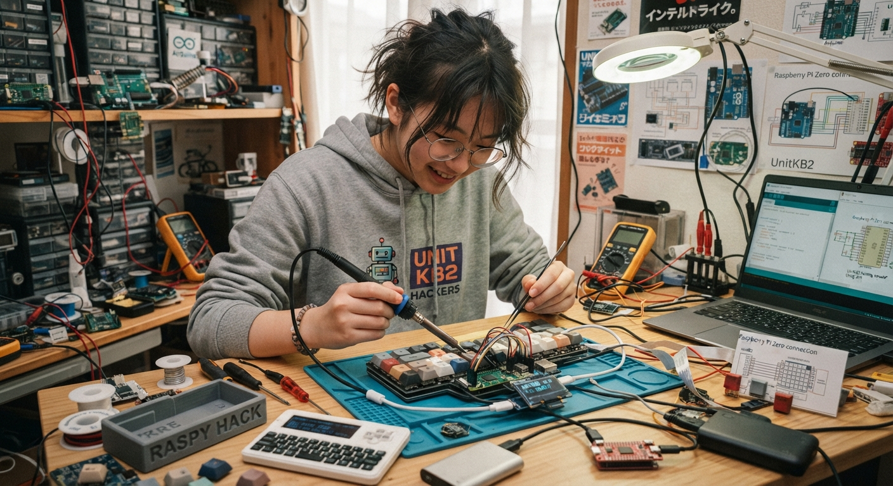

# [M5Stack]CardKB2に SSH クライアント実装した[3分ハッキング付録]

2026年11月18日 11:01
<p class="article-tags">タグ: <a href="..?tag=KB2">KB2</a> <a href="..?tag=M5Stack">M5Stack</a> <a href="..?tag=SSH">SSH</a></p>



# CardKB2 を SSH ターミナルにする — 工場ファームウェア改造ガイド

## はじめに

M5Stack の Unit CardKB2 は、42キーの小さなキーボードユニットです。
ところがこのキーボード、中を開けると ESP32-C61 というチップが入っていて、Wi-Fi も Bluetooth も使える、れっきとしたコンピュータです。
キーを押したことを I2C や BLE で外へ伝えるのが本来の仕事ですが、せっかくコンピュータなのですから、キーボード自身が画面を持って、単体で SSH 接続までできたら面白いのではないか。
そう考えて作ったのが、この改造ファームウェアです。

やることは、CardKB2 の工場ファームウェア（M5Stack が公開している M5Unit-CardKB2-UserDemo）を土台に、次の3つを足すことです。

- Grove ポートに繋いだ SSD1306 ディスプレイへの表示
- Wi-Fi 接続と、libssh2（SSH クライアントのライブラリ）による SSH 接続
- 工場ファームウェアには無い Ctrl キーの追加（これが無いと Ctrl+C が打てません）

完成すると、電源を入れるだけで前回の Wi-Fi に自動接続し、`ssh` と打てば手元の Linux マシンにログインできる、手のひらサイズの SSH ターミナルになります。

始める前に、大事な注意が3つあります。

- ファームウェアの書き換えは自己責任です。手順3で工場出荷状態のフルバックアップを必ず取ってから進めてください。バックアップがあればいつでも元に戻せます
- 表示には別途 SSD1306（I2C、128×64）が必要です。本体だけでは画面がありません
- 接続先として、SSH サーバが動いているマシンと Wi-Fi 環境が必要です

用語をひとつだけ先に説明します。このガイドでは「フォーク」という言葉を使います。公開されているソースコードを自分の手元にコピーして、そのコピーを改造することです。元のソースコードには一切手を触れません。

## 完成形の仕様

<blockquote class="twitter-tweet" data-theme="dark"><a href="https://twitter.com/chrmlinux03/status/2122606757197512707"></a></blockquote>
<script async src="https://platform.twitter.com/widgets.js" charset="utf-8"></script>
- 起動すると端末モード（TERM）で立ち上がり、Grove 接続の SSD1306（128×64）に 21列×8行のターミナルを表示する
- ローカルシェル（プロンプト `kb2> `）から `wifi` / `ssh` コマンドで接続する。設定は NVS に保存され、次回起動時は保存済み Wi-Fi へ自動接続（3秒カウントダウン、キー入力で取消）
- キーボード拡張：Fn タップでワンショット Ctrl（Ctrl+C が打てる）、SYM はワンショット化（ダブルクリックでロック）、Fn+1=ESC、Fn+Z/X/C/D=矢印キー、Tab は Ctrl+I
- モード切替は工場のまま有効：Fn+Sym+1〜4 が工場モード（I2C / UART / ESP-NOW / BLE HID）、Fn+Sym+5 が端末モード
- 表示は ASCII のみ（漢字は `?` で表示）

## 全体の仕組み

改造後の CardKB2 の中では、次の部品が働いています。

| 要素 | 役割・接続先 |
| --- | --- |
| キー入力 | app_factory へ渡される |
| app_factory | キー読み取り・LED・モード切替。ssh_term と disp_ssd1306 の呼び出し元 |
| ssh_term | シェル・Wi-Fi・SSH・画面の管理。tmtj と libssh2 を使用 |
| tmtj | 端末エミュレーション（ssh_term から使用） |
| libssh2 | SSH クライアント（ssh_term から使用） |
| disp_ssd1306 | app_factory から呼ばれ、I2C で SSD1306 ディスプレイへ表示 |
| SSD1306 ディスプレイ | disp_ssd1306 から I2C で接続 |

- **app_factory.c**：工場ファームウェアの中心部分です。キーマトリクスの読み取り、RGB LED、動作モードの切替を担当します。ここに Ctrl キーと端末モードを追加しました
- **ssh_term.c**：今回新しく書いた部分です。ローカルシェル（`kb2> ` というプロンプトでコマンドを受ける仕組み）、Wi-Fi 接続、SSH セッション、画面表示の更新をまとめて担当します
- **tmtj.c**：端末エミュレーションです。SSH 先から送られてくるエスケープシーケンス（画面を消したりカーソルを動かしたりする制御文字）を解釈して、文字の並びに直します。筆者が別に作っている ESP32 用 X サーバ「tinyX11」の部品を流用しました
- **disp_ssd1306.c**：SSD1306 への描画です。ESP-IDF 標準の esp_lcd ドライバを使っています
- **libssh2_esp**：SSH クライアントのライブラリです。ESP32 向けの移植版を使いますが、そのままでは組み込めません。理由と対策は「仕組みの解説」で説明します

開発とビルドは Windows 上の WSL2（Ubuntu）に ESP-IDF v6.1 を入れて行います。書き込みは USB 経由（usbipd で WSL に接続）か、後述する結合イメージ＋Web フラッシャーで行います。

## 用意するもの

- Unit CardKB2（U215）
- SSD1306 I2C ディスプレイ（128×64、アドレス 0x3C）＋ Grove ケーブル
- Windows PC（WSL2 / Ubuntu）＋ usbipd-win
- **ESP-IDF v6.1**（WSL 内にインストール）
## 作り方

大まかな流れは、環境を作る → 工場ファームウェアで練習する → バックアップを取る → 部品とコードを差し替える → ビルドして書き込む、です。

### 手順 1. 環境構築（WSL2 + ESP-IDF v6.1）

工場ファームウェアは **ESP-IDF 6.x 系が必須**です（I2C スレーブの新 API を使用）。

```bash
sudo apt update && sudo apt install -y git wget flex bison gperf python3 python3-pip python3-venv cmake ninja-build ccache libffi-dev libssl-dev dfu-util libusb-1.0-0
mkdir -p ~/esp && cd ~/esp
git clone -b v6.1 https://github.com/espressif/esp-idf.git esp-idf-v6.1
cd esp-idf-v6.1 && ./install.sh esp32c61
```

新しいシェルでは毎回、環境を有効化します。

```bash
. ~/esp/esp-idf-v6.1/export.sh
```

書き込みは usbipd-win で CardKB2（VID:PID 303a:1001）を WSL へアタッチして行います。管理者 PowerShell で一度だけ bind し、接続のたびに attach します（BUSID は USB の接続位置で変わるため、毎回 `usbipd list` で 303a:1001 の BUSID を確認すること。attach は PowerShell 側で実行します）。

```powershell
usbipd bind --busid <BUSID>
usbipd attach --wsl --busid <BUSID>
```

WSL 側では `/dev/ttyACM0` として見えます。モニタの終了は Ctrl+] です。

### 手順 2. 工場ファームウェアのビルド確認

```bash
cd ~
git clone https://github.com/m5stack/M5Unit-CardKB2-UserDemo.git
cd ~/M5Unit-CardKB2-UserDemo/src
. ~/esp/esp-idf-v6.1/export.sh
idf.py set-target esp32c61
idf.py build
idf.py -p /dev/ttyACM0 flash monitor
```

無改変でビルドと書き込みができ、工場ファームウェアが起動すること（キー入力で `KEY[..]` ログが出ること）を確認します。プロジェクトのルートはリポジトリ直下で、ESP-IDF プロジェクトは `src/` です。

### 手順 3. 工場ファームウェアのフルバックアップ

改造前にフラッシュ全体を保存します。これがあればいつでも工場出荷状態へ戻せます。

```bash
python3 -m esptool --chip esp32c61 -p /dev/ttyACM0 read_flash 0x0 0x400000 ~/cardkb2_backup.bin
```

4,194,304 バイトちょうどになれば成功です。復旧は次のコマンドで行います。

```bash
python3 -m esptool --chip esp32c61 -p /dev/ttyACM0 write-flash 0x0 ~/cardkb2_backup.bin
```

### 手順 4. 作業用コピーを作る

以降の作業はすべてコピーの中で行い、元のツリーと ESP-IDF には手を入れません。

```bash
cp -r ~/M5Unit-CardKB2-UserDemo ~/M5Unit-CardKB2-UserDemo-ssh
rm -rf ~/M5Unit-CardKB2-UserDemo-ssh/src/build
cd ~/M5Unit-CardKB2-UserDemo-ssh/src
```

### 手順 5. libssh2 の組み込み（IDF v6.1 / mbedTLS 4 対応）

ESP-IDF v6.1 は mbedTLS 4.x（TF-PSA-Crypto 構成）を搭載しており、libssh2_esp 1.1.0 が前提とする mbedTLS 3.x の公開ヘッダ（`mbedtls/rsa.h` など）が存在しません。david-cermak/mbedtls_v3_shim が旧ヘッダを v4 の内部実装で再現するため、これを併用します。さらに libssh2_esp をローカルコンポーネント化し、パッチを4件当てます。

```bash
. ~/esp/esp-idf-v6.1/export.sh
idf.py add-dependency skuodi/libssh2_esp==1.1.0
idf.py add-dependency david-cermak/mbedtls_v3_shim==0.1.3
idf.py reconfigure
mkdir -p components
cp -r managed_components/skuodi__libssh2_esp components/libssh2_esp
cp -r managed_components/david-cermak__mbedtls_v3_shim components/mbedtls_v3_shim
```

`main/idf_component.yml` は元の内容（button のみ）に戻します。ローカルの `components/` が優先されるため、依存はそちらで解決されます。

```yaml
## IDF Component Manager Manifest File
dependencies:
  idf:
    version: '>=4.1.0'
  espressif/button: ^4.1.4
```

パッチ4件（全文は付録A）を当てます。`src/` で次を実行します。

```bash
patch -p1 < cardkb2_libssh2_idf61.patch
```

パッチの内容は次のとおりです。

1. `components/libssh2_esp/CMakeLists.txt`：シムの include を先頭に置き、`mbedtls_v3_shim` を REQUIRES に追加
2. `components/libssh2_esp/libssh2/src/mbedtls.h`：ECDH の include ガードを `PSA_WANT_ALG_ECDH` でも有効化（IDF v6.1 の PSA 構成では旧マクロが未定義）
3. `components/libssh2_esp/libssh2/src/mbedtls.c`：`mbedtls_pk_parse_keyfile` に v4 用の分岐（引数3つ、RNG なし）を追加
4. `components/libssh2_esp/libssh2/src/libssh2_priv.h`：`MAX_SSH_PACKET_LEN` を 35000 → 8192 に削減。**必須の変更**です。libssh2 のセッション構造体は送受信バッファ（各 MAX_SSH_PACKET_LEN バイト）を内蔵しており、既定では約80.7KB の単一ブロック確保が必要で、このデバイスのヒープ（総量約153KB）では Wi-Fi 接続後に確保できません。8192 にすると約27.1KB になります

なお david-cermak/libssh は SSH サーバ専用で、クライアントの代替にはなりません。

### 手順 6. main のファイルを差し替え・追加

`src/main/` に次のファイルを配置します（全文は付録B）。既存の `app/` と `bsp/` は工場のまま使います。

| 配置先 | 内容 |
|---|---|
| `main/main.c` | 差し替え。app_factory と ssh_term のタスクを起動 |
| `main/CMakeLists.txt` | 差し替え。esp_lcd と libssh2_esp を REQUIRES に追加（内容は付録B） |
| `main/app/app_factory.c` | 差し替え。ワンショット Ctrl、SYM ワンショット、MODE_TERM 追加、モード切替 |
| `main/app/app_factory.h` | 差し替え。`MODE_TERM = 6` を追加 |
| `main/ssh_term.c` / `ssh_term.h` | 新規。Wi-Fi、ローカルシェル、SSH セッション、描画 |
| `main/disp_ssd1306.c` / `disp_ssd1306.h` | 新規。SSD1306 ドライバ（esp_lcd） |
| `main/term_link.h` | 新規。app_factory から端末へのキュー受け渡し |
| `main/tmtj.c` / `tmtj.h` | 新規。ターミナルエミュレータ（tinyX11 の libtmt 改造版を流用） |
| `main/font5x7.h` | 新規。5×7 フォント（Adafruit glcdfont 由来、ASCII 0x20–0x7E） |

配線についての注意：このSSD1306では Grove の SDA/SCL が工場想定と逆だったため、`disp_ssd1306.h` は SDA=GPIO25 / SCL=GPIO26 になっています。通常どおり SDA=GPIO26 / SCL=GPIO25 で配線した場合は、この2つの define を入れ替えてください。表示は取り付け向きに合わせて `esp_lcd_panel_mirror(panel, true, true)` で180度回転させています。

このプロジェクトの main コンポーネントは `-Werror` でビルドされます。生成ヘッダでは、コメント末尾のバックスラッシュ（行継続と解釈される）と初期化子の波括弧不足がエラーになるため注意してください。

### 手順 7. sdkconfig の変更（Wi-Fi IRAM 最適化の無効化）

ヒープ総量は約153KB しかありません。Wi-Fi ドライバの IRAM 最適化を無効にして約24KB をヒープへ戻します（低速なターミナル用途では実害ありません）。

```bash
cd ~/M5Unit-CardKB2-UserDemo-ssh/src
sed -i 's/^CONFIG_ESP_WIFI_IRAM_OPT=y/# CONFIG_ESP_WIFI_IRAM_OPT is not set/; s/^CONFIG_ESP_WIFI_EXTRA_IRAM_OPT=y/# CONFIG_ESP_WIFI_EXTRA_IRAM_OPT is not set/; s/^CONFIG_ESP_WIFI_RX_IRAM_OPT=y/# CONFIG_ESP_WIFI_RX_IRAM_OPT is not set/; s/^CONFIG_ESP_WIFI_SLP_IRAM_OPT=y/# CONFIG_ESP_WIFI_SLP_IRAM_OPT is not set/; s/^CONFIG_ESP32_WIFI_IRAM_OPT=y/# CONFIG_ESP32_WIFI_IRAM_OPT is not set/; s/^CONFIG_ESP32_WIFI_RX_IRAM_OPT=y/# CONFIG_ESP32_WIFI_RX_IRAM_OPT is not set/' sdkconfig
```

注意：Wi-Fi バッファ数（STATIC/DYNAMIC_RX/TX_BUFFER_NUM）の実体は `CONFIG_WIFI_RMT_*` 系シンボルです。`CONFIG_ESP_WIFI_*` 系を sed で書き換えると Kconfig の再解決で値が壊れるため、触らないでください。

### 手順 8. ビルドと書き込み

```bash
. ~/esp/esp-idf-v6.1/export.sh
idf.py build
idf.py -p /dev/ttyACM0 flash monitor
```

初回はフルビルドで数分かかります。正常なら `main.bin` が約 0x1b7xxx バイト（パーティションの約89%）になります。

## 使い方

起動すると端末モードで立ち上がり、保存済み Wi-Fi があれば3秒カウントダウン後に自動接続します（キー入力で取消）。

### ローカルシェルのコマンド（プロンプト `kb2> `）

```
 wifi [SSID]  join
 ssh user@host
  [-p N] [-s save pw]
 ssh  saved login
 forget [pw]
 status clear help
```

- `wifi <SSID>`：パスワードを聞いて接続し、成功したら保存します。`wifi` だけでは保存済みへ再接続します
- `ssh user@host [-p port] [-s]`：ログイン成功で接続先を保存します。`-s` のときだけパスワードも保存します。`ssh` だけでは保存済みの接続先（とパスワード）でログインします
- `forget`：全設定を消去。`forget pw` は SSH パスワードのみ消去
- `status`：Wi-Fi 状態、保存済み設定、空きヒープを表示
- 入力履歴は上下キーで呼び出せます。パスワード入力は `*` でマスクされ、Ctrl+C で取消できます

### キー操作

- Fn を単独タップ：ワンショット Ctrl（LED 黄色）。次の英字が制御コードになります（I=Tab、M=Enter、H=BS も可）
- SYM を1回押す：ワンショット（LED 青）。次の1文字だけ記号レイヤー。再押下で取消
- SYM をダブルクリック：記号レイヤーをロック。ロック中にシングルクリックで解除
- Aa：Caps。1回でワンショット、ダブルクリックでロック（工場仕様）
- Fn+1：ESC
- Fn+Z / X / C / D：矢印キー（Z=←、X=↓、C=→、D=↑）
- Fn+Sym+1〜4：工場モードへ切替。Fn+Sym+5：端末モードへ復帰

SSH セッション中はすべてのキーがサーバへ送られます。終了はサーバ側で `exit` します。

### プロンプトを短くする（21列に収める）

- そのセッションだけ：SSH ログイン後に `export PS1="$ "` を打つ。`$` と `"` は SYM ワンショットで打てる。プロンプトが `$ ` だけになる。
- 毎回有効にする場合：接続先マシン の `~/.bashrc` の末尾に同じ行を追加する（例：`echo 'export PS1="$ "' >> ~/.bashrc`）。ただし Windows ターミナルなど他の端末からの SSH でもプロンプトが `$ ` になる。

## 設定の保存（NVS）の詳細

NVS（Non-Volatile Storage）は、ESP32 のフラッシュメモリ内にある、電源を切っても消えない小さな保存領域です。このファームウェアでは、Wi-Fi と SSH の設定をここに保存して、再起動しても接続をやり直さなくて済むようにしています。

Wi-Fi と SSH の設定は、ssh_term.c が NVS（名前空間 `kb2cfg`）に保存する。保存先のパーティションはパーティション表の nvs 領域（0x9000、サイズ 0x6000）。

### キー一覧

| キー | 型 | 内容 | 上限 |
|---|---|---|---|
| `ssid` | 文字列 | Wi-Fi の SSID | 32文字 |
| `wpass` | 文字列 | Wi-Fi のパスワード（オープンネットワークでは空） | 63文字 |
| `suser` | 文字列 | SSH のユーザー名 | 31文字 |
| `shost` | 文字列 | SSH の接続先（ホスト名または IP アドレス） | 63文字 |
| `sport` | u16 | SSH のポート番号（既定 22） | — |
| `spass` | 文字列 | SSH のパスワード（保存した場合のみ） | 63文字 |

### 書き込まれるタイミング

- `wifi <SSID>`：接続が成功（IP 取得）したときに `ssid` と `wpass` を保存する。失敗やキャンセルのときは保存しない。引数なしの `wifi`（保存済み設定での再接続）や起動時の自動接続では、再保存はしない
- `ssh`：ログインが成功したときに接続先（`suser` / `shost` / `sport`）を常に保存する。パスワードは `-s` を付けたときに限って `spass` に保存する。接続先が変わり `-s` がない場合は、旧接続先のパスワードが残らないよう `spass` を消去する
- いずれも `nvs_set_*` の後に `nvs_commit` で確定させる

### 読み出されるタイミング

- 起動時：`ssid` が保存されていれば、保存済み Wi-Fi への自動接続カウントダウン（3秒）に入る
- 引数なしの `ssh`：`suser` / `shost` / `sport` を読み、その接続先へ接続する。`spass` があればパスワードを聞かずに使う
- `status`：保存済みの SSID と接続先を表示する

### 消去

- `forget`：名前空間内の全キーを消去する（`nvs_erase_all`）
- `forget pw`：`spass` のみを消去する

### 注意

- ホスト鍵は保存も検証もしない（この構成では libssh2 の known hosts を使わない）。接続先の真正性を確認する仕組みはない
- パスワードは平文で保存される（NVS 暗号化は有効化していない）。フラッシュを読み出せる環境では復元できるため、本機を手放す際は `forget` で消去すること。なお、パスワードは使用後に RAM 上のバッファからも消去される
- アプリのみの書き込み（`idf.py flash`）では NVS は保持されるが、結合イメージを 0x0 から書き込むと NVS 領域も初期化され、保存済み設定は消える

## 仕組みの解説

ここからは、改造の中で工夫が必要だった部分を、理由と一緒に説明します。手順どおりに作るだけなら読み飛ばして構いませんが、うまくいかないときの切り分けに役立ちます。

### キーボードに Ctrl を足す

工場ファームウェアのキー割り当てをソースコードで確認すると、印字できる文字と BackSpace、Enter、Space しかありません。Fn キーとの組み合わせで Fn+1 が ESC、Fn+Z/X/C/D が矢印キー（BLE HID モードのときだけ）になりますが、Ctrl キーはどこにもありません。SSH ターミナルでは Ctrl+C（実行中のプログラムを止める）が打てないと使い物になりません。

そこで、Fn キーの「単独タップ」に役割を与えました。Fn を押して、他のキーを押さずに離すと、次の1文字だけ Ctrl が効いた状態（ワンショット Ctrl）になります。LED が黄色に光るので状態が分かります。もう一度 Fn をタップすると取り消しです。仕組みは単純で、英字の文字コードに `& 0x1F` の演算をすると制御コードになることを使っています。たとえば C は 0x03（Ctrl+C）になります。同じ理屈で、Tab は Ctrl+I、Enter は Ctrl+M としても打てます。

Caps（Aa キー）が工場ファームウェアで「1回だけ効く／ロックする」の2段構えになっていたので、その作りに倣って SYM キーもワンショット化しました。シングルクリックで次の1文字だけ記号レイヤー、ダブルクリックで従来どおりのロックです。

### LED の反応が遅れる問題と対策

ワンショット化した SYM と Aa は、キーを押してから LED が変わるまでにわずかな遅れがありました。原因はキーの判定方法です。シングルクリックかダブルクリックかを見分けるため、部品（espressif の button コンポーネント）は約200ミリ秒待ってから「クリック」を確定させます。LED の更新がその確定後だったため、遅れて見えていたのです。

対策として、キーを押した瞬間に「シングルクリックだった場合の LED」を先に表示し、ダブルクリックと確定したら表示を直すようにしました。入力そのものの判定は従来どおりです。Fn キーの LED が速かったのは、Fn がクリック判定を通らず押下状態をそのまま表示していたためで、この違いが切り分けの手がかりになりました。

### libssh2 と mbedTLS 4 の相性

ESP-IDF v6.1 には暗号ライブラリ mbedTLS の 4.x が入っています。一方、ESP32 向け SSH ライブラリ libssh2_esp 1.1.0 が前提にしているのは mbedTLS 3.x で、3.x にあった公開ヘッダ（`mbedtls/rsa.h` など）が 4.x では無くなっているため、そのままではビルドが通りません。

解決には david-cermak/mbedtls_v3_shim という橋渡し用の部品を使いました。これは 4.x の内部ヘッダを使って 3.x のヘッダを復元するもので、これと libssh2_esp への小さなパッチ4件（手順5と付録A）の組み合わせで、IDF v6.1／ESP32-C61 でもビルドできるようになります。なお、同じ作者の libssh という別ライブラリは SSH サーバ専用で、クライアントには使えませんでした。

### メモリのやりくり

このデバイスでプログラムが自由に使えるメモリ（ヒープ）は、合計で約153KB しかありません。ここが一番苦労したところです。

SSH 接続の開始時に「session init failed」となって先へ進めない問題がありました。調べると、libssh2 のセッション構造体が約80.7KB のひとかたまりのメモリを要求していました。セッション構造体は送受信バッファを内蔵していて、その大きさが `MAX_SSH_PACKET_LEN`（既定 35000 バイト）で決まっていたためです。ヒープの総量は足りていても、それだけ大きな「連続した空き」が残っていないと確保できません。

対策は2つです。

- `MAX_SSH_PACKET_LEN` を 8192 に下げ、セッションの確保を約27.1KB にしました。あわせて、SSH のチャネルを開くときに「受け取れるパケットは最大 4096 バイト」と相手に伝えるようにしています。相手はそれに合わせて送ってくるので、小さくしたバッファでもあふれません
- Wi-Fi ドライバの IRAM 最適化を無効化しました（手順7）。ドライバが使っていた約24KB がヒープに戻り、余裕が生まれます

ついでに書いておくと、Wi-Fi のバッファ数を減らして空きを増やす方法は、このチップでは使えませんでした。設定項目の実体が `CONFIG_WIFI_RMT_*` という別名の項目で、よく知られた `CONFIG_ESP_WIFI_*` 側を書き換えると設定の再解決で壊れてしまうためです。

### Wi-Fi が繋がらないときの切り分け方

開発中、自宅のメッシュ Wi-Fi では「繋がったり繋がらなかったりする」現象がありました。切り分けは、接続を層に分けて考えるのが基本です。

1. 関連付けと WPA2（暗号化の交渉）までは完了しているか
2. その後、DHCP で IP アドレスがもらえているか

このケースでは 1 は毎回成功し、2 で DHCP の応答（Offer）が返ってきていませんでした。念のためスマートフォンのテザリングで試すと即座にアドレスがもらえたので、ファームウェア側は正常で、相手は高速ローミング（802.11r / FT）を広告するメッシュ AP 側の挙動だと切り分けられました。ゲスト用 SSID はアドレスがもらえても内部 LAN へ到達できないことがあるので、アドレス取得と到達性は別々に確認するのが確実です。なお、接続待ちのタイムアウトで「IP が無い接続」を切断すると、切断そのものが再接続と競合して不具合の元になります。現行ファームウェアでは、接続処理の工夫（再接続との競合防止、応答を待つ方式）で乗り切る形にし、この環境でも接続できる場合があるため、このまま使うことにしました。

### 表示に SSD1306 を選んだ理由

表示デバイスには、Grove ケーブルでそのまま繋げる SSD1306 を選びました。理由は再現性です。カラー LCD を I2C から駆動する変換基板（wire2spi）のような専用品は、持っている人が限られ、他の人が同じものを作れません。SSD1306 なら誰でも入手できます。

実装上の注意が2点あります。ひとつは配線で、この個体では Grove の SDA/SCL が工場ファームウェアの想定と逆でした。コードでは SDA=GPIO25 / SCL=GPIO26 としています。通常の配線の個体では、この2つの定義を入れ替えてください。もうひとつは向きで、取り付け方向に合わせて表示を180度回転（mirror(true, true)）させています。

フォントは 5×7 ドットで、21列×8行です。3×5 ドット（32列×10行）も試しましたが、実機で見ると文字が小さく、読みやすさを優先して 5×7 にしました。表示できるのは ASCII 文字だけで、漢字は `?` になります。漢字対応は今後の課題として保留しています。

### モード切替と I2C バスの共有

工場ファームウェアのモード切替（Fn+Sym+数字）はそのまま使えます。端末モードは Fn+Sym+5 です。ただし Grove の I2C バスは、工場ファームウェアの I2C スレーブ機能と同じバス（ポート0）を共有しています。そのため、端末モードを離れるときは表示ドライバを解放してバスを明け渡し、端末モードに戻るときに初期化し直す作りにしています。SSH セッションやシェルは表示の有無に関係なく動き続けます。

## ハードウェア情報

ESP32-C61 の GPIO は 0〜29 です。このファームウェアでの使用状況は次のとおりです。

- 使用中：キーマトリクス（行 0〜3、列 4, 5, 6, 7, 8, 29, 10, 11, 22, 23, 24）、RGB LED（27, 28, 9）、Grove（25, 26）
- 未使用：12〜21。ただし 12 と 13 は USB Serial/JTAG 用です。14〜21 はチップ上は空いていますが、基板のどのコネクタにも出ていないため、使うには基板への直接配線が必要です

## トラブルシュート

- **DHCP が返らない AP がある**：高速ローミング（802.11r / FT）を広告するメッシュ AP では、関連付けと WPA2 が完了しても DHCP Offer が返らず IP が取得できない場合があります（実測したメッシュ SSID では再現）。この場合は AP 側で高速ローミングを無効にするか、2.4GHz 専用 SSID を使ってください。ゲスト用 SSID は DHCP が通っても内部 LAN へ到達できないことがあります
- **session init failed と出る**：手順5のパッチ4（MAX_SSH_PACKET_LEN）と手順7（IRAM 無効化）が当たっているか確認してください。どちらかが欠けると libssh2 のセッション確保に失敗します
- **書き込みできない**：`/dev/ttyACM0` が無い場合は usbipd の attach が外れています。PowerShell で `usbipd list` の BUSID を確認して attach し直してください。リセットや抜き差し、WSL 再起動でも外れます
- **工場出荷状態へ戻す**：手順3のバックアップを `write-flash 0x0` で書き戻します
- **ssh でいつまでも待ってしまう**：接続先に到達できない場合、現行コードのタイムアウト（10秒）が connect() 自体には効かず、数分待ち続けることがあります。これは既知の問題で、ノンブロッキング connect に変える対策版を用意してありますが、現行ファームウェアには未適用です。まず接続先マシンが起動しているか、同じ LAN にいるかを確認してください


## おわりに

調べた範囲では、CardKB2 自体を単体の SSH ターミナルにした公開例は見つかりませんでした。近い例としては、キーボード付き端末デバイス LILYGO T-Deck 向けの PocketSSH がありますが、こちらは最初から画面付き端末として設計された製品です。$9.95 の入力ユニットが、ファームウェアの書き換えだけで単体の端末になる、という点がこの改造の面白さだと思います。

前提条件（CardKB2 本体、SSD1306、Wi-Fi 環境、接続先の SSH サーバ）がいくつも重なるため、使う人は限られるかもしれません。それでも、キーボードだと思っていたものの中にコンピュータが入っていた、という発見は一度体験する価値があります。

繰り返しになりますが、ファームウェアの書き換えは自己責任でお願いします。フルバックアップさえ取ってあれば、工場出荷状態にはいつでも戻せます。

## 付録A. libssh2_esp へのパッチ全文

`src/` で `patch -p1` により適用します。

```diff
diff -ruN '--exclude=.git' '--exclude=CHECKSUMS.json' a/components/libssh2_esp/CMakeLists.txt b/components/libssh2_esp/CMakeLists.txt
--- a/components/libssh2_esp/CMakeLists.txt
+++ b/components/libssh2_esp/CMakeLists.txt
@@ -36,7 +36,7 @@
 # TEST PATCH (shim trial, local copy only): put mbedtls_v3_shim headers first
 # so libssh2's legacy mbedtls/rsa.h etc. resolve against mbedTLS v4.
 idf_component_register( SRCS ${CSOURCES}
-                        INCLUDE_DIRS ${CMAKE_CURRENT_SOURCE_DIR}/../../components/mbedtls_v3_shim/include ${INCLUDES}
+                        INCLUDE_DIRS ${CMAKE_CURRENT_SOURCE_DIR}/../mbedtls_v3_shim/include ${INCLUDES}
                         REQUIRES mbedtls esp_netif mbedtls_v3_shim)
 
 # Differences in platform data type sizes generate print formating warnings.
diff -ruN '--exclude=.git' '--exclude=CHECKSUMS.json' a/components/libssh2_esp/libssh2/src/libssh2_priv.h b/components/libssh2_esp/libssh2/src/libssh2_priv.h
--- a/components/libssh2_esp/libssh2/src/libssh2_priv.h
+++ b/components/libssh2_esp/libssh2/src/libssh2_priv.h
@@ -225,7 +225,7 @@
  * total packet size of 35000 bytes or less (including length,
  * padding length, payload, padding, and MAC.)."
  */
-#define MAX_SSH_PACKET_LEN 35000
+#define MAX_SSH_PACKET_LEN 8192
 #define MAX_SHA_DIGEST_LEN SHA512_DIGEST_LENGTH
 
 #define LIBSSH2_ALLOC(session, count) \
diff -ruN '--exclude=.git' '--exclude=CHECKSUMS.json' a/components/libssh2_esp/libssh2/src/mbedtls.c b/components/libssh2_esp/libssh2/src/mbedtls.c
--- a/components/libssh2_esp/libssh2/src/mbedtls.c
+++ b/components/libssh2_esp/libssh2/src/mbedtls.c
@@ -478,7 +478,10 @@
 #endif
     mbedtls_pk_init(&pkey);
 
-#if MBEDTLS_VERSION_NUMBER >= 0x03000000
+#if MBEDTLS_VERSION_NUMBER >= 0x04000000
+    /* mbedTLS v4: parse_keyfile takes 3 args (no RNG params). */
+    ret = mbedtls_pk_parse_keyfile(&pkey, filename, (const char *)passphrase);
+#elif MBEDTLS_VERSION_NUMBER >= 0x03000000
     ret = mbedtls_pk_parse_keyfile(&pkey, filename, (const char *)passphrase,
                                    mbedtls_ctr_drbg_random,
                                    &_libssh2_mbedtls_ctr_drbg);
@@ -809,7 +812,10 @@
     int ret;
 
     mbedtls_pk_init(&pkey);
-#if MBEDTLS_VERSION_NUMBER >= 0x03000000
+#if MBEDTLS_VERSION_NUMBER >= 0x04000000
+    /* mbedTLS v4: parse_keyfile takes 3 args (no RNG params). */
+    ret = mbedtls_pk_parse_keyfile(&pkey, privatekey, passphrase);
+#elif MBEDTLS_VERSION_NUMBER >= 0x03000000
     ret = mbedtls_pk_parse_keyfile(&pkey, privatekey, passphrase,
                                    mbedtls_ctr_drbg_random,
                                    &_libssh2_mbedtls_ctr_drbg);
diff -ruN '--exclude=.git' '--exclude=CHECKSUMS.json' a/components/libssh2_esp/libssh2/src/mbedtls.h b/components/libssh2_esp/libssh2/src/mbedtls.h
--- a/components/libssh2_esp/libssh2/src/mbedtls.h
+++ b/components/libssh2_esp/libssh2/src/mbedtls.h
@@ -47,7 +47,9 @@
 #include <mbedtls/rsa.h>
 #include <mbedtls/bignum.h>
 #include <mbedtls/cipher.h>
-#ifdef MBEDTLS_ECDH_C
+/* TEST PATCH (shim trial): IDF v6.1/mbedTLS 4 defines PSA_WANT_ALG_ECDH
+ * instead of MBEDTLS_ECDH_C, so the legacy guard alone never fires. */
+#if defined(MBEDTLS_ECDH_C) || defined(PSA_WANT_ALG_ECDH)
 # include <mbedtls/ecdh.h>
 #endif
 #ifdef MBEDTLS_ECDSA_C
```

## 付録B. コード

### main/CMakeLists.txt

```cmake
set(src_dirs        
    .
    ./app
    ./bsp
)

set(include_dirs      
    .
    ./app
    ./bsp
) 

idf_component_register(
    SRC_DIRS 
        ${src_dirs} 
    INCLUDE_DIRS 
        ${include_dirs}
    REQUIRES 
        esp_hid
        esp_driver_ledc
        esp_driver_i2c
        esp_lcd
        esp_driver_uart
        esp_wifi
        esp_netif
        bt
        button
        libssh2_esp
    PRIV_REQUIRES 
        nvs_flash
)

```

### main/main.c

```c
/******************************************************************************
 * CardKB2 SSHターミナル (統合版)
 * 土台: M5Stack Unit CardKB2 UserDemo (ESP-IDF v6.1 / ESP32-C61) フォーク
 *
 * app_factory は MODE_TERM 固定で起動し、キーを端末へ送る。
 * ssh_term タスクが Wi-Fi/SSH/表示を担う。
 ******************************************************************************/
#include "app_factory.h"
#include "ssh_term.h"
#include "esp_log.h"
#include "esp_system.h"
#include "freertos/FreeRTOS.h"
#include "freertos/task.h"
#include "driver/gpio.h"
#include "nvs_flash.h"

static const char *TAG = "main";

void app_main(void)
{
    ESP_LOGI(TAG, "CardKB2 SSH terminal start");
    ESP_LOGI(TAG, "heap@main: %u", (unsigned)esp_get_free_heap_size());

    esp_err_t ret = nvs_flash_init();
    if (ret == ESP_ERR_NVS_NO_FREE_PAGES || ret == ESP_ERR_NVS_NEW_VERSION_FOUND) {
        ESP_ERROR_CHECK(nvs_flash_erase());
        ret = nvs_flash_init();
    }
    ESP_ERROR_CHECK(ret);

    xTaskCreate(app_factory, "app_factory", 8192, NULL, 5, NULL);
    /* libssh2 + mbedTLS ハンドシェイク用に大きめのスタックを取る */
    xTaskCreate(ssh_term_task, "ssh_term", 32768, NULL, 5, NULL);

    while (1) {
        vTaskDelay(pdMS_TO_TICKS(100));
    }
}
```

### main/app/app_factory.h

```c
#pragma once

#include "esp_log.h"
#include "freertos/FreeRTOS.h"
#include "freertos/task.h"
#include "driver/gpio.h"
#include "bsp_keyboard.h"

// 工作模式定义
typedef enum {
    MODE_NONE = 0,     // 未定义模式
    MODE_I2C = 1,      // I2C 模式 (默认, Fn+1)
    MODE_UART = 2,     // UART 模式 (Fn+2)
    MODE_ESPNOW = 3,   // ESP-NOW 模式 (Fn+3)
    MODE_BLEHID = 4,   // BLE HID 模式 (Fn+4)
    MODE_PRODTEST = 5, // 产测模式
    MODE_TERM = 6,     // SSHターミナルモード (Fn+Sym+5 で選択、キーを端末へ送る)
    MODE_MAX
} app_mode_t;

// I2C 触发产测模式切换相关变量（供 bsp_i2c ISR 使用）
extern QueueHandle_t mode_queue;
extern app_mode_t g_mode;

#ifdef __cplusplus
extern "C" {
#endif

// 固件版本定义
#define FIRMWARE_VERSION    0x02

// 键盘状态定义
typedef struct {
    bool caps_lock;   // 大写锁定状态
    bool fn_pressed;  // Fn 键状态
    bool sym_pressed; // Sym 键状态
} keyboard_state_t;

// LED 状态定义
typedef struct {
    bool caps_led_on; // 大写锁定红灯
    bool sym_led_on;  // 符号模式绿灯  
    bool fn_led_on;   // Fn 激活蓝灯
} led_state_t;

// 按键索引定义
#define KEY_AA_TOGGLE    22 // Aa 大小写切换 (行2, 列0)
#define KEY_DEL          21 // Del 删除键 (行1, 列10)
#define KEY_ENTER        32 // Enter 回车键 (行2, 列10)
#define KEY_FN           33 // Fn 功能键 (行3, 列0)
#define KEY_SYM          34 // Sym 符号键 (行3, 列1)
#define KEY_SPACE        42 // Space 空格键 (行3, 列9)

// Fn 键组合功能定义
#define KEY_ESC          0  // ESC 键 (行0, 列0) = 0*11+0 = 0 (Fn+1)
#define KEY_UP           25 // 上方向键 (行2, 列3) = 2*11+3 = 25 (Fn+D)
#define KEY_LEFT         35 // 左方向键 (行3, 列2) = 3*11+2 = 35 (Fn+Z)
#define KEY_DOWN         36 // 下方向键 (行3, 列3) = 3*11+3 = 36 (Fn+X)
#define KEY_RIGHT        37 // 右方向键 (行3, 列4) = 3*11+4 = 37 (Fn+C)

// 输出模式选择：1=DEBUG模式(输出index), 0=正常模式(输出ASCII)
#define KEYBOARD_DEBUG_MODE   0

// 函数声明
void app_key_event_cb(button_event_data_t *event_data);
void app_mode_switch(void *arg);
void app_factory(void *arg);

#ifdef __cplusplus
}
#endif

 ```

### main/app/app_factory.c

```c
//==============================================
// Includes
//==============================================
#include "app_factory.h"
#include "app_production_test.h"
#include "bsp_keyboard.h"
#include "bsp_rgb_led.h"
#include "bsp_blehid.h"
#include "bsp_uart.h"
#include "bsp_i2c.h"
#include "bsp_espnow.h"
#include "term_link.h"
#include "esp_err.h"
#include "esp_log.h"
#include "nvs.h"
#include <string.h>

//===================================================================================================
// Global State / Queues
//===================================================================================================

static const char *TAG = "app/factory";

app_mode_t g_mode = MODE_I2C;
QueueHandle_t mode_queue = NULL;

typedef struct {
    int button_index;
    button_event_t event;
    bool is_repeat;
} key_event_t;

#define KEY_EVENT_QUEUE_SIZE  32
static QueueHandle_t key_event_queue = NULL;

// Aa / Fn / Sym 状态
static bool caps_one_time = false;
static bool caps_locked = false;
static bool caps_hold = false;
static bool pending_click = false;
static bool fn_pressed = false;
static bool sym_pressed = false;  // Sym 键按下状态（用于组合键检测）
static bool sym_mode = false;     // Sym 模式开关状态（用于符号输入）= ダブルクリックでのロック
static bool sym_one_time = false; // Sym ワンショット（次の1文字だけ符号レイヤー）
static bool ctrl_oneshot = false; // ワンショットCtrl（Fn単独タップで切替、次の英字キーを制御コード化する）
static bool fn_used = false;      // Fn押下中に他のキーが押されたか（単独タップの判定用）
static TaskHandle_t led_delay_task_handle = NULL;

// 按键保持功能
#define MAX_KEY_INDEX  44
#define KEY_REPEAT_DELAY_MS     300  // 首次重复延迟：300ms
#define KEY_REPEAT_INTERVAL_MS  50   // 重复间隔：50ms
static bool key_pressed[MAX_KEY_INDEX] = {0};
static uint32_t key_press_time[MAX_KEY_INDEX] = {0};
static uint32_t key_last_repeat_time[MAX_KEY_INDEX] = {0};
static TaskHandle_t key_repeat_task_handle = NULL;

//===================================================================================================
// RGB Indicator Task
//===================================================================================================

// RGB 指示任务
typedef enum {
    RGB_CMD_SET_STATE = 0,
    RGB_CMD_BLINK_WHITE,
} rgb_cmd_type_t;

typedef struct {
    rgb_cmd_type_t type;
    uint8_t r;
    uint8_t g;
    uint8_t b;
    uint8_t times;
} rgb_cmd_t;

static QueueHandle_t rgb_cmd_queue = NULL;
static TaskHandle_t rgb_task_handle = NULL;

//===================================================================================================
// Keymap Tables
//===================================================================================================
// 按键映射表（ASCII）
static const uint8_t keymap_normal[4][11] = {
    {0x31, 0x32, 0x33, 0x34, 0x35, 0x36, 0x37, 0x38, 0x39, 0x30, 0x00},
    {0x71, 0x77, 0x65, 0x72, 0x74, 0x79, 0x75, 0x69, 0x6F, 0x70, 0x08},
    {0x41, 0x61, 0x73, 0x64, 0x66, 0x67, 0x68, 0x6A, 0x6B, 0x6C, 0x0A},
    {0x46, 0x53, 0x7A, 0x78, 0x63, 0x76, 0x62, 0x6E, 0x6D, 0x20, 0x00}
};

static const uint8_t keymap_sym[4][11] = {
    {0x21, 0x40, 0x23, 0x24, 0x25, 0x5E, 0x26, 0x2A, 0x28, 0x29, 0x00},
    {0x7E, 0x60, 0x3F, 0x5C, 0x2F, 0x7C, 0x5F, 0x2D, 0x2B, 0x3D, 0x08},
    {0x41, 0x7B, 0x7D, 0x5E, 0x5B, 0x5D, 0x22, 0x27, 0x3B, 0x3A, 0x0A},
    {0x46, 0x53, 0x5A, 0x58, 0x43, 0x3C, 0x3E, 0x2C, 0x2E, 0x20, 0x00}
};

//===================================================================================================
// Forward Declarations
//===================================================================================================
static bool app_get_key_char(int button_index, char *out_char);
static void app_process_key_event(key_event_t *key_event);
static void app_mode_apply(app_mode_t new_mode, bool save_nvs);

//===================================================================================================
// LED Helpers
//===================================================================================================
static bool app_is_caps_active(void)
{
    return caps_one_time || caps_locked || caps_hold;
}

static void rgb_indicator_task(void *arg)
{
    uint8_t current_r = 0;
    uint8_t current_g = 0;
    uint8_t current_b = 0;

    while (1) {
        rgb_cmd_t cmd;
        if (xQueueReceive(rgb_cmd_queue, &cmd, portMAX_DELAY) != pdTRUE) {
            continue;
        }

        switch (cmd.type) {
            case RGB_CMD_SET_STATE:
                current_r = cmd.r;
                current_g = cmd.g;
                current_b = cmd.b;
                bsp_rgb_led_set_color(current_r, current_g, current_b);
                break;
            case RGB_CMD_BLINK_WHITE:
                for (uint8_t i = 0; i < cmd.times; i++) {
                    bsp_rgb_led_set_color(255, 255, 255);
                    vTaskDelay(pdMS_TO_TICKS(200));
                    bsp_rgb_led_set_color(0, 0, 0);
                    vTaskDelay(pdMS_TO_TICKS(200));
                }
                bsp_rgb_led_set_color(current_r, current_g, current_b);
                break;
            default:
                break;
        }
    }
}

static void app_update_led_state(void)
{
    // Fn -- Red，Caps -- Green，Sym -- Blue
    uint8_t r = (fn_pressed || ctrl_oneshot) ? 255 : 0;
    uint8_t g = (app_is_caps_active() || ctrl_oneshot) ? 255 : 0;
    uint8_t b = (sym_mode || sym_one_time) ? 255 : 0;
    rgb_cmd_t cmd = {
        .type = RGB_CMD_SET_STATE,
        .r = r,
        .g = g,
        .b = b,
        .times = 0
    };
    if (rgb_cmd_queue != NULL) {
        xQueueSend(rgb_cmd_queue, &cmd, 0);
    }
}

static void app_led_blink_white(uint8_t times)
{
    rgb_cmd_t cmd = {
        .type = RGB_CMD_BLINK_WHITE,
        .r = 0,
        .g = 0,
        .b = 0,
        .times = times
    };
    if (rgb_cmd_queue != NULL) {
        xQueueSend(rgb_cmd_queue, &cmd, 0);
    }
}

//===================================================================================================
// Mode / NVS Helpers
//===================================================================================================
static uint8_t app_mode_to_blink_count(app_mode_t mode)
{
    switch (mode) {
        case MODE_I2C:
            return 1;
        case MODE_UART:
            return 2;
        case MODE_ESPNOW:
            return 3;
        case MODE_BLEHID:
            return 4;
        case MODE_PRODTEST:
            return 5;
        case MODE_TERM:
            return 5;  // Fn+Sym+5 に合わせる
        case MODE_NONE:
        default:
            return 0;
    }
}

static const char *app_mode_to_string(app_mode_t mode)
{
    switch (mode) {
        case MODE_NONE:
            return "NONE";
        case MODE_I2C:
            return "I2C";
        case MODE_UART:
            return "UART";
        case MODE_ESPNOW:
            return "ESP-NOW";
        case MODE_BLEHID:
            return "BLE-HID";
        case MODE_PRODTEST:
            return "PRODTEST";
        case MODE_TERM:
            return "TERM";
        default:
            return "UNKNOWN";
    }
}

static void app_print_mode(app_mode_t mode)
{
    printf("Unit CardKB2 MODE: %s\r\n", app_mode_to_string(mode));
}

static void app_print_key_event(int key_id, bool pressed)
{
    // 获取按键字符（如果有）
    char key_char = 0;
    bool has_char = app_get_key_char(key_id, &key_char);

    // ワンショットCtrlが有効な間は、モニタ表示も制御コードとして見せる（表示のみ）
    if (pressed && ctrl_oneshot && has_char &&
        ((key_char >= 'a' && key_char <= 'z') || (key_char >= 'A' && key_char <= 'Z'))) {
        key_char = (char)(key_char & 0x1F);
    }
    
    if (has_char && key_char >= 32 && key_char <= 126) {
        // 可打印字符
        printf("KEY[%2d] '%c' %s\r\n", key_id, key_char, pressed ? "PRESS" : "RELEASE");
    } else if (has_char) {
        // 控制字符
        const char *ctrl_name = "";
        switch (key_char) {
            case 0x08: ctrl_name = "BS";    break;
            case 0x09: ctrl_name = "TAB";   break;
            case 0x0A: ctrl_name = "LF";    break;
            case 0x0D: ctrl_name = "CR";    break;
            case 0x20: ctrl_name = "SPACE"; break;
            case 0x1B: ctrl_name = "ESC";   break;
            default:   ctrl_name = "CTRL";  break;
        }
        printf("KEY[%2d] %s %s\r\n", key_id, ctrl_name, pressed ? "PRESS" : "RELEASE");
    } else {
        // 特殊功能键（Aa/Fn/Sym等）
        const char *key_name = "";
        if (key_id == KEY_AA_TOGGLE) {
            key_name = "Aa";
        } else if (key_id == KEY_FN) {
            key_name = "Fn";
        } else if (key_id == KEY_SYM) {
            key_name = "Sym";
        } else if (key_id == KEY_DEL) {
            key_name = "Del";
        } else if (key_id == KEY_ENTER) {
            key_name = "Enter";
        } else if (key_id == KEY_SPACE) {
            key_name = "Space";
        } else {
            key_name = "?";
        }
        printf("KEY[%2d] %s %s\r\n", key_id, key_name, pressed ? "PRESS" : "RELEASE");
    }
}

static void app_save_mode_to_nvs(app_mode_t mode)
{
    if (mode != MODE_I2C && mode != MODE_UART && mode != MODE_BLEHID && mode != MODE_ESPNOW) {
        return;
    }

    nvs_handle_t handle;
    if (nvs_open("cardkb2", NVS_READWRITE, &handle) != ESP_OK) {
        return;
    }

    uint8_t value = (uint8_t)mode;
    if (nvs_set_u8(handle, "mode", value) == ESP_OK) {
        nvs_commit(handle);
    }
    nvs_close(handle);
}

static app_mode_t app_load_mode_from_nvs(void)
{
    nvs_handle_t handle;
    uint8_t value = (uint8_t)MODE_I2C;
    if (nvs_open("cardkb2", NVS_READONLY, &handle) == ESP_OK) {
        if (nvs_get_u8(handle, "mode", &value) != ESP_OK) {
            value = (uint8_t)MODE_I2C;
        }
        nvs_close(handle);
    }
    if (value == MODE_NONE || value >= MODE_MAX) {
        return MODE_I2C;
    }
    if (value == MODE_I2C || value == MODE_UART || value == MODE_BLEHID || value == MODE_ESPNOW) {
        return (app_mode_t)value;
    }
    return MODE_I2C;
}

//===================================================================================================
// Output Helpers (UART / ESP-NOW)
//===================================================================================================
static void app_send_uart_frame(uint8_t key_id, bool pressed)
{
    uint8_t frame[5];
    frame[0] = 0xAA;
    frame[1] = 0x03;
    frame[2] = key_id;
    frame[3] = pressed ? 0x01 : 0x02;
    frame[4] = (uint8_t)((frame[1] + frame[2] + frame[3]) & 0xFF);
    bsp_uart_send(frame, sizeof(frame));
}

static void app_send_espnow_frame(uint8_t key_id, bool pressed)
{
    uint8_t frame[5];
    frame[0] = 0xAA;
    frame[1] = 0x03;
    frame[2] = key_id;
    frame[3] = pressed ? 0x01 : 0x02;
    frame[4] = (uint8_t)((frame[1] + frame[2] + frame[3]) & 0xFF);
    bsp_espnow_send(frame, sizeof(frame));
}

//===================================================================================================
// Key Handling Helpers
//===================================================================================================
static bool app_is_special_key(int button_index)
{
    return (button_index == KEY_AA_TOGGLE || button_index == KEY_FN || button_index == KEY_SYM);
}

static bool app_is_repeatable_key(int button_index)
{
    if (button_index < 0 || button_index >= MAX_KEY_INDEX) {
        return false;
    }
    return !app_is_special_key(button_index);
}

static bool app_get_key_char(int button_index, char *out_char)
{
    if (button_index < 0 || button_index >= MAX_KEY_INDEX || out_char == NULL) {
        return false;
    }

    if (app_is_special_key(button_index)) {
        return false;
    }

    int row = button_index / 11;
    int col = button_index % 11;
    if (row < 0 || row >= 4 || col < 0 || col >= 11) {
        return false;
    }

    bool sym_active = sym_mode || sym_one_time;
    uint8_t key_char = sym_active ? keymap_sym[row][col] : keymap_normal[row][col];
    if (key_char == 0) {
        return false;
    }

    if (!sym_active && app_is_caps_active() && key_char >= 0x61 && key_char <= 0x7A) {
        key_char = (uint8_t)(key_char - 0x61 + 0x41);
    }

    *out_char = (char)key_char;
    return true;
}

static void app_clear_caps_one_time(void)
{
    if (caps_one_time) {
        caps_one_time = false;
        app_update_led_state();
    }
}

static void app_clear_sym_one_time(void)
{
    if (sym_one_time) {
        sym_one_time = false;
        app_update_led_state();
    }
}

//===================================================================================================   
// Tasks
//===================================================================================================
static void led_delay_task(void *arg)
{
    while (1) {
        vTaskSuspend(NULL);
        vTaskDelay(pdMS_TO_TICKS(300));
        if (pending_click) {
            pending_click = false;
            app_update_led_state();
        }
    }
}

static void key_repeat_task(void *arg)
{
    while (1) {
        uint32_t current_time = xTaskGetTickCount() * portTICK_PERIOD_MS;
        for (int i = 0; i < MAX_KEY_INDEX; i++) {
            if (!app_is_repeatable_key(i)) {
                continue;
            }
            if (key_pressed[i] && key_press_time[i] > 0) {
                bool should_repeat = false;
                if (key_last_repeat_time[i] == 0) {
                    uint32_t elapsed = current_time - key_press_time[i];
                    if (elapsed >= KEY_REPEAT_DELAY_MS) {
                        should_repeat = true;
                    }
                } else {
                    uint32_t elapsed = current_time - key_last_repeat_time[i];
                    if (elapsed >= KEY_REPEAT_INTERVAL_MS) {
                        should_repeat = true;
                    }
                }

                if (should_repeat && key_event_queue != NULL) {
                    key_event_t evt = {
                        .button_index = i,
                        .event = BUTTON_PRESS_DOWN,
                        .is_repeat = true
                    };
                    xQueueSend(key_event_queue, &evt, 0);
                    key_last_repeat_time[i] = current_time;
                }
            }
        }
        vTaskDelay(pdMS_TO_TICKS(KEY_REPEAT_INTERVAL_MS));
    }
}

static void ble_hid_event_callback(ble_hid_state_t state)
{
    if (state == BLE_HID_STATE_CONNECTED) {
        printf("BLE-HID connected\r\n");
    } else if (state == BLE_HID_STATE_DISCONNECTED) {
        printf("BLE-HID disconnected\r\n");
        // 断开连接时清除所有按键状态，防止自动输入
        for (int i = 0; i < MAX_KEY_INDEX; i++) {
            key_pressed[i] = false;
            key_press_time[i] = 0;
            key_last_repeat_time[i] = 0;
        }
        // 挂起按键重复任务
        if (key_repeat_task_handle != NULL) {
            vTaskSuspend(key_repeat_task_handle);
        }
    }
}

//===================================================================================================
// Mode Switch / Key Processing
//===================================================================================================
static void app_mode_apply(app_mode_t new_mode, bool save_nvs)
{
    if (new_mode == MODE_NONE || new_mode >= MODE_MAX) {
        return;
    }

    if (g_mode == MODE_PRODTEST) {
        app_production_test_set_enabled(false);
        app_production_test_deinit();
    }

    bsp_i2c_deinit();
    bsp_uart_deinit();
    bsp_blehid_deinit();
    if (bsp_espnow_is_initialized()) {
        bsp_espnow_deinit();
    }

    // 端末表示の有効/無効: Grove の I2C ポート0 は表示マスタと
    // 工場 I2C スレーブで共用するため、TERM のときだけ表示がバスを持ち、
    // 他モードでは解放する。全トランスポートの deinit の後、新モードの
    // init の前に呼ぶこと。
    term_display_set_active(new_mode == MODE_TERM);

    g_mode = new_mode;
    switch (g_mode) {
        case MODE_I2C:
            bsp_i2c_init();
            break;
        case MODE_UART:
            bsp_uart_init();
            break;
        case MODE_ESPNOW:
            bsp_espnow_init();
            break;
        case MODE_BLEHID:
            bsp_blehid_register_event_cb(ble_hid_event_callback);
            if (bsp_blehid_init() == ESP_OK) {
                bsp_blehid_start_advertising();
            }
            break;
        case MODE_PRODTEST:
            bsp_uart_init();
            app_production_test_init();
            app_production_test_set_enabled(true);
            break;
        case MODE_TERM:
            // 端末モードでは外部トランスポートを初期化しない
            // (Grove は表示用 I2C マスタ、キーは term_post_key へ)
            break;
        default:
            break;
    }

    // Fix: reset modifier state and refresh LED on mode switch (avoids leaking Sym/Fn into new mode)
    sym_mode      = false;
    sym_one_time  = false;
    sym_pressed   = false;
    fn_pressed    = false;
    caps_one_time = false;
    caps_locked   = false;
    caps_hold     = false;
    app_update_led_state();

    if (save_nvs) {
        app_save_mode_to_nvs(g_mode);
    }

    app_print_mode(g_mode);
    app_led_blink_white(app_mode_to_blink_count(g_mode));
}

void app_key_event_cb(button_event_data_t *event_data)
{
    if (key_event_queue != NULL) {
        key_event_t evt = {
            .button_index = event_data->button_index,
            .event = event_data->event,
            .is_repeat = false
        };
        BaseType_t xHigherPriorityTaskWoken = pdFALSE;
        xQueueSendFromISR(key_event_queue, &evt, &xHigherPriorityTaskWoken);
        portYIELD_FROM_ISR(xHigherPriorityTaskWoken);
    }
}

static void app_process_key_event(key_event_t *key_event)
{
    bool is_press = (key_event->event == BUTTON_PRESS_DOWN);
    bool is_release = (key_event->event == BUTTON_PRESS_UP);
    uint32_t current_time = xTaskGetTickCount() * portTICK_PERIOD_MS;

    // 更新按键保持状态
    if (key_event->button_index < MAX_KEY_INDEX) {
        if (is_press) {
            key_pressed[key_event->button_index] = true;
            key_press_time[key_event->button_index] = current_time;
            key_last_repeat_time[key_event->button_index] = 0;
        } else if (is_release) {
            key_pressed[key_event->button_index] = false;
            key_press_time[key_event->button_index] = 0;
            key_last_repeat_time[key_event->button_index] = 0;
        }
    }

    // 控制按键重复任务
    if (key_repeat_task_handle != NULL) {
        bool has_pressed_key = false;
        for (int i = 0; i < MAX_KEY_INDEX; i++) {
            if (key_pressed[i]) {
                has_pressed_key = true;
                break;
            }
        }
        if (has_pressed_key) {
            vTaskResume(key_repeat_task_handle);
        } else {
            vTaskSuspend(key_repeat_task_handle);
        }
    }

    // USB 串口输出按键事件（仅真实按下/释放）
    if ((is_press || is_release) && !key_event->is_repeat) {
        app_print_key_event(key_event->button_index, is_press);
    }

    // Fn 押下中に他のキーが押されたら、組み合わせとして使ったことを記録する
    if (is_press && fn_pressed && key_event->button_index != KEY_FN) {
        fn_used = true;
    }

    // Fn + Sym + 数字键切换模式（仅按下事件，忽略重复）
    if (is_press && !key_event->is_repeat && fn_pressed && sym_pressed) {
        app_mode_t new_mode;
        switch (key_event->button_index) {
            case 0:  // Fn + Sym + 1
                new_mode = MODE_I2C;
                break;
            case 1:  // Fn + Sym + 2
                new_mode = MODE_UART;
                break;
            case 2:  // Fn + Sym + 3
                new_mode = MODE_ESPNOW;
                break;
            case 3:  // Fn + Sym + 4
                new_mode = MODE_BLEHID;
                break;
            case 4:  // Fn + Sym + 5
                new_mode = MODE_TERM;
                break;
            default:
                new_mode = MODE_MAX;
                break;
        }
        if (new_mode < MODE_MAX && mode_queue != NULL) {
            xQueueSend(mode_queue, &new_mode, 0);
            return;
        }
    }

    // Fn + 1 = ESC 键（仅按下事件，忽略重复）
    if (is_press && !key_event->is_repeat && fn_pressed && !sym_pressed && key_event->button_index == KEY_ESC) {
        uint8_t esc_char = 0x1B;
        if (g_mode == MODE_I2C) {
            bsp_i2c_add_key(esc_char);  // ESC ASCII 码
        } else if (g_mode == MODE_BLEHID) {
            if (bsp_blehid_is_connected()) {
                bsp_blehid_send_keycode(0, USB_HID_KEY_ESC);
            }
        } else if (g_mode == MODE_UART) {
            // Fix: send framed ESC (host parser expects 5-byte KEY_ID + KEY_STATE frame)
            app_send_uart_frame(KEY_ESC, true);
        } else if (g_mode == MODE_TERM) {
            term_post_key(esc_char);
        }
        return;
    }

    // UART / ESP-NOW 模式：按键索引 + 状态帧
    if (is_press || is_release) {
        if (g_mode == MODE_UART) {
            app_send_uart_frame((uint8_t)key_event->button_index, is_press);
        } else if (g_mode == MODE_ESPNOW) {
            app_send_espnow_frame((uint8_t)key_event->button_index, is_press);
        }
    }

    // Fix: consume caps one-shot in UART/ESP-NOW modes when an alphabetic key is pressed
    // (originally only handled in I2C/BLEHID ASCII paths — see app_clear_caps_one_time call below)
    if (is_press && !key_event->is_repeat && !fn_pressed &&
        (g_mode == MODE_UART || g_mode == MODE_ESPNOW)) {
        char c = 0;
        if (app_get_key_char(key_event->button_index, &c)) {
            if ((c >= 0x41 && c <= 0x5A) || (c >= 0x61 && c <= 0x7A)) {
                app_clear_caps_one_time();
            }
            app_clear_sym_one_time();
        }
    }

    // 产测模式：通过 UART 上报按键事件
    if (g_mode == MODE_PRODTEST && (is_press || is_release)) {
        bsp_uart_printf("+KEY:%d,%d\r\n", key_event->button_index, key_event->event);
    }

    // 处理 Aa 键事件
    if (key_event->button_index == KEY_AA_TOGGLE) {
        switch (key_event->event) {
            case BUTTON_PRESS_DOWN:
                if (!caps_locked) {
                    caps_hold = true;
                    app_update_led_state();
                }
                return;
            case BUTTON_PRESS_UP:
                if (!caps_locked && caps_hold) {
                    pending_click = true;
                    caps_hold = false;
                    if (led_delay_task_handle != NULL) {
                        vTaskResume(led_delay_task_handle);
                    }
                } else if (!caps_locked) {
                    caps_hold = false;
                    app_update_led_state();
                }
                return;
            case BUTTON_LONG_PRESS_START:
                return;
            case BUTTON_LONG_PRESS_UP:
                if (!caps_locked) {
                    caps_hold = false;
                    app_update_led_state();
                }
                return;
            case BUTTON_SINGLE_CLICK:
                pending_click = false;
                if (caps_locked) {
                    caps_locked = false;
                    caps_one_time = false;
                } else {
                    caps_one_time = true;
                    caps_locked = false;
                }
                app_update_led_state();
                return;
            case BUTTON_DOUBLE_CLICK:
                pending_click = false;
                caps_locked = !caps_locked;
                caps_one_time = false;
                app_update_led_state();
                return;
            default:
                break;
        }
    }

    // 处理 Fn 键
    if (key_event->button_index == KEY_FN) {
        if (is_press) {
            fn_pressed = true;
            fn_used = false;
        } else if (is_release) {
            fn_pressed = false;
            // 単独タップ（組み合わせに使わなかった）→ ワンショットCtrlを切り替える
            if (!fn_used) {
                ctrl_oneshot = !ctrl_oneshot;
            }
        }
        app_update_led_state();
        return;
    }

    // 处理方向键（Fn + D/Z/X/C）
    // 注意：需要处理重复事件，以便长按时也能连续发送方向键
    if (is_press && fn_pressed) {
        switch (key_event->button_index) {
            case KEY_UP:  // Fn+D = 上方向键
                if (g_mode == MODE_BLEHID) {
                    if (bsp_blehid_is_connected()) {
                        bsp_blehid_send_keycode(0, USB_HID_KEY_UP);
                    }
                } else if (g_mode == MODE_TERM) {
                    term_post_str("\033[A");
                }
                return;
                
            case KEY_LEFT:  // Fn+Z = 左方向键
                if (g_mode == MODE_BLEHID) {
                    if (bsp_blehid_is_connected()) {
                        bsp_blehid_send_keycode(0, USB_HID_KEY_LEFT);
                    }
                } else if (g_mode == MODE_TERM) {
                    term_post_str("\033[D");
                }
                return;
                
            case KEY_DOWN:  // Fn+X = 下方向键
                if (g_mode == MODE_BLEHID) {
                    if (bsp_blehid_is_connected()) {
                        bsp_blehid_send_keycode(0, USB_HID_KEY_DOWN);
                    }
                } else if (g_mode == MODE_TERM) {
                    term_post_str("\033[B");
                }
                return;
                
            case KEY_RIGHT:  // Fn+C = 右方向键
                if (g_mode == MODE_BLEHID) {
                    if (bsp_blehid_is_connected()) {
                        bsp_blehid_send_keycode(0, USB_HID_KEY_RIGHT);
                    }
                } else if (g_mode == MODE_TERM) {
                    term_post_str("\033[C");
                }
                return;
                
            default:
                break;
        }
    }

    // 处理 Sym 键
    if (key_event->button_index == KEY_SYM) {
        if (is_press) {
            sym_pressed = true;
        } else if (is_release) {
            sym_pressed = false;
        }
        // ワンショット化（Caps と同じ方式、组合键时不触发）：
        // シングルクリック = 次の1文字だけ符号レイヤー（再押下で取消、
        // ロック中は解除）。ダブルクリック = ロックの切替（従来動作）。
        if (!fn_pressed) {
            if (key_event->event == BUTTON_SINGLE_CLICK) {
                if (sym_mode) {
                    sym_mode = false;
                    sym_one_time = false;
                } else {
                    sym_one_time = !sym_one_time;
                }
                app_update_led_state();
            } else if (key_event->event == BUTTON_DOUBLE_CLICK) {
                sym_mode = !sym_mode;
                sym_one_time = false;
                app_update_led_state();
            }
        }
        // 如果 Fn 未按下，更新 LED 状态
        if (!fn_pressed) {
            app_update_led_state();
        }
        return;
    }

    // I2C / BLE HID / TERM 模式：输出 ASCII
    if (is_press && (g_mode == MODE_I2C || g_mode == MODE_BLEHID || g_mode == MODE_TERM)) {
        char key_char = 0;
        if (app_get_key_char(key_event->button_index, &key_char)) {
            // ワンショットCtrl：次の英字キーを制御コードとして送る（1回で解除）
            bool ctrl = false;
            if (ctrl_oneshot && !key_event->is_repeat) {
                ctrl_oneshot = false;
                app_update_led_state();
                if ((key_char >= 'a' && key_char <= 'z') ||
                    (key_char >= 'A' && key_char <= 'Z')) {
                    ctrl = true;
                }
            }

            if (g_mode == MODE_I2C) {
                bsp_i2c_add_key((uint8_t)(ctrl ? (key_char & 0x1F) : key_char));
            } else if (g_mode == MODE_TERM) {
                uint8_t byte = (uint8_t)(ctrl ? (key_char & 0x1F) : key_char);
                if (byte == 0x0A) {
                    byte = 0x0D;  // Enter は CR を送る (端末の標準動作)
                }
                term_post_key(byte);
            } else if (g_mode == MODE_BLEHID) {
                if (bsp_blehid_is_connected()) {
                    if (ctrl) {
                        uint8_t base = (key_char >= 'a' && key_char <= 'z')
                                           ? (uint8_t)(key_char - 'a')
                                           : (uint8_t)(key_char - 'A');
                        bsp_blehid_send_keycode(USB_HID_MODIFIER_LEFT_CTRL,
                                                (uint8_t)(0x04 + base));
                    } else {
                        bsp_blehid_send_key(key_char);
                    }
                }
            }

            if (!key_event->is_repeat &&
                ((key_char >= 0x41 && key_char <= 0x5A) || (key_char >= 0x61 && key_char <= 0x7A))) {
                app_clear_caps_one_time();
            }
            if (!key_event->is_repeat) {
                app_clear_sym_one_time();
            }
        }
    }
}

void app_mode_switch(void *arg)
{
    app_mode_t last = MODE_MAX;
    while (1) {
        app_mode_t new_mode;
        if (xQueueReceive(mode_queue, &new_mode, portMAX_DELAY) == pdTRUE) {
            if (new_mode == last) {
                continue;
            }
            bool save_nvs = (new_mode != MODE_PRODTEST);
            app_mode_apply(new_mode, save_nvs);
            last = new_mode;
        }
    }
}

//===================================================================================================
// App Entry
//===================================================================================================
void app_factory(void *arg)
{
    mode_queue = xQueueCreate(5, sizeof(app_mode_t));
    if (mode_queue == NULL) {
        ESP_LOGE(TAG, "Create mode queue failed");
        return;
    }

    key_event_queue = xQueueCreate(KEY_EVENT_QUEUE_SIZE, sizeof(key_event_t));
    if (key_event_queue == NULL) {
        ESP_LOGE(TAG, "Create key event queue failed");
        return;
    }

    rgb_cmd_queue = xQueueCreate(8, sizeof(rgb_cmd_t));
    if (rgb_cmd_queue == NULL) {
        ESP_LOGE(TAG, "Create rgb cmd queue failed");
        return;
    }

    bsp_keyboard_init();
    ESP_LOGI(TAG, "heap@kbd: %u", (unsigned)esp_get_free_heap_size());
    bsp_keyboard_add_event_cb(app_key_event_cb, BUTTON_PRESS_DOWN);
    bsp_keyboard_add_event_cb(app_key_event_cb, BUTTON_PRESS_UP);
    bsp_keyboard_add_event_cb_by_index(KEY_AA_TOGGLE, app_key_event_cb, BUTTON_SINGLE_CLICK);
    bsp_keyboard_add_event_cb_by_index(KEY_AA_TOGGLE, app_key_event_cb, BUTTON_DOUBLE_CLICK);
    bsp_keyboard_add_event_cb_by_index(KEY_SYM, app_key_event_cb, BUTTON_SINGLE_CLICK);
    bsp_keyboard_add_event_cb_by_index(KEY_SYM, app_key_event_cb, BUTTON_DOUBLE_CLICK);

    bsp_rgb_led_init();
    bsp_rgb_led_set_color(0, 0, 0);
    ESP_LOGI(TAG, "heap@led: %u", (unsigned)esp_get_free_heap_size());

    xTaskCreate(led_delay_task, "led_delay", 2048, NULL, 1, &led_delay_task_handle);
    if (led_delay_task_handle != NULL) {
        vTaskSuspend(led_delay_task_handle);
    }

    xTaskCreate(rgb_indicator_task, "rgb_indicator", 4096, NULL, 2, &rgb_task_handle);

    xTaskCreate(key_repeat_task, "key_repeat", 3072, NULL, 2, &key_repeat_task_handle);
    if (key_repeat_task_handle != NULL) {
        vTaskSuspend(key_repeat_task_handle);
    }

    xTaskCreate(app_mode_switch, "mode_switch", 8192, NULL, 5, NULL);

    // ターミナル版: 起動時は常に TERM で始める (NVS の保存モードは
    // 使わない)。起動後は Fn+Sym+1〜5 で他モードへ切り替えでき、
    // Fn+Sym+5 で TERM に戻る。
    ESP_LOGI(TAG, "heap@tasks: %u", (unsigned)esp_get_free_heap_size());
    app_mode_apply(MODE_TERM, false);
    ESP_LOGI(TAG, "heap@mode: %u", (unsigned)esp_get_free_heap_size());

    while (1) {
        key_event_t evt;
        if (xQueueReceive(key_event_queue, &evt, portMAX_DELAY) == pdTRUE) {
            app_process_key_event(&evt);
        }
    }
}


```

### main/term_link.h

```c
// term_link.h - keyboard (app_factory, MODE_TERM) -> terminal glue.
// app_factory calls these for every key byte destined for the terminal;
// ssh_term consumes them and forwards them to the SSH channel.
#pragma once

#include <stdint.h>
#include <stdbool.h>

void term_post_key(uint8_t byte);
void term_post_str(const char *s);

// Called by app_mode_apply() on every mode switch: true while
// MODE_TERM is active. The display owns I2C port 0 as a master only
// in TERM mode; other modes need the port released (the factory I2C
// slave uses the same port and Grove pins).
void term_display_set_active(bool active);
```

### main/disp_ssd1306.h

```c
// disp_ssd1306.h - SSD1306 (128x64, I2C) text display for CardKB2.
//
// Wiring (this unit): the Grove cable swaps SDA/SCL against the factory
// firmware's assumption, so SDA = GPIO25, SCL = GPIO26 here.
// (Factory firmware uses SDA=GPIO26 / SCL=GPIO25 for its I2C slave port.)
//
// Text grid: 21 cols x 8 rows (5x7 font, 6 px advance, 8 px line height).
#pragma once

#include <stdbool.h>
#include "esp_err.h"

#define DISP_SDA_GPIO 25
#define DISP_SCL_GPIO 26
#define DISP_WIDTH    128
#define DISP_HEIGHT   64
#define DISP_COLS     21
#define DISP_ROWS     8

// Init I2C master + panel. Probes 0x3C then 0x3D and uses the address
// that ACKs. Returns ESP_OK on success. Safe to call when already
// initialized (returns ESP_OK).
esp_err_t disp_init(void);

// Release the panel and the I2C master bus (the port is shared with
// the factory I2C slave mode).
void disp_deinit(void);

// Framebuffer operations (nothing reaches the panel until disp_flush()).
void disp_clear(void);
void disp_pixel(int x, int y, bool on);
void disp_text(int col, int row, const char *s);   // clipped at edges
void disp_cell(int col, int row, char ch, bool invert);  // overwrite one cell
void disp_rect(int x, int y, int w, int h);        // 1 px outline
esp_err_t disp_flush(void);
```

### main/disp_ssd1306.c

```c
// disp_ssd1306.c - SSD1306 over I2C via esp_lcd (ESP-IDF v6.1).
// Framebuffer is kept in SSD1306 page format: byte (page*128 + x),
// bit (y % 8), page = y / 8. Text rows are page-aligned (8 px), so a
// glyph column byte can be OR-ed straight into the framebuffer.
#include "disp_ssd1306.h"

#include <string.h>
#include "esp_log.h"
#include "driver/i2c_master.h"
#include "esp_lcd_panel_io.h"
#include "esp_lcd_panel_ops.h"
#include "esp_lcd_panel_ssd1306.h"
#include "font5x7.h"

static const char *TAG = "disp_ssd1306";

static i2c_master_bus_handle_t s_bus = NULL;
static esp_lcd_panel_io_handle_t s_io = NULL;
static esp_lcd_panel_handle_t s_panel = NULL;
static uint8_t s_fb[DISP_WIDTH * DISP_HEIGHT / 8];

esp_err_t disp_init(void)
{
    if (s_panel != NULL) {
        return ESP_OK;  // already initialized
    }
    i2c_master_bus_config_t bus_cfg = {
        .i2c_port = I2C_NUM_0,
        .sda_io_num = DISP_SDA_GPIO,
        .scl_io_num = DISP_SCL_GPIO,
        .clk_source = I2C_CLK_SRC_DEFAULT,
        .glitch_ignore_cnt = 7,
        .flags.enable_internal_pullup = true,
    };
    i2c_master_bus_handle_t bus = NULL;
    esp_err_t err = i2c_new_master_bus(&bus_cfg, &bus);
    if (err != ESP_OK) {
        ESP_LOGE(TAG, "i2c_new_master_bus failed: %s", esp_err_to_name(err));
        return err;
    }

    // SSD1306 modules are usually 0x3C, sometimes 0x3D. Use whichever ACKs.
    uint8_t addr = 0;
    const uint8_t candidates[] = {0x3C, 0x3D};
    for (size_t i = 0; i < sizeof(candidates); i++) {
        if (i2c_master_probe(bus, candidates[i], 100) == ESP_OK) {
            addr = candidates[i];
            break;
        }
    }
    if (addr == 0) {
        ESP_LOGE(TAG, "no SSD1306 found (probed 0x3C/0x3D, SDA=%d SCL=%d)",
                 DISP_SDA_GPIO, DISP_SCL_GPIO);
        i2c_del_master_bus(bus);
        return ESP_ERR_NOT_FOUND;
    }
    ESP_LOGI(TAG, "SSD1306 at 0x%02X (SDA=%d SCL=%d)", addr, DISP_SDA_GPIO, DISP_SCL_GPIO);

    esp_lcd_panel_io_i2c_config_t io_cfg = {
        .dev_addr = addr,
        .scl_speed_hz = 400 * 1000,
        .control_phase_bytes = 1,
        .dc_bit_offset = 6,
        .lcd_cmd_bits = 8,
        .lcd_param_bits = 8,
    };
    esp_lcd_panel_io_handle_t io = NULL;
    err = esp_lcd_new_panel_io_i2c(bus, &io_cfg, &io);
    if (err != ESP_OK) {
        ESP_LOGE(TAG, "new_panel_io_i2c failed: %s", esp_err_to_name(err));
        i2c_del_master_bus(bus);
        return err;
    }

    esp_lcd_panel_ssd1306_config_t ssd_cfg = { .height = DISP_HEIGHT };
    esp_lcd_panel_dev_config_t panel_cfg = {
        .reset_gpio_num = -1,
        .bits_per_pixel = 1,
        .vendor_config = &ssd_cfg,
    };
    esp_lcd_panel_handle_t panel = NULL;
    err = esp_lcd_new_panel_ssd1306(io, &panel_cfg, &panel);
    if (err != ESP_OK) {
        ESP_LOGE(TAG, "new_panel_ssd1306 failed: %s", esp_err_to_name(err));
        esp_lcd_panel_io_del(io);
        i2c_del_master_bus(bus);
        return err;
    }
    ESP_ERROR_CHECK(esp_lcd_panel_reset(panel));
    ESP_ERROR_CHECK(esp_lcd_panel_init(panel));
    // This unit is mounted upside down: rotate 180 degrees.
    ESP_ERROR_CHECK(esp_lcd_panel_mirror(panel, true, true));
    ESP_ERROR_CHECK(esp_lcd_panel_disp_on_off(panel, true));

    s_bus = bus;
    s_io = io;
    s_panel = panel;

    disp_clear();
    return disp_flush();
}

// Release the panel and the I2C master bus. I2C port 0 is shared with
// the factory firmware's I2C slave mode, so the display must let go of
// the bus while another keyboard mode is active. The framebuffer
// content is kept; the next disp_init() + redraw restores the screen.
void disp_deinit(void)
{
    if (s_panel != NULL) {
        esp_lcd_panel_del(s_panel);
        s_panel = NULL;
    }
    if (s_io != NULL) {
        esp_lcd_panel_io_del(s_io);
        s_io = NULL;
    }
    if (s_bus != NULL) {
        i2c_del_master_bus(s_bus);
        s_bus = NULL;
    }
}

void disp_clear(void)
{
    memset(s_fb, 0, sizeof(s_fb));
}

void disp_pixel(int x, int y, bool on)
{
    if (x < 0 || x >= DISP_WIDTH || y < 0 || y >= DISP_HEIGHT) {
        return;
    }
    uint8_t *byte = &s_fb[(y / 8) * DISP_WIDTH + x];
    if (on) {
        *byte |= (uint8_t)(1u << (y % 8));
    } else {
        *byte &= (uint8_t)~(1u << (y % 8));
    }
}

void disp_text(int col, int row, const char *s)
{
    if (row < 0 || row >= DISP_ROWS) {
        return;
    }
    for (int i = 0; s[i] != '\0'; i++) {
        int c = col + i;
        if (c < 0) {
            continue;
        }
        if (c >= DISP_COLS) {
            break;
        }
        unsigned char ch = (unsigned char)s[i];
        if (ch < 0x20 || ch > 0x7E) {
            ch = '?';
        }
        int x0 = c * 6;
        // Glyph column bytes land directly in this row's page.
        for (int gx = 0; gx < 5; gx++) {
            s_fb[row * DISP_WIDTH + x0 + gx] |= font5x7[ch - 0x20][gx];
        }
    }
}

void disp_cell(int col, int row, char ch, bool invert)
{
    if (col < 0 || col >= DISP_COLS || row < 0 || row >= DISP_ROWS) {
        return;
    }
    unsigned char c = (unsigned char)ch;
    if (c < 0x20 || c > 0x7E) {
        c = '?';
    }
    int x0 = col * 6;
    for (int gx = 0; gx < 5; gx++) {
        uint8_t b = font5x7[c - 0x20][gx];
        s_fb[row * DISP_WIDTH + x0 + gx] = invert ? (uint8_t)~b : b;
    }
    s_fb[row * DISP_WIDTH + x0 + 5] = invert ? 0xFF : 0x00;
}

void disp_rect(int x, int y, int w, int h)
{
    for (int i = 0; i < w; i++) {
        disp_pixel(x + i, y, true);
        disp_pixel(x + i, y + h - 1, true);
    }
    for (int j = 0; j < h; j++) {
        disp_pixel(x, y + j, true);
        disp_pixel(x + w - 1, y + j, true);
    }
}

esp_err_t disp_flush(void)
{
    if (s_panel == NULL) {
        return ESP_ERR_INVALID_STATE;
    }
    return esp_lcd_panel_draw_bitmap(s_panel, 0, 0, DISP_WIDTH, DISP_HEIGHT, s_fb);
}
```

### main/font5x7.h

```c
// font5x7.h - 5x7 font for ASCII 0x20..0x7E (95 chars, 5 bytes each).
// Column-major: byte = one column, bit0 = top pixel. Advance 6 px.
// Source: Adafruit GFX glcdfont (BSD), via wire2spi/ili9341x.hpp.
#pragma once
#include <stdint.h>

static const uint8_t font5x7[][5] = {
    { 0x00, 0x00, 0x00, 0x00, 0x00 },  /* 0x20 */
    { 0x00, 0x00, 0x5F, 0x00, 0x00 },  /* 0x21 */
    { 0x00, 0x07, 0x00, 0x07, 0x00 },  /* 0x22 */
    { 0x14, 0x7F, 0x14, 0x7F, 0x14 },  /* 0x23 */
    { 0x24, 0x2A, 0x7F, 0x2A, 0x12 },  /* 0x24 */
    { 0x23, 0x13, 0x08, 0x64, 0x62 },  /* 0x25 */
    { 0x36, 0x49, 0x56, 0x20, 0x50 },  /* 0x26 */
    { 0x00, 0x08, 0x07, 0x03, 0x00 },  /* 0x27 */
    { 0x00, 0x1C, 0x22, 0x41, 0x00 },  /* 0x28 */
    { 0x00, 0x41, 0x22, 0x1C, 0x00 },  /* 0x29 */
    { 0x2A, 0x1C, 0x7F, 0x1C, 0x2A },  /* 0x2A */
    { 0x08, 0x08, 0x3E, 0x08, 0x08 },  /* 0x2B */
    { 0x00, 0x80, 0x70, 0x30, 0x00 },  /* 0x2C */
    { 0x08, 0x08, 0x08, 0x08, 0x08 },  /* 0x2D */
    { 0x00, 0x00, 0x60, 0x60, 0x00 },  /* 0x2E */
    { 0x20, 0x10, 0x08, 0x04, 0x02 },  /* 0x2F */
    { 0x3E, 0x51, 0x49, 0x45, 0x3E },  /* 0x30 */
    { 0x00, 0x42, 0x7F, 0x40, 0x00 },  /* 0x31 */
    { 0x72, 0x49, 0x49, 0x49, 0x46 },  /* 0x32 */
    { 0x21, 0x41, 0x49, 0x4D, 0x33 },  /* 0x33 */
    { 0x18, 0x14, 0x12, 0x7F, 0x10 },  /* 0x34 */
    { 0x27, 0x45, 0x45, 0x45, 0x39 },  /* 0x35 */
    { 0x3C, 0x4A, 0x49, 0x49, 0x31 },  /* 0x36 */
    { 0x41, 0x21, 0x11, 0x09, 0x07 },  /* 0x37 */
    { 0x36, 0x49, 0x49, 0x49, 0x36 },  /* 0x38 */
    { 0x46, 0x49, 0x49, 0x29, 0x1E },  /* 0x39 */
    { 0x00, 0x00, 0x14, 0x00, 0x00 },  /* 0x3A */
    { 0x00, 0x40, 0x34, 0x00, 0x00 },  /* 0x3B */
    { 0x00, 0x08, 0x14, 0x22, 0x41 },  /* 0x3C */
    { 0x14, 0x14, 0x14, 0x14, 0x14 },  /* 0x3D */
    { 0x00, 0x41, 0x22, 0x14, 0x08 },  /* 0x3E */
    { 0x02, 0x01, 0x59, 0x09, 0x06 },  /* 0x3F */
    { 0x3E, 0x41, 0x5D, 0x59, 0x4E },  /* 0x40 */
    { 0x7C, 0x12, 0x11, 0x12, 0x7C },  /* 0x41 */
    { 0x7F, 0x49, 0x49, 0x49, 0x36 },  /* 0x42 */
    { 0x3E, 0x41, 0x41, 0x41, 0x22 },  /* 0x43 */
    { 0x7F, 0x41, 0x41, 0x41, 0x3E },  /* 0x44 */
    { 0x7F, 0x49, 0x49, 0x49, 0x41 },  /* 0x45 */
    { 0x7F, 0x09, 0x09, 0x09, 0x01 },  /* 0x46 */
    { 0x3E, 0x41, 0x41, 0x51, 0x73 },  /* 0x47 */
    { 0x7F, 0x08, 0x08, 0x08, 0x7F },  /* 0x48 */
    { 0x00, 0x41, 0x7F, 0x41, 0x00 },  /* 0x49 */
    { 0x20, 0x40, 0x41, 0x3F, 0x01 },  /* 0x4A */
    { 0x7F, 0x08, 0x14, 0x22, 0x41 },  /* 0x4B */
    { 0x7F, 0x40, 0x40, 0x40, 0x40 },  /* 0x4C */
    { 0x7F, 0x02, 0x1C, 0x02, 0x7F },  /* 0x4D */
    { 0x7F, 0x04, 0x08, 0x10, 0x7F },  /* 0x4E */
    { 0x3E, 0x41, 0x41, 0x41, 0x3E },  /* 0x4F */
    { 0x7F, 0x09, 0x09, 0x09, 0x06 },  /* 0x50 */
    { 0x3E, 0x41, 0x51, 0x21, 0x5E },  /* 0x51 */
    { 0x7F, 0x09, 0x19, 0x29, 0x46 },  /* 0x52 */
    { 0x26, 0x49, 0x49, 0x49, 0x32 },  /* 0x53 */
    { 0x03, 0x01, 0x7F, 0x01, 0x03 },  /* 0x54 */
    { 0x3F, 0x40, 0x40, 0x40, 0x3F },  /* 0x55 */
    { 0x1F, 0x20, 0x40, 0x20, 0x1F },  /* 0x56 */
    { 0x3F, 0x40, 0x38, 0x40, 0x3F },  /* 0x57 */
    { 0x63, 0x14, 0x08, 0x14, 0x63 },  /* 0x58 */
    { 0x03, 0x04, 0x78, 0x04, 0x03 },  /* 0x59 */
    { 0x61, 0x59, 0x49, 0x4D, 0x43 },  /* 0x5A */
    { 0x00, 0x7F, 0x41, 0x41, 0x41 },  /* 0x5B */
    { 0x02, 0x04, 0x08, 0x10, 0x20 },  /* 0x5C */
    { 0x00, 0x41, 0x41, 0x41, 0x7F },  /* 0x5D */
    { 0x04, 0x02, 0x01, 0x02, 0x04 },  /* 0x5E */
    { 0x40, 0x40, 0x40, 0x40, 0x40 },  /* 0x5F */
    { 0x00, 0x03, 0x07, 0x08, 0x00 },  /* 0x60 */
    { 0x20, 0x54, 0x54, 0x78, 0x40 },  /* 0x61 */
    { 0x7F, 0x28, 0x44, 0x44, 0x38 },  /* 0x62 */
    { 0x38, 0x44, 0x44, 0x44, 0x28 },  /* 0x63 */
    { 0x38, 0x44, 0x44, 0x28, 0x7F },  /* 0x64 */
    { 0x38, 0x54, 0x54, 0x54, 0x18 },  /* 0x65 */
    { 0x00, 0x08, 0x7E, 0x09, 0x02 },  /* 0x66 */
    { 0x18, 0xA4, 0xA4, 0x9C, 0x78 },  /* 0x67 */
    { 0x7F, 0x08, 0x04, 0x04, 0x78 },  /* 0x68 */
    { 0x00, 0x44, 0x7D, 0x40, 0x00 },  /* 0x69 */
    { 0x20, 0x40, 0x40, 0x3D, 0x00 },  /* 0x6A */
    { 0x7F, 0x10, 0x28, 0x44, 0x00 },  /* 0x6B */
    { 0x00, 0x41, 0x7F, 0x40, 0x00 },  /* 0x6C */
    { 0x7C, 0x04, 0x78, 0x04, 0x78 },  /* 0x6D */
    { 0x7C, 0x08, 0x04, 0x04, 0x78 },  /* 0x6E */
    { 0x38, 0x44, 0x44, 0x44, 0x38 },  /* 0x6F */
    { 0xFC, 0x18, 0x24, 0x24, 0x18 },  /* 0x70 */
    { 0x18, 0x24, 0x24, 0x18, 0xFC },  /* 0x71 */
    { 0x7C, 0x08, 0x04, 0x04, 0x08 },  /* 0x72 */
    { 0x48, 0x54, 0x54, 0x54, 0x24 },  /* 0x73 */
    { 0x04, 0x04, 0x3F, 0x44, 0x24 },  /* 0x74 */
    { 0x3C, 0x40, 0x40, 0x20, 0x7C },  /* 0x75 */
    { 0x1C, 0x20, 0x40, 0x20, 0x1C },  /* 0x76 */
    { 0x3C, 0x40, 0x30, 0x40, 0x3C },  /* 0x77 */
    { 0x44, 0x28, 0x10, 0x28, 0x44 },  /* 0x78 */
    { 0x4C, 0x90, 0x90, 0x90, 0x7C },  /* 0x79 */
    { 0x44, 0x64, 0x54, 0x4C, 0x44 },  /* 0x7A */
    { 0x00, 0x08, 0x36, 0x41, 0x00 },  /* 0x7B */
    { 0x00, 0x00, 0x77, 0x00, 0x00 },  /* 0x7C */
    { 0x00, 0x41, 0x36, 0x08, 0x00 },  /* 0x7D */
    { 0x02, 0x01, 0x02, 0x04, 0x02 },  /* 0x7E */
};
```

### main/ssh_term.h

```c
// ssh_term.h - CardKB2 stage 3: Wi-Fi + SSH shell + tmtj terminal
// rendered on the SSD1306 (21 cols x 8 rows, ASCII only for now;
// wide/kanji characters are shown as '?' - kanji support is deferred).
#pragma once

// FreeRTOS task entry. Create with a 32768-byte stack (libssh2 +
// mbedTLS handshake peak, same as the verified exec test).
void ssh_term_task(void *arg);
```

### main/ssh_term.c

```c
/******************************************************************************
 * ssh_term.c - CardKB2 SSHターミナル本体 (CYD と同じシェル方式)
 *
 * 構成: キーボード (app_factory, MODE_TERM) → term_post_key キュー →
 *       このタスク → ローカルシェル / libssh2 シェルチャネル ⇄ tmtj
 *       ターミナル → SSD1306 (21列x8行) に描画。
 *
 * ローカルシェルは tinyX11 (CYD) の x11_shell と同じ流儀:
 *   wifi <SSID>   Wi-Fi 接続 (パスワードを聞く)。成功したら保存する
 *   wifi          保存済み Wi-Fi へ接続
 *   ssh user@host [-p port] [-s]
 *                 ログイン (パスワードを聞く)。成功したら接続先を保存。
 *                 -s のときはパスワードも保存し、次回から "ssh" だけで
 *                 パスワードなしでログインできる
 *   ssh           保存済みの接続先 (とパスワード) でログイン
 *   status        Wi-Fi 状態と保存内容の表示
 *   forget        保存を全消去 (forget password は SSH パスワードのみ)
 *   clear, help
 * 起動時、保存済み Wi-Fi があれば 3 秒カウントダウンの後に自動接続
 * (キーを押すとキャンセル)。設定は NVS (名前空間 "kb2cfg") に保存。
 * パスワードは使用後に RAM から消去する。NVS は暗号化されない。
 ******************************************************************************/
#include <string.h>
#include <stdlib.h>
#include <stdarg.h>
#include <errno.h>
#include <sys/socket.h>
#include <netinet/in.h>
#include <arpa/inet.h>
#include <netdb.h>
#include <unistd.h>

#include "ssh_term.h"
#include "term_link.h"
#include "disp_ssd1306.h"
#include "tmtj.h"
#include <libssh2.h>
#include "esp_log.h"
#include "esp_event.h"
#include "esp_netif.h"
#include "esp_wifi.h"
#include "esp_heap_caps.h"
#include "esp_system.h"
#include "nvs.h"
#include "freertos/FreeRTOS.h"
#include "freertos/task.h"
#include "freertos/queue.h"
#include "freertos/event_groups.h"

static const char *TAG = "ssh_term";

#define TERM_COLS 21
#define TERM_ROWS 8

/* ---------------- keyboard input queue (term_link) ---------------- */

static QueueHandle_t s_keyq = NULL;

void term_post_key(uint8_t byte)
{
    if (s_keyq != NULL) {
        xQueueSend(s_keyq, &byte, 0);
    }
}

void term_post_str(const char *s)
{
    while (*s) {
        term_post_key((uint8_t)*s++);
    }
}

// Read one input byte; -1 on timeout.
static int key_get(int timeout_ms)
{
    uint8_t b;
    if (xQueueReceive(s_keyq, &b, pdMS_TO_TICKS(timeout_ms)) == pdTRUE) {
        return b;
    }
    return -1;
}

/* ---------------- tmtj terminal + rendering ---------------- */

static TMT *s_tmt = NULL;
static bool s_dirty = false;
static bool s_cursor_visible = true;
static char s_answer[64];
static size_t s_answer_len = 0;

// True only while MODE_TERM is selected (see term_link.h). The SSH
// session and the local shell keep running while another mode is
// selected; only the display is released.
static bool s_disp_active = false;

void term_display_set_active(bool active)
{
    if (active) {
        if (disp_init() == ESP_OK) {
            s_disp_active = true;
            s_dirty = true;  // full redraw on the next render
        } else {
            ESP_LOGE(TAG, "display init failed; terminal runs headless");
            s_disp_active = false;
        }
    } else {
        s_disp_active = false;
        // Let a render already in flight finish before the bus goes.
        vTaskDelay(pdMS_TO_TICKS(50));
        disp_deinit();
    }
}

static void tmt_cb(tmt_msg_t m, TMT *v, const void *r, void *p)
{
    (void)v;
    (void)p;
    switch (m) {
    case TMT_MSG_UPDATE:
    case TMT_MSG_MOVED:
        s_dirty = true;
        break;
    case TMT_MSG_ANSWER: {
        const char *a = (const char *)r;
        size_t n = strlen(a);
        if (s_answer_len + n < sizeof(s_answer)) {
            memcpy(s_answer + s_answer_len, a, n);
            s_answer_len += n;
        }
        break;
    }
    case TMT_MSG_CURSOR:
        s_cursor_visible = (((const char *)r)[0] == 't');
        s_dirty = true;
        break;
    default:
        break;
    }
}

static void render(void)
{
    if (s_tmt == NULL || !s_disp_active) {
        return;
    }
    const TMTSCREEN *sc = tmt_screen(s_tmt);
    const TMTPOINT *cur = tmt_cursor(s_tmt);
    for (size_t r = 0; r < TERM_ROWS; r++) {
        for (size_t c = 0; c < TERM_COLS; c++) {
            TMTCHAR cell = sc->lines[r]->chars[c];
            wchar_t w = cell.c;
            char ch;
            if (w == TMT_WIDE_TAIL) {
                ch = ' ';
            } else if (w >= 0x20 && w <= 0x7E) {
                ch = (char)w;
            } else {
                ch = '?';
            }
            bool inv = cell.a.reverse;
            if (s_cursor_visible && r == cur->r && c == cur->c) {
                inv = !inv;
            }
            disp_cell((int)c, (int)r, ch, inv);
        }
    }
    disp_flush();
    tmt_clean(s_tmt);
    s_dirty = false;
}

static void tprint(const char *s)
{
    tmt_write(s_tmt, s, strlen(s));
    render();
}

static void tprintf(const char *fmt, ...)
{
    char buf[160];
    va_list ap;
    va_start(ap, fmt);
    vsnprintf(buf, sizeof(buf), fmt, ap);
    va_end(ap);
    tprint(buf);
}

/* ---------------- saved settings (NVS, namespace "kb2cfg") ---------------- */

#define CFG_NS "kb2cfg"

static bool cfg_load_wifi(char *ssid, size_t ssid_sz, char *pass, size_t pass_sz)
{
    nvs_handle_t h;
    bool ok = false;
    if (nvs_open(CFG_NS, NVS_READONLY, &h) == ESP_OK) {
        size_t n = ssid_sz;
        if (nvs_get_str(h, "ssid", ssid, &n) == ESP_OK && ssid[0] != '\0') {
            n = pass_sz;
            if (nvs_get_str(h, "wpass", pass, &n) != ESP_OK) {
                pass[0] = '\0';
            }
            ok = true;
        }
        nvs_close(h);
    }
    return ok;
}

static void cfg_save_wifi(const char *ssid, const char *pass)
{
    nvs_handle_t h;
    if (nvs_open(CFG_NS, NVS_READWRITE, &h) == ESP_OK) {
        nvs_set_str(h, "ssid", ssid);
        nvs_set_str(h, "wpass", pass);
        nvs_commit(h);
        nvs_close(h);
    }
}

static bool cfg_load_target(char *user, size_t user_sz, char *host, size_t host_sz,
                            uint16_t *port)
{
    nvs_handle_t h;
    bool ok = false;
    if (nvs_open(CFG_NS, NVS_READONLY, &h) == ESP_OK) {
        size_t n = user_sz;
        if (nvs_get_str(h, "suser", user, &n) == ESP_OK && user[0] != '\0') {
            n = host_sz;
            if (nvs_get_str(h, "shost", host, &n) == ESP_OK && host[0] != '\0') {
                if (nvs_get_u16(h, "sport", port) != ESP_OK) {
                    *port = 22;
                }
                ok = true;
            }
        }
        nvs_close(h);
    }
    return ok;
}

static void cfg_save_target(const char *user, const char *host, uint16_t port)
{
    nvs_handle_t h;
    if (nvs_open(CFG_NS, NVS_READWRITE, &h) == ESP_OK) {
        nvs_set_str(h, "suser", user);
        nvs_set_str(h, "shost", host);
        nvs_set_u16(h, "sport", port);
        nvs_commit(h);
        nvs_close(h);
    }
}

static bool cfg_load_ssh_pass(char *pass, size_t pass_sz)
{
    nvs_handle_t h;
    bool ok = false;
    if (nvs_open(CFG_NS, NVS_READONLY, &h) == ESP_OK) {
        size_t n = pass_sz;
        if (nvs_get_str(h, "spass", pass, &n) == ESP_OK && pass[0] != '\0') {
            ok = true;
        }
        nvs_close(h);
    }
    return ok;
}

static void cfg_save_ssh_pass(const char *pass)
{
    nvs_handle_t h;
    if (nvs_open(CFG_NS, NVS_READWRITE, &h) == ESP_OK) {
        nvs_set_str(h, "spass", pass);
        nvs_commit(h);
        nvs_close(h);
    }
}

static void cfg_forget_ssh_pass(void)
{
    nvs_handle_t h;
    if (nvs_open(CFG_NS, NVS_READWRITE, &h) == ESP_OK) {
        nvs_erase_key(h, "spass");
        nvs_commit(h);
        nvs_close(h);
    }
}

static void cfg_forget_all(void)
{
    nvs_handle_t h;
    if (nvs_open(CFG_NS, NVS_READWRITE, &h) == ESP_OK) {
        nvs_erase_all(h);
        nvs_commit(h);
        nvs_close(h);
    }
}

/* ---------------- Wi-Fi ---------------- */

static bool s_wifi_started = false;
static esp_netif_t *s_netif = NULL;
static bool s_wifi_connected = false;
static bool s_evt_got_ip = false;
static char s_wifi_ip[16] = "";
static char s_cur_ssid[33] = "";
static int s_wifi_retry = 0;
// Set while wifi_join() drives the connection itself: the disconnect
// handler must not auto-reconnect then (its connect() would put the
// STA into "connecting" state and make esp_wifi_set_config fail with
// ESP_ERR_WIFI_STATE).
static bool s_joining = false;
// True after a successful join: transient drops are reconnected by
// the handler. Cleared when a join is cancelled or fails.
static bool s_want_connected = false;
// Reason of the most recent disconnect (wifi_event_sta_disconnected_t).
// 15 = 4-way handshake timeout (usually a wrong password),
// 201 = AP not found, 2 = authentication expired.
static uint8_t s_disconn_reason = 0;
// Set by the handler on every disconnect; wifi_join() watches it to
// fail fast instead of waiting out the whole timeout.
static bool s_evt_disconn = false;
// The reason captured at the moment a join gives up, before our own
// esp_wifi_disconnect() can overwrite it with ASSOC_LEAVE (8).
static uint8_t s_join_reason = 0;

static void wifi_event_handler(void *arg, esp_event_base_t event_base,
                               int32_t event_id, void *event_data)
{
    if (event_base == WIFI_EVENT && event_id == WIFI_EVENT_STA_START) {
        esp_wifi_connect();
    } else if (event_base == WIFI_EVENT && event_id == WIFI_EVENT_STA_CONNECTED) {
        // Association is up. Make sure the DHCP client is really
        // running: in this firmware the address was observed to never
        // arrive even with the association held up, so start it
        // explicitly instead of relying on the netif glue alone.
        ESP_LOGI(TAG, "STA connected, starting DHCP client");
        if (s_netif != NULL) {
            esp_err_t e = esp_netif_dhcpc_start(s_netif);
            if (e != ESP_OK && e != ESP_ERR_ESP_NETIF_DHCP_ALREADY_STARTED) {
                ESP_LOGW(TAG, "dhcpc_start: %s", esp_err_to_name(e));
            }
        }
    } else if (event_base == WIFI_EVENT && event_id == WIFI_EVENT_STA_DISCONNECTED) {
        wifi_event_sta_disconnected_t *d =
            (wifi_event_sta_disconnected_t *)event_data;
        s_disconn_reason = d->reason;
        s_evt_disconn = true;
        ESP_LOGI(TAG, "Wi-Fi disconnected, reason=%d", d->reason);
        s_wifi_connected = false;
        s_wifi_ip[0] = '\0';
        if (!s_joining && s_want_connected && s_wifi_retry < 30) {
            s_wifi_retry++;
            esp_wifi_connect();
        }
    } else if (event_base == IP_EVENT && event_id == IP_EVENT_STA_GOT_IP) {
        ip_event_got_ip_t *event = (ip_event_got_ip_t *)event_data;
        snprintf(s_wifi_ip, sizeof(s_wifi_ip), IPSTR, IP2STR(&event->ip_info.ip));
        s_wifi_connected = true;
        s_evt_got_ip = true;
        s_wifi_retry = 0;
        ESP_LOGI(TAG, "Wi-Fi got IP: %s", s_wifi_ip);
    }
}

static void wifi_init_once(void)
{
    if (s_wifi_started) {
        return;
    }
    // Tolerate "already initialized": another part of the firmware
    // (production test) can create these too.
    esp_err_t err = esp_netif_init();
    if (err != ESP_OK && err != ESP_ERR_INVALID_STATE) {
        ESP_ERROR_CHECK(err);
    }
    err = esp_event_loop_create_default();
    if (err != ESP_OK && err != ESP_ERR_INVALID_STATE) {
        ESP_ERROR_CHECK(err);
    }
    s_netif = esp_netif_create_default_wifi_sta();

    wifi_init_config_t cfg = WIFI_INIT_CONFIG_DEFAULT();
    ESP_ERROR_CHECK(esp_wifi_init(&cfg));
    ESP_ERROR_CHECK(esp_event_handler_instance_register(
        WIFI_EVENT, ESP_EVENT_ANY_ID, &wifi_event_handler, NULL, NULL));
    ESP_ERROR_CHECK(esp_event_handler_instance_register(
        IP_EVENT, IP_EVENT_STA_GOT_IP, &wifi_event_handler, NULL, NULL));
    ESP_ERROR_CHECK(esp_wifi_set_mode(WIFI_MODE_STA));
    // No modem sleep: some APs deauthenticate a client that sleeps
    // (reason 2 a few seconds after association), and a mains-powered
    // terminal does not need the saving. Also rules power save out
    // when diagnosing AP compatibility.
    esp_wifi_set_ps(WIFI_PS_NONE);
    s_wifi_started = true;
}

typedef enum {
    JOIN_OK,
    JOIN_FAIL,
    JOIN_CANCELLED,
} join_result_t;

// Join ssid/pass. Any key cancels. 30 s total budget, riding out
// disconnects (mesh steering kicks) by reconnecting inside the join.
static join_result_t wifi_join(const char *ssid, const char *pass)
{
    wifi_init_once();

    wifi_config_t wc = { 0 };
    strncpy((char *)wc.sta.ssid, ssid, sizeof(wc.sta.ssid) - 1);
    if (pass != NULL) {
        strncpy((char *)wc.sta.password, pass, sizeof(wc.sta.password) - 1);
    }
    // PMF capable (not required): helps with WPA2/WPA3 mixed APs and
    // roaming (802.11r/FT) setups that deauthenticate plain clients.
    wc.sta.pmf_cfg.capable = true;
    wc.sta.pmf_cfg.required = false;
    // Scan ALL channels and pick the strongest BSSID. The default
    // fast scan stops at the first AP with a matching SSID, which on
    // a mesh network can be a far node (rssi -89 was seen); the mesh
    // then steers the client off again (deauth reason 2/8).
    wc.sta.scan_method = WIFI_ALL_CHANNEL_SCAN;
    wc.sta.sort_method = WIFI_CONNECT_AP_BY_SIGNAL;

    // Drive the join alone: suppress the handler's auto-reconnect,
    // stop any current connection attempt, then set the new config.
    // set_config fails with ESP_ERR_WIFI_STATE while the STA is in
    // "connecting" state, so retry it for a moment instead of
    // treating the error as fatal.
    s_joining = true;
    s_want_connected = false;
    s_wifi_retry = 0;
    esp_wifi_disconnect();
    vTaskDelay(pdMS_TO_TICKS(200));
    // Clear the event flags only after the disconnect above has had
    // its event delivered, so it cannot fail this join retroactively.
    s_evt_got_ip = false;
    s_evt_disconn = false;
    s_disconn_reason = 0;
    s_join_reason = 0;

    esp_err_t err = esp_wifi_set_config(WIFI_IF_STA, &wc);
    for (int i = 0; err == ESP_ERR_WIFI_STATE && i < 15; i++) {
        vTaskDelay(pdMS_TO_TICKS(200));
        err = esp_wifi_set_config(WIFI_IF_STA, &wc);
    }
    if (err != ESP_OK) {
        ESP_LOGE(TAG, "esp_wifi_set_config failed: %s", esp_err_to_name(err));
        s_joining = false;
        return JOIN_FAIL;
    }

    // First join starts the driver (STA_START triggers connect in the
    // handler); later joins reconnect explicitly.
    static bool s_driver_on = false;
    if (!s_driver_on) {
        ESP_ERROR_CHECK(esp_wifi_start());
        s_driver_on = true;
    } else {
        esp_wifi_connect();
    }
    strncpy(s_cur_ssid, ssid, sizeof(s_cur_ssid) - 1);
    s_want_connected = true;

    // Wait for an IP address, riding out disconnects: on a mesh
    // network the AP may kick the client during the join (steering,
    // reason 2/8) or DHCP may be slow. A disconnect therefore does
    // not end the join; reconnect and keep waiting within the total
    // budget. (Aborting on the first disconnect, or timing out while
    // the association itself was already up, tore down connections
    // that were about to complete.)
    int waited = 0;
    while (waited < 30000) {
        if (s_evt_got_ip) {
            ESP_LOGI(TAG, "join OK after %d ms, free heap %u", waited,
                     (unsigned)esp_get_free_heap_size());
            s_joining = false;
            return JOIN_OK;
        }
        if (s_evt_disconn) {
            s_join_reason = s_disconn_reason;
            s_evt_disconn = false;
            ESP_LOGI(TAG, "join: disconnected (reason %d) after %d ms, reconnecting",
                     s_join_reason, waited);
            vTaskDelay(pdMS_TO_TICKS(300));
            waited += 300;
            esp_wifi_connect();
            continue;
        }
        if (key_get(100) >= 0) {
            s_want_connected = false;
            esp_wifi_disconnect();
            s_joining = false;
            return JOIN_CANCELLED;
        }
        waited += 100;
    }
    if (s_join_reason == 0) {
        s_join_reason = s_disconn_reason;
    }
    ESP_LOGI(TAG, "join FAIL, last reason %d", s_join_reason);
    if (s_netif != NULL) {
        // Did DHCP actually complete without the event reaching us?
        esp_netif_ip_info_t ip = { 0 };
        if (esp_netif_get_ip_info(s_netif, &ip) == ESP_OK) {
            ESP_LOGI(TAG, "netif IP at fail: " IPSTR, IP2STR(&ip.ip));
        }
        esp_netif_dhcp_status_t ds;
        if (esp_netif_dhcpc_get_status(s_netif, &ds) == ESP_OK) {
            ESP_LOGI(TAG, "DHCP client status: %d (0=init 1=started 2=stopped)", (int)ds);
        }
    }
    s_want_connected = false;
    esp_wifi_disconnect();
    s_joining = false;
    return JOIN_FAIL;
}

/* ---------------- SSH shell session ---------------- */

typedef enum {
    SSH_OK,          // session ran and ended
    SSH_TCP_FAIL,
    SSH_HANDSHAKE_FAIL,
    SSH_AUTH_FAIL,
    SSH_CHANNEL_FAIL,
} ssh_result_t;

// Retry a libssh2 call while it returns LIBSSH2_ERROR_EAGAIN.
#define SSH_WAIT_RETRY(expr)                                     \
    ({                                                           \
        int _rc;                                                 \
        while ((_rc = (expr)) == LIBSSH2_ERROR_EAGAIN) {         \
            vTaskDelay(pdMS_TO_TICKS(10));                       \
        }                                                        \
        _rc;                                                     \
    })

static void session_pump(LIBSSH2_SESSION *session, LIBSSH2_CHANNEL *chan)
{
    char outbuf[256];
    size_t outlen = 0;
    char rbuf[256];

    while (1) {
        bool did = false;

        // Terminal answerback (DSR replies etc.) goes out first.
        if (s_answer_len > 0 && outlen + s_answer_len <= sizeof(outbuf)) {
            memcpy(outbuf + outlen, s_answer, s_answer_len);
            outlen += s_answer_len;
            s_answer_len = 0;
        }
        uint8_t b;
        while (outlen < sizeof(outbuf) &&
               xQueueReceive(s_keyq, &b, 0) == pdTRUE) {
            outbuf[outlen++] = (char)b;
        }
        if (outlen > 0) {
            ssize_t w = libssh2_channel_write(chan, outbuf, outlen);
            if (w > 0) {
                outlen -= (size_t)w;
                if (outlen > 0) {
                    memmove(outbuf, outbuf + w, outlen);
                }
                did = true;
            } else if (w != LIBSSH2_ERROR_EAGAIN) {
                ESP_LOGE(TAG, "channel write error: %d", (int)w);
                return;
            }
        }

        ssize_t n = libssh2_channel_read(chan, rbuf, sizeof(rbuf));
        if (n > 0) {
            tmt_write(s_tmt, rbuf, (size_t)n);
            did = true;
        } else if (n != LIBSSH2_ERROR_EAGAIN && n != 0) {
            ESP_LOGE(TAG, "channel read error: %d", (int)n);
            return;
        }
        if (libssh2_channel_eof(chan)) {
            ESP_LOGI(TAG, "channel EOF");
            return;
        }

        if (s_dirty) {
            render();
            did = true;
        }
        vTaskDelay(pdMS_TO_TICKS(did ? 2 : 10));
    }
}

// Connect, authenticate and run one shell session. Status lines are
// printed to the terminal screen as it goes.
static ssh_result_t ssh_session(const char *user, const char *host,
                                uint16_t port, const char *pass)
{
    ssh_result_t result = SSH_OK;
    LIBSSH2_SESSION *session = NULL;
    LIBSSH2_CHANNEL *chan = NULL;
    int sock = -1;

    // Host may be a name or an IPv4 literal; resolve names via DNS.
    struct sockaddr_in addr = { 0 };
    addr.sin_family = AF_INET;
    addr.sin_port = htons(port);
    if (inet_pton(AF_INET, host, &addr.sin_addr) != 1) {
        struct hostent *he = gethostbyname(host);
        if (he == NULL || he->h_addrtype != AF_INET) {
            tprint("Cannot resolve host\r\n");
            return SSH_TCP_FAIL;
        }
        memcpy(&addr.sin_addr, he->h_addr_list[0], sizeof(addr.sin_addr));
    }

    sock = socket(AF_INET, SOCK_STREAM, IPPROTO_IP);
    if (sock < 0) {
        tprint("socket failed\r\n");
        return SSH_TCP_FAIL;
    }
    struct timeval tv = { .tv_sec = 10, .tv_usec = 0 };
    setsockopt(sock, SOL_SOCKET, SO_RCVTIMEO, &tv, sizeof(tv));
    setsockopt(sock, SOL_SOCKET, SO_SNDTIMEO, &tv, sizeof(tv));

    tprintf("Connecting to %s:%u ...\r\n", host, (unsigned)port);
    if (connect(sock, (struct sockaddr *)&addr, sizeof(addr)) != 0) {
        tprint("TCP connect failed\r\n");
        ESP_LOGE(TAG, "TCP connect failed (errno=%d)", errno);
        close(sock);
        return SSH_TCP_FAIL;
    }

    ESP_LOGI(TAG, "ssh: free heap %u, largest block %u",
             (unsigned)esp_get_free_heap_size(),
             (unsigned)heap_caps_get_largest_free_block(MALLOC_CAP_8BIT));
    if (libssh2_init(0) != 0) {
        tprint("libssh2 init failed\r\n");
        close(sock);
        return SSH_TCP_FAIL;
    }
    session = libssh2_session_init();
    if (!session) {
        tprint("session init failed\r\n");
        ESP_LOGE(TAG, "session_init NULL: free heap %u, largest block %u",
                 (unsigned)esp_get_free_heap_size(),
                 (unsigned)heap_caps_get_largest_free_block(MALLOC_CAP_8BIT));
        libssh2_exit();
        close(sock);
        return SSH_TCP_FAIL;
    }
    libssh2_session_set_blocking(session, 1);

    if (libssh2_session_handshake(session, sock) != 0) {
        tprint("SSH handshake failed\r\n");
        ESP_LOGE(TAG, "handshake failed: %d", libssh2_session_last_errno(session));
        result = SSH_HANDSHAKE_FAIL;
        goto out;
    }
    if (libssh2_userauth_password(session, user, pass) != 0) {
        ESP_LOGE(TAG, "password auth failed: %d", libssh2_session_last_errno(session));
        result = SSH_AUTH_FAIL;
        goto out;
    }
    ESP_LOGI(TAG, "auth OK, free heap: %u", (unsigned)esp_get_free_heap_size());

    libssh2_session_set_blocking(session, 0);
    // Advertise a small max channel packet (4096): the local
    // libssh2 build caps its transport buffers at 8192 bytes
    // (MAX_SSH_PACKET_LEN patch), so the server must not send
    // larger channel packets than that.
    while ((chan = libssh2_channel_open_ex(session, "session", 7,
                                            LIBSSH2_CHANNEL_WINDOW_DEFAULT,
                                            4096, NULL, 0)) == NULL) {
        if (libssh2_session_last_errno(session) != LIBSSH2_ERROR_EAGAIN) {
            tprint("channel open failed\r\n");
            result = SSH_CHANNEL_FAIL;
            goto out;
        }
        vTaskDelay(pdMS_TO_TICKS(10));
    }
    if (SSH_WAIT_RETRY(libssh2_channel_request_pty_ex(
            chan, "xterm", 5, NULL, 0, TERM_COLS, TERM_ROWS, 0, 0)) != 0 ||
        SSH_WAIT_RETRY(libssh2_channel_shell(chan)) != 0) {
        tprint("shell request failed\r\n");
        result = SSH_CHANNEL_FAIL;
        goto out;
    }

    session_pump(session, chan);

    libssh2_session_set_blocking(session, 1);
    libssh2_channel_close(chan);

out:
    if (chan != NULL) {
        libssh2_channel_free(chan);
    }
    if (session != NULL) {
        libssh2_session_disconnect(session, "bye");
        libssh2_session_free(session);
    }
    libssh2_exit();
    if (sock >= 0) {
        close(sock);
    }
    return result;
}

/* ---------------- local shell (same style as tinyX11's shell) ---------------- */

#define SH_PROMPT_STR "kb2> "
#define SH_PASS_MAX   63
#define SH_HIST_MAX   8
#define SH_WIFI_TIMEOUT_MS 20000

static char s_line[96];
static size_t s_len = 0;

static char s_hist[SH_HIST_MAX][sizeof(s_line)];
static int s_hist_count = 0;
static int s_hist_head = 0;
static int s_hist_pos = -1;
static char s_hist_saved[sizeof(s_line)];

static const char *hist_get(int k)
{
    return s_hist[(s_hist_head - 1 - k + SH_HIST_MAX * 2) % SH_HIST_MAX];
}

static void hist_add(const char *cmd)
{
    while (*cmd == ' ') {
        cmd++;
    }
    size_t n = strlen(cmd);
    while (n && cmd[n - 1] == ' ') {
        n--;
    }
    if (!n) {
        return;
    }
    if (s_hist_count > 0 && strlen(hist_get(0)) == n &&
        !strncmp(hist_get(0), cmd, n)) {
        return;
    }
    char *slot = s_hist[s_hist_head];
    memcpy(slot, cmd, n);
    slot[n] = '\0';
    s_hist_head = (s_hist_head + 1) % SH_HIST_MAX;
    if (s_hist_count < SH_HIST_MAX) {
        s_hist_count++;
    }
}

static void sh_set_line(const char *text)
{
    tprint("\r\033[K");
    tprint(SH_PROMPT_STR);
    strncpy(s_line, text, sizeof(s_line) - 1);
    s_line[sizeof(s_line) - 1] = '\0';
    s_len = strlen(s_line);
    tprint(s_line);
}

static void hist_up(void)
{
    if (s_hist_count == 0) {
        return;
    }
    if (s_hist_pos < 0) {
        strncpy(s_hist_saved, s_line, sizeof(s_hist_saved) - 1);
        s_hist_saved[sizeof(s_hist_saved) - 1] = '\0';
        s_hist_pos = 0;
    } else if (s_hist_pos + 1 < s_hist_count) {
        s_hist_pos++;
    } else {
        return;
    }
    sh_set_line(hist_get(s_hist_pos));
}

static void hist_down(void)
{
    if (s_hist_pos < 0) {
        return;
    }
    s_hist_pos--;
    sh_set_line(s_hist_pos < 0 ? s_hist_saved : hist_get(s_hist_pos));
}

// Read one line with editing. In password mode input is echoed as '*'.
// Returns false on Ctrl+C. Escape sequences: Up/Down browse history
// (prompt mode only), everything else is ignored.
static bool sh_read_line(bool password_mode, char *out, size_t out_sz)
{
    size_t max_len = password_mode ? SH_PASS_MAX : sizeof(s_line) - 1;
    int esc = 0;
    s_len = 0;
    s_line[0] = '\0';
    s_hist_pos = -1;

    while (1) {
        int c = key_get(-1);
        if (c < 0) {
            continue;
        }
        if (esc == 1) {
            esc = 0;
            if (c == '[') {
                esc = 2;
                continue;
            }
            // Not a sequence: fall through and process the byte normally.
        } else if (esc == 2) {
            esc = 0;
            if (!password_mode) {
                if (c == 'A') {
                    hist_up();
                } else if (c == 'B') {
                    hist_down();
                }
            }
            continue;
        }
        if (c == 0x1B) {
            esc = 1;
            continue;
        }
        if (c == 0x03) {  // Ctrl+C
            tprint("^C\r\n");
            s_len = 0;
            s_line[0] = '\0';
            return false;
        }
        if (c == '\r' || c == '\n') {
            tprint("\r\n");
            strncpy(out, s_line, out_sz - 1);
            out[out_sz - 1] = '\0';
            s_len = 0;
            s_line[0] = '\0';
            return true;
        }
        if (c == 0x7F || c == 0x08) {
            s_hist_pos = -1;
            if (s_len > 0) {
                s_line[--s_len] = '\0';
                tprint("\b \b");
            }
            continue;
        }
        if (c == 0x15) {  // Ctrl+U
            s_hist_pos = -1;
            while (s_len > 0) {
                s_line[--s_len] = '\0';
                tprint("\b \b");
            }
            continue;
        }
        if (c >= 0x20 && c < 0x7F && s_len < max_len) {
            s_hist_pos = -1;
            s_line[s_len++] = (char)c;
            s_line[s_len] = '\0';
            char echo[2] = { password_mode ? '*' : (char)c, '\0' };
            tprint(echo);
        }
    }
}

/* ---------------- shell commands ---------------- */

// SSH target of the command being run.
static char s_sh_user[32];
static char s_sh_host[64];
static uint16_t s_sh_port = 22;
static bool s_save_auth = false;      // ssh -s: save the password after login
static char s_pending_pass[64];       // password to save once the login worked

static void wipe(char *p, size_t n)
{
    memset(p, 0, n);
}

// The login worked: remember the target and, with ssh -s, the password.
// A password saved earlier belongs to the old target, so it is dropped
// when the target changes and no new password is saved.
static void remember_login(void)
{
    char old_user[32], old_host[64];
    uint16_t old_port = 22;
    bool had = cfg_load_target(old_user, sizeof(old_user),
                               old_host, sizeof(old_host), &old_port);
    bool same = had && !strcmp(old_user, s_sh_user) &&
                !strcmp(old_host, s_sh_host) && old_port == s_sh_port;

    cfg_save_target(s_sh_user, s_sh_host, s_sh_port);
    if (s_save_auth) {
        cfg_save_ssh_pass(s_pending_pass);
    } else if (!same) {
        cfg_forget_ssh_pass();
    }
    wipe(s_pending_pass, sizeof(s_pending_pass));
}

static void cmd_wifi(char *args)
{
    char ssid[33];
    char pass[64];

    if (!*args) {
        if (!cfg_load_wifi(ssid, sizeof(ssid), pass, sizeof(pass))) {
            tprint("No saved Wi-Fi. Usage: wifi <SSID>\r\n");
            return;
        }
        tprintf("Connecting to \"%s\" ... (any key cancels)\r\n", ssid);
        join_result_t r = wifi_join(ssid, pass);
        wipe(pass, sizeof(pass));
        if (r == JOIN_OK) {
            tprintf("Connected. IP %s\r\n", s_wifi_ip);
        } else if (r == JOIN_CANCELLED) {
            tprint("^C\r\n");
        } else {
            tprintf("Wi-Fi failed (reason %d)\r\n", s_join_reason);
        }
        return;
    }

    if (strlen(args) > 32) {
        tprint("SSID is too long (32 characters at most)\r\n");
        return;
    }
    strncpy(ssid, args, sizeof(ssid) - 1);
    ssid[sizeof(ssid) - 1] = '\0';

    tprintf("Password for \"%s\" (empty: open network): ", ssid);
    if (!sh_read_line(true, pass, sizeof(pass))) {
        return;  // cancelled
    }
    tprintf("Connecting to \"%s\" ... (any key cancels)\r\n", ssid);
    join_result_t r = wifi_join(ssid, pass);
    if (r == JOIN_OK) {
        cfg_save_wifi(ssid, pass);
        tprintf("Connected. IP %s\r\n", s_wifi_ip);
        char user[32], host[64];
        uint16_t port;
        if (cfg_load_target(user, sizeof(user), host, sizeof(host), &port)) {
            tprintf("Saved target %s@%s:%u. Type 'ssh' to log in.\r\n",
                    user, host, (unsigned)port);
        }
    } else if (r == JOIN_CANCELLED) {
        tprint("^C\r\n");
    } else {
        tprintf("Wi-Fi failed (reason %d)\r\n", s_join_reason);
    }
    wipe(pass, sizeof(pass));
}

static void run_session_with(const char *pass, bool used_saved)
{
    ssh_result_t r = ssh_session(s_sh_user, s_sh_host, s_sh_port, pass);
    if (r == SSH_OK) {
        remember_login();
        tprint("\033[0m\033[?25h");
    } else if (r == SSH_AUTH_FAIL) {
        if (used_saved) {
            tprint("Login failed. Wrong saved password? Run: ssh -s\r\n");
        } else {
            tprint("Login failed.\r\n");
        }
        wipe(s_pending_pass, sizeof(s_pending_pass));
    } else {
        wipe(s_pending_pass, sizeof(s_pending_pass));
    }
}

static void cmd_ssh(char *args)
{
    char user[32] = "";
    char host[64] = "";
    uint16_t port = 22;
    bool any = false;
    bool save_auth = false;
    char *save = NULL;

    for (char *t = strtok_r(args, " ", &save); t;
         t = strtok_r(NULL, " ", &save)) {
        if (!strcmp(t, "-s")) {
            save_auth = true;
            continue;
        }
        any = true;
        if (!strcmp(t, "-p")) {
            char *v = strtok_r(NULL, " ", &save);
            int p = v ? atoi(v) : 0;
            if (p < 1 || p > 65535) {
                tprint("Invalid port\r\n");
                return;
            }
            port = (uint16_t)p;
        } else {
            char *at = strchr(t, '@');
            if (!at || at == t || !at[1]) {
                tprint("Usage: ssh user@host [-p port] [-s]\r\n");
                return;
            }
            size_t ulen = (size_t)(at - t);
            if (ulen >= sizeof(user) || strlen(at + 1) >= sizeof(host)) {
                tprint("User or host name is too long\r\n");
                return;
            }
            memcpy(user, t, ulen);
            user[ulen] = '\0';
            strncpy(host, at + 1, sizeof(host) - 1);
            host[sizeof(host) - 1] = '\0';
        }
    }

    if (!any) {
        if (!cfg_load_target(user, sizeof(user), host, sizeof(host), &port)) {
            tprint("No saved target.\r\n");
            tprint("Usage: ssh user@host [-p port] [-s]\r\n");
            return;
        }
    } else if (!user[0]) {
        tprint("Usage: ssh user@host [-p port] [-s]\r\n");
        return;
    }

    if (!s_wifi_connected) {
        tprint("No Wi-Fi. Use: wifi <SSID>\r\n");
        return;
    }

    strncpy(s_sh_user, user, sizeof(s_sh_user) - 1);
    s_sh_user[sizeof(s_sh_user) - 1] = '\0';
    strncpy(s_sh_host, host, sizeof(s_sh_host) - 1);
    s_sh_host[sizeof(s_sh_host) - 1] = '\0';
    s_sh_port = port;
    s_save_auth = save_auth;
    wipe(s_pending_pass, sizeof(s_pending_pass));

    // Bare "ssh" without -s: use the saved password if there is one.
    if (!any && !save_auth) {
        char pass[64];
        if (cfg_load_ssh_pass(pass, sizeof(pass))) {
            tprintf("Logging in as %s@%s with the saved password ...\r\n",
                    s_sh_user, s_sh_host);
            run_session_with(pass, true);
            wipe(pass, sizeof(pass));
            return;
        }
    }

    tprintf("%s@%s's password: ", s_sh_user, s_sh_host);
    char pass[64];
    if (!sh_read_line(true, pass, sizeof(pass))) {
        return;  // cancelled
    }
    if (save_auth) {
        strncpy(s_pending_pass, pass, sizeof(s_pending_pass) - 1);
    }
    run_session_with(pass, false);
    wipe(pass, sizeof(pass));
}

static void cmd_status(void)
{
    char ssid[33], pass[64], user[32], host[64];
    uint16_t port;

    if (s_wifi_connected) {
        tprintf("Wi-Fi: %s  IP %s\r\n", s_cur_ssid, s_wifi_ip);
    } else {
        tprint("Wi-Fi: not connected\r\n");
    }
    if (cfg_load_wifi(ssid, sizeof(ssid), pass, sizeof(pass))) {
        tprintf("Saved Wi-Fi: %s\r\n", ssid);
    } else {
        tprint("Saved Wi-Fi: none\r\n");
    }
    wipe(pass, sizeof(pass));

    if (cfg_load_target(user, sizeof(user), host, sizeof(host), &port)) {
        bool has_pass = cfg_load_ssh_pass(pass, sizeof(pass));
        wipe(pass, sizeof(pass));
        tprintf("Saved SSH: %s@%s:%u%s\r\n", user, host, (unsigned)port,
                has_pass ? "  (password saved)" : "");
    } else {
        tprint("Saved SSH: none\r\n");
    }
    tprintf("Free heap: %u bytes\r\n", (unsigned)esp_get_free_heap_size());
}

static void cmd_forget(char *args)
{
    if (!*args) {
        cfg_forget_all();
        tprint("Saved Wi-Fi, SSH target and password erased\r\n");
    } else if (!strcmp(args, "password") || !strcmp(args, "pw")) {
        cfg_forget_ssh_pass();
        tprint("Saved SSH password erased\r\n");
    } else if (!strcmp(args, "hostkey")) {
        tprint("Host keys are not stored\r\n");
    } else {
        tprint("Usage: forget [pw|hostkey]\r\n");
    }
}

static void cmd_help(void)
{
    tprint("Commands:\r\n"
           " wifi [SSID]  join\r\n"
           " ssh user@host\r\n"
           "  [-p N] [-s save pw]\r\n"
           " ssh  saved login\r\n"
           " forget [pw]\r\n"
           " status clear help\r\n");
}

static void sh_exec(char *cmd)
{
    while (*cmd == ' ') {
        cmd++;
    }
    size_t n = strlen(cmd);
    while (n && cmd[n - 1] == ' ') {
        cmd[--n] = '\0';
    }
    if (!n) {
        return;
    }
    char *args = cmd;
    while (*args && *args != ' ') {
        args++;
    }
    if (*args) {
        *args++ = '\0';
        while (*args == ' ') {
            args++;
        }
    }

    if (!strcmp(cmd, "help")) {
        cmd_help();
    } else if (!strcmp(cmd, "status")) {
        cmd_status();
    } else if (!strcmp(cmd, "wifi")) {
        cmd_wifi(args);
    } else if (!strcmp(cmd, "ssh")) {
        cmd_ssh(args);
    } else if (!strcmp(cmd, "forget")) {
        cmd_forget(args);
    } else if (!strcmp(cmd, "clear")) {
        tprint("\033[2J\033[H");
    } else {
        tprintf("Unknown command: %s (try help)\r\n", cmd);
    }
}

/* ---------------- task entry / boot flow ---------------- */

void ssh_term_task(void *arg)
{
    (void)arg;
    s_keyq = xQueueCreate(128, sizeof(uint8_t));

    // The display is activated by app_mode_apply() (MODE_TERM at boot)
    // via term_display_set_active(); render() stays quiet until then.
    s_tmt = tmt_open(TERM_ROWS, TERM_COLS, tmt_cb, NULL, NULL);
    if (s_tmt == NULL) {
        ESP_LOGE(TAG, "tmt_open failed");
        vTaskDelete(NULL);
        return;
    }
    tprint("CardKB2 SSH term. Type 'help'.\r\n");
    ESP_LOGI(TAG, "free heap: %u", (unsigned)esp_get_free_heap_size());

    // Boot: join the saved Wi-Fi after a 3 s countdown (any key cancels).
    char ssid[33], pass[64];
    if (cfg_load_wifi(ssid, sizeof(ssid), pass, sizeof(pass))) {
        tprintf("Wi-Fi \"%s\" in 3 s (any key cancels): ", ssid);
        bool cancelled = false;
        int shown = -1;
        for (int waited = 0; waited < 3000; waited += 100) {
            int secs = (3000 - waited + 999) / 1000;
            if (secs != shown) {
                shown = secs;
                tprintf("%d ", secs);
            }
            if (key_get(100) >= 0) {
                cancelled = true;
                break;
            }
        }
        tprint("\r\n");
        if (!cancelled) {
            tprintf("Connecting to \"%s\" ... (any key cancels)\r\n", ssid);
            join_result_t r = wifi_join(ssid, pass);
            if (r == JOIN_OK) {
                tprintf("Connected. IP %s\r\n", s_wifi_ip);
                char user[32], host[64];
                uint16_t port;
                if (cfg_load_target(user, sizeof(user), host, sizeof(host), &port)) {
                    tprintf("Saved target %s@%s:%u. Type 'ssh' to log in.\r\n",
                            user, host, (unsigned)port);
                }
            } else if (r == JOIN_CANCELLED) {
                tprint("^C\r\n");
            } else {
                tprintf("Wi-Fi failed (reason %d)\r\n", s_join_reason);
            }
        }
        wipe(pass, sizeof(pass));
    } else {
        tprint("No saved Wi-Fi. Use: wifi <SSID>\r\n");
    }

    // Prompt loop.
    while (1) {
        tprint(SH_PROMPT_STR);
        char cmd[sizeof(s_line)];
        if (sh_read_line(false, cmd, sizeof(cmd))) {
            hist_add(cmd);
            sh_exec(cmd);
        }
    }
}
```

### main/tmtj.h

```c
/* Copyright (c) 2017 Rob King
 * All rights reserved.
 *
 * Redistribution and use in source and binary forms, with or without
 * modification, are permitted provided that the following conditions are met:
 *   * Redistributions of source code must retain the above copyright
 *     notice, this list of conditions and the following disclaimer.
 *   * Redistributions in binary form must reproduce the above copyright
 *     notice, this list of conditions and the following disclaimer in the
 *     documentation and/or other materials provided with the distribution.
 *   * Neither the name of the copyright holder nor the
 *     names of contributors may be used to endorse or promote products
 *     derived from this software without specific prior written permission.
 *
 * THIS SOFTWARE IS PROVIDED BY THE COPYRIGHT HOLDER AND CONTRIBUTORS
 * "AS IS" AND ANY EXPRESS OR IMPLIED WARRANTIES, INCLUDING, BUT NOT
 * LIMITED TO, THE IMPLIED WARRANTIES OF MERCHANTABILITY AND FITNESS FOR
 * A PARTICULAR PURPOSE ARE DISCLAIMED. IN NO EVENT SHALL THE AUTHORS,
 * COPYRIGHT HOLDERS, OR CONTRIBUTORS BE LIABLE FOR ANY DIRECT, INDIRECT,
 * INCIDENTAL, SPECIAL, EXEMPLARY, OR CONSEQUENTIAL DAMAGES (INCLUDING,
 * BUT NOT LIMITED TO, PROCUREMENT OF SUBSTITUTE GOODS OR SERVICES; LOSS OF
 * USE, DATA, OR PROFITS; OR BUSINESS INTERRUPTION) HOWEVER CAUSED AND ON
 * ANY THEORY OF LIABILITY, WHETHER IN CONTRACT, STRICT LIABILITY, OR TORT
 * (INCLUDING NEGLIGENCE OR OTHERWISE) ARISING IN ANY WAY OUT OF THE USE
 * OF THIS SOFTWARE, EVEN IF ADVISED OF THE POSSIBILITY OF SUCH DAMAGE.
 */

/* tmtj.h: libtmt with UTF-8 and wide (Japanese) character support, made for
 * tinyX11. This is a modified copy of deadpixi/libtmt, kept under another name
 * (tmtj.c / tmtj.h) so that it is not mixed up with the original. The function
 * and type names are unchanged (tmt_open, TMT, ...): do not build the original
 * tmt.c in the same sketch. The changes are marked "tinyX11". */

#ifndef TMTJ_H
#define TMTJ_H

#include <stdbool.h>
#include <stddef.h>
#include <wchar.h>

/**** INVALID WIDE CHARACTER */
#ifndef TMT_INVALID_CHAR
#define TMT_INVALID_CHAR ((wchar_t)0xfffd)
#endif

/**** WIDE CHARACTERS (tinyX11 change)
 *
 * A character that is two columns wide (Japanese, ...) is stored in the cell
 * where it starts. The cell to its right holds this marker. A program that
 * draws the screen draws the character over both cells and skips the marker.
 * The marker is a Unicode non-character; incoming text that contains it is
 * shown as TMT_INVALID_CHAR instead.
 */
#ifndef TMT_WIDE_TAIL
#define TMT_WIDE_TAIL ((wchar_t)0xfffe)
#endif

/**** INPUT SEQUENCES */
#define TMT_KEY_UP             "\033[A"
#define TMT_KEY_DOWN           "\033[B"
#define TMT_KEY_RIGHT          "\033[C"
#define TMT_KEY_LEFT           "\033[D"
#define TMT_KEY_HOME           "\033[H"
#define TMT_KEY_END            "\033[Y"
#define TMT_KEY_INSERT         "\033[L"
#define TMT_KEY_BACKSPACE      "\x08"
#define TMT_KEY_ESCAPE         "\x1b"
#define TMT_KEY_BACK_TAB       "\033[Z"
#define TMT_KEY_PAGE_UP        "\033[V"
#define TMT_KEY_PAGE_DOWN      "\033[U"
#define TMT_KEY_F1             "\033OP"
#define TMT_KEY_F2             "\033OQ"
#define TMT_KEY_F3             "\033OR"
#define TMT_KEY_F4             "\033OS"
#define TMT_KEY_F5             "\033OT"
#define TMT_KEY_F6             "\033OU"
#define TMT_KEY_F7             "\033OV"
#define TMT_KEY_F8             "\033OW"
#define TMT_KEY_F9             "\033OX"
#define TMT_KEY_F10            "\033OY"

/**** BASIC DATA STRUCTURES */
typedef struct TMT TMT;

typedef enum{
    TMT_COLOR_DEFAULT = -1,
    TMT_COLOR_BLACK = 1,
    TMT_COLOR_RED,
    TMT_COLOR_GREEN,
    TMT_COLOR_YELLOW,
    TMT_COLOR_BLUE,
    TMT_COLOR_MAGENTA,
    TMT_COLOR_CYAN,
    TMT_COLOR_WHITE,
    TMT_COLOR_MAX
} tmt_color_t;

typedef struct TMTATTRS TMTATTRS;
struct TMTATTRS{
    bool bold;
    bool dim;
    bool underline;
    bool blink;
    bool reverse;
    bool invisible;
    tmt_color_t fg;
    tmt_color_t bg;
};

typedef struct TMTCHAR TMTCHAR;
struct TMTCHAR{
    wchar_t c;
    TMTATTRS a;
};

typedef struct TMTPOINT TMTPOINT;
struct TMTPOINT{
    size_t r;
    size_t c;
};

typedef struct TMTLINE TMTLINE;
struct TMTLINE{
    bool dirty;
    TMTCHAR chars[];
};

typedef struct TMTSCREEN TMTSCREEN;
struct TMTSCREEN{
    size_t nline;
    size_t ncol;

    TMTLINE **lines;
};

/**** CALLBACK SUPPORT */
typedef enum{
    TMT_MSG_MOVED,
    TMT_MSG_UPDATE,
    TMT_MSG_ANSWER,
    TMT_MSG_BELL,
    TMT_MSG_CURSOR
} tmt_msg_t;

typedef void (*TMTCALLBACK)(tmt_msg_t m, struct TMT *v, const void *r, void *p);

/**** PUBLIC FUNCTIONS */
TMT *tmt_open(size_t nline, size_t ncol, TMTCALLBACK cb, void *p,
              const wchar_t *acs);
void tmt_close(TMT *vt);
bool tmt_resize(TMT *vt, size_t nline, size_t ncol);
void tmt_write(TMT *vt, const char *s, size_t n);
const TMTSCREEN *tmt_screen(const TMT *vt);
const TMTPOINT *tmt_cursor(const TMT *vt);
void tmt_clean(TMT *vt);
void tmt_reset(TMT *vt);

/* tinyX11 change: number of columns a character takes: 0 (combining and zero
 * width characters, they are not stored), 1 or 2 (East Asian wide and
 * fullwidth characters). */
int tmt_wcwidth(wchar_t w);

#endif
```

### main/tmtj.c

```c
/* Copyright (c) 2017 Rob King
 * All rights reserved.
 *
 * Redistribution and use in source and binary forms, with or without
 * modification, are permitted provided that the following conditions are met:
 *   * Redistributions of source code must retain the above copyright
 *     notice, this list of conditions and the following disclaimer.
 *   * Redistributions in binary form must reproduce the above copyright
 *     notice, this list of conditions and the following disclaimer in the
 *     documentation and/or other materials provided with the distribution.
 *   * Neither the name of the copyright holder nor the
 *     names of contributors may be used to endorse or promote products
 *     derived from this software without specific prior written permission.
 *
 * THIS SOFTWARE IS PROVIDED BY THE COPYRIGHT HOLDER AND CONTRIBUTORS
 * "AS IS" AND ANY EXPRESS OR IMPLIED WARRANTIES, INCLUDING, BUT NOT
 * LIMITED TO, THE IMPLIED WARRANTIES OF MERCHANTABILITY AND FITNESS FOR
 * A PARTICULAR PURPOSE ARE DISCLAIMED. IN NO EVENT SHALL THE AUTHORS,
 * COPYRIGHT HOLDERS, OR CONTRIBUTORS BE LIABLE FOR ANY DIRECT, INDIRECT,
 * INCIDENTAL, SPECIAL, EXEMPLARY, OR CONSEQUENTIAL DAMAGES (INCLUDING,
 * BUT NOT LIMITED TO, PROCUREMENT OF SUBSTITUTE GOODS OR SERVICES; LOSS OF
 * USE, DATA, OR PROFITS; OR BUSINESS INTERRUPTION) HOWEVER CAUSED AND ON
 * ANY THEORY OF LIABILITY, WHETHER IN CONTRACT, STRICT LIABILITY, OR TORT
 * (INCLUDING NEGLIGENCE OR OTHERWISE) ARISING IN ANY WAY OUT OF THE USE
 * OF THIS SOFTWARE, EVEN IF ADVISED OF THE POSSIBILITY OF SUCH DAMAGE.
 */
/* tmtj.c: libtmt with UTF-8 and wide (Japanese) character support, made for
 * tinyX11 (see tmtj.h). Changes to libtmt (marked "tinyX11"):
 *   - Text is decoded as UTF-8 by the code below, not by mbrtowc(), so it does
 *     not depend on the C library's locale (which is not UTF-8 on the ESP32).
 *   - Characters that are two columns wide use two cells (see TMT_WIDE_TAIL in
 *     tmtj.h) instead of being replaced by TMT_INVALID_CHAR.
 *   - TMT_HAS_WCWIDTH is not used any more; tmt_wcwidth() replaces wcwidth().
 */
#include <limits.h>
#include <stdint.h>
#include <stdio.h>
#include <stdlib.h>
#include <string.h>
#include "tmtj.h"

#define BUF_MAX 100
#define PAR_MAX 8
#define TAB 8
#define MAX(x, y) (((size_t)(x) > (size_t)(y)) ? (size_t)(x) : (size_t)(y))
#define MIN(x, y) (((size_t)(x) < (size_t)(y)) ? (size_t)(x) : (size_t)(y))
#define CLINE(vt) (vt)->screen.lines[MIN((vt)->curs.r, (vt)->screen.nline - 1)]

#define P0(x) (vt->pars[x])
#define P1(x) (vt->pars[x]? vt->pars[x] : 1)
#define CB(vt, m, a) ((vt)->cb? (vt)->cb(m, vt, a, (vt)->p) : (void)0)
#define INESC ((vt)->state)

#define COMMON_VARS             \
    TMTSCREEN *s = &vt->screen; \
    TMTPOINT *c = &vt->curs;    \
    TMTLINE *l = CLINE(vt);     \
    TMTCHAR *t = vt->tabs->chars

#define HANDLER(name) static void name (TMT *vt) { COMMON_VARS; 

struct TMT{
    TMTPOINT curs, oldcurs;
    TMTATTRS attrs, oldattrs;

    bool dirty, acs, ignored;
    TMTSCREEN screen;
    TMTLINE *tabs;

    TMTCALLBACK cb;
    void *p;
    const wchar_t *acschars;

    uint32_t ucp;   /* tinyX11: code point of the UTF-8 sequence being decoded */
    int uneed;      /* tinyX11: continuation bytes still expected (0: none) */

    size_t pars[PAR_MAX];   
    size_t npar;
    size_t arg;
    enum {S_NUL, S_ESC, S_ARG} state;
};

static TMTATTRS defattrs = {.fg = TMT_COLOR_DEFAULT, .bg = TMT_COLOR_DEFAULT};
static void writecharatcurs(TMT *vt, wchar_t w);

static wchar_t
tacs(const TMT *vt, unsigned char c)
{
    /* The terminfo alternate character set for ANSI. */
    static unsigned char map[] = {0020U, 0021U, 0030U, 0031U, 0333U, 0004U,
                                  0261U, 0370U, 0361U, 0260U, 0331U, 0277U,
                                  0332U, 0300U, 0305U, 0176U, 0304U, 0304U,
                                  0304U, 0137U, 0303U, 0264U, 0301U, 0302U,
                                  0263U, 0363U, 0362U, 0343U, 0330U, 0234U,
                                  0376U};
    for (size_t i = 0; i < sizeof(map); i++) if (map[i] == c)
        return vt->acschars[i];
    return (wchar_t)c;
}

static void
dirtylines(TMT *vt, size_t s, size_t e)
{
    vt->dirty = true;
    for (size_t i = s; i < e; i++)
        vt->screen.lines[i]->dirty = true;
}

static void
clearline(TMT *vt, TMTLINE *l, size_t s, size_t e)
{
    vt->dirty = l->dirty = true;
    for (size_t i = s; i < e && i < vt->screen.ncol; i++){
        l->chars[i].a = defattrs;
        l->chars[i].c = L' ';
    }
}

static void
clearlines(TMT *vt, size_t r, size_t n)
{
    for (size_t i = r; i < r + n && i < vt->screen.nline; i++)
        clearline(vt, vt->screen.lines[i], 0, vt->screen.ncol);
}

static void
scrup(TMT *vt, size_t r, size_t n)
{
    n = MIN(n, vt->screen.nline - 1 - r);

    if (n){
        TMTLINE *buf[n];

        memcpy(buf, vt->screen.lines + r, n * sizeof(TMTLINE *));
        memmove(vt->screen.lines + r, vt->screen.lines + r + n,
                (vt->screen.nline - n - r) * sizeof(TMTLINE *));
        memcpy(vt->screen.lines + (vt->screen.nline - n),
               buf, n * sizeof(TMTLINE *));

        clearlines(vt, vt->screen.nline - n, n);
        dirtylines(vt, r, vt->screen.nline);
    }
}

static void
scrdn(TMT *vt, size_t r, size_t n)
{
    n = MIN(n, vt->screen.nline - 1 - r);

    if (n){
        TMTLINE *buf[n];

        memcpy(buf, vt->screen.lines + (vt->screen.nline - n),
               n * sizeof(TMTLINE *));
        memmove(vt->screen.lines + r + n, vt->screen.lines + r,
                (vt->screen.nline - n - r) * sizeof(TMTLINE *));
        memcpy(vt->screen.lines + r, buf, n * sizeof(TMTLINE *));
    
        clearlines(vt, r, n);
        dirtylines(vt, r, vt->screen.nline);
    }
}

HANDLER(ed)
    size_t b = 0;
    size_t e = s->nline;

    switch (P0(0)){
        case 0: b = c->r + 1; clearline(vt, l, c->c, vt->screen.ncol); break;
        case 1: e = c->r - 1; clearline(vt, l, 0, c->c);               break;
        case 2:  /* use defaults */                                    break;
        default: /* do nothing   */                                    return;
    }

    clearlines(vt, b, e - b);
}

HANDLER(ich)
    size_t n = P1(0); /* XXX use MAX */
    if (n > s->ncol - c->c - 1) n = s->ncol - c->c - 1;

    memmove(l->chars + c->c + n, l->chars + c->c,
            MIN(s->ncol - 1 - c->c,
            (s->ncol - c->c - n - 1)) * sizeof(TMTCHAR));
    clearline(vt, l, c->c, n);
}

HANDLER(dch)
    size_t n = P1(0); /* XXX use MAX */
    if (n > s->ncol - c->c) n = s->ncol - c->c;
    else if (n == 0) return;

    memmove(l->chars + c->c, l->chars + c->c + n,
            (s->ncol - c->c - n) * sizeof(TMTCHAR));

    clearline(vt, l, s->ncol - n, s->ncol);
    /* VT102 manual says the attribute for the newly empty characters
     * should be the same as the last character moved left, which isn't
     * what clearline() currently does.
     */
}

HANDLER(el)
    switch (P0(0)){
        case 0: clearline(vt, l, c->c, vt->screen.ncol);         break;
        case 1: clearline(vt, l, 0, MIN(c->c + 1, s->ncol - 1)); break;
        case 2: clearline(vt, l, 0, vt->screen.ncol);            break;
    }
}

HANDLER(sgr)
    #define FGBG(c) *(P0(i) < 40? &vt->attrs.fg : &vt->attrs.bg) = c
    for (size_t i = 0; i < vt->npar; i++) switch (P0(i)){
        case  0: vt->attrs                    = defattrs;   break;
        case  1: case 22: vt->attrs.bold      = P0(i) < 20; break;
        case  2: case 23: vt->attrs.dim       = P0(i) < 20; break;
        case  4: case 24: vt->attrs.underline = P0(i) < 20; break;
        case  5: case 25: vt->attrs.blink     = P0(i) < 20; break;
        case  7: case 27: vt->attrs.reverse   = P0(i) < 20; break;
        case  8: case 28: vt->attrs.invisible = P0(i) < 20; break;
        case 10: case 11: vt->acs             = P0(i) > 10; break;
        case 30: case 40: FGBG(TMT_COLOR_BLACK);            break;
        case 31: case 41: FGBG(TMT_COLOR_RED);              break;
        case 32: case 42: FGBG(TMT_COLOR_GREEN);            break;
        case 33: case 43: FGBG(TMT_COLOR_YELLOW);           break;
        case 34: case 44: FGBG(TMT_COLOR_BLUE);             break;
        case 35: case 45: FGBG(TMT_COLOR_MAGENTA);          break;
        case 36: case 46: FGBG(TMT_COLOR_CYAN);             break;
        case 37: case 47: FGBG(TMT_COLOR_WHITE);            break;
        case 39: case 49: FGBG(TMT_COLOR_DEFAULT);          break;
    }
}

HANDLER(rep)
    if (!c->c) return;
    wchar_t r = l->chars[c->c - 1].c;
    for (size_t i = 0; i < P1(0); i++)
        writecharatcurs(vt, r);
}

HANDLER(dsr)
    char r[BUF_MAX + 1] = {0};
    snprintf(r, BUF_MAX, "\033[%zd;%zdR", c->r + 1, c->c + 1);
    CB(vt, TMT_MSG_ANSWER, (const char *)r);
}

HANDLER(resetparser)
    memset(vt->pars, 0, sizeof(vt->pars));
    vt->state = vt->npar = vt->arg = vt->ignored = (bool)0;
}

HANDLER(consumearg)
    if (vt->npar < PAR_MAX)
        vt->pars[vt->npar++] = vt->arg;
    vt->arg = 0;
}

HANDLER(fixcursor)
    c->r = MIN(c->r, s->nline - 1);
    c->c = MIN(c->c, s->ncol - 1);
}

static bool
handlechar(TMT *vt, char i)
{
    COMMON_VARS;

    char cs[] = {i, 0};
    #define ON(S, C, A) if (vt->state == (S) && strchr(C, i)){ A; return true;}
    #define DO(S, C, A) ON(S, C, consumearg(vt); if (!vt->ignored) {A;} \
                                 fixcursor(vt); resetparser(vt););

    DO(S_NUL, "\x07",       CB(vt, TMT_MSG_BELL, NULL))
    DO(S_NUL, "\x08",       if (c->c) c->c--)
    DO(S_NUL, "\x09",       while (++c->c < s->ncol - 1 && t[c->c].c != L'*'))
    DO(S_NUL, "\x0a",       c->r < s->nline - 1? (void)c->r++ : scrup(vt, 0, 1))
    DO(S_NUL, "\x0d",       c->c = 0)
    ON(S_NUL, "\x1b",       vt->state = S_ESC)
    ON(S_ESC, "\x1b",       vt->state = S_ESC)
    DO(S_ESC, "H",          t[c->c].c = L'*')
    DO(S_ESC, "7",          vt->oldcurs = vt->curs; vt->oldattrs = vt->attrs)
    DO(S_ESC, "8",          vt->curs = vt->oldcurs; vt->attrs = vt->oldattrs)
    ON(S_ESC, "+*()",       vt->ignored = true; vt->state = S_ARG)
    DO(S_ESC, "c",          tmt_reset(vt))
    ON(S_ESC, "[",          vt->state = S_ARG)
    ON(S_ARG, "\x1b",       vt->state = S_ESC)
    ON(S_ARG, ";",          consumearg(vt))
    ON(S_ARG, "?",          (void)0)
    ON(S_ARG, "0123456789", vt->arg = vt->arg * 10 + atoi(cs))
    DO(S_ARG, "A",          c->r = MAX(c->r - P1(0), 0))
    DO(S_ARG, "B",          c->r = MIN(c->r + P1(0), s->nline - 1))
    DO(S_ARG, "C",          c->c = MIN(c->c + P1(0), s->ncol - 1))
    DO(S_ARG, "D",          c->c = MIN(c->c - P1(0), c->c))
    DO(S_ARG, "E",          c->c = 0; c->r = MIN(c->r + P1(0), s->nline - 1))
    DO(S_ARG, "F",          c->c = 0; c->r = MAX(c->r - P1(0), 0))
    DO(S_ARG, "G",          c->c = MIN(P1(0) - 1, s->ncol - 1))
    DO(S_ARG, "d",          c->r = MIN(P1(0) - 1, s->nline - 1))
    DO(S_ARG, "Hf",         c->r = P1(0) - 1; c->c = P1(1) - 1)
    DO(S_ARG, "I",          while (++c->c < s->ncol - 1 && t[c->c].c != L'*'))
    DO(S_ARG, "J",          ed(vt))
    DO(S_ARG, "K",          el(vt))
    DO(S_ARG, "L",          scrdn(vt, c->r, P1(0)))
    DO(S_ARG, "M",          scrup(vt, c->r, P1(0)))
    DO(S_ARG, "P",          dch(vt))
    DO(S_ARG, "S",          scrup(vt, 0, P1(0)))
    DO(S_ARG, "T",          scrdn(vt, 0, P1(0)))
    DO(S_ARG, "X",          clearline(vt, l, c->c, P1(0)))
    DO(S_ARG, "Z",          while (c->c && t[--c->c].c != L'*'))
    DO(S_ARG, "b",          rep(vt));
    DO(S_ARG, "c",          CB(vt, TMT_MSG_ANSWER, "\033[?6c"))
    DO(S_ARG, "g",          if (P0(0) == 3) clearline(vt, vt->tabs, 0, s->ncol))
    DO(S_ARG, "m",          sgr(vt))
    DO(S_ARG, "n",          if (P0(0) == 6) dsr(vt))
    DO(S_ARG, "h",          if (P0(0) == 25) CB(vt, TMT_MSG_CURSOR, "t"))
    DO(S_ARG, "i",          (void)0)
    DO(S_ARG, "l",          if (P0(0) == 25) CB(vt, TMT_MSG_CURSOR, "f"))
    DO(S_ARG, "s",          vt->oldcurs = vt->curs; vt->oldattrs = vt->attrs)
    DO(S_ARG, "u",          vt->curs = vt->oldcurs; vt->attrs = vt->oldattrs)
    DO(S_ARG, "@",          ich(vt))

    return resetparser(vt), false;
}

static void
notify(TMT *vt, bool update, bool moved)
{
    if (update) CB(vt, TMT_MSG_UPDATE, &vt->screen);
    if (moved) CB(vt, TMT_MSG_MOVED, &vt->curs);
}

static TMTLINE *
allocline(TMT *vt, TMTLINE *o, size_t n, size_t pc)
{
    TMTLINE *l = realloc(o, sizeof(TMTLINE) + n * sizeof(TMTCHAR));
    if (!l) return NULL;

    clearline(vt, l, pc, n);
    return l;
}

static void
freelines(TMT *vt, size_t s, size_t n, bool screen)
{
    for (size_t i = s; vt->screen.lines && i < s + n; i++){
        free(vt->screen.lines[i]);
        vt->screen.lines[i] = NULL;
    }
    if (screen) free(vt->screen.lines);
}

TMT *
tmt_open(size_t nline, size_t ncol, TMTCALLBACK cb, void *p,
         const wchar_t *acs)
{
    TMT *vt = calloc(1, sizeof(TMT));
    if (!nline || !ncol || !vt) return free(vt), NULL;

    /* ASCII-safe defaults for box-drawing characters. */
    vt->acschars = acs? acs : L"><^v#+:o##+++++~---_++++|<>*!fo";
    vt->cb = cb;
    vt->p = p;

    if (!tmt_resize(vt, nline, ncol)) return tmt_close(vt), NULL;
    return vt;
}

void
tmt_close(TMT *vt)
{
    free(vt->tabs);
    freelines(vt, 0, vt->screen.nline, true);
    free(vt);
}

bool
tmt_resize(TMT *vt, size_t nline, size_t ncol)
{
    if (nline < 2 || ncol < 2) return false;
    if (nline < vt->screen.nline)
        freelines(vt, nline, vt->screen.nline - nline, false);

    TMTLINE **l = realloc(vt->screen.lines, nline * sizeof(TMTLINE *));
    if (!l) return false;

    size_t pc = vt->screen.ncol;
    vt->screen.lines = l;
    vt->screen.ncol = ncol;
    for (size_t i = 0; i < nline; i++){
        TMTLINE *nl = NULL;
        if (i >= vt->screen.nline)
            nl = vt->screen.lines[i] = allocline(vt, NULL, ncol, 0);
        else
            nl = allocline(vt, vt->screen.lines[i], ncol, pc);

        if (!nl) return false;
        vt->screen.lines[i] = nl;
    }
    vt->screen.nline = nline;

    vt->tabs = allocline(vt, vt->tabs, ncol, 0);
    if (!vt->tabs) return free(l), false;
    vt->tabs->chars[0].c = vt->tabs->chars[ncol - 1].c = L'*';
    for (size_t i = 0; i < ncol; i++) if (i % TAB == 0)
        vt->tabs->chars[i].c = L'*';

    fixcursor(vt);
    dirtylines(vt, 0, nline);
    notify(vt, true, true);
    return true;
}

/* tinyX11: number of columns of a character. */
int
tmt_wcwidth(wchar_t w)
{
    unsigned long u = (unsigned long)w;

    if (u < 0x300)
        return 1;   /* ASCII and Latin-1; control characters count as one */

    /* Combining marks and zero width characters. */
    if ((u >= 0x300 && u <= 0x36f) || (u >= 0x200b && u <= 0x200f) ||
        (u >= 0x3099 && u <= 0x309a) || (u >= 0xfe00 && u <= 0xfe0f) ||
        u == 0xfeff)
        return 0;

    /* East Asian wide and fullwidth characters. */
    if ((u >= 0x1100 && u <= 0x115f) || (u >= 0x2e80 && u <= 0x303e) ||
        (u >= 0x3041 && u <= 0x33ff) || (u >= 0x3400 && u <= 0x4dbf) ||
        (u >= 0x4e00 && u <= 0xa4cf) || (u >= 0xac00 && u <= 0xd7a3) ||
        (u >= 0xf900 && u <= 0xfaff) || (u >= 0xfe30 && u <= 0xfe6f) ||
        (u >= 0xff00 && u <= 0xff60) || (u >= 0xffe0 && u <= 0xffe6) ||
        (u >= 0x20000 && u <= 0x3fffd))
        return 2;

    return 1;
}

/* tinyX11: a cell is about to be overwritten. When it is one half of a wide
 * character, blank the other half so no orphan is left behind. */
static void
unpair(TMTLINE *l, size_t col, size_t ncol)
{
    if (l->chars[col].c == TMT_WIDE_TAIL && col > 0)
        l->chars[col - 1].c = L' ';
    else if (col + 1 < ncol && l->chars[col + 1].c == TMT_WIDE_TAIL)
        l->chars[col + 1].c = L' ';
}

static void
writecharatcurs(TMT *vt, wchar_t w)
{
    COMMON_VARS;

    if (w == TMT_WIDE_TAIL)
        w = TMT_INVALID_CHAR;       /* the marker must stay unique */

    int width = tmt_wcwidth(w);

    if (!width)
        return;                     /* combining marks are not shown */

    /* A wide character needs two cells: with one left, wrap first. */
    if (width == 2 && c->c >= s->ncol - 1){
        unpair(CLINE(vt), c->c, s->ncol);
        CLINE(vt)->chars[c->c].c = L' ';
        CLINE(vt)->chars[c->c].a = vt->attrs;
        CLINE(vt)->dirty = vt->dirty = true;

        c->c = 0;
        c->r++;

        if (c->r >= s->nline){
            c->r = s->nline - 1;
            scrup(vt, 0, 1);
        }
    }

    TMTLINE *line = CLINE(vt);

    unpair(line, c->c, s->ncol);
    line->chars[c->c].c = w;
    line->chars[c->c].a = vt->attrs;

    if (width == 2){
        unpair(line, c->c + 1, s->ncol);
        line->chars[c->c + 1].c = TMT_WIDE_TAIL;
        line->chars[c->c + 1].a = vt->attrs;
    }

    line->dirty = vt->dirty = true;

    if (c->c + width < s->ncol)
        c->c += width;
    else{
        c->c = 0;
        c->r++;
    }

    if (c->r >= s->nline){
        c->r = s->nline - 1;
        scrup(vt, 0, 1);
    }
}

/* tinyX11: feed one byte of text to the UTF-8 decoder. A character is written
 * when its last byte arrives; a broken sequence is shown as TMT_INVALID_CHAR. */
static void
utf8char(TMT *vt, unsigned char b)
{
    if (b >= 0x80 && b < 0xc0){             /* continuation byte */
        if (!vt->uneed){
            writecharatcurs(vt, TMT_INVALID_CHAR);   /* stray byte */
            return;
        }

        vt->ucp = (vt->ucp << 6) | (b & 0x3f);

        if (--vt->uneed == 0){
            uint32_t u = vt->ucp;
            writecharatcurs(vt, (u > 0x10ffff || (u >= 0xd800 && u <= 0xdfff))?
                                TMT_INVALID_CHAR : (wchar_t)u);
        }

        return;
    }

    if (vt->uneed){                         /* the previous sequence was cut short */
        writecharatcurs(vt, TMT_INVALID_CHAR);
        vt->uneed = 0;
    }

    if (b < 0x80)
        writecharatcurs(vt, (wchar_t)b);
    else if (b >= 0xf8)
        writecharatcurs(vt, TMT_INVALID_CHAR);
    else{                                   /* lead byte of a 2 to 4 byte sequence */
        vt->uneed = (b >= 0xf0)? 3 : (b >= 0xe0)? 2 : 1;
        vt->ucp = b & (0x3f >> vt->uneed);
    }
}

void
tmt_write(TMT *vt, const char *s, size_t n)
{
    TMTPOINT oc = vt->curs;
    n = n? n : strlen(s);

    for (size_t p = 0; p < n; p++){
        if (handlechar(vt, s[p])){
            vt->uneed = 0;      /* tinyX11: a control sequence cuts UTF-8 short */
            continue;
        }
        else if (vt->acs)
            writecharatcurs(vt, tacs(vt, (unsigned char)s[p]));
        else
            utf8char(vt, (unsigned char)s[p]);
    }

    notify(vt, vt->dirty, memcmp(&oc, &vt->curs, sizeof(oc)) != 0);
}

const TMTSCREEN *
tmt_screen(const TMT *vt)
{
    return &vt->screen;
}

const TMTPOINT *
tmt_cursor(const TMT *vt)
{
    return &vt->curs;
}

void
tmt_clean(TMT *vt)
{
    for (size_t i = 0; i < vt->screen.nline; i++)
        vt->dirty = vt->screen.lines[i]->dirty = false;
}

void
tmt_reset(TMT *vt)
{
    vt->curs.r = vt->curs.c = vt->oldcurs.r = vt->oldcurs.c = vt->acs = (bool)0;
    resetparser(vt);
    vt->attrs = vt->oldattrs = defattrs;
    vt->uneed = 0;
    vt->ucp = 0;
    clearlines(vt, 0, vt->screen.nline);
    CB(vt, TMT_MSG_CURSOR, "t");
    notify(vt, true, true);
}
```

<div class="like-wrap"><div data-lyket-type="like" data-lyket-template="twitter" data-lyket-namespace="linalog" data-lyket-color-icon="#b5e853" data-lyket-color-primary="#b5e853" data-lyket-color-text="#eaeaea" data-lyket-color-secondary="#2b2b2b" data-lyket-id="cardkb2-ssh"></div></div>
