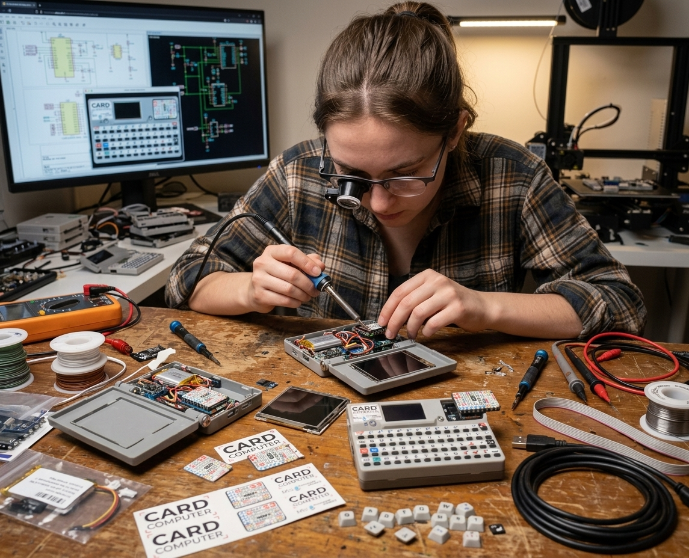

# [ch32v003]ほぼどんなマイコンでも液晶付けられるにょ[cardputer]

2026年9月16日 11:06



# 8pinマイコン(CH32V003)でILI9341を「I2C経由リモート描画」させる ― SPIとWireの仕組みを徹底解説

## 1. これは何か

ILI9341搭載のSPI接続TFT液晶モジュールは、多くの場合ピン数が多く(CS/DC/RESET/SCK/MOSI/LED/VCC/GNDなど)、ピン数の少ない安価なマイコンからは扱いづらい部品です。

今回紹介する仕組みは、**8pinしかないCH32V003(RISC-Vコア、SOP8/QFN8パッケージ)1個をILI9341専属の「描画コプロセッサ」にしてしまい、本来SPIでしか喋れないTFTを、I2C(Wire)経由のシンプルなコマンド送信だけで動かせるようにする**、というものです。

名付けて **SpiHubWire**。親機(Arduinoでも何でもよい)は「fillRectしてね」「文字を描いてね」という数バイトのI2Cパケットを投げるだけで、ILI9341の初期化・SPI波形生成・座標計算といった面倒な処理は全部CH32V003側が肩代わりしてくれます。

本記事では、
- CH32V003側でSPI(TFT制御)とI2C(親機との通信)をどう共存させているか
- ソフトウェアビットバンSPIの中身
- 割り込み駆動のI2Cスレーブ実装の中身
- 両者をつなぐ通信プロトコル

を、実際のソースコード (`J4M6.hpp` / `ili9341x.hpp` / `wireSlave.hpp` / `wireCmd.hpp` / `SpiHubWireVer0_4.ino`) に沿って解説します。

---

## 2. ハードウェア構成 ― 8pinにSPIとI2Cを同居させる

### 2.1 CH32V003J4M6のピン配置

```
     +------+
 PD6 | 1  8 | PD5
 GND | 2  7 | PC4
 PA2 | 3  6 | PC2
 VCC | 4  5 | PC1
     +------+
```

8本しかピンがないうち、電源2本(VCC/GND)を除くと信号線は **たったの6本**。この6本で

- ILI9341へのSPI風信号(CS, SCK, MOSI, DC)= 4本
- 親機とのI2C(SDA, SCL)= 2本

をすべて賄っています。内訳は次の通りです。

| ピン | 機能 | 用途 |
|---|---|---|
| PA2 | SPI CS  | ILI9341のチップセレクト |
| PC4 | SPI SCK | ILI9341への手動クロック |
| PD6 | SPI MOSI | ILI9341へのデータ出力 |
| PD5 | SPI DC  | コマンド/データ切替 |
| PC1 | I2C SDA | 親機との通信(データ) |
| PC2 | I2C SCL | 親機との通信(クロック) |

### 2.2 液晶モジュール側のピン再利用トリック

`ili9341x.hpp` 冒頭のコメントにある液晶モジュールのピン配置がポイントです。

```
              +------+
 (SPI)MOS | 1  8 | (SPI)DC/SWIO
 GND      | 2  7 | (SPI)CLK
 (SPI)CS  | 3  6 | (Wire)SCL
 VCC      | 4  5 | (Wire)SDA
          +------+
 RST -> VCC
 LED -> VCC
```

一般的な8pin ILI9341ブレイクアウト基板は `VCC / GND / CS / RESET / DC / SDI(MOSI) / SCK / LED` の8本を持っています。ここでは

- **RSTとLEDはVCCに直結**して固定化(リセットは常時解除、バックライトは常時点灯にしてしまい、制御ピンとして使わない)
- 空いた2本を **I2CのSDA/SCLとして転用**

することで、「TFTモジュール用の8pinコネクタ」と「CH32V003自体の8本足」をそのまま1対1で対応させています。マイコン側のGPIO制約(6本しか信号ピンがない)と、液晶モジュールのコネクタ形状(8pin)という2つの制約を同時に満たす、かなり合理的な割り切りです。

---

## 3. SPI側 ― ハードウェアSPIを使わずGPIOビットバンで駆動する理由と実装

CH32V003にもハードウェアSPIペリフェラルはありますが、このプロジェクトでは **あえて使わず、GPIOを直接叩くソフトウェアSPI** でILI9341を駆動しています。理由は明快で、ハードウェアSPIのピン配置は固定(またはAFIOでの制約付き切替のみ)であるのに対し、この設計では「液晶コネクタのピン配置」を先に決めてしまっているため、信号線をCPUの好きなGPIOへ自由に割り付けられるビットバンの方が都合が良いからです。

### 3.1 GPIO直叩きマクロ

```c
#define SPI_MOSI_HIGH() (GPIOD->BSHR = GPIO_BSHR_BS6)
#define SPI_MOSI_LOW()  (GPIOD->BSHR = GPIO_BSHR_BR6)
#define SPI_SCK_HIGH()  (GPIOC->BSHR = GPIO_BSHR_BS4)
#define SPI_SCK_LOW()   (GPIOC->BCR  = GPIO_BCR_BR4)
#define SPI_DC_HIGH()   (GPIOD->BSHR = GPIO_BSHR_BS5)
#define SPI_DC_LOW()    (GPIOD->BSHR = GPIO_BSHR_BR5)
#define SPI_CS_HIGH()   (GPIOA->BSHR = GPIO_BSHR_BS2)
#define SPI_CS_LOW()    (GPIOA->BSHR = GPIO_BSHR_BR2)
```

CH32V0シリーズのGPIOは `BSHR`(Bit Set/Reset Register)への書き込みでアトミックにHigh/Lowを設定できます。読み出し→変更→書き込みが不要なため、通常の`digitalWrite()`より大幅に高速です。

### 3.2 1バイト送信:`SEND8`マクロ

```c
#define SEND8(d) \
  { \
    uint8_t _d = (d); \
    (_d & 0x80) ? SPI_MOSI_HIGH() : SPI_MOSI_LOW(); \
    SPI_SCK_HIGH(); SPI_SCK_LOW(); \
    ... // 以下ビットごとに8回繰り返し
  }
```

MSBファーストで1ビットずつ「MOSIをセット → SCKをHigh → SCKをLow」を8回繰り返す、教科書通りのSPI Mode 0(CPOL=0, CPHA=0)のソフトウェア実装です。`DC`ピンでコマンド/データを切り替え、`CS`をLowにしている間だけILI9341が信号を受け付けます。

```c
void tftCmd(uint8_t cmd) {
  SPI_DC_LOW(); SPI_CS_LOW();
  SEND8(cmd);
  SPI_CS_HIGH();
}
void tftData(uint8_t data) {
  SPI_DC_HIGH(); SPI_CS_LOW();
  SEND8(data);
  SPI_CS_HIGH();
}
```

### 3.3 塗りつぶし高速化:`SEND_PIXEL_FAST`

`fillRect`のような広範囲塗りつぶしでは`SEND8`を毎回呼ぶとレジスタ参照のオーバーヘッドが無視できません。そこで、あらかじめGPIOレジスタのアドレスとビットマスクをローカル変数にキャッシュしてから回すバージョンが用意されています。

```c
#define SEND_BIT_FAST(c, bd, bc, mh, ml, sh, sl) \
  *bd = ((int16_t)(c) < 0) ? mh : ml; \
  *bc = sh; *bc = sl; \
  (c) <<= 1;
```

`(c) <<= 1` でcの最上位ビットを毎回見ながらシフトしていくことでMSBファーストの送信を実現しつつ、`*bd = mh`のように **ポインタ経由でBSHRレジスタへ直接書く** ことでマクロ展開後の命令数を切り詰めています。画面全消去(`tftClear`)のような1バイトあたり数万回級の処理では、この最適化の有無が体感速度に直結します。

### 3.4 座標ウィンドウとタイミング

`tftSetWindow()`でILI9341の`0x2A`(Column Address Set)/`0x2B`(Page Address Set)/`0x2C`(Memory Write)コマンドを発行し、以降流し込んだピクセルデータが指定矩形内に書き込まれるようにしています。文字描画(`tftDrawCh`)もフォントデータをピクセルへ展開しながら同じ`SEND_PIXEL_FAST`経路に流し込む形で実装されており、コマンド体系・描画ロジック共にAdafruit_GFX系ライブラリの設計を踏襲しつつ、必要な機能だけをこの8pinチップ向けに刈り込んだ内容になっています。

---

## 4. I2C(Wire)側 ― 割り込み駆動の軽量スレーブ実装

### 4.1 なぜ標準のWireライブラリを使わないのか

CH32V003はSRAMが2KBしかない超小型MCUです。フル機能のWireライブラリ(バッファ管理・マスタ/スレーブ両対応など)を載せる余裕が乏しいため、`wireSlave.hpp`では **CH32V00xの標準ペリフェラルライブラリ(`ch32v00x_i2c.h`)を直接叩く、必要最小限のスレーブ専用実装**を自作しています。

### 4.2 初期化

```c
void begin(uint8_t addr) {
  ...
  g.GPIO_Pin  = GPIO_Pin_1 | GPIO_Pin_2;  // PC1=SDA, PC2=SCL
  g.GPIO_Mode = GPIO_Mode_AF_OD;          // オープンドレイン
  ...
  i.I2C_ClockSpeed  = 1000000UL;          // 1MHz (Fast mode plus相当)
  i.I2C_OwnAddress1 = (uint16_t)(addr << 1);
  ...
  I2C_ITConfig(I2C1, I2C_IT_EVT | I2C_IT_BUF | I2C_IT_ERR, ENABLE);
  NVIC_EnableIRQ(I2C1_EV_IRQn);
  NVIC_EnableIRQ(I2C1_ER_IRQn);
  I2C_Cmd(I2C1, ENABLE);
}
```

I2CピンはSDA/SCLとも `GPIO_Mode_AF_OD`(オルタネート機能・オープンドレイン)で設定するのがポイントです。I2Cはバス上の複数デバイスが同じ線をLowに引っ張り合うプロトコルのため、プッシュプル出力では成立しません。クロックは1MHzを指定しており、標準の100kHz/400kHzより踏み込んだFast-mode plus相当の速度で運用しています。

### 4.3 割り込みハンドラの読み方

I2Cスレーブの状態遷移は、ステータスレジスタ`STAR1`のビットで判定します。

```c
void _ev() {
  uint16_t sr1 = I2C1->STAR1;

  if (sr1 & I2C_STAR1_ADDR) {           // ①アドレス一致
    uint16_t sr2 = I2C1->STAR2;         // STAR2読み出しでADDRフラグをクリア
    if (sr2 & I2C_STAR2_TRA) {          // マスタがRead要求 → 送信モード
      _txLen = _txIdx = 0;
      if (_onRequest) _onRequest();     // ユーザーコールバックでバッファを埋める
    } else {                            // マスタがWrite → 受信モード
      _rxLen = 0;
    }
  }

  if (sr1 & I2C_STAR1_RXNE) {           // ②受信バッファにデータあり
    uint8_t d = (uint8_t)I2C1->DATAR;
    if (_rxLen < sizeof(_rxBuf)) _rxBuf[_rxLen++] = d;
  }

  if (sr1 & I2C_STAR1_TXE) {            // ③送信バッファが空 = 次の1byteが必要
    I2C1->DATAR = (_txIdx < _txLen) ? _txBuf[_txIdx++] : 0x00;
  }

  if (sr1 & I2C_STAR1_STOPF) {          // ④STOPコンディション検出
    I2C1->CTLR1 |= I2C_CTLR1_ACK;
    if (_onReceive && _rxLen > 0) {
      _rxIdx = 0;
      _onReceive((int)_rxLen);          // 受信完了をユーザーコールバックへ通知
    }
  }
}
```

この4パターン(①アドレス一致→②受信 or ③送信→④ストップ検出)が、Arduinoの`Wire.onReceive()`/`Wire.onRequest()`とほぼ同じ役割のコールバックを、標準ライブラリなしで再現している部分です。`STAR2`を読むことでADDRフラグが自動クリアされる、`STOPF`検出後に`CTLR1`へACKビットを書き戻す必要がある、といった **CH32V0系I2Cペリフェラル特有のお作法** がそのまま反映されています。

受信バッファは32byte、送信バッファは16byte固定のリングを使わない単純な配列で、`SpiHubWireVer0_4.ino`側では受信完了時に即座に別バッファへコピーし、メインループで処理するという設計(後述)によって、割り込みハンドラ自体は極力短く保たれています。

### 4.4 ステータス返却(onRequest)

親機がRead要求を出すと、CH32V003側は次の6バイトを返します。

```c
void onRequest() {
  WireSlave.write(rxReady ? 0x01 : 0x00); // 直前コマンド処理待ちフラグ
  WireSlave.write((uint8_t)(_width  & 0xFF));
  WireSlave.write((uint8_t)(_width  >> 8));
  WireSlave.write((uint8_t)(_height & 0xFF));
  WireSlave.write((uint8_t)(_height >> 8));
  WireSlave.write(_rotation);
  WireSlave.write(SLAVE_VERSION);
}
```

現在の画面解像度(回転状態によって変わる)・回転値・ファームウェアバージョンを親機側から読み出せるようにしてあり、親機はこれを見て「今の画面は240x320か320x240か」を判断できます。

---

## 5. 通信プロトコル ― `wireCmd.hpp`

親機→CH32V003へのI2C書き込みは「1バイト目=コマンドID、以降=パラメータ」という単純なTLV風フォーマットです。

| コマンド | 内容 | パラメータ |
|---|---|---|
| 0x00 | clear | なし |
| 0x01 | fillScreen | uint16 col |
| 0x02 | displayOff | なし |
| 0x03 | displayOn | なし |
| 0x04 | setRotation | uint8 rot(0-3) |
| 0x10 | fillRect | x,y,w,h(各uint16 LE) + col |
| 0x20 | drawRect | x,y,w,h + col + thickness |
| 0x30 | drawLine | x0,y0,x1,y1 + col |
| 0x40 | drawStr | x,y,fg,bg,size + 文字列 |
| 0x50 | drawBitmap8 | x,y,col + 8x8モノクロビットマップ |
| 0x60 | drawGrid | col, inc(間隔) |

16bit値はすべてリトルエンディアンで、`U16LE(p, i)`マクロで取り出します。

```c
#define U16LE(p, i)  ((uint16_t)((p)[(i)] | ((p)[(i)+1] << 8)))
```

`execWireCmd()`は受け取ったバッファを`switch`文でディスパッチするだけのシンプルな構造で、パラメータ長(`plen`)が足りない不正なパケットは黙って無視するガードが各caseに入っています(例:`case 0x10`は`plen >= 10`のときのみ`tftFillRect`を呼ぶ)。マイコン間通信でノイズや取りこぼしがあっても暴走しにくい、実用上重要な作りです。

`readWireCmd()`は受信した生バイト列を16進ダンプとして画面上部に描画するデバッグ機能で、`_width`に応じて表示可能な桁数を動的に計算し、`msg[64]`バッファを溢れさせないようクランプする処理まで入っています(コメントにも「rot90/270でwidth=320のときのオーバーフロー対策」と明記されています)。

---

## 6. メインループとチップ間協調 ― `SpiHubWireVer0_4.ino`

```c
void onReceive(int n) {
  rxLen = 0;
  while (WireSlave.available() && rxLen < sizeof(rxBuf))
    rxBuf[rxLen++] = WireSlave.read();
  rxReady = true;
}

void loop() {
  if (rxReady) {
    readWireCmd(rxBuf, rxLen, 0, tftHeight() - 12);
    execWireCmd(rxBuf, rxLen);
    rxReady = false;
  }
  if ((getMs() - tm) > 4) {
    drawAst(0, tftHeight() - 20);   // スピナー表示
    tm = getMs();
  }
}
```

割り込みハンドラ内では受信データを一旦グローバルバッファへコピーして`rxReady`フラグを立てるだけに留め、実際のSPI描画(時間のかかる処理)は**メインループ側**で行っています。I2Cの割り込みハンドラの中でSPIのビットバン送信(数百〜数千クロック)を行うと、次のI2Cトランザクションの受信タイミングを逃す恐れがあるため、この「受信は割り込みで即応、描画はループでゆっくり」という役割分担は理にかなっています。

### 6.1 スレーブアドレスの自動決定

`J4M6.hpp`の`systemSetup()`にさりげなく書かれているこの1行が面白いポイントです。

```c
slaveAdrs = *(volatile uint8_t*)0x1FFFF804UL;
```

これはCH32V003のフラッシュ内に焼き込まれているチップ固有のID領域(電子署名/ユニークID)から1バイトを読み出し、それをそのままI2Cスレーブアドレスとして採用しています。つまり **ファームウェア側でアドレスをハードコードせずに、チップごとに(ある程度)異なるアドレスが自動的に割り当たる** ようにしてあり、同じI2Cバスに複数のSpiHubWireモジュールをぶら下げても衝突しにくくなる、という設計意図が読み取れます(完全な一意性を保証するものではありませんが、量産・複数枚接続を見据えた実用上の工夫です)。

このアドレスは`drawAst()`によって画面下部に`SLAVE:0xXX`として常時表示されるため、親機側は目視でも今どのアドレスに割り当たっているか確認できます。

### 6.2 クロック設定の分岐

```c
#ifdef CLOCK48MHZ
  RCC->CFGR0 |= RCC_PLLSRC_HSI_Mul2;   // 内蔵24MHz発振器を2逓倍→48MHz
  ...
#else
  RCC->CFGR0 = (RCC->CFGR0 & ~RCC_SW) | RCC_SW_HSI; // 内蔵24MHzそのまま
#endif
```

`SpiHubWireVer0_4.ino`では`#define CLOCK48MHZ`が有効化されており、内蔵HSI(24MHz)をPLLで2逓倍して48MHz動作させています。ビットバンSPIやI2C 1MHz通信を安定させるにはクロック余裕が欲しいため、標準の24MHzから48MHzへ引き上げているものと考えられます。

---

## 7. まとめ:この設計のキモ

- **物理ピン制約(8pin)と液晶コネクタ形状(8pin)を、RST/LEDのVCC直結という割り切りで一致させた**
- **ハードウェアSPIペリフェラルを使わず、GPIO直叩きのビットバンにすることで信号線の物理配置を自由に選べるようにした**
- **標準Wireライブラリに頼らず、ペリフェラルレジスタを直接操作する割り込み駆動I2Cスレーブを自作し、2KB SRAMという制約下でも軽量に動かした**
- **受信(割り込み)と描画(メインループ)を分離し、I2Cの応答性を損なわないようにした**
- **チップ固有IDからスレーブアドレスを自動生成し、複数枚接続時の衝突を回避しやすくした**
- **不正/不完全なパケットを黙って無視するガードにより、通信エラー耐性を持たせた**

ピン数が極端に少ない廉価マイコン(CH32V003)を「I2Cで喋りかけるだけで絵が出るTFTモジュール」に変換するという発想と、それを実現するための地道なレジスタレベルの作り込みが、このコード全体から見えてきます。安価なマイコンにディスプレイをぶら下げたいが配線ピンが足りない、というときの実装例として参考になる内容です。

## 実機

（X 投稿の埋め込み）
（X 投稿の埋め込み）
