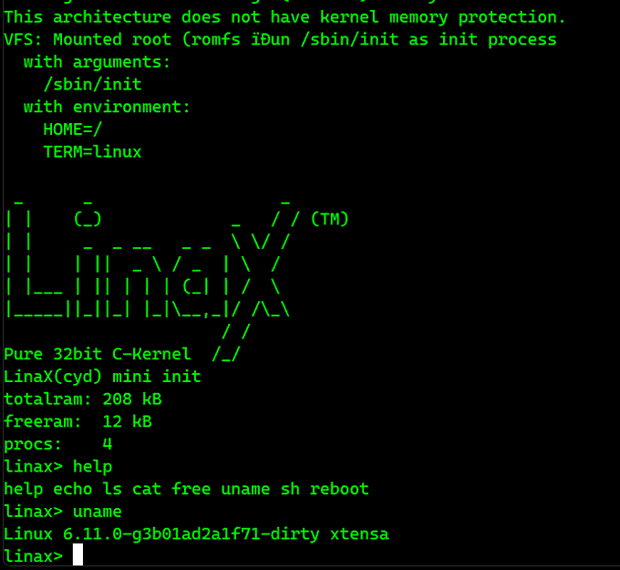

# [CYD]内蔵 DRAM 320KB で Linux6.11を動かしたにょ

2026年11月21日 14:52

# 歴史は塗り替えられた

<blockquote class="twitter-tweet" data-theme="dark"></blockquote>

<blockquote class="twitter-tweet" data-theme="dark"></blockquote>

