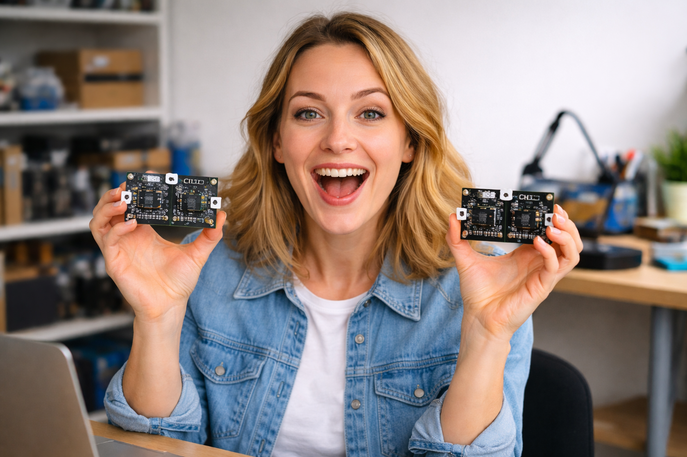
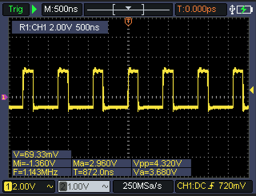
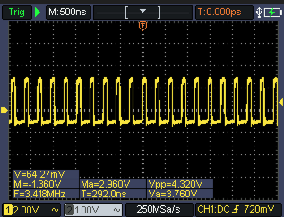

# 【dualCH32V003】92ByteでPD6から高速矩形波を出してみたにょ【40円マイコン】

2026年4月1日 11:06



## はじめに

奇しくも本日は4月1日(エイプリルフール)、さすがに92ByteでLチカとか、しかも3MHz超えの脅威の速度で実現するなんてね(///)
CH32V003J4M6（SOP8）の超小型ファームウェアチャレンジを続けています。
今回は **Arduino IDE 2 の枠組みを残したまま、どれだけ小さくできるか** に挑戦しました。

これまでは主に環境整備（Arduino IDE 2のインストール、CH32V003対応ボードパッケージの設定など）に力を入れてきたので、ようやくここまで小さくまとめることができました。さらに **dual CH32V003 ボード** を作成し、動作確認も行いました。

---

## 主な最適化ポイント

この **92 Byte** を実現するために、以下の変更を行いました。

- Arduino IDE 2 の標準スタートアップをバイパスするため、`_start` 関数を `naked` 属性 + `.text.entry` セクションで直接定義
- `setup()` / `loop()` は空のまま残しつつ、一切の Arduino 高レベル関数を使わずレジスタ直叩きのみに
- **LTO（Link Time Optimization）** を有効化してデッドコードを徹底除去
- GPIO トグルを `BSHR` レジスタの Set/Reset を2命令で交互実行する極めてタイトなループに最適化
- `#define USE_MAXHZ` で内部 HSI 24MHz を PLL で 48MHz に倍増するクロック設定を追加

---

## platform.txt の編集内容（重要）

単に `-flto -Os` を追加するだけでなく、`setup()` / `loop()` をリンクしないように以下の編集を行いました。

**platform.txt（または platform.local.txt）に追加・修正した主な行：**

```txt
compiler.c.extra_flags=-flto -Os -ffunction-sections -fdata-sections
compiler.cpp.extra_flags=-flto -Os -ffunction-sections -fdata-sections
compiler.c.elf.extra_flags=-flto -Os -Wl,--gc-sections -Wl,--undefined=_start
```

これにより：

- LTO + サイズ最適化が効く
- 不要な Arduino スタートアップ関数（`setup()` / `loop()` 関連）がリンク時に削除されやすくなる
- `_start` を明示的に undefined 扱いにして naked エントリポイントを優先

この組み合わせが **92 Byte 達成の鍵** になりました。

---

## 結果

| 項目 | 内容 |
|------|------|
| バイナリサイズ | 約 **92 Byte**（LTO 有効時） |
| 出力波形 | 数百 kHz ～ 1 MHz クラスのきれいな高速矩形波 |
| 外部部品 | 一切なし |

---

## ソースコード

```c
#define USE_MAXHZ

void loop() {}
void setup() {}

extern "C" {
  void _start(void) __attribute__((section(".text.entry"), naked));

  void _start(void) {
    volatile unsigned int* const RCC_CR   = (unsigned int*)0x40021000;
    volatile unsigned int* const RCC_CFGR = (unsigned int*)0x40021004;
    volatile unsigned int* const RCC_APB2 = (unsigned int*)0x40021018;
    volatile unsigned int* const GPIO_CFG = (unsigned int*)0x40011400;  // PD CFGLR
    volatile unsigned int* const GPIO_BSHR= (unsigned int*)0x40011410;

#ifdef USE_MAXHZ
    *RCC_CR |= (1 << 24);                        // 内部HSIをベースにPLLで48MHz化
    while ((*RCC_CR & (1 << 25)) == 0);          // PLL ready 待ち
    *RCC_CFGR = 0;
    *RCC_CFGR |= (1 << 0);                       // System clock switch
#endif

    *RCC_APB2 |= (1 << 5);                       // IOPDEN（GPIOD クロック有効化）

    // PD6 を Push-Pull 出力（最大速度）に設定
    *GPIO_CFG = (*GPIO_CFG & ~(0xFu << 24)) | (0x3u << 24);

    const unsigned int set = (1u << 6);
    const unsigned int rst = (1u << 22);

    while (1) {
      *GPIO_BSHR = set;   // PD6 High
      *GPIO_BSHR = rst;   // PD6 Low
    }
  }
}
```

---

## dual CH32V003 での動作確認

先日作成した **dual CH32V003 ボード**（2つの CH32V003J4M6 を搭載）に、この 92 Byte ファームウェアを書き込んで動作確認しました。

- 両方のチップで PD6 から安定した矩形波が出力されていることをオシロで確認
- 片方は内部 HSI **24 MHz** ベース、もう片方は `#USE_MAXHZ` 有効で **48 MHz** モードに設定
- 2チップ同時動作でもクロック干渉や電源ノイズがほとんどなく、きれいな波形が得られました

この dual 構成は、センサー用途や小型 IoT デバイスで便利そうです。

<blockquote class="twitter-tweet" data-theme="dark"><a href="https://twitter.com/chrmlinux03/status/2037786990964625563"></a></blockquote>
<script async src="https://platform.twitter.com/widgets.js" charset="utf-8"></script>


---

## 書き込み・確認手順（Arduino IDE 2）

1. Arduino IDE 2.x を起動
2. CH32V003 対応ボードパッケージをインストール
3. 上記の `platform.txt` 編集後、コンパイル
4. **WCH-LinkE** などで書き込み
5. オシロで PD6 を観測 → きれいな矩形波が出れば成功 🎉

---

## 参考リソース

- [Arduino Core for CH32V003（AlexanderMandera 版）](https://github.com/AlexanderMandera/arduino-wch32v003)
- [OpenWCH 公式 Arduino Core](https://github.com/openwch/arduino_core_ch32)
- [CH32V003 Reference Manual（PDF）](https://www.wch-ic.com/downloads/CH32V003RM_PDF.html)

---

（X 投稿の埋め込み）

この 92 Byte というサイズ感と、dual CH32V003 での動作確認、どれも CH32 RTA として面白いと思います。elchika の皆さんはどう思いますか？ぜひコメントお待ちしています！

---

`#CH32V003` `#SOP8` `#Arduino` `#LTO` `#極小ファームウェア` `#dualCH32` `#CH32RTA`
