# Spresensを使って自律移動出来るよっ(easyLiDARの製作と運用)

2022年9月15日 14:30
<p class="article-tags">タグ: <a href="..?tag=IMU">IMU</a> <a href="..?tag=M5Atom">M5Atom</a> <a href="..?tag=SLAM">SLAM</a> <a href="..?tag=easyLiDAR">easyLiDAR</a> <a href="..?tag=spresense">spresense</a></p>

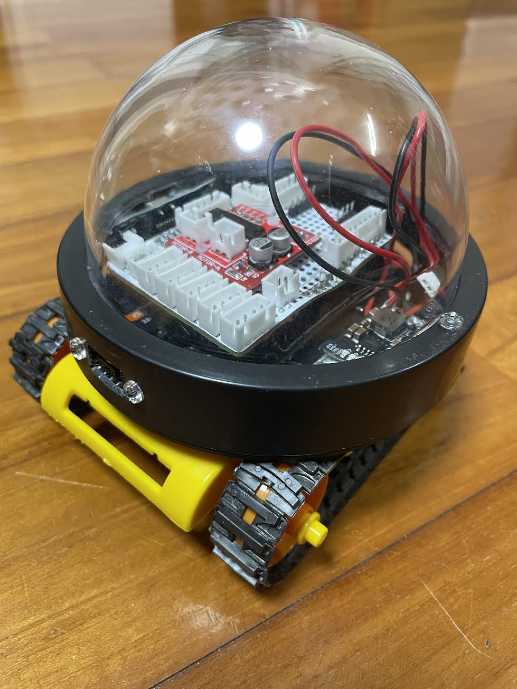

# はじめに
こんにちわ、リナちゃん@chrmlinux03 です。
普段は毎日圧着PINを打ったりArduino用ライブラリを作ったり、近所の食堂のヘルプに呼ばれてお食事を作ってます。
今回は Spresense を使って**easyLiDAR**を自作し自律移動するロボット(クローラ型)を作ってみたいと思います。
あくまでも **easyLiDAR** を作るのが目的ですからモジュール化し **足回り** は付け替えOKな感じで。

# 準備
## easyLiDARとは
最近のロボットには LiDAR と呼ばれるレーザによる測距センサーをぐるぐる回す機械が搭載されてます。
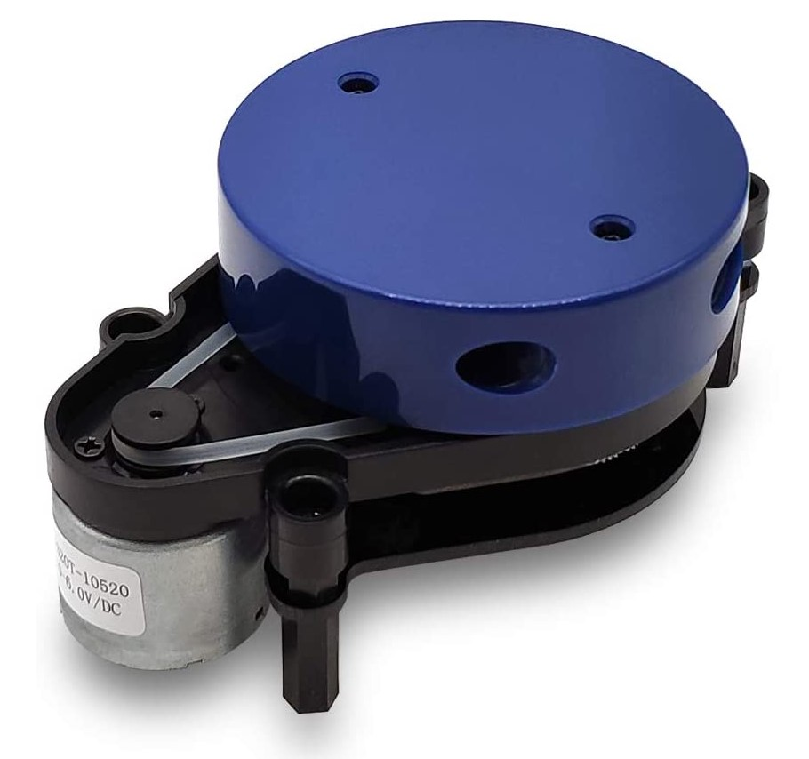
これは自分自身と壁までの距離つかって自分の今居る場所を推定させるためのデバイスであり、屋内ではこれはありかも知れませんが屋外ではちょっと...という感じです。それと**回転系**のデバイスは壊れや....。
そこでVL53L5CXというTOFセンサを64個(8x8)格子状に搭載したなんとも贅沢なセンサを使って**自前**でLiDARならぬ easyLiDARを作ってみようと思います。
探査法は右手法アルゴリズムにて行いますので簡単な安価な測距センサも右手側に装備する必要があります。
>引用：ウイキペディア::迷路
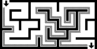
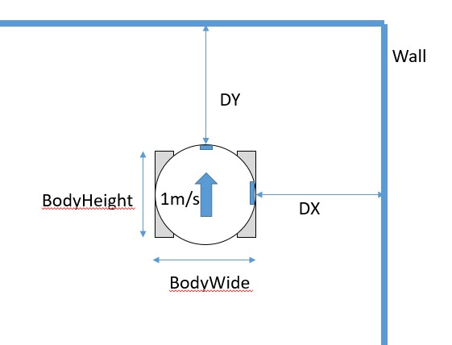

## VL53L5CXとは
簡単に言うと **TOF**センサ(Time Of Flight方式の光学式測距)が 8x8 の格子状に並べられていて
前方 400cm (4m) におけるFOV が45°という**広範囲**のデータが取得できるセンサになってます
発売は随分前なんですが、何故かあまり使っている方々がおりません。(便利なのに)
VLシリーズは発売開始時期から随分使っていました、**黒い壁**を読む事が出来たりするのが良いところだと思います。
**ガラス面(鏡面)** に対する測距は角度により可能ではありますが現地(試験迷路)によっては後述の**SR-04**のほうが有効な場合があります、但し SR-04 は直角面/球面に弱いという特性がありますので SR-04タイプのArray があれば前面センサにはそれを使ってもよいかもしれません。
センサをArray で持つという事は **壁**に対して車体の**壁に対する傾き**を得ることが出来る素敵な実装方法です。

>引用:VL53L5CXユーザーズマニュアル
>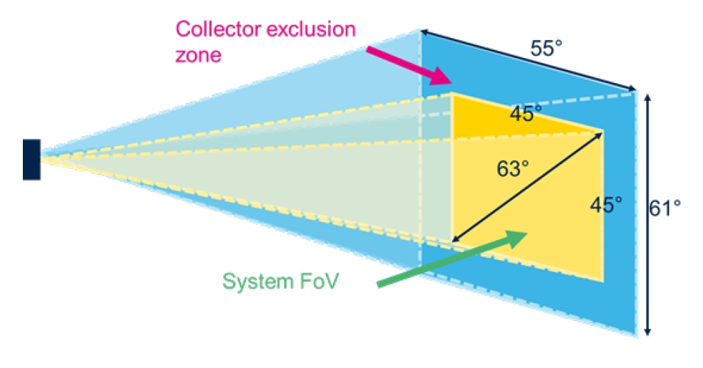
>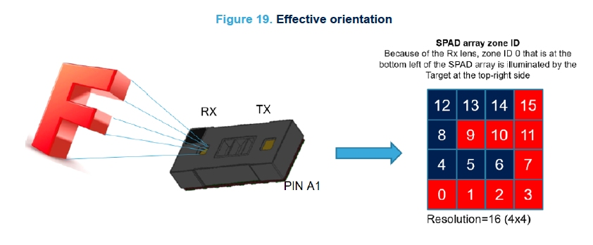
>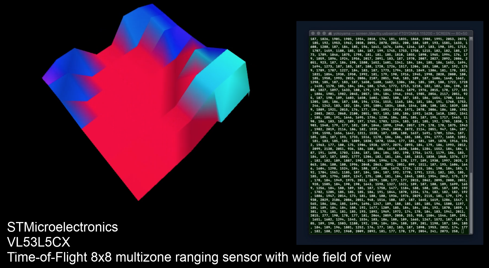

## 自律移動とは
外部からのイベントによらず 自分で考えて移動する事ができる、これが自律移動。
目的？それはあとで考える事にしよう。
初期位置が設定出来ればそこにQi系の充電台を置いて自動充電も可能かも...

## クローラとは
屋内屋外問わず オムニホイールやメカナムホイールまたは車輪ですと どうしても落ちているものに引っかかってしまいます。
またサーボモータだと小さい型だとパワーが足りない。ここはDCモータでクローラ(キャタピラ)駆動させることにする。
車輪が空転をしてもモータの回転速度が分かりますとかオドメトリが分かりますというのはナンセンスかと。

## DCモータとは
2本のIO(DegitalWrite + AnalogWrite) を使えば1個のモータはPWM駆動できます。
他の方々のライブラリは2本のIO(AnalogWrite x 2)を使っているようなのですが
DCモータは所詮 **差動**で動くわけですから、ちょっと工夫をしてライブラリ化してあります。
<blockquote class="twitter-tweet" data-theme="dark"><a href="https://twitter.com/chrmlinux03/status/1559526096030531590"></a></blockquote>
<script async src="https://platform.twitter.com/widgets.js" charset="utf-8"></script>
DCモータとはマブチモータ等の+(プラス)-(マイナス)で直接駆動し、反転はそれを逆にすることで実現可能。ただしDCモータは電流値が高く、マイコンから直接動かすことはできない。動かすためにはモータドライバなりの回路が必要。
またDCモータはON/OFF や OFF/ON の動作時に激しい電流の変化があるため回路やデバイスに対して**スムーズ**な駆動が必要なために、**台形制御**と呼ばれる駆動方法が必要です。そこで**移動平均**によるDCモータ駆動も可能と考え今回のDCモータ駆動は下記の自前ライブラリを使用する事にしました。
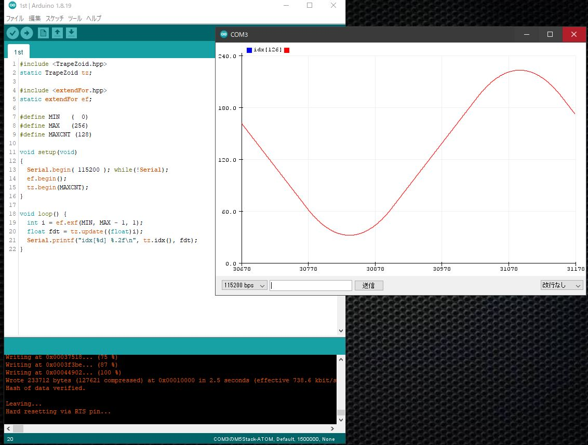

>自作台形制御ライブラリ
>https://www.arduinolibraries.info/libraries/trape-zoid

## モータドライバとは
1モータに付き2本の配線を使いその差動によりモータを駆動させる回路。たとえば 1 0 だったら正回転(CW) 0 1 だったら逆回転(CCW) 0 0 が停止 1 1がブレーキをいう構成で動かす事が出来ます。
過去の経験を活かし2PIN(DegitalOut + AnalogOut)のみで1個のモータを駆動し、モータの優劣(劣化/個体差)によるFactも加味してあります
<u>以前ロボットの足回りを担当した頃、DCモータの特性で同じ出力を得る事が出来ませんでした。その時には回路で対応したのですが、今はもうモータドライバが自作できる時代ですのでそこは最初から実装がお薦めですっ</u>

>自作DCモータ駆動ライブラリ
>https://github.com/chrmlinux/tinyDC

## SLAMとは
Simultaneous Localization and Mapping の頭文字をとってSLAM(スラム)と呼ばれる手法。**S**imultaneous=同時に**L**ocalization=位置推定**a**nd=と**M**apping=地図作成の意味となります。
Simultaneousは"いろいろなセンサ"を同時につかいという意味であり 今回使用する IMU(Inertial Measurement Unit)や接触センサ等が含まれます。自律移動させるためにはこれは必須。
巨大なマップを用意し現在の車体の位置(x,y,z) 車体の方向(x, y, z)からリアルタイムで書き写す必要があります。
マイコン等の場合内部メモリが限られていますので今回は実装してありませんが内部マップを超えたエリアに移動する場合もしくはオートキャリブレーションをしないで前回の位置/環境を使って運用をする場合SDカード等の外部記憶にデータを保存する必要があります。
そこまで実装してしまうと....本が1冊書けてしまいますので今回は未実装となります。
<u>過去に**SLAMを自作しましょう**とかいう大胆な発言を某社でしていたのですが
有名大学の先生さまが「いやそれ出来れば一生食って行けます」とか言われて居たのに....まさか本気で自作するとは。
時代はSLAM自作可能な域まで迫ってきましたね</u>

## IMUとは
IMU には色々なタイプがありますが 6軸(加速度センサ+ジャイロセンサ) 9軸(加速度センサ+ジャイロセンサ+地磁気センサ)等が有名な所。今回9軸を使用して開発を進めていたのですがモータが駆動されると"地磁気が乱れる"という当たり前な現象に悩まされ泣く泣く6軸の使用となりました。
今回は　MPU6050 という6軸タイプのセンサを使いましたが、wifiModem で使用するモジュールに M5AtomMatrix を使えば MPU6885 用の配線は不要です。
<u>IMU6050にはDMP(Digital Motion Processor)という素敵な機能があり自動的にキャリブレーションを行ってくれます。逆に IMU6885 には DMPが搭載されておらず自前でキャリブレーションを行う必要があります</u>
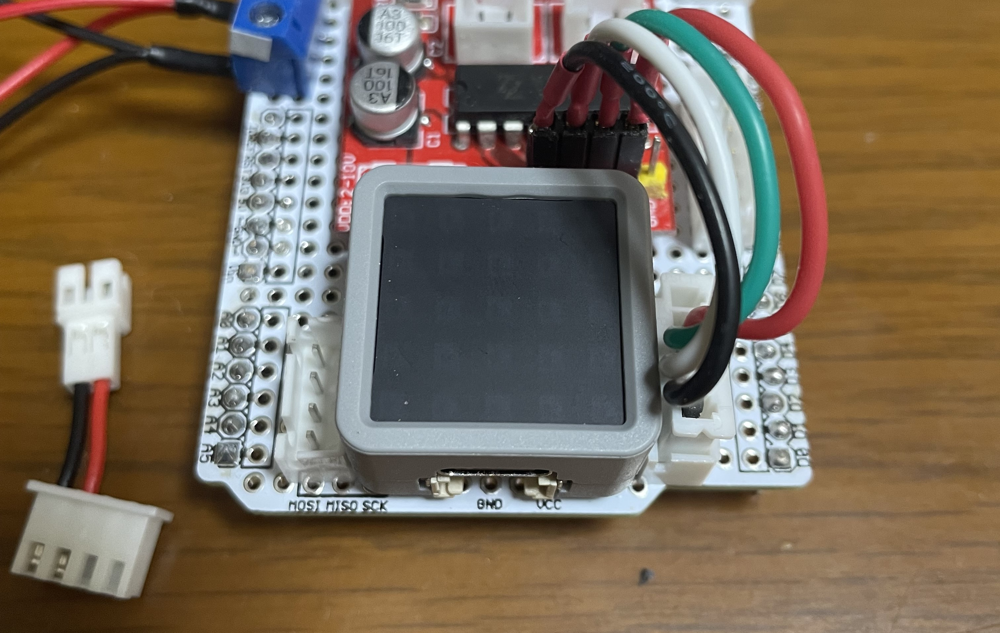

# ハード製作
## ハード構成
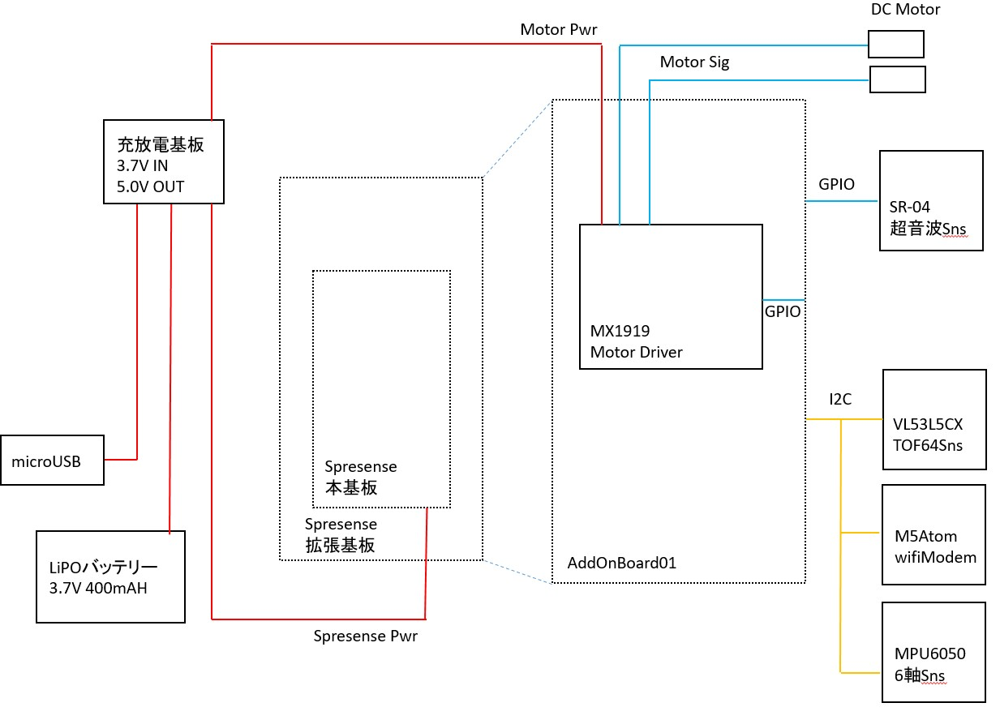
- Spresense本基板
- Spresense拡張基板(Arduino形状)
- AddonBoard01基板
- バッテリ基板(3.7V->5V充放電基板)
- バッテリ(LiION3.7V 400mAH)
- DCモータ5Vx2
- クローラセット2輪
- 各種センサ
- 百円均一のカバー的なもの

## AddOnBord01基板
配線が色々と大変ですので基板化しました
製作と言ってもコネクタをつけまくって電源を張りまくってって感じです。
<u>I2C のコネクタは全部で7本(2本はGrove) 
コネクタを載せるよりも今となっては I2C セレクタを搭載すれば良かったと感じて居ます
同じ会社同じ種類のセンサはアドレスがほぼ一緒なんですよね...</u>

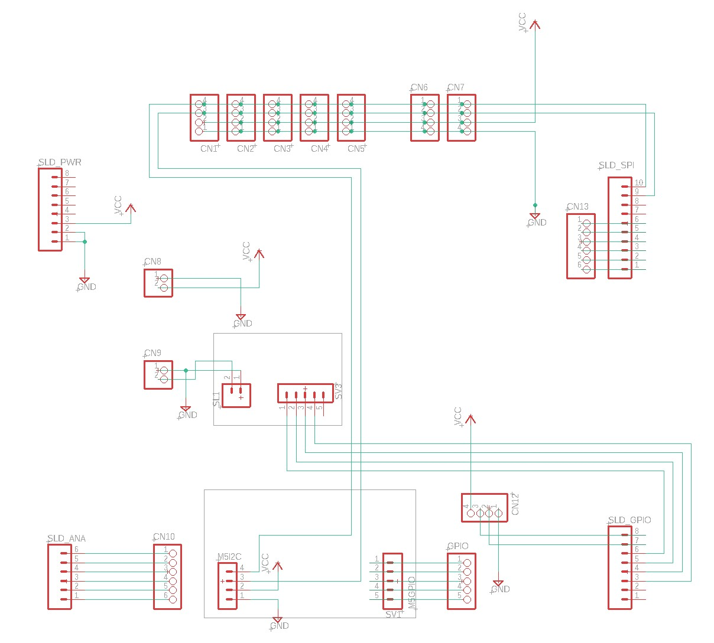

## Arduinoバニラシールド
遠い記憶に Arduio用自作基板があったのを思い出し倉庫から引っ張り出してきましたぴったりです。
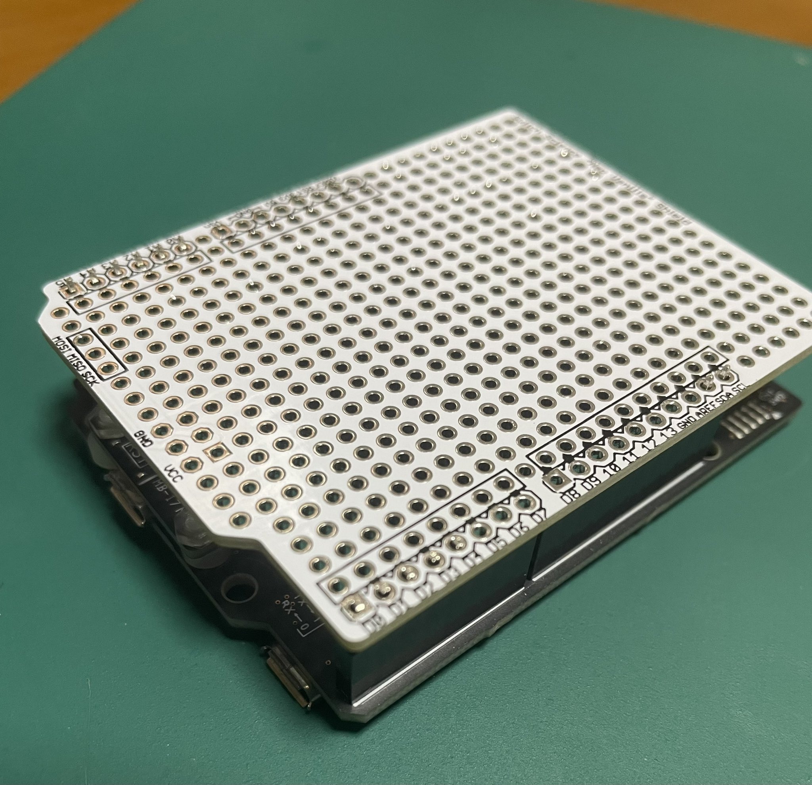

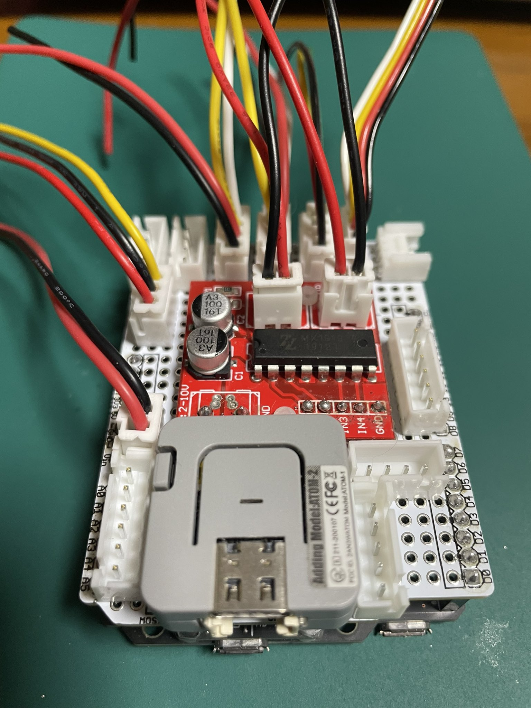

## MotorDriver(MX1919)
GPIO 4本を使い2個のモータを制御させる事が出来ます。差動によりモータを駆動させるたとえば 1 0 だったら正回転(CW) 0 1 だったら逆回転(CCW) 0 0 が停止 1 1がブレーキという手順で動かす事が出来ます。
<u>停止とブレーキの概念が過去にわからず、悩みまくった事があります
教習所の坂道発進を思い浮かべると分かりやすい
坂道でブレーキを踏まないと下がってしまいますよねこれが停止
ブレーキを踏むと下がる事なくそこで停止します
DCモータの回転方向を CW から CCW に移動する場合
一度 停止を挟むと良いと言うのを今回の作業で覚えました。</u>

## WiFiModule(M5AtomLite)
今後の拡張のため WiFiはどうしても必要により苦肉の策、M5AtomLiteはI2CSlaveとして駆動させるので今回はWiFiModemとして使用されます。ただしあくまでも今回の主役は Spresense であって M5Atom は I2C Slave として動作します。
ROSもWiFiであれば受け入れてくれるかもしれない....
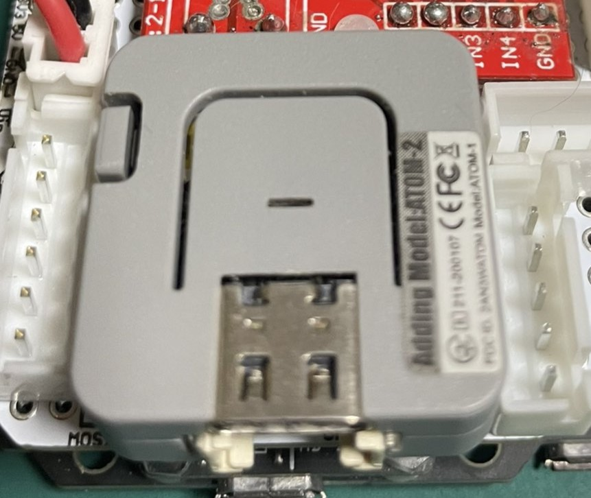
>自作 I2C MASTER/SLAVE ライブラリ
>https://github.com/chrmlinux/esp32MasterSlave

## TOF64センサー
VL53L5CX(8x8x400cmマルチゾーン対応ToF測距センサ)
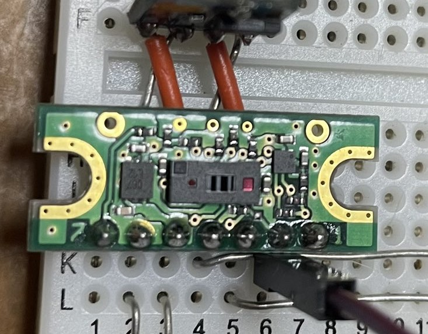

## HC-SR04(300cm 超音波距離センサ)
右手法アルゴリズムにより**洞窟**等の道順探索にはかならず右手を**壁**に手を触れて洞窟を探索する事になります。
今回のTOF64センサは前方を見て壁の有無を45°のFOV で検出し、SR-04 は右手法アルゴリズムの**右手**の役目をします。

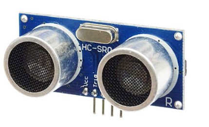

## カバー
セリアに売っていた**ダミーカメラ**の筐体を使うことにした。
色々入って110円(税込)は奇跡である。
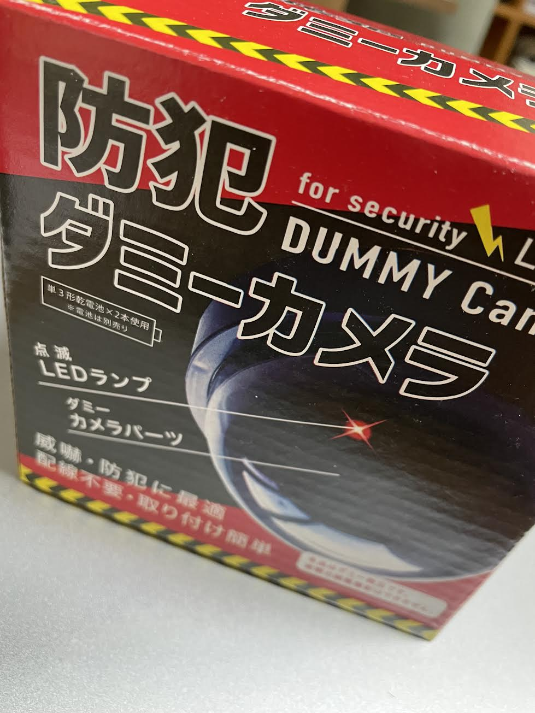
往年の**ハカイダー**もしくは**禁断の惑星**を彷彿させる姿ではあるが中身が見えるとカッコいい感は否めない。
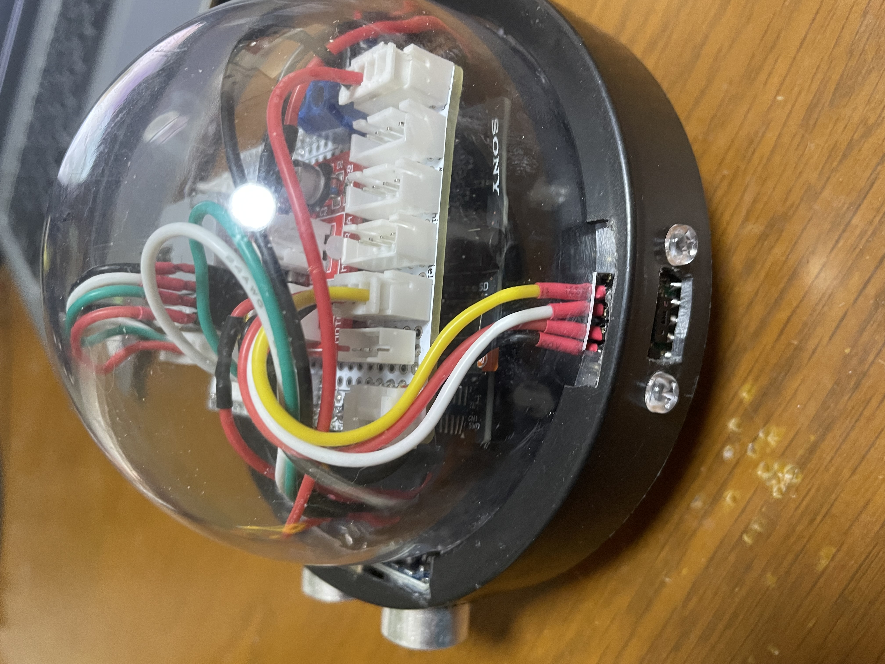

## 電源
今まで使っていたリチウムイオン充放電基板が 3.7V -> 5V が別基板となっているので収まりが悪い。
そこで 新たに バッテリ(3.7V) -> 充放電 -> 出力(5V) という素敵な基板を入手。
但し マイクロUSB基板が自前での取り付けなのでちょっと面倒。
だけどコンパクトに勝るものは無い
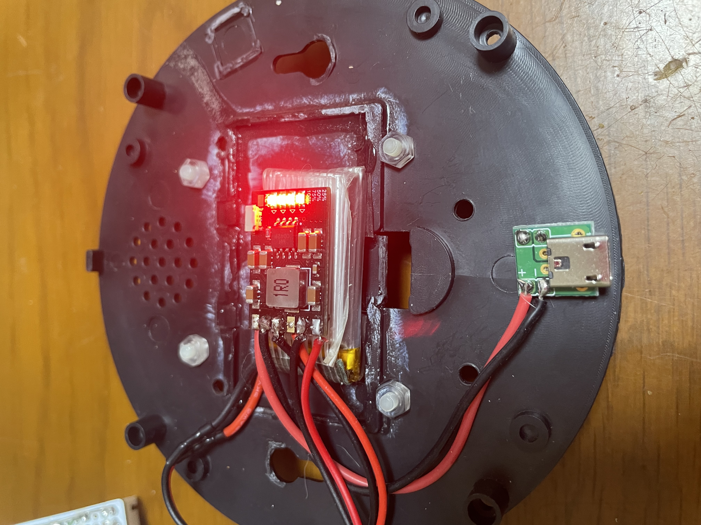
> 電源充電器ボード モジュール 2A 5V 

## ハーネス
ダミーカメラの前面に TOF64 対して 右手側に SR04、後ろ側に マイクロUSB 充電端子を配置。
この マイクロUSB端子に Qi 充電パネルを取り付け下部に配置すると Qi 系の充電が出来そう。
充電時間?それは後の話である。
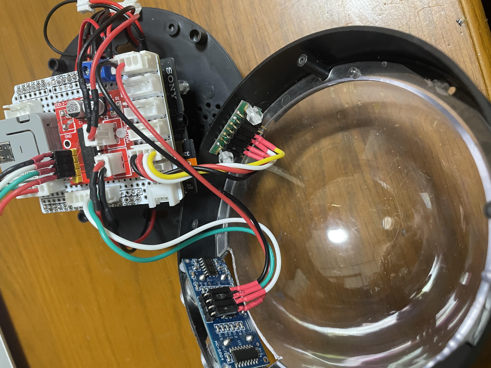

# ソフト製作
## 象限の把握
ロボットを使う上で象限管理/位置移動/回転移動/画像処理 が必須条件となります
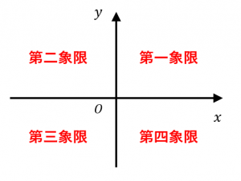
義務教育で習うグラフは4象限をフルに活用するのですがTV等でよく見るグラフは大体第一象限(原点が左下)。
マイコンを導入して最初に嵌るのが第四象限(原点が左上) SLAMを製作する上でこれは必須項目なのでもう一度確認して置きましょう。
また車体から見える象限方向とマップ上の象限方向も**脳内**でうまく変換しないと面倒なことになります(**なった**)
マップの更新は下記グラフィックスライブラリを多用します。
> 自作グラフィックス回転移動ライブラリ
> https://github.com/chrmlinux/ThreeD
## コアの割り当てと共通領域
今回のメインはあくまでも Spresense ですので MainCoreにて共通領域の確保とセンサからのデータ取得 を行い
SubCore1 では受け取ったデータを使って 24時間 365日 **自己位置推定**/**移動距離**/**回転方向(Yaw角)** の算出を行います。

## ファイルの配置
各Coreごとのinoファイルは共通の config.h / easyLiDAR.hpp を参照させる必要があるためにフォルダ構造を以下のように構成しました
config.h / easyLiDAR.hpp は Sub1配下に存在するために Main をコンパイルする場合には Sub1 配下を必ず**書込**して最新にする必要があります
```c++:folder
easyLiDAR
 +Main
    | Main.ino
    + Sub1
        | Sub1.ino
        | config.h
        | easyLiDAR.h
```       
<u>ライブラリ作家としては ライブラリ化した方が確かに楽なんですけど
製作途中でライブラリエリアに入れるのはなかなか大変です</u>
## 各Coreのメモリ割当と共通領域
Spresense 独特の表現方法で MainCore/SubCore で使用するメモリの割り当てを行うことが出来る
またSharedMemory のポインタを使用する事でより多いデータを各core間でデータの共有を行う事が出来る(**重要**)
今回は以下の割り当てで行う事とした

MainCore : 512 KByte
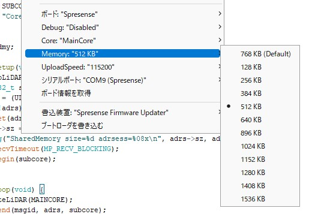
SubCore1: 256 KByte 
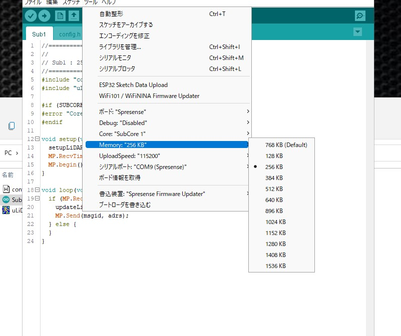
SharedMem : 768 KByte(**余ったメモリをすべて使い切る**) 
```c++:Sub1/config.h 

一部抜粋

//========================================
// Spresense Muluti Core Module
//========================================
#include <MP.h>
#include <MPMutex.h>
MPMutex mtx(MP_MUTEX_ID0);
#define ERROR_LEDID (3)
#define MAINCORE (0)
int8_t msgid = 10;
int subcore = 1;

//========================================
// easyLiDARconfig
//========================================

#define TOF64_HEIGHT (8)
#define TOF64_WIDTH  (8)
#define TOF64_MAXCNT (TOF64_HEIGHT * TOF64_WIDTH)

#define AREA_MAXHEIGHT  (896)
#define AREA_MAXWIDTH   (896)
#define AREA_DATABIT    (  8)
#define AREA_MAXCNT     (AREA_MAXHEIGHT * AREA_MAXWIDTH)
#define BLYNK_MAXCNT    (  8)

#define WIRE_FREQ (1000 * 1000)

//========================================
// Shard Memory
//========================================
struct AXS_T {
  float x;
  float y;
  float z;
};

struct easyLiDAR_T {

  //-------------------------------------------
  // System Data
  //-------------------------------------------
  uint32_t sz;
  int func;
  int resp;
  int stat;

  //-------------------------------------------
  // Sensor Data
  //-------------------------------------------
  uint16_t tof64Ary[TOF64_MAXCNT];
  uint16_t side;
  AXS_T g;
  AXS_T a;
  AXS_T m;

  //-------------------------------------------
  // Map Data
  //-------------------------------------------
  uint8_t areaAry[AREA_MAXCNT];

  //-------------------------------------------
  // Blynk Data
  //-------------------------------------------
  uint8_t Bdt[BLYNK_MAXCNT];

  //-------------------------------------------
  // Last Tag
  //-------------------------------------------
  int32_t cnt;

};
static easyLiDAR_T *adrs;

//========================================
// mutex
//========================================
void mtxLock(void) {
  int rtn; do {rtn = mtx.Trylock();} while (rtn);
}
void mtxUnLock(void) {
  mtx.Unlock();
}

//========================================
// ledary
//========================================
#define LEDS_MAXCNT (4)
static uint8_t ledary[LEDS_MAXCNT] = {
  LED0, LED1, LED2, LED3
};

//========================================
// ledOnOff
//========================================
void ledOnOff(int ledid) {
  static int stat = 0;
  if (stat) ledOn (ledary[ledid]);
  else      ledOff(ledary[ledid]);
  stat = !stat;
}

//========================================
// ledOnOffNoDelay
//========================================
void ledOnOffNoDelay(int ledid, uint32_t delaytm) {
  static uint32_t tm = millis();
  if ((millis() - tm) > delaytm) {
    tm = millis();
    ledOnOff(ledid);
  }
}

//========================================
// ledOnOffNoWhite
//========================================
void ledOnOffWhile(int ledid, uint32_t delaytm) {
  while(1) {
    ledOnOffNoDelay(ledid, 1000);
  }
}

```
config.h で定義された構造体 easyLiDAR_T の大きさを構造体メンバー adrs->sz に格納し
そのサイズで作業を簡潔にさせる事とした
```c++:Main.ino
一部抜粋
#include "Sub1/config.h"
#include "Sub1/easyLiDAR.h"

#ifdef SUBCORE
#error "Core selection is wrong!!"
#endif

void *dmy;

void setup(void) {
  setupLiDAR(MAINCORE);
  uint32_t sz = sizeof(easyLiDAR_T);
  adrs = (easyLiDAR_T *)MP.AllocSharedMemory(sz);
  if (!adrs) ledOnOffWhile(ERROR_LEDID, 100);
  memset(adrs, 0x0, sz);
  adrs->sz = sz;
  MPLog("SharedMemory size=%d adrsess=%08x\n", adrs->sz, adrs);
  MP.RecvTimeout(MP_RECV_BLOCKING);
  MP.begin(subcore);
}

void loop(void) {
  updateLiDAR(MAINCORE);
  MP.Send(msgid, adrs, subcore);
  MP.Recv(&msgid, &dmy, subcore);
  MPLog("recv cnt=%d\n", adrs->cnt);
}
```
```c++:Sub1.ino
一部抜粋
#include "config.h"
#include "easyLiDAR.h"

#if (SUBCORE != 1)
#error "Core selection is wrong!!"
#endif

void setup(void) {
  setupLiDAR(SUBCORE);
  MP.RecvTimeout(MP_RECV_POLLING);
  MP.begin();
}

void loop(void) {
  if (MP.Recv(&msgid, &adrs) > 0) {
    updateLiDAR(SUBCORE);
    MP.Send(msgid, adrs);
  } else {
    update();  
  }
}
```
## IMUから移動距離/回転速度を算出
easyLiDAR は走行時(運用時)キャリブレーションを行う必要があります。
これは 6軸センサから移動距離/回転方向を算出するのに必要な処理であり特に 回転角Yaw の算出/クローラと床面の摩擦係数を取得するのに必須な作業となります。
今回はこれを**オートキャリブレーション**機能を搭載することにより簡単にそれを行う事にしました。
### オートキャリブレーション
#### 前後移動により移動速度から移動距離を算出する
<u>あくまでも6軸センサの補完的な意味で</u>

Wall に対して第3象限位置に置かれた車体を**一定速度**で前後移動を行い DYの値を取得し車体の移動速度を算出する。これにより一定時間あたりの速度が算出出来るため一定時間あたりの移動距離を算出することが出来る。これを数回行う事により床面とクローラの適正値を算出する事が出来る。
#### 回転により移動速度から移動距離を算出する
<u>6軸センサからたまに変な値が帰って来る事が多々ありますので...これは予備的な意味で</u>
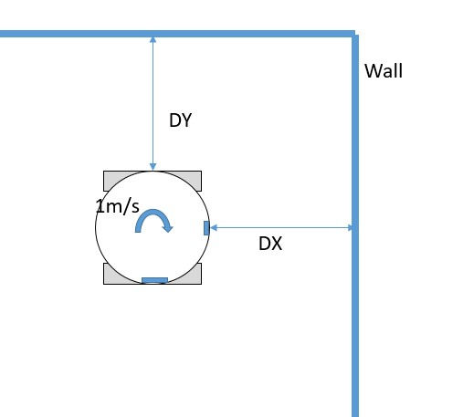
Wallに対してDY/DXを同じ距離を初期値として回転方向CWで**一定速度**で回転させTOF64センサが同じ距離を算出した時点で 1/4 回転(90°)とする。6軸センサのyaw各の補完として使用する事が出来る。これを数回行う事により床面とクローラの適正値を算出する事が出来る。

## 移動に関して
## Y方向に対する移動
非常に簡単に記述できます。左右のDCモータを**同じ回転数**で決まった秒数もしくは決まった移動距離を移動させれば良いと言う事になります。
DCモータドライバは正の整数(fwd) 負の整数(back) で記述する事が出来ます。
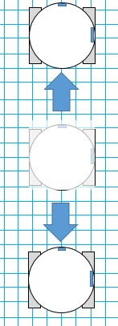
```c++:easyLiDAR.h
一部抜粋
void movy(int pwr, int msec) {
  static uint32_t tm = millis();
  if  ((millis() - tm) > msec) {
    tm = millis();
    dcR(pwr); 
    dcL(pwr); 
  }
}
```

## X方向に対する移動
オムニホイールやメカナムホイールに関しては現在位置からX方向に対するベクターを計算してささっと記述する事が出来ますが
クローラではそれは実現する事が出来ません。(車両タイプの場合にはもっと複雑なロジックが必要です)
良くありがちな**壁**に寄りすぎてしまった場合には壁から遠ざかる必要があります。
そこで今回は左側に移動する場合にはクローラ特有性能である**超信地旋回**を使いX方向に対する移動を
- 左回転90°
- 前進(移動距離分秒数)
- 右回転90°
というロジックで動作させようと実装しました。
左右のクローラを反対方向に駆動させる事で現在位置を保持しつつ回転できる最高の方法かと思います
<u>回転する前に回りに**車体の幅高さ**分のスペースがあることを予知しないと駄目なんですけど....</u>
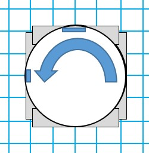 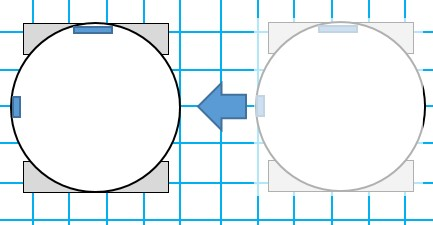 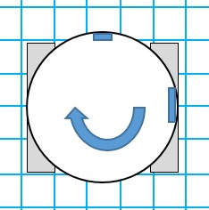
```c++:easyLiDAR.h
一部抜粋
void rotR(int pwr, int msec) {
  static uint32_t tm = millis();
  if  ((millis() - tm) > msec) {
    tm = millis();
    dcR( pwr); 
    dcL(-pwr); 
  }
}
void rotL(int pwr, int msec) {
  static uint32_t tm = millis();
  if  ((millis() - tm) > msec) {
    tm = millis();
    dcR(-pwr); 
    dcL( pwr); 
  }
}
void movx(int pwr, int msec) {
  rotL(pwr, 128);
  movx(pwr, msec);
  rotR(pwr, 128);
}
```
## 右手法アルゴリズムに関して
<blockquote class="twitter-tweet" data-theme="dark"><a href="https://twitter.com/chrmlinux03/status/1573148356477878273"></a></blockquote>
<script async src="https://platform.twitter.com/widgets.js" charset="utf-8"></script>
すべてのセンサとDCモータが**無事**動けば車体は以下のようなアルゴリズムで壁を回避**できることになる**
この走行はマッピングを行う為の走行であり **壁に沿って動けますよ** と言うデモ走行では無い事を伝えておく。
### 測距センサの概念図
前方にTOF64センサ FOV45°最大測距400cm右手にSR04センサ最大測距300cm
もうこれだけでお腹一杯である。

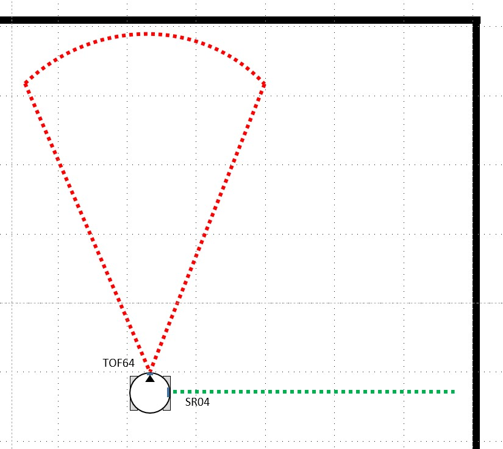
### 前方に壁を感じつつ右手は壁に沿わせる
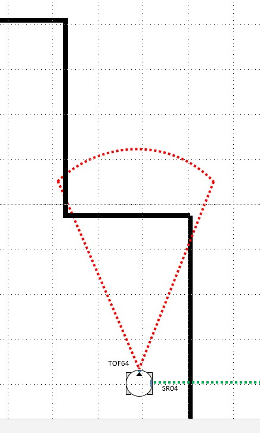
### 前方の壁との距離が短くなる
 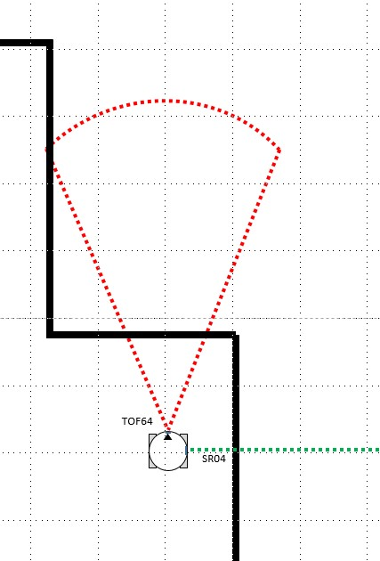
### 右手は壁に沿わせ左方向に90°回転を行う
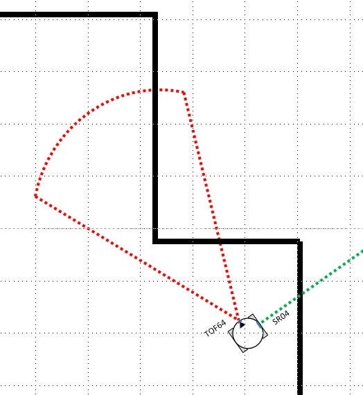
### 途中壁の角が右手にあたるが距離が比較的短いために回転をつづけ無事 90°回転を終わる
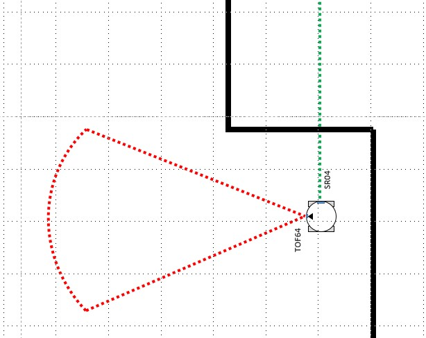
### 右手を壁に沿わせしばらく前進を続けると再び右手の壁が無くなる
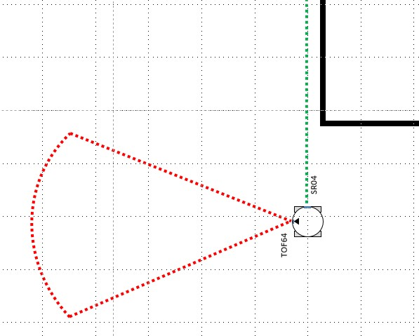
### すぐに回転してしまうと車体が壁にぶつかってしまうので車体＋α 進んだところで停止
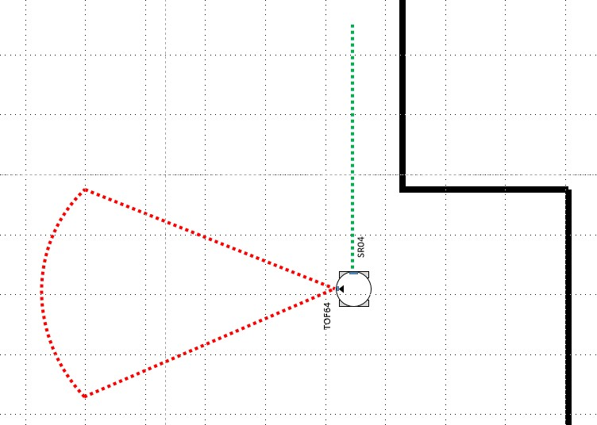
###  いい感じの所で回転を始める途中壁が右手に感じられても90°回りきるまでは待つ
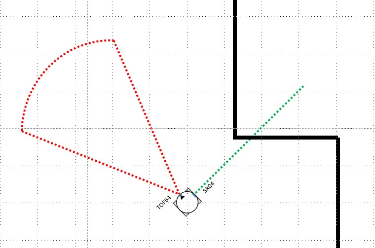
### 周り切った所で前進をする
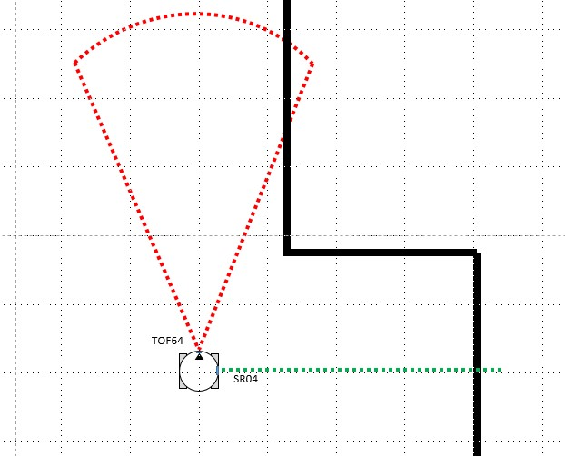

### 無事左手に壁を感じる事が出来た
壁との距離が近い/遠いと判断された場合には前述の **Y方向に対する移動**で壁との距離を調節できる
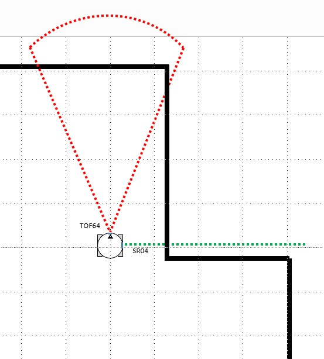

### 右手に壁を感じながら暫く進むと今後は前方に壁が出現する
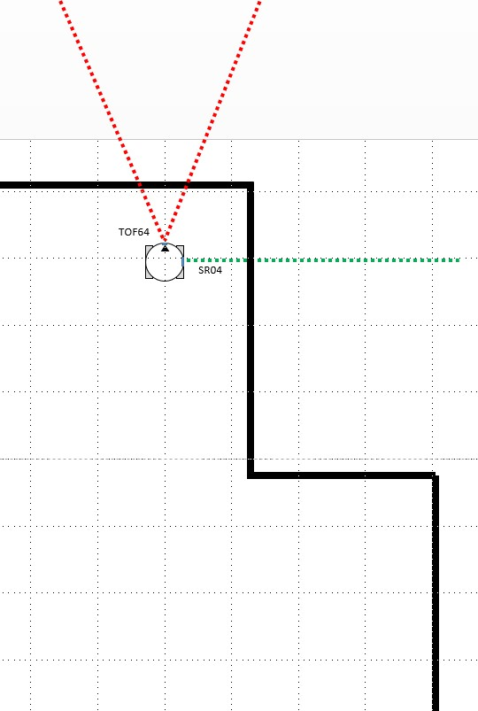

### 右手は壁なので左回転を90°行い出っ張りの部分を無事回避した
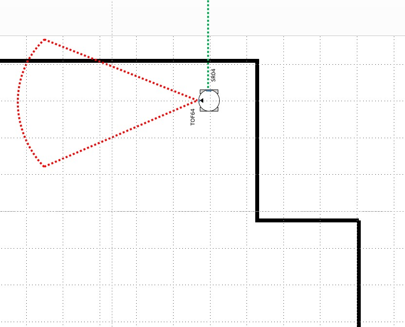

## 移動距離/回転方向に関して
壁に対して TOF64 は以下のような信号を排出する。
単一のTOFと違い中心点から fov45°で扇状に出力されるデータなので排出されたデータに円弧処理を多用する事になる。
<u>上記オートキャリブレーションと6軸センサを使ってより正確な距離角度が算出出来たらなぁと考えています</u>
<blockquote class="twitter-tweet" data-theme="dark"><a href="https://twitter.com/chrmlinux03/status/1570972350027538434"></a></blockquote>
<script async src="https://platform.twitter.com/widgets.js" charset="utf-8"></script>
## 取得されたTOF64データの補完
取得されたデータはあくまでも 8x8 のデータであるのでソフトウエアで 15 x 15 の倍分解能を持つデータに補完することとします。後述する右手法アルゴリズムで得られた障害物との接触情報が 8x8 では荒くより多くのデータにてMAP上に追記する必要があるからです。
これで波々ならぬギザギザのデータが滑らかになるといいのですが....
<u>センサデータの分解能を疑似的に増やしてもfov は変わりません
TOF64センサを2機3機と増やしていけば駆動部を持たない n x 45° のセンサも可能かと思います</u>
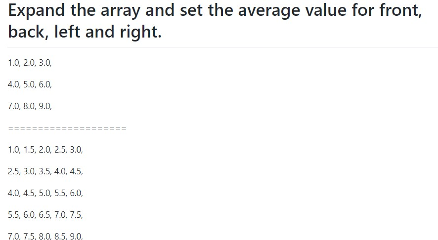
>自作補完ライブラリ
>https://github.com/chrmlinux/ArrayExt

## Pitch/Roll/yawに関して
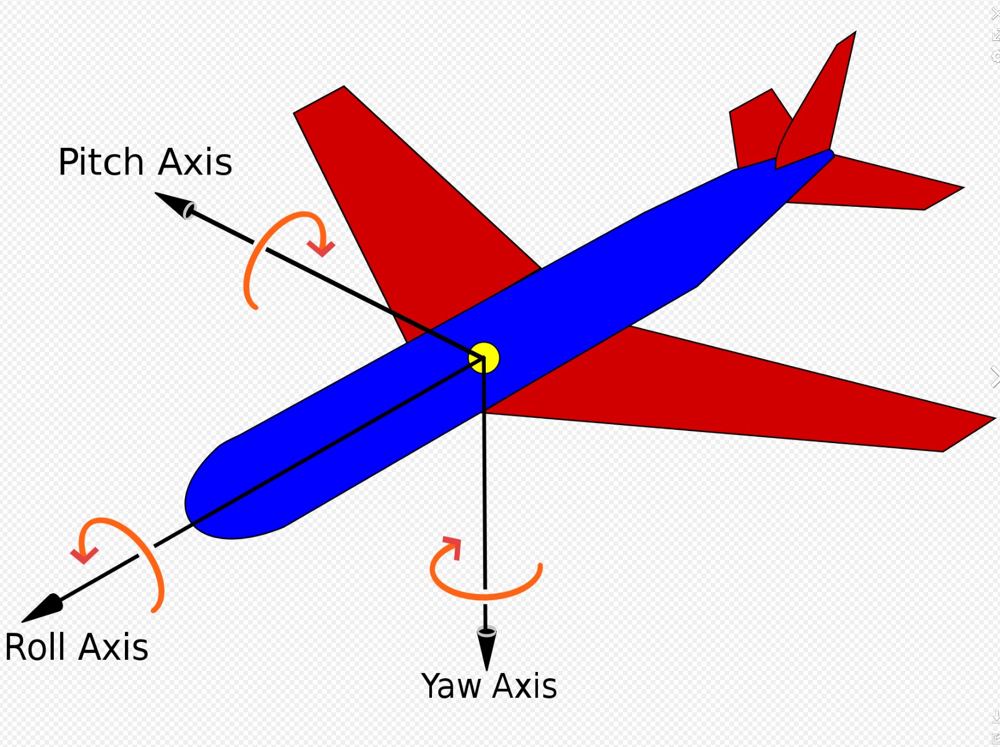
> 引用:ウイキペディア

一般の6軸センサは Pitch/Roll は良い感じなのですが Yaw角がなかなかひどい状況です。
キャリブレーションにより**ある程度**の補完をするします。
ドローンと違い 平面を駆動するロボットは Yaw角が一番大事なのです。

## 自己位置推定とアルゴリズム
Main.ino から SUb1.ino に渡す**巨大**な構造体には以下のデータが含まれています。
Main.ino が stat を更新することによりステータスマシンとして動作します
また各種センサからのデータは Main.ino にて更新を行い
マッピングで一番重要である**物体**の更新は Sub1 側で行う事とします

- sz 構造体の大きさ
 - func ファンクション
- resp レスポンス
- stat ステータス
- tof64 array uint16[8x8] 前面8x8 測距データ
- side 右側面 測距データ
- gyro ジャイロデータ type
x,y,z
- acc アクセラレータデータ type
x,y,z
- mode type
x pitch角
y roll角
z yaw角
- area array uint8[896x896] マップデータ
- blynk array uint8[8]
- move type 
x, y, z 移動方向と秒数
- angle type
x, y, z 車体の角度
- cnt デバック用カウンター
### ステータスマシン
車体は Main.ino 側から下記の6個のファンクションにて駆動します。
- 停止
- オートキャリブレーション
-  左手法アルゴリズムによる巡回
- 初期位置から目標位置 まで移動 **未実装**
- 現在位置から初期位置まで移動 **未実装**
- Blynk によるマニュアル操作
<u>当初は Spresense 側からDCモータドライバにアクセスして居たのですが
電圧の関係か電流の関係か本基板が書込み不可となってしまいました
現在は i2cSlave/wifiModem としてある M5AtomからDCモータドライバにアクセスを行っています
接続距離が遠いのですが逆にロジック側 制御側にうまく分かれたような気がします</u>

### マップ
マップは 全象限を使用し車体電源ON で センター 位置(0,0) から自己位置として開始します。
Main.ino から func を指定する事により現在位置を参照できます。
<u>実装されたメモリーの関係で現在は 896cm x 896cm までのマップ情報しか確保する事が出来ませんでした
Width 方向の 格納BIT を 8BIT(状態256) から 2BIT(状態4) に変更すれば 4倍のマップ情報を確保できる予定なのですが
拡張基板に搭載されたSDカードを駆使すればそれ以上のエリアを確保する事が出来ます
レスポンスはかなり落ちるかとは思いますのでまずは8m x 8m で対応させて頂きます</u>

### 自己位置の更新
自己位置は Sub1 側で更新し area array 上に状態を常に上書きします。
また **物体** の更新は移動先が更新されたタイミングで状態として上書きします。
右手法アルゴリズムにて障害物との接触を検知し
<blockquote class="twitter-tweet" data-theme="dark"><a href="https://twitter.com/chrmlinux03/status/1573545628772487168"></a></blockquote>
<script async src="https://platform.twitter.com/widgets.js" charset="utf-8"></script>
Local座標から Global座標への変換を行い area へと追記します
<blockquote class="twitter-tweet" data-theme="dark"><a href="https://twitter.com/chrmlinux03/status/1573547265440251904"></a></blockquote>
<script async src="https://platform.twitter.com/widgets.js" charset="utf-8"></script>

### 自己位置推定
TOF64の測距距離がカタログ上では400cm(4m)なのですがよく**ゴミ**を拾います。
前面と右側センサの兼ね合いから adrs->area を総なめして自己位置推定を行います。
その為の**Spresense**であり**マルチコア処理**であり**巨大なマップエリア**を必要とします。
つまりセンサが測距距離を得る事が出来なければ**現在は**自己位置は推定する事が出来ません。
<u>上記自己位置の更新からあるていど自己位置推定する事は可能なのですがそこは未知の領域です</u>

# 実機動作
USB充電
<blockquote class="twitter-tweet" data-theme="dark"><a href="https://twitter.com/chrmlinux03/status/1573210861896093696"></a></blockquote>
<script async src="https://platform.twitter.com/widgets.js" charset="utf-8"></script>
オートキャリブレーション
<blockquote class="twitter-tweet" data-theme="dark"><a href="https://twitter.com/chrmlinux03/status/1573251760390807553"></a></blockquote>
<script async src="https://platform.twitter.com/widgets.js" charset="utf-8"></script>
右手法アルゴリズムによるSLAM
<blockquote class="twitter-tweet" data-theme="dark"><a href="https://twitter.com/chrmlinux03/status/1573253363197964288"></a></blockquote>
<script async src="https://platform.twitter.com/widgets.js" charset="utf-8"></script>

TOF64 のFOVは45 °ですのでかなりな**壁**を用意しないと中々上手く **壁**を捉える事が出来ませんが
なんとなく**壁**に対する自分の位置/角度は検出出来ていると思われます。
<u>過去に 週に4日会議とプレゼン用データ**可視化**の作業を行っていたのですが、**可視化**はあくまでもデモ用でありデモだけの為に**可視化**ソフトを製作するのはいつもどうもなぁと言う感じです</u>

# 反省と今後の拡張
Yawの精度をなんとかしないと**駄目駄目**です現在はオートキャリブレーションで得た値を使ってふらふらですが動いているといった状況。またモータドライバにアクセスしDCモータが動くとSerialの出力が止まってしまう、センサ周りに**ノイズ**が乗りまくる。
暴走はしないものの予期しない動きをする....はぁという感じです
## 出費を抑えたい
提供された本基板を何度も壊してしまったり、必要以上に部材の購入が多すぎた...これは趣味の域を超えた出費である。
## モータドライバICを使ったコンパクトな設計
時間があまりなかったのでそこにあったMotorDrive基板を改造して使ってます、好ましくない。
## より良い6軸9軸センサの発掘
時間が先か実機が先かという意味では実機を優先したためにそれを補完するソフト側に負担が大きくなりました。
シンプルイズベスト...名言ですね
## より大きなマップを得るためにSDカード対応
マイコンはパソコンと違い湯水のようにメモリを使う事が出来ません。
拡張基板にSDカードが乗っているのではそれは重要視したいと考えてます。
## 最初にケースを選択しそれから実装を開始するようにする
途中で何度か試したのですが、良いカバーが無くて探すのを断念しました。
むき出しの配線は危険でありますし、見栄えもよくありませんです。
## 下記2点これちょっと良いアイデアなので是非バイナリで固めて配布したいと考えております
- i2cSlave/wifiModem バイナリライブラリ対応
- easyLiDAR バイナリライブラリ対応
## Spresense センサモジュールの正しい使い方をする
Main/Sub側の制約が激しすぎて正しい使い方ではない方法で組み上げてしまいました。そもそも"使用目的"を考えて実装するべきでした(反省)
<u>SLAMを制するものは本当に世界を制するのかも知れません</u>

# 最後に
中々ハードな1か月でしたがなんとなく完了の予感です
これを期にTOF64とSpresense を使ったロボットが沢山出てくれば良いなという感じです。
って言うか"書籍"が一冊書けそうなボリュームでした...///


ご清聴ありがとうございました。

<div class="like-wrap"><div data-lyket-type="like" data-lyket-template="twitter" data-lyket-namespace="linalog" data-lyket-color-icon="#b5e853" data-lyket-color-primary="#b5e853" data-lyket-color-text="#eaeaea" data-lyket-color-secondary="#2b2b2b" data-lyket-id="easylidar"></div></div>
