# linaLog

  

製作記事置き場です。Markdown のまま読めます。

Project write-ups, in Markdown.

X: <a href="https://x.com/chrmlinux03">@chrmlinux03</a>

<a href="feed.xml">RSS フィード</a>

## 記事 / Articles

<input id="searchBox" type="search" placeholder="検索（タイトル・タグ・日付）" aria-label="記事を検索">

<button id="sortBtn" type="button">古い順に並べ替える</button> <button id="tagToggle" type="button">タグを表示</button>

<ul id="articleList">
  <li data-tags="GitHub|ブログ" data-date="2026-11-27 21:10">2026-11-27 21:10 ― <a href="linalog-search-tags/">linaLog に検索とタグを付けた件</a> <a class="tag" href="?tag=GitHub">GitHub</a> <a class="tag" href="?tag=%E3%83%96%E3%83%AD%E3%82%B0">ブログ</a></li>
  <li data-tags="GitHub|ブログ" data-date="2026-11-27 15:31">2026-11-27 15:31 ― <a href="linalog-counter-like/">linaLog にアクセスカウンターと「いいね」を付けた件</a> <a class="tag" href="?tag=GitHub">GitHub</a> <a class="tag" href="?tag=%E3%83%96%E3%83%AD%E3%82%B0">ブログ</a></li>
  <li data-tags="GitHub|ブログ" data-date="2026-11-27 13:44">2026-11-27 13:44 ― <a href="blog-migration/">elchika から GitHub Pages へ、ブログ71記事を引っ越した手順</a> <a class="tag" href="?tag=GitHub">GitHub</a> <a class="tag" href="?tag=%E3%83%96%E3%83%AD%E3%82%B0">ブログ</a></li>
  <li data-tags="linux|Arduino|Unix" data-date="2026-11-26 20:17">2026-11-26 20:17 ― <a href="linax-uno/">linaX(uno) ― Arduino Uno（ATmega328P）に載せた Unix 系 OS</a> <a class="tag" href="?tag=linux">linux</a> <a class="tag" href="?tag=Arduino">Arduino</a> <a class="tag" href="?tag=Unix">Unix</a></li>
  <li data-tags="Junction|Windows11" data-date="2026-11-23 13:54">2026-11-23 13:54 ― <a href="windows-disk/">[Junction] Windows の C ドライブを空ける話 [目から鱗]</a> <a class="tag" href="?tag=Junction">Junction</a> <a class="tag" href="?tag=Windows11">Windows11</a></li>
  <li data-tags="linux|ESP32|CYD|LinaX" data-date="2026-11-21 21:41">2026-11-21 21:41 ― <a href="linax-cyd/">LinaX(cyd) ― PSRAM なしの ESP32（CYD）に載せた Linux 6.11</a> <a class="tag" href="?tag=linux">linux</a> <a class="tag" href="?tag=ESP32">ESP32</a> <a class="tag" href="?tag=CYD">CYD</a> <a class="tag" href="?tag=LinaX">LinaX</a></li>
  <li data-tags="CYD|ESP32|LinaX|linux" data-date="2026-11-21 14:52">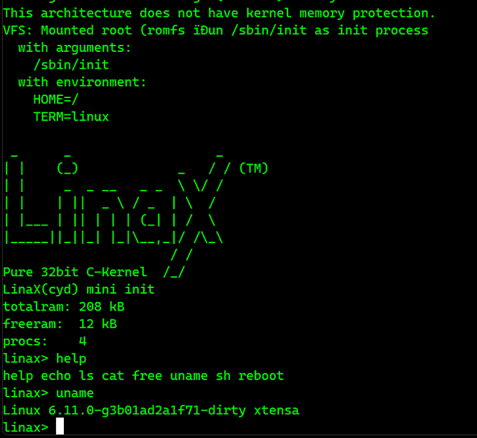2026-11-21 14:52 ― <a href="cyd-linux611/">[CYD]内蔵 DRAM 320KB で Linux6.11を動かしたにょ</a> <a class="tag" href="?tag=CYD">CYD</a> <a class="tag" href="?tag=ESP32">ESP32</a> <a class="tag" href="?tag=LinaX">LinaX</a> <a class="tag" href="?tag=linux">linux</a></li>
  <li data-tags="CYD|ESP32|x11" data-date="2026-11-19 10:46">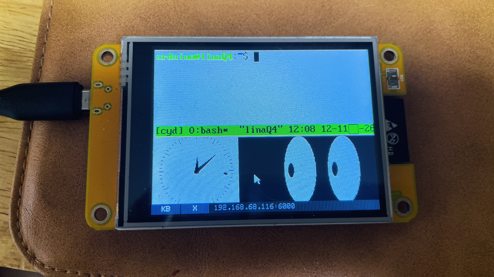2026-11-19 10:46 ― <a href="tinyx11-cyd/">[cyd] $7の液晶付きマイコンに x11 を載せてみた[3分ハッキング別冊]</a> <a class="tag" href="?tag=CYD">CYD</a> <a class="tag" href="?tag=ESP32">ESP32</a> <a class="tag" href="?tag=x11">x11</a></li>
  <li data-tags="KB2|M5Stack|SSH" data-date="2026-11-18 11:01">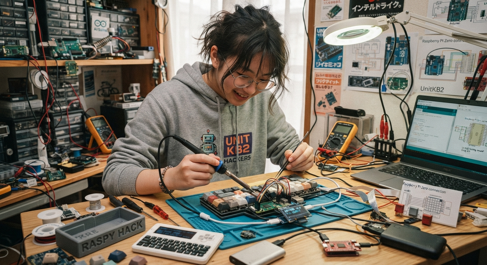2026-11-18 11:01 ― <a href="cardkb2-ssh/">[M5Stack]CardKB2に SSH クライアント実装した[3分ハッキング付録]</a> <a class="tag" href="?tag=KB2">KB2</a> <a class="tag" href="?tag=M5Stack">M5Stack</a> <a class="tag" href="?tag=SSH">SSH</a></li>
  <li data-tags="CARDKB2|CNT+C|M5Stack" data-date="2026-11-16 16:49">2026-11-16 16:49 ― <a href="cardkb2-cntc/">[M5Stack]CardKB2にCNT+Cを実装する[3分ハッキング最終回]</a> <a class="tag" href="?tag=CARDKB2">CARDKB2</a> <a class="tag" href="?tag=CNT%2BC">CNT+C</a> <a class="tag" href="?tag=M5Stack">M5Stack</a></li>
  <li data-tags="FEP|IME|SPRESENSE|日本語入力|自作OS" data-date="2026-09-19 13:51">2026-09-19 13:51 ― <a href="spresense-nihongo/">[#SPRESENSE 2026]簡単だけど奥が深いにょ[日本語入力]</a> <a class="tag" href="?tag=FEP">FEP</a> <a class="tag" href="?tag=IME">IME</a> <a class="tag" href="?tag=SPRESENSE">SPRESENSE</a> <a class="tag" href="?tag=%E6%97%A5%E6%9C%AC%E8%AA%9E%E5%85%A5%E5%8A%9B">日本語入力</a> <a class="tag" href="?tag=%E8%87%AA%E4%BD%9COS">自作OS</a></li>
  <li data-tags="CH32V003|I2C|ILI9341|SPI|cardputer|sop8" data-date="2026-09-16 11:06">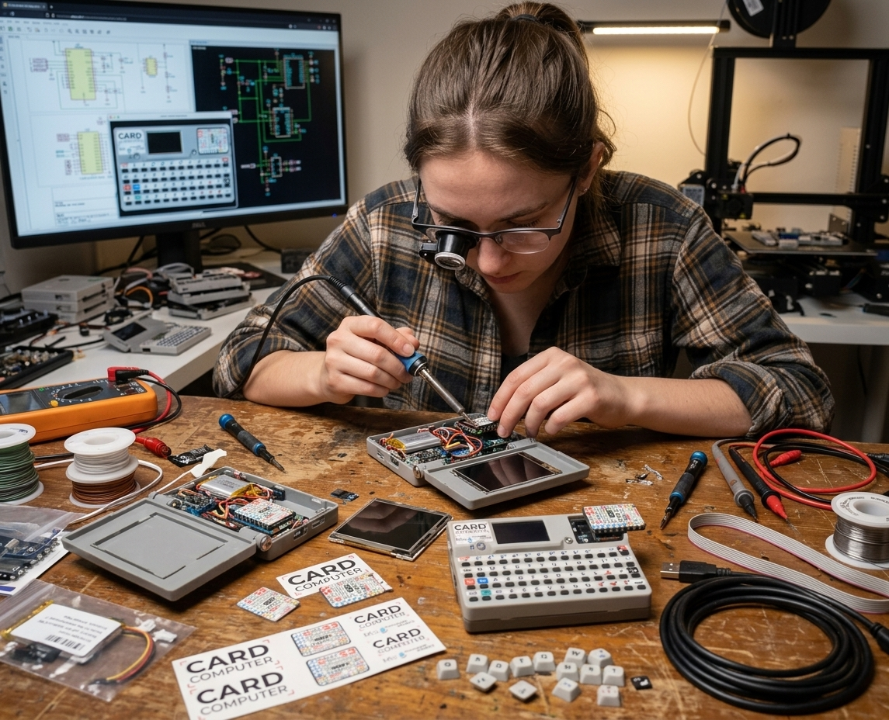2026-09-16 11:06 ― <a href="ch32v003-cardputer-lcd/">[ch32v003]ほぼどんなマイコンでも液晶付けられるにょ[cardputer]</a> <a class="tag" href="?tag=CH32V003">CH32V003</a> <a class="tag" href="?tag=I2C">I2C</a> <a class="tag" href="?tag=ILI9341">ILI9341</a> <a class="tag" href="?tag=SPI">SPI</a> <a class="tag" href="?tag=cardputer">cardputer</a> <a class="tag" href="?tag=sop8">sop8</a></li>
  <li data-tags="Arduino|LIVEC|M5Stack|VM|linux|stickS3|tab5|自作OS" data-date="2026-09-12 13:06">2026-09-12 13:06 ― <a href="spresense-linax-port/">[#SPRESENSE 2026]移植してみたにょ[linaX]</a> <a class="tag" href="?tag=Arduino">Arduino</a> <a class="tag" href="?tag=LIVEC">LIVEC</a> <a class="tag" href="?tag=M5Stack">M5Stack</a> <a class="tag" href="?tag=VM">VM</a> <a class="tag" href="?tag=linux">linux</a> <a class="tag" href="?tag=stickS3">stickS3</a> <a class="tag" href="?tag=tab5">tab5</a> <a class="tag" href="?tag=%E8%87%AA%E4%BD%9COS">自作OS</a></li>
  <li data-tags="Arduino|LIVEC|SPRESENSE|VM|linux|自作OS" data-date="2026-09-08 19:25">2026-09-08 19:25 ― <a href="spresense-linax/">[#SPRESENSE 2026]最終奥義OS作ってみたにょ[linaX]</a> <a class="tag" href="?tag=Arduino">Arduino</a> <a class="tag" href="?tag=LIVEC">LIVEC</a> <a class="tag" href="?tag=SPRESENSE">SPRESENSE</a> <a class="tag" href="?tag=VM">VM</a> <a class="tag" href="?tag=linux">linux</a> <a class="tag" href="?tag=%E8%87%AA%E4%BD%9COS">自作OS</a></li>
  <li data-tags="Arduino|LIVEC|SPRESENSE|VM|自作OS" data-date="2026-09-07 17:13">2026-09-07 17:13 ― <a href="lindos/">[#SPRESENSE 2026]OS作ってみたにょ[LinDOS]</a> <a class="tag" href="?tag=Arduino">Arduino</a> <a class="tag" href="?tag=LIVEC">LIVEC</a> <a class="tag" href="?tag=SPRESENSE">SPRESENSE</a> <a class="tag" href="?tag=VM">VM</a> <a class="tag" href="?tag=%E8%87%AA%E4%BD%9COS">自作OS</a></li>
  <li data-tags="Arduino|FORTRAN|LIVEFO|SPRESENSE|VM|自作OS" data-date="2026-09-03 13:06">2026-09-03 13:06 ― <a href="livefo/">[#SPRESENSE 2026] FORTRAN(VM)を作ったにょ [LiveFO編]</a> <a class="tag" href="?tag=Arduino">Arduino</a> <a class="tag" href="?tag=FORTRAN">FORTRAN</a> <a class="tag" href="?tag=LIVEFO">LIVEFO</a> <a class="tag" href="?tag=SPRESENSE">SPRESENSE</a> <a class="tag" href="?tag=VM">VM</a> <a class="tag" href="?tag=%E8%87%AA%E4%BD%9COS">自作OS</a></li>
  <li data-tags="Arduino|COBOL|LIVECO|SPRESENSE|VM|自作OS" data-date="2026-09-02 13:20">2026-09-02 13:20 ― <a href="liveco/">[#SPRESENSE 2026] COBOLインタプリタ(VM)を作ったにょ [LiveCO編]</a> <a class="tag" href="?tag=Arduino">Arduino</a> <a class="tag" href="?tag=COBOL">COBOL</a> <a class="tag" href="?tag=LIVECO">LIVECO</a> <a class="tag" href="?tag=SPRESENSE">SPRESENSE</a> <a class="tag" href="?tag=VM">VM</a> <a class="tag" href="?tag=%E8%87%AA%E4%BD%9COS">自作OS</a></li>
  <li data-tags="Arduino|BASIC|LIVEB|LIVEP|Python|SPRESENSE|VM|自作OS" data-date="2026-08-31 16:56">2026-08-31 16:56 ― <a href="liveb-livep/">[#SPRESENSE 2026]Cインタプリタ(VM)を作ったにょ[LiveB/LiveP編]</a> <a class="tag" href="?tag=Arduino">Arduino</a> <a class="tag" href="?tag=BASIC">BASIC</a> <a class="tag" href="?tag=LIVEB">LIVEB</a> <a class="tag" href="?tag=LIVEP">LIVEP</a> <a class="tag" href="?tag=Python">Python</a> <a class="tag" href="?tag=SPRESENSE">SPRESENSE</a> <a class="tag" href="?tag=VM">VM</a> <a class="tag" href="?tag=%E8%87%AA%E4%BD%9COS">自作OS</a></li>
  <li data-tags="Arduino|C言語|LIVEC|SPRESENSE|VM|自作OS" data-date="2026-08-26 13:28">2026-08-26 13:28 ― <a href="livec-editor/">[#SPRESENSE 2026]Cインタプリタ(VM)を作ったにょ[エディタ編]</a> <a class="tag" href="?tag=Arduino">Arduino</a> <a class="tag" href="?tag=C%E8%A8%80%E8%AA%9E">C言語</a> <a class="tag" href="?tag=LIVEC">LIVEC</a> <a class="tag" href="?tag=SPRESENSE">SPRESENSE</a> <a class="tag" href="?tag=VM">VM</a> <a class="tag" href="?tag=%E8%87%AA%E4%BD%9COS">自作OS</a></li>
  <li data-tags="Arduino|C言語|LIVEC|SPRESENSE|VM|ch9350|キーボード|マウス|自作OS" data-date="2026-08-26 13:10">2026-08-26 13:10 ― <a href="livec-ch9350/">[#SPRESENSE 2026]Cインタプリタ(VM)を作ったにょ[ch9350編]</a> <a class="tag" href="?tag=Arduino">Arduino</a> <a class="tag" href="?tag=C%E8%A8%80%E8%AA%9E">C言語</a> <a class="tag" href="?tag=LIVEC">LIVEC</a> <a class="tag" href="?tag=SPRESENSE">SPRESENSE</a> <a class="tag" href="?tag=VM">VM</a> <a class="tag" href="?tag=ch9350">ch9350</a> <a class="tag" href="?tag=%E3%82%AD%E3%83%BC%E3%83%9C%E3%83%BC%E3%83%89">キーボード</a> <a class="tag" href="?tag=%E3%83%9E%E3%82%A6%E3%82%B9">マウス</a> <a class="tag" href="?tag=%E8%87%AA%E4%BD%9COS">自作OS</a></li>
  <li data-tags="Arduino|C言語|LIVEC|SPRESENSE|VM|自作OS" data-date="2026-08-26 11:44">2026-08-26 11:44 ― <a href="livec/">[#SPRESENSE 2026]Cインタプリタ(VM)を作ったにょ[LiveC編]</a> <a class="tag" href="?tag=Arduino">Arduino</a> <a class="tag" href="?tag=C%E8%A8%80%E8%AA%9E">C言語</a> <a class="tag" href="?tag=LIVEC">LIVEC</a> <a class="tag" href="?tag=SPRESENSE">SPRESENSE</a> <a class="tag" href="?tag=VM">VM</a> <a class="tag" href="?tag=%E8%87%AA%E4%BD%9COS">自作OS</a></li>
  <li data-tags="Audio|CVBS|USBDAC" data-date="2026-06-18 11:41">2026-06-18 11:41 ― <a href="usbdac-cvbs-small/">[USBDAC]基板が小さくなったにょ[CVBS]</a> <a class="tag" href="?tag=Audio">Audio</a> <a class="tag" href="?tag=CVBS">CVBS</a> <a class="tag" href="?tag=USBDAC">USBDAC</a></li>
  <li data-tags="Audio|CVBS|HIRES" data-date="2026-06-17 13:27">2026-06-17 13:27 ― <a href="usbdac-ntsc/">[USBDAC]イヤホンジャックでNTSC映像を出してみたにょ[CVBS]</a> <a class="tag" href="?tag=Audio">Audio</a> <a class="tag" href="?tag=CVBS">CVBS</a> <a class="tag" href="?tag=HIRES">HIRES</a></li>
  <li data-tags="Audio|CVBS|HIRES|SPRESENSE|misakifont|漢字" data-date="2026-06-16 16:51">2026-06-16 16:51 ― <a href="spresense-audiohack-kanji/">[SPRESENSE 2026]AudioHack漢字に対応したにょ[CVBS]</a> <a class="tag" href="?tag=Audio">Audio</a> <a class="tag" href="?tag=CVBS">CVBS</a> <a class="tag" href="?tag=HIRES">HIRES</a> <a class="tag" href="?tag=SPRESENSE">SPRESENSE</a> <a class="tag" href="?tag=misakifont">misakifont</a> <a class="tag" href="?tag=%E6%BC%A2%E5%AD%97">漢字</a></li>
  <li data-tags="Audio|CVBS|HIRES|SPRESENSE" data-date="2026-06-15 16:52">2026-06-15 16:52 ― <a href="spresense-audiojack-hack/">[SPRESENSE 2026]AudioJackをHackしたにょ[CVBS]</a> <a class="tag" href="?tag=Audio">Audio</a> <a class="tag" href="?tag=CVBS">CVBS</a> <a class="tag" href="?tag=HIRES">HIRES</a> <a class="tag" href="?tag=SPRESENSE">SPRESENSE</a></li>
  <li data-tags="CVBS|SPRESENSE" data-date="2026-06-10 12:22">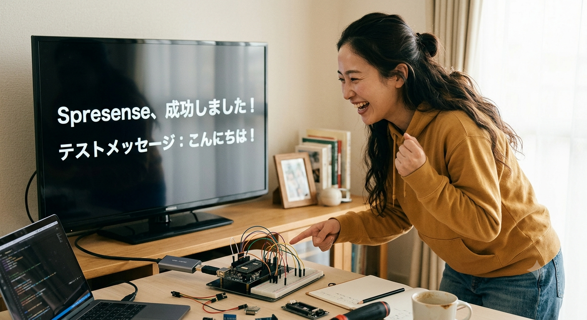2026-06-10 12:22 ― <a href="spresense-tv-cvbs/">[SPRESENSE 2026]TVに出力したにょ[CVBS]</a> <a class="tag" href="?tag=CVBS">CVBS</a> <a class="tag" href="?tag=SPRESENSE">SPRESENSE</a></li>
  <li data-tags="CH552E|CH552G|MSOP10|SOP10|USB-Audio|linaAudio" data-date="2026-06-05 10:50">2026-06-05 10:50 ― <a href="linaaudio-2/">【linaAudio】45円CPUで作るUSB-Audioだにょ②【動作編】</a> <a class="tag" href="?tag=CH552E">CH552E</a> <a class="tag" href="?tag=CH552G">CH552G</a> <a class="tag" href="?tag=MSOP10">MSOP10</a> <a class="tag" href="?tag=SOP10">SOP10</a> <a class="tag" href="?tag=USB-Audio">USB-Audio</a> <a class="tag" href="?tag=linaAudio">linaAudio</a></li>
  <li data-tags="CH32V003|USB-Audio|linaAudio|linaduino|sop8" data-date="2026-05-27 10:18">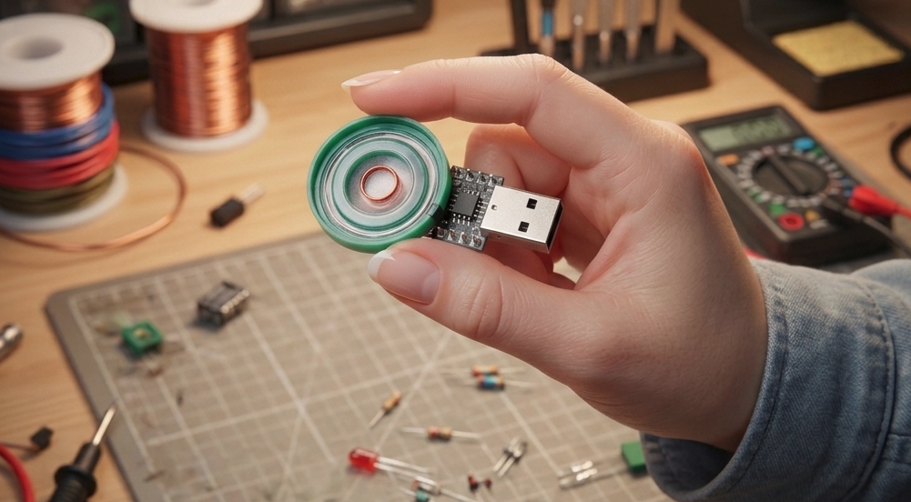2026-05-27 10:18 ― <a href="linaaudio-1/">【linaAudio】25円CPUで作るUSB-Audioだにょ①【認識編】</a> <a class="tag" href="?tag=CH32V003">CH32V003</a> <a class="tag" href="?tag=USB-Audio">USB-Audio</a> <a class="tag" href="?tag=linaAudio">linaAudio</a> <a class="tag" href="?tag=linaduino">linaduino</a> <a class="tag" href="?tag=sop8">sop8</a></li>
  <li data-tags="IRFi|WiFi" data-date="2026-05-20 13:58">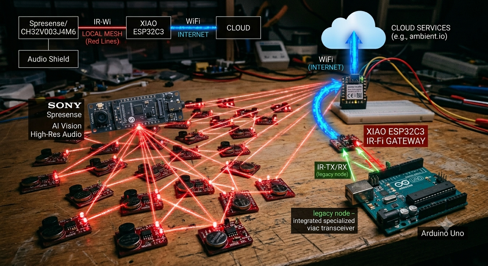2026-05-20 13:58 ― <a href="irfi/">【IRFi】え？IRDAでWiFi?【無線光通信】</a> <a class="tag" href="?tag=IRFi">IRFi</a> <a class="tag" href="?tag=WiFi">WiFi</a></li>
  <li data-tags="CH32V003|Grove|USB-HID|linaduino|sop8" data-date="2026-05-15 08:31">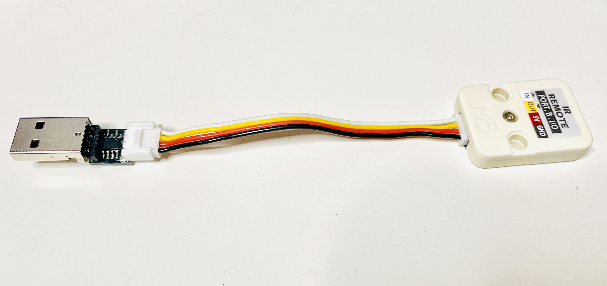2026-05-15 08:31 ― <a href="linaduino-usbgrove/">【linaDuino】25円で作るUSBGroveブリッジだにょ【USBGrove】</a> <a class="tag" href="?tag=CH32V003">CH32V003</a> <a class="tag" href="?tag=Grove">Grove</a> <a class="tag" href="?tag=USB-HID">USB-HID</a> <a class="tag" href="?tag=linaduino">linaduino</a> <a class="tag" href="?tag=sop8">sop8</a></li>
  <li data-tags="CH32V003|ILI9341|USB-HID|linaduino|sop8" data-date="2026-05-14 20:30">2026-05-14 20:30 ― <a href="linaduino-usbmonitor/">【linaDuino】25円で作るUSBモニターだにょ【USBMonitor】</a> <a class="tag" href="?tag=CH32V003">CH32V003</a> <a class="tag" href="?tag=ILI9341">ILI9341</a> <a class="tag" href="?tag=USB-HID">USB-HID</a> <a class="tag" href="?tag=linaduino">linaduino</a> <a class="tag" href="?tag=sop8">sop8</a></li>
  <li data-tags="CH32V003|USB-HID|gamepad|linaduino|sop8" data-date="2026-05-14 14:27">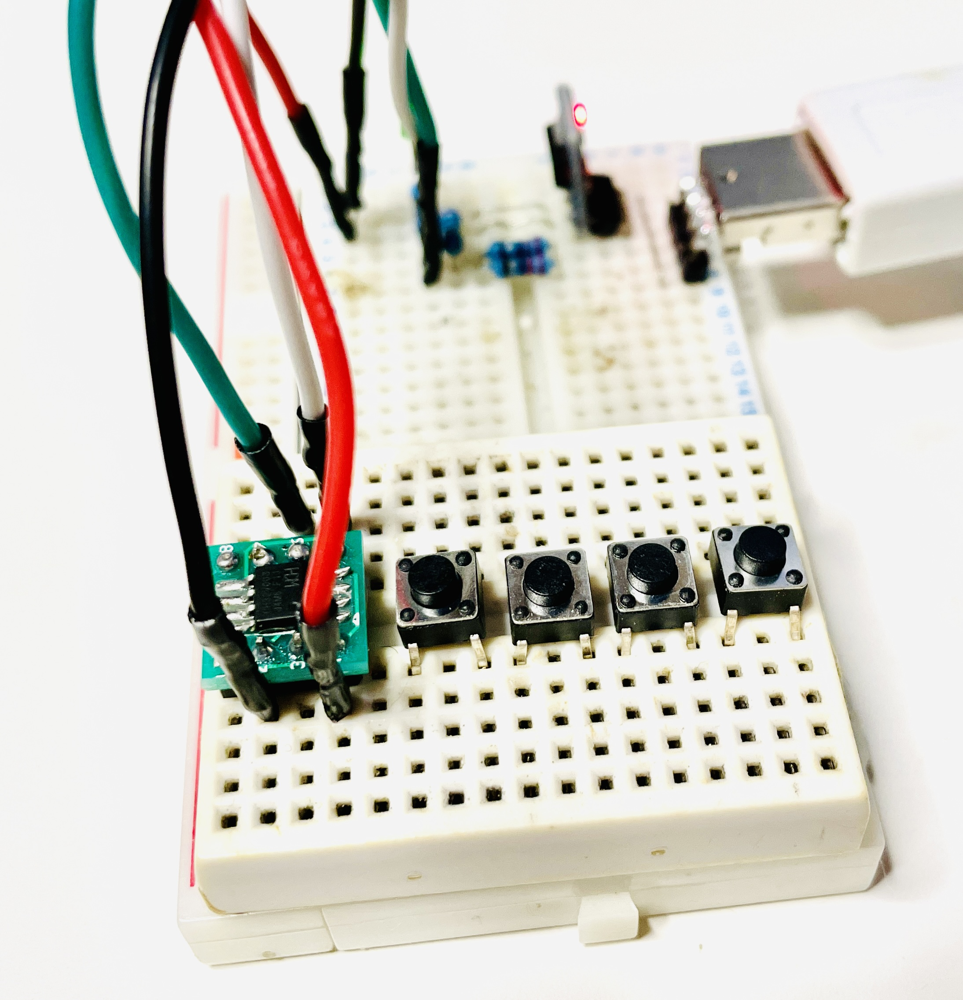2026-05-14 14:27 ― <a href="linaduino-4btnpad/">【linaDuino】25円で作るUSB-HIDだにょ【4btnPad】</a> <a class="tag" href="?tag=CH32V003">CH32V003</a> <a class="tag" href="?tag=USB-HID">USB-HID</a> <a class="tag" href="?tag=gamepad">gamepad</a> <a class="tag" href="?tag=linaduino">linaduino</a> <a class="tag" href="?tag=sop8">sop8</a></li>
  <li data-tags="USB" data-date="2026-05-10 23:13">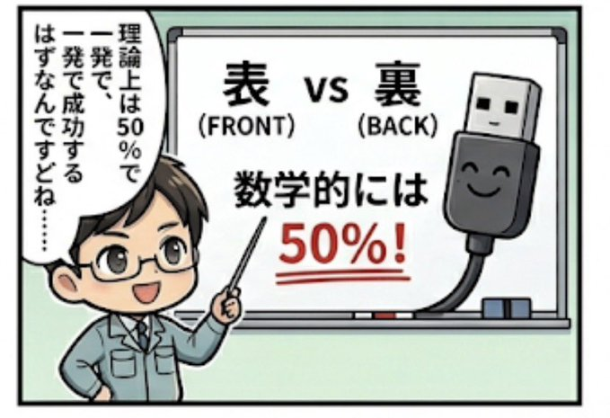2026-05-10 23:13 ― <a href="usb-a-probability/">【USB-Aの成功率】50%のはずが75%の確率で間違える理由【なぜなぜ？】</a> <a class="tag" href="?tag=USB">USB</a></li>
  <li data-tags="CH32V003|j4m6|linaduino|sop8" data-date="2026-05-07 14:09">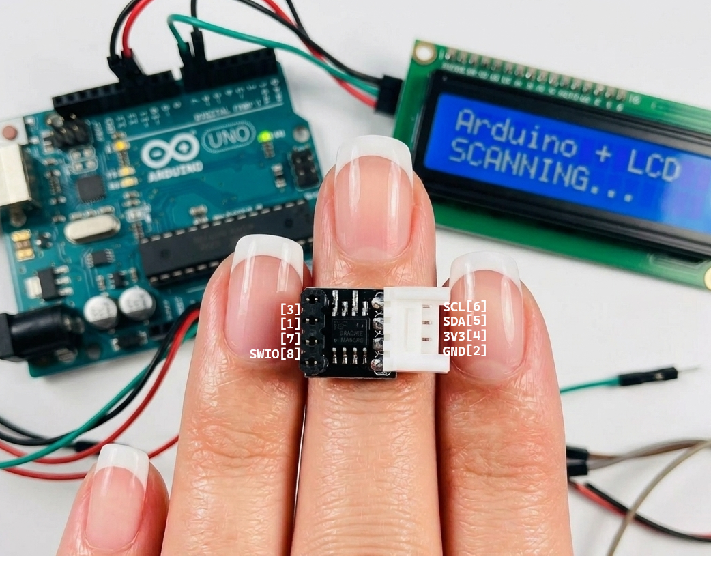2026-05-07 14:09 ― <a href="linaduino/">【linaDuino】リナディーノ(てじなーにゃのアクセントで)【世界最小Arduino互換】</a> <a class="tag" href="?tag=CH32V003">CH32V003</a> <a class="tag" href="?tag=j4m6">j4m6</a> <a class="tag" href="?tag=linaduino">linaduino</a> <a class="tag" href="?tag=sop8">sop8</a></li>
  <li data-tags="64bit|CH32V003|RISC-V|クラスタ|リナゴスティーニ" data-date="2026-04-08 11:21">2026-04-08 11:21 ― <a href="linagostini-1/">【リナゴスティーニ①創刊号】64bitI2Cクラスタを27円RISC-Vで作るにょ【思想】</a> <a class="tag" href="?tag=64bit">64bit</a> <a class="tag" href="?tag=CH32V003">CH32V003</a> <a class="tag" href="?tag=RISC-V">RISC-V</a> <a class="tag" href="?tag=%E3%82%AF%E3%83%A9%E3%82%B9%E3%82%BF">クラスタ</a> <a class="tag" href="?tag=%E3%83%AA%E3%83%8A%E3%82%B4%E3%82%B9%E3%83%86%E3%82%A3%E3%83%BC%E3%83%8B">リナゴスティーニ</a></li>
  <li data-tags="40円マイコン|Arduino-IDE|CH32RTA|CH32V003" data-date="2026-04-01 11:06">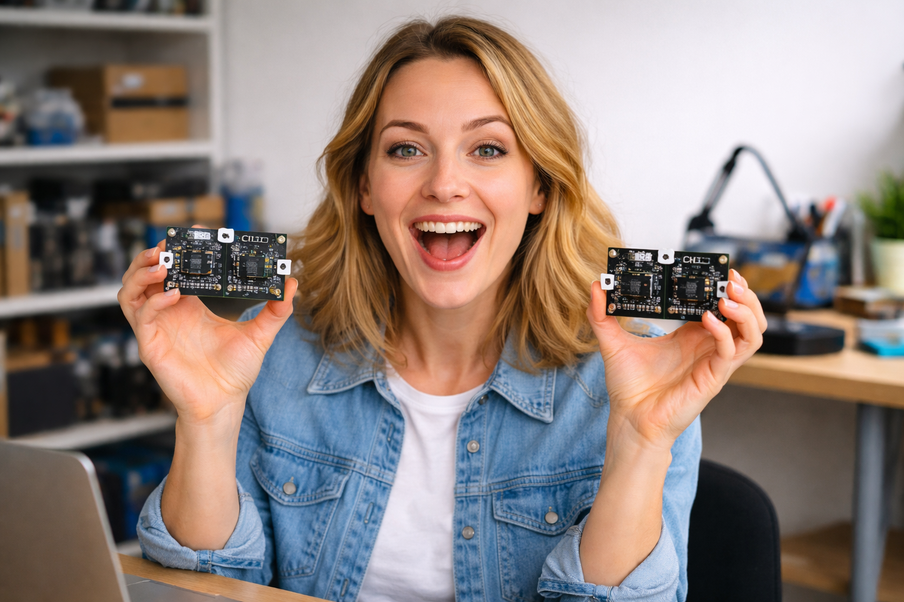2026-04-01 11:06 ― <a href="dual-ch32v003/">【dualCH32V003】92ByteでPD6から高速矩形波を出してみたにょ【40円マイコン】</a> <a class="tag" href="?tag=40%E5%86%86%E3%83%9E%E3%82%A4%E3%82%B3%E3%83%B3">40円マイコン</a> <a class="tag" href="?tag=Arduino-IDE">Arduino-IDE</a> <a class="tag" href="?tag=CH32RTA">CH32RTA</a> <a class="tag" href="?tag=CH32V003">CH32V003</a></li>
  <li data-tags="290円マイコン|CH32V003|UIAPduino" data-date="2026-03-25 12:41">2026-03-25 12:41 ― <a href="uiapduino-video/">【UIAPduino】VIDEO信号を出したにょ①【290円マイコン基板】</a> <a class="tag" href="?tag=290%E5%86%86%E3%83%9E%E3%82%A4%E3%82%B3%E3%83%B3">290円マイコン</a> <a class="tag" href="?tag=CH32V003">CH32V003</a> <a class="tag" href="?tag=UIAPduino">UIAPduino</a></li>
  <li data-tags="290円マイコン|CH32V003|UIAPduino" data-date="2026-03-18 13:17">2026-03-18 13:17 ― <a href="uiapduino-printf/">【UIAPduino】printf を実装するにょ【290円マイコン基板】</a> <a class="tag" href="?tag=290%E5%86%86%E3%83%9E%E3%82%A4%E3%82%B3%E3%83%B3">290円マイコン</a> <a class="tag" href="?tag=CH32V003">CH32V003</a> <a class="tag" href="?tag=UIAPduino">UIAPduino</a></li>
  <li data-tags="290円マイコン|CH32V003|UIAPduino" data-date="2026-03-07 17:56">2026-03-07 17:56 ― <a href="uiapduino/">【UIAPduino】普通に使えるっぽいにょ【290円マイコン基板】</a> <a class="tag" href="?tag=290%E5%86%86%E3%83%9E%E3%82%A4%E3%82%B3%E3%83%B3">290円マイコン</a> <a class="tag" href="?tag=CH32V003">CH32V003</a> <a class="tag" href="?tag=UIAPduino">UIAPduino</a></li>
  <li data-tags="Arduino|linux|unoQ" data-date="2026-03-05 18:23">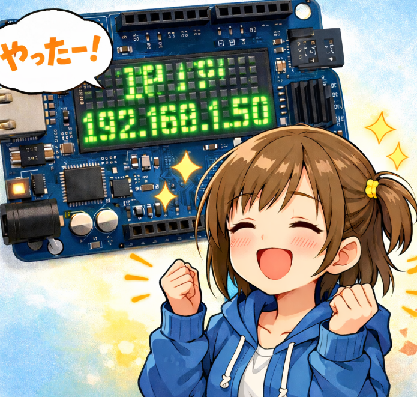2026-03-05 18:23 ― <a href="unoq-matrix-ip/">【unoQ】起動時にIPアドレスと温度をMatrixに表示するにょ【小さなLinux機】</a> <a class="tag" href="?tag=Arduino">Arduino</a> <a class="tag" href="?tag=linux">linux</a> <a class="tag" href="?tag=unoQ">unoQ</a></li>
  <li data-tags="Arduino|linaQ|linux|unoQ" data-date="2026-03-02 06:44">2026-03-02 06:44 ― <a href="unoq-freedos/">【unoQ】tiny386でFreeDos動かしたにょ【小さなLinux機】</a> <a class="tag" href="?tag=Arduino">Arduino</a> <a class="tag" href="?tag=linaQ">linaQ</a> <a class="tag" href="?tag=linux">linux</a> <a class="tag" href="?tag=unoQ">unoQ</a></li>
  <li data-tags="Arduino|linux|unoQ" data-date="2026-02-25 10:06">2026-02-25 10:06 ― <a href="unoq-windows/">【unoQ】Windowsを動かしたにょ【小さなLinux機】</a> <a class="tag" href="?tag=Arduino">Arduino</a> <a class="tag" href="?tag=linux">linux</a> <a class="tag" href="?tag=unoQ">unoQ</a></li>
  <li data-tags="Arduino|linux|unoQ" data-date="2026-02-18 09:42">2026-02-18 09:42 ― <a href="unoq-ros2/">【unoQ】ROS2を無理やり入れたにょ【小さなLinux機】</a> <a class="tag" href="?tag=Arduino">Arduino</a> <a class="tag" href="?tag=linux">linux</a> <a class="tag" href="?tag=unoQ">unoQ</a></li>
  <li data-tags="Arduino|linux|unoQ" data-date="2026-02-11 16:00">2026-02-11 16:00 ― <a href="unoq-x11-lcd/">【unoQ】QRB側X11をSTM32のLCDに表示出来たにょ【小さなLinux機】</a> <a class="tag" href="?tag=Arduino">Arduino</a> <a class="tag" href="?tag=linux">linux</a> <a class="tag" href="?tag=unoQ">unoQ</a></li>
  <li data-tags="Arduino|linux|unoQ" data-date="2026-02-09 17:57">2026-02-09 17:57 ― <a href="unoq-qrb-stm32/">【unoQ】さっそく簡単にQRBとSTM32U5通信させたにょ【小さなLinux機】</a> <a class="tag" href="?tag=Arduino">Arduino</a> <a class="tag" href="?tag=linux">linux</a> <a class="tag" href="?tag=unoQ">unoQ</a></li>
  <li data-tags="Arduino|linux|unoQ" data-date="2026-02-06 10:54">2026-02-06 10:54 ― <a href="unoq-setup/">【unoQ】Arduino UNO Q 簡単初期セットアップ手順【小さなLinux機】</a> <a class="tag" href="?tag=Arduino">Arduino</a> <a class="tag" href="?tag=linux">linux</a> <a class="tag" href="?tag=unoQ">unoQ</a></li>
  <li data-tags="GNSS|GPS|SDカード|SPRESENSE|VGA|WiFi" data-date="2026-01-28 01:47">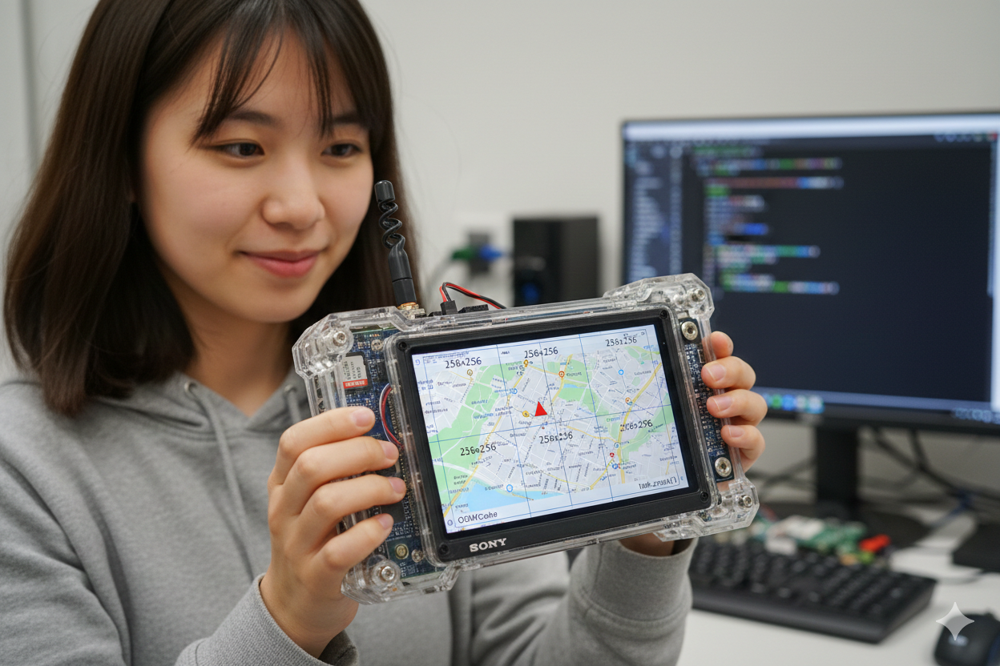2026-01-28 01:47 ― <a href="spresense-sprepad/">【SPRESENSE2025】VGA液晶を搭載しGPS地図を表示したにょ【sprePAD?】</a> <a class="tag" href="?tag=GNSS">GNSS</a> <a class="tag" href="?tag=GPS">GPS</a> <a class="tag" href="?tag=SD%E3%82%AB%E3%83%BC%E3%83%89">SDカード</a> <a class="tag" href="?tag=SPRESENSE">SPRESENSE</a> <a class="tag" href="?tag=VGA">VGA</a> <a class="tag" href="?tag=WiFi">WiFi</a></li>
  <li data-tags="NNC|SPRESENSE|YOLO|dnnRt|ロボット|追従エンジン" data-date="2026-01-20 18:59">2026-01-20 18:59 ― <a href="spresense-dnn/">【SPRESENSE2025】dnnPlathomeを作ったょ【YOLOっぽい】</a> <a class="tag" href="?tag=NNC">NNC</a> <a class="tag" href="?tag=SPRESENSE">SPRESENSE</a> <a class="tag" href="?tag=YOLO">YOLO</a> <a class="tag" href="?tag=dnnRt">dnnRt</a> <a class="tag" href="?tag=%E3%83%AD%E3%83%9C%E3%83%83%E3%83%88">ロボット</a> <a class="tag" href="?tag=%E8%BF%BD%E5%BE%93%E3%82%A8%E3%83%B3%E3%82%B8%E3%83%B3">追従エンジン</a></li>
  <li data-tags="I2C|RDA5807|SPRESENSE" data-date="2026-01-09 16:25">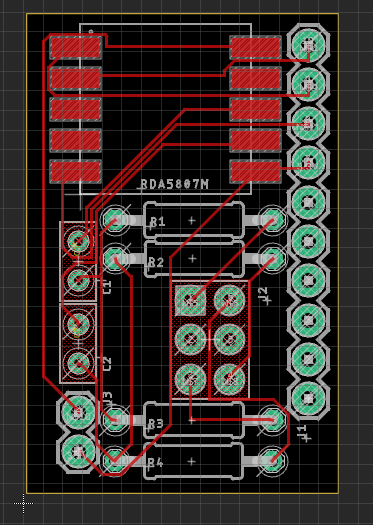2026-01-09 16:25 ― <a href="spresense-radio/">【SPRESENSE2025】spresense拡張基板に搭載できるラジオモジュールを作ったよっ</a> <a class="tag" href="?tag=I2C">I2C</a> <a class="tag" href="?tag=RDA5807">RDA5807</a> <a class="tag" href="?tag=SPRESENSE">SPRESENSE</a></li>
  <li data-tags="Arduino|ESPNOW|SPRESENSE|テオヤンセン" data-date="2025-01-31 20:05">2025-01-31 20:05 ― <a href="spresense-jansen/">【SPRESENSE2024】動くテオ・ヤンセン機構【eNord通信】</a> <a class="tag" href="?tag=Arduino">Arduino</a> <a class="tag" href="?tag=ESPNOW">ESPNOW</a> <a class="tag" href="?tag=SPRESENSE">SPRESENSE</a> <a class="tag" href="?tag=%E3%83%86%E3%82%AA%E3%83%A4%E3%83%B3%E3%82%BB%E3%83%B3">テオヤンセン</a></li>
  <li data-tags="3Dプリンタ|Arduino|SPRESENSE|mp3|長岡式" data-date="2025-01-30 17:09">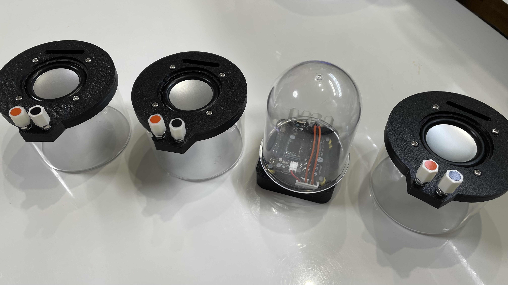2025-01-30 17:09 ― <a href="spresense-matrix-speaker/">【SPRESENSE2024】3Dプリンターで長岡式マトリクススピーカー【夢のオーディオ体験】</a> <a class="tag" href="?tag=3D%E3%83%97%E3%83%AA%E3%83%B3%E3%82%BF">3Dプリンタ</a> <a class="tag" href="?tag=Arduino">Arduino</a> <a class="tag" href="?tag=SPRESENSE">SPRESENSE</a> <a class="tag" href="?tag=mp3">mp3</a> <a class="tag" href="?tag=%E9%95%B7%E5%B2%A1%E5%BC%8F">長岡式</a></li>
  <li data-tags="GNSS|LoRa|SPRESENSE" data-date="2025-01-29 16:24">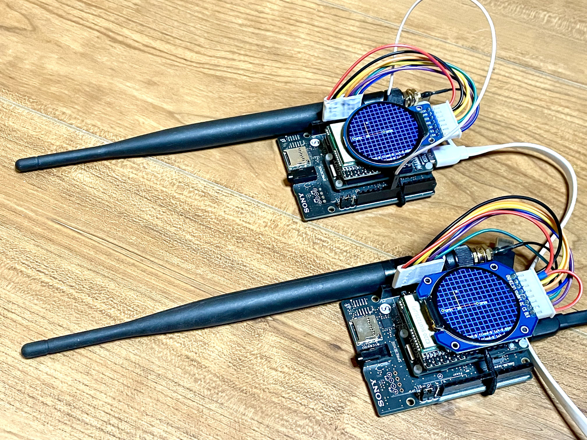2025-01-29 16:24 ― <a href="spresense-compass/">【SPRESENSE2024】今年の恵方巻きの方向は？【サテライトコンパス】</a> <a class="tag" href="?tag=GNSS">GNSS</a> <a class="tag" href="?tag=LoRa">LoRa</a> <a class="tag" href="?tag=SPRESENSE">SPRESENSE</a></li>
  <li data-tags="SPRESENSE|タッチパネル|マルチコア|マルチスレッド|マンデルブロ集合|リアルタイム" data-date="2025-01-28 23:13">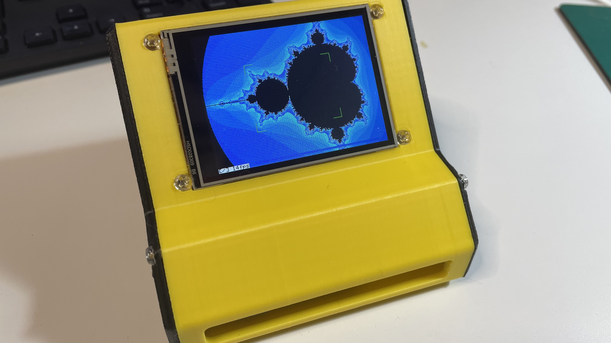2025-01-28 23:13 ― <a href="spresense-mandelbrot/">【SPRESENSE2024】仮想30コアでマンデルブロ集合【リアルタイム描画】</a> <a class="tag" href="?tag=SPRESENSE">SPRESENSE</a> <a class="tag" href="?tag=%E3%82%BF%E3%83%83%E3%83%81%E3%83%91%E3%83%8D%E3%83%AB">タッチパネル</a> <a class="tag" href="?tag=%E3%83%9E%E3%83%AB%E3%83%81%E3%82%B3%E3%82%A2">マルチコア</a> <a class="tag" href="?tag=%E3%83%9E%E3%83%AB%E3%83%81%E3%82%B9%E3%83%AC%E3%83%83%E3%83%89">マルチスレッド</a> <a class="tag" href="?tag=%E3%83%9E%E3%83%B3%E3%83%87%E3%83%AB%E3%83%96%E3%83%AD%E9%9B%86%E5%90%88">マンデルブロ集合</a> <a class="tag" href="?tag=%E3%83%AA%E3%82%A2%E3%83%AB%E3%82%BF%E3%82%A4%E3%83%A0">リアルタイム</a></li>
  <li data-tags="SPRESENSE|mp3|スピーカー|パッシブジェネレータ|自作オーディオ" data-date="2024-12-23 16:19">2024-12-23 16:19 ― <a href="spresense-mp3-cub/">【SPRESENSE2024】mp3綺麗に鳴らす【CuB】</a> <a class="tag" href="?tag=SPRESENSE">SPRESENSE</a> <a class="tag" href="?tag=mp3">mp3</a> <a class="tag" href="?tag=%E3%82%B9%E3%83%94%E3%83%BC%E3%82%AB%E3%83%BC">スピーカー</a> <a class="tag" href="?tag=%E3%83%91%E3%83%83%E3%82%B7%E3%83%96%E3%82%B8%E3%82%A7%E3%83%8D%E3%83%AC%E3%83%BC%E3%82%BF">パッシブジェネレータ</a> <a class="tag" href="?tag=%E8%87%AA%E4%BD%9C%E3%82%AA%E3%83%BC%E3%83%87%E3%82%A3%E3%82%AA">自作オーディオ</a></li>
  <li data-tags="ESP32|ESPNOW|I2C|SPRESENSE|Wire|eNord" data-date="2024-12-12 13:14">2024-12-12 13:14 ― <a href="spresense-enord/">【SPRESENSE2024】esp32とSpresenseによるモデム機能制御"eNord"の構築</a> <a class="tag" href="?tag=ESP32">ESP32</a> <a class="tag" href="?tag=ESPNOW">ESPNOW</a> <a class="tag" href="?tag=I2C">I2C</a> <a class="tag" href="?tag=SPRESENSE">SPRESENSE</a> <a class="tag" href="?tag=Wire">Wire</a> <a class="tag" href="?tag=eNord">eNord</a></li>
  <li data-tags="LCD|LovyanGFX|SPRESENSE|ST7735S" data-date="2024-10-31 13:30">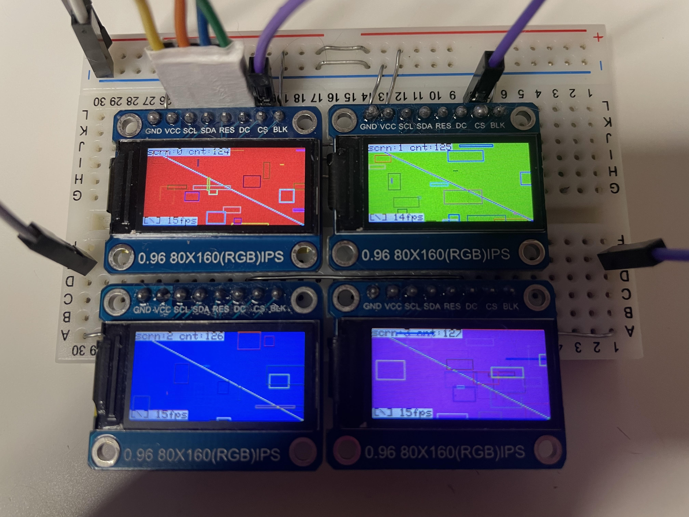2024-10-31 13:30 ― <a href="spresense-multi-lcd/">【SPRESENSE】複数LCD制御のためのSpresenseとLovyanGFXに関する実験的研究</a> <a class="tag" href="?tag=LCD">LCD</a> <a class="tag" href="?tag=LovyanGFX">LovyanGFX</a> <a class="tag" href="?tag=SPRESENSE">SPRESENSE</a> <a class="tag" href="?tag=ST7735S">ST7735S</a></li>
  <li data-tags="CAMERA|SPRESENSE|パラパラ漫画|写真|動画" data-date="2024-02-06 21:29">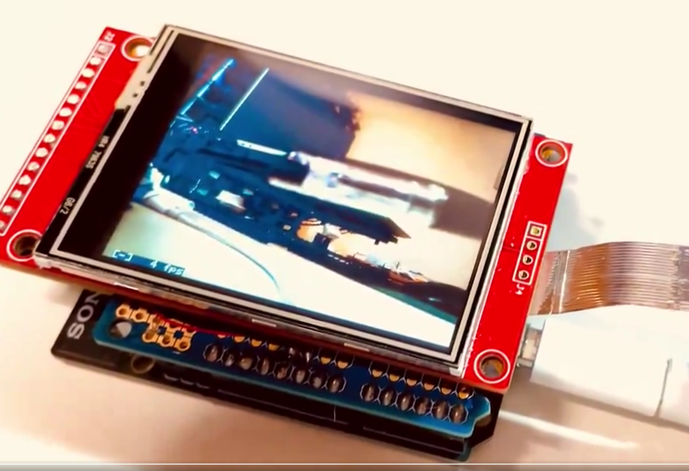2024-02-06 21:29 ― <a href="spresense-camera-lcd/">【SPRESENSE】液晶にカメラ画像の動画再生に成功したよっ</a> <a class="tag" href="?tag=CAMERA">CAMERA</a> <a class="tag" href="?tag=SPRESENSE">SPRESENSE</a> <a class="tag" href="?tag=%E3%83%91%E3%83%A9%E3%83%91%E3%83%A9%E6%BC%AB%E7%94%BB">パラパラ漫画</a> <a class="tag" href="?tag=%E5%86%99%E7%9C%9F">写真</a> <a class="tag" href="?tag=%E5%8B%95%E7%94%BB">動画</a></li>
  <li data-tags="Audio|SPRESENSE|改造|環境音" data-date="2024-01-26 09:52">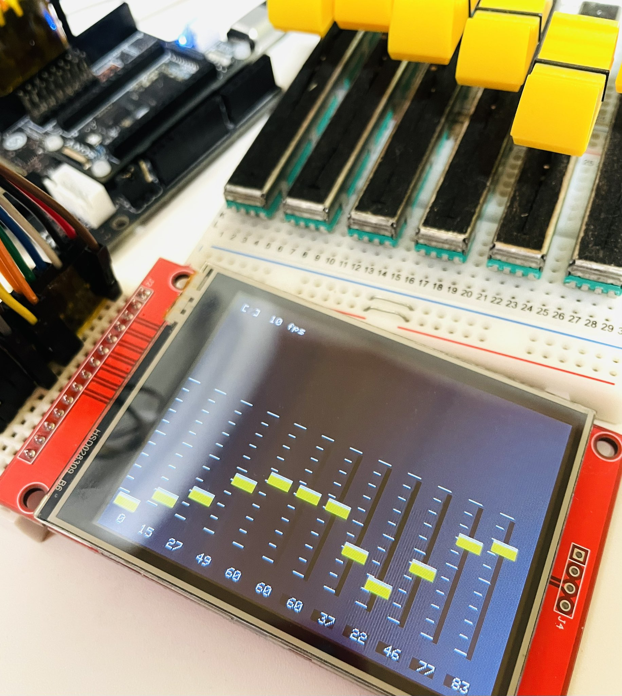2024-01-26 09:52 ― <a href="spresense-soundserenity/">【SPRESENSE2023】SoundSerenityを作ったよっ【環境音を8Trackで】</a> <a class="tag" href="?tag=Audio">Audio</a> <a class="tag" href="?tag=SPRESENSE">SPRESENSE</a> <a class="tag" href="?tag=%E6%94%B9%E9%80%A0">改造</a> <a class="tag" href="?tag=%E7%92%B0%E5%A2%83%E9%9F%B3">環境音</a></li>
  <li data-tags="Library|LoRa|Module|SPRESENSE|通信" data-date="2024-01-26 09:49">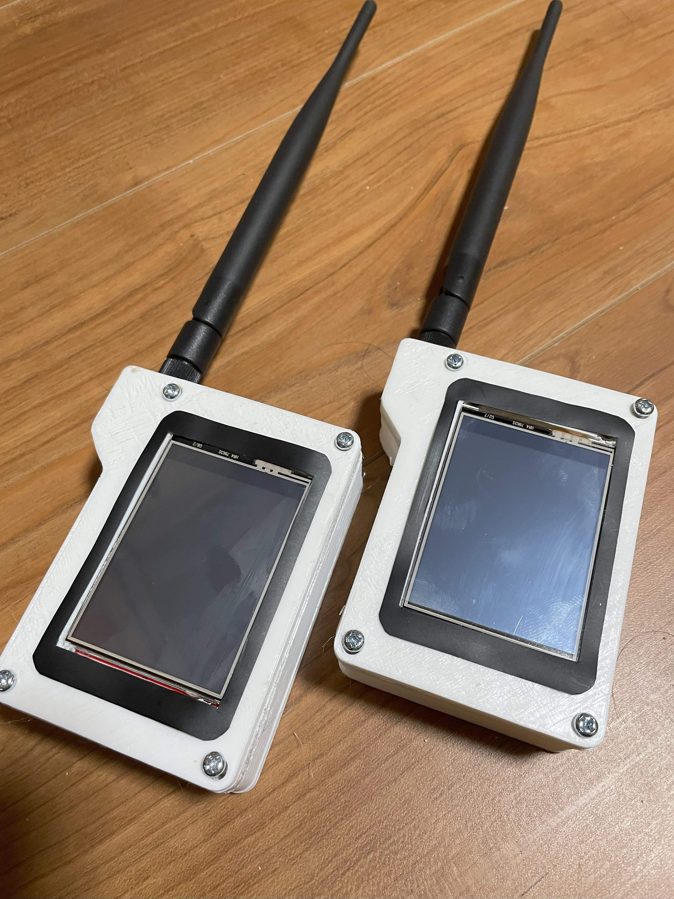2024-01-26 09:49 ― <a href="spresense-lorapager/">【SPRESENSE2023】LoRaPagerを作ったよっ【簡易メッセンジャー】</a> <a class="tag" href="?tag=Library">Library</a> <a class="tag" href="?tag=LoRa">LoRa</a> <a class="tag" href="?tag=Module">Module</a> <a class="tag" href="?tag=SPRESENSE">SPRESENSE</a> <a class="tag" href="?tag=%E9%80%9A%E4%BF%A1">通信</a></li>
  <li data-tags="SPRESENSE|タッチパネル|改造" data-date="2024-01-26 09:47">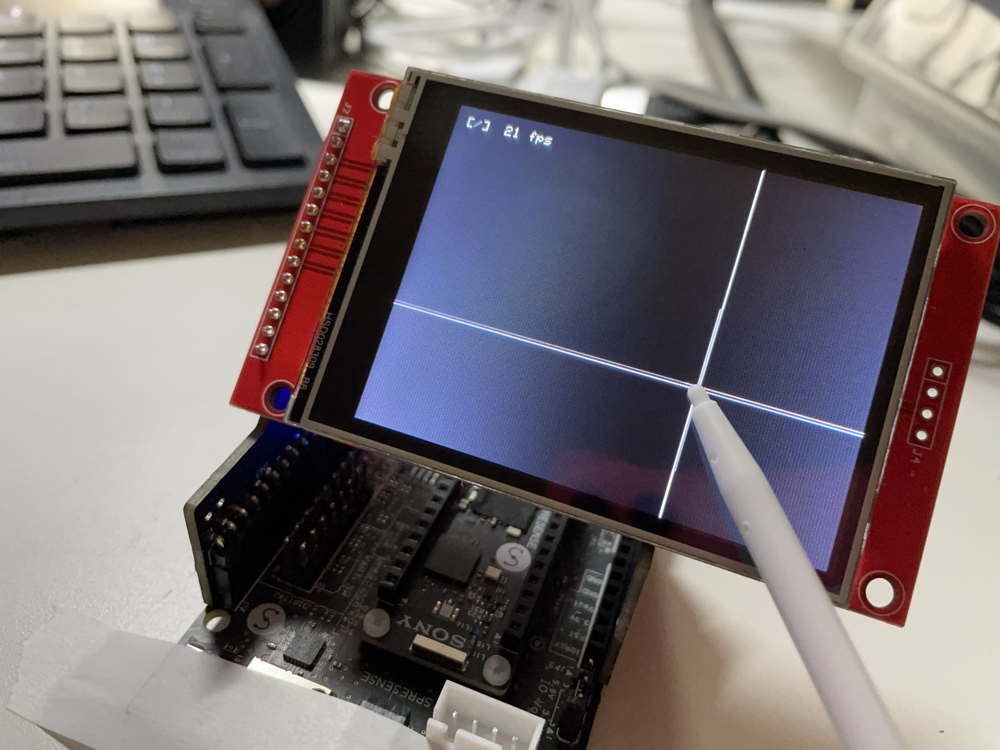2024-01-26 09:47 ― <a href="spresense-bstem-touch/">【SPRESENSE2023】B-Stem4CM01Displayにタッチパネルの改造を行うよっ</a> <a class="tag" href="?tag=SPRESENSE">SPRESENSE</a> <a class="tag" href="?tag=%E3%82%BF%E3%83%83%E3%83%81%E3%83%91%E3%83%8D%E3%83%AB">タッチパネル</a> <a class="tag" href="?tag=%E6%94%B9%E9%80%A0">改造</a></li>
  <li data-tags="Mixer|SPRESENSE|fader" data-date="2024-01-26 09:45">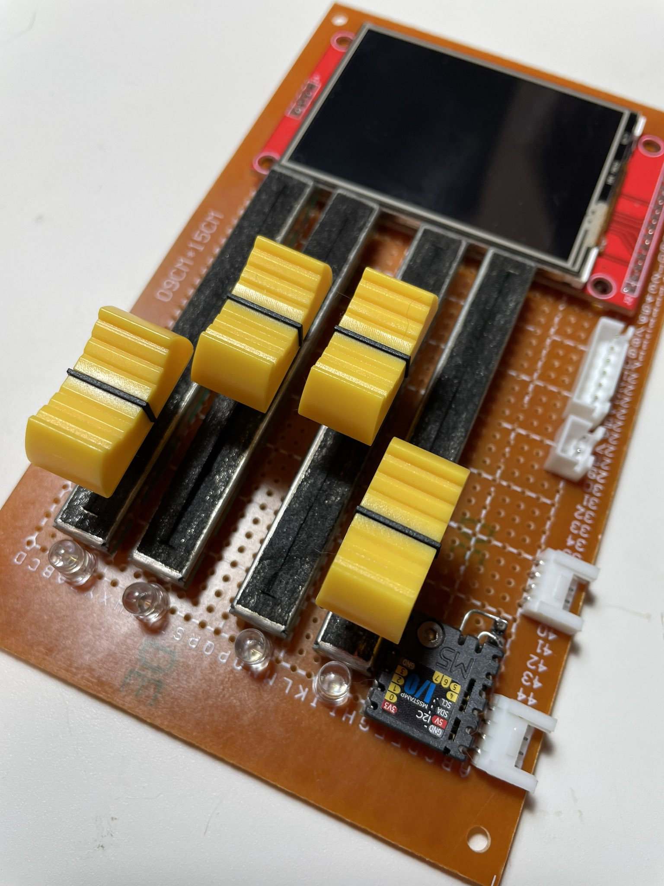2024-01-26 09:45 ― <a href="spresense-tinymixer/">【SPRESENSE2023】tinyMixer【簡易ミキサー】</a> <a class="tag" href="?tag=Mixer">Mixer</a> <a class="tag" href="?tag=SPRESENSE">SPRESENSE</a> <a class="tag" href="?tag=fader">fader</a></li>
  <li data-tags="Module|SPRESENSE|タッチパネル" data-date="2024-01-26 09:44">2024-01-26 09:44 ― <a href="spresense-ili9341-touch/">【SPRESENSE2023】LCD液晶基板ili9341でタッチパネルを使うよっ</a> <a class="tag" href="?tag=Module">Module</a> <a class="tag" href="?tag=SPRESENSE">SPRESENSE</a> <a class="tag" href="?tag=%E3%82%BF%E3%83%83%E3%83%81%E3%83%91%E3%83%8D%E3%83%AB">タッチパネル</a></li>
  <li data-tags="SPRESENSE|fader|mixer" data-date="2024-01-26 09:41">2024-01-26 09:41 ― <a href="spresense-virtual-fader/">【SPRESENSE2023】タッチパネルにバーチャルフェーダーを載せたよっ</a> <a class="tag" href="?tag=SPRESENSE">SPRESENSE</a> <a class="tag" href="?tag=fader">fader</a> <a class="tag" href="?tag=mixer">mixer</a></li>
  <li data-tags="Module|SPRESENSE|キーボード|タッチパネル" data-date="2024-01-26 09:40">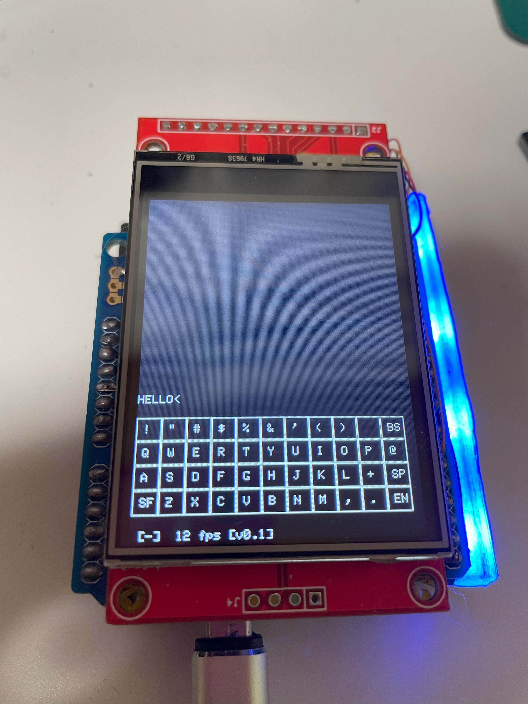2024-01-26 09:40 ― <a href="spresense-virtual-keyboard/">【SPRESENSE2023】タッチパネルにバーチャルキーボードを載せたよっ</a> <a class="tag" href="?tag=Module">Module</a> <a class="tag" href="?tag=SPRESENSE">SPRESENSE</a> <a class="tag" href="?tag=%E3%82%AD%E3%83%BC%E3%83%9C%E3%83%BC%E3%83%89">キーボード</a> <a class="tag" href="?tag=%E3%82%BF%E3%83%83%E3%83%81%E3%83%91%E3%83%8D%E3%83%AB">タッチパネル</a></li>
  <li data-tags="Library|LoRa|Module|SPRESENSE" data-date="2024-01-26 09:38">2024-01-26 09:38 ― <a href="spresense-lora-lib/">【SPRESENSE2023】LoRaのライブラリを使いやすくしたよっ</a> <a class="tag" href="?tag=Library">Library</a> <a class="tag" href="?tag=LoRa">LoRa</a> <a class="tag" href="?tag=Module">Module</a> <a class="tag" href="?tag=SPRESENSE">SPRESENSE</a></li>
  <li data-tags="8Track再生|ArduinoIDE|Audio|Module|SPRESENSE|ライブラリ" data-date="2024-01-26 09:36">2024-01-26 09:36 ― <a href="spresense-audiodsp-jissen/">【SPRESENSE2023】AudioDSPを絶妙にハックしたよっ【実践編】</a> <a class="tag" href="?tag=8Track%E5%86%8D%E7%94%9F">8Track再生</a> <a class="tag" href="?tag=ArduinoIDE">ArduinoIDE</a> <a class="tag" href="?tag=Audio">Audio</a> <a class="tag" href="?tag=Module">Module</a> <a class="tag" href="?tag=SPRESENSE">SPRESENSE</a> <a class="tag" href="?tag=%E3%83%A9%E3%82%A4%E3%83%96%E3%83%A9%E3%83%AA">ライブラリ</a></li>
  <li data-tags="Module|SPRESENSE|WS2812B|組込み" data-date="2024-01-26 09:34">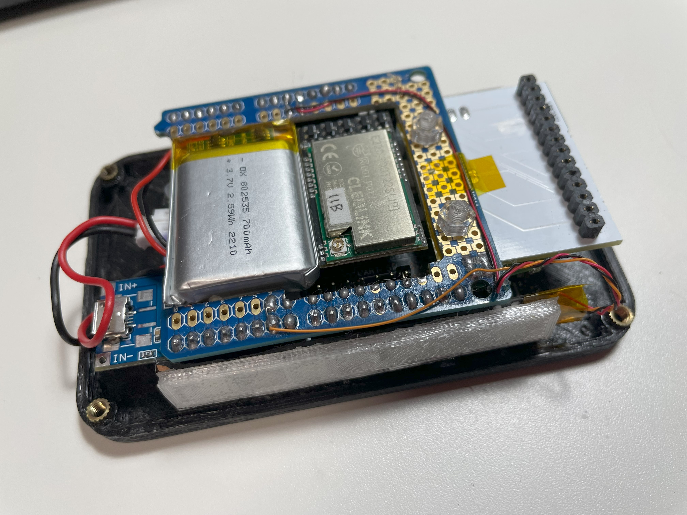2024-01-26 09:34 ― <a href="spresense-module/">【SPRESENSE2023】組込用のSPRESENSEモジュールを作ったよ</a> <a class="tag" href="?tag=Module">Module</a> <a class="tag" href="?tag=SPRESENSE">SPRESENSE</a> <a class="tag" href="?tag=WS2812B">WS2812B</a> <a class="tag" href="?tag=%E7%B5%84%E8%BE%BC%E3%81%BF">組込み</a></li>
  <li data-tags="3Dプリンタ|Module|SPRESENSE|WS2812B" data-date="2024-01-26 09:31">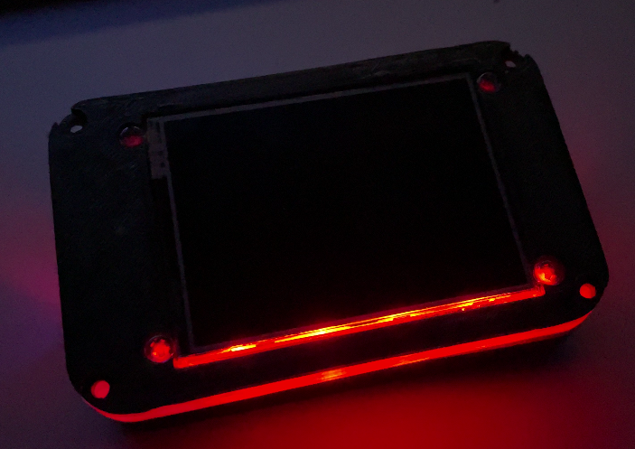2024-01-26 09:31 ― <a href="spresense-ws2812b/">【SPRESENSE2023】WS2812B で流れるような光効果を～</a> <a class="tag" href="?tag=3D%E3%83%97%E3%83%AA%E3%83%B3%E3%82%BF">3Dプリンタ</a> <a class="tag" href="?tag=Module">Module</a> <a class="tag" href="?tag=SPRESENSE">SPRESENSE</a> <a class="tag" href="?tag=WS2812B">WS2812B</a></li>
  <li data-tags="3Dプリンタ|Arduino|Audio|ILI9341|SPRESENSE|WS2812B|タッチパネル" data-date="2024-01-24 21:08">2024-01-24 21:08 ― <a href="spresense-2023-matome/">【SPRESENSE2023】開発まとめ</a> <a class="tag" href="?tag=3D%E3%83%97%E3%83%AA%E3%83%B3%E3%82%BF">3Dプリンタ</a> <a class="tag" href="?tag=Arduino">Arduino</a> <a class="tag" href="?tag=Audio">Audio</a> <a class="tag" href="?tag=ILI9341">ILI9341</a> <a class="tag" href="?tag=SPRESENSE">SPRESENSE</a> <a class="tag" href="?tag=WS2812B">WS2812B</a> <a class="tag" href="?tag=%E3%82%BF%E3%83%83%E3%83%81%E3%83%91%E3%83%8D%E3%83%AB">タッチパネル</a></li>
  <li data-tags="Arduino|Audio|DSP|simpleFIFO|spresense" data-date="2023-12-14 19:51">2023-12-14 19:51 ― <a href="spresense-dsp-riron/">SPRESENSE の DSPを微妙にHackするよっ【理論編】</a> <a class="tag" href="?tag=Arduino">Arduino</a> <a class="tag" href="?tag=Audio">Audio</a> <a class="tag" href="?tag=DSP">DSP</a> <a class="tag" href="?tag=simpleFIFO">simpleFIFO</a> <a class="tag" href="?tag=spresense">spresense</a></li>
  <li data-tags="Arduino|E220|LoRa|SPRESENSE" data-date="2023-12-12 08:05">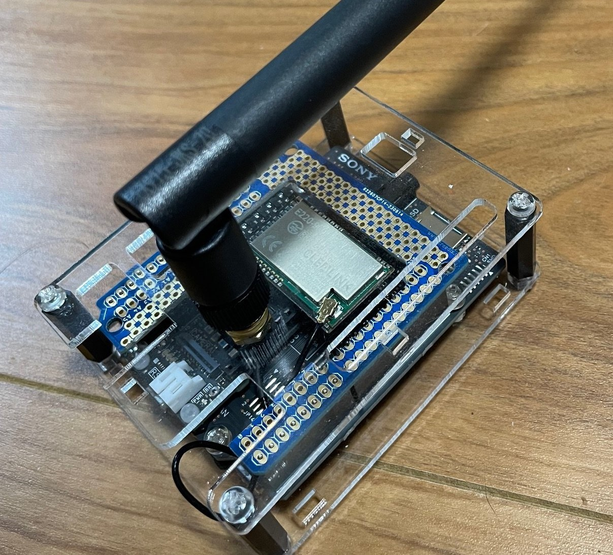2023-12-12 08:05 ― <a href="lorae220-fix/">LoRaE220_900T22S_JPのサンプルが間違ってたので修正したよっ</a> <a class="tag" href="?tag=Arduino">Arduino</a> <a class="tag" href="?tag=E220">E220</a> <a class="tag" href="?tag=LoRa">LoRa</a> <a class="tag" href="?tag=SPRESENSE">SPRESENSE</a></li>
  <li data-tags="Arduino|Library|SPRESENSE|multicore|thread" data-date="2023-12-01 16:06">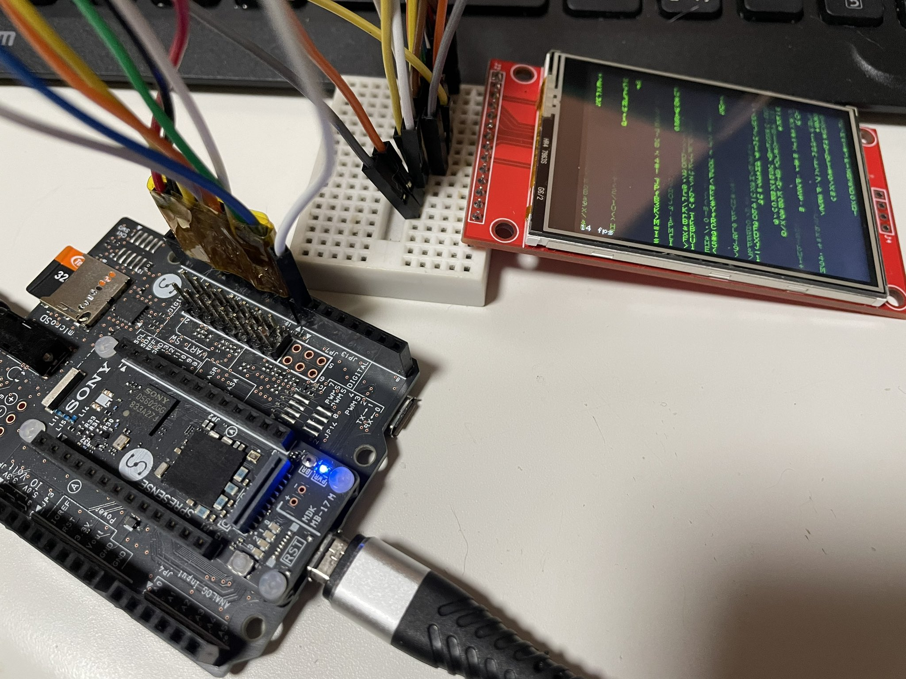2023-12-01 16:06 ― <a href="spresense-setup1loop1/">RP2040のsetup1/loop1が素敵なので SPRESENSE にも実装してみたよっ</a> <a class="tag" href="?tag=Arduino">Arduino</a> <a class="tag" href="?tag=Library">Library</a> <a class="tag" href="?tag=SPRESENSE">SPRESENSE</a> <a class="tag" href="?tag=multicore">multicore</a> <a class="tag" href="?tag=thread">thread</a></li>
  <li data-tags="IMU|M5Atom|SLAM|easyLiDAR|spresense" data-date="2022-09-15 14:30">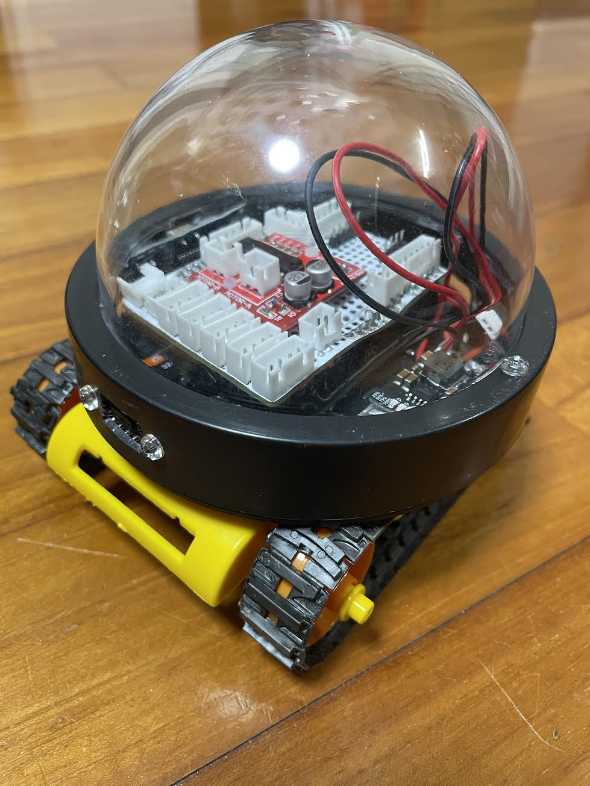2022-09-15 14:30 ― <a href="easylidar/">Spresensを使って自律移動出来るよっ(easyLiDARの製作と運用)</a> <a class="tag" href="?tag=IMU">IMU</a> <a class="tag" href="?tag=M5Atom">M5Atom</a> <a class="tag" href="?tag=SLAM">SLAM</a> <a class="tag" href="?tag=easyLiDAR">easyLiDAR</a> <a class="tag" href="?tag=spresense">spresense</a></li>
  <li data-tags="Arduino|ESP32|M5Atom|WiFi|esp32Modem|spresense" data-date="2022-08-24 21:06">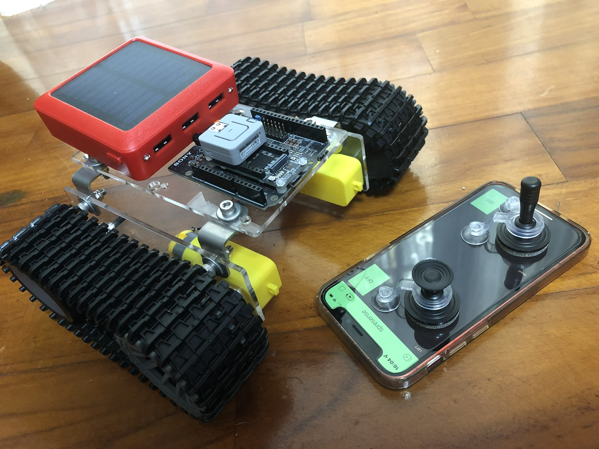2022-08-24 21:06 ― <a href="spresense-blynk/">SpresenseをBlynkに接続出来たよっ</a> <a class="tag" href="?tag=Arduino">Arduino</a> <a class="tag" href="?tag=ESP32">ESP32</a> <a class="tag" href="?tag=M5Atom">M5Atom</a> <a class="tag" href="?tag=WiFi">WiFi</a> <a class="tag" href="?tag=esp32Modem">esp32Modem</a> <a class="tag" href="?tag=spresense">spresense</a></li>
  <li data-tags="Arduino|Arduino_IDE|Library|疑似マルチタスク" data-date="2022-06-23 15:41">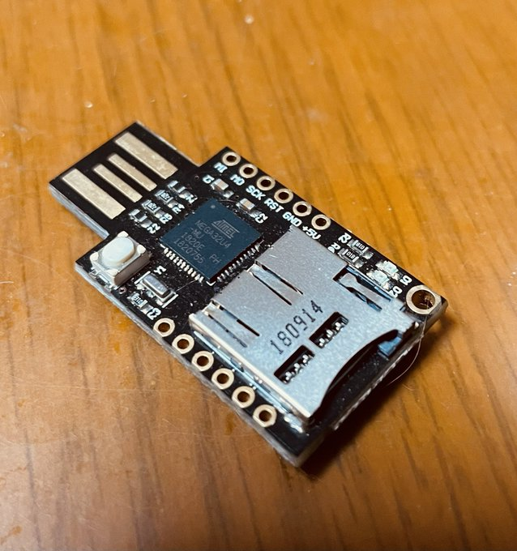2022-06-23 15:41 ― <a href="arduino-setup1loop1/">RP2040のsetup1/loop1が素敵なので Arduino でも使えるように実装してみたよっ</a> <a class="tag" href="?tag=Arduino">Arduino</a> <a class="tag" href="?tag=Arduino_IDE">Arduino_IDE</a> <a class="tag" href="?tag=Library">Library</a> <a class="tag" href="?tag=%E7%96%91%E4%BC%BC%E3%83%9E%E3%83%AB%E3%83%81%E3%82%BF%E3%82%B9%E3%82%AF">疑似マルチタスク</a></li>
  <li data-tags="Arduino_IDE|ESP32|Library|M5Atom|multicore" data-date="2022-06-20 16:12">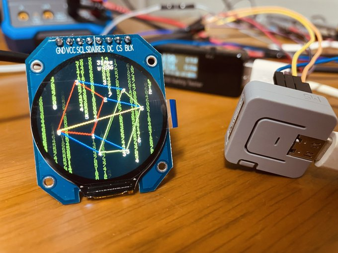2022-06-20 16:12 ― <a href="m5stack-setup1loop1/">RP2040のsetup1/loop1が素敵なので M5Stack/ESP32 にも実装してみたよっ</a> <a class="tag" href="?tag=Arduino_IDE">Arduino_IDE</a> <a class="tag" href="?tag=ESP32">ESP32</a> <a class="tag" href="?tag=Library">Library</a> <a class="tag" href="?tag=M5Atom">M5Atom</a> <a class="tag" href="?tag=multicore">multicore</a></li>
</ul>

