# linaLog

  

製作記事置き場です。Markdown のまま読めます。

Project write-ups, in Markdown.

<a href="feed.xml">RSS フィード</a>

## 記事 / Articles

<button id="sortBtn" type="button">古い順に並べ替える</button>

<ul id="articleList">
  <li data-date="2026-11-27 13:44">2026-11-27 13:44 ― <a href="blog-migration/">elchika から GitHub Pages へ、ブログ71記事を引っ越した手順</a></li>
  <li data-date="2026-11-26 20:17">2026-11-26 20:17 ― <a href="linax-uno/">linaX(uno) ― Arduino Uno（ATmega328P）に載せた Unix 系 OS</a></li>
  <li data-date="2026-11-23 13:54">2026-11-23 13:54 ― <a href="windows-disk/">[Junction] Windows の C ドライブを空ける話 [目から鱗]</a></li>
  <li data-date="2026-11-21 21:41">2026-11-21 21:41 ― <a href="linax-cyd/">LinaX(cyd) ― PSRAM なしの ESP32（CYD）に載せた Linux 6.11</a></li>
  <li data-date="2026-11-21 14:52">2026-11-21 14:52 ― <a href="cyd-linux611/">[CYD]内蔵 DRAM 320KB で Linux6.11を動かしたにょ</a></li>
  <li data-date="2026-11-19 10:46">2026-11-19 10:46 ― <a href="tinyx11-cyd/">[cyd] $7の液晶付きマイコンに x11 を載せてみた[3分ハッキング別冊]</a></li>
  <li data-date="2026-11-18 11:01">2026-11-18 11:01 ― <a href="cardkb2-ssh/">[M5Stack]CardKB2に SSH クライアント実装した[3分ハッキング付録]</a></li>
  <li data-date="2026-11-16 16:49">2026-11-16 16:49 ― <a href="cardkb2-cntc/">[M5Stack]CardKB2にCNT+Cを実装する[3分ハッキング最終回]</a></li>
  <li data-date="2026-09-19 13:51">2026-09-19 13:51 ― <a href="spresense-nihongo/">[#SPRESENSE 2026]簡単だけど奥が深いにょ[日本語入力]</a></li>
  <li data-date="2026-09-16 11:06">2026-09-16 11:06 ― <a href="ch32v003-cardputer-lcd/">[ch32v003]ほぼどんなマイコンでも液晶付けられるにょ[cardputer]</a></li>
  <li data-date="2026-09-12 13:06">2026-09-12 13:06 ― <a href="spresense-linax-port/">[#SPRESENSE 2026]移植してみたにょ[linaX]</a></li>
  <li data-date="2026-09-08 19:25">2026-09-08 19:25 ― <a href="spresense-linax/">[#SPRESENSE 2026]最終奥義OS作ってみたにょ[linaX]</a></li>
  <li data-date="2026-09-07 17:13">2026-09-07 17:13 ― <a href="lindos/">[#SPRESENSE 2026]OS作ってみたにょ[LinDOS]</a></li>
  <li data-date="2026-09-03 13:06">2026-09-03 13:06 ― <a href="livefo/">[#SPRESENSE 2026] FORTRAN(VM)を作ったにょ [LiveFO編]</a></li>
  <li data-date="2026-09-02 13:20">2026-09-02 13:20 ― <a href="liveco/">[#SPRESENSE 2026] COBOLインタプリタ(VM)を作ったにょ [LiveCO編]</a></li>
  <li data-date="2026-08-31 16:56">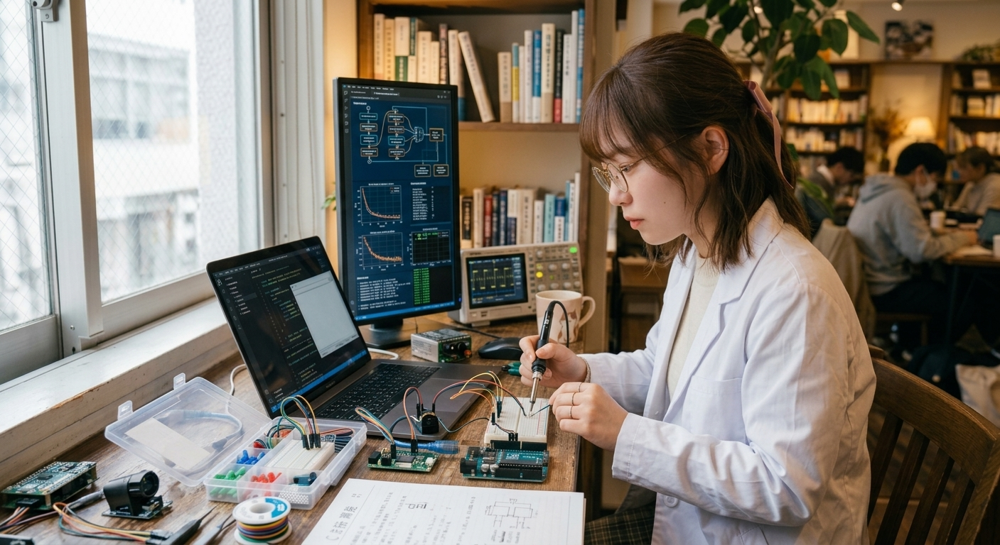2026-08-31 16:56 ― <a href="liveb-livep/">[#SPRESENSE 2026]Cインタプリタ(VM)を作ったにょ[LiveB/LiveP編]</a></li>
  <li data-date="2026-08-26 13:28">2026-08-26 13:28 ― <a href="livec-editor/">[#SPRESENSE 2026]Cインタプリタ(VM)を作ったにょ[エディタ編]</a></li>
  <li data-date="2026-08-26 13:10">2026-08-26 13:10 ― <a href="livec-ch9350/">[#SPRESENSE 2026]Cインタプリタ(VM)を作ったにょ[ch9350編]</a></li>
  <li data-date="2026-08-26 11:44">2026-08-26 11:44 ― <a href="livec/">[#SPRESENSE 2026]Cインタプリタ(VM)を作ったにょ[LiveC編]</a></li>
  <li data-date="2026-06-18 11:41">2026-06-18 11:41 ― <a href="usbdac-cvbs-small/">[USBDAC]基板が小さくなったにょ[CVBS]</a></li>
  <li data-date="2026-06-17 13:27">2026-06-17 13:27 ― <a href="usbdac-ntsc/">[USBDAC]イヤホンジャックでNTSC映像を出してみたにょ[CVBS]</a></li>
  <li data-date="2026-06-16 16:51">2026-06-16 16:51 ― <a href="spresense-audiohack-kanji/">[SPRESENSE 2026]AudioHack漢字に対応したにょ[CVBS]</a></li>
  <li data-date="2026-06-15 16:52">2026-06-15 16:52 ― <a href="spresense-audiojack-hack/">[SPRESENSE 2026]AudioJackをHackしたにょ[CVBS]</a></li>
  <li data-date="2026-06-10 12:22">2026-06-10 12:22 ― <a href="spresense-tv-cvbs/">[SPRESENSE 2026]TVに出力したにょ[CVBS]</a></li>
  <li data-date="2026-06-05 10:50">2026-06-05 10:50 ― <a href="linaaudio-2/">【linaAudio】45円CPUで作るUSB-Audioだにょ②【動作編】</a></li>
  <li data-date="2026-05-27 10:18">2026-05-27 10:18 ― <a href="linaaudio-1/">【linaAudio】25円CPUで作るUSB-Audioだにょ①【認識編】</a></li>
  <li data-date="2026-05-20 13:58">2026-05-20 13:58 ― <a href="irfi/">【IRFi】え？IRDAでWiFi?【無線光通信】</a></li>
  <li data-date="2026-05-15 08:31">2026-05-15 08:31 ― <a href="linaduino-usbgrove/">【linaDuino】25円で作るUSBGroveブリッジだにょ【USBGrove】</a></li>
  <li data-date="2026-05-14 20:30">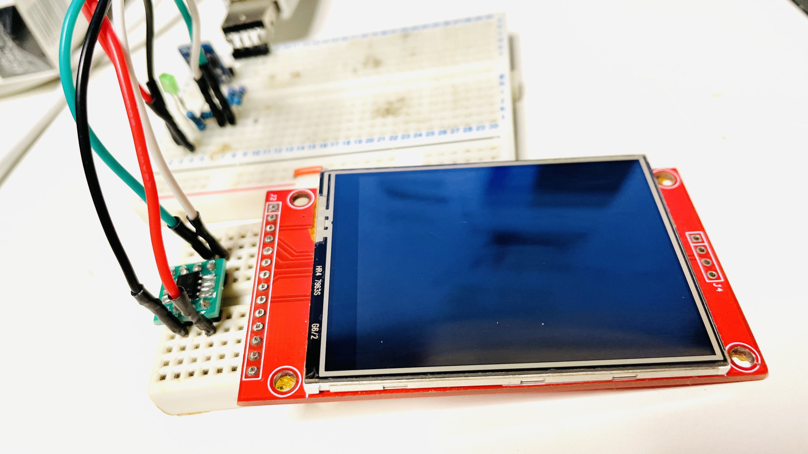2026-05-14 20:30 ― <a href="linaduino-usbmonitor/">【linaDuino】25円で作るUSBモニターだにょ【USBMonitor】</a></li>
  <li data-date="2026-05-14 14:27">2026-05-14 14:27 ― <a href="linaduino-4btnpad/">【linaDuino】25円で作るUSB-HIDだにょ【4btnPad】</a></li>
  <li data-date="2026-05-10 23:13">2026-05-10 23:13 ― <a href="usb-a-probability/">【USB-Aの成功率】50%のはずが75%の確率で間違える理由【なぜなぜ？】</a></li>
  <li data-date="2026-05-07 14:09">2026-05-07 14:09 ― <a href="linaduino/">【linaDuino】リナディーノ(てじなーにゃのアクセントで)【世界最小Arduino互換】</a></li>
  <li data-date="2026-04-08 11:21">2026-04-08 11:21 ― <a href="linagostini-1/">【リナゴスティーニ①創刊号】64bitI2Cクラスタを27円RISC-Vで作るにょ【思想】</a></li>
  <li data-date="2026-04-01 11:06">2026-04-01 11:06 ― <a href="dual-ch32v003/">【dualCH32V003】92ByteでPD6から高速矩形波を出してみたにょ【40円マイコン】</a></li>
  <li data-date="2026-03-25 12:41">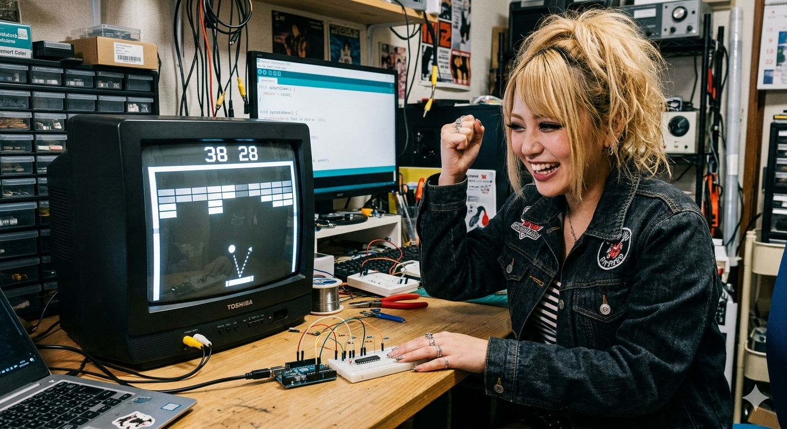2026-03-25 12:41 ― <a href="uiapduino-video/">【UIAPduino】VIDEO信号を出したにょ①【290円マイコン基板】</a></li>
  <li data-date="2026-03-18 13:17">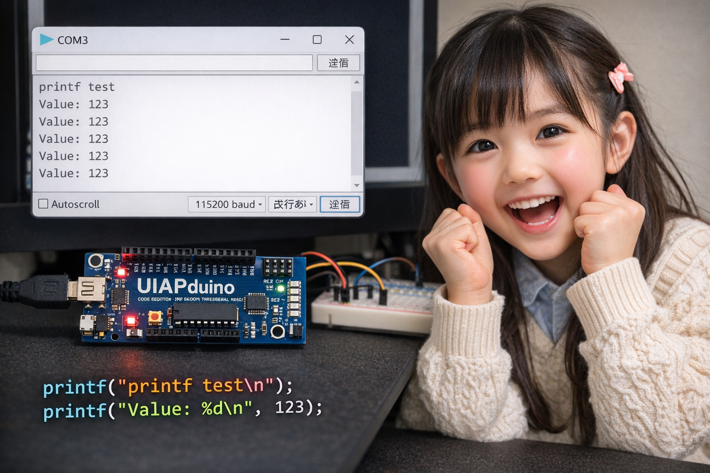2026-03-18 13:17 ― <a href="uiapduino-printf/">【UIAPduino】printf を実装するにょ【290円マイコン基板】</a></li>
  <li data-date="2026-03-07 17:56">2026-03-07 17:56 ― <a href="uiapduino/">【UIAPduino】普通に使えるっぽいにょ【290円マイコン基板】</a></li>
  <li data-date="2026-03-05 18:23">2026-03-05 18:23 ― <a href="unoq-matrix-ip/">【unoQ】起動時にIPアドレスと温度をMatrixに表示するにょ【小さなLinux機】</a></li>
  <li data-date="2026-03-02 06:44">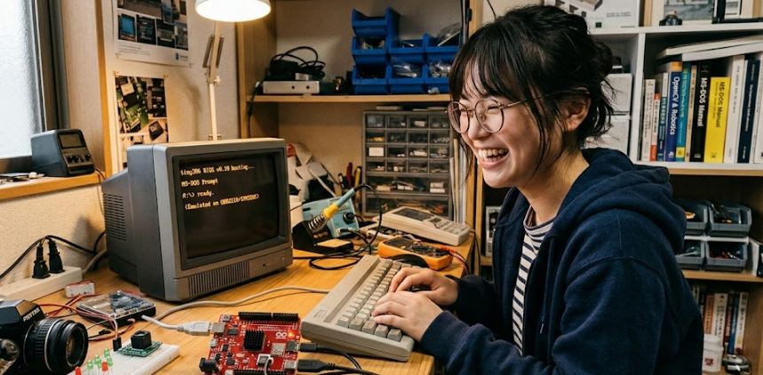2026-03-02 06:44 ― <a href="unoq-freedos/">【unoQ】tiny386でFreeDos動かしたにょ【小さなLinux機】</a></li>
  <li data-date="2026-02-25 10:06">2026-02-25 10:06 ― <a href="unoq-windows/">【unoQ】Windowsを動かしたにょ【小さなLinux機】</a></li>
  <li data-date="2026-02-18 09:42">2026-02-18 09:42 ― <a href="unoq-ros2/">【unoQ】ROS2を無理やり入れたにょ【小さなLinux機】</a></li>
  <li data-date="2026-02-11 16:00">2026-02-11 16:00 ― <a href="unoq-x11-lcd/">【unoQ】QRB側X11をSTM32のLCDに表示出来たにょ【小さなLinux機】</a></li>
  <li data-date="2026-02-09 17:57">2026-02-09 17:57 ― <a href="unoq-qrb-stm32/">【unoQ】さっそく簡単にQRBとSTM32U5通信させたにょ【小さなLinux機】</a></li>
  <li data-date="2026-02-06 10:54">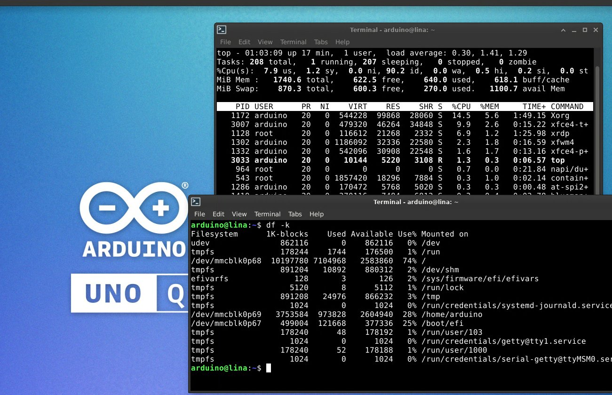2026-02-06 10:54 ― <a href="unoq-setup/">【unoQ】Arduino UNO Q 簡単初期セットアップ手順【小さなLinux機】</a></li>
  <li data-date="2026-01-28 01:47">2026-01-28 01:47 ― <a href="spresense-sprepad/">【SPRESENSE2025】VGA液晶を搭載しGPS地図を表示したにょ【sprePAD?】</a></li>
  <li data-date="2026-01-20 18:59">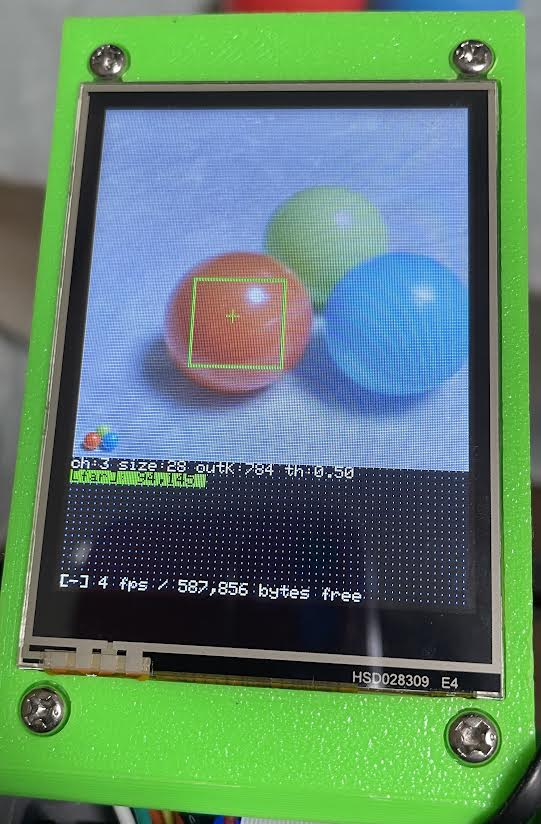2026-01-20 18:59 ― <a href="spresense-dnn/">【SPRESENSE2025】dnnPlathomeを作ったょ【YOLOっぽい】</a></li>
  <li data-date="2026-01-09 16:25">2026-01-09 16:25 ― <a href="spresense-radio/">【SPRESENSE2025】spresense拡張基板に搭載できるラジオモジュールを作ったよっ</a></li>
  <li data-date="2025-01-31 20:05">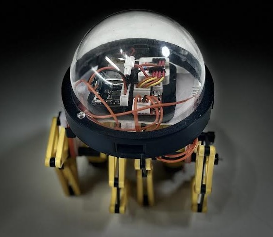2025-01-31 20:05 ― <a href="spresense-jansen/">【SPRESENSE2024】動くテオ・ヤンセン機構【eNord通信】</a></li>
  <li data-date="2025-01-30 17:09">2025-01-30 17:09 ― <a href="spresense-matrix-speaker/">【SPRESENSE2024】3Dプリンターで長岡式マトリクススピーカー【夢のオーディオ体験】</a></li>
  <li data-date="2025-01-29 16:24">2025-01-29 16:24 ― <a href="spresense-compass/">【SPRESENSE2024】今年の恵方巻きの方向は？【サテライトコンパス】</a></li>
  <li data-date="2025-01-28 23:13">2025-01-28 23:13 ― <a href="spresense-mandelbrot/">【SPRESENSE2024】仮想30コアでマンデルブロ集合【リアルタイム描画】</a></li>
  <li data-date="2024-12-23 16:19">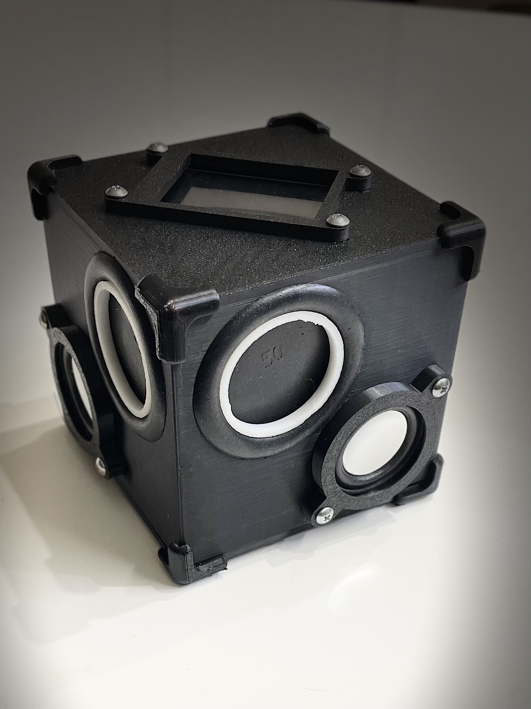2024-12-23 16:19 ― <a href="spresense-mp3-cub/">【SPRESENSE2024】mp3綺麗に鳴らす【CuB】</a></li>
  <li data-date="2024-12-12 13:14">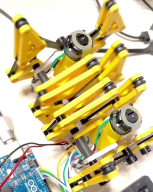2024-12-12 13:14 ― <a href="spresense-enord/">【SPRESENSE2024】esp32とSpresenseによるモデム機能制御"eNord"の構築</a></li>
  <li data-date="2024-10-31 13:30">2024-10-31 13:30 ― <a href="spresense-multi-lcd/">【SPRESENSE】複数LCD制御のためのSpresenseとLovyanGFXに関する実験的研究</a></li>
  <li data-date="2024-02-06 21:29">2024-02-06 21:29 ― <a href="spresense-camera-lcd/">【SPRESENSE】液晶にカメラ画像の動画再生に成功したよっ</a></li>
  <li data-date="2024-01-26 09:52">2024-01-26 09:52 ― <a href="spresense-soundserenity/">【SPRESENSE2023】SoundSerenityを作ったよっ【環境音を8Trackで】</a></li>
  <li data-date="2024-01-26 09:49">2024-01-26 09:49 ― <a href="spresense-lorapager/">【SPRESENSE2023】LoRaPagerを作ったよっ【簡易メッセンジャー】</a></li>
  <li data-date="2024-01-26 09:47">2024-01-26 09:47 ― <a href="spresense-bstem-touch/">【SPRESENSE2023】B-Stem4CM01Displayにタッチパネルの改造を行うよっ</a></li>
  <li data-date="2024-01-26 09:45">2024-01-26 09:45 ― <a href="spresense-tinymixer/">【SPRESENSE2023】tinyMixer【簡易ミキサー】</a></li>
  <li data-date="2024-01-26 09:44">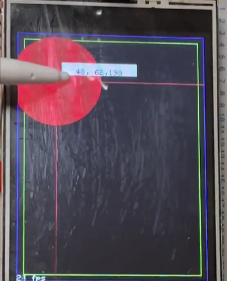2024-01-26 09:44 ― <a href="spresense-ili9341-touch/">【SPRESENSE2023】LCD液晶基板ili9341でタッチパネルを使うよっ</a></li>
  <li data-date="2024-01-26 09:41">2024-01-26 09:41 ― <a href="spresense-virtual-fader/">【SPRESENSE2023】タッチパネルにバーチャルフェーダーを載せたよっ</a></li>
  <li data-date="2024-01-26 09:40">2024-01-26 09:40 ― <a href="spresense-virtual-keyboard/">【SPRESENSE2023】タッチパネルにバーチャルキーボードを載せたよっ</a></li>
  <li data-date="2024-01-26 09:38">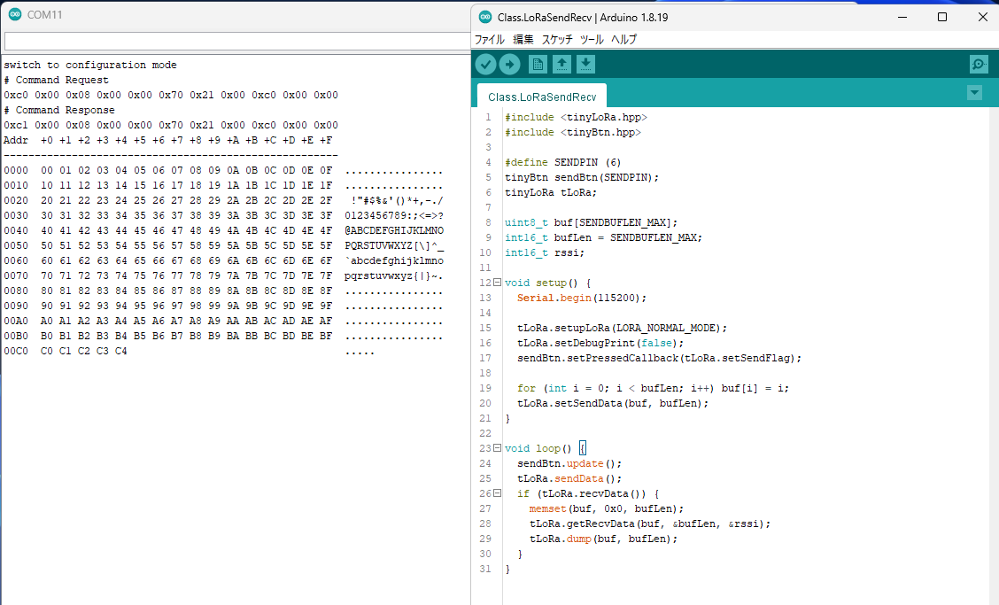2024-01-26 09:38 ― <a href="spresense-lora-lib/">【SPRESENSE2023】LoRaのライブラリを使いやすくしたよっ</a></li>
  <li data-date="2024-01-26 09:36">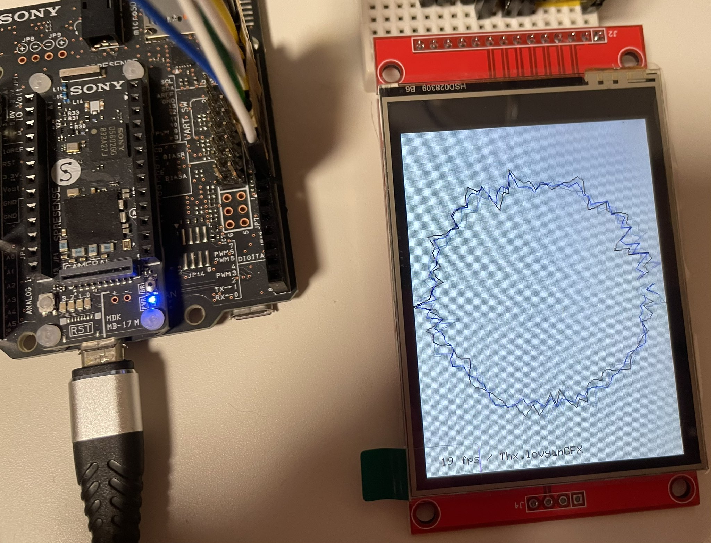2024-01-26 09:36 ― <a href="spresense-audiodsp-jissen/">【SPRESENSE2023】AudioDSPを絶妙にハックしたよっ【実践編】</a></li>
  <li data-date="2024-01-26 09:34">2024-01-26 09:34 ― <a href="spresense-module/">【SPRESENSE2023】組込用のSPRESENSEモジュールを作ったよ</a></li>
  <li data-date="2024-01-26 09:31">2024-01-26 09:31 ― <a href="spresense-ws2812b/">【SPRESENSE2023】WS2812B で流れるような光効果を～</a></li>
  <li data-date="2024-01-24 21:08">2024-01-24 21:08 ― <a href="spresense-2023-matome/">【SPRESENSE2023】開発まとめ</a></li>
  <li data-date="2023-12-14 19:51">2023-12-14 19:51 ― <a href="spresense-dsp-riron/">SPRESENSE の DSPを微妙にHackするよっ【理論編】</a></li>
  <li data-date="2023-12-12 08:05">2023-12-12 08:05 ― <a href="lorae220-fix/">LoRaE220_900T22S_JPのサンプルが間違ってたので修正したよっ</a></li>
  <li data-date="2023-12-01 16:06">2023-12-01 16:06 ― <a href="spresense-setup1loop1/">RP2040のsetup1/loop1が素敵なので SPRESENSE にも実装してみたよっ</a></li>
  <li data-date="2022-09-15 14:30">2022-09-15 14:30 ― <a href="easylidar/">Spresensを使って自律移動出来るよっ(easyLiDARの製作と運用)</a></li>
  <li data-date="2022-08-24 21:06">2022-08-24 21:06 ― <a href="spresense-blynk/">SpresenseをBlynkに接続出来たよっ</a></li>
  <li data-date="2022-06-23 15:41">2022-06-23 15:41 ― <a href="arduino-setup1loop1/">RP2040のsetup1/loop1が素敵なので Arduino でも使えるように実装してみたよっ</a></li>
  <li data-date="2022-06-20 16:12">2022-06-20 16:12 ― <a href="m5stack-setup1loop1/">RP2040のsetup1/loop1が素敵なので M5Stack/ESP32 にも実装してみたよっ</a></li>
</ul>

