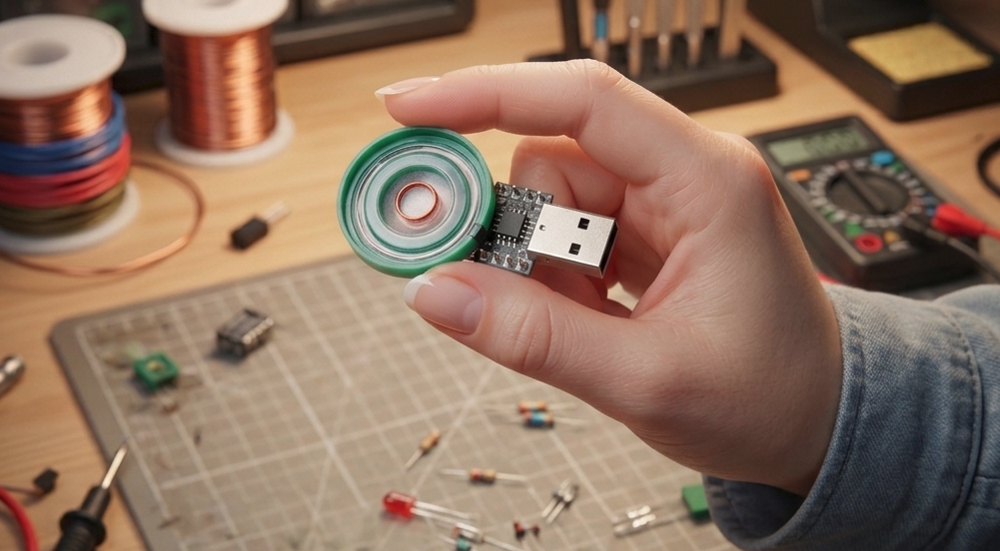
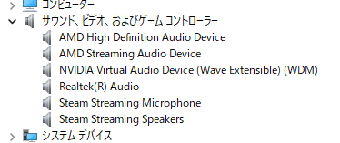
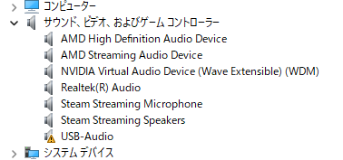

# 【linaAudio】25円CPUで作るUSB-Audioだにょ①【認識編】

2026年5月27日 10:18



## 目次

1. [はじめに](#はじめに)
2. [ハードウェア](#ハードウェア)
3. [WSL環境構築](#wsl環境構築)
4. [フォルダ構成](#フォルダ構成)
5. [ファイル一式](#ファイル一式)
6. [ビルドと書き込み](#ビルドと書き込み)
7. [ハマりポイント全記録](#ハマりポイント全記録)
8. [さいごに](#さいごに)

---

## はじめに

前回は CH32V003J4M6 (SOP8) で USB-HID (ゲームパッド) 他を作りました。
- [USB2Gamepad](../linaduino-4btnpad/)
- [USB2Monitor](../linaduino-usbmonitor/)
- [USB2Grove](../linaduino-usbgrove/)

今回は同じチップ・同じ配線で **USB Audio Class 1.0 デバイス** としてホストに認識させます。

```
usbipd list で確認:
8-2    1209:d004  USB-Audio    Not shared  ← これが目標！
```

「認識させる」だけで音は出ません。でも…

> **Low-Speed USB デバイスを USB-Audio Class として Windows に認識させる。**
> これ、おそらく世界初です。

USB 1.1 仕様では Low-Speed はアイソクロナス転送禁止なので、
通常 USB-Audio は Full-Speed 以上のチップで実装されます。
CH32V003 はソフトウェア USB の Low-Speed デバイスですが、
ディスクリプタを正しく組めば Windows はちゃんと認識してくれます。

---

## ハードウェア

前回の HID と**完全に同じ配線**です。追加部品ゼロ。

```
PD6 [1]|       |[8] PD4
GND [2]|       |[7] PC4
PA2 [3]|       |[6] PC2 (白) D+
VCC [4]|       |[5] PC1 (緑) D-
```

**USB配線**

- PC1 (Pin5) --- 22Ω --- USB D- (白)
- PC2 (Pin6) --- 22Ω --- USB D+ (緑)
- PC2 (Pin6) --- 1.5kΩ --- 3.3V (プルアップ)

---

## WSL環境構築

### パッケージインストール

```bash
sudo apt update
sudo apt install -y \
    build-essential \
    gcc-riscv64-unknown-elf \
    libnewlib-dev \
    libusb-1.0-0-dev \
    libudev-dev \
    git make
```

### リポジトリのクローン

rv003usb には ch32fun がサブモジュールとして含まれています。

```bash
mkdir ~/dev && cd ~/dev
git clone --recursive https://github.com/cnlohr/rv003usb.git
```

---

## フォルダ構成

rv003usb のリポジトリ直下に `demo_gamepad` と同じ構成でフォルダを作ります。

```bash
cd ~/dev/rv003usb
mkdir demo_usb_audio
cp demo_gamepad/Makefile          demo_usb_audio/
cp demo_gamepad/funconfig.h       demo_usb_audio/
cp demo_gamepad/ch32v003_GPIO_branchless.h demo_usb_audio/
sed -i 's/demo_gamepad/demo_usb_audio/g' demo_usb_audio/Makefile
```

完成後のディレクトリ構成：

| パス | 説明 |
| --- | --- |
| rv003usb/demo_usb_audio/Makefile | |
| rv003usb/demo_usb_audio/funconfig.h | |
| rv003usb/demo_usb_audio/ch32v003_GPIO_branchless.h | |
| rv003usb/demo_usb_audio/usb_config.h | 今回作成 |
| rv003usb/demo_usb_audio/demo_usb_audio.c | 今回作成 |
| rv003usb/rv003usb/ | ライブラリ本体 |
| rv003usb/ch32fun/ | SDK |

**Makefile**

```makefile
all : flash
TARGET:=demo_usb_audio
ADDITIONAL_C_FILES+=../rv003usb/rv003usb.S ../rv003usb/rv003usb.c
EXTRA_CFLAGS:=-I../lib -I../rv003usb
TARGET_MCU?=CH32V003
include ../ch32fun/ch32fun/ch32fun.mk
flash : cv_flash
clean : cv_clean
```

**funconfig.h**

```c
#ifndef _FUNCONFIG_H
#define _FUNCONFIG_H
#define FUNCONF_USE_DEBUGPRINTF  0
#define FUNCONF_SYSTICK_USE_HCLK 1
#define FUNCONF_SYSTEM_CORE_CLOCK 48000000
#endif
```

---

## ファイル一式

### rv003usb.c の修正 (重要！)

`rv003usb.c` の 438行目付近にある `#if 0` を `#if 1` に変更します。

```bash
# 何行目か確認
grep -n "^#if 0" ../rv003usb/rv003usb.c
# → 438:#if 0

# 変更
sed -i '438s/#if 0/#if 1/' ../rv003usb/rv003usb.c
```

変更箇所：

```c
// 変更前
#if 0
// These are optional for the most part.
else if( reqShl == (0x0080>>1) ) // GET_STATUS
else if( reqShl == (0x0a21>>1) ) // GET_INTERFACE
#endif

// 変更後
#if 1   // ← ここ
```

これをしないと Linux/Windows が `GET_STATUS` に応答できずタイムアウトします。

---

### usb_config.h

USB Audio Class 1.0 のディスクリプタを定義します。

**ディスクリプタ構成 (合計65バイト)**

| 部分 | バイト数 |
|------|---------|
| Configuration Descriptor | 9 |
| IAD (Interface Association Descriptor) | 8 |
| Interface 0: AudioControl | 9 |
| CS AC Header | 9 |
| CS AC Input Terminal | 12 |
| CS AC Output Terminal | 9 |
| Interface 1 Alt 0 (Zero Bandwidth) | 9 |
| **合計** | **65** |

```c
#ifndef _USB_CONFIG_H
#define _USB_CONFIG_H

#include "funconfig.h"

#define ENDPOINTS 2

#define USB_PORT C
#define USB_PIN_DP 1
#define USB_PIN_DM 2
#define USB_PIN_DPU 2

#define RV003USB_OPTIMIZE_FLASH    0
#define RV003USB_HANDLE_IN_REQUEST 1
#define RV003USB_OTHER_CONTROL     1   // SET_INTERFACE 処理に必要
#define RV003USB_HANDLE_USER_DATA  0
#define RV003USB_HID_FEATURES      0

#ifndef __ASSEMBLER__

#include <tusb_types.h>

#ifdef INSTANCE_DESCRIPTORS

static const uint8_t device_descriptor[] = {
    18, TUSB_DESC_DEVICE,
    0x10, 0x01,         // bcdUSB: 1.10
    0xEF, 0x02, 0x01,   // bDeviceClass: Miscellaneous (IAD必須)
    0x08,               // bMaxPacketSize0: 8
    0x09, 0x12,         // idVendor:  0x1209 (pid.codes)
    0x04, 0xD0,         // idProduct: 0xD004
    0x00, 0x01,         // bcdDevice: 1.00
    1, 2, 3, 1,
};

// wTotalLength = 65
static const uint8_t config_descriptor[] = {
    // Configuration (9)
    9, TUSB_DESC_CONFIGURATION,
    65, 0x00, 0x02, 0x01, 0x00, 0x80, 0x32,

    // IAD (8) Windows の usbaudio.sys が必要とする
    8, 0x0B, 0x00, 0x02, 0x01, 0x00, 0x20, 0x00,

    // Interface 0: AudioControl (9)
    9, TUSB_DESC_INTERFACE, 0x00, 0x00, 0x00, 0x01, 0x01, 0x00, 0x00,

    // CS AC Header (9)
    9, 0x24, 0x01, 0x00, 0x01, 0x1E, 0x00, 0x01, 0x01,

    // CS AC Input Terminal (12) USB Streaming → ID:1
    12, 0x24, 0x02, 0x01, 0x01, 0x01, 0x00, 0x01, 0x00, 0x00, 0x00, 0x00,

    // CS AC Output Terminal (9) Speaker ← ID:1
    9, 0x24, 0x03, 0x02, 0x01, 0x03, 0x00, 0x01, 0x00,

    // Interface 1 Alt 0: Zero Bandwidth only (9)
    // Low-Speed では Isochronous EP を持てないため Alt0 のみ
    9, TUSB_DESC_INTERFACE, 0x01, 0x00, 0x00, 0x01, 0x02, 0x00, 0x00,
};

#define STR_MANUFACTURER u"linaDuino"
#define STR_PRODUCT      u"USB-Audio"
#define STR_SERIAL       u"000"

struct usb_string_descriptor_struct {
    uint8_t bLength;
    uint8_t bDescriptorType;
    uint16_t wString[];
};

const static struct usb_string_descriptor_struct string0 = { 4, 3, {0x0409} };
const static struct usb_string_descriptor_struct string1 = { sizeof(STR_MANUFACTURER), 3, STR_MANUFACTURER };
const static struct usb_string_descriptor_struct string2 = { sizeof(STR_PRODUCT),      3, STR_PRODUCT };
const static struct usb_string_descriptor_struct string3 = { sizeof(STR_SERIAL),       3, STR_SERIAL };

const static struct descriptor_list_struct {
    uint32_t lIndexValue;
    const uint8_t *addr;
    uint8_t length;
} descriptor_list[] = {
    {0x00000100, device_descriptor, sizeof(device_descriptor)},
    {0x00000200, config_descriptor, sizeof(config_descriptor)},
    {0x00000300, (const uint8_t *)&string0, 4},
    {0x04090301, (const uint8_t *)&string1, sizeof(STR_MANUFACTURER)},
    {0x04090302, (const uint8_t *)&string2, sizeof(STR_PRODUCT)},
    {0x04090303, (const uint8_t *)&string3, sizeof(STR_SERIAL)},
};

#define DESCRIPTOR_LIST_ENTRIES \
    ((sizeof(descriptor_list)) / (sizeof(struct descriptor_list_struct)))

#endif
#endif
#endif
```

---

### demo_usb_audio.c

```c
#include "ch32fun.h"
#include "rv003usb.h"

static volatile uint8_t audio_alt_setting = 0;

int main(void)
{
    SystemInit();
    usb_setup();
    while(1) { }
}

void usb_handle_user_in_request(
    struct usb_endpoint * e, uint8_t * scratchpad,
    int endp, uint32_t sendtok, struct rv003usb_internal * ist)
{
    usb_send_empty(sendtok);
}

void usb_handle_user_data(
    struct usb_endpoint * e, int current_endpoint,
    uint8_t * data, int len, struct rv003usb_internal * ist)
{
    (void)e; (void)current_endpoint; (void)data; (void)len; (void)ist;
}

void usb_handle_other_control_message(
    struct usb_endpoint * e,
    struct usb_urb * s,
    struct rv003usb_internal * ist)
{
    uint8_t bmRequestType = s->wRequestTypeLSBRequestMSB & 0xFF;
    uint8_t bRequest      = (s->wRequestTypeLSBRequestMSB >> 8) & 0xFF;
    uint8_t wValueLSB     = s->lValueLSBIndexMSB & 0xFF;
    uint8_t wIndexLSB     = (s->lValueLSBIndexMSB >> 16) & 0xFF;

    // SET_INTERFACE
    if (bmRequestType == 0x01 && bRequest == 0x0B)
    {
        if (wIndexLSB == 0x01)
            audio_alt_setting = wValueLSB;
        return;  // just_ack に任せる (重要!)
    }

    // GET_INTERFACE
    if (bmRequestType == 0x81 && bRequest == 0x0A)
    {
        static uint8_t alt;
        alt = (wIndexLSB == 0x01) ? audio_alt_setting : 0;
        e->opaque  = &alt;
        e->max_len = 1;
        return;
    }
}
```

---

## ビルドと書き込み

### WSL側: ビルド

```bash
cd ~/dev/rv003usb/demo_usb_audio
make clean && make
```

**ビルド成功時の出力**

```
Memory region         Used Size  Region Size  %age Used
           FLASH:        2212 B        16 KB     13.50%
             RAM:         160 B         2 KB      7.81%
```

FLASH 13% / RAM 8% — 余裕あり！

### Windows側: WCH-LinkUtility で書き込み

1. WCH-Link を PC に接続
2. `MCU Config` → **CH32V003** を選択
3. `.hex` ファイルを選択
4. **Download** をクリック

### 確認

```powershell
usbipd list
# 8-2    1209:d004  USB-Audio    Not shared  ← 成功！
```

---

## ハマりポイント全記録

今回は相当ハマりました。同じ轍を踏まないように全部記録します。

### 1. rv003usb.c の #if 0 問題

`rv003usb.c` の `GET_STATUS` / `GET_INTERFACE` 応答が `#if 0` で無効化されています。
これを `#if 1` にしないと `can't set config #1, error -110` (タイムアウト) になります。

```bash
sed -i '438s/#if 0/#if 1/' ../rv003usb/rv003usb.c
```

### 2. usb_handle_other_control_message で usb_send_empty を呼んではいけない

`rv003usb.c` の処理フロー：

| 処理 | 説明 |
| --- | --- |
| usb_pid_handle_data() | |
| usb_handle_other_control_message() | ここから return すると |
| just_ack: usb_send_data(0,0,2,0xD2) | ここが ACK を送る |

コールバック内で `usb_send_empty(token)` を呼ぶと二重送信になります。
**`return` だけ**にして `just_ack` に任せるのが正解。

### 3. Isochronous EP は Low-Speed では Windows に弾かれる

USB 1.1 仕様で Low-Speed デバイスはアイソクロナス転送を持てません。
Alt 1 + Isochronous EP を追加すると `無効な構成記述子` になります。

```
Alt 0 (Zero Bandwidth, EP なし) のみ → Windows OK ✅
Alt 0 + Alt 1 (Isochronous EP あり) → 無効な構成記述子 ❌
```

### 4. IAD (Interface Association Descriptor) が必要

IAD なしだと `USB-Audio` インターフェースが `Error (コード10)` になります。
合わせて `device_descriptor` の `bDeviceClass` も変更が必要。

```c
// 変更前 (NG)
0x00,  // bDeviceClass: per interface

// 変更後 (OK)
0xEF, 0x02, 0x01,  // Miscellaneous / Common Class / IAD
```

### 5. Windows の PID キャッシュ問題

同じ PID (0xD003) で HID として登録されていると、
Audio ドライバに切り替わらず HID として認識されます。
PID を変えて (0xD003 → 0xD004) 回避しました。

### 6. rv003usb の usb_urb 構造体メンバー名

HID のコードをそのまま流用すると以下でコンパイルエラーになります。

```c
// NG (存在しない)
s->wRequestTypeLSB
s->wRequestMSB
s->wIndexLSB
s->wValueLSB

// OK (実際の構造体)
s->wRequestTypeLSBRequestMSB & 0xFF         // bmRequestType
(s->wRequestTypeLSBRequestMSB >> 8) & 0xFF  // bRequest
s->lValueLSBIndexMSB & 0xFF                 // wValue
(s->lValueLSBIndexMSB >> 16) & 0xFF         // wIndex
```

### 7. e->opaque のキャスト

`e->opaque` は `uint8_t *` だが `usb_send_empty()` は `uint32_t` を要求。

```c
uint32_t token = (uint32_t)e->opaque;  // キャスト必須
```

ただし今回は `usb_send_empty()` を呼ばない方針にしたので不要になりました。

---

## さいごに

**ビルドサイズ**

- FLASH: **2212 B** (16KB中 13%)
- RAM: **160 B** (2KB中 8%)

**達成したこと**



25円の CH32V003J4M6 (SOP8) が Windows/Linux に **USB-Audio** として認識されました。
Low-Speed USB デバイスを USB-Audio Class として認識させるのはおそらく世界初です。

- [USB2Gamepad (前回)](../linaduino-4btnpad/)
- USB2Audio 認識編 (今回) ← いまここ
- USB2Audio 音出し編 (次回)

いつもご清聴ありがとうございます

<div class="like-wrap"><div data-lyket-type="like" data-lyket-namespace="linalog" data-lyket-id="linaaudio-1"></div></div>
