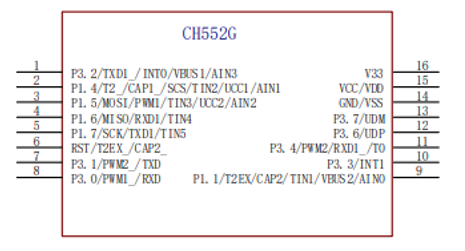
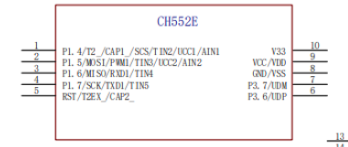
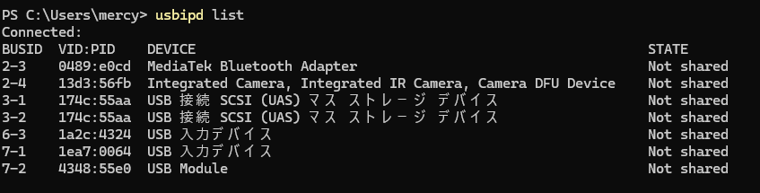
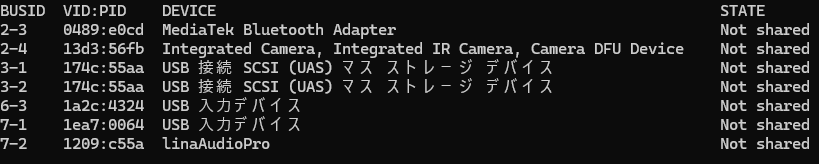
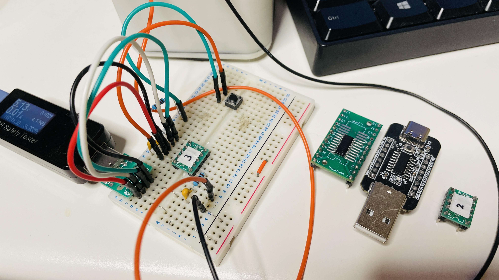

# 【linaAudio】45円CPUで作るUSB-Audioだにょ②【動作編】

2026年6月5日 10:50


## 概要

USB Audio デバイスを小型マイコンで作る試みです。最終的に CH552E で USB サウンドカード（linaAudioPro）として動作させることができました。

---

## 1. CH32V003 J4M6 にて USB Audio 認識

まず手元にあった **CH32V003 J4M6** で USB Audio Class として PC に認識させることに成功しました。

しかし音声ストリーミングは不可能でした。理由は USB Audio のアイソクロナス転送には **Full-Speed（12Mbps）以上**が必要ですが、CH32V003 は **Low-Speed（1.5Mbps）** のみ対応しているため、Windows がアイソクロナス転送を拒否します。

| チップ | USB速度 | 音声ストリーミング |
|---|---|---|
| CH32V003 J4M6 | Low-Speed 1.5Mbps | ❌ |
| CH552 | Full-Speed 12Mbps | ✅ |

- [linaAudio(認識編)](../linaaudio-1/)
---

## 2. nanoCH55x（CH552G）にて初 try

ch55xduino 0.0.25 の `UsbAudioSpeaker` サンプルをそのまま使い、**nanoCH55x 基板**で動作確認しました。

- 24kHz モノラル
- P3.4（PWM2）から音声出力
- PC に USB サウンドカードとして認識

### 初回書き込みのポイント
++CH552系のCHIPは書込み保障回数が最高200回程度とされています　ここ注意です❕++

nanoCH55x はボタンを押しながら USB 接続でブートローダーモードに入ります。初回のみ Zadig でドライバ（libusb-win32）を当てる必要があります。

2回目以降は以下の PowerShell スクリプトで書き込めます：

```powershell
# flash.ps1
$hex = Get-ChildItem "$env:TEMP\arduino_build_*\*.hex" | Sort-Object LastWriteTime -Descending | Select-Object -First 1
& "C:\arduino-1.8.19\portable\packages\CH55xDuino\tools\MCS51Tools\2023.10.10\win\vnproch55x.exe" $hex.FullName
```

### 注意点

`src/` 配下にバックアップファイル（`__xxx.c` など）を置くと Arduino IDE がコンパイル対象にしてしまいます。バックアップは拡張子を `.bak` にするか別フォルダに置いてください。
++CH552系のCHIPは書込み保障回数が最高200回程度とされています　ここ注意です❕++

---

## 3. CH552G チップにて P1.5 にポートを変更


nanoCH55x 基板は P3.5 が引き出されていないためステレオ化できません。また CH552E への移植を見据えて、音声出力を **P3.4（PWM2）から P1.5（PWM1）に変更**しました。

### 変更点

**`.ino`**

```c
// 変更前（P3.4 / PWM2）
pinMode(34, OUTPUT);
PIN_FUNC &= ~(bPWM2_PIN_X);
PWM_CK_SE = 1;
PWM_CTRL |= bPWM2_OUT_EN;
PWM_DATA2 = 128;

// 変更後（P1.5 / PWM1）
pinMode(15, OUTPUT);
PIN_FUNC &= ~(bPWM1_PIN_X);
PWM_CK_SE = 1;
PWM_CTRL |= bPWM1_OUT_EN;
PWM_DATA1 = 128;
```

**`USBAudioSpeaker.c`**

アセンブリ内の `PWM_DATA2` を `PWM_DATA1` に変更。PWM1 は PWM2 のようなバグがないため nop 処理も不要ですが、同じ方式で安定動作します。

### PWM ピン対応表

| チップ | PWM | デフォルトピン |
|---|---|---|
| CH552G/E | PWM1 | **P1.5** |
| CH552G/E | PWM2 | P3.4（CH552E には出ていない） |

---

## 4. CH552E チップにて完了

CH552E（MSOP-10、ピッチ 0.5mm）単体での最小回路で動作確認しました。なお CH552G（SOP-16）のピッチは 0.74mm です。

### 最小回路

| ピン | 接続 |
|---|---|
| VCC（9番） | 5V |
| VCC（9番） | 104（0.1uF） → GND |
| GND（8番） | GND |
| V33（10番） | 104（0.1uF） → GND |
| P3.6（6番） | USB D+（緑） |
| P3.7（7番） | USB D-（白） |
| P1.5（2番） | 音声出力 |

### ブートローダーモード

P1.5 を 10kΩ を介して V33（3.3V）に接続した状態で電源投入するとブートローダーモードに入ります。


### デバイス名の変更

`USBconstant.c` の `Prod_Des[]` を変更することで PC 上でのデバイス名を変えられます（UTF-16LE 形式）：

```c
// linaAudioPro（12文字）
__code uint8_t Prod_Des[] = {
    0x1A, 0x03,
    'l', 0x00, 'i', 0x00, 'n', 0x00, 'a', 0x00,
    'A', 0x00, 'u', 0x00, 'd', 0x00, 'i', 0x00,
    'o', 0x00, 'P', 0x00, 'r', 0x00, 'o', 0x00};
```

### 最終的な .ino

```c
#ifndef USER_USB_RAM
#error "This example needs to be compiled with a USER USB setting"
#endif
#include "src/USBAudioSpeaker/USBAudioSpeaker.h"

#define SOUND_PIN 15

void setup() {
  USBInit();
  pinMode(SOUND_PIN, OUTPUT);
  PIN_FUNC &= ~(bPWM1_PIN_X);
  PWM_CK_SE = 1;
  PWM_CTRL |= bPWM1_OUT_EN;
  PWM_DATA1 = 128;
}

void loop() {
}
```

---

## 結果

PC に **linaAudioPro** として認識され、24kHz モノラルで音声ストリーミングが動作しました。CH552G・CH552E 両対応です。



++CH552系のCHIPは書込み保障回数が最高200回程度とされています　ここ注意です❕++
### ローパスフィルタ


PWM 出力にはノイズが含まれるため、LPF を追加すると音質が改善します：

| 要素 | 接続先 |
| --- | --- |
| P1.5 | [100Ω] を介してスピーカー(+) 側のノードへ |
| 100Ω | P1.5 とスピーカー(+) の間 |
| スピーカー(+) | 100Ω 経由で P1.5 に接続 |
| 0.1uF | スピーカー(+) のノードから GND へ |
| GND | 0.1uF の接続先 |

<div class="like-wrap"><div data-lyket-type="like" data-lyket-template="twitter" data-lyket-namespace="linalog" data-lyket-color-icon="#b5e853" data-lyket-color-primary="#b5e853" data-lyket-color-text="#eaeaea" data-lyket-color-secondary="#2b2b2b" data-lyket-id="linaaudio-2"></div></div>
