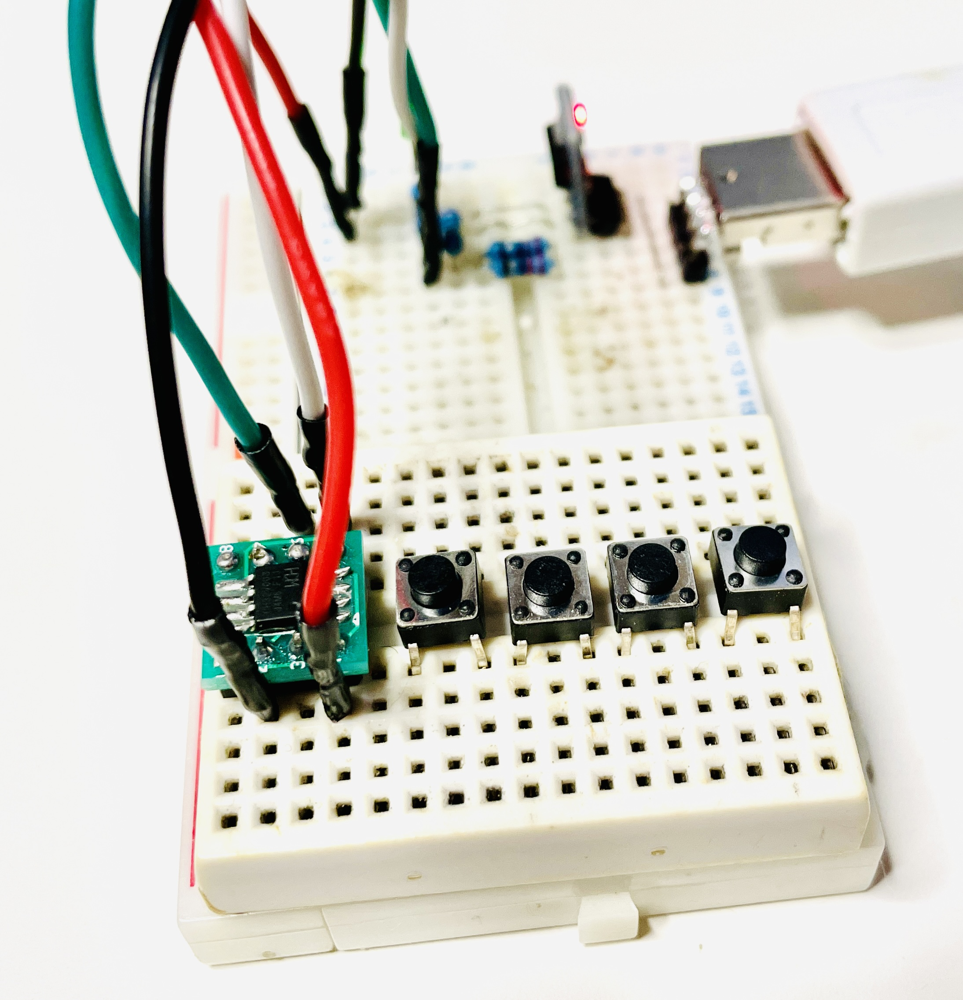
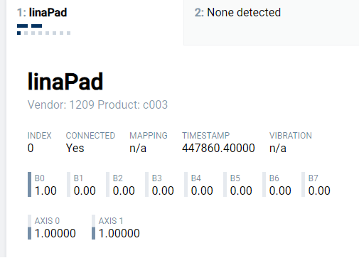
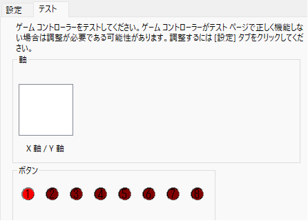

# 【linaDuino】25円で作るUSB-HIDだにょ【4btnPad】

2026年5月14日 14:27



# すべてはここから始まった
- [USB2Gamepad](../linaduino-4btnpad/)
- [USB2Monitor](../linaduino-usbmonitor/)
- [USB2Grove](../linaduino-usbgrove/)
# CH32V003J4M6 (SOP8) USB-HID ゲームパッド

## ハードウェア

```
//              +---_---+
// (Btn1)PD6 [1]|       |[8] PD4 (Btn4)
//       GND [2]|       |[7] PC4 (Btn3)
// (Btn2)PA2 [3]|       |[6] PC2 (白) D+
//       VCC [4]|       |[5] PC1 (緑) D-
//              +-------+
```

**USB配線**
- PC1 (Pin5) --- 22Ω --- USB D- (白)
- PC2 (Pin6) --- 22Ω --- USB D+ (緑)
- PC2 (Pin6) --- 1.5kΩ --- 3.3V (プルアップ)

---

## ソフトウェア構成

- **ライブラリ**: [rv003usb](https://github.com/cnlohr/rv003usb) (ソフトウェアUSB実装)
- **ビルド環境**: WSL (Ubuntu 22.04) + make
- **ツールチェーン**: riscv64-unknown-elf-gcc

---

## ハマりポイント

### 1. USB ピンの制約
rv003usb は `c.andi` 命令の制約により **GPIO 0-4 のみ** D+/D- に使用可能。**PD5-PD7 は使用不可。**

### 2. ポートの選択
SOP8 では使えるピンが少ない。PC1/PC2 が USB に最適。

### 3. DEBUGPRINTF の無効化
`funconfig.h` で `FUNCONF_USE_DEBUGPRINTF 0` にしないと PD5 が UART に取られてボタンが不安定になる。

### 4. Delay_Ms と USB の競合
メインループで `Delay_Ms` を使うと USB が止まる場合がある。短い値 (10ms程度) なら問題なし。

### 5. ボタンの論理
内部プルアップ使用時、押すと LOW になるので `!GPIO_digitalRead()` で読む。

### 6. GPIO ライブラリ
`ch32v003_GPIO_branchless.h` を使うと `GPIO_pinMode` / `GPIO_digitalRead` が使えてシンプルに書ける。

---

## VID/PID について
- VID `0x1209` は [pid.codes](https://pid.codes) のオープンソース用
- 個人開発・OSS公開は無料で利用可能
- **販売時は正式な VID/PID の取得が必要**

---

## 完成コード

```c
#include "ch32fun.h"
#include "rv003usb.h"
#include "ch32v003_GPIO_branchless.h"

static volatile uint8_t x_axis = 127;
static volatile uint8_t y_axis = 127;
static volatile uint8_t buttons = 0;

int main()
{
    SystemInit();

    funGpioInitD();
    GPIO_port_enable(GPIO_port_A);
    GPIO_port_enable(GPIO_port_C);
    GPIO_port_enable(GPIO_port_D);

    GPIO_pinMode(GPIOv_from_PORT_PIN(GPIO_port_D, 6), GPIO_pinMode_I_pullUp, GPIO_Speed_In);
    GPIO_pinMode(GPIOv_from_PORT_PIN(GPIO_port_A, 2), GPIO_pinMode_I_pullUp, GPIO_Speed_In);
    GPIO_pinMode(GPIOv_from_PORT_PIN(GPIO_port_C, 4), GPIO_pinMode_I_pullUp, GPIO_Speed_In);
    GPIO_pinMode(GPIOv_from_PORT_PIN(GPIO_port_D, 4), GPIO_pinMode_I_pullUp, GPIO_Speed_In);

    usb_setup();
    while(1)
    {
        buttons = 0;
        if (!GPIO_digitalRead(GPIOv_from_PORT_PIN(GPIO_port_D, 6))) buttons |= (1 << 0);
        if (!GPIO_digitalRead(GPIOv_from_PORT_PIN(GPIO_port_A, 2))) buttons |= (1 << 1);
        if (!GPIO_digitalRead(GPIOv_from_PORT_PIN(GPIO_port_C, 4))) buttons |= (1 << 2);
        if (!GPIO_digitalRead(GPIOv_from_PORT_PIN(GPIO_port_D, 4))) buttons |= (1 << 3);
        Delay_Ms(10);
    }
}

void usb_handle_user_in_request(
    struct usb_endpoint * e,
    uint8_t * scratchpad,
    int endp,
    uint32_t sendtok,
    struct rv003usb_internal * ist )
{
    if( endp )
    {
        uint8_t report[3] = { x_axis, y_axis, buttons };
        usb_send_data( report, 3, 0, sendtok );
    }
    else
    {
        usb_send_empty( sendtok );
    }
}
```
## 検証


## さいごに
うわ～　ちょっとハマりどころ満載だけど
USB機器が作れる #linaDuinoは凄いね
