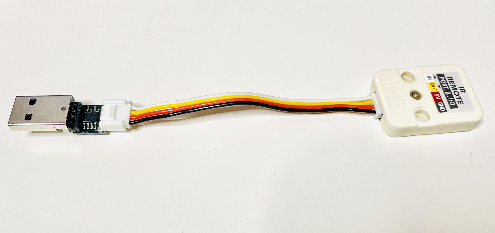

# 【linaDuino】25円で作るUSBGroveブリッジだにょ【USBGrove】

2026年5月15日 08:31
<p class="article-tags">タグ: <a href="..?tag=CH32V003">CH32V003</a> <a href="..?tag=Grove">Grove</a> <a href="..?tag=USB-HID">USB-HID</a> <a href="..?tag=linaduino">linaduino</a> <a href="..?tag=sop8">sop8</a></p>



# すべてはここから始まった
- [USB2Gamepad](../linaduino-4btnpad/)
- [USB2Monitor](../linaduino-usbmonitor/)
- [USB2Grove](../linaduino-usbgrove/)
# CH32V003J4M6 で作る USB-GROVE アダプタ
たぶん、これを作るための数日間
PCはつひに"感覚"を手に入れた
## 概要

**CH32V003J4M6 (SOP8 8ピン, 約10円)** を USB コネクタに直付けし、
GROVE コネクタで外部デバイスと接続する超小型 USB アダプタです。

PC からは **USB-HID デバイス**として認識されるため、ドライバ不要で使えます。

```
[PC] ----USB----> [CH32V003 SOP8] ----GROVE----> [外部デバイス]
                  (USB直付け)                    (センサー/IR等)
```

---

## ハードウェア

### ピン配置

```
CH32V003J4M6 SOP8
      +-------+-------+
  PD6 |1             8| PD1/SWIO
  GND |2             7| PC4
  PA2 |3             6| PC2 --- USB D+ (緑)
  VCC |4             5| PC1 --- USB D- (白)
      +-------+-------+

GROVE コネクタ:
  Signal1 --- PD6 (Pin1) または PC4 (Pin7)
  Signal2 --- PD1 (Pin8) ※書き込み後は使用可
  5V      --- VCC (Pin4)
  GND     --- GND (Pin2)
```

### USB 配線

```
PC1 (Pin5) ---[22Ω]--- USB D- (白)
PC2 (Pin6) ---[22Ω]--- USB D+ (緑)
PC2 (Pin6) ---[1.5kΩ]--- 3.3V (プルアップ)
VCC (Pin4) --- USB 5V (3.3Vレギュレータ経由)
GND (Pin2) --- USB GND
```

---

## ソフトウェア構成

- **ライブラリ**: [rv003usb](https://github.com/cnlohr/rv003usb)
- **ビルド環境**: WSL (Ubuntu 22.04) + make
- **ツールチェーン**: riscv64-unknown-elf-gcc
- **PC側**: Python + hidapi

---

## USB-HID プロトコル

```
送信 (PC -> CH32V003):
  Byte[0] = コマンド
    0x01 = GPIO 出力
    0x02 = UART 送信
    0x03 = I2C 送信
    ...

受信 (CH32V003 -> PC):
  Byte[0] = ステータス
  Byte[1..] = データ
```

---

## 応用例

| GROVE モジュール | 用途 |
|----------------|------|
| IR リモコン受信 | PC からリモコン操作 |
| ILI9341 ディスプレイ | PC から描画コマンド送信 |
| 温湿度センサー | USB 経由でデータ取得 |
| リレー | PC から ON/OFF 制御 |

---

## ハマりポイント

### 1. USB ピンの制約
rv003usb は **GPIO 0-4 のみ** D+/D- に使用可能。
**PD5-PD7 は使用不可**。PC1/PC2 が最適。

### 2. DEBUGPRINTF の無効化
`funconfig.h` で `FUNCONF_USE_DEBUGPRINTF 0` に設定。
そのままだと PC2 が UART に取られる。

### 3. VID/PID
- VID `0x1209` は [pid.codes](https://pid.codes) のオープンソース用
- 個人開発・OSS 公開は無料
- **販売時は正式取得が必要**

### 4. 書き込み時の注意
PD1 (Pin8) を外部デバイスに使う場合、書き込み時は一時的に外す必要がある。

---

## コスト

| 部品 | 単価 |
|------|------|
| CH32V003J4M6 | 約25円 |
| 抵抗 (22Ω x2, 1.5kΩ x1) | 数円 |
| USB コネクタ | 数十円 |
| GROVE コネクタ | 数十円 |
| **合計** | **約100円以下** |

---
## 実機
<blockquote class="twitter-tweet" data-theme="dark"><a href="https://twitter.com/chrmlinux03/status/2055065542084686291"></a></blockquote>
<script async src="https://platform.twitter.com/widgets.js" charset="utf-8"></script>

## まとめ

- **8ピン・約25円** のチップで USB-HID + GROVE インターフェース
- ドライバ不要、Python から簡単に制御可能
- USB コネクタ直付けで超コンパクト
- CH32V003J4M6 + USB-HID + GROVE の組み合わせは **世界初の可能性**

<div class="like-wrap"><div data-lyket-type="like" data-lyket-template="twitter" data-lyket-namespace="linalog" data-lyket-color-icon="#b5e853" data-lyket-color-primary="#b5e853" data-lyket-color-text="#eaeaea" data-lyket-color-secondary="#2b2b2b" data-lyket-id="linaduino-usbgrove"></div></div>
