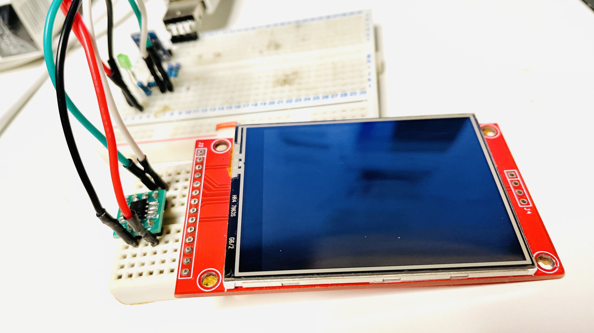

# 【linaDuino】25円で作るUSBモニターだにょ【USBMonitor】

2026年5月14日 20:30

タグ: <a href="..?tag=CH32V003">CH32V003</a> <a href="..?tag=ILI9341">ILI9341</a> <a href="..?tag=USB-HID">USB-HID</a> <a href="..?tag=linaduino">linaduino</a> <a href="..?tag=sop8">sop8</a>

# すべてはここから始まった
- [USB2Gamepad](../linaduino-4btnpad/)
- [USB2Monitor](../linaduino-usbmonitor/)
- [USB2Grove](../linaduino-usbgrove/)

# USB-HID で液晶ドライブしてみた
もちろん世界初💕
いや USB-HIDが今面白い

<blockquote class="twitter-tweet" data-theme="dark"></blockquote>

<blockquote class="twitter-tweet" data-theme="dark"></blockquote>

