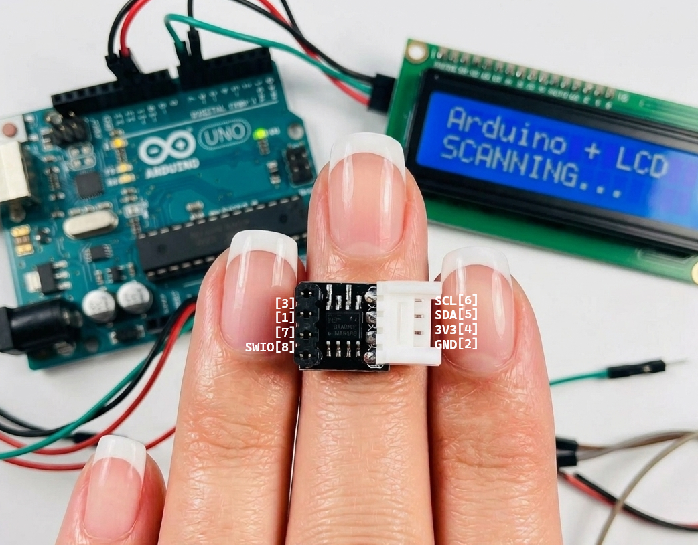

# 【linaDuino】リナディーノ(てじなーにゃのアクセントで)【世界最小Arduino互換】

2026年5月7日 14:09

# すべてはここから始まった
- [USB2Gamepad](../linaduino-4btnpad/)
- [USB2Monitor](../linaduino-usbmonitor/)
- [USB2Grove](../linaduino-usbgrove/)
# 実機
（X 投稿の埋め込み）

