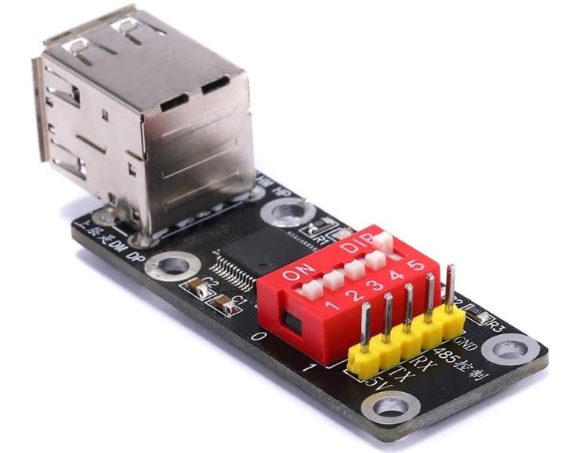

# [#SPRESENSE 2026]Cインタプリタ(VM)を作ったにょ[ch9350編]

2026年8月26日 13:10


# liveOSの中身 ― CH9350LでマイコンにUSBキーボード/マウスを生やす

liveOSシリーズ3本目です。[Cインタプリタ「livec」編](./liveOS_elchika.md)、[エディタ/シェル編](./liveOS_editor_elchika.md)に続いて、今回は「マイコンにUSBホスト機能がなくても、普通のUSBキーボード・マウスをそのまま挿して使えるようにする」部分、**CH9350L**まわりの実装を詳しく書きます。

## そもそもの課題 ― マイコンでUSBキーボードを使う面倒さ

RP2040やSpresenseは基本的にUSB**デバイス**(PCにつながる側)として使うのが標準的で、USB**ホスト**として汎用キーボード/マウスを繋ぐには相応の実装が要ります。今回はそこを自作せず、**CH9350L**という「USBキーボード/マウスの信号を受けて、UART(シリアル通信)のバイト列に変換して吐き出してくれるチップ」を使うことで解決しました。

| 要素 | 接続先・説明 |
| --- | --- |
| USBキーボード/マウス | USB で [ CH9350L ] へ |
| CH9350L | HID→UART変換。UART(115200bps) でマイコン(RP2040/Spresense) へ |
| マイコン(RP2040/Spresense) | CH9350L から UART(115200bps) で受信 |

マイコン側からすると「ただのシリアルポートから謎のバイト列が流れてくる」だけなので、そのバイト列(フレーム)を正しくパースする`ch9350lib.hpp`が実装の中心になります。

## CH9350Lのフレーム構造

CH9350Lは「下位機モード」(DIPスイッチ/SLE・BA1ピンで設定)にすると、2つのUSBホストポートを両方使えるようになり、キーボードとマウスを同時に挿してどちらの入力も1本のUARTに流し込んでくれます。フレームはこういう形です。

| フィールド | 説明 |
| --- | --- |
| 57 AB | ヘッダ2バイト (固定) |
| `<opcode>` | 種別 (1バイト) |
| [data_length] | フレーム長 (可変長フレームのみ。0x88/0x83の時だけ存在) |
| [device_kind, report..., serial, checksum] | ペイロード |

opcodeによってフレームの意味と長さが変わります。

| opcode | 種類 | 長さ | 中身 |
|---|---|---|---|
| `0x82` | 定期ステータス/同期フレーム | 4バイト固定 | マウス/キーボードと無関係、破棄 |
| `0x84`/`0x86`/`0x87` | 中身なしフレーム | 3バイト固定(opcodeのみ) | 破棄 |
| `0x88`/`0x83` | **データフレーム** | **可変長**(4 + data_length) | マウスまたはキーボードのレポート |

最初にハマったのがこの**可変長**の部分でした。実機でダンプしてみると:

- マウスのレポート: `data_length = 8` → フレーム全体で12バイト
- キーボードのレポート: `data_length = 11` → フレーム全体で15バイト

同じopcode(`0x88`)でも中身次第でフレーム長が変わります。最初のバージョンでは「マウスは12バイト固定」という決め打ちで実装してしまい、キーボードのフレーム(15バイト)が来た瞬間にバイトのズレ(デシンク)が起きて、その後の入力がすべて化けるバグを出しました。今のバージョンでは、`opcode`の次のバイトを**必ずdata_lengthとして読んでからフレーム長を確定させる**ようにしています。

```cpp
// 4バイト目 = data_length。ここで初めてフレーム全体の長さが確定する
uint8_t dataLen = _packet[3];
_frameLen = 4 + dataLen;
```

ペイロードの先頭にある`device_kind`バイトの上位ビットで、マウスかキーボードかを判別します。

```cpp
uint8_t deviceKind = _packet[4];
uint8_t kind = (deviceKind >> 4) & 0x03; // 2=マウス, 1=キーボード
```

## バイト列の受信: ステートマシンでの同期

シリアルから届くバイトは、`_pos`(今フレームの何バイト目を読んでいるか)を進めながら1バイトずつステートマシンで処理しています。

| 状態 | 条件 | 遷移先・備考 |
| --- | --- | --- |
| _pos=0 | 0x57受信 | _pos=1 へ |
| _pos=0 | それ以外 | 無視 |
| _pos=1 | 0xAB受信 | _pos=2 (opcode受信) へ |
| _pos=1 | 0xAB以外なら | _pos=0に戻る (ただし0x57ならそこから再挑戦) |
| _pos=2 (opcode受信) | 後続の受信へ | ... |

ポイントは「**ヘッダ`57 AB`が来るまでは何を受信しても捨てる**」ことです。これによって、電源投入直後やUARTのノイズで変なバイトが混ざっても、次の正しいヘッダが来た時点で自動的に同期が回復します。またフレーム長がバッファサイズを超えるなど「想定外」を検知したら、都度`_pos = 0`にリセットして先頭から探し直す、という設計にしていて、1回のフレーム異常が引きずって永久に壊れ続けることがないようにしています。

受信そのものは、`Serial.read()`を1バイトずつ呼ぶのではなく、届いている分をまとめて`readBytes()`で取得してからローカルバッファ内でさばく方式にしています。

```cpp
if (_rxPos >= _rxLen) {
    int n = _serial.available();
    if (n <= 0) break;
    _rxLen = _serial.readBytes(_rxBuf, n);
    _rxPos = 0;
}
uint8_t c = _rxBuf[_rxPos++];
```

## マウス: 相対移動 + 感度 + 加速

マウスのレポートは button/x/y/wheel の4バイトで、x/yは**符号付き相対移動量**(1回のレポートでどれだけ動いたか)です。これをそのままカーソル座標に足すのではなく、感度・加速・移動しきい値という3つのパラメータを通しています。

```cpp
int16_t effX = (abs(_x) < _moveThreshold) ? 0 : _x;         // しきい値未満の微小な揺れは無視
float accelMulX = 1.0f + _accelGainX * (float)abs(effX);     // 速く動かすほど倍率が上がる
_remX += (float)effX * _sensitivityX * accelMulX;             // 端数を含めて蓄積
int32_t dx = (int32_t)_remX;    // 整数部だけを実際の移動量として反映
_remX -= dx;                    // 端数は次回に持ち越す(蓄積誤差を防ぐ)
```

`_remX`/`_remY`に端数を蓄積しているのが地味なポイントです。感度を小さくする(例えば0.5倍)と、1レポートあたりの移動量が1px未満になる場面が出てきますが、そのたびに切り捨てていると「動かしているのにカーソルが全く動かない」ということが起きます。端数を持ち越して次回に足すことで、平均的には正しい速度でカーソルが動くようにしています。

## キーボード: 6キーロールオーバーの差分検出

USB HIDのキーボードレポートは「今押されているキーを最大6つ、コード値で並べる」形式です。これは「新たに押されたキー」を教えてくれるわけではなく、**今の状態のスナップショット**が送られてくるだけなので、前回のレポートと比較して「新しく増えたキー」だけを拾う処理が要ります。

```cpp
void processKeyboardReport(uint8_t modifiers, const uint8_t* keys, uint8_t keysLen) {
  for (uint8_t i = 0; i < n; i++) {
    uint8_t code = keys[i];
    bool wasDown = 前回のレポートにcodeが含まれていたか;
    if (!wasDown) {
      // 新しく押されたキーだけを文字コードに変換してキューへ
      kbPush(hidKeyToBytes(code, modifiers));
    }
  }
  _prevKeys[] = 今回のkeys[]で更新;
}
```

これをやらないと、キーを押しっぱなしにした時、レポートが届くたびに(だいたい数msおきに)同じ文字が大量にキューに積まれてしまいます。差分を取ることで、「押した瞬間の1回だけ」入力として扱われます(いわゆるキーリピートは今のところ実装していません)。

## JIS配列対応: US配列ライブラリのコードそのままでは使えない

USB HIDのキーコードは物理的な**キーの位置**を表す番号で、US配列かJIS配列かでコードと文字の対応が変わります。特に数字キーの上段(`0x1E`〜`0x27`)は、Shiftを押した時の記号がUS配列とJIS配列で全く違います。

```
  US配列(Shift+2 = @):  1 2 3 4 5 6 7 8 9 0
                        ! @ # $ % ^ & * ( )

  JIS配列(Shift+2 = "): 1 2 3 4 5 6 7 8 9 0
                        ! " # $ % & ' ( )
```

`hidKeyToBytes()`では、US配列のテーブルをそのまま使うのではなく、JIS配列用のテーブルを個別に用意しています。

```cpp
static const char plain[10]   = { '1','2','3','4','5','6','7','8','9','0' };
static const char shifted[10] = { '!','"','#','$','%','&','\'','(',')','0' };
```

記号キー(`-`/`^`/`@`/`[`/`]`/`;`/`:`など)もJIS配列では位置も刻印もUS配列と異なるため、1つ1つ個別に対応表を書いています。中でも実機で手間取ったのが**"ろ"キー**(JIS配列特有の、右下にある`\`/`_`キー)で、HIDキーコード表の記載(`0x87`)と、実際に手元のキーボードが送ってきたコード(`0x32`)が食い違っていました。

```cpp
case 0x31: out[0] = shift ? '}' : ']';  return 1; // JIS: ] / }
case 0x32: out[0] = shift ? '}' : ']';  return 1; // JIS: ] / } (実機ではこちらのコードで送られてくる)
```

こういうキーボード個体差・ファーム差はデータシートだけでは分からず、実機に実際にキーボードを挿して1キーずつダンプしながら潰していく地道な作業になりました(`setDebugRaw(true)`で生バイトダンプできるようにしてあるのはこのため)。

矢印キーは単一バイトでは表現できないので、ANSI/VT100端末でおなじみの `ESC [ A`(上)のような3バイトのエスケープシーケンスとしてキューに積んでいます。これにより、キーボードから来た入力もSerialモニタから来た入力も、[エディタ/シェル編](./liveOS_editor_elchika.md)で書いたキー入力ループがまったく同じコードで処理できます。

```cpp
case 0x52: out[0] = 27; out[1] = '['; out[2] = 'A'; return 3; // Up
```

## USBシリアルとの統合(input.hpp)

`ch9350lib.hpp`自体はキーボードのバイト列を内部キューに溜めるところまでで、実際に「Arduino IDEのシリアルモニタから打った文字」と「CH9350経由のキーボード入力」を1本のストリームにまとめているのは`input.hpp`です。

```cpp
inline bool kbInputAvailable() {
    while (Mouse.available()) { }   // マウスの読み出しがキーボードキューも同時に埋める
    return Mouse.kbAvailable() || Serial.available();
}
inline int kbInputRead() {
    if (Mouse.kbAvailable()) return (int)Mouse.kbRead();
    return Serial.read();
}
```

`Mouse.available()`(マウス用の関数なのに)を呼ぶ必要があるのがポイントです。UARTから実際にバイトを読んでフレームをパースしているのはこの関数の中なので、キーボードの入力だけを待っているつもりでも、裏でマウスのフレームを読み進めてあげないとUARTのバッファが詰まってしまいます。「マウスも見ているキーボード関数」ではなく、「UART全体を面倒見る関数の副産物としてマウス/キーボード両方の状態が更新される」という設計です。

## ハードウェア面: 下位機モードと2ポート

CH9350Lは複数の動作モードを持っていて、キーボード・マウスを同時に扱うには**下位機モード**(DIPスイッチ/SLE・BA1ピンの設定)にする必要があります。このモードにしないと片方の入力しか拾えず、「キーボードは動くのにマウスが反応しない」のような症状になります。またCH9350L側の2つ目のUSB-Aポート(スタック型コネクタ)を使うことで、物理的にキーボードとマウスの両方を挿せるようにしています。

## まとめ

CH9350L統合でやったことを一言でまとめると、「**データシート通りに実装しても実機で微妙にズレる部分を、実機ダンプで1つずつ潰していく**」作業でした。

- フレーム長を決め打ちにせず、必ずdata_lengthフィールドを読んでから確定させる(可変長フレームの罠)
- ヘッダバイト列による自己同期で、ノイズや想定外のフレームから自動復帰する
- HIDの「状態スナップショット」を「新規押下イベント」に変換する差分検出
- データシート記載のキーコードと実機の送信コードが食い違うケース(ろキー)への対応
- マウス/キーボードを1本のUARTから多重化して受け、さらにSerial入力とも1本のストリームに統合

USBホスト機能を持たないマイコンでも、こういう変換チップを1枚挟むことで、普通のUSB周辺機器がわりと簡単に使えるようになる、というのが今回の一番の収穫でした。

---


## 関連コンテンツ
・[liveOS liveC](../livec/)
・[liveOS エディタ編](../livec-editor/)
・[liveOS ch9350編](../livec-ch9350/)
・[liveOS LiveB/LiveP](../liveb-livep/)
・[liveOS LiveCO](../liveco/)
・[liveOS LiveFO](../livefo/)
・[liveOS LinDOS](../lindos/)
・[liveOS linaX](../spresense-linax/)
・[liveOS porting m5](../spresense-linax-port/) ←いまここ

*このプロジェクトはArduinoフレームワーク上で開発しています。ボードはVicharak Shrike-Lite (RP2040) / Sony Spresense / cyd / m5tab5 / m5sticks3 5機種に対応。*

