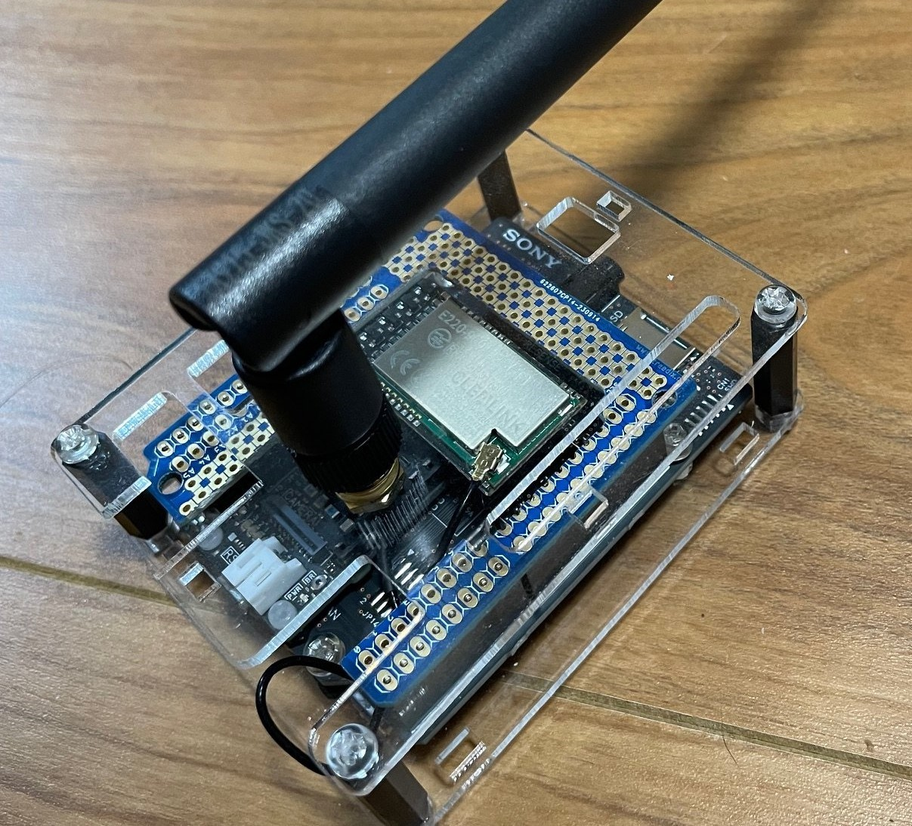

# LoRaE220_900T22S_JPのサンプルが間違ってたので修正したよっ

2023年12月12日 08:05



# はじめに

おはようございまし リナちゃん@chrmlinux03 です
LoRaの基板が届いて1時間ケース作ってガリガリやって
「さぁ」ってやったら動かない～って事で修正したご報告

# 前提条件
えーこれってSPRESENSE2023のモニター機材だから
皆困ってるでしょ？だから早急に直さないと

# 実装開始
たぶんどこかの元ソースから流用して直したようなんですが
このコにはSWが付いてないからモードが切り替えられなかったって事だと思う
loopが動いてないのはthreadが立ってないから💦
なのでモードは強制的に切り替えちゃいましょう

# 完成形
```c++:lora_send.ino
抜粋
// ノーマルモード(M0=0,M1=0)へ移行する
//  SerialMon.printf("switch to normal mode\n");
//  lora.SwitchToNormalMode();
//  送信モード(M1=1,M1=0)へ移行する
  SerialMon.printf("switch to sending mode\n");
  lora.SwitchToWORSendingMode();
```

# 実行結果
（X 投稿の埋め込み）

# 最後に
もっとすごいのはコンテストに向けて製作中なので今しばらくお待ち下さいませ
よろしくお願い申し上げます
※ごめんちょっと直した٩(ˊᗜˋ*)و
