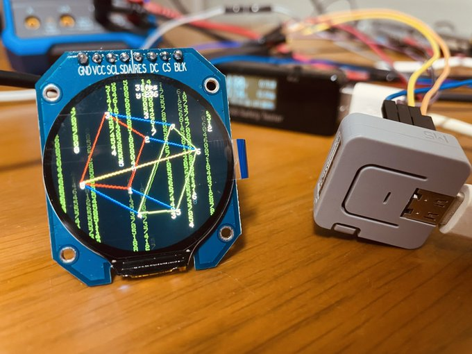
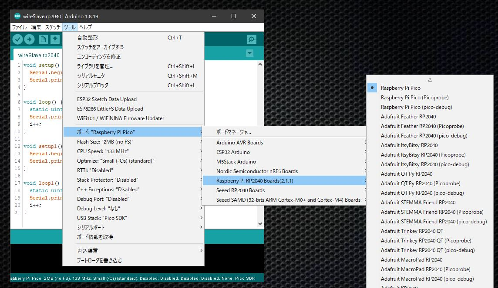
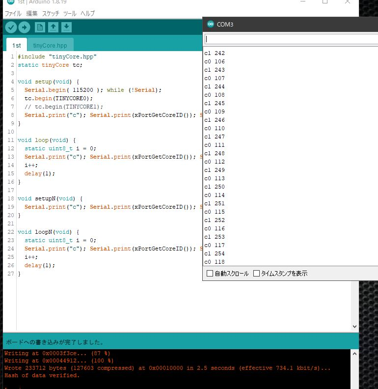

# RP2040のsetup1/loop1が素敵なので M5Stack/ESP32 にも実装してみたよっ

2022年6月20日 16:12



# はじめに

こんにちわ リナちゃん@chrmlinux03 です
最近 rp2040 っていうマイコンが流行っていてすっごいリーズナブルなのに高性能しかもコードが書きやすいって感じなので調べてみると....

# え？ setup1()? loop1()?

++悲しい事に Arduino IDE ボードマネージャー > Rasberry Pi RP2040 Board > Rasberry Pi Pico を選択しないとこの機能は使え無い++

# まぁ確かに 2個のcoreを持っているcpu だから
初心者にはわかりやすいですよね
ははぁ　初心者....
んぢゃこれ M5Stack / ESP32 にも同じような記述方法があれば
Lチカとか楽になりそ
いや劇的に楽になるでそ

# 前提条件
M5Stack / ESP32 の loop() は core1 で行われる
通信等の処理は core0 で行われる
たまぁーに core数が1個の cpu も存在するので裏で動かす core 自体を設定できるのが良い
限りなくwdtに掛からないようにすべき
++ウォッチドッグタイマ(WDT)とはマイコンのプログラムが暴走・停止していないかを監視するタイマ。MCUの動作を常に見張る番犬 
wikipedia++

# 実装開始
ライブラリとして製作するわけですが　
あまりライブラリとしての存在感が出てしまうと rp2040 のコードに負けてしまう💦
ぢゃそこ class外に持って行って使って頂く事に
名称は setupN/loopN でどうかしら？
実際に使う場合は core の指定だけで良い感じで
++ライブラリは、汎用性の高い複数のプログラムを再利用可能な形でひとまとまりにしたものである。ライブラリと呼ぶときは、それ単体ではプログラムとして動作させることはできない、つまり実行ファイルではない場合がある。ライブラリは他のプログラムに何らかの機能を提供するコードの集まりと言える。
wikipedia++

# 完成形

```c++:1st.ino
#include <tinyCore.hpp>
static tinyCore tc;
void setup(void) {
  Serial.begin( 115200 ); while(!Serial);  
  tc.begin(TINYCORE0);
  // cpu1 で実行したい初期化を記述
}
void loop(void) {
  // cpu1 で実行したい内容を記述
  delay(1);
}
void setupN(void) {
  // cpu0 で実行したい初期化を記述
}
void loopN(void) {
  // cpu0 で実行したい内容を記述
  delay(1);
}
```
++**導入方法**
[github tinyCore](https://github.com/chrmlinux/tinyCore)
もしくは ライブラリーマネージャーから 'tinyCore' で検索++

# 動作例


# 最後に
Arduino IDE を使い M5StackやESP32でLチカをなさっている方々
さらに上のスーパLチカを目指して
是非こちらをお使いくださいませっ
よろしくお願い申し上げます

