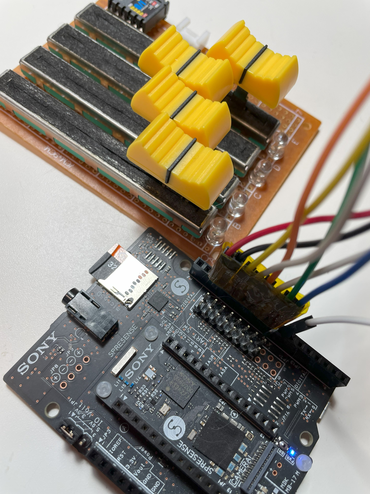
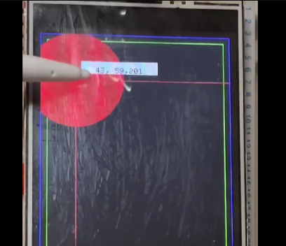
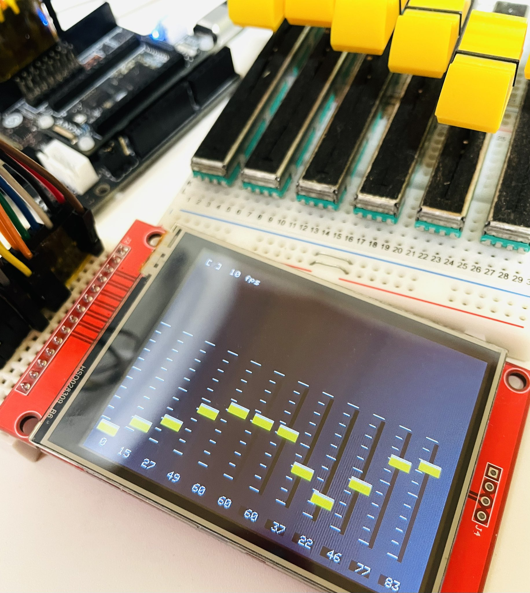
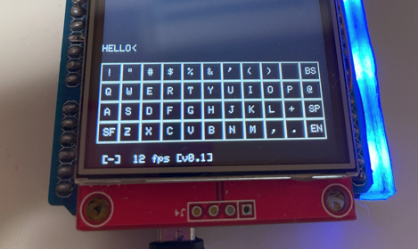
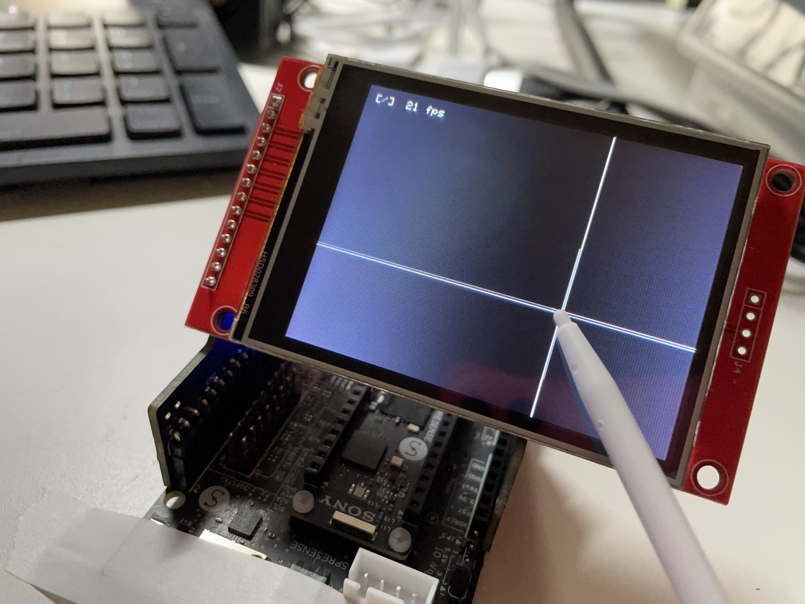
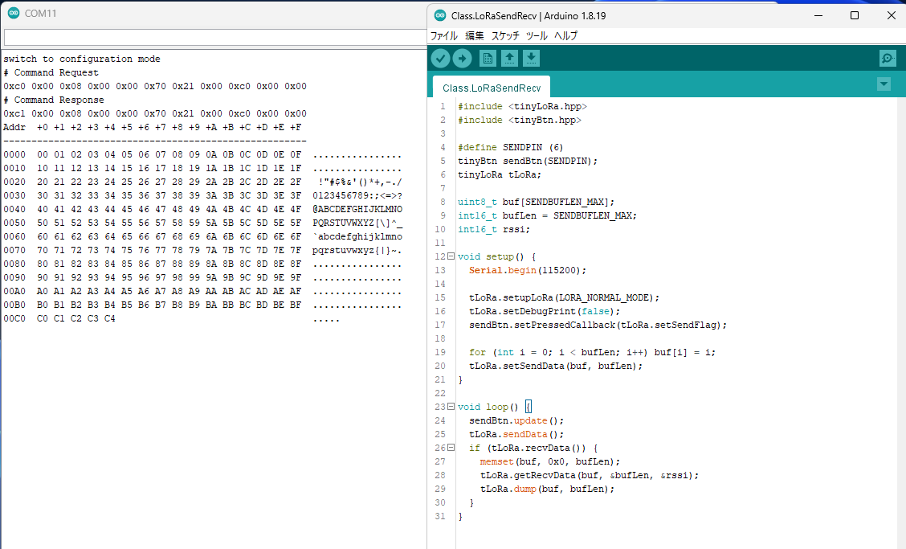
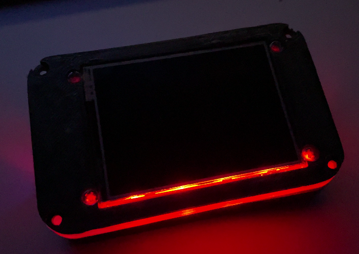
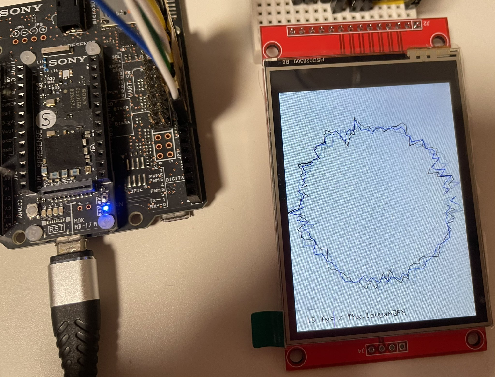
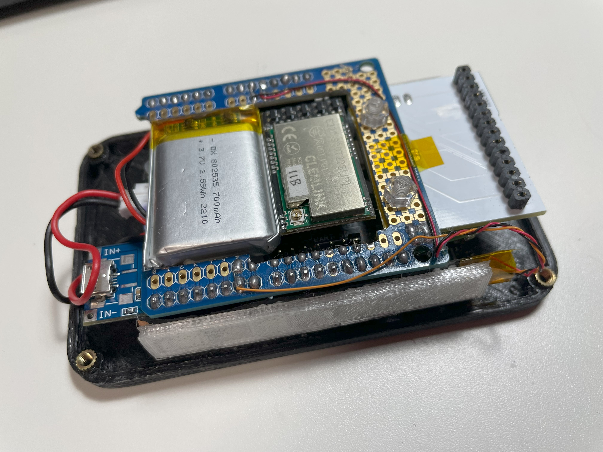

# 【SPRESENSE2023】開発まとめ

2024年1月24日 21:08


# はじめに
こんにちわっ 

リナちゃん　X@chrmlinux03　です

皆さまおそくなりましたがっ
あけまして🎊おめでとうございます

昨年は**SPRESENSE ロボット部門最優秀賞**ありがとうございました[[1]](https://elchika.com/promotion/spresense2022/winner/#nav "spresense2023コンテスト")

今年も色々やらせて頂きました٩(ˊᗜˋ*)و

今回のテーマは **音** と **光** 
# まず今回の製作物一覧
## SoundSerenity(環境音が8Trackで美しく流れる箱)
👉[SoundSerenity](../spresense-soundserenity/)


## LoRaPager(LoRaを使った簡易メッセンジャーBox)
👉[LoRaPager](../spresense-lorapager/)


## tinyFader(SPRESENSEを簡易ミキサーに~~する~~したかった
👉[tinyMixer](../spresense-tinymixer/)



++完成しなかった物も一部混じっております↑
まぁこれはこれで急ぐものではありませんので
面白そうなのでコンテスト終了後にでもぼちぼち💦++

# 工事中もある
また、壮大なドキュメントなのでたまーに


こんな画像が入ってるとこがありますが

これは単純に転送を忘れただけです💦

やさしぃ気持ちで笑って下さい

# やってる事は地味だけど得るものは大きい
今年の作品~~は~~も、やってる事は地味なんですけど

初心者の方々(Lチカが出来るくらいの仲間たち)にも分かり易く説明する為に、

出来るだけ main.ino は少なめに構造だけを記するという~~特殊な~~素敵な技法で作成しました。

``` c++:main.ino
#include "tinyCore.hpp"
volatile int _cnt = 0; 
tinyCore tc;
void setup(void) {
  Serial.begin( 115200 );
  tc.begin();
}
void loop(void) {
  Serial.printf("task%d cnt:%d\n", 0, _cnt);   
  _cnt++;
}
void setupN(void) {}
void loopN(void) {
  Serial.printf("task%d cnt:%d\n", 1, _cnt);   
  _cnt++;
}
```

まぁいつもの事なんですけどね。

その為に開発効率よりも構造化にかなり時間が割かれますが

まぁそれも大きくなった時の良い思い出になるのではないかなぁとか考えております

# 何故ドキュメントを分割するのか？
上記のような理由で

外部のライブラリとか同じような仕掛(からくり)は別ファイルで構成しております。

つまり　#include の嵐なんですけどっ

プログラムの師匠だった方から**1画面1関数**と**1Class1ファイル** と言う謎の教えを頂き、

それをずっと守って居ります。

さらに閲覧する方々が

「あれ？これは同じ事書いてない？」

という悲しい思いを募らせるのもなんなんで分割させて頂こうと思いますので

こちらのドキュメントを総合のアジェンダとさせて頂こうと考えております。

作業の50%はドキュメント作成 24%はプログラム作成 25%は筐体設計/印刷

のこり1% がものを発明する時間となっておりました💦
# パワーポイントとワードの違いに関して
過去に毎週2～3回ほどの開発会議をこなしており

そのあたりの重要性と違いに関しては熟知しているつもりです

某大学のインターンにあるシステムのマニュアルをお願いしたところ

**パワーポイント**や**エクセル**で納品頂き困ってしまいました💦

要するにパワーポイントは会議用、しかも**説明は演者**が行う事が出来る

ワードは納品用、つまり**提出物として使う事**が出来るという形になります

elchika の markDown掲載 はもちろん後者にあたり

**外部への参照リンクは不可**という文言を読んでもお分かりのように

elchika内部のサーバにアップしてある文書に関しては改変履歴が残り

書き換える事が出来ない仕組みになっていると言う事だと思われます

そのあたりが明確に描かれておりませんので

「この辺の内容は 以前製作した xxxx を参照」と言うのはありえねぇって感じです

# ついに2023年3DPrinter導入
2023年3DPrinterを~~無料で~~頂いたので筐体は設計印刷共々自作となり

過去に3D映像を扱った経緯もあり、お仕事で**設計**を教える事も出来ました

ただし 最近のお仕事は

- システム設計
- 回路設計
- 半田付け
- プログラム作成
- ドキュメント作成
- 筐体モデル設計 <- **作業が増えた**
- 筐体3DPrinter印刷 <- **作業が増えた**

ダイソーでケースを探すよりも大変な今回のプロジェクトとなりました💦


# 今年の仕掛け(からくり)一覧
ですが、そのお陰で新規の製品を作る上で、

「あーこういう仕掛（からくり）があったら便利なのになぁ」

という事象があった場合には**楽**にその機能を実現出来ます。

また読んで下さる皆さまが審査される皆さまも

「あーここどうなってるんだろぉぉ？」

「こういう風にやりたいのに方法がわからない～」

「不思議ぃ」

と思い悩んだ場合でも

このアジェンダを見て頂ければ限りなくすぐに検索出来、メンテ、開発できるのではないかと考えております。

はい、長い長いオール自作開発のドキュメントの始まりです

## LCD液晶基板ili9341でタッチパネルを使うよ
👉[LCD液晶基板ili9341でタッチパネルを使うよ](../spresense-ili9341-touch/)




## タッチパネルにバーチャルフェーダーを載せたよ
👉[タッチパネルにバーチャルフェーダーを載せたよ](../spresense-virtual-fader/)



## タッチパネルにバーチャルキーボードを載せたよ
👉[タッチパネルにバーチャルキーボードを載せたよ](../spresense-virtual-keyboard/)



## B-Stem4CM01Display にタッチパネルの改造を行うよ
👉[B-Stem4CM01Display にタッチパネルの改造を行うよ](../spresense-bstem-touch/)



## LoRaのライブラリを使いやすくしたよ
👉[LoRaのライブラリを使いやすくしたよ](../spresense-lora-lib/)



## WS2812B を使った流れるような効果を
👉[WS2812B を使った流れるような効果を](../spresense-ws2812b/)



## AudioDSPを絶妙にハックしたよ【実践編】
👉[AudioDSPを絶妙にハックしたよ【実践編】](../spresense-audiodsp-jissen/)



## 組込用のSPRESENSEモジュールを作ったよ
👉[組込用のSPRESENSEモジュールを作ったよ](../spresense-module/)



ふぇ～壮大なドキュメントだった💦

以上よろしくお願い申し上げます。


  
2024年01月某日 リナちゃん　X@chrmlinux03
