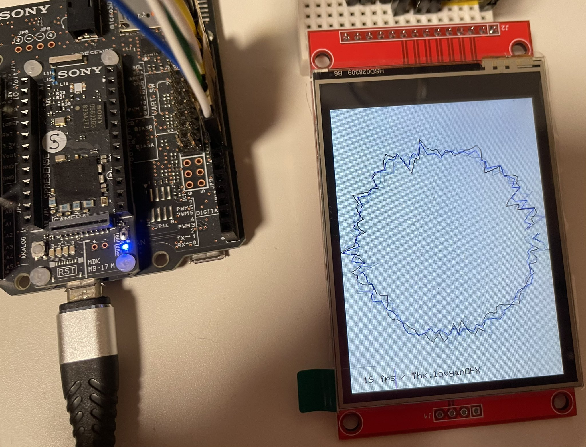
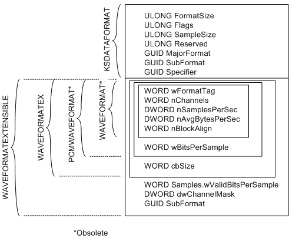
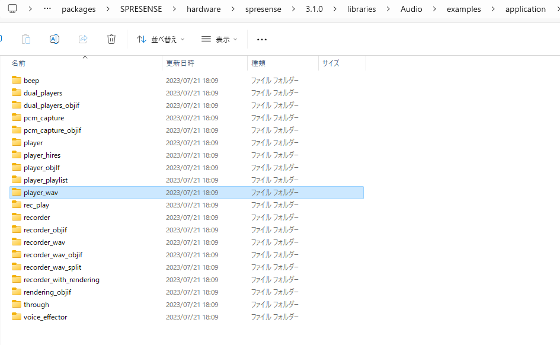
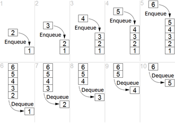
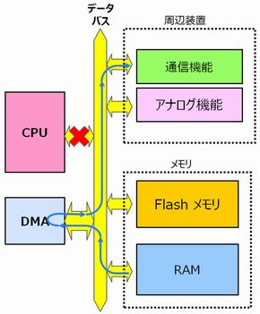
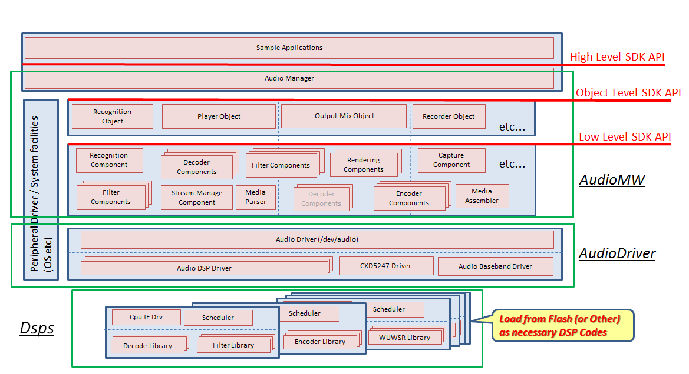
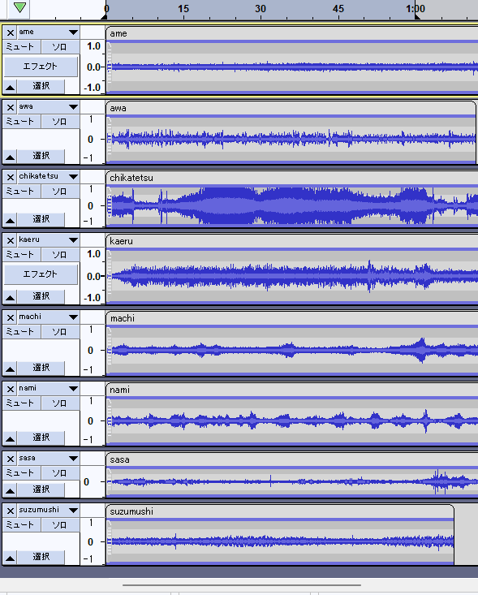
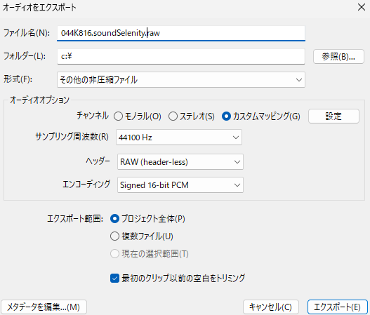
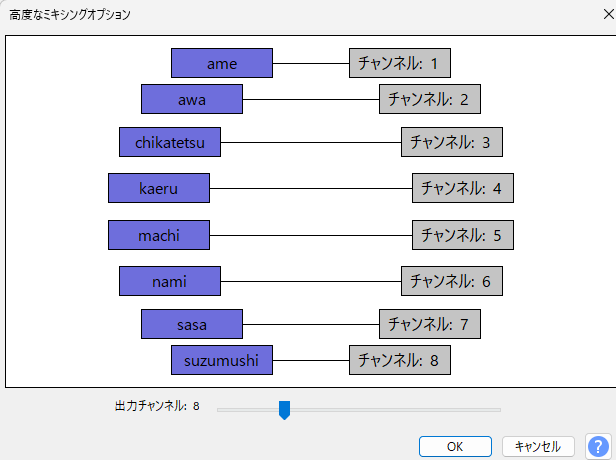
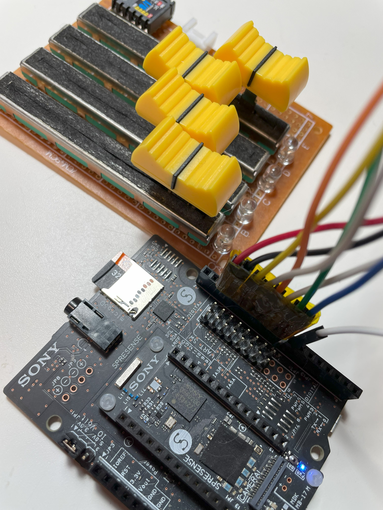

# 【SPRESENSE2023】AudioDSPを絶妙にハックしたよっ【実践編】

2024年1月26日 09:36



# はじめに

こんにちわっ 

リナちゃん　X@chrmlinux03　です

++このページは SPRESENSE2023コンテストで作った部品を紹介するものです
最初に [開発まとめ](../spresense-2023-matome/) をお読みいただければ幸いです++
# このモジュールで実現したかった事
### - 誰も成しえてない8Track の音声をSPRESENSEで鳴らしたかった
### - Player0 と Player1 が Stero + Streo なんで 合計 4Track しか同時再生出来ないし💦 それの倍くらいの 8Track を再生したかった
### - 出来ればそれに　色と光によるエフェクトするための仕組みを付けたかった

（X 投稿の埋め込み）

# 用意するもの

| 部品名 | 販売先 | 価格 |御提供品|
| -------- | -------- | -------- |-------- |
| スピーカ or 有線イヤホン|ダイソー|330円|ー|
|決して負けない強い力|誰でも|プライスレス|ー|

# 知ってる音声ファイル形式を列挙
## MP3 (MPEG Audio Layer III)
- 特徴: 高い圧縮率を持ち、ファイルサイズを小さく保ちながら音質を劣化させないように設計されている
- 用途: インターネット上での音楽のストリーミングやダウンロード、携帯音楽プレーヤーでの再生など

## WAV (Waveform Audio File Format)
- 特徴: 非圧縮形式であり、高品質な音声を保持
- 用途: 音楽制作、オーディオ編集、効果音の保存、CDオーディオトラックなど

## AAC (Advanced Audio Coding)
- 特徴: 高い圧縮効率と良好な音質を兼ねる
- 用途: iTunesでの音楽ファイル、iPhoneやiPadでの音楽再生、オンライン音楽配信など

## AIFF (Audio Interchange File Format)
- 特徴: 非圧縮形式であり、高品質な音声を保持する
- 用途: 音楽制作、オーディオ編集、Mac用の音楽アプリケーションでの使用など

## WMA (Windows Media Audio)
- 特徴: マイクロソフトによって開発された形式で、MP3よりも高い圧縮率を持ちつつ、良好な音質を提供する
- 用途: Windows Media Playerでの音楽再生、Windowsプラットフォーム上でのメディア再生など

## FLAC (Free Lossless Audio Codec)
- 特徴: 無損失圧縮形式で、圧縮率が高くても音質の劣化がない
- 用途: 音楽制作、オーディオアーカイブ、高品質な音楽再生機器での使用など

## PCM (Pulse Code Modulation)
- 特徴: 音声をアナログからデジタルに変換するための基本的な方式で、音声信号を一定の間隔でサンプリングし、各サンプルの振幅を数値で表現する
- 非圧縮形式であり、高品質な音声を保持する
- 用途: CDオーディオ、音声録音、オーディオ制作など

## RAW (Raw Audio File)
- 特徴: 圧縮やエンコードが一切行われていない生の音声データを含む　最高の音質が得られるが、ファイルサイズは大きくなる
- 用途: 高品質な音声データの保存や処理、オーディオエンジニアリングなど

## PCM と RAW の概念

**RAW**と**PCM**は異なる概念であり、一般的に混同されることがある

### PCM (Pulse Code Modulation):
- PCMは、アナログ信号をデジタル信号に変換するための一般的な手法
- 音声信号を一定の間隔でサンプリングし、各サンプルの振幅を数値で表現する
- PCMはデジタル音声の基本形式であり、無損失のデジタルオーディオの表現に使用される
- WAVやAIFFなど、多くの音声フォーマットがPCMを使用す

### RAW (Raw Audio File):
- RAWオーディオファイルは、通常、圧縮やエンコードが一切行われていない生の音声データを含む形式である
- RAWファイルは単なる生のバイナリデータであり、ファイル内のデータ構造やメタデータが少ないか一切ないことが大体ある
- RAW形式は一般的に、デジタルオーディオデータをそのまま保存するために使用され、他の形式に変換する前の生データを含むことがたまにある

++要するに、PCMはデジタルオーディオの表現方法であり、RAWは通常、生の音声データを含む未加工の形式　ただし、PCMデータをRAWと呼ぶこともあるが、その場合は通常、PCMデータが特定のヘッダーやメタデータなしに生データとして保存されている状態を指す++

## とりま MP3/WAV/RAW は再生できる事がわかった

深い事は気にしない　🚬

# 面倒な事は良いとして、音綺麗に鳴るぢゃん
SPRESENSE を御提供頂きまず、最初に行うのはAudio機能ではないだろうか

私も前回まず最初に Audio機能に魅了された一人である

全てはここから始まった٩(ˊᗜˋ*)و

（X 投稿の埋め込み）

ここまで可能になった٩(ˊᗜˋ*)و
（X 投稿の埋め込み）

# 本家のライブラリが難解過ぎて涙
一番簡単な 1個のmp3ファイルを鳴らす ino ファイルで

度肝を抜かれた💦

え？こんなに設定しないと駄目なの？

goto 使わないと駄目なの？

先は長いな　🚬

```c++:Player.ino
#define MP3FILENAME "Sound.mp3"

#include <SDHCI.h>
#include <Audio.h>

SDClass theSD;
AudioClass *theAudio;
File myFile;
bool ErrEnd = false;
static void audio_attention_cb(const ErrorAttentionParam *atprm) {
  puts("Attention!");
  if (atprm->error_code >= AS_ATTENTION_CODE_WARNING) {
    ErrEnd = true;
  }
}

void setup() {
  while (!theSD.begin()) {
    Serial.println("Insert SD card.");
  }
  theAudio = AudioClass::getInstance();
  theAudio->begin(audio_attention_cb);
  puts("initialization Audio Library");
  theAudio->setRenderingClockMode(AS_CLKMODE_NORMAL);
  theAudio->setPlayerMode(AS_SETPLAYER_OUTPUTDEVICE_SPHP, AS_SP_DRV_MODE_LINEOUT);
  err_t err = theAudio->initPlayer(AudioClass::Player0,
                                   AS_CODECTYPE_MP3,
                                   "/mnt/spif/BIN",
                                   AS_SAMPLINGRATE_AUTO,
                                   AS_CHANNEL_STEREO);
  if (err != AUDIOLIB_ECODE_OK) {
    printf("Player0 initialize error\n");
    exit(1);
  }
  myFile = theSD.open(MP3FILENAME);
  if (!myFile) {
    printf("File open error\n");
    exit(1);
  }
  printf("Open! 0x%08lx\n", (uint32_t)myFile);
  err = theAudio->writeFrames(AudioClass::Player0, myFile);
  if ((err != AUDIOLIB_ECODE_OK) && (err != AUDIOLIB_ECODE_FILEEND)) {
    printf("File Read Error! =%d\n", err);
    myFile.close();
    exit(1);
  }
  puts("Play!");
  theAudio->setVolume(-160);
  theAudio->startPlayer(AudioClass::Player0);
}

void loop() {
  puts("loop!!");
  int err = theAudio->writeFrames(AudioClass::Player0, myFile);
  if (err == AUDIOLIB_ECODE_FILEEND) {
    printf("Main player File End!\n");
  }
  if (err) {
    printf("Main player error code: %d\n", err);
    goto stop_player;
  }
  if (ErrEnd) {
    printf("Error End\n");
    goto stop_player;
  }
  usleep(40000);
  return;

stop_player:
  theAudio->stopPlayer(AudioClass::Player0);
  myFile.close();
  theAudio->setReadyMode();
  theAudio->end();
  exit(1);
}
```

> SPRESENSE->Arduino Ide->Audio->example->Player.ino 

## 音声ファイル再生で(最低限)設定する内容

### システム内にDSPをインストールし再生を行う
SDカードもしくは SPIF上にインストールを行う
```
  err_t err = theAudio->initPlayer(AudioClass::Player0,
                                   AS_CODECTYPE_MP3,
                                   "/mnt/spif/BIN",
                                   AS_SAMPLINGRATE_AUTO,
                                   AS_BITLENGTH,
                                   AS_CHANNEL_STEREO);


```

### ノーマルかハイレゾか？

サンプリング周波数 44.1までは AS_CLKMODE_NORMAL
それ以上は AS_CLKMODE_HIRES

```
 theAudio->setRenderingClockMode(mode);

```

### 再生するファイル形式は？
- MP3:AS_CODECTYPE_MP3

```
32kHz (AS_SAMPLINGRATE_32000)
44.1kHz (AS_SAMPLINGRATE_44100)
48kHz (AS_SAMPLINGRATE_48000)
AS_SAMPLINGRATE_AUTO 指定するとサンプリングレート

```
- WAV/RAW:AS_CODECTYPE_WAV

```
32kHz (AS_SAMPLINGRATE_32000)
44.1kHz (AS_SAMPLINGRATE_44100)
48kHz (AS_SAMPLINGRATE_48000)
96kHz (AS_SAMPLINGRATE_96000)
192kHz (AS_SAMPLINGRATE_192000)
サンプリングオートは無い
```

### 何ビットのデータか？
```
AS_BITLENGTH_8
AS_BITLENGTH_16
AS_BITLENGTH_24

```

### ステレオかモノラルか？
```
 AS_CHANNEL_STEREO
 AS_CHANNEL_MONO
```


## Volume
- vol = -1020 ～ 120

```
 theAudio->setVolume(vol, vol, vol);

```

# Audio0 とか Audio1 とか Player0 とか Player1 とかなんだろう

てか  theAudio->writeFrames が2回書かれている

なんだろうね💦

Audio0 / Audio1 / Player0 / Player1 とかもよくわからない

さらに　setVolume メソッドに至っては

```
Audio0->setVolume(vol, vol, vol);
Audio1->setVolume(vol, vol, vol);

```
え💦 4ch 再生して　個別に音量調整できるの？

スピーカーは 2個だからなんだろうか....(まだわかって居ないのが事実)

# まず Player0 を解析
```
#include <Audio.h>
AudioClass *theAudio;
theAudio = AudioClass::getInstance();
err = theAudio->writeFrames(AudioClass::Player0, myFile);
theAudio->startPlayer(AudioClass::Player0);

```

この辺りから Player0 は theAudio0 を指定するだけのID番号として考える

myFile はなんだろう addrs をPrintしても同じ番地が返ってくるから スレッドセーフされた特殊な File myFile と考える

# うーん Streo と 2track は違うのか
（X 投稿の埋め込み）

んぢゃ完全に 別々な音声を 8Track分作成する必要があるね

覚えていられないかも💦

# 基本を raw ファイルを再生するものとして考える
RAWファイルは単なる生データでありバイナリデータである

WAVファイルも同様にほぼ生データではあるがヘッダにその生データの
- サンプリング周波数
- ビットレングス
- チャンネル数

等の情報が含まれる


> https://learn.microsoft.com/ja-jp/windows-hardware/drivers/audio/extensible-wave-format-descriptors

RAWファイルとして保存したものは上記ヘッダ情報は存在していないので

それを知らないとほぼ再生する事は出来ないのである💦

# ぢゃファイル名にその情報入れちゃう？

リナちゃんらしく単純な発想であった💦

例えば "192KS24.Rain.raw" というファイル名をシステムに食わせた場合

- サンプリングレート : 192000Hz
- 再生チャンネル：ステレオ
- ビットレート：24bit
- 音声コーデック：RAW(WAV)

という内容を FMT_T 構造体に返してくれる関数である٩(ˊᗜˋ*)و

```c++:抜粋
typedef struct {
  char fname[FILELEN_MAX];
  int8_t codec;
  int32_t freq;
  int8_t bitlen;
  int8_t ch;
  int16_t mode;
  File file;
} FMT_T;

//==============================================
//
// getFmt
// - Extracts audio file format information from the file name.
// - Input: fmt - Pointer to the FMT_T structure.
// - Return: None
//
//==============================================
void getFmt(FMT_T *fmt) {
  String fname = String(fmt->fname);
  fmt->codec = fname.endsWith(".mp3") ? AS_CODECTYPE_MP3 : AS_CODECTYPE_WAV;
  if (fmt->codec == AS_CODECTYPE_MP3) {
    fmt->freq = AS_SAMPLINGRATE_AUTO;
    fmt->ch = 2;
  } else {
    fmt->freq = fname.substring(0, 3).toInt() * 1000;
    if (fmt->freq == 44000) fmt->freq = 44100;
    fmt->ch = (fname.charAt(4) == 'S') ? 2 : ((fname.charAt(4) == 'M') ? 1 : (isdigit(fname.charAt(4)) ? (fname.charAt(4) - '0') : 0));
    fmt->bitlen = fname.substring(5, 7).toInt();
  }
}


```

また単純に 👉[SoundSerenity](../spresense-soundserenity/) 等で使用する際には

```
#define PLAYING_FILENAME "044K416.soundSerenity.raw"
const uint8_t numTracks = PLAYING_FILENAME[4] - '0';

```

のように、これから作成する numTracks(仮想フェーダーの数) を一瞬で得る事が出来るという

さらに "044K816/sound1.raw" のようなフォルダ構造でも解析できちゃうという

素敵なファイル名ヘッダが出来上がった訳である

# DSP への転送手順

ここからが長かった💦

## WAVファイル転送にヒントがあった


このファイルを見つけた時
どれだけ嬉しかったことか💕

## 何故 setup() で writeFrame するのか

loop は意味が分かる　音声を再生する訳なので

loop の中で何回も何回もファイルを読み取ってそれを DSP に渡さないとそりゃ無理です

👉[AudioDSPを説妙にハックしたよ理論編](../spresense-dsp-riron/)

44.1KHz 16bit Streo 3分の場合 31メガバイトのデータを回さないと駄目ですから💦

しかも1度に送れる量が決まってる

## 結論 = simpleFIFOの予備充填

> https://ja.wikipedia.org/wiki/FIFO


DSPは DMA(Direct Memory Access) と言う機能で

ある領域のデータを CPU の力を使わないで 音声デコーダに送ってくれる仕組みらしい

従って ある程度は loop の前に一杯にしておかないと

CPU が動いている時に無くなってしまう(勝手に出ちゃうから)

simpleFIFO は 先入れ先出しと言うルールにより構成されているので

先に入ったデータは DMA が勝手に再生しちゃうって事

## 結論 = simpleFIFOの本充填

だから setupが終わった瞬間に   theAudio->startPlayer(AudioClass::Player0); を実行し

loop で   theAudio->writeFrames(AudioClass::Player0, myFile); し続ける必要があるらしい


>https://edn.itmedia.co.jp/edn/articles/1608/18/news015.html

# 6144バイトの謎

（X 投稿の埋め込み）

なぜ 6144バイトなのかやっとわかった
んぢゃコード書いとく？
デバッグも仕込もうねっ

# HightLevel / ObjectLevel / LawLevel API


今回のコードは HightLevel ですね
基本的なコードしか使ってないし

# コード
```c++:spre.AudioLib.hpp
//==============================================
//
// Program Information
// - Name: spre.AudioLib.hpp
// - Date/Author: 2023/12/20 @chrmlinux03
// - Update/Author: 2023/12/20 @chrmlinux03
//
//==============================================
#include <SDHCI.h>
#include <Audio.h>
SDClass theSD;

//==============================================
//
// Definitions
// - Definitions for file length, count, channel count, etc.
//
//==============================================
#define FILELEN_MAX (128)
#define FILECNT_MAX (2)
#define CHCNT_MAX (2)
#define TRACK_MAX (16)

#define BIT12_MAX (4096 - 1)
#define BIT11_MAX (2048 - 1)
#define BIT10_MAX (1024 - 1)

#define PERCENT_MAX (100.0)

#define SCALE_MAX (1.0)
#define SCALE_MIN (0.0)
#define SCALE_NEG (-1.0)

#define VOLUME_MIN (-1000)
#define VOLUME_MAX (0)
#define VOLUME_DEF (0)

#define AUDIO_BUFSIZE (6144)
#define AUDIO_PRESTOREFRAME_SIZE (120)
#define AUDIO_NOWSTOREFRAME_SIZE (60)

#define DSP_PATH "/mnt/spif/BIN"

//==============================================
//
// Redefinitions
// - Redefinitions for audio-related constants.
//
//==============================================
#define AUDIO ((AudioClass::PlayerId)0)
#define AUDIO0 ((AudioClass::PlayerId)0)
#define AUDIO1 ((AudioClass::PlayerId)1)
#define CLOCK_NORMAL (AS_CLKMODE_NORMAL)
#define CLOCK_HIRESO (AS_CLKMODE_HIRES)

//==============================================
//
// Structs
// - Definition of various data structures.
//
//==============================================
typedef struct {
  int16_t master;
  int16_t audio0;
  int16_t audio1;
} VOLUME_T;

typedef struct {
  char fname[FILELEN_MAX];
  int8_t codec;
  int32_t freq;
  int8_t bitlen;
  int8_t ch;
  int16_t mode;
  File file;
} FMT_T;

typedef struct {
  uint8_t fcnt;
  FMT_T fmt[FILECNT_MAX];
} SYS_T;

//==============================================
//
// Global Variables
// - Declaration of global variables.
//
//==============================================
//float fbuf[CHCNT_MAX][AUDIO_BUFSIZE / sizeof(float)];

bool ErrEnd = false;
bool useAudio = false;
bool debugAudio = false;
bool useEffect = false;
SYS_T sys;
VOLUME_T vol = {VOLUME_DEF, VOLUME_DEF, VOLUME_DEF};
float trackVolume[TRACK_MAX];

//==============================================
//
// getFmt
// - Extracts audio file format information from the file name.
// - Input: fmt - Pointer to the FMT_T structure.
// - Return: None
//
//==============================================
void getFmt(FMT_T *fmt) {
  String fname = String(fmt->fname);
  fmt->codec = fname.endsWith(".mp3") ? AS_CODECTYPE_MP3 : AS_CODECTYPE_WAV;
  if (fmt->codec == AS_CODECTYPE_MP3) {
    fmt->freq = AS_SAMPLINGRATE_AUTO;
    fmt->ch = 2;
  } else {
    fmt->freq = fname.substring(0, 3).toInt() * 1000;
    if (fmt->freq == 44000) fmt->freq = 44100;
    fmt->ch = (fname.charAt(4) == 'S') ? 2 : ((fname.charAt(4) == 'M') ? 1 : (isdigit(fname.charAt(4)) ? (fname.charAt(4) - '0') : 0));
    fmt->bitlen = fname.substring(5, 7).toInt();
  }
}

//==============================================
//
// addFile
// - Adds a file to the system file list and prints its format information.
// - Input: fname - File name to be added.
// - Return: int16_t - Result code (always 0).
//
//==============================================
int16_t addFile(char *fname) {
  FMT_T fmt;
  strcpy(fmt.fname, fname);
  getFmt(&fmt);
  sys.fmt[sys.fcnt] = fmt;
  Serial.printf("[%s] freq:%d bitlen:%d ch:%d \n", fname, fmt.freq, fmt.bitlen, fmt.ch);
  sys.fcnt++;
  return 0;
}

//==============================================
//
// audio_attention_cb
// - Callback function for audio library attention events, particularly errors.
// - Input: atprm - Pointer to the ErrorAttentionParam structure.
// - Return: None
//
//==============================================
static void audio_attention_cb(const ErrorAttentionParam *atprm) {
  Serial.printf("Attention!");
  if (atprm->error_code >= AS_ATTENTION_CODE_WARNING) {
    ErrEnd = true;
  }
}

//==============================================
//
// setupAudio
// - Initializes the audio library and sets rendering mode and output device.
// - Input: playerid - ID of the audio player to be initialized.
//          mode - Rendering mode (AS_CLKMODE_NORMAL or AS_CLKMODE_HIRESO).
// - Return: int16_t - Result code (always 0).
//
//==============================================
int16_t setupAudio(AudioClass::PlayerId playerid, int16_t mode) {
  int16_t rtn = 0;
  AudioClass *theAudio = AudioClass::getInstance();
  theAudio->begin(audio_attention_cb);
  theAudio->setRenderingClockMode(mode);
  theAudio->setPlayerMode(AS_SETPLAYER_OUTPUTDEVICE_SPHP, AS_SP_DRV_MODE_LINEOUT);
  Serial.printf("Initialization Audio Library\n");
  memset(&sys, 0x0, sizeof(sys));
  return rtn;
}

//==============================================
//
// frameWriteFromBuffer
//
// This function writes audio frames from a buffer to the specified audio player.
//
// Inputs:
// - playerid: The ID of the target audio player.
// - file: The File object representing the source audio file.
// - storeFrames: The number of frames to be written.
//
// Outputs:
// - err_t: An error code (0 if the operation is successful).
//
//==============================================
err_t frameWriteFromBuffer(AudioClass::PlayerId playerid, File file, uint32_t storeFrames) {
  err_t err = 0;
  AudioClass *theAudio = AudioClass::getInstance();

  uint8_t buf[AUDIO_BUFSIZE];
  int16_t readedBytes = 0;
  uint32_t remainBytes = file.size() - file.position();

  for (uint32_t i = 0; i < storeFrames; i++) {
    if (remainBytes == 0) {
      file.seek(0);
      remainBytes = file.size();
    }

    memset(buf, 0, AUDIO_BUFSIZE);
    readedBytes = file.read(buf, min(remainBytes, AUDIO_BUFSIZE));
    remainBytes -= readedBytes;

    int16_t *audioData = (int16_t *)buf;
    int32_t samplesPerFrame = readedBytes / (sizeof(int16_t) * numTracks);

    for (uint32_t j = 0; j < samplesPerFrame; j++) {
      for (int tr = 0; tr < numTracks; tr++) {
        int32_t result = (int32_t)audioData[j * numTracks + tr] * trackVolume[tr];
        audioData[j * numTracks + tr] = (int16_t)(min(max(result, INT16_MIN), INT16_MAX));
      }

      for (int tr = 0; tr < numTracks; tr += numTracks / 2) {
        for (int ch = 0; ch < numTracks / 2; ch++) {
          int32_t result = 0;
          for (int subTr = 0; subTr < numTracks / 2; subTr++) {
            result += audioData[j * numTracks + tr + subTr];
          }
          audioData[j * numTracks / (numTracks / 2) + tr / (numTracks / 2) + ch] = (int16_t)(min(max(result, INT16_MIN), INT16_MAX));
        }
      }
    }

    uint32_t writeBytes = readedBytes / (numTracks / 2);
    err = theAudio->writeFrames(playerid, (uint8_t *)buf, writeBytes);

    if (debugAudio) {
      Serial.printf("  [frameWriteFromBuffer(%d)] err:%d store:%d remains:%s readeds:%s writes:%s\n",
                    playerid, err, i, fmtC(remainBytes).c_str(), fmtC(readedBytes).c_str(), fmtC(writeBytes).c_str());
    }

    if (err) {
      remainBytes += readedBytes;
      file.seek(file.position() - readedBytes);
      err = 0;
      break;
    }
  }

  return err;
}

//==============================================
//
// setupPlayer
// - Initializes the audio player for a specific player ID.
// - Input: playerid - ID of the audio player.
// - Return: err_t - Error code (0 if successful).
//
//==============================================
err_t setupPlayer(AudioClass::PlayerId playerid) {
  err_t err = 0;
  File file;
  AudioClass *theAudio = AudioClass::getInstance();
  file = theSD.open(sys.fmt[playerid].fname);
  if (!file) {
    Serial.printf("can't open [%s]\n", sys.fmt[playerid].fname);
    return;
  }
  sys.fmt[playerid].file = file;
  err = theAudio->initPlayer(playerid,
                             sys.fmt[playerid].codec,
                             DSP_PATH,
                             sys.fmt[playerid].freq,
                             sys.fmt[playerid].bitlen,
                             (sys.fmt[playerid].ch >= 2) ? 2 : sys.fmt[playerid].ch);
  Serial.printf("theAudio(%d)->initPlayer err:%d\n", playerid, err);
  if (err != AUDIOLIB_ECODE_OK) {
    Serial.printf("player%d initialize error\n", playerid);
    return err;
  }
  err = frameWriteFromBuffer(playerid, file, AUDIO_PRESTOREFRAME_SIZE);
  theAudio->setVolume(vol.master, vol.audio0, vol.audio1);
  theAudio->startPlayer(playerid);
  Serial.printf("theAudio(%d)->startPlayer err:%d\n", playerid, err);
  return err;
}

//==============================================
//
// loopPlayer
// - Continuously writes audio frames to the player to keep it playing.
// - Input: playerid - ID of the audio player.
// - Return: err_t - Error code (0 if successful).
//
//==============================================
err_t loopPlayer(AudioClass::PlayerId playerid) {
  err_t err;
  File file = sys.fmt[playerid].file;
  err = frameWriteFromBuffer(playerid, file, AUDIO_NOWSTOREFRAME_SIZE);
  return err;
}

//==============================================
//
// endAudio
// - Closes the file associated with the audio player.
// - Input: playerid - ID of the audio player.
// - Return: err_t - Error code (0 if successful).
//
//==============================================
err_t endAudio(AudioClass::PlayerId playerid) {
  err_t err = 0;
  File file = sys.fmt[playerid].file;
  file.close();
  return err;
}

```

- 0x0000 | 0x0101 = 0x0101 だとなんか音が濁る
- 0x0000 + 0x0101 = 0x0101 が正しいのかもやも

そのあたりが永遠の謎

```c++: 抜粋
#define AUDIO_PRESTOREFRAME_SIZE (120)
#define AUDIO_NOWSTOREFRAME_SIZE (60)
```
これで setup時に DSP に転送するFRAMEの数と
loop時に DSP に転送するFRAMEの数を操作できます

# ある意味一番大事なこと ＝ ファイルの作り方

RAWファイルはRAWファイルでも実は 
41.1KHz 16bit (CDと同じクオリティ) ですけど Track数 を変えています
ここで重要なのは"RAWファイルの名前"❣

- 041K216.soundSerenity.raw:2Track
- 041K416.soundSerenity.raw:4Track
- 041K816.soundSerenity.raw:8Track

# Audacity起動


詳しい使い方は私も良く分からないので
適当に処理しましたが💦
ご自分で モノラル(1Track) なファイルを8個用意するか
インターネットに上に存在する "無料環境音" などを持ってきて モノラルにしてから
Audacity に読み込ませる
この時 重要なのは**同じ長さ(秒数)**にする事

## 8ファイル読み込んだ所


## オーディオをエクスポート


## 高度なミキシングオプション


で、ファイルは作れます٩(ˊᗜˋ*)و

## ファイルイメージ

ステレオのファイルが こういう並びのファイルだった場合
```
[L][R]
[L][R]
[L][R]
[L][R]
:
[L][R]
```
この特殊な RAWファイルは こういう並びになります💦
```
[T1][T2][T3][T4][T5][T6][T7][T8]
[T1][T2][T3][T4][T5][T6][T7][T8]
[T1][T2][T3][T4][T5][T6][T7][T8]
:
[T1][T2][T3][T4][T5][T6][T7][T8]
```
考えただけでも嫌になりますね(棒)

# 応用例
👉[SoundSerenity](../spresense-soundserenity/)


👉[tinyMixer](../spresense-tinymixer/)



# 残務と今後の考察
次回 Audio0 + Audio1 で 16Track 再生でお会いしましょう～(謎

# さいごに
ご清聴ありがとうございました

++このページは SPRESENSE2023コンテストで作った部品を紹介するものです
最初に [開発まとめ](../spresense-2023-matome/) をお読みいただければ幸いです++

<div class="like-wrap"><div data-lyket-type="like" data-lyket-namespace="linalog" data-lyket-id="spresense-audiodsp-jissen"></div></div>
