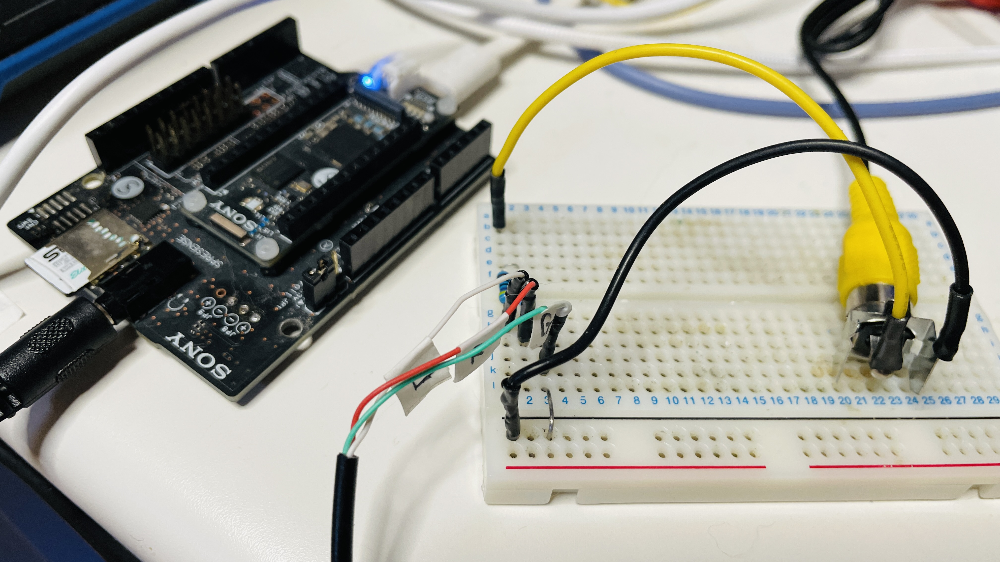
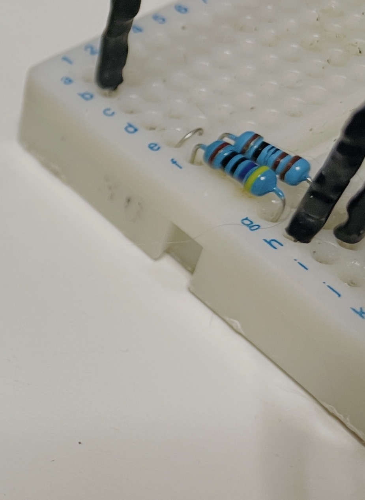
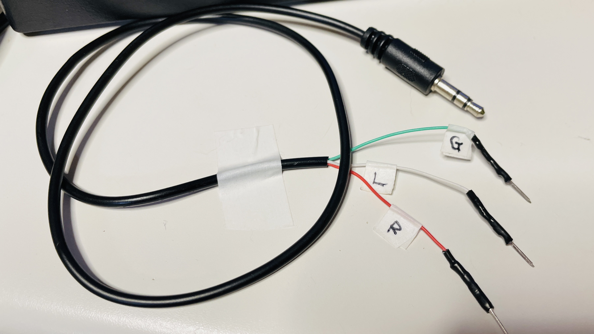
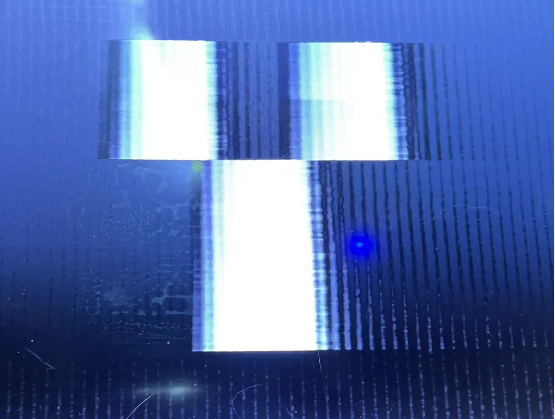
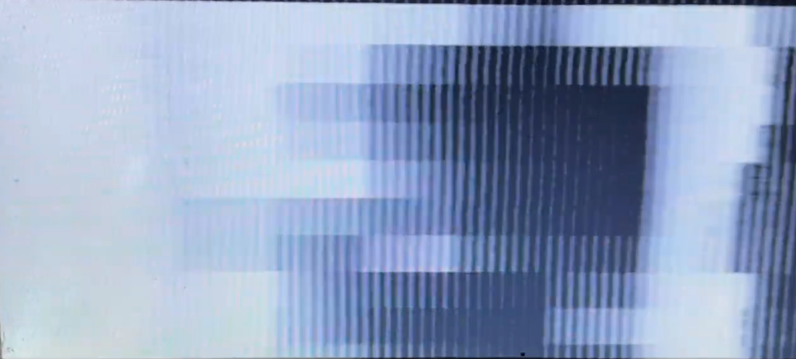
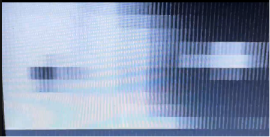

# [SPRESENSE 2026]AudioJackをHackしたにょ[CVBS]

2026年6月15日 16:52


# Spresense Audio Jack as NTSC Video Output

> Playing NTSC composite video on a TV using Sony Spresense's 192kHz 24bit HiRes Audio DAC — no code changes, just a WAV file.

**作者:** [chrmlinux03](https://hackaday.io/hacker/1546011-chrmlinux03)  
**作成日:** 2026/06/14  
**タグ:** `bad-apple` `spresense` `ntsc` `arduino` `composite-video`  
**元URL:** https://hackaday.io/project/205934-spresense-audio-jack-as-ntsc-video-output

---

## 概要

Sony Spresenseのヘッドフォンジャックからわずか2本の抵抗だけでNTSCコンポジット映像をテレビに出力するプロジェクト。Arduinoコードは一切変更なし。SDカード上のファイルだけが違う。

**ハードウェア:**
- Sony Spresense + Extension Board
- 抵抗 2本（470Ω と 1kΩ）
- RCAケーブル

NTSCの波形をPythonでRAWファイルとして事前生成し、192kHz 24bit Stereoで再生。Lチャンネルが映像、Rチャンネルが同期信号を担当。Bad Apple!! も動作確認済み。

---

## Chapter 1: はじめに

ある日、ふとこんな疑問が浮かんだ。

> 「Audio Jackから出る信号は電圧変化に過ぎない。NTSCも電圧変化だ。同じじゃないか？」

- **オーディオ信号** = 時間軸上の電圧変化
- **NTSCコンポジット映像信号** = 時間軸上の電圧変化（同期信号＋輝度信号）

本質はまったく同じ。違うのは電圧変化のパターンだけ。

ならば、NTSCパターンで変化する電圧をAudio Jackから出力すれば、テレビに映像が映るはずだ。

**実装方針:**
1. NTSCの波形をPCMデータとして表現
2. RAWファイルとしてSDカードに保存
3. Spresenseの Audio Player（`player_hires.ino`）でそのまま再生

Arduinoコードはソニー公式サンプル [`player_hires.ino`](https://developer.spresense.sony-semicon.com/development-guides/?lang=en&page=arduino_tutorials#_play_high_resolution_audio) を**一行も変更しない**。

映画「コンタクト」では音声データの中に映像信号が隠されていたが、このプロジェクトはその逆——映像信号を意図的に音声データとして設計した。


---

## Chapter 2: Generation 1 — CPUがリアルタイムで映像生成（CH32V003版）

Spresense版の前段階として、超安価な48MHz RISC-Vマイコン **CH32V003**（数円）を使ったNTSC出力を実装した。

[[SPRESENSE 2026]TVに出力したにょ[CVBS]](../spresense-tv-cvbs/)

```
CPU (48MHz)
→ GPIOタイミング制御
→ 抵抗DAC（2本の抵抗で電圧レベル生成）
→ CVBS（コンポジット映像信号）
→ TV
```

### 歴史的な先例

| 実装 | 手法 |
|---|---|
| AVR TVout library | ATmega + GPIO |
| PIC TV output | PIC + GPIO |
| ESP32 Composite | ESP32 + I2S |
| Arduino TVout | Arduino + GPIO |

すべて同じパターン：CPUがリアルタイムで映像信号を生成する。これがGeneration 1の特徴。

### Generation 1の限界

- CPUが映像生成で占有されるため、他の処理ができない
- 割り込みの精度がわずかにズレると映像が乱れる
- 「CPUが映像を作る」という概念から抜け出せない

この経験が次の問いをより深くした——「データが映像になる世界へ」

---

## Chapter 3: Generation 2 — WAVファイルがTVになる（Spresense版）

### 3.1 核心的な気づき

Spresenseには **192kHz 24bit HiRes Audio** 機能がある。これは1秒間に192,000回、電圧を更新できることを意味する。

```
1サンプル = 1/192000秒 = 5.2μs

NTSCの水平同期周波数 = 15,734Hz
1ライン = 1/15734秒 = 63.5μs

1ラインあたりのサンプル数:
63.5μs ÷ 5.2μs = 12サンプル
```

**12サンプルで1ラインを表現できる。**

Spresenseはステレオ出力なのでLチャンネルとRチャンネルを独立制御できる。

```
L ch = VIDEO信号（輝度）
R ch = SYNC信号（同期パルス）
```

2本の抵抗でミックスすればNTSC信号の完成。

### 3.2 決定的な気づき

Spresenseには `player_hires.ino` というサンプルがある。SDカードのRAWファイルを192kHz 24bit Stereoで再生するだけのコード。

このコードを**一切変更しない**。

SDカード上のファイルだけを変える。`ntsc.raw` の中にNTSC波形データを入れれば、Audio Playerがそのまま NTSC信号を出力する。

CPUはリアルタイムで何もしていない。ただ再生しているだけ。これがGeneration 1との決定的な違い。

```
Generation 1 (CH32V003): CPUがリアルタイムで映像信号を生成
Generation 2 (Spresense): Pythonが事前にデータを生成、CPUは再生するだけ
```

### 3.3 回路

**たった2本の抵抗だけ。**

```
ヘッドフォンジャック:
L (tip)    → 470Ω → RCAセンターピン
R (middle) → 1kΩ  → RCAセンターピン
G (sleeve) --------→ RCA GND
```


### 3.4 PCM値とNTSC電圧レベルの対応

```python
PCM_SYNC  = 0x000000  # 0V   = 同期パルス
PCM_BLACK = 0x100000  # 0.3V = 黒レベル
PCM_WHITE = 0x7FFFFF  # 1.0V = 白レベル（最大輝度）
```

### 3.5 結果（オシロスコープ測定値）

| 項目 | 実測値 | 規格値 |
|---|---|---|
| 水平周波数 | 15.97kHz | 15.734kHz |
| 周期 | 62.56μs | 63.5μs |
| Vpp | 960mV | 1Vpp |

**テレビに映像が映った。**

正確には「WAVファイルがテレビで再生された」。


---

## Chapter 4: 技術詳細 — ntsc.rawの生成方法

### 4.1 全体フロー

```
Pythonスクリプト
→ 1ライン = 12サンプルのPCMデータ生成
→ 1フレーム = 262ライン書き出し
→ ntsc.raw としてSDカードに保存

Spresense
→ AudioClass で 192kHz 24bit Stereo 再生
→ CXD5247 DAC で出力
→ Audio Jack: L ch = VIDEO (470Ω), R ch = SYNC (1kΩ)
→ 抵抗ミックス → RCA → TV
```

### 4.2 定数

| 定数 | 値 | 説明 |
|---|---|---|
| SAMPLE_RATE | 188,811 Hz | 実測から微調整した値 |
| NTSC_H | 262 | 垂直ライン数 |
| NTSC_W | 12 | 1ラインあたりのサンプル数 |
| SYNC_W | 2 | 同期パルス幅（サンプル数） |
| BLANK_W | 3 | ブランキング幅（サンプル数） |
| VRAM_W | 9 | 有効映像幅（= 9ピクセル） |
| LINE_REPEAT | 3 | 1ピクセル行あたりの繰り返しライン数 |
| VRAM_H | 87 | 有効映像高さ（ライン数） |

### 4.3 1サンプルの書き出し

24bit Stereo = 1サンプルあたり6バイト。L chにVIDEOデータ、R chにSYNCデータを24bitリトルエンディアンで書き出す。

### 4.4 1フレームの生成

| ライン範囲 | 内容 |
|---|---|
| 0〜8 | 垂直同期期間 |
| 9〜20 | 垂直ブランキング期間 |
| 21〜261 | 有効映像期間 |

有効ライン内の構成:
- 最初の2サンプル: SYNC
- 次の1サンプル: BLANK
- 残り9サンプル: VRAMからのVIDEOデータ

### 4.5 VRAMと描画

VRAMは9列×87行の2次元配列。各セルは0または1。`draw_pixel` が境界チェック付きでVRAMに書き込む。

### 4.6 font3x5 文字描画

各文字を3×5ドットマトリクスの15bitビットマップで表現。`draw_char` が各ビットを走査して `draw_pixel` を呼び出す。

### 4.7 ループ再生

`ntsc.raw` は1フレーム分のみ。Spresenseがファイル末尾に達するとシークして先頭に戻り、連続してNTSC映像を出力し続ける。ファイルサイズはわずか **1.8KB**。

---

## Chapter 5: 表示実験 — テキストとBad Apple!!

### 5.1 HELLO WORLD テキスト表示

最初の表示実験。水平解像度が9ピクセルしかないため、3ピクセル幅の文字を縦に積み上げて配置。それでも文字は明瞭に認識できた。

[viemo](https://vimeo.com/1201161282/)

### 5.2 SONY テキスト表示（1秒ごとに切り替え）

S・O・N・Yを1秒ごとに切り替え表示。`ntsc.raw` で動的なコンテンツも表現できることを確認。

[vimeo](https://vimeo.com/1201161716)

### 5.3 Bad Apple!! — グレースケール映像再生

最も野心的な実験。有名なモノクロアニメ「Bad Apple!!」をNTSC映像に変換して再生。

グレースケール対応が大きな進化点:

[vimeo](https://vimeo.com/1201161788)







```python
brightness 0   (黒) → PCM_BLACK (0x100000)
brightness 255 (白) → PCM_WHITE (0x7FFFFF)
```

24bitのダイナミックレンジにより、1bit GPIO出力では不可能だった滑らかな256段階グレースケールを実現。

**解像度:**
- 水平: 9ピクセル
- 垂直: 87ライン（LINE_REPEAT=3, 有効180ライン）

極めて低解像度でもBad Apple!!はしっかり認識できる。これはシルエットスタイルによる高コントラストと、グレースケール対応による正確な輝度再現のおかげ。

### 5.4 Generation 1 vs Generation 2 比較

| 項目 | Generation 1 (CH32V003) | Generation 2 (Spresense) |
|---|---|---|
| 映像生成 | CPUがリアルタイム生成 | Pythonが事前生成 |
| 色深度 | 1bit（白黒のみ） | 24bit（グレースケール） |
| CPU負荷 | 高 | ゼロ |
| コード変更 | 必要 | 不要 |
| コンテンツ更新方法 | 再コンパイル＋書き込み | SDカードのファイルを入れ替えるだけ |
| 出力先 | GPIO | Audio Jack |

---

## Chapter 6: まとめ・考察・今後の展望

### 6.1 このプロジェクトの新しさ

一言で言えば:

> **「音楽プレーヤーをテレビにする」**

技術的な新規性は「映像を出力すること」ではない（GPIO経由のNTSC出力は歴史的に多くの先例がある）。新しいのは **信号の出所** と **映像の作り方** だ。

- **どこから:** Audio Jack（ヘッドフォン出力）
- **どうやって:** WAVファイルを再生するだけ

CPUはリアルタイムで何もしない。ただ再生するだけ。すべての映像コンテンツはPythonが事前生成し `ntsc.raw` に格納されている。

### 6.2 映画「コンタクト」との類似性

映画「コンタクト」では、エレノア・アロウェイ博士が音声データの中に隠された宇宙人の信号を解析し、映像を取り出した。

```
Contact:      音声データ → 解析 → 映像を取り出す
このProject:  映像データ → 設計 → 音声ファイルとして再生
```

このプロジェクトは実装によって「音声と映像は本質的に同じもの」であることを証明した。

### 6.3 192kHz 24bitの意味

なぜSpresense？ CXD5247 DACが192kHz 24bit HiRes Audioに対応しているから。この高いサンプリングレートがすべての鍵。

- 192kHz → 1サンプル = 5.2μs
- NTSC 1ライン = 63.5μs
- → 1ラインあたり12サンプル

12サンプルは少ない数字だが、NTSCの基本構造を表現するには十分。そして24bitのダイナミックレンジにより、1bit GPIO出力では不可能だったグレースケール表現が可能になった。

### 6.4 現時点の制限

| 項目 | 現状 |
|---|---|
| 水平解像度 | 9ピクセル |
| 垂直解像度 | 87ライン（LINE_REPEAT=3） |
| カラー | グレースケールのみ（カラー不可） |
| 音声 | 映像出力と同時使用不可 |

水平解像度が低い根本的な理由: CXD5247 DACのアナログ出力帯域幅が約96kHz（ナイキスト限界）であり、NTSCの理論最大帯域幅4.2MHzには遠く及ばないため。

### 6.5 今後の展望 — 384kHz 32bitへの拡張

次のステップ: PC に接続した USB-C 外付け DAC（384kHz 32bit UAC2.0 対応）で `ntsc.raw` を直接再生。

```
384kHz → 1サンプル = 2.6μs
NTSC 1ライン = 63.5μs
→ 1ラインあたり約24サンプル

水平解像度: 9ピクセル → 約20ピクセルに倍増
32bit: さらに精密なグレースケール再現
```
https://amzn.to/43AX3wc

### 6.6 Makerの精神

この開発中、AIに「Audio DAC経由のNTSCは不可能」と最初に言われた。帯域不足、サンプル数不足、物理的に無理、と。

**しかし映像は映った。Bad Apple!! は動いた。**

> 「できないのではない。方法を見つければいい。」

技術的な制限は確かに存在する。しかしその制限の中で方法を見つけることがエンジニアの仕事だ。9ピクセルの解像度でも、Bad Apple!! はBad Apple!! だ。

---

### 6.7 Pythonコード（font3x5.py 抜粋）

```python
# font3x5.py
# 3x5ドットマトリクス (ASCII 32 - 93)
font3x5 = [
    0b000000000000000,  # 32 ' '
    0b010010010000010,  # 33 '!'
    0b000000000000000,  # 34 '"'
    0b101111101111101,  # 35 '#'
    # ... (省略)
    0b111101101101111,  # 48 '0'
    0b010110010010111,  # 49 '1'
    0b111001111100111,  # 50 '2'
    0b111001111001111,  # 51 '3'
    0b101101111001001,  # 52 '4'
    0b111100111001111,  # 53 '5'
    0b111100111101111,  # 54 '6'
    0b111001001001001,  # 55 '7'
    0b111101111101111,  # 56 '8'
    0b111101111001111,  # 57 '9'
    # ... (省略)
    0b111101111101101,  # 65 'A'
    0b110101110101110,  # 66 'B'
    0b111100100100111,  # 67 'C'
    0b110101101101110,  # 68 'D'
    0b111100110100111,  # 69 'E'
    0b111100110100100,  # 70 'F'
    0b111100101101111,  # 71 'G'
    0b101101111101101,  # 72 'H'
    0b111010010010111,  # 73 'I'
    0b001001001101111,  # 74 'J'
    # ... (続く)
]
```

> 完全なコードは元プロジェクトページの Chapter 6 ログを参照:  
> https://hackaday.io/project/205934/log/248497-chapter-6-summary-considerations-and-future-plans

---

## 動画

- **HELLO WORLD 表示:** https://vimeo.com/1201161282
- **SONY テキスト（1秒切り替え）:** https://vimeo.com/1201161716
- **Bad Apple!! グレースケール再生:** https://vimeo.com/1201161788

---

## 参考リンク

- Sony Spresense player_hires.ino: https://developer.spresense.sony-semicon.com/development-guides/?lang=en&page=arduino_tutorials#_play_high_resolution_audio
- CH32V003版（Generation 1）のツイート（下に埋め込み）
- 元プロジェクトページ: https://hackaday.io/project/205934-spresense-audio-jack-as-ntsc-video-output

<blockquote class="twitter-tweet" data-theme="dark"><a href="https://twitter.com/chrmlinux03/status/2047242788916621336"></a></blockquote>
<script async src="https://platform.twitter.com/widgets.js" charset="utf-8"></script>

<div class="like-wrap"><div data-lyket-type="like" data-lyket-namespace="linalog" data-lyket-id="spresense-audiojack-hack"></div></div>
