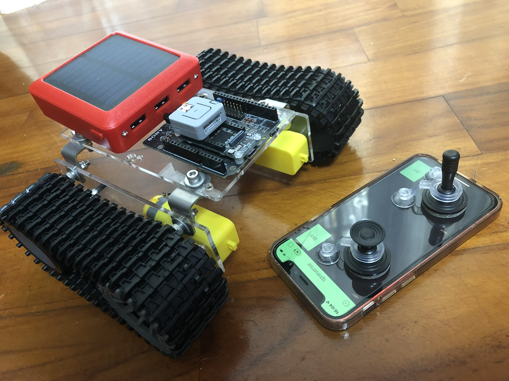

# SpresenseをBlynkに接続出来たよっ

2022年8月24日 21:06
<p class="article-tags">タグ: <a href="..?tag=Arduino">Arduino</a> <a href="..?tag=ESP32">ESP32</a> <a href="..?tag=M5Atom">M5Atom</a> <a href="..?tag=WiFi">WiFi</a> <a href="..?tag=esp32Modem">esp32Modem</a> <a href="..?tag=spresense">spresense</a></p>



# はじめに
こんにちわ リナちゃん@chrmlinux03 です
2022年 SPRESENSE™ 活用コンテスト絶賛製作中なんですけどっ
ESP32系と違ってやっぱり WiFi や BT が外付けなのがちょっとばかり厄介

# WiFiが無ければ作れば良いのよ(マリー・アントワネット)
って事でいつもの M5Atom を I2C Slave Device にしてモデムにしてみました
原理は簡単 SPRESENSE をMaster にして M5Atom を Slave にして
SSID や PASS や TOKEN を Master から Slave に転送して
Register構造やらを自前で構築し状態や値を持ってきます

ご参考)世界一簡単なMaster/Slave
[github esp32MasterSlave](https://github.com/chrmlinux/esp32MasterSlave)

# 使い方
```c++:esp32ModemMaster.ino
#include <esp32Modem.hpp>
static esp32Modem em;
void setup(void)  {
  Serial.begin( 115200 ); while(!Serial);  
  if (em.begin(SSID, PSWD, TOKEN)) {
      Serial.println("espModem Not Ready !"); 
      while(1);   
  }
}
void loop(void) {
  blynk[0]   = em.read(ESPMODEM, JOYLEFT);
  blynk[1]   = em.read(ESPMODEM, JOYRIGHT);
  blynk[2]   = em.read(ESPMODEM, BTN1);
  blynk[3]   = em.read(ESPMODEM, BTN2);
  delay(1);
}
```
# 感動の瞬間

<blockquote class="twitter-tweet" data-theme="dark"><a href="https://twitter.com/chrmlinux03/status/1562337259252514816"></a></blockquote>
<script async src="https://platform.twitter.com/widgets.js" charset="utf-8"></script>

# 最後に

これでほぼ準備は整ったので
肝心のSLAMの構築に入りますっ
2022年 SPRESENSE™ 活用コンテストが終わったらライブラリ化して公開しますね
ご清聴ありがとうございました


@chrmlinux03

<div class="like-wrap"><div data-lyket-type="like" data-lyket-template="twitter" data-lyket-namespace="linalog" data-lyket-color-icon="#b5e853" data-lyket-color-primary="#b5e853" data-lyket-color-text="#eaeaea" data-lyket-color-secondary="#2b2b2b" data-lyket-id="spresense-blynk"></div></div>
