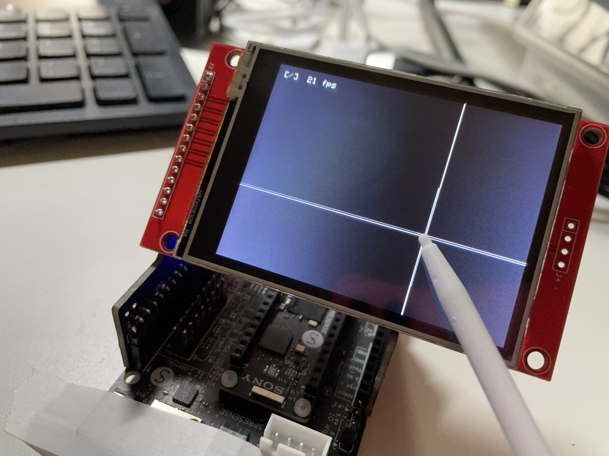
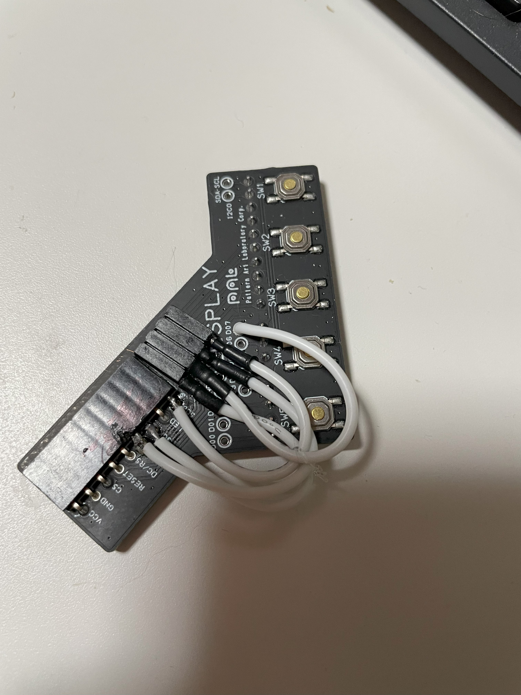

# 【SPRESENSE2023】B-Stem4CM01Displayにタッチパネルの改造を行うよっ

2024年1月26日 09:47

# はじめに

こんにちわっ 

リナちゃん　X@chrmlinux03　です

++このページは SPRESENSE2023コンテストで作った部品を紹介するものです
最初に [開発まとめ](../spresense-2023-matome/) をお読みいただければ幸いです++

# 何故タッチパネルの配線がしてないの？

と、タッチパネルマスターなら普通に考えた

# 用意するもの
| 部品名 | 販売先 | 価格 | 御提供品 |
|-|-|-|-|
| [B-Stem 4CM01 Display基板](https://www.switch-science.com/products/7996) |スイッチサイエンス|3,300円|ー|

# 改造のポイント
前述の [LCD液晶基板ili9341でタッチパネルを使うよ](../spresense-ili9341-touch/) を読んで「あ～」ってなった方は大正解

つまりこの基板は タッチパネルへの配線とほかのSPI配線が出来て居ないだけなんだね

## 回路図
|４CM01Display基板|液晶基板|追加|
|-|-|-|
|VCC|VCC||
|GND|GND||
|CS|CS||
|RESET|RESET||
|DC/RS|DC||
|SDI(MOSI)|SDI(MOSI)||
|SCK|SCK||
|SDO(MISO)|SDO(MISO)||
|SCK|T_CL|追加|
|D7|T_CS|追加|
|SDI(MOSI)|T_DIN|追加|
|SDO(MISO)|T_DO|追加|

## 半田付けする

# 応用例
すでにこの基板を使って考えあぐねている方々へ
# 残務と今後の考察
これはこれでとても良い基板なんですけど

やはり SW を生かしたかったんだねって思います

こういう基板はアップデートすべきです

※何故液晶が斜めなのー💦
# さいごに
これで あなたも タッチパネルマスター٩(ˊᗜˋ*)و

ご清聴ありがとうございました

++このページは SPRESENSE2023コンテストで作った部品を紹介するものです
最初に [開発まとめ](../spresense-2023-matome/) をお読みいただければ幸いです++

