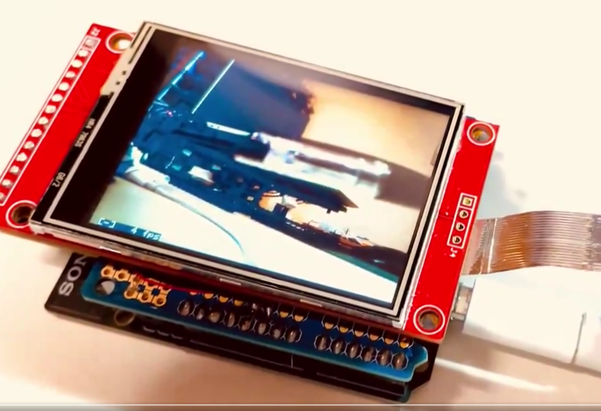

# 【SPRESENSE】液晶にカメラ画像の動画再生に成功したよっ

2024年2月6日 21:29



おつかれさまでございます

リナちゃん X@chrmlinux03 です

# 動画で液晶に再生出来たよ

Spresense の カメラで撮った写真をパラパラ漫画で動画に出来たよっ

（X 投稿の埋め込み）

# 使用部品
|  部品 |  御提供品  |
|---|---|
|  SPRESENSE本基板  |  〇  |
|  SPRESENSE拡張基板  |  〇  |
|  SPRESENSEカメラ一式  |  〇  |
|  カメラと拡張基板を繋ぐ配線  |  後日公開される  |
|  はま寿司 |  お寿司は4皿まで  |

```c++:spresense用"spreGraphics.hpp"
#ifndef __GRAPHIC_HPP__
#define __GRAPHIC_HPP__

#define SPI4_SCLK  (13)
#define SPI4_MISO  (12)
#define SPI4_MOSI  (11)
#define SPI4_CS    (10)
#define SPI4_DC    ( 9)
#define SPI4_RST   ( 8)
#define SPI4_CS2   ( 7)

#define IO_SW4    ( 7)
#define IO_SW3    ( 6)
#define IO_SW2    ( 5)
#define IO_SW1    ( 4)

#define ROT0   (0)
#define ROT90  (1)
#define ROT180 (2)
#define ROT270 (3)

#define MEGA (1000 * 1000)
#define LGFX_AUTODETECT
#define LGFX_USE_V1
#include <LovyanGFX.hpp>

class LGFX : public lgfx::LGFX_Device
{
    lgfx::Panel_ILI9341 _panel_instance;
    lgfx::Bus_SPI       _bus_instance;

  public:
    LGFX(void) {
      {
        auto cfg = _bus_instance.config();
        cfg.spi_mode    = 0;
        cfg.spi_port    = 4;
        cfg.freq_write  = (20 * MEGA);
        cfg.freq_read   = (16 * MEGA);
        cfg.pin_dc      = SPI4_DC;
        _bus_instance.config(cfg);
        _panel_instance.setBus(&_bus_instance);
      }

      {
        auto cfg = _panel_instance.config();
        cfg.pin_cs           =  SPI4_CS;
        cfg.pin_rst          =  SPI4_RST;
        cfg.pin_busy         =  -1;
        cfg.panel_width      =   240;
        cfg.panel_height     =   320;
        cfg.bus_shared       =  true;
        _panel_instance.config(cfg);
      }

      setPanel(&_panel_instance);
    }
};

static LGFX lcd;
static LGFX_Sprite spr;
static bool useGraphics = false;
static uint16_t _w, _h, _hw, _hh;

int16_t setupGraphics(int16_t rot) {
  lcd.init();
  lcd.setRotation(rot);
  spr.setColorDepth(16);
  spr.createSprite(lcd.width(), lcd.height());
  _w = spr.width(); _h = spr.height();
	_hw = _w >> 1; _hh = _h >> 1;
  useGraphics = true;
  return 0;
}

//==================================
// getfps
//==================================
uint32_t getfps(void) {

  static uint32_t psec = 0;
  static uint32_t cnt = 0;
  static uint32_t fps = 0;
  uint32_t sec = 0;

  sec = millis() / 1000;
  ++cnt;
  if (psec != sec) {
    psec = sec;
    fps = cnt;
    cnt = 0;
  }
  return fps;
}

//==================================
// drawAst
//==================================
void drawAst(LGFX_Sprite *spr, int gx, int gy) {
  static int cnt = 0;
  char ast[4] = "|/-\\";
  spr->setTextColor(TFT_WHITE, TFT_BLACK);
  spr->setCursor(gx, gy);
  spr->printf("[%c] %3d fps\n", ast[cnt], getfps());
  cnt = (cnt + 1) % 4;
}

#endif
```

```c++:cam2.ino
#include <SDHCI.h>
SDClass  theSD;
#include <Camera.h>

#define CIMG_H  CAM_IMGSIZE_QVGA_H
#define CIMG_V  CAM_IMGSIZE_QVGA_V
//#define CIMG_FMT  CAM_IMAGE_PIX_FMT_JPG
#define CIMG_FMT  CAM_IMAGE_PIX_FMT_RGB565

#include <spreGraphics.hpp>

void printError(enum CamErr err) {
  Serial.print("Error: ");
  switch (err) {
    case CAM_ERR_NO_DEVICE: Serial.println("No Device"); break;
    case CAM_ERR_ILLEGAL_DEVERR: Serial.println("Illegal device error"); break;
    case CAM_ERR_ALREADY_INITIALIZED: Serial.println("Already initialized"); break;
    case CAM_ERR_NOT_INITIALIZED: Serial.println("Not initialized"); break;
    case CAM_ERR_NOT_STILL_INITIALIZED: Serial.println("Still picture not initialized"); break;
    case CAM_ERR_CANT_CREATE_THREAD: Serial.println("Failed to create thread"); break;
    case CAM_ERR_INVALID_PARAM: Serial.println("Invalid parameter"); break;
    case CAM_ERR_NO_MEMORY: Serial.println("No memory"); break;
    case CAM_ERR_USR_INUSED: Serial.println("Buffer already in use"); break;
    case CAM_ERR_NOT_PERMITTED: Serial.println("Operation not permitted"); break;
    default: break;
  }
}

void CamCB(CamImage img) {}

void setup(void) {
  CamErr err;
  Serial.begin( 115200 ); while (!Serial);
  while (!theSD.begin());
  err = theCamera.begin(); if (err != CAM_ERR_SUCCESS) printError(err);
  //err = theCamera.startStreaming(true, CamCB); if (err != CAM_ERR_SUCCESS) printError(err);
  err = theCamera.setAutoWhiteBalanceMode(CAM_WHITE_BALANCE_DAYLIGHT); if (err != CAM_ERR_SUCCESS) printError(err);
  err = theCamera.setStillPictureImageFormat(CIMG_H, CIMG_V, CIMG_FMT); if (err != CAM_ERR_SUCCESS) printError(err);
  setupGraphics(ROT90);
}

void loop(void) {
  spr.startWrite();
  spr.clear(TFT_BLACK);
  CamImage img = theCamera.takePicture();
  if (img.isAvailable()) {
    switch (CIMG_FMT) {
      case CAM_IMAGE_PIX_FMT_RGB565:
        spr.setSwapBytes(true);
        spr.pushImage(0, 0, CIMG_H, CIMG_V, (uint16_t*)img.getImgBuff(), img.getImgSize());
        spr.setSwapBytes(false);
        break;
      case CAM_IMAGE_PIX_FMT_JPG:
        spr.drawJpg(img.getImgBuff(), img.getImgSize(), 0, 0);
        break;
    }
  }
  drawAst(&spr, 8, _h - 8);
  spr.pushSprite(&lcd, 0, 0);
  spr.endWrite();
}
```

# ポイント1
## RGB565 の並びが逆だった

img.getImgBuff() で返って来る イメージがどうも
上下バイト逆になってるっぽいので
spr.setSwapBytes(true);
:
この間は並びが逆に出来る
:
spr.setSwapBytes(false);

で回避した٩(ˊᗜˋ*)و

# ポイント2
## startStream しなくても動くっぽい
// err = theCamera.startStreaming(true, CamCB); if (err != CAM_ERR_SUCCESS) printError(err);

# ポイント3
##   spr.drawJpgだと激重
RGB565であればなんとか使えるかなぁと言う感じ

# ポイント4
## イメージサイズは QVGA_H/ QVGA_V (320x240)
#define CIMG_H  CAM_IMGSIZE_QVGA_H
#define CIMG_V  CAM_IMGSIZE_QVGA_V
//#define CIMG_FMT  CAM_IMAGE_PIX_FMT_JPG
#define CIMG_FMT  CAM_IMAGE_PIX_FMT_RGB565
QQVGA_H/QQVGA_V(160x120) でも動くけどちょっと寂しい💕
デフォルトで書かれていたサイズだと色々重いっぽい

# callback は空でも動く
## 無理に色々しなくてもOK
void CamCB(CamImage img) {}

# 最後に
これでやっとオブジェクトトラッキングが出来るようになる
ご清聴ありがとうございましたっ

<div class="like-wrap"><div data-lyket-type="like" data-lyket-namespace="linalog" data-lyket-id="spresense-camera-lcd"></div></div>
