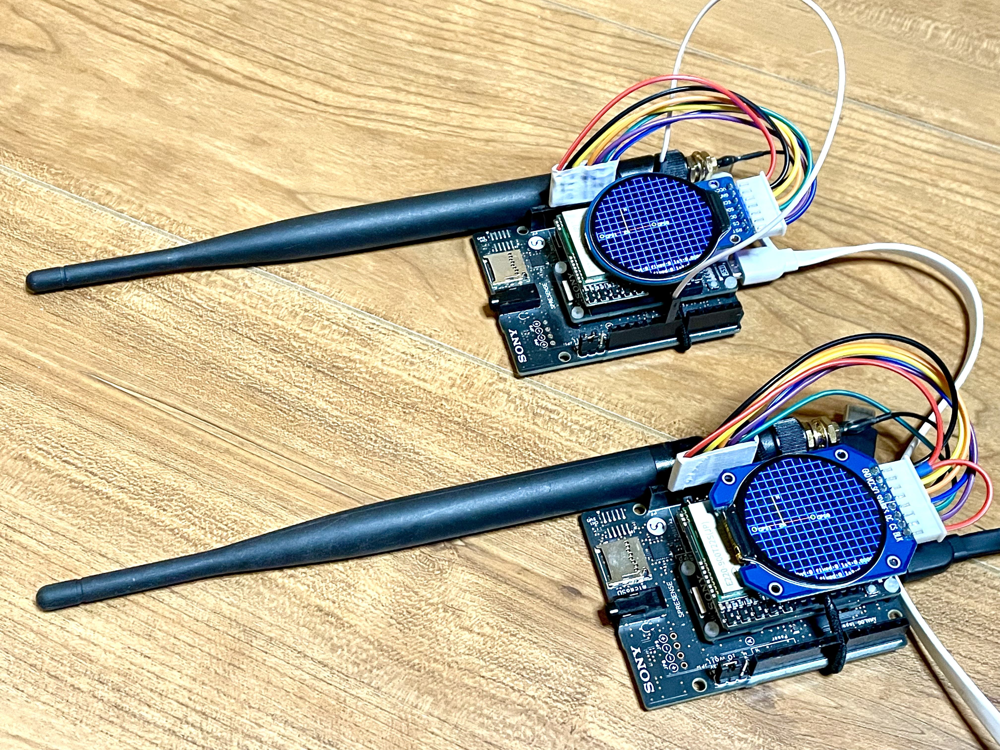
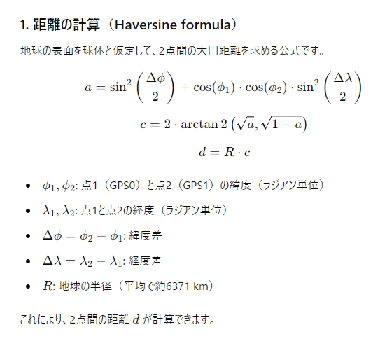
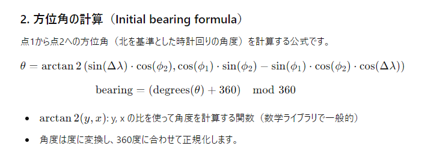
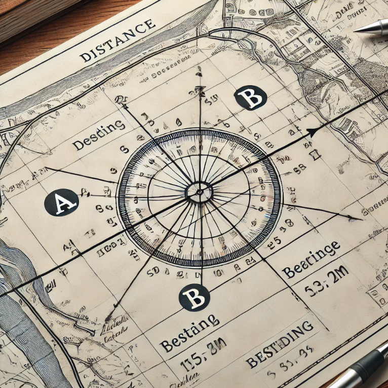
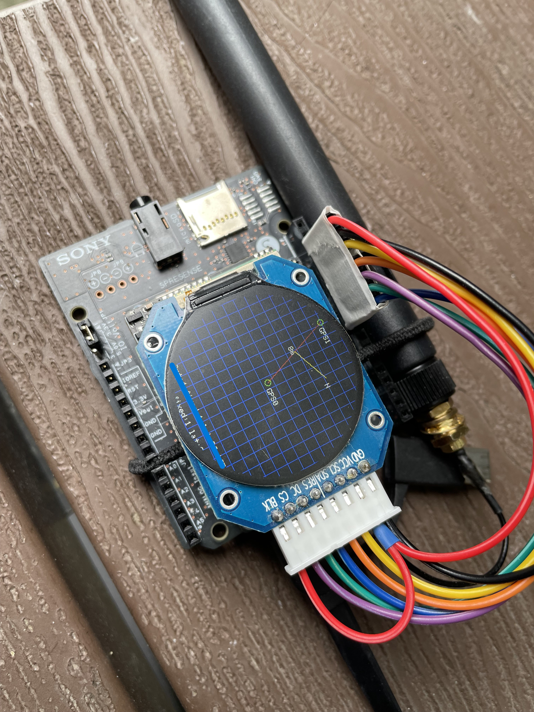
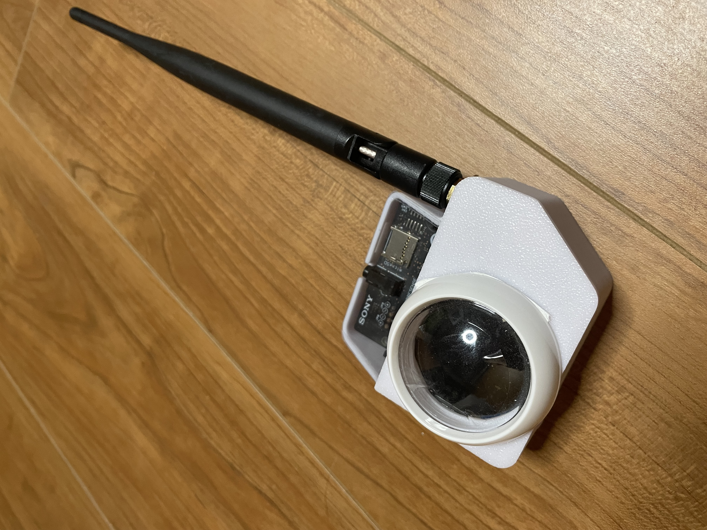
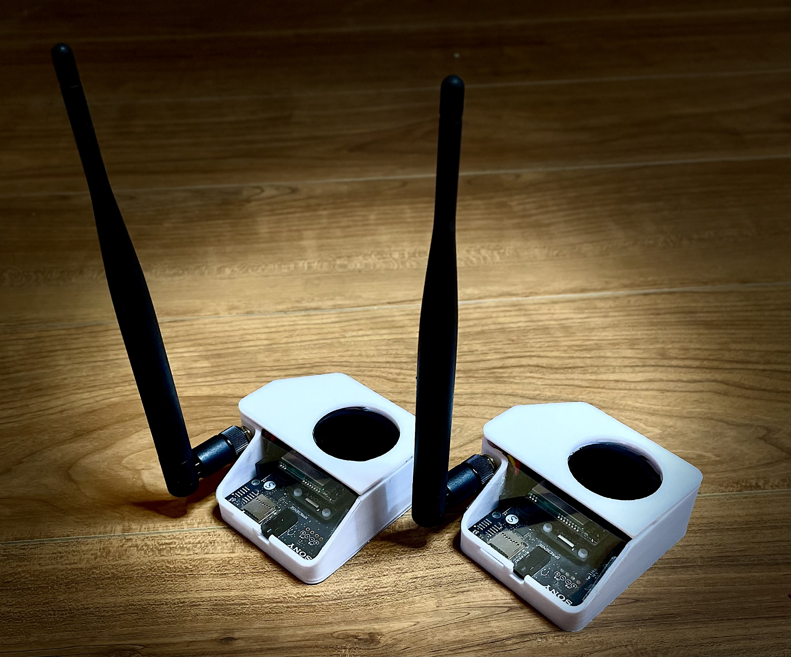
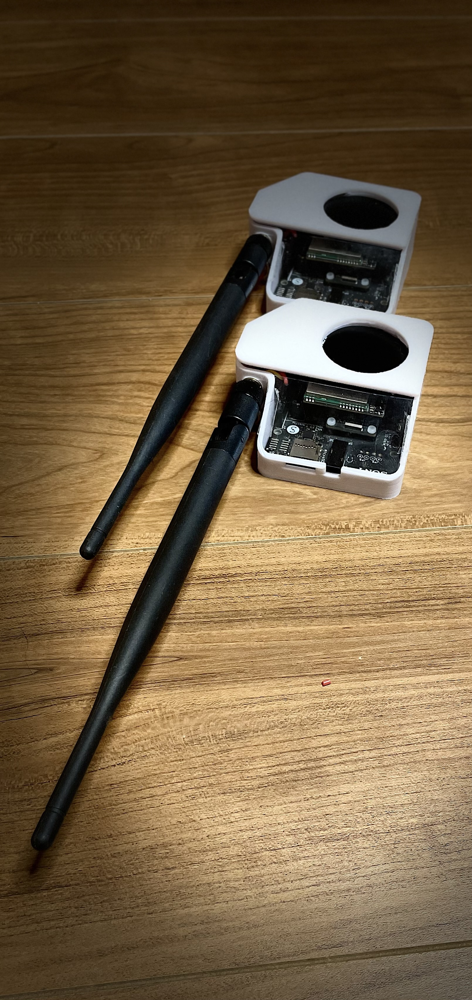
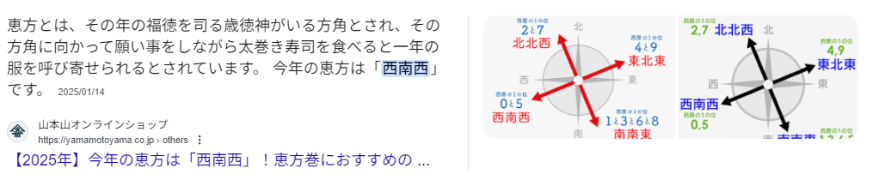

# 【SPRESENSE2024】今年の恵方巻きの方向は？【サテライトコンパス】

2025年1月29日 16:24



# SpresenseのGNSSとLoRaが融合し、時空を超越する新たな羅針盤が誕生

このプロジェクトでは、ソニーの革新的なIoTマイクロコントローラ「Spresense」をプラットフォームとして、従来のコンパスの概念を超越する、全く新しいサテライトコンパスシステムを開発しました。GNSS（全球測位衛星システム）の力を借りて、宇宙から真北を捉え、LoRa（長距離無線通信）技術によって、その情報を広範囲に共有することを可能にしました。

<u>本システム最大の特徴は、2台のSpresenseとGNSSモジュールを用いることで、高精度な方位情報を取得できる点にあります。 
1台では移動中に限り真北を把握できますが、2台の場合は静止していてもお互いの位置情報から方位を計算できます。</u>
<u>出力されるLat/Lon は自分の居る位置が5m誤差で分かってしまいますので
取り扱いには注意です。</u>

## システム構成
<u>同じシステム構成なので起動時にGPIO3のボタンが押下されているかで
recv側(GPS0) send側(GPS1) のシステムを起動します。
通信はLoRaですので自局chが設定されていれば N 台の構成も可能</u>
```plantuml
start
:起動時にGPIO3を見る;
if (押されて起動された) then (yes)
  :Recvでシステムを起動;
else (no)
  :Sendでシステムを起動;
endif
stop
```

```plantuml
start
:起動時にGPIO3を見る;
if (押されて起動された) then (yes)
  :Recvでシステムを起動;
else (no)
  :Sendでシステムを起動;
endif
stop
```

| 部品名 | 販売先 | 価格 | 御提供品 |
|-|-|-|-|
|[SPRESENSEメインボード](https://amzn.to/40xXYeM)|Amazon他|6,080円(税込)|〇|
|[SPRESENSE拡張ボード](https://amzn.to/40Aaavz)|Amazon他|4,500円(税込)|〇|
|[SPRESENSE用 LoRa Add-onボード](https://ssci.to/8958) |スイッチサイエンス|4,950円(税込)|〇|
|[丸形液晶 GC9A01](https://amzn.to/4jy7Spr)|Amazon他|2,000円(税込)|-|
|お寿司は4皿まで|[はま寿司](https://www.hama-sushi.co.jp/menu/)|440円(税込)|-|
- Spresense: 
2台のSpresenseが、それぞれGNSS受信機とLoRaモジュールを搭載し、システムの心臓部を担います。2台のSpresenseがお互いの位置情報を共有することで、より正確な方位の計算が可能になります。
- GNSSモジュール: 
高精度な2台のGNSSモジュール が、高精度な位置情報を取得し、真北方向を正確に決定します。
- LoRaモジュール: 
LoRaモジュールが、Spresense間で長距離・低消費電力な無線通信を実現し、位置情報の共有を可能にします。
- ディスプレイ:
 円形ディスプレイに、コンパスの方位とその他の情報が見やすく表示されます。
- ボタン: 
GPIO3に接続されたボタンで、送受信モードの切り替えを容易に行えます。

## 主要ライブラリ
- spreLGFXLib.GC9A01.hpp: 
GC9A01ディスプレイを制御し、円形ディスプレイにコンパスの方位を美しく描画します。
- spreLoRa.hpp: 
LoRa通信を用いて、Spresense間で位置情報を送受信します。
- DistanceAndBearing.hpp: 
2点間の距離と方位角を正確に計算し、相対的な方向を把握します。


- drawCompass.hpp: 
円形ディスプレイにコンパスを描画し、方位を視覚的に表現します。

## 主な機能
### GNSSによる真北方向の取得
2台のGNSSモジュールを使用することで、1台のみの場合と比べて、より高精度な真北方向の取得を実現しました。
2台の場合、静止していてもお互いの位置情報から方位を計算できるため、移動中だけでなく、様々な状況下で正確な方位情報を取得できます。
磁北は取得できないため、必要に応じて磁気センサーなどを追加できます。
### LoRa通信による位置情報共有
LoRaモジュールにより、長距離・低消費電力で位置情報を他のデバイスに送信できます。
緯度、経度、方位などの情報を共有し、広範囲なナビゲーションを支援します。
### ボタンによる送受信モードの切り替え
GPIO3に接続されたボタンで、デバイスを簡単に送受信モードに切り替えられます。
柔軟なシステム運用を可能にし、様々な状況に対応できます。
### 位置のFix状態の確認
位置情報がFixされるまで待機し、安定した方位情報を提供します。
不正確な情報による誤ったナビゲーションを防ぎます。

### ファイル解説
- spreLGFXLib.GC9A01.hpp: 
ディスプレイの制御と描画処理を行います。
- spreLoRa.hpp: 
LoRa通信の制御とデータ送受信を行います。
- DistanceAndBearing.hpp:
このライブラリは、2つの地点間の距離と方位角を計算する、システムの頭脳とも言える部分です。
- Haversine formula: 
地球を球体として近似し、2点の緯度経度から正確な距離を算出します。
方位角計算: 2点の緯度経度から、北を基準とした方位角を計算します。
これらの計算により、2台のSpresense の相対的な位置関係を正確に把握し、コンパスの方位を決定します。

```c++:DistanceAndBearing.hpp一部抜粋
float haversineDistance(float lat1, float lon1, float lat2, float lon2) {
  // ... Haversine formulaによる距離計算 ...
}
float calculateBearing(float lat1, float lon1, float lat2, float lon2) {
  // ... 方位角計算 ...
}
```
- drawCompass.hpp:

このライブラリは、計算された方位角を、円形ディスプレイ上にコンパスとして描画する役割を担います。
単に方位角を表示するだけでなく、円形ディスプレイの特性に合わせた最適な描画処理を行います。
2台のSpresense の位置関係、方位、距離をグラフィカルに表示し、直感的に理解しやすいコンパス画面を提供します。

```c++:drawCompass.hpp一部抜粋
void drawGraph(LGFX_Sprite *dst, float distance, float bearing) {
  // ... コンパス描画処理 ...
  // GPS0を中心にGPS1とを線で結ぶ
  // GPS0とGPS1の位置にマークを表示
  // 距離と方位のテキストを表示
  // 北方向を示す線を表示
  // ...
}
```
### 時空を超越するナビゲーション体験
SpresenseとLoRaの融合が生み出した衛星コンパスは、従来のコンパスの限界を超え、新たなナビゲーションの可能性を広げます。

- 都市部: ビルや地下街など、GNSS信号が届きにくい場所でも、LoRaの長距離通信能力で正確な方位情報を取得できます。
- 山岳地帯: 険しい地形や森林など、GNSS信号が不安定な場所でも、LoRaが安定した通信を確保します。
- 海上: 広大な海上で、遠く離れた場所との通信をLoRaが支え、正確な航海を支援します。
- 未来への展望
- 自動運転: 自動運転車に搭載することで、より安全で信頼性の高いナビゲーションシステムを構築できます。
- ドローン: LoRaの長距離通信を活用し、ドローンをより広範囲に運用できます。
- IoT: 様々なセンサーと組み合わせることで、位置情報に基づいた新たなIoTサービスを創造できます。

## さあ、Spresenseの衛星コンパスと共に、時空を超えたナビゲーション体験へ旅立ちましょう。
## コード
```c++:satelliteCompass.ino
//==================================
//
// satelliteCompass.ino
// MainCore < 768KByte
//----------------------------------
// GNSS(GPS) / RoLa
//
//==================================
#include <SDHCI.h>
#include <File.h>
SDClass SD;
File myFile;

//==================================
//  include
//==================================
#include "DistanceAndBearing.hpp"
#include <spreGnssRtcLib.hpp>
#include "spreLoRaLib.hpp"
#include "spreLGFXLib.GC9A01.hpp"

spreGnssRtcLib gnss;
spreLoRa sLoRa;

typedef struct {
  uint16_t satNum;
  int16_t fixed;
  int16_t cnt;
  float lat;
  float lon;
} SAT_T;
typedef struct {
  uint32_t utc;
  uint16_t year;
  uint16_t month;
  uint16_t day;
  uint16_t week;
  uint16_t hour;
  uint16_t minute;
  uint16_t second;
  uint16_t usec;
} RTC_T;
typedef struct {
  uint32_t sz;
  RTC_T rtc;
  SAT_T sat;
} SEND_RECV_T;

SEND_RECV_T *LoRaData;
int modePin = 3;
int myMode = 0; // 0:recv 1:send
enum {MODE_RECV = 0, MODE_SEND};

#include "drawCompass.hpp"

//==================================
//  dispRtc
//==================================
void SerialDispRtc(RtcTime nowTime) {
  Serial.printf(
    "RTC: %04d/%02d/%02d %02d:%02d:%02d | Lat: %.6f | Lon: %.6f\n",
    nowTime.year(), nowTime.month(), nowTime.day(),
    nowTime.hour(), nowTime.minute(), nowTime.second(),
    gnss.getLatitude(), gnss.getLongitude());
}

//==================================
// setSendData
//==================================
void setSendData(RtcTime nowT) {
  uint32_t sz = sizeof(SEND_RECV_T);
  uint16_t offs = 9;
  memset(LoRaData, 0x0, sz);
  LoRaData->sz = sz;
  LoRaData->rtc.utc = ((nowT.hour() - offs) * 3600) + (nowT.minute() * 60) + nowT.second();
  LoRaData->rtc.year = nowT.year();
  LoRaData->rtc.month = nowT.month();
  LoRaData->rtc.day = nowT.day();
  LoRaData->rtc.hour = nowT.hour();
  LoRaData->rtc.minute = nowT.minute();
  LoRaData->rtc.second = nowT.second();
  LoRaData->rtc.usec = nowT.nsec() * 1000;
  LoRaData->sat.fixed = gnss.isPositionFixed();
  LoRaData->sat.cnt = gnss.getSatelliteCount();
  LoRaData->sat.lat = gnss.getLatitude();
  LoRaData->sat.lon = gnss.getLongitude();
  sLoRa.setSendData((uint8_t *)LoRaData, LoRaData->sz);
}

//==================================
//
// sendLoRaData
//
//==================================
void sendLoRaData(void) {
  RtcTime nowT = RTC.getTime();
  static uint16_t preMinute = 0xffff;
  if (nowT.minute() != preMinute) {
    preMinute = nowT.minute();
    setSendData(nowT);
    sLoRa.setSendFlag();
    sLoRa.sendData();
  }
}

//==================================
//
// recvLoRaData
//
//==================================
void recvLoRaData(void) {
  int16_t rssi = 0;
  int16_t sz = sLoRa.recvData();
  if (sz) {
    sLoRa.getRecvData((uint8_t *)LoRaData, sz, &rssi);
  }
}

//==================================
// threadLoop
//==================================
void threadLoop(void) {
  while (1) {
    systemLoop();
    usleep(1000 * 10);
  }
}

//==================================
// systemLoop
//==================================
#define GNSS_INTERVAL (1000 * 5)
void systemLoop(void) {
  static uint32_t tm = millis();
  if ((millis() - tm) > GNSS_INTERVAL) {
    gnss.update();
    if (myMode == MODE_SEND) {
      sendLoRaData(); // ==> send
    } else {
      recvLoRaData(); // <== recv
    }
  }
  if (myMode == MODE_RECV) {
    drawData(&spr);
  }
}

//==================================
// setup
//==================================
void setup(void) {
  bool debugMode = true;
  //----------------------------------
  // Serial
  //----------------------------------
  Serial.begin(115200);
  while (!Serial);
  SD.begin();

  //----------------------------------
  // mode set
  //----------------------------------
  pinMode(modePin, INPUT_PULLUP);
  myMode = !digitalRead(modePin);
  Serial.printf("mode:%d\n", myMode);
  setupLGFX(16, ROT270);

  //----------------------------------
  // setupGnss
  //----------------------------------
  gnss.setDebugMode(debugMode);
  gnss.setSatelliteType(eSatGpsQz1cQz1S);
  gnss.begin();

  //----------------------------------
  // setupLora
  //----------------------------------
  sLoRa.setDebugMode(debugMode);
  sLoRa.setupLoRa(LORA_NORMAL_MODE);
  LoRaData = (SEND_RECV_T *)malloc(sizeof(SEND_RECV_T));
  if (LoRaData == nullptr) {
    Serial.println("Memory allocation failed for LoRaData.");
    return;
  }
  memset(LoRaData, 0, sizeof(SEND_RECV_T));

  //----------------------------------
  // threadLoop
  //----------------------------------
  pthread_t pt;
  pthread_create(&pt, NULL, threadLoop, NULL);
}

//==================================
// loop
//==================================
void loop() {}

```
```c++:spreLoRaLib.hpp
//==============================
//
// spreLoRaLib.hpp
//------------------------------
// LoRa Driver : spresense_e220900t22s_jp_lib.h
//
//==============================

#ifndef __SPRELORA_HPP__
#define __SPRELORA_HPP__

#include <Arduino.h>
#include <spresense_e220900t22s_jp_lib.h>

#define SENDBUFLEN_MAX (200 - 3)

enum {
  LORA_NORMAL_MODE = 0,
  LORA_WOR_SEND_MODE,
  LORA_WOR_RECV_MODE
};

//================================
// spreLoRa Class
//================================
class spreLoRa {
  public:

    //================================
    //
    //================================
    spreLoRa() {
      sendFlag = false;
      recvFlag = false;
      sendBufLen = SENDBUFLEN_MAX;
      sendBuf = new uint8_t[sendBufLen];
      defMode = LORA_NORMAL_MODE;

      LoRaConfig = {
        0x0000,   // own_address 0
        0b011,    // baud_rate 9600 bps
        0b10000,  // air_data_rate SF:9 BW:125
        0b00,     // subpacket_size 200
        0b1,      // rssi_ambient_noise_flag 有効
        0b0,      // transmission_pause_flag 有効
        0b01,     // transmitting_power 13 dBm
        0x00,     // own_channel 0
        0b1,      // rssi_byte_flag 有効
        0b1,      // transmission_method_type 固定送信モード
        0b0,      // lbt_flag 有効
        0b000,    // wor_cycle 500 ms  //0b011, // wor_cycle 2000 ms
        0x0000,   // encryption_key 0
        0x0000,   // target_address 0
        0x00      // target_channel 0
      };
    }

    //================================
    //
    //================================
    ~spreLoRa() {
      delete[] sendBuf;
    }

    //================================
    //
    //================================
    int16_t switchMode(int16_t mode) {
      int16_t result = 0;
      char message[64] = {0};

      switch (mode) {
        case LORA_NORMAL_MODE:
          strcpy(message, "normal mode");
          lora.SwitchToNormalMode();
          break;

        case LORA_WOR_SEND_MODE:
          strcpy(message, "wor send mode");
          lora.SwitchToWORSendingMode();
          break;

        case LORA_WOR_RECV_MODE:
          strcpy(message, "wor recv mode");
          lora.SwitchToWORReceivingMode();
          break;
      }

      if (debugMode) Serial.printf("Switch To %s\n", message);
      return result;
    }

    //================================
    //
    //================================
    bool getSendFlag(void) {
      return sendFlag;
    }

    //================================
    //
    //================================
    bool getRecvFlag(void) {
      return recvFlag;
    }

    //================================
    //
    //================================
    static void setSendFlag(void) {
      sendFlag = true;
    }

    //================================
    //
    //================================
    bool setDebugMode(bool newDebugMode) {
      debugMode = newDebugMode;
      return debugMode;
    }

    //================================
    //
    //================================
    void setRecvFlag(void) {
      if (SerialLoRa.available()) {
        recvFlag = true;
      }
    }

    //================================
    //
    //================================
    void dump(uint8_t *buffer, int16_t bufferSize) {
      Serial.printf("Addr  +0 +1 +2 +3 +4 +5 +6 +7 +8 +9 +A +B +C +D +E +F\n");
      Serial.printf("------------------------------------------------------\n");
      for (int i = 0; i < bufferSize; i += 16) {
        Serial.printf("%04X  ", i);
        for (int j = 0; j < 16 && i + j < bufferSize; j++) {
          Serial.printf("%02X ", buffer[i + j]);
        }
        for (int j = 0; j < 16 - min(16, bufferSize - i); j++) {
          Serial.print("   ");
        }
        Serial.print(" ");
        for (int j = 0; j < 16 && i + j < bufferSize; j++) {
          char c = (char)(buffer[i + j]);
          Serial.print((c >= 0x20 && c <= 0x7E) ? c : '.');
        }
        Serial.println();
      }
    }

    //================================
    // setAdrs
    //================================
    void setAdrs(int16_t ownAdrs_, int16_t tgtAdrs_) {
      ownAdrs = ownAdrs_;
      tgtAdrs = tgtAdrs_;  
    }
    
    //================================
    // setupLoRa
    //================================
    int16_t setupLoRa(int16_t mode) {
      int16_t rtn = 0;
      if (lora.InitLoRaModule(LoRaConfig)) {
        if (debugMode) Serial.printf("init error\n");
        rtn = -1;
      } else {
        if (debugMode) Serial.printf("init ok\n");
      }
      switchMode(mode);
      sendBuf = new uint8_t [sendBufLen];
      if (!sendBuf) {
        Serial.printf("can't alloc sendBuf\n");
        rtn = -1;
      }
      return rtn;
    }

    //================================
    //
    //================================
    int16_t getSendBufLen(void) {
      return sendBufLen;
    }

    //================================
    //
    //================================
    int16_t setSendData(uint8_t *buf, int16_t bufLen) {
      int16_t rtn = 0;
      memcpy(sendBuf, buf, bufLen);
      sendBufLen = bufLen;
      return rtn;
    }

    //================================
    //
    //================================
    int16_t getRecvData(uint8_t *buf, int16_t *bufLen, int16_t *rssi) {
      int16_t rtn = 0;
      memcpy(buf, LoRaData.recv_data, LoRaData.recv_data_len);
      *bufLen = LoRaData.recv_data_len;
      *rssi = LoRaData.rssi;
      return rtn;
    }

    //================================
    //
    //================================
    int16_t sendData(void) {
      int16_t rtn = 0;
      if (sendFlag) {
        if (debugMode) Serial.printf("=> sendData\n");
        switchMode(LORA_WOR_SEND_MODE);
        if (lora.SendFrame(LoRaConfig, sendBuf, sendBufLen) == 0) {
          if (debugMode) {
            dump(sendBuf, sendBufLen);
            Serial.printf("send succeeded.\n");
          }
          rtn = sendBufLen;
        } else {
          if (debugMode) {
            Serial.printf("send failed.\n");
          }
        }
        switchMode(defMode);
        sendFlag = false;
      }
      return rtn;
    }

    //================================
    //
    //================================
    int16_t recvData(void) {
      int16_t rtn = 0;
      setRecvFlag();
      if (recvFlag) {
        if (debugMode) Serial.printf("<= receiveData\n");
        if (lora.RecieveFrame(&LoRaData) == 0) {
          if (debugMode) {
            Serial.printf("dataLen:%d RSSI:%d\n", LoRaData.recv_data_len, LoRaData.rssi);
            dump(LoRaData.recv_data, LoRaData.recv_data_len);
          }
          Serial.flush();
          rtn = LoRaData.recv_data_len;
          recvFlag = false;
        }
      }
      return rtn;
    }

    //================================
    //
    //================================
  private:
    CLoRa lora;
    static bool sendFlag;
    bool recvFlag = false;
    uint8_t sendBufLen;
    uint8_t *sendBuf;
    uint8_t defMode;
    bool debugMode = false;
    uint16_t ownAdrs = 0x0000;
    uint16_t tgtAdrs = 0x0000;
    struct RecvFrameE220900T22SJP_t LoRaData;
    struct LoRaConfigItem_t LoRaConfig;
};

bool spreLoRa::sendFlag = false;

#endif
```
```c++:DistanceAndBearing.hpp
#ifndef __DISTANCEANDBEARING_HPP__
#define __DISTANCEANDBEARING_HPP__

//======================================
//
// A header file for calculating the distance and bearing between two locations
//
// haversineDistance:
// Vincenty, T. (1975). Direct and Inverse Solutions of Geodesics on the Ellipsoid with Application of Nested Equations. Survey Review, 23(176), 88-93.
//
// calculateBearing:
// Generally, the bearing between two points on a sphere is calculated using the "Spherical Law of Cosines" or "Great-Circle Distance" methods.
//
// filename: DistanceAndBearing.hpp
// update/author: 2014/11/20 @chrmlinux03
// update/author: 2014/11/20 @chrmlinux03
//
//======================================

#include <math.h>
#define R 6371.0  // Radius of the Earth in kilometers

// Convert degrees to radians
float degToRad(float deg) {
  return deg * (M_PI / 180.0);
}

// Haversine formula to calculate the distance between two points (lat1, lon1) and (lat2, lon2)
float haversineDistance(float lat1, float lon1, float lat2, float lon2) {
  float phi1 = degToRad(lat1);
  float phi2 = degToRad(lat2);
  float deltaPhi = degToRad(lat2 - lat1);
  float deltaLambda = degToRad(lon2 - lon1);
  
  // Haversine formula
  float a = sin(deltaPhi / 2) * sin(deltaPhi / 2) + cos(phi1) * cos(phi2) * sin(deltaLambda / 2) * sin(deltaLambda / 2);
  float c = 2 * atan2(sqrt(a), sqrt(1 - a));
  
  // Calculate the distance (in kilometers)
  return R * c;
}

// Calculate the bearing (azimuth) between two points (lat1, lon1) and (lat2, lon2)
float calculateBearing(float lat1, float lon1, float lat2, float lon2) {
  float phi1 = degToRad(lat1);
  float phi2 = degToRad(lat2);
  float deltaLambda = degToRad(lon2 - lon1);
  
  // Bearing calculation
  float y = sin(deltaLambda) * cos(phi2);
  float x = cos(phi1) * sin(phi2) - sin(phi1) * cos(phi2) * cos(deltaLambda);
  float bearingRad = atan2(y, x);
  
  // Convert bearing from radians to degrees and normalize it to the range [0, 360]
  float bearingDeg = fmod((bearingRad * 180.0 / M_PI + 360), 360);
  return bearingDeg;
}

// Function to calculate the distance and bearing between two points (lat1, lon1) and (lat2, lon2)
// The results are stored in the provided pointers (distance and bearing)
void calculateLocationInfo(float lat1, float lon1, float lat2, float lon2, float *distance, float *bearing) {
  *distance = haversineDistance(lat1, lon1, lat2, lon2);  // Calculate the distance and store the result
  *bearing = calculateBearing(lat1, lon1, lat2, lon2);    // Calculate the bearing and store the result
}

#endif
```
```c++:drawCompass.hpp
#ifndef __DRAWCOMPASS_HPP__
#define __DRAWCOMPASS_HPP__

//==================================
//
// drawCompass.hpp
//
//
//
//==================================

//==================================
// drawGraph
//==================================
void drawGraph(LGFX_Sprite *dst, float distance, float bearing) {
  float scaleFactor = 100000.0 / (distance + 1);
  int maxRadius = min(_w - 16, _h - 16) / 2;
  int radius = (int)(distance * scaleFactor);
  radius = min(radius, maxRadius - 1);

  //----------------------------------
  // line (between GPS0 and GPS1)
  //----------------------------------
  float ang = bearing * (M_PI / 180.0);
  int x1 = _hw + radius * sin(ang);
  int y1 = _hh - radius * cos(ang);
  dst->drawLine(_hw, _hh, x1, y1, TFT_RED);

  //----------------------------------
  // GPS0
  //----------------------------------
  dst->drawCircle(_hw, _hh, 4, TFT_GREEN);
  dst->setCursor(_hw + 8, _hh);
  dst->printf("GPS0");

  //----------------------------------
  // GPS1
  //----------------------------------
  dst->drawCircle(x1, y1, 4, TFT_GREEN);
  dst->setCursor(x1 + 8, y1);
  dst->printf("GPS1");

  //----------------------------------
  // distance and bearing
  //----------------------------------
  int x2 = (_hw + x1) / 2;
  int y2 = (_hh + y1) / 2;
  dst->setCursor(x2 - 8, y2);
  dst->printf("%dm", (int)(distance * 1000.0));

  //----------------------------------
  // draw perpendicular line
  //----------------------------------
  // Middle point for the perpendicular line
  float mid_x = (_hw + x1) / 2;
  float mid_y = (_hh + y1) / 2;

  // The bearing of the perpendicular line is 90 degrees offset from the main bearing
  float perpendicular_bearing = fmod(bearing + 90.0, 360.0);

  ang = perpendicular_bearing * (M_PI / 180.0);
  int px = mid_x + (radius / 2) * sin(ang);
  int py = mid_y - (radius / 2) * cos(ang);

  // Draw the perpendicular line
  dst->drawLine(mid_x, mid_y, px, py, TFT_YELLOW);

  //----------------------------------
  // N / S indicators
  //----------------------------------
  // N (North) and S (South) labels at the end of the perpendicular line
  if (perpendicular_bearing >= 0 && perpendicular_bearing <= 180) {
    dst->setCursor(px + 8, py);  // N direction
    dst->printf("N");
  } else {
    dst->setCursor(px + 8, py);  // S direction
    dst->printf("S");
  }
}

//==================================
// drawData
//==================================
void drawData(LGFX_Sprite *dst) {
  //----------------------------------
  // work
  //----------------------------------
  uint8_t msg[255] = {0};
  float distance = 2.0 / 1000, bearing = 270.0;

  int16_t cnt0 = gnss.getSatelliteCount();
  int16_t fixed0 = gnss.isPositionFixed();
  float lat0 = gnss.getLatitude();
  float lon0 = gnss.getLongitude();

  int16_t cnt1 = LoRaData->sat.cnt;
  int16_t fixed1 = LoRaData->sat.fixed;
  float lat1 = LoRaData->sat.lat;
  float lon1 = LoRaData->sat.lon;

  //----------------------------------
  // grid
  //----------------------------------
  dst->clear(TFT_BLACK);
  int gridSpacing = 16;
  for (int x = 0; x < _w; x += gridSpacing) dst->drawLine(x, 0, x, _h, TFT_BLUE);
  for (int y = 0; y < _h; y += gridSpacing) dst->drawLine(0, y, _w, y, TFT_BLUE);
  dst->drawRect(0, 0, _w, _h, TFT_BLUE);

  dst->setCursor(0, _h - (8 * 3));
  dst->setTextColor(TFT_WHITE);

  //----------------------------------
  // gnss pos
  //----------------------------------
  sprintf(msg, "GPS0 satCnt:%d fixed:%d lat:%.4f lon:%.4f\n", cnt0, fixed0, lat0, lon0);
  dst->printf(msg); Serial.printf(msg);

  //----------------------------------
  // recv pos
  //----------------------------------
  sprintf(msg, "GSP1 satCnt:%d fixed:%d lat:%.4f lon:%.4f\n", cnt1, fixed1, lat1, lon1);
  dst->printf(msg); Serial.printf(msg);

  //----------------------------------
  // distance bearing
  //----------------------------------
  if (fixed0 && fixed1) {
    calculateLocationInfo(lat0, lon0, lat1, lon1, &distance, &bearing);
  }
  sprintf(msg, "distance:%.4f bearing:%.4f\n", distance, bearing);
  dst->printf(msg); Serial.printf(msg);

  //----------------------------------
  // drawGraph
  //----------------------------------
  drawGraph(dst, distance, bearing);

  //----------------------------------
  // push
  //----------------------------------
  dst->pushSprite(&lcd, 0, 0);
}

#endif // __DRAWCOMPASS_HPP__

```
## 筐体に入れる

そとで使える事を想定すると筐体は必須。
GNSSのアンテナが露出できるように 45°の切込みを入れないと駄目っぽい。
ただし、薄い透明なアクリルであればGPS電波は透過するようだ。





## 今後の展望
- 3つ以上のSpresenseを立体で連携し、より広範囲な方位情報を取得・共有できるようにする。
- ディスプレイに、方位以外にも、距離や高度などの情報を表示する。
- GUIを導入して、操作性を向上させる。
わくわくしますねっ
## さいごに
お疲れさまでございまし。
カーナビでGPSが正しい位置を把握できるのは
動いているからと言う事が判りました
いやぁ 奥深いですねっ

あ、今年の恵方？

ぐぐりました(汗
> https://yamamotoyama.co.jp/blogs/others/reading248#:~:text=%E6%81%B5%E6%96%B9%E3%81%A8%E3%81%AF%E3%80%81%E3%81%9D%E3%81%AE%E5%B9%B4,%E3%81%AF%E3%80%8C%E8%A5%BF%E5%8D%97%E8%A5%BF%E3%80%8D%E3%81%A7%E3%81%99%E3%80%82

<div class="like-wrap"><div data-lyket-type="like" data-lyket-template="twitter" data-lyket-namespace="linalog" data-lyket-color-icon="#b5e853" data-lyket-color-primary="#b5e853" data-lyket-color-text="#eaeaea" data-lyket-color-secondary="#2b2b2b" data-lyket-id="spresense-compass"></div></div>
