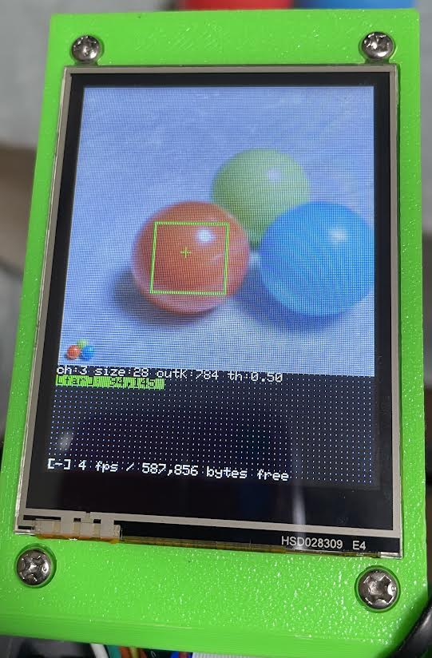
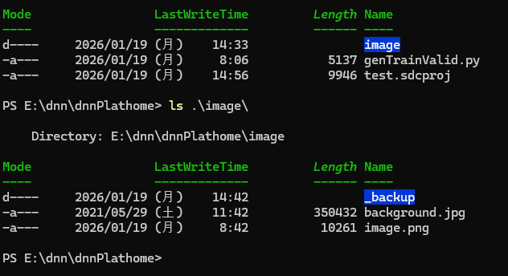
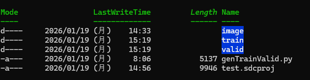
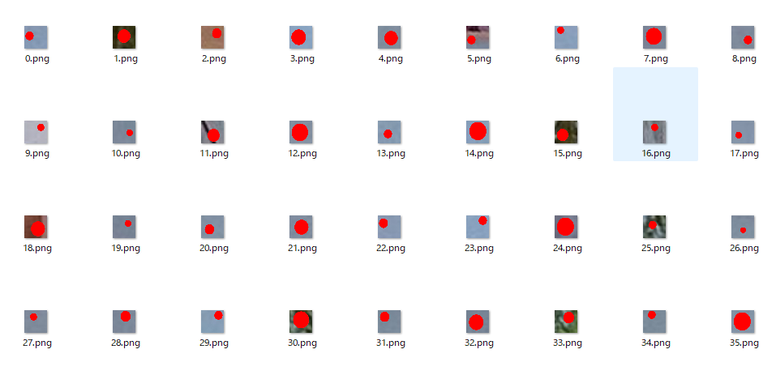
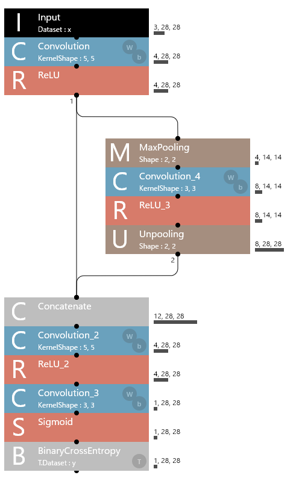
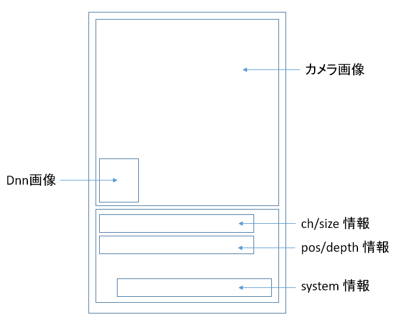
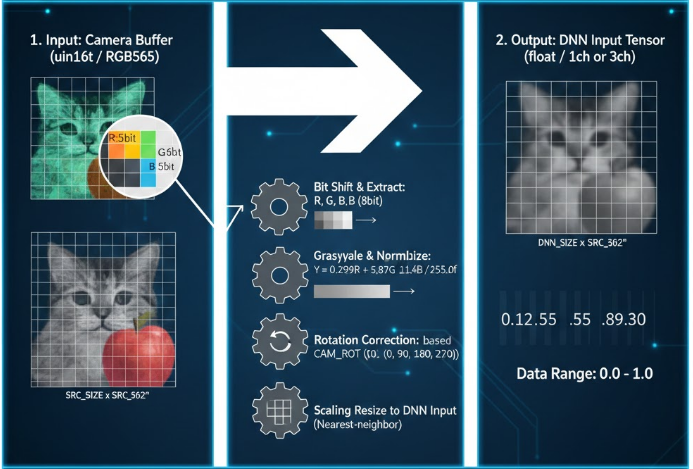
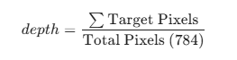
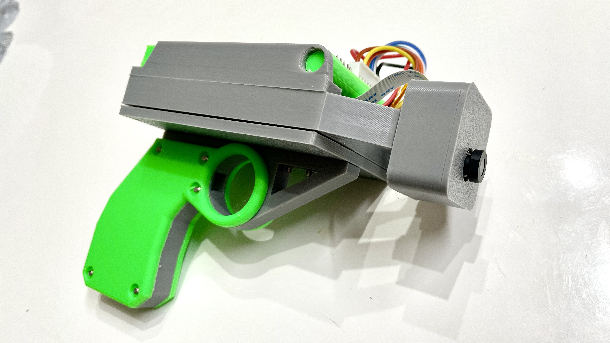
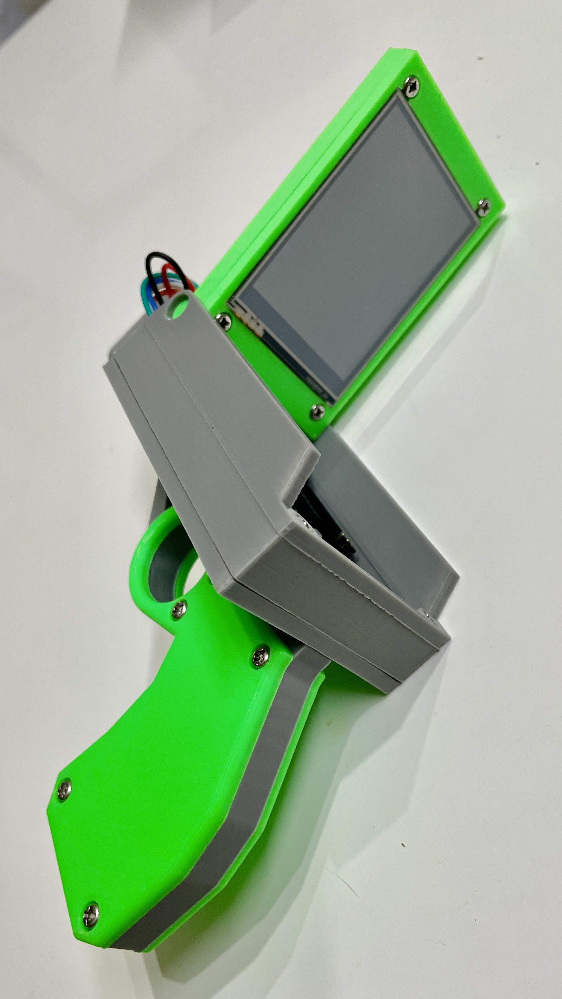

# 【SPRESENSE2025】dnnPlathomeを作ったょ【YOLOっぽい】

2026年1月20日 18:59




# はじめに
本プロジェクトは spresense と dnnRt を活用したリアルタイム物体検知・距離推定システムです
カメラ画像から物体の位置を特定するだけでなく Depthを内部的に**なんちゃって**算出し 
液晶ディスプレイおよび内蔵LEDを用いて直感的な距離フィードバックを提供します

## なぜ今これを？
spresense コンテストに第1回から投稿していますが dnnRt が全く意味不明でした
せっかく **dnnRt 推論機能**があるのは分かっているのに いまひとつ意味/動きが分からず
自分が判らない事は他の開発者も分からないと思い頑張って開発しました
++俗に言う「自分が苦しい時は相手も苦しい理論」++
いわゆる開発日記と御思い下さいまし
後述する **dnnConfig.cfg** と **model.nnb** の差し替えだけで動きますので
色々リアルタイムでデバッグできるかと思います

# ハードウェア構成
今回は配線コネクタ以外ご提供品のみで動きます
LTE拡張基板はSPIの速度がちょいと難なので表示無しモータ等の駆動のみであればOKです

|部品名|販売店|
|---|---|
|本体基板|ご提供品|
|拡張基板(LTE基板も表示無しであれば大丈夫)|ご提供品|
|新カメラ基板(旧カメラ基板も可能)|ご提供品|
|液晶 2.8Inch ili9341|ご提供品|
|配線/コネクタ|手元にあったもの|

# 配線
spresense 拡張基板 CN1 を上から順に繋ぎます

|spresense側 CN1|lcd側|
|---|---|
|VCC|VCC|
|GND|GND|
|pin13|TFT_SCK|
|pin12|TFT_MISO|
|pin11|TFT_MOSI|
|pin10|TFT_CS|
|pin9|TFT_DC|
|pin8|TFT_RST|

---
画像

---


# ソフトウェア設計 
いつものように 1機能 1クラスで設計してあり他の機能追加も簡単に....
また今回のこのシステムで コンパイル時における spresense 特有の nn KByte 情報も大体把握出来ました
多い KByte で実行できなくとも逆に少なくしてみるとかすればあるいわ動くこともあるのかも知れません..

## genTrainValid.py
train/valid用の学習データを作成するpythonスクリプトを修正させて頂きました

>セマンティックセグメンテーション sample
>[SPRESENSEではじめるローパワーエッジAI Chap09](https://github.com/TE-YoshinoriOota/Spresense-LowPower-EdgeAI/tree/main/Chap09)

sample python では 内部に固定で 画像 w/h を記述し mask を作成する必要があったのですが
カレントに genTrainValid.py を配置し imageフォルダを作成し



image 配下に image.png (透過png) background(背景jpg)を配置し
python を実行するだけで train/valid用データを作成できます




## nnc
これ究極っぽいギリギリのnnc らしいですね
色々やってもこれ以上でもこれ以下でも出来なかったです
右側の分岐で解像度を落として遠目で観て
左側本線で28x28で推論させます
<mark>何故 サンプルの殆どが28x28なのか？
最も大きな理由は、手書き数字データセットである MNIST です。
デファクトスタンダード: MNISTはディープラーニングの「Hello World（入門の定番）」であり、その画像サイズが 28x28 ピクセルです。多くのサンプルがこのサイズを基準にしているため、自作のモデルが既存の有名なモデルと比較してどの程度の精度が出るかを検証しやすくなっています。NNCのサンプルは、層を深くしすぎず、かつディープラーニングの本質を学べる最小構成として 28x28 が最適化されています。数字や単純な図形を認識する場合、28x28（計784ピクセル）あれば、人間が見ても内容を判別でき、かつコンピュータが特徴を抽出するのにも十分な情報量が含まれています。これ以上大きくしても、入門用のタスクでは精度が劇的に上がるわけではなく、計算コストだけが増えてしまいます。</mark>





```
#
# genTrainValid.py
#

import os
import argparse
import random
from PIL import Image

# グローバル変数の初期化
g_imgSizeW = 0
g_imgSizeH = 0
g_bgPath = ''
g_imagePath = ''
g_nTrain = 0
g_nValid = 0

def check_input_output_dir(path):
    """保存用フォルダ（input/output）を作成する"""
    for sub_dir in ["/input", "/output"]:
        dir_path = path + sub_dir
        if not os.path.isdir(dir_path):
            os.makedirs(dir_path, exist_ok=True)

def environment_check(bg_filename):
    """実行環境のフォルダとファイルの存在を確認する"""
    global g_bgPath, g_imagePath
    print("========== DIRECTORY CHECK =============")
    path = os.getcwd()
    img_dir = os.path.join(path, "image")

    # 背景画像の確認 (imageフォルダ内)
    g_bgPath = os.path.join(img_dir, bg_filename)
    if not os.path.isfile(g_bgPath):
        print(f"ERROR: {g_bgPath} が見つかりません。")
        exit()

    # 透過PNG画像の確認
    g_imagePath = os.path.join(img_dir, "image.png")
    if not os.path.isfile(g_imagePath):
        print(f"ERROR: {g_imagePath} が見つかりません。")
        exit()

    # 学習・評価用フォルダの準備
    for d in ["train", "valid"]:
        check_input_output_dir(os.path.join(path, d))
    
    print("Environment -- OK\n")

def check_arguments():
    """コマンドライン引数を解析する"""
    print("========== ARGUMENT CHECK =============")
    parse = argparse.ArgumentParser()
    parse.add_argument('-x', dest='iwidth', default='28', help='生成する画像の幅')
    parse.add_argument('-y', dest='iheight', default='28', help='生成する画像の高さ')
    parse.add_argument('-b', dest='bgimage', default='background.jpg', help='背景ファイル名(imageフォルダ内)')
    parse.add_argument('-t', dest='train', default='200', help='学習データの生成数')
    parse.add_argument('-v', dest='valid', default='100', help='評価データの生成数')
    results = parse.parse_args()
    return int(results.iwidth), int(results.iheight), results.bgimage, int(results.train), int(results.valid)

def dataset_make_loop(quantity, arg_path):
    """データセット生成のメインループ"""
    path = os.getcwd()
    
    # 背景と対象画像をオープン
    background_master = Image.open(g_bgPath)
    bg_w, bg_h = background_master.size  # 背景サイズを自動取得
    
    # 安全チェック
    if bg_w < g_imgSizeW or bg_h < g_imgSizeH:
        print(f"ERROR: 背景サイズ({bg_w}x{bg_h})が生成サイズ({g_imgSizeW}x{g_imgSizeH})より小さいです。")
        exit()

    target_org = Image.open(g_imagePath).convert("RGBA")
    # 透過部分からマスクを自動生成
    mask_master = target_org.split()[3]

    # CSV管理ファイルの作成
    csv_file_path = os.path.join(path, arg_path, f"{arg_path}.csv")
    if os.path.isfile(csv_file_path):
        os.remove(csv_file_path)
    
    with open(csv_file_path, 'w') as csvfile:
        csvfile.write("x:in,y:out\n")

        for i in range(quantity):
            print(f"Generating {arg_path}: {i+1}/{quantity}")

            # 1. 背景をランダムに切り出し
            start_x = random.randint(0, bg_w - g_imgSizeW)
            start_y = random.randint(0, bg_h - g_imgSizeH)
            cropped_bg = background_master.crop((start_x, start_y, start_x + g_imgSizeW, start_y + g_imgSizeH)).convert("RGB")

            # 2. 対象物とマスクをランダムリサイズ (元の1/1.0 〜 1/3.0倍)
            rand_s = random.uniform(1.0, 3.0)
            sw, sh = round(g_imgSizeW/rand_s), round(g_imgSizeH/rand_s)
            resize_image = target_org.resize((sw, sh), Image.LANCZOS)
            resize_mask = mask_master.resize((sw, sh), Image.NEAREST)

            # 3. 合成位置を決定
            px = random.randint(0, g_imgSizeW - sw)
            py = random.randint(0, g_imgSizeH - sh)

            # 4. 入力画像(X)の作成
            input_img = cropped_bg.copy()
            input_img.paste(resize_image, (px, py), resize_mask)

            # 5. 出力マスク(Y)の作成
            output_mask = Image.new("L", (g_imgSizeW, g_imgSizeH), 0)
            output_mask.paste(resize_mask, (px, py))

            # 6. 保存
            inp_filename = os.path.join(path, arg_path, "input", f"{i}.png")
            out_filename = os.path.join(path, arg_path, "output", f"{i}.png")
            input_img.save(inp_filename)
            output_mask.save(out_filename)

            # 相対パスでCSVに記録
            csvfile.write(f"{inp_filename},{out_filename}\n")

def main():
    global g_imgSizeW, g_imgSizeH, g_nTrain, g_nValid
    g_imgSizeW, g_imgSizeH, bg_filename, g_nTrain, g_nValid = check_arguments()
    
    environment_check(bg_filename)
    
    dataset_make_loop(g_nTrain, "train")
    dataset_make_loop(g_nValid, "valid")
    
    print("\n[SUCCESS] すべての生成が完了しました。")

if __name__ == "__main__":
    main()
```

## DnnBase.ino
メイン制御
おなじみMainとなるinoですが
ちょっとした癖が強すぎる構成です なんなら setup/loopにはあまり記さない方針です
```
void draw(); // 推論された 内容を可視化します
void setup(); // システムを初期化します
void loop(); // drawをloopして呼び出します
```


- DnnPlathome として作成しているので最低限の表示は必要
- 凝った作りはぜずにスマートに
- dnnConfigや SystemInfo も最低限で
- 動きはこんな感じです
<blockquote class="twitter-tweet" data-theme="dark"><a href="https://twitter.com/chrmlinux03/status/2013523077813150030"></a></blockquote>
<script async src="https://platform.twitter.com/widgets.js" charset="utf-8"></script>


```
//============================================================
// name         : DnnBase.ino
// date/author  : 2026/01/19 @chrmlinux03
// memSize      : 1408 KByte推奨
//============================================================
#pragma once

#include "spreCommon.hpp"
#include "spreCamWrap.hpp"
#include "spreDnnWrap.hpp"
#include "spreScrWrap.hpp"
#include "spre4LedsWrap.hpp"

ScrWrap scr;
CamWrap cam;
DnnWrap dnn;
LedsWrap leds;

void draw() {
  PIXEL_T* camImg = cam.lockImage();
  if (!camImg) return;

  scr.clear();
  scr.drawCamImg(0, 0, camImg);
  dnn.inference(camImg);
  scr.drawGrid(0, SCR_SIZE, SCR_SIZE, GRP_H, 4, TFT_BLUE);
  if (dnn.dnnType == DNN_TYPE_SCALAR) {
    scr.drawDnnGfx(0, SCR_SIZE, SCR_SIZE, GRP_H, &dnn);
  } 
  scr.drawDnnImg(0, SCR_SIZE - dnn.dnnSize, &dnn);
  scr.drawResp(0, SCR_SIZE, &dnn);
  scr.drawSystemInfo(0, scr.scrH - 8);
  scr.update();
  leds.update(dnn.depth);
  cam.unlockImage();
}

void setup() {
  Serial.begin(115200);
  while (!Serial);
  if (!SD.begin()) errMsg("SD begin failed");
  if (dnn.begin()) errMsg("dnn begin failed!");
  if (scr.begin()) errMsg("scr begin failed!");
  if (cam.begin()) errMsg("cam begin failed!");
}

void loop(void) {
  draw();
}
```
## spreCommon.hpp
共通関数/define群
systemInfo やら drawAst やらの関数
**何故か存在しない**cam画像の回転処理もここで行います
カメラ画像の回転はちょっと欲しかったですね、さすがにSWでの回転は荷が重すぎます

```
//==============================
// filename     : spreCommon.hpp
// date/author  : 2026/01/19 @chrmlinux03
//
//==============================
#pragma once

#include <Arduino.h>
#include <SDHCI.h>
#include <malloc.h>
#include <pthread.h>
SDClass SD;

using PIXEL_T = uint16_t;
using DNN_T = float;

enum {ROT0 = 0, ROT90, ROT180, ROT270};
#define TFT_SPI   4
#define TFT_SCK  13
#define TFT_MISO 12
#define TFT_MOSI 11
#define TFT_CS   10
#define TFT_DC    9
#define TFT_RST   8
#define TFT_FREQ 40000000UL

#define BITS_PAR_BYTE 8
#define SCR_WIDTH 240
#define SCR_HEIGHT 320
#define SCR_SIZE SCR_WIDTH
#define GRP_H (SCR_HEIGHT - SCR_WIDTH)
#define CAM_SFT (GRP_H / 2)
#define CAM_ROT ROT0
#define SCR_ROT ROT180

void errMsg(char *msg) { Serial.println(msg); while (1); }

inline uint32_t getfps() {
  static uint64_t prevMillis = 0;
  static int frameCount = 0, lastFPS = 0;
  frameCount++;
  uint64_t now = millis();
  if (now - prevMillis >= 1000) {
    lastFPS = frameCount; frameCount = 0; prevMillis = now;
  }
  return lastFPS;
}

inline size_t getFreeMem() { return mallinfo().fordblks; }

inline String formatComma(unsigned long val) {
  String s = String(val);
  for (int i = s.length() - 3; i > 0; i -= 3) s = s.substring(0, i) + "," + s.substring(i);
  return s;
}

#define R_WEIGHT 0.299f
#define G_WEIGHT 0.587f
#define B_WEIGHT 0.114f
#define MAX_8BIT_VALUE 255.0f
#define RGB565_R8(col) ((uint8_t)(((col) & 0xF800) >> 11) << 3)
#define RGB565_G8(col) ((uint8_t)(((col) & 0x07E0) >>  5) << 2)
#define RGB565_B8(col) ((uint8_t)(((col) & 0x001F) >>  0) << 3)

enum {KIND_IMG_TO_RNN = 0, KIND_RNN_TO_IMG};

inline int arrayCopy(uint16_t *ubuf, uint16_t usize, float *fbuf, uint16_t fsize, int ch, int kind) {
  if (kind != KIND_IMG_TO_RNN && kind != KIND_RNN_TO_IMG) return -1;
  const uint32_t PIX_COUNT = (uint32_t)fsize * (uint32_t)fsize;

  if (kind == KIND_IMG_TO_RNN) {
    const float scale = (float)usize / (float)fsize;
    for (int y = 0; y < fsize; y++) {
      for (int x = 0; x < fsize; x++) {
        int rx, ry;
        switch (CAM_ROT) {
          case ROT90:  rx = y; ry = (fsize-1)-x; break;
          case ROT180: rx = (fsize-1)-x; ry = (fsize-1)-y; break;
          case ROT270: rx = (fsize-1)-y; ry = x; break;
          default:     rx = x; ry = y; break;
        }
        uint16_t cP = (uint16_t)((ry+0.5f)*scale) * usize + (uint16_t)((rx+0.5f)*scale);
        uint16_t col = ubuf[cP];
        uint32_t fP = (uint32_t)fsize * y + x;
        
        if (ch == 1) {
          fbuf[fP] = ((float)RGB565_R8(col)*R_WEIGHT + (float)RGB565_G8(col)*G_WEIGHT + (float)RGB565_B8(col)*B_WEIGHT) / 255.0f;
        } else {
          fbuf[fP] = (float)RGB565_R8(col) / 255.0f;
          fbuf[fP + PIX_COUNT] = (float)RGB565_G8(col) / 255.0f;
          fbuf[fP + PIX_COUNT * 2] = (float)RGB565_B8(col) / 255.0f;
        }
      }
    }
  } else {
    for (int i = 0; i < PIX_COUNT; i++) {
      uint8_t r = (uint8_t)(fbuf[i] * 255.0f);
      uint8_t g = (ch == 3) ? (uint8_t)(fbuf[i + PIX_COUNT] * 255.0f) : r;
      uint8_t b = (ch == 3) ? (uint8_t)(fbuf[i + PIX_COUNT * 2] * 255.0f) : r;
      ubuf[i] = ((r >> 3) << 11) | ((g >> 2) << 5) | (b >> 3);
    }
  }
  return 0;
}
```

## spreCamWrap.hpp
カメラ制御 Wrap
カメラは Mutex管理を推奨します

<mark>なぜ Mutex が必要なのか？
カメラが撮影した画像データが置かれているメモリ領域を複数の「人（処理）」が同時に触ろうとすると問題が起きます。
カメラ（書き込み役）「新しい画像を今、メモリに書き込んでいます...」
AI推論/表示（読み取り役）「今、メモリにある画像を読み取って分析します！」
もし Mutex がないと、「カメラが半分だけ書き換えた画像」をAIが読み取ってしまうことがあります。すると画面の上半分は新しい画像、下半分は古い画像という「ズレ」が発生したり、最悪の場合はデータが支離滅裂になってシステムがクラッシュします(何度も原因が分からず難儀の毎日)</mark>

```
int begin(); // 初期化
PIXEL_T* lockImage(); // カメラ画像を取得し camMutex lock します
void unlockImage(); // camMutex unlock
```

```
//==============================
// filename     : spreCamWrap.hpp
// date/author  : 2026/01/19 @chrmlinux03
//
//==============================
#pragma once

#include <Camera.h>

class CamWrap {
    static CamWrap* instance;
    volatile bool camUpdate = false;
    CamImage dspImg;
    pthread_mutex_t camMutex;

  public:
    CamWrap() { instance = this; pthread_mutex_init(&camMutex, NULL); }
    int begin() {
      if (theCamera.begin() != CAM_ERR_SUCCESS) return -1;
      theCamera.setAutoWhiteBalanceMode(CAM_WHITE_BALANCE_DAYLIGHT);
      if (theCamera.startStreaming(true, camCallbackStatic) != CAM_ERR_SUCCESS) return -2;
      return 0;
    }
    inline bool updateAvailable() { return camUpdate && dspImg.isAvailable(); }
    inline PIXEL_T* lockImage() {
      if (!updateAvailable()) return nullptr;
      pthread_mutex_lock(&camMutex);
      camUpdate = false;
      return (PIXEL_T*)dspImg.getImgBuff();
    }
    inline void unlockImage() { pthread_mutex_unlock(&camMutex); }
    ~CamWrap() { pthread_mutex_destroy(&camMutex); }

  private:
    static void camCallbackStatic(CamImage img) { if (instance) instance->camCallback(img); }
    void camCallback(CamImage img) {
      if (!img.isAvailable() || pthread_mutex_trylock(&camMutex) != 0) return;
      if (img.clipAndResizeImageByHW(dspImg, CAM_SFT, 0, CAM_SFT+SCR_SIZE-1, SCR_SIZE-1, SCR_SIZE, SCR_SIZE) == CAM_ERR_SUCCESS) {
        dspImg.convertPixFormat(CAM_IMAGE_PIX_FMT_RGB565);
        camUpdate = true;
      }
      pthread_mutex_unlock(&camMutex);
    }
};
CamWrap* CamWrap::instance = nullptr;
```

## spreDnnWrap.hpp
AI推論 Wrap
classを 初期化/推論だけにしました

```
int begin(); /// 初期化
int inference(PIXEL_T* img) // 推論
```

```
//==============================
// filename     : spreDnnWrap.hpp
// date/author  : 2026/01/19 @chrmlinux03
//
//==============================
#pragma once

#include <DNNRT.h>

enum {DNN_TYPE_NONE = 0, DNN_TYPE_SCALAR, DNN_TYPE_ARRAY};
#define DNN_CONFIG "dnnConfig.cfg"

class DnnWrap {
    DNNRT dnnrt;
    DNNVariable *inputVar = nullptr;
  public:
    bool use = false;
    int dnnCh = 0, dnnSize = 0, dnnOutK = 0, dnnType = DNN_TYPE_NONE, dnnIdx = 0;
    int xMin = 0, yMin = 0, xMax = 0, yMax = 0, xLen = 0, yLen = 0, cx = 0, cy = 0;
    float depth = 0.0f;
    float threshold = 0.5f;
    float dnnScale = 0.0f;
    PIXEL_T *dnnU16 = nullptr;
    DNN_T *dnnOut = nullptr;

    ~DnnWrap() {
      if (dnnOut) delete[] dnnOut;
      if (dnnU16) delete[] dnnU16;
      if (inputVar) delete inputVar;
    }

    int begin() {
      File f = SD.open(DNN_CONFIG);
      if (!f) return -10;
      while (f.available()) {
        String line = f.readStringUntil('\n'); line.trim();
        int sep = line.indexOf('='); if (sep == -1) continue;
        String k = line.substring(0, sep), v = line.substring(sep + 1);
        if (k == "ch") dnnCh = v.toInt();
        if (k == "size") dnnSize = v.toInt();
        if (k == "outK") dnnOutK = v.toInt();
        if (k == "type") dnnType = v.toInt();
        if (k == "threshold") threshold = v.toFloat();
        if (k == "fname") {
          File mf = SD.open(v);
          if (mf && dnnrt.begin(mf) >= 0) use = true;
          mf.close();
        }
      }
      f.close();
      if (!use) return -1;
      inputVar = new DNNVariable(dnnCh * dnnSize * dnnSize);
      dnnScale = (float)SCR_SIZE / dnnSize;
      dnnU16 = new PIXEL_T[dnnSize * dnnSize]();
      dnnOut = new DNN_T[dnnOutK]();
      return 0;
    }

    int inference(PIXEL_T* img) {
      if (!use) return -1;
      arrayCopy(img, SCR_SIZE, inputVar->data(), dnnSize, dnnCh, KIND_IMG_TO_RNN);
      dnnrt.inputVariable(*inputVar, 0);
      dnnrt.forward();
      memcpy(dnnOut, dnnrt.outputVariable(0).data(), dnnOutK * sizeof(DNN_T));

      if (dnnType == DNN_TYPE_SCALAR) {
        float maxV = -1.0f;
        for (int i = 0; i < dnnOutK; i++) if (dnnOut[i] > maxV) {
            maxV = dnnOut[i];
            dnnIdx = i;
          }
      } else {
        int miX = dnnSize, maX = -1, miY = dnnSize, maY = -1, cnt = 0;
        for (int i = 0; i < dnnOutK; i++) {
          if (dnnOut[i] > threshold) {
            int px = i % dnnSize, py = i / dnnSize;
            miX = min(miX, px);
            maX = max(maX, px);
            miY = min(miY, py);
            maY = max(maY, py);
            cnt++;
          }
        }
        if (cnt > 0) {
          dnnIdx = cnt;
          xMin = miX; yMin = miY; xMax = maX; yMax = maY;
          xLen = (xMax - xMin) + 1;
          yLen = (yMax - yMin) + 1;
          cx = xMin + (xLen / 2);
          cy = yMin + (yLen / 2);
          depth = (float)(xLen * yLen) / (float)(dnnSize * dnnSize);
        } else {
          xMin = yMin = xMax = yMax = xLen = yLen = cx = cy = -1;
          dnnIdx = -1;
        }
      }
      return dnnIdx;
    }

    inline DNN_T* getInputData() {
      return inputVar ? inputVar->data() : nullptr;
    }
};
```
## spreScrWrap.hpp 
唯我独尊的な爆速を誇る lovyanGFX をWrap し簡単に使えるようにしてあります
基本の使い方はいつもと同じです

```
//==============================
// filename     : spreScrWrap.hpp
// date/author  : 2026/01/19 @chrmlinux03
//
//==============================
#pragma once

#define LGFX_USE_V1
#include <LovyanGFX.hpp>

//==============================
// ScrWrap
//==============================
class ScrWrap {
    struct LGFX_Display : public lgfx::LGFX_Device {
      lgfx::Panel_ILI9341 _panel;
      lgfx::Bus_SPI _bus;
      LGFX_Display() {
        auto c = _bus.config(); c.spi_port = TFT_SPI; c.freq_write = TFT_FREQ; c.pin_dc = TFT_DC; _bus.config(c);
        auto p = _panel.config(); p.pin_cs = TFT_CS; p.pin_rst = TFT_RST;
        p.panel_width = SCR_WIDTH; p.panel_height = SCR_HEIGHT; _panel.config(p);
        _panel.setBus(&_bus); setPanel(&_panel);
      }
    } lcd;
  public:
    lgfx::LGFX_Sprite spr{&lcd};
    uint16_t scrW, scrH;

    //==============================
    // begin
    //==============================
    int begin() {
      lcd.init(); lcd.clear(TFT_BLACK);
      spr.setColorDepth(16); spr.createSprite(SCR_WIDTH, SCR_HEIGHT);
      spr.setRotation(SCR_ROT);
      scrW = spr.width(); scrH = spr.height();
      return 0;
    }

    //==============================
    // update
    //==============================
    void update() {
      spr.pushSprite(0, 0);
    }

    //==============================
    // clear
    //==============================
    void clear() {
      spr.clear(TFT_BLACK);
    }

    //==============================
    // drawCamImg
    //==============================
    void drawCamImg(int x, int y, uint16_t *img) {
      spr.setSwapBytes(true);
      spr.pushImage(x, y, SCR_SIZE, SCR_SIZE, img);
      spr.setSwapBytes(false);
    }

    //==============================
    // drawDnnImg
    //==============================
    void drawDnnImg(int x, int y, DnnWrap* d) {
      arrayCopy(d->dnnU16, d->dnnSize, d->getInputData(), d->dnnSize, d->dnnCh, KIND_RNN_TO_IMG);
      spr.setSwapBytes(true); spr.pushImage(x, y, d->dnnSize, d->dnnSize, d->dnnU16); spr.setSwapBytes(false);
    }

    //==============================
    // drawResp
    //==============================
    void drawResp(int x, int y, DnnWrap* d) {
      spr.setTextColor(TFT_WHITE);
      spr.setCursor(x, y);
      spr.printf("ch:%d size:%d outK:%d th:%.2f\n", d->dnnCh, d->dnnSize, d->dnnOutK, d->threshold);

      if (d->dnnType == DNN_TYPE_ARRAY) {
        if (d->dnnIdx > 0) {
          int xM = d->xMin * d->dnnScale;
          int yM = d->yMin * d->dnnScale;
          int w  = d->xLen * d->dnnScale;
          int h  = d->yLen * d->dnnScale;
          int cX = d->cx   * d->dnnScale;
          int cY = d->cy   * d->dnnScale;

          //==============================
          // near?far?
          //==============================
          uint16_t color;
          String distStr;
          if (d->depth > 0.3f) {
            color = TFT_RED;
            distStr = "near";
          } else if (d->depth > 0.08f) {
            color = TFT_YELLOW;
            distStr = "mid";
          } else {
            color = TFT_GREEN;
            distStr = "far";
          }

          //==============================
          // rect
          //==============================
          spr.drawRect(xM, yM, w, h, color);
          spr.drawRect(xM + 1, yM + 1, w - 2, h - 2, color);
          int len = 4;
          spr.drawFastHLine(cX - len, cY, len * 2 + 1, color);
          spr.drawFastVLine(cX, cY - len, len * 2 + 1, color);

          spr.setTextColor(TFT_BLACK, color);
          spr.printf("[%s]:%3d,%3d ", distStr.c_str(), cX, cY);
        }
      } else {
        spr.setTextColor(TFT_BLACK, TFT_WHITE);
        spr.printf(" idx:%d ", d->dnnIdx);
      }
      spr.setTextColor(TFT_WHITE);
    }

    //==============================
    // drawSystemInfo
    //==============================
    void drawSystemInfo(int x, int y) {
      static const char ast[] = "/-\\|";
      static int astIdx = 0;
      spr.setTextColor(TFT_WHITE);
      spr.setTextSize(1);
      spr.setCursor(x, y);
      spr.printf("[%c] ", ast[astIdx]);
      astIdx = (astIdx + 1) % (sizeof(ast) - 1);
      spr.printf("%d fps / %s bytes free", getfps(), formatComma(getFreeMem()).c_str());
    }

    //==============================
    // drawGrid
    //==============================
    void drawGrid(int x, int y, int w, int h, int s, uint16_t c) {
      for (int i = 0; i < w; i += s) for (int j = 0; j < h; j += s) spr.drawPixel(x + i, y + j, c);
    }

    //==============================
    // drawDnnGfx
    //==============================
    void drawDnnGfx(int x, int y, int w, int h, DnnWrap* d) {
    }
};
```

## spre4LedsWrap.hpp 
4段階LEDインジケーター
あるものは使え
```
//==============================
// name          : spre4LedsWrap.hpp
// date/author   : 2026/01/19 @chrmlinux03
//==============================
#pragma once

#include <Arduino.h>

class LedsWrap {
  public:

    //==============================
    // update (depth: 0.0 - 1.0)
    //==============================
    void update(float depth) {
      static bool inited = false;
      if (!inited) {
        pinMode(LED0, OUTPUT);
        pinMode(LED1, OUTPUT);
        pinMode(LED2, OUTPUT);
        pinMode(LED3, OUTPUT);
        allOff();
        inited = true;
      }
      int level = 0;
      if (depth > 0.50f)      level = 4;
      else if (depth > 0.25f) level = 3;
      else if (depth > 0.08f) level = 2;
      else if (depth > 0.01f) level = 1;
      else                    level = 0;

      digitalWrite(LED0, (level >= 1) ? HIGH : LOW);
      digitalWrite(LED1, (level >= 2) ? HIGH : LOW);
      digitalWrite(LED2, (level >= 3) ? HIGH : LOW);
      digitalWrite(LED3, (level >= 4) ? HIGH : LOW);
    }

    //==============================
    // allOff
    //==============================
    void allOff() {
      digitalWrite(LED0, LOW);
      digitalWrite(LED1, LOW);
      digitalWrite(LED2, LOW);
      digitalWrite(LED3, LOW);
    }
};
```

# 特徴的なロジック
作者的に良いロジックだったものを取り上げます

##  SCALAR と ARRAY
dnnが吐き出す推論model は
scalar : 複数の事象から唯一の事象の認識率を得る
array : 画面中のソレがどこにあるのかを得る
..等を sony製 nnc (Neural Network Console) で組み上げる事が出来ます
もちろん他の事も出来ますがまずはこれから


## 運用設定 (dnnConfig.cfg)
折角作った 推論model でも
毎回毎回 model.nnb をコピーしてコンパイルというのでは開発効率が落ちます
そこで代表的な ch/size/outK/type/threshold/fname の書き換えでだけで
xxx.ino は変えずに(コンパイルせずに)稼働させる事ができます

```c++:dnnConfig.cfg
ch=3
size=28
outK=784
type=2
threshold=0.50
fname=model.nnb
````

## arrayCopy
RGB565からAI用の正規化 float データへの変換、および回転処理を一括で行います。
さすがに camera.h には回転がありませんので自作
ついでに uint16_t -> float への相互変換も行います
最初のコードはここから始まりました flolat <-> uint16_t の相互変換です


## depth による距離推定
推定する物体が1個の場合のみ有効、いわゆる遠近法
単眼カメラの画像からAI（NNC）が抽出した物体の「占有面積」を利用し対象物との距離を擬似的に算出します

- AIの出力マップ（28×28）に対し、設定ファイルで定義した threshold を適用して有効なピクセルを抽出します

 ∑Target Pixels: 出力値が threshold を超えたピクセルの総数
Total Pixels: 入力解像度に基づく全画素数（28×28=784）

- 距離の4段階判定
算出された depth（面積比率）に基づき以下の4段階で距離を判定しUI（表示）や制御にフィードバックします

|レベル|判定|状態の説明|推定距離|
|---|---|---|---|
|Level 1|Far|ターゲットが非常に小さく、遠方に位置する|遠距離|
|Level 2|Mid|形が明確になり、追跡が安定する距離|中距離|
|Level 3|Near|画面内での存在感が大きく、接近している|近距離|
Level 4|Close|画面の大部分を占有しており、衝突の可能性がある|至近距離|

- 実装のメリット
低負荷: 複雑なステレオ演算や深度推定モデルが不要でspresenseの省電力性能を活かせます
高効率: 位置（pos）と面積（depth）を同時に取得できるため、シンプルなロジックで自律動作が可能です
調整容易: 環境に応じた検知感度の調整は、構成ファイルの threshold パラメータを変更するだけで完了します

## LedsWrap
```
自律初期化ロジックを搭載。update(depth) を呼ぶだけでLEDを制御します。
Level 1: LED0 点灯 (Far)
Level 2: LED0, 1 点灯 (Mid)
Level 3: LED0, 1, 2 点灯 (Near)
Level 4: LED0, 1, 2, 3 全点灯 (Danger)
````

# 応用例
昨今 相変わらずの **3DPrinter流行り**のコンテストなので 
ちょっと変わった外装を....


- 撃てる DnnGun / 追従するロボット 等のエンジンに最適です

# さいごに
わたし同様、がりがり書くことから nnc を使った投稿が増える事を祈っています
ご清聴ありがとうございました
相変わらず長かったです(モデルリングが)

<div class="like-wrap"><div data-lyket-type="like" data-lyket-template="twitter" data-lyket-namespace="linalog" data-lyket-color-icon="#b5e853" data-lyket-color-primary="#b5e853" data-lyket-color-text="#eaeaea" data-lyket-color-secondary="#2b2b2b" data-lyket-id="spresense-dnn"></div></div>
