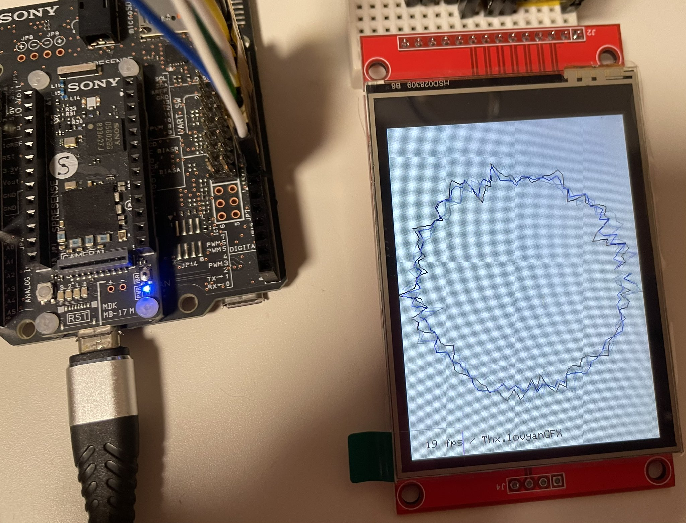
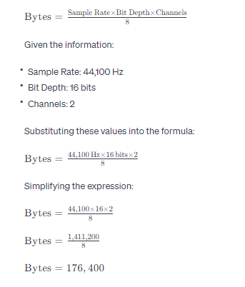
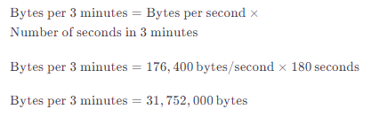
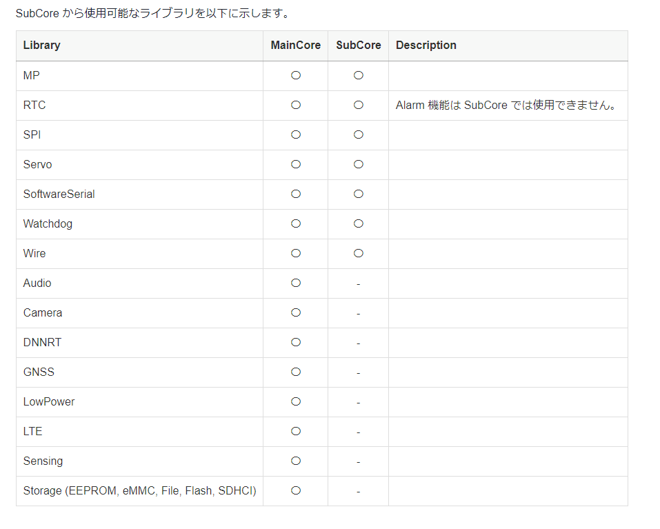

# SPRESENSE の DSPを微妙にHackするよっ【理論編】

2023年12月14日 19:51
<p class="article-tags">タグ: <a href="..?tag=Arduino">Arduino</a> <a href="..?tag=Audio">Audio</a> <a href="..?tag=DSP">DSP</a> <a href="..?tag=simpleFIFO">simpleFIFO</a> <a href="..?tag=spresense">spresense</a></p>



# はじめに
はいまた投稿だよ リナちゃん💕です
SPRESENSE2023 あと60日切りましたねっ
今回はSPRESENSEのAudio機能を切り崩してまいります

# もくてき
mp3/wav/raw ファイルのDual_Playerとかのサンプルはあるんですけど
そのFileから取得されたDataと映像のリンクが面倒なの
sampleは膨大なのに ちょっとわかりづらい構成(goto とかあるし)になってて
まぁ専門の方々なら読めるんだろうけど

# rawふぁいるの構成
ぢゃぁ非圧縮のファイルを考えて rawファイルに目を向けて見る
CD音質と同じファイルフォーマットなら
freq 44.1000Hz 16bit 2ch なの
つまり こういう計算式になるよね

1秒間あたりのバイト数はなんと 176,400 Byte💦
これを3分くらい再生するわけですから　


3分あたりのバイト数はなんと 31MegaByte💦
この秒以下の時間で31MegaByteをSPRESENSE のDSPに送るわけですからもう大変は事です
ちなみに Audio 機能は SubCore では動きません
出典：Spresenseハードウェアドキュメント


# しんぷるえふあぃえふぉ？
音楽は音声ファイル(theFile)を読み込んで一旦 DSPのsimpleFIFO に送られるの
FIFO だから最初に書いたものから最初に押しだされるって感じ
※bufが5コの場合
setup() {
&nbsp;&nbsp;&nbsp;&nbsp;-> [4][3][2][1][0]　左からデータが積まれて行く（まだ再生はしない)
}
loop() {
&nbsp;&nbsp;&nbsp;&nbsp;-> [5][4][3][2][1]     [0] が再生されて [5] が積まれる
&nbsp;&nbsp;&nbsp;&nbsp;-> [6][5][4][3][2]     [1] が再生されて [6] が積まれる
}
SPRESENSE の DSP はそのあたりは良くできていて
simpleFIFOがエラーを返してくれるのね
だからそのエラーの感じで simpleFIFO を微妙にHackすれば
音は鳴り続けるという事までは分かった
たま～に 1個入れたのに 2個3個とか再生されたり←今ここ苦戦中

# お試し
上のloopのDSPに送るタイミングで間に映像を流せば
多分なるよね～って作ったのがこれ
simpleFIFO の現在のポインタの位置とか判ればもうちょっと同期出来るんですけどね
<blockquote class="twitter-tweet" data-theme="dark"><a href="https://twitter.com/chrmlinux03/status/1735246091812217301"></a></blockquote>
<script async src="https://platform.twitter.com/widgets.js" charset="utf-8"></script>

# さいごに
完全なるソースの公開は来年までお待ちください
今回は音声データの可視化のみお楽しみ頂ければと考えています
ぢゃ　また投稿するね💕

# 可視化コード
データは44.1kHzのサンプリングレート、16ビットのビット深度、2チャンネルのオーディオデータは、アナログ信号を44,100回/秒でサンプリングし、各サンプルを16ビットで表現し、左右の2つのチャンネルでデジタル化され16ビットの符号付整数データを-1.0から1.0の範囲に変換(スケーリング)されてます

```arduino:drawRadialEffectWav.hpp
void drawRadialEffectWav(LGFX_Sprite *sprite,
                          float *audioBuffer, uint32_t audioBufferSize, uint8_t audioDataLength, uint8_t audioChannels,
                          uint16_t drawPoints, int16_t pitch, int16_t space) {
  // Definition of the Point structure
  struct Point {
    int16_t x;
    int16_t y;
    float pwr;
  };

  // Calculate the number of samples
  int16_t samples = (audioBufferSize / audioDataLength);
  // Number of samples per draw point
  int16_t samplesPerDrawPoint = samples / drawPoints;
  // Sprite width and height
  int16_t spriteWidth = sprite->width(), spriteHeight = sprite->height();
  // Half of the sprite width and height
  int16_t halfSpriteWidth = spriteWidth >> 1, halfSpriteHeight = spriteHeight >> 1;
  // Calculate the radius (considering space)
  int16_t radius = min(halfSpriteWidth, halfSpriteHeight) - space;

  // Array to store coordinates and power for draw points
  Point drawPointsArray[drawPoints][audioChannels];

  // Calculate coordinates and power for draw points based on audio data
  for (int ch = 0; ch < audioChannels; ch++) {
    for (int i = 0; i < drawPoints; i++) {
      float angle = radians(i * (360.0 / drawPoints));
      int16_t index = i * samplesPerDrawPoint + ch;
      drawPointsArray[i][ch] = {
        halfSpriteWidth + (radius + audioBuffer[index] * pitch) * cos(angle),
        halfSpriteHeight + (radius + audioBuffer[index] * pitch) * sin(angle),
        audioBuffer[index]
      };
    }
  }

  // Draw circles at the calculated coordinates
  for (int ch = 0; ch < audioChannels; ch++) {
    for (int i = 0; i < drawPoints; i++) {
      sprite->fillCircle(drawPointsArray[i][ch].x, drawPointsArray[i][ch].y, drawPointsArray[i][ch].pwr * random(20),
                         colorPalette[random(RCOLOR_MAX)]);
    }
  }
}
```

<div class="like-wrap"><div data-lyket-type="like" data-lyket-template="twitter" data-lyket-namespace="linalog" data-lyket-color-icon="#b5e853" data-lyket-color-primary="#b5e853" data-lyket-color-text="#eaeaea" data-lyket-color-secondary="#2b2b2b" data-lyket-id="spresense-dsp-riron"></div></div>
