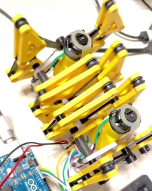

# 【SPRESENSE2024】esp32とSpresenseによるモデム機能制御"eNord"の構築

2024年12月12日 13:14
<p class="article-tags">タグ: <a href="..?tag=ESP32">ESP32</a> <a href="..?tag=ESPNOW">ESPNOW</a> <a href="..?tag=I2C">I2C</a> <a href="..?tag=SPRESENSE">SPRESENSE</a> <a href="..?tag=Wire">Wire</a> <a href="..?tag=eNord">eNord</a></p>



作成者: リナちゃん

# はじめに

近年、IoT技術の進展に伴い、さまざまな通信機能を内蔵したデバイスの需要が高まっています。特に、モバイルデバイスやロボットにおいては、低消費電力で高い通信機能を持つモジュールが求められています。本研究では、**Sony Spresense**を使用したロボット制御システムにおいて、通信機能を実現するために**ESP32-S3**を使用し、これを**ESP-NOW**を介した通信に活用する方法 **eNordType** を提案します。

**Spresense**本体には、通信機能が搭載されていないため、別途、**ESP32-S3**を利用してモデム機能を追加し、ESP-NOWプロトコルを活用することで、簡単に通信機能を確保できることを実証しました。また、ESP32-S3を使用することで、複数の通信モジュールを個別に用意する必要がなく、単体での通信機能の実現が可能となります。

# システム構成

本研究で構築したシステムは、以下の三つの主要なモジュールから成り立っています：

## **motorSide**
ロボットのモーターを制御する部分。壁センサ（前および右）を使用して障害物の位置を検出し、その情報を**spreSide**に送信します。
   
## **spreSide**
ESP32-S3を活用した通信モジュール。**motorSide**から送信された壁センサ情報を受信し、**Spresense**本体へ転送する役割を担います。ここでは、**ESP-NOW**を使用して通信を行います。

## **spreSense**
**Sony Spresense**本体。この部分では、受信した壁情報を元にマップ情報を計算し、ロボットの移動経路や障害物回避経路を決定します。

# 通信機能

## ESP-NOWによる通信

本システムでは、**ESP32-S3**に搭載されている**ESP-NOW**を使用して、**motorSide**と**spreSide**間のデータ通信を行います。ESP-NOWは、Wi-Fiを介さずにデバイス間で直接通信を行う技術であり、低消費電力かつ高速な通信が可能です。この技術により、通信の遅延を最小限に抑え、リアルタイムで壁センサ情報を送受信することができます。

## I2C通信による情報転送

さらに、**spreSide**は、**I2C**通信を使用して、**motorSide**で取得されたセンサーデータを**Spresense**本体に転送します。I2C通信を使用することで、複数のデバイス間で簡単にデータのやり取りができるため、センサーデータを効率的に処理することが可能となります。

# システム動作の詳細

## motorSideにおけるデータ取得

**motorSide**には、壁センサ（前および右）が接続されています。これらのセンサから得られたデータは、瞬時に**spreSide**に送られます。送信されたデータは、**spreSide**で受信後、**Spresense**本体に転送され、さらに高度な処理が行われます。**motorSide**では、壁センサを利用して障害物の位置をリアルタイムで把握し、その情報を基にロボットの移動経路を制御することが可能となります。

## SpreSenseでの計算と制御

**Spresense**本体では、受信した壁情報を基に、障害物回避や経路計算を行います。これには、**Spresense**の6つのコアをフル活用して計算処理を行うため、リアルタイムでのマップ生成や移動経路の決定が可能となります。この計算結果を元に、**spreSide**から**motorSide**へ指示が送られ、ロボットのモーターを制御することができます。

# 実験結果

## wallセンサーデータの転送

実験では、**motorSide**で取得された壁情報（前および右のセンサーデータ）は、瞬時に**spreSide**へ送信され、**Spresense**本体に転送されました。これにより、**Spresense**では、あたかもその壁情報が直接取得されたかのように動作し、計算を行うことができました。この結果、ロボットは障害物を回避しながら自律的に移動することができました。

## マップ情報と移動情報の転送

**Spresense**で計算されたマップ情報および移動情報は、**spreSide**を通じて**motorSide**に送信され、その情報に基づいてモーターが駆動されます。この一連の動作により、ロボットは障害物を避けながら目的地に向かって移動することが可能となり、実用的な自律移動システムを構築することができました。

# 結論

本研究では、**Spresense**と**ESP32-S3**を活用した通信機能およびロボット制御システム **eNordType** を構築しました。**ESP32-S3**を使用することで、**ESP-NOW**を介した低消費電力かつ高速な通信を実現し、**motorSide**から**spreSide**、そして**Spresense**本体へのデータ転送を効率的に行うことができました。さらに、**Spresense**本体の強力な計算能力を活用することで、リアルタイムでの障害物回避や移動経路の計算を行い、ロボットの自律移動を実現しました。今後は、このシステムをさらに発展させ、より複雑な環境下での自律移動を実現することを目指します。

# サンプルコード
※詳細は後日

```c++
#include "spreWireLib.hpp"
//===========================
// spreSense.ino
//   eNordType
//===========================
void setup() {
  setupSpre();
  delay( 5000 );
  cpuToeNord(STX, 0, 0, 0, ETX);
}

// 5v:7..993 3v3:7..656
void loop() {
  uint8_t left, right;
  int dt0 = analogRead(A0);
  int dt1 = analogRead(A1);
  left = map(dt, 7, 656, 0, 255);
  right = map(dt, 7, 656, 0, 255);
  cpuToeNord(left, right);
  dataDump((uint8_t *)eNord, sizeof(eNord));
}
```
```
//===========================
// spreSide.ino
//  eNordType
//===========================
#define GROVE
#include "esp32S3Lib.hpp"

void setup() {
  setupS3(WIRE_SLAVE_ADRS, DEFAULT_BRIGHTNESS);
  delay(5000);
  setupEspNow();
}

void loop() {
  COLOR_T col;
  memset(&col, 0x0, sizeof(col));
  if (eNord[ENORD_WALL]) col.b = 255;
  else                    col.g = 255;
  breathNeo(60, col.r, col.g, col.b);
  sendData(100);
  dataDump((uint8_t *)eNord, sizeof(eNord));
}
```
```
//===========================
// motorSide.ino
//  eNordType
//===========================
#define GROVE
#include "esp32S3Lib.hpp"

void setup() {
  setupS3(WIRE_MASTER_ADRS, DEFAULT_BRIGHTNESS);
  delay(5000);
  setupEspNow();
}

void loop() {
  breathNeo(60, 0, 255, 0);
  int wallStat = getWallStat();
  eNord[ENORD_WALL] = wallStat;
  sendData(100);
  driveMotor();
  dataDump((uint8_t *)eNord, sizeof(eNord));
}
```
# 参考文献

0. 旧バージョン:../easylidar/
1. Sony Spresense公式サイト: https://developer.sony.com/spresense/development-guides/arduino_developer_guide_ja.html
2. ESP32-S3技術仕様: https://www.espressif.com/en/products/socs/esp32-s3
3. ESP-NOWの技術仕様と実装方法: https://www.espressif.com/en/products/software/esp-now

<div class="like-wrap"><div data-lyket-type="like" data-lyket-template="twitter" data-lyket-namespace="linalog" data-lyket-color-icon="#b5e853" data-lyket-color-primary="#b5e853" data-lyket-color-text="#eaeaea" data-lyket-color-secondary="#2b2b2b" data-lyket-id="spresense-enord"></div></div>
