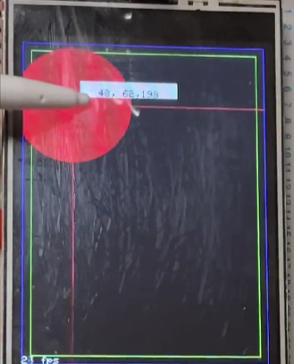
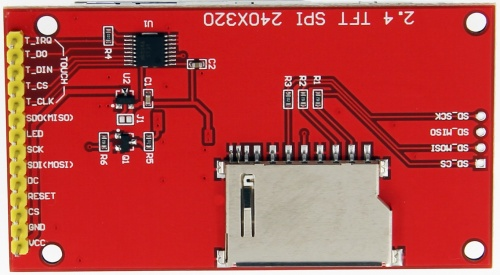
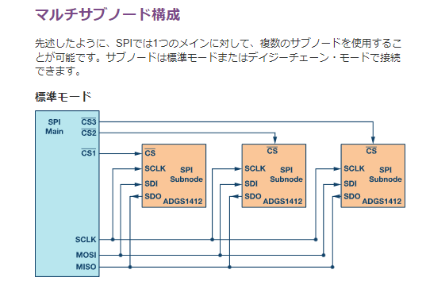
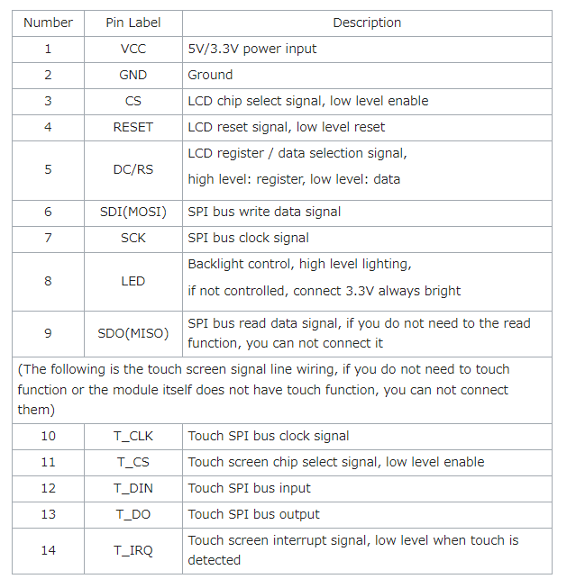
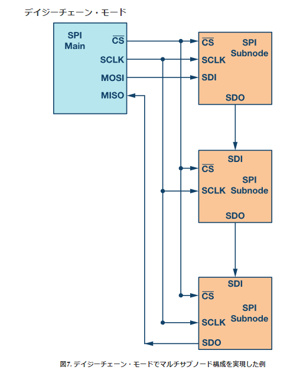
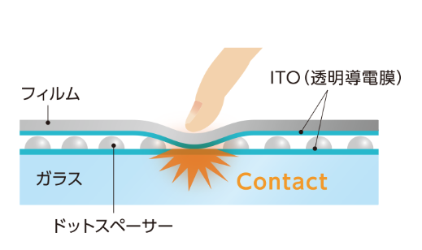
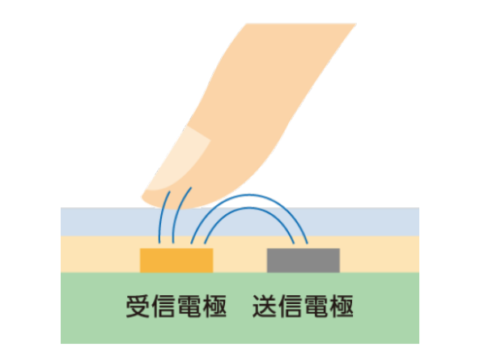
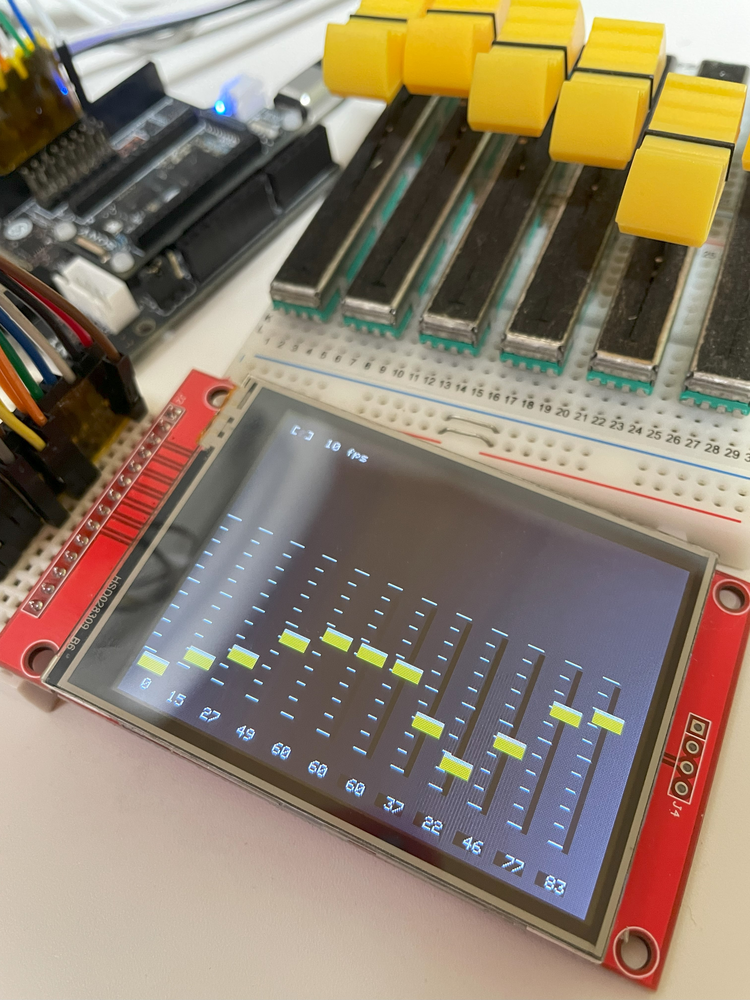
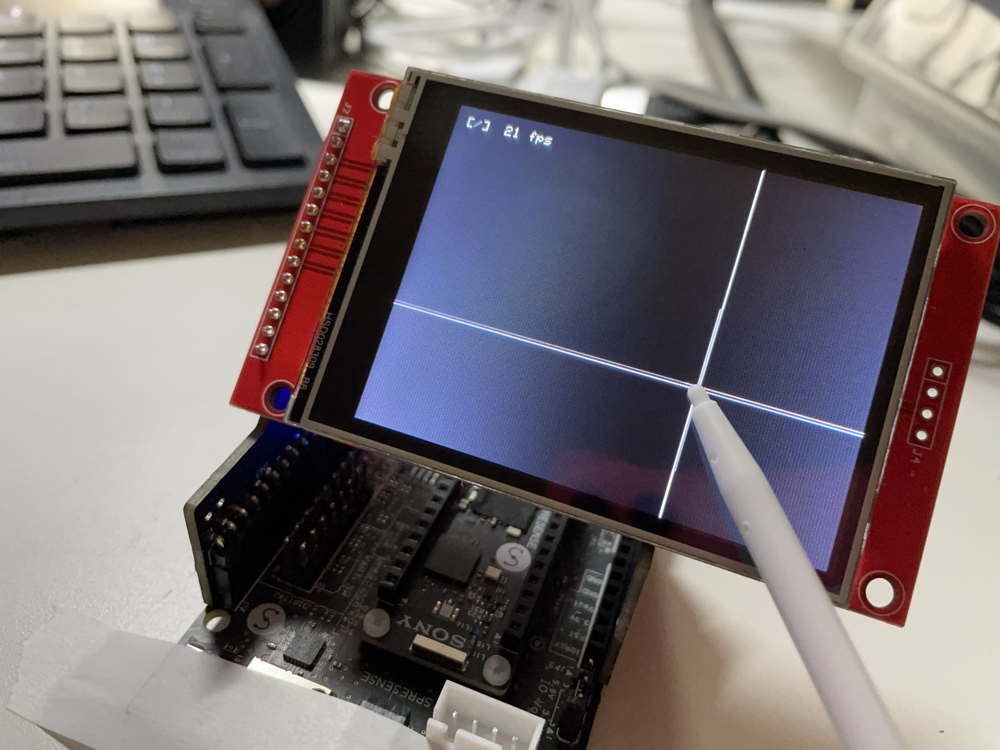

# 【SPRESENSE2023】LCD液晶基板ili9341でタッチパネルを使うよっ

2024年1月26日 09:44



# はじめに

こんにちわっ 

リナちゃん　X@chrmlinux03　です

++このページは SPRESENSE2023コンテストで作った部品を紹介するものです
最初に [開発まとめ](../spresense-2023-matome/) をお読みいただければ幸いです++

インターネットを検索するとタッチパネルの記事は沢山あります

だけど何故か SPRESENSE + タッチパネル ではヒットが出て来ません

そこで今後の持ってるけど使えなくってうずうずしている方々への

感謝を込めて全部公開

目指せタッチパネルマスター ٩(ˊᗜˋ*)و
# 用意するもの
| 部品名 | 販売先 | 価格 | 御提供品 |
|-|-|-|-|
| タッチパネル付き液晶(ili9341) |どこでも|400～3,000円|〇|

赤い基板の液晶なんで "ili9341 + Arduino" とかで検索すると大体出てくる

2.4インチ 2.8インチ ... とか色々あるけど

液晶制御用のICが ili9341 だと今回の作業で使えるし

他のICでもちょこっと検索するとやり方が出てくるのでこのページを応用して

# 液晶基板とタッチパネル

赤い液晶基板には液晶とタッチパネル別のICが載っていて

それらは SPI (Serial Peripheral Interface) と言う信号線で繋がっています

ざっくり言うと CS 以外の それぞれの線を繋ぎたいデバイスの信号と

制御する側の信号に合わせて接続して

もしも デバイスが2個以上あるのであれば CS 以外信号線は共通で

CS だけ別なGPIOに繋がれば良いって感じですかね？

# 配線

|SPRESENSE側|液晶基板側|
|-|-|
|D13|SCK と T_CLK|
|D12|SDO(MISO) と T_DO|
|D11|SDI(MOSI) と T_DI
|D10|CS
|D9|DC
|D8|RESET
|D7|T_CS
|VCC|5V か 3.3V
|GND| GND





>出典
>http://www.lcdwiki.com/2.4inch_SPI_Module_ILI9341_SKU:MSP2402
>https://www.analog.com/jp/analog-dialogue/articles/introduction-to-spi-interface.html

# 液晶の制御
色々制御方法はありますが

今回は ESP32シリーズでお世話になっています lovyanGFX で制御を行います

``` c++:spre.Graphics.hpp

#ifndef __GRAPHIC_HPP__
#define __GRAPHIC_HPP__

#define SPI4_SCLK  (13)
#define SPI4_MISO  (12)
#define SPI4_MOSI  (11)
#define SPI4_CS    (10)
#define SPI4_DC    ( 9)
#define SPI4_RST   ( 8)
#define SPI4_CS2   ( 7)

#define IO_SW4    ( 7)
#define IO_SW3    ( 6)
#define IO_SW2    ( 5)
#define IO_SW1    ( 4)

#define ROT0   (0)
#define ROT90  (1)
#define ROT180 (2)
#define ROT270 (3)

#define MEGA (1000 * 1000)
#define LGFX_AUTODETECT
#define LGFX_USE_V1
#include <LovyanGFX.hpp>

class LGFX : public lgfx::LGFX_Device
{
    lgfx::Panel_ILI9341 _panel_instance;
    lgfx::Bus_SPI       _bus_instance;

  public:
    LGFX(void) {
      {
        auto cfg = _bus_instance.config();
        cfg.spi_mode    = 0;
        cfg.spi_port    = 4;
        cfg.freq_write  = (20 * MEGA);
        cfg.freq_read   = (16 * MEGA);
        cfg.pin_dc      = SPI4_DC;
        _bus_instance.config(cfg);
        _panel_instance.setBus(&_bus_instance);
      }

      {
        auto cfg = _panel_instance.config();
        cfg.pin_cs           =  SPI4_CS;
        cfg.pin_rst          =  SPI4_RST;
        cfg.pin_busy         =  -1;
        cfg.panel_width      =   240;
        cfg.panel_height     =   320;
        cfg.bus_shared       =  true;
        _panel_instance.config(cfg);
      }

      setPanel(&_panel_instance);
    }
};

static LGFX lcd;
static LGFX_Sprite spr;
static bool useGraphics = false;
static uint16_t _w, _h;

int16_t setupGraphics(int16_t rot) {
  lcd.init();
  lcd.setRotation(rot);
  spr.setColorDepth(16);
  spr.createSprite(lcd.width(), lcd.height());
  _w = spr.width(); _h = spr.height();
  useGraphics = true;
  return 0;
}


#endif
```

## ポイント
ポイントは色々あるんですけど

uint16_t setupGraphics(int16_t rot)　という関数で

lcd ... 画像描画用インスタンス

spr ... スプライト用インスタンス

_w ... スプライトの幅

_h ... スプライトの高さ

を最初に確保するのが楽で良い♪
# タッチパネルの制御
lovyanGFX でもディージーチェーン(CS共通)でタッチパネルが制御できるはずなんですが

<blockquote class="twitter-tweet" data-theme="dark"><a href="https://twitter.com/chrmlinux03/status/1723960619446223100"></a></blockquote>
<script async src="https://platform.twitter.com/widgets.js" charset="utf-8"></script>



何か SPI の所で嵌ってしまいそうなので💦

今回は 赤い基板に載ってる制御IC XPT2046 に特化した内容でご説明

他のICでもちょこっと検索するとやり方が出てくるから

次の次元へ行きたい方は是非チャレンジを

```c++:tinyTouch.hpp
#ifndef __TOUCH_HPP__
#define __TOUCH_HPP__

#include <XPT2046_Touchscreen.h>
XPT2046_Touchscreen tch(SPI4_CS2);

static uint16_t _tx, _ty, _tz;
static uint16_t _tw, _th, _tr;
static uint16_t _thw, _thh;
static bool _swap = 0;
static bool useTouch = false;

#define HARDWARETOUCH_W (390)
#define HARDWARETOUCH_H (3900)

//int16_t isTouch(void) {
int16_t isTouch(int *tx, int *ty, int *tz) {
  if (!tch.touched()) {
    return 0;
  }

  TS_Point p = tch.getPoint();
  _tz = p.z;

  int txmin =   0;
  int txmax = _tw;
  if (_swap) {
    txmin = _tw;
    txmax =   0;
  }

  switch (_tr) {
    case 0:
      _tx = map(p.y, _thh, _thw, txmin, txmax);
      _ty = map(p.x, _thw, _thh, 0, _th);
      break;
    case 1:
      _tx = map(p.x, _thw, _thh, txmin, txmax);
      _ty = map(p.y, _thw, _thh, 0, _th);
      break;
    case 2:
      _tx = map(p.y, _thw, _thh, txmin, txmax);
      _ty = map(p.x, _thh, _thw, 0, _th);
      break;
    case 3:
      _tx = map(p.x, _thh, _thw, txmin, txmax);
      _ty = map(p.y, _thh, _thw, 0, _th);
      break;
  }

	*tx = _tx;
	*ty = _ty;
	*tz = _tz;
  return 1;
}

void setupTouch(int16_t w, int16_t h, int16_t r, bool swap) {
  _tw = w;
  _th = h;
  _tr = r;
  _thw = HARDWARETOUCH_W;
  _thh = HARDWARETOUCH_H;  
  _swap = swap;
  tch.begin();
}

#endif

```
## ポイント

これも　ポイントは沢山あるんですけど液晶の方向(角度?)が変化しても

タッチパネルは物理座標(左上原点)を返して来るから

それは lovyanGFX を初期化するときに液晶の方向は ROT0..ROT270 で教えて置いた方が良い

これも色々な方法があるけど　今のところはこれでOK💦


# ライブラリ等のダウンロード
Arduio Ide で 上記 2本の ライブラリをカレントフォルダに入れたら

色々入れて下さい～とかエラーが出るので

```
XPT2046_Touchscreen
LovyanGFX
```
この2本はダウンロードしてインストールすれば良いかも

# なんとZ軸の筆圧が検知できる

タッチパネルには色々種類があって

抵抗被膜式


静電容量式


>引用
>https://connect.nissha.com/filmdevice/filmdevice_column/capacitive_touch_panel

とかある

<blockquote class="twitter-tweet" data-theme="dark"><a href="https://twitter.com/chrmlinux03/status/1729833253106843787"></a></blockquote>
<script async src="https://platform.twitter.com/widgets.js" charset="utf-8"></script>


抵抗被膜式って言うのは薄い透明な被膜が接点の上に張ってあって

そのどこかを押すと接点がONになる

だからZ軸上でどれくらい押されたのかが検知できる

それをコントローラICが読み取って SPI で伝えるって感じですかね？

今回のは病院の待合室で組んだよっ

<blockquote class="twitter-tweet" data-theme="dark"><a href="https://twitter.com/chrmlinux03/status/1729746161446084966"></a></blockquote>
<script async src="https://platform.twitter.com/widgets.js" charset="utf-8"></script>


# 応用例
このモジュール群は以下の製品で使われてますので是非ご参照くださいませ٩(ˊᗜˋ*)و

## SoundSerenity(環境音が8Trackで美しく流れる箱)
👉[SoundSerenity](../spresense-soundserenity/)



## LoRaPager(LoRaを使った簡易メッセンジャーBox)
👉[LoRaPager](../spresense-lorapager/)


# 回る目玉
<blockquote class="twitter-tweet" data-theme="dark"><a href="https://twitter.com/chrmlinux03/status/1752239749870522823"></a></blockquote>
<script async src="https://platform.twitter.com/widgets.js" charset="utf-8"></script>
```
#include <spreTools.hpp>
#include <spreGraphics.hpp>
#include <spreTouch.hpp>

float dialAngle = 0;
float dialVelocity = 0.0;
float friction = 0.98;
float flickMultiplier = 0.08;

void drawDial(LGFX_Sprite *spr, int cx, int cy, int dR, int needleWidth) {
  spr->fillArc(cx, cy, dR, dR - 8, 0, 360, TFT_WHITE);
  int icR = dR - 48;
  float icAng = radians(dialAngle);
  int icx = cx + int(cos(icAng) * icR);
  int icy = cy + int(sin(icAng) * icR);
  spr->fillCircle(icx, icy, 48, TFT_WHITE);
}

void drawGrid(LGFX_Sprite *spr) {
  int dot = 16;
  for (int x = 0; x < _w; x += dot) {
    for (int y = 0; y < _h; y += dot) {
      spr->drawPixel(x, y, TFT_BLUE);
    }
  }
  spr->drawRect(0, 0, _w, _h, TFT_BLUE);
}

void setup() {
  Serial.begin(115200);
  int8_t rotation = ROT0;
  bool tft24inch = true;
  setupGraphics(rotation);
  setupTouch(_w, _h, rotation, tft24inch);
}

void loop(void) {
  spr.startWrite();
  spr.clear(TFT_BLACK);
//  drawGrid(&spr);

  dialVelocity *= friction;
  dialAngle += dialVelocity;

  drawDial(&spr, _hw, _hh, _hw - 8, 6);

  int tx, ty, tz;
  if (isTouch(&tx, &ty, &tz)) {
    float touchAngle = atan2(ty - _hh, tx - _hw) * RAD_TO_DEG;
    float angleDiff = touchAngle - dialAngle;
    angleDiff = fmod(angleDiff + 180, 360) - 180;
    dialVelocity += flickMultiplier * angleDiff;
  }

  drawAst(&spr, 8, _h - 16);
  spr.pushSprite(&lcd, 0, 0);
  spr.endWrite();
}
```

# 残務と今後の考察
今回はたまたま ESP32 用に作ってあった基板を使ったので

工数がかなり短縮出来ましたけど

まぁ最初はブレッドボードでも良いかも

最終的にはこれが完全に乗る基板を作りたいです

# ご参考

👉[B-Stem4CM01Display にタッチパネルの改造を行うよ](../spresense-bstem-touch/)




# さいごに
なかなか厄介なタッチパネルですが

組込用のスイッチとしてはまだまだ健在です（安いから)💦

ご清聴ありがとうございました

++このページは SPRESENSE2023コンテストで作った部品を紹介するものです
最初に [開発まとめ](../spresense-2023-matome/) をお読みいただければ幸いです++

<div class="like-wrap"><div data-lyket-type="like" data-lyket-template="twitter" data-lyket-namespace="linalog" data-lyket-color-icon="#b5e853" data-lyket-color-primary="#b5e853" data-lyket-color-text="#eaeaea" data-lyket-color-secondary="#2b2b2b" data-lyket-id="spresense-ili9341-touch"></div></div>
