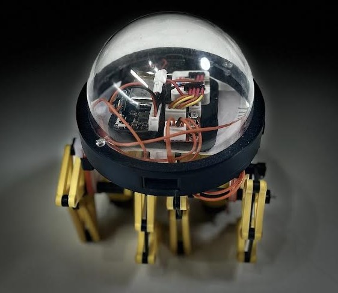
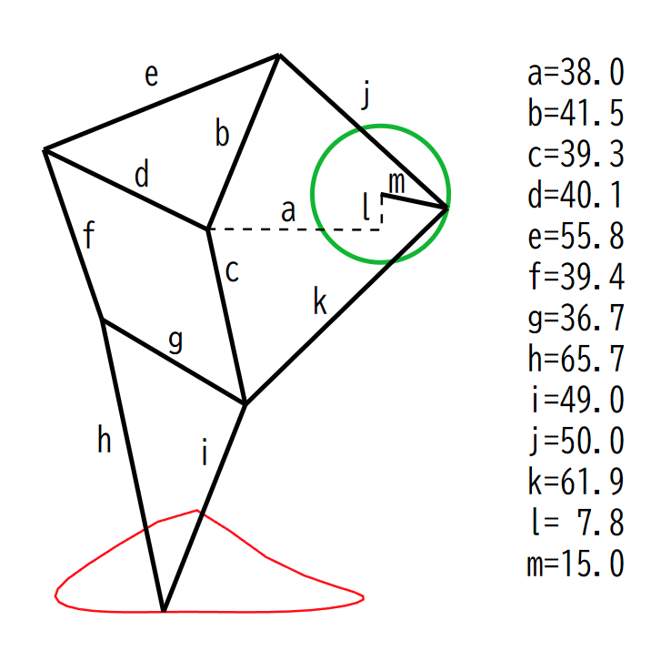

# 【SPRESENSE2024】動くテオ・ヤンセン機構【eNord通信】

2025年1月31日 20:05




# はじめに
今回は eNord を使ってロボットを動かします。
最低限の機構を搭載した eNord@Recvが spresense を使い eNord@Send で
自由に走行を行います。
++[eNord 簡単な解説](../spresense-enord/)++

## ロボットが大好きです
ロボット大好きですよ。ロボットを作る為にコンピュータをやっているといっても過言では無かったんですけど、いつの間にかセンサ屋さんになってた頃があります。あ、今は調理師やってますっ

### ロボットの概念
++あくまでも持論です++
ロボットとは、単なる機械ではなく、人間の手を借りずに動作し、特定の目的を果たすために設計された「知的機構」です。その基本要素は大きく5つに分類され、それらが互いに密接に関わることで、真の「ロボット」として機能します。

1. CPU（制御装置）
    ロボットの頭脳に相当する部分。現代のロボットは単純なリレー回路ではなく、マイクロコントローラやシングルボードコンピュータ、さらにはAIプロセッサを搭載することも珍しくありません。この中枢が全体の指令を出し、センサからの情報を解析し、適切なアクションを決定します。
    
1. センサ（知覚装置）  
ロボットが環境を認識し、適応するための「目」「耳」「皮膚」に相当する部分。光学センサ、超音波センサ、ジャイロスコープ、加速度計、LiDARなど、多様なセンサが組み合わさり、ロボットの知覚能力を高めます。ロボットが知的に動作するためには、これらのデータを正しく処理し、状況に応じたフィードバックを行う必要があります。
    
 1. 移動手段（アクチュエータ）
ロボットが物理的に動作するための構造。移動ロボットであれば、車輪、脚、キャタピラなどが用いられ、マニピュレータや産業用ロボットであれば、多関節アームが該当します。動作の滑らかさや効率は、この機構の設計によって大きく左右されるため、機構設計の最適化はロボット開発において非常に重要です。
    
1. バッテリ（エネルギー源）
どれほど優れたCPUやアクチュエータを備えていても、電力がなければロボットは動きません。小型ロボットではリチウムイオンバッテリが主流ですが、大型機では燃料電池やエンジンを搭載することもあります。持続時間、充電速度、電力効率など、エネルギー管理もロボットの実用性を左右する重要な要素です。
    
1. カッコいい（ビジュアル)
見た目の美しさやデザインもロボットにとって重要な要素です。機能性だけでなく、魅力的な外観を持つことで、ユーザーの愛着や興味を引きつけます。映画やアニメに登場するロボットの多くは、単なる機械ではなく、デザインによって個性を持たせています。実際のロボット開発でも、工業デザインと機能性のバランスを考慮することが求められます。まぁカッコいいかどうかは個人の判断ではありますが。

この5つの要素が有機的に組み合わさることで、ロボットは単なる機械ではなく**自律的に動作する知的存在**となります。単純に上の5つの要素を組み上げただけではよいロボットにはなりません。

# 今回はテオ・ヤンセン機構
++テオヤンセンではなくテオ・ヤンセンと記述するのが正しい++
ではクローラや車輪から離れ、ちょい違った方向で攻めてみます。
オドメトリ(自己位置推定)とかが出来ない機構ではありますが、
そもそも自己位置推定実施には
- 車輪は床に密着し滑らない(タイヤの直径の3.14倍で必ず進む)
- タイヤは空回りしない(動けと命令を出したらその角度で動く)
- 積分で累積されるのでその誤差がどんどん溜まって行く

という問題点がありますのでそこを突っ込むのでは無く
カッコいいという1点に関して突き詰めて参ります


### テオ・ヤンセン機構とは？
オランダの芸術家であり、工学者でもある **テオ・ヤンセン**（Theo Jansen）が考案した **独特なリンク機構** のことです。この機構は、風力で動く「ストランドビースト（Strandbeest）」と呼ばれる歩行機械の脚の動作を生み出します。
#### 特徴
-   脚の動作がスムーズ: 一般的な二足歩行ロボットのようにジャンプせず、転倒しにくい歩行ができる。
-   車輪なしで移動可能: 自然な歩行運動に近い形で、風の力だけで前進できる。
-   リンクの長さが数学的に最適化: ヤンセンは進化的アルゴリズムを使って、このリンク比率を求めた。
#### 応用例
-   風で動く芸術作品（ストランドビースト）
-   省エネルギーな移動ロボット
-   不整地をスムーズに移動するロボットの脚機構
>https://ja.wikipedia.org/wiki/%E3%83%86%E3%82%AA%E3%83%BB%E3%83%A4%E3%83%B3%E3%82%BB%E3%83%B3_(%E5%BD%AB%E5%88%BB%E5%AE%B6)

# どう作る？
## ホーリーナンバー
テオ・ヤンセン機構には
ホーリーナンバーと呼ばれる特殊な長さの組合せがあります

これをCADソフトの下書きとして使い作成する事は可能ですが
実はそれが大きな間違いだという事に実際に製作し分かりました。

これだけでは動かないのです

## 二年くらい研究を重ねました
（X 投稿の埋め込み）
結局の所、いかに重ね合わせ部分を少なくするかという事に落ち着きました。

# Drone(どろーん) ≒ eNord(いーのぉど)
++eNordはDroneのアナグラムです++

## spresense には通信機器が乗ってない
これは毎回毎回悩むんですけど無いんですよね。
で、今回も ESP32系のCPUを搭載する事にしました。
ESP32系のCPUを搭載すると特典があります
- 通信機能(BLE/WiFi/ESPNOW)が使える
- GROVE(一部で有名な通信ケーブル)が使える
- かなり安価(1000円)
## ぢゃ双方にESP32使えば良いかも
動くロボット側と制御するspresense側の両方に搭載すれば良いかも!
### motorSide
- ESPNOWを使って eNord で通信を受けます
- ESP32側の GPIO38/39 は I2C Master に使用し GPIO2/1 は XSHUT に使います。

| 部品名 | 販売先 | 価格 | 御提供品 |
|-|-|-|-|
|[AtomS3Lite](https://shop.m5stack.com/products/atoms3-lite-esp32s3-dev-kit)|M5Stack他|$7.5|-|
|[モータドライバ(MX1508)](https://amzn.to/40GwpQJ) |Amazon他|1,520円(@126円)(税込)|-|
|壁センサ(VL5310)x3|Alliexpress他|時価100..2,000円|-|
|DCモータ(両サイドギア付)x2|Alliexpress他|時価100..300円|-|

### spreSide
- ESP32側の GPIO2/1 は I2C に使い、spresenseからのI2C Slave として動作し eNord@Send を行います
- spresense 側拡張ボード I2C と接続を行います

| 部品名 | 販売先 | 価格 | 御提供品 |
|-|-|-|-|
|[AtomS3Lite](https://shop.m5stack.com/products/atoms3-lite-esp32s3-dev-kit)|M5Stack他|$7.5|-|
|[SPRESENSEメインボード](https://amzn.to/40xXYeM)|Amazon他|6,080円(税込)|〇|
|[SPRESENSE拡張ボード](https://amzn.to/40Aaavz)|Amazon他|4,500円(税込)|〇|
|[9軸 加速度計・ジャイロ・コンパスセンサ (BMI270・AK09918) Addon ボード](https://www.chip1stop.com/products/NextStep/NS-SPR-0315/NEST*0000008)|-||〇|
|[4.0インチタッチパネル付き液晶(480x320)](https://amzn.to/3CwpzVF)|Amazon他|2,861円(税込)|-|
|[ジョイスティックモジュールx2](https://amzn.to/40YgX3O)|Amazon他|149円(税込)|-|

 ## 制御は標準化したい
++ESPNOWの仕様が変わったので最新にしてあります:2025/01/31時点++

### コード(ESP32共通部分)

```c++:esp32S3Lib.hpp
//
// esp32S3Lib.hpp
//
//

#include <Arduino.h>

//===========================
//
// Wire
//
//===========================
#include <Wire.h>

#ifndef GROVE
#define WIRE_SDA_PIN (38)
#define WIRE_SCL_PIN (39)
#else
#define WIRE_SDA_PIN ( 2)
#define WIRE_SCL_PIN ( 1)
#endif

#define WIRE_FREQ (400 * 1000)
#define WIRE_SLAVE_ADRS  (0x4d)
#define WIRE_MASTER_ADRS (0x00)
#define WIRE_uSECDELAY (500)

enum {REG_STX = 0, REG_LEFT, REG_RIGHT, REG_WALL, REG_ETX};
#define WIRE_REGS_MAX (REG_ETX  +1)
volatile uint8_t wireRegs[WIRE_REGS_MAX] = {0};
volatile uint8_t wireRegsPos = 0;
bool debugMode = false;

//===========================
//
// Wire
//
//===========================
//===========================
// wireScan
//===========================
void wireScan() {
  int nDevices = 0;
  for (byte address = 1; address < 127; ++address) {
    Wire.beginTransmission(address);
    byte error = Wire.endTransmission();
    if (error == 0) {
      Serial.print("I2C device found at address 0x");
      if (address < 16) {
        Serial.print("0");
      }
      Serial.print(address, HEX);
      Serial.println("  !");
      ++nDevices;
    } else if (error == 4) {
      Serial.print("Unknown error at address 0x");
      if (address < 16) {
        Serial.print("0");
      }
      Serial.println(address, HEX);
    }
  }
  if (nDevices == 0) {
    Serial.println("No I2C devices found\n");
  } else {
    Serial.println("done\n");
  }
}

//===========================
// onRequest
//===========================
void onRequest() {
  Wire.write(wireRegs[wireRegsPos]);
  delayMicroseconds(WIRE_uSECDELAY);
}

//===========================
// onReceive
//===========================
void onReceive(int len) {
  if (Wire.available() >= 1) {
    delayMicroseconds(WIRE_uSECDELAY);
    wireRegsPos = Wire.read();
    if (Wire.available() >= 1) {
      delayMicroseconds(WIRE_uSECDELAY);
      uint8_t data = Wire.read();
      wireRegs[wireRegsPos] = data;
    }
  }
}

//===========================
// setupWire
//===========================
int setupWire(uint8_t slaveAdrs) {
  int rtn = 0;
  if (slaveAdrs) {
    Wire.onReceive(onReceive);
    Wire.onRequest(onRequest);
    rtn = Wire.begin(slaveAdrs, WIRE_SDA_PIN, WIRE_SCL_PIN, WIRE_FREQ);
  } else {
    rtn = Wire.begin(WIRE_SDA_PIN, WIRE_SCL_PIN);
    Wire.setClock(WIRE_FREQ);
    wireScan();
  }
  return rtn;
}

//===========================
//
// espNow
//
//===========================
#include <esp_now.h>
#include <WiFi.h>

#define ESPNOW_uSECDELAY (500)
const uint8_t broadcastAddress[] = {0xFF, 0xFF, 0xFF, 0xFF, 0xFF, 0xFF};

//=========================
// onDataRecv
//=========================
void onDataRecv(const uint8_t *mac, const uint8_t *data, int len) {
  if (len == sizeof(wireRegs)) {
    memcpy((void*)wireRegs, data, sizeof(wireRegs));
  }
}

//=========================
// onDataSent
//=========================
void onDataSent(const uint8_t *mac_addr, esp_now_send_status_t status) {
  if (status == ESP_NOW_SEND_SUCCESS) {
    if (debugMode) Serial.println("ESP-NOW: Data sent successfully!");
  } else {
    if (debugMode) Serial.println("ESP-NOW: Data send failed!");
  }
}

//=========================
// sendData
//=========================
void sendData(uint32_t waitMsec) {
  static uint32_t tm = millis();
  if ((millis() - tm) > waitMsec) {
    uint8_t temp[sizeof(wireRegs)];
    tm = millis();
    memcpy(temp, (const void*)wireRegs, sizeof(wireRegs));
    esp_err_t result = esp_now_send(broadcastAddress, temp, sizeof(wireRegs));
    delayMicroseconds(ESPNOW_uSECDELAY);
    if (result == ESP_OK) {
      if (debugMode) Serial.println("ESP-NOW: Data sent request successful.");
    } else {
      if (debugMode) Serial.printf("ESP-NOW: Failed to send data. Error code: %d\n", result);
    }
  }
}

//=========================
// setupEspNow
//=========================
void setupEspNow() {
  WiFi.disconnect(true);
  WiFi.mode(WIFI_STA);

  if (esp_now_init() != ESP_OK) {
    Serial.println("[ERROR] ESP-NOW Initialization Failed");
    return;
  }

  if (esp_now_register_recv_cb(onDataRecv) != ESP_OK) {
    Serial.println("[ERROR] Failed to Register Receive Callback");
    return;
  }

  if (esp_now_register_send_cb(onDataSent) != ESP_OK) {
    Serial.println("[ERROR] Failed to Register Send Callback");
    return;
  }

  esp_now_peer_info_t peerInfo;
  memset(&peerInfo, 0, sizeof(peerInfo));
  memcpy(peerInfo.peer_addr, broadcastAddress, 6);
  peerInfo.channel = 0;
  peerInfo.encrypt = false;
  if (esp_now_add_peer(&peerInfo) != ESP_OK) {
    Serial.println("[ERROR] Failed to Add Peer");
    return;
  }

  Serial.println("ESP-NOW Ready");
}

//===========================
//
// BtnA
//
//===========================
#define BTN_PIN (41)
int BtnA() {
  static bool setupEd = false;
  if (!setupEd) {
    pinMode(BTN_PIN, INPUT_PULLUP);
    setupEd = true;
  }
  static int stat_ = -1;
  int stat = !digitalRead(BTN_PIN);  // illogical
  return stat;
}

//===========================
//
// IRLED
//
//===========================
#define IRLED_PIN ( 4)
void setupIrLed(uint8_t stat) {
  static bool setupEd = false;
  if (!setupEd) {
    pinMode(IRLED_PIN, OUTPUT);
    setupEd = true;
  }
  digitalWrite(IRLED_PIN, stat);
}
void setIrLed(int stat) {
  digitalWrite(IRLED_PIN, stat);
}

//===========================
//
// NeoPixel
//
//===========================
#include <Adafruit_NeoPixel.h>
#define RGBLED_PIN (35)
#define NUM_LEDS   ( 1)
#define DEFAULT_BRIGHTNESS (32)

typedef struct {
  uint8_t r;
  uint8_t g;
  uint8_t b;
} COLOR_T;
Adafruit_NeoPixel neo(NUM_LEDS, RGBLED_PIN, NEO_GRB + NEO_KHZ800);

//===========================
// setupNeo
//===========================
void setupNeo(uint8_t brightness) {
  static bool setupEd = false;
  if (!setupEd) {
    pinMode(RGBLED_PIN, OUTPUT);
    setupEd = true;
  }
  neo.begin();
  neo.setBrightness(brightness);
  neo.show();
}

//===========================
// setNeo
//===========================
void setNeo(uint8_t r, uint8_t g, uint8_t b, uint16_t pixelIndex = 0) {
  if (pixelIndex < NUM_LEDS) {
    neo.setPixelColor(pixelIndex, neo.Color(r, g, b));
    neo.show();
  }
}

//===========================
// clearNeo
//===========================
void clearNeo() {
  neo.clear();
  neo.show();
}

//===========================
// blinkNeo
//===========================
void blinkNeo(uint32_t interval, uint8_t r, uint8_t g, uint8_t b) {
  static uint32_t lastTime = 0;
  static bool isOn = false;

  if (millis() - lastTime > interval) {
    lastTime = millis();
    isOn = !isOn;

    if (isOn) {
      setNeo(r, g, b);
    } else {
      clearNeo();
    }
  }
}

//===========================
// breathNeo
//===========================
//#include <math.h>
void breathNeo(uint32_t interval, uint8_t baseR, uint8_t baseG, uint8_t baseB) {
  static uint32_t lastTime = 0;
  static float progress = 0.0;
  if (millis() - lastTime > interval) {
    lastTime = millis();
    progress += 0.02;
    if (progress > 1.0) progress -= 1.0;
    float brightness = (sin(progress * 2 * PI) + 1.0) / 2.0;
    uint8_t r = baseR * brightness;
    uint8_t g = baseG * brightness;
    uint8_t b = baseB * brightness;
    setNeo(r, g, b);
  }
}

//===========================
//
// dataDump
//
//===========================
void dataDump(uint8_t *data, int dataCnt) {
  char msg[64] = {0};
  Serial.println("dataDump");
  for (int i = 0; i < dataCnt; i += 16) {
    sprintf(msg, "%04X : ", i);
    Serial.print(msg);
    for (int j = 0; j < 16; j++) {
      if (i + j < dataCnt) {
        sprintf(msg, "%02X ", data[i + j]);
        Serial.print(msg);
      } else {
        Serial.print("   ");
      }
    }
    Serial.print(": ");
    for (int j = 0; j < 16; j++) {
      if (i + j < dataCnt) {
        char c = data[i + j];
        if (c >= 32 && c <= 126) {
          Serial.print((char)c);
        } else {
          Serial.print(".");
        }
      }
    }
    Serial.println();
  }
}

//===========================
//
// setupS3
//
//===========================
void setupS3(int wireMode, int bright, bool debugMode = false) {
  Serial.begin( 115200 );
  //  while(!Serial);
  delay( 1000 );

  setupWire(wireMode);
  setupNeo(bright);
  setupIrLed(LOW);
  setupEspNow();
  Serial.println("esp32S3 Ready !");
}
```
### コード(SPRESENE Wireライブラリ)
```c++:spreWireLib.hpp
//
// spreWireLib.hpp
//
//
#include <Arduino.h>

//===========================
//
// Wire
//
//===========================
#include <Wire.h>

#define STX (0x02)
#define ETX (0x03)

#define WIRE_FREQ (400 * 1000)
#define WIRE_SLAVE_ADRS (0x4d)
#define WIRE_MASTER (0x00)
#define WIRE_uSECDELAY (500)

enum {REG_STX = 0, REG_LEFT, REG_RIGHT, REG_WALL, REG_ETX};
#define WIRE_REGS_MAX (REG_ETX  +1)
volatile uint8_t wireRegs[WIRE_REGS_MAX] = {0};
volatile uint8_t wireRegsPos = 0;
bool debugMode = false;

//===========================
//
// Wire
//
//===========================
//===========================
// wireScan
//===========================
void wireScan() {
  int nDevices = 0;
  for (byte address = 1; address < 127; ++address) {
    Wire.beginTransmission(address);
    byte error = Wire.endTransmission();
    if (error == 0) {
      Serial.print("I2C device found at address 0x");
      if (address < 16) {
        Serial.print("0");
      }
      Serial.print(address, HEX);
      Serial.println("  !");
      ++nDevices;
    } else if (error == 4) {
      Serial.print("Unknown error at address 0x");
      if (address < 16) {
        Serial.print("0");
      }
      Serial.println(address, HEX);
    }
  }
  if (nDevices == 0) {
    Serial.println("No I2C devices found\n");
  } else {
    Serial.println("done\n");
  }
}

//===========================
// setupWire
//===========================
int setupWire() {
  int rtn = 0;
  Wire.begin();
  Wire.setClock(WIRE_FREQ);
  wireScan();
  return rtn;
}

//===========================
//
// dataDump
//
//===========================
void dataDump(uint8_t *data, int dataCnt) {
  char msg[64] = {0};
  Serial.println("dataDump");
  for (int i = 0; i < dataCnt; i += 16) {
    sprintf(msg, "%04X : ", i);
    Serial.print(msg);
    for (int j = 0; j < 16; j++) {
      if (i + j < dataCnt) {
        sprintf(msg, "%02X ", data[i + j]);
        Serial.print(msg);
      } else {
        Serial.print("   ");
      }
    }
    Serial.print(": ");
    for (int j = 0; j < 16; j++) {
      if (i + j < dataCnt) {
        char c = data[i + j];
        if (c >= 32 && c <= 126) {
          Serial.print((char)c);
        } else {
          Serial.print(".");
        }
      }
    }
    Serial.println();
  }
}

//===========================
// wireWriteByte
//===========================
bool wireWriteByte(int adrs, uint8_t reg, uint8_t dt) {
  Wire.beginTransmission(adrs);
  Wire.write(reg);
  Wire.write(dt);
  uint8_t status = Wire.endTransmission();
  if (status != 0) {
    if (debugMode) Serial.printf("I2C Write Error: %d\n", status);
    return false;
  }
  delayMicroseconds(WIRE_uSECDELAY);
  return true;
}

//===========================
// wireReadByte
//===========================
uint8_t wireReadByte(int adrs, uint8_t reg) {
  Wire.beginTransmission(adrs);
  Wire.write(reg);
  uint8_t status = Wire.endTransmission();
  if (status != 0) {
    Serial.printf("I2C Write Error: %d\n", status);
    return 0xFF;
  }
  Wire.requestFrom(adrs, 1);
  if (Wire.available()) {
    delayMicroseconds(WIRE_uSECDELAY);
    return Wire.read();
  }
  Serial.println("I2C Read Error: No data received");
  return 0xFF;
}

//===========================
// wireToRegs
//===========================
void wireToRegs() {
  wireRegs[REG_LEFT] = wireReadByte(WIRE_SLAVE_ADRS, REG_LEFT);
  wireRegs[REG_RIGHT] = wireReadByte(WIRE_SLAVE_ADRS, REG_RIGHT);
  wireRegs[REG_WALL] = wireReadByte(WIRE_SLAVE_ADRS, REG_WALL);
}

//===========================
// cpuToWire [OverLoad]
//===========================
void cpuToWire(int8_t stx, int8_t left, int8_t right, int8_t wall, int etx) {
  // val => wireRegs
  wireRegs[REG_STX] = stx;
  wireRegs[REG_LEFT] = left;
  wireRegs[REG_RIGHT] = right;
  wireRegs[REG_WALL] = wall;
  wireRegs[REG_ETX] = etx;
  // wireRegs => wireWrite
  wireWriteByte(WIRE_SLAVE_ADRS, REG_STX, wireRegs[REG_STX]);
  wireWriteByte(WIRE_SLAVE_ADRS, REG_LEFT, wireRegs[REG_LEFT]);
  wireWriteByte(WIRE_SLAVE_ADRS, REG_RIGHT, wireRegs[REG_RIGHT]);
  wireWriteByte(WIRE_SLAVE_ADRS, REG_WALL, wireRegs[REG_WALL]);
  wireWriteByte(WIRE_SLAVE_ADRS, REG_ETX, wireRegs[REG_ETX]);
  wireToRegs();
}

void cpuToWire(int8_t left, int8_t right) {
  // val => wireRegs
  wireRegs[REG_LEFT] = left;
  wireRegs[REG_RIGHT] = right;
  // wireRegs => wireWrite
  wireWriteByte(WIRE_SLAVE_ADRS, REG_LEFT, wireRegs[REG_LEFT]);
  wireWriteByte(WIRE_SLAVE_ADRS, REG_RIGHT, wireRegs[REG_RIGHT]);
  wireToRegs();
}

//===========================
//
// setupSpre
//
//===========================
void setupSpre(bool debufMode = false) {
  Serial.begin( 115200 );
  //  while(!Serial);
  delay( 1000 );

  setupWire();

  Serial.println("spreSense Ready !");
}
```
### コード(SPRESENSE本体)
```c++:spresense.ino
#include "spreWireLib.hpp"

//===========================
// setup
//===========================
void setup() {
  setupSpre();
  delay( 5000 );
  cpuToWire(STX, 0, 0, 0, ETX);
}

//===========================
// loop
// 5v:7..993 3v3:7..656
//===========================
void loop() {
  int16_t dt; // 0..32767
  uint8_t left, right; // 0..255
  dt = analogRead(A0);
  left = right = map(dt, 7, 656, 0, 255);
  cpuToWire(left, right);
  dataDump((uint8_t *)wireRegs, sizeof(wireRegs));
}

```
### コード(VL53L0X用アドレス書込み)

```:c++multiSens.hpp
#ifndef __MULTISENS_HPP__
#define __MULTISENS_HPP__

//=================================
// multiSens.hpp
//
//=================================
#include <Wire.h>
#include <VL53L0X.h>

#define GPIO_DELAY (100)

VL53L0X sens0;
VL53L0X sens1;
VL53L0X sens2;

#define SENS_CNTMAX (3)
#define SENS0_ENABLE_PIN (2)
#define SENS1_ENABLE_PIN (1)
#define SENS2_ENABLE_PIN (-1)
int16_t sensVal[SENS_CNTMAX] = {0}; 

void i2cScan(TwoWire &wire, const char *msg) {
  Serial.printf("%s scan start ==>\n", msg);
  for (byte address = 1; address < 127; ++address) {
    wire.beginTransmission(address);
    if (wire.endTransmission() == 0) {
      Serial.printf("Found device at address: 0x%02X\n", address);
    }
  }
  Serial.printf("<== %s scan complete\n", msg);
}

void setupSensor(VL53L0X &sensor, int enablePin, uint8_t address) {
  if (enablePin > 0) {
    pinMode(enablePin, OUTPUT);
    digitalWrite(enablePin,  LOW);
    digitalWrite(enablePin, HIGH);
  }
  sensor.init();
  sensor.setAddress(address);
  sensor.startContinuous();
}

void loopSensors() {
  sensVal[0] = sens0.readRangeContinuousMillimeters();
  sensVal[1] = sens1.readRangeContinuousMillimeters();
  sensVal[2] = sens2.readRangeContinuousMillimeters();
  Serial.printf("%d,%d,%d\n", sensVal[0], sensVal[1], sensVal[2]);
}

void setupSensors() {
 setupSensor(sens2, SENS2_ENABLE_PIN, 0x31);
 setupSensor(sens1, SENS1_ENABLE_PIN, 0x30);
 setupSensor(sens0, SENS0_ENABLE_PIN, 0x29);
}

#endif

```


## 最後に

お疲れさまでございました
よりよい テオ・ヤンセンが出来ますように
（X 投稿の埋め込み）

<div class="like-wrap"><div data-lyket-type="like" data-lyket-template="simple" data-lyket-namespace="linalog" data-lyket-color-icon="#b5e853" data-lyket-color-primary="#b5e853" data-lyket-color-text="#eaeaea" data-lyket-color-secondary="#2b2b2b" data-lyket-id="spresense-jansen"></div></div>
