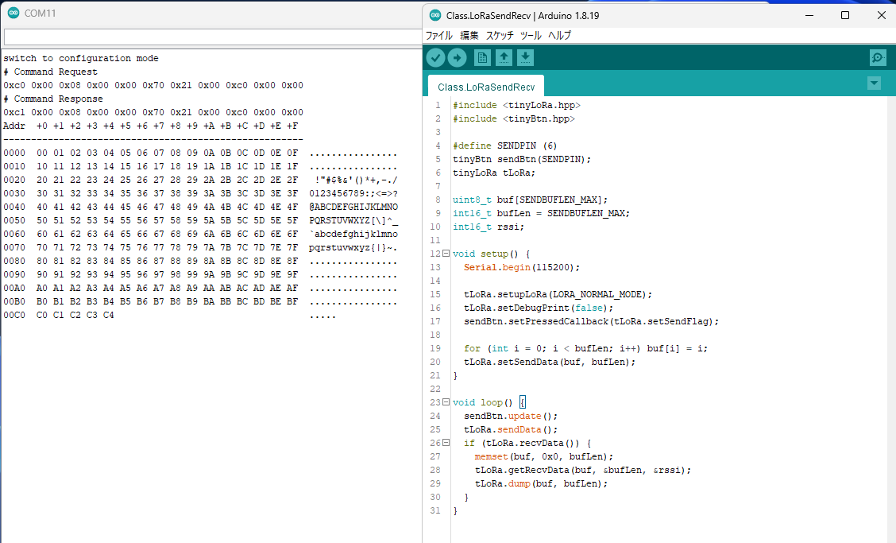

# 【SPRESENSE2023】LoRaのライブラリを使いやすくしたよっ

2024年1月26日 09:38



# はじめに

こんにちわっ 

リナちゃん　X@chrmlinux03　です

<u>このページは SPRESENSE2023コンテストで作った部品を紹介するものです
最初に [開発まとめ](../spresense-2023-matome/) をお読みいただければ幸いです</u>

# 用意するもの
LoRaモジュールは2個以上無いと動きません
SPRESENSE 本体も2個必要です

|部品名|販売先|価格|御提供品|
| --------| -------- | -------- | -------- |
|LoRa Add-onボードx2|スイッチサイエンス|4,950円x2|〇|

出典：https://www.switch-science.com/products/8958

# 念願のLoRaボードが到着した

<blockquote class="twitter-tweet" data-theme="dark"><a href="https://twitter.com/chrmlinux03/status/1733692484998537221"></a></blockquote>
<script async src="https://platform.twitter.com/widgets.js" charset="utf-8"></script>

到着した LoRa 基板に発売元のライブラリを入れて見るがさっぱり動きません

どうやら 何か間違っている風

さっそく解析を行い　あとから困る方々にお知らせを行う

👉[LoRaE220_900T22S_JPのサンプルが間違ってたので修正したよっ](../lorae220-fix/)

でもそれだけでは終わらない

もっと使いやすく　他でも応用が利くものを٩(ˊᗜˋ*)و

## ん？recvで while(1) {} してる？
<blockquote class="twitter-tweet" data-theme="dark"><a href="https://twitter.com/chrmlinux03/status/1740311342979207591"></a></blockquote>
<script async src="https://platform.twitter.com/widgets.js" charset="utf-8"></script>

どうやら LORA_NORMAL_MODE で待機している LoRa モジュールのライブラリの中で

recv 部分で while(1){} で回っている部分を発見

どうやって抜けるのかと言う素敵なsampleだった💦

# ぢゃ作ろうか
```c++:tinyLoRa.hpp
// tinyLoRa.hpp
#ifndef __TINYLORA_HPP__
#define __TINYLORA_HPP__

#include <Arduino.h>
#include <spresense_e220900t22s_jp_lib.h>

enum {
  LORA_NORMAL_MODE = 0,
  LORA_WOR_SEND_MODE,
  LORA_WOR_RECV_MODE
};

#define SENDBUFLEN_MAX (200 - 3)

class tinyLoRa {
  public:

    tinyLoRa() {
      sendFlag = false;
      recvFlag = false;
      sendBufLen = SENDBUFLEN_MAX;
      sendBuf = new uint8_t[sendBufLen];
      defMode = LORA_NORMAL_MODE;

      LoRaConfig = {
        0x0000,   // own_address 0
        0b011,    // baud_rate 9600 bps
        0b10000,  // air_data_rate SF:9 BW:125
        0b00,     // subpacket_size 200
        0b1,      // rssi_ambient_noise_flag 有効
        0b0,      // transmission_pause_flag 有効
        0b01,     // transmitting_power 13 dBm
        0x00,     // own_channel 0
        0b1,      // rssi_byte_flag 有効
        0b1,      // transmission_method_type 固定送信モード
        0b0,      // lbt_flag 有効
        //    0b011,    // wor_cycle 2000 ms
        0b000,    // wor_cycle 500 ms
        0x0000,   // encryption_key 0
        0x0000,   // target_address 0
        0x00      // target_channel 0
      };
    }

    ~tinyLoRa() {
      delete[] sendBuf;
    }

    int16_t switchMode(int16_t mode) {
      int16_t result = 0;
      char message[64] = {0};

      switch (mode) {
        case LORA_NORMAL_MODE:
          strcpy(message, "normal mode");
          lora.SwitchToNormalMode();
          break;

        case LORA_WOR_SEND_MODE:
          strcpy(message, "wor send mode");
          lora.SwitchToWORSendingMode();
          break;

        case LORA_WOR_RECV_MODE:
          strcpy(message, "wor recv mode");
          lora.SwitchToWORReceivingMode();
          break;
      }

      if (debugPrint) Serial.printf("Switch To %s\n", message);
      return result;
    }

    bool getSendFlag(void) {
      return sendFlag;
    }

    bool getRecvFlag(void) {
      return recvFlag;
    }

    static void setSendFlag(void) {
      sendFlag = true;
    }

    bool setDebugPrint(bool newDebugPrint) {
      debugPrint = newDebugPrint;
      return debugPrint;
    }

    void setRecvFlag(void) {
      if (SerialLoRa.available()) {
        recvFlag = true;
      }
    }
    
    void dump(uint8_t *buffer, int16_t bufferSize) {
      Serial.printf("Addr  +0 +1 +2 +3 +4 +5 +6 +7 +8 +9 +A +B +C +D +E +F\n");
      Serial.printf("------------------------------------------------------\n");
      for (int i = 0; i < bufferSize; i += 16) {
        Serial.printf("%04X  ", i);
        for (int j = 0; j < 16 && i + j < bufferSize; j++) {
          Serial.printf("%02X ", buffer[i + j]);
        }
        for (int j = 0; j < 16 - min(16, bufferSize - i); j++) {
          Serial.print("   ");
        }
        Serial.print(" ");
        for (int j = 0; j < 16 && i + j < bufferSize; j++) {
          char c = (char)(buffer[i + j]);
          Serial.print((c >= 0x20 && c <= 0x7E) ? c : '.');
        }
        Serial.println();
      }
    }

    int16_t setupLoRa(int16_t mode) {
      int16_t rtn = 0;
      if (lora.InitLoRaModule(LoRaConfig)) {
        if (debugPrint) Serial.printf("init error\n");
        rtn = -1;
      } else {
        if (debugPrint) Serial.printf("init ok\n");
      }
      switchMode(mode);
      sendBuf = new uint8_t [sendBufLen];
      if (!sendBuf) {
        Serial.printf("can't alloc sendBuf\n");
        rtn = -1;
      }
      return rtn;
    }

    int16_t getSendBufLen(void) {
      return sendBufLen;
    }

    int16_t setSendData(uint8_t *buf, int16_t bufLen) {
      int16_t rtn = 0;
      memcpy(sendBuf, buf, bufLen);
      sendBufLen = bufLen;
      return rtn;
    }

    int16_t getRecvData(uint8_t *buf, int16_t *bufLen, int16_t *rssi) {
      int16_t rtn = 0;
      memcpy(buf, LoRaData.recv_data, LoRaData.recv_data_len);
      *bufLen = LoRaData.recv_data_len;
      *rssi = LoRaData.rssi;
      return rtn;
    }

    int16_t sendData(void) {
      int16_t rtn = 0;
      if (sendFlag) {
        if (debugPrint) Serial.printf("=> sendData\n");
        switchMode(LORA_WOR_SEND_MODE);
        if (lora.SendFrame(LoRaConfig, sendBuf, sendBufLen) == 0) {
          if (debugPrint) {
            dump(sendBuf, sendBufLen);
            Serial.printf("send succeeded.\n");
          }
          rtn = sendBufLen;
        } else {
          if (debugPrint) {
            Serial.printf("send failed.\n");
          }
        }
        switchMode(defMode);
        sendFlag = false;
      }
      return rtn;
    }

    int16_t recvData(void) {
      int16_t rtn = 0;
      setRecvFlag();
      if (recvFlag) {
        if (debugPrint) Serial.printf("<= receiveData\n");
        if (lora.RecieveFrame(&LoRaData) == 0) {
          if (debugPrint) {
            Serial.printf("dataLen:%d RSSI:%d\n", LoRaData.recv_data_len, LoRaData.rssi);
            dump(LoRaData.recv_data, LoRaData.recv_data_len);
          }
          Serial.flush();
          rtn = LoRaData.recv_data_len;
          recvFlag = false;
        }
      }
      return rtn;
    }

  private:
    CLoRa lora;
    static bool sendFlag;
    bool recvFlag = false;
    uint8_t sendBufLen;
    uint8_t *sendBuf;
    uint8_t defMode;
    bool debugPrint = false;
    struct RecvFrameE220900T22SJP_t LoRaData;
    struct LoRaConfigItem_t LoRaConfig;
};

bool tinyLoRa::sendFlag = false;

#endif

```

そのあたりを強化したのがこれ

recvFlag / sendFlag を設け

それが true になって居なければ recv は内部で行わないようにした

内部的に 自動で AUX(D21） を参照しているようで

recv はこれで完全動作するようになった

また sendFlag を true にする前に データをセットし true になった瞬間に

自動的に データは送信されます

基本的な構造は元のライブラリを取り込んでいるので

他のLoRaモジュールでも　AUX が正常に動作するのであれば動くのかなぁと...

# 応用例
このモジュール群は以下で使ってます是非ご参照くださいませ٩(ˊᗜˋ*)و

## LoRaPager(LoRaを使った簡易メッセンジャーBox)
👉[LoRaPager](../spresense-lorapager/)


# 残務と今後の考察
LoRa は初めて使ったのですが

私の家はもともと核シェルターがごとく電波が悪く

やっとWiFi以外で使える電波が来て嬉しい限りです

このライブラリでまた何か製作したいと考えております


# さいごに

秋月から着弾したのと

<blockquote class="twitter-tweet" data-theme="dark"><a href="https://twitter.com/chrmlinux03/status/1740660543340634535"></a></blockquote>
<script async src="https://platform.twitter.com/widgets.js" charset="utf-8"></script>

全部で5枚ありますので

本業にも役立てたいと思います

ご清聴ありがとうございました

<u>このページは SPRESENSE2023コンテストで作った部品を紹介するものです
最初に [開発まとめ](../spresense-2023-matome/) をお読みいただければ幸いです</u>

<div class="like-wrap"><div data-lyket-type="like" data-lyket-template="twitter" data-lyket-namespace="linalog" data-lyket-color-icon="#b5e853" data-lyket-color-primary="#b5e853" data-lyket-color-text="#eaeaea" data-lyket-color-secondary="#2b2b2b" data-lyket-id="spresense-lora-lib"></div></div>
