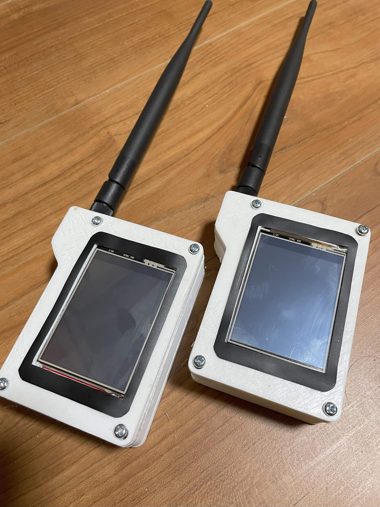
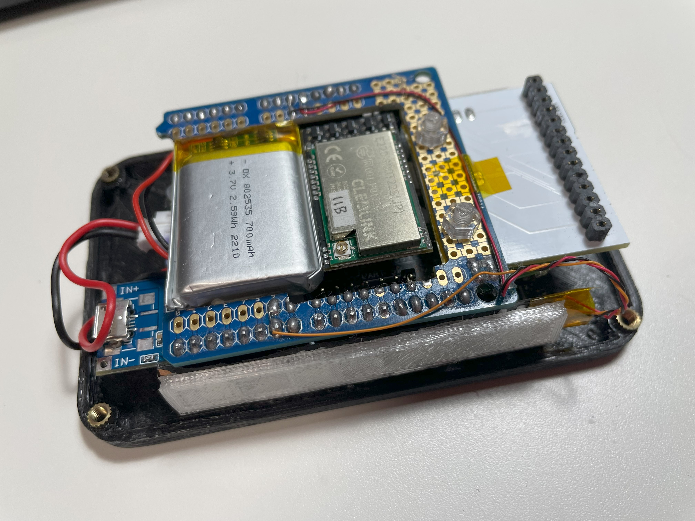
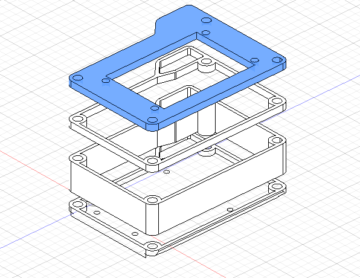
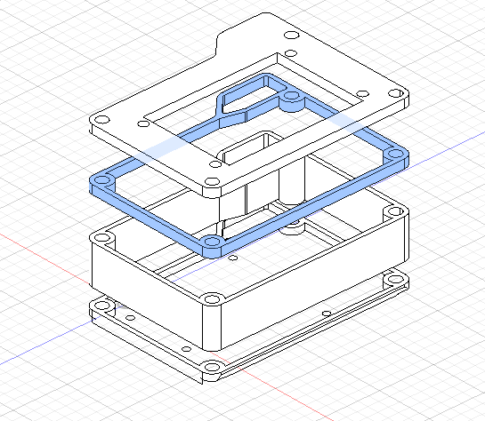
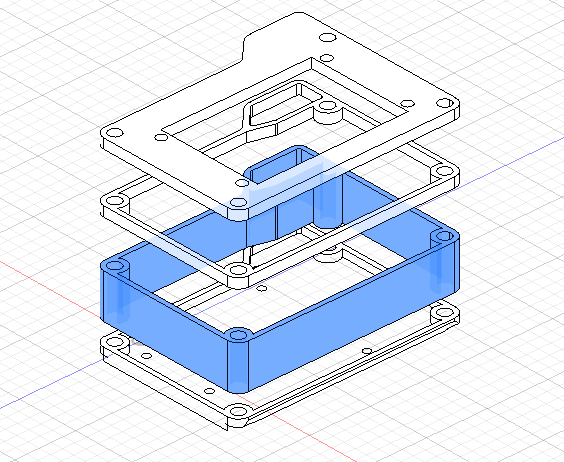
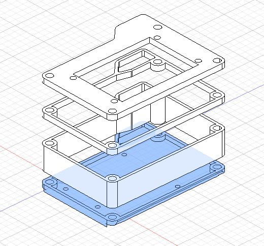
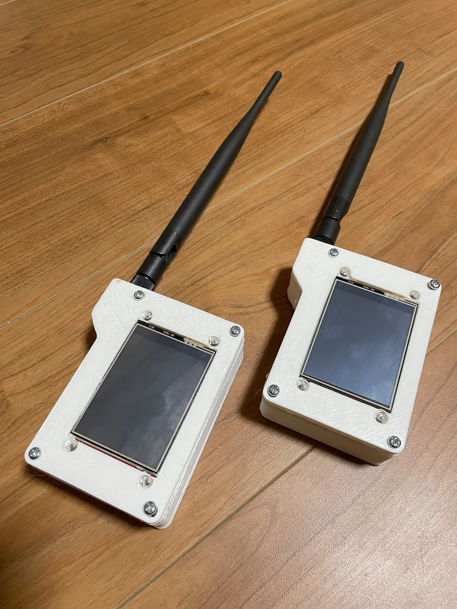

# 【SPRESENSE2023】LoRaPagerを作ったよっ【簡易メッセンジャー】

2024年1月26日 09:49



# はじめに

こんにちわっ 

リナちゃん　X@chrmlinux03　です

++このページは SPRESENSE2023コンテストで作った製品を紹介するものです
最初に [開発まとめ](../spresense-2023-matome/) をお読みいただければ幸いです++

# はじめは トランシーバーを作る気満々だった

当初は ESPNow や WiFi の速度 と転送容量を期待していたのですが

実際に実装してみるとなんと 200byte - 3byte の 197byteがせいぜい💦

しかも 転送に1秒ほどかかるようで

それでもエイヤっと組んでみるかと考えて

試しに計算してみると　10Kbyte のファイル転送に要する時間が半端ない💦

さらにこんなメッセージが

（X 投稿の埋め込み）

# 用意するもの

👉[組込用のSPRESENSEモジュールを作ったよ](../spresense-module/)




ある日　毎日欠かさず読んでいるサイトに

こんなデータがあることが分かった

これを使えば採寸しなくて良いのでは？

※って言うか 元旦💦
（X 投稿の埋め込み）


# ケース作成要件
- リチウムイオン電池を内蔵して
- LEDミルフィーユを右側に搭載
- アンテナは左側上部に設置する
- 画面は 2.4インチのタッチパネル
- タッチパネルは天面と同じ高さ

# ケースの設計








# 印刷物



# 実装

```
//===================================================
/*
  program name  : LoRaPager.ino
  date/author   : 2024/01/23 @chrmlinux03
  update/author : 2024/01/23 @chrmlinux03
-----------------------------------------------------
  MainCore : 512KByte
*/
//===================================================

#include <spre.Tools.hpp>
#include <spre.Graphics.hpp>
#include <tinyLoRa.hpp>
#include <tinyTouch.hpp>
#include <tinyTouchVrKey.hpp>
#include <spre.Neo.hpp>
SpreNeo neo;

TouchVrKey VrKey;
tinyLoRa tLoRa;

#define VERSION "v0.1"

const int historyBufferSize = 5;
char recvHistory[historyBufferSize][SENDBUFLEN_MAX];
int recvHistoryIndex = 0;

char sendHistory[historyBufferSize][SENDBUFLEN_MAX];
int sendHistoryIndex = 0;

uint8_t recvBuf[SENDBUFLEN_MAX] = {0};
int16_t recvBufLen = SENDBUFLEN_MAX;
int16_t rssi;

uint8_t sendBuf[SENDBUFLEN_MAX] = {0};
int16_t sendBufLen = SENDBUFLEN_MAX;

enum {
  LED_STAT_IDLE = 0,
  LED_STAT_SEND,
  LED_STAT_RECV
};

int ledStat = LED_STAT_IDLE;

void addToHistory(const char* data, char historyBuffer[][SENDBUFLEN_MAX], int& historyIndex) {
  strncpy(historyBuffer[historyIndex], data, SENDBUFLEN_MAX);
  historyIndex = (historyIndex + 1) % historyBufferSize;
}

void sendProc(void) {
  tLoRa.setSendData(sendBuf, sendBufLen);
  tLoRa.setSendFlag();
  tLoRa.sendData();
  addToHistory(reinterpret_cast<char*>(sendBuf), sendHistory, sendHistoryIndex);
  memset(sendBuf, 0x0, sendBufLen);
  ledStat = LED_STAT_SEND;
}

void recvProc(void) {
  if (tLoRa.recvData()) {
    memset(recvBuf, 0x0, recvBufLen);
    tLoRa.getRecvData(recvBuf, &recvBufLen, &rssi);
    tLoRa.dump(recvBuf, recvBufLen);
    addToHistory(reinterpret_cast<char*>(recvBuf), recvHistory, recvHistoryIndex);
    ledStat = LED_STAT_RECV;
  }
}

void setup() {
  Serial.begin(115200);
  int8_t rotation = ROT0;
  bool tft24inch = true;
  setupGraphics(rotation);
  setupTouch(_w, _h, rotation, tft24inch);
  tLoRa.setupLoRa(LORA_NORMAL_MODE);
  tLoRa.setDebugPrint(false);
  int bw = 21, bh = 20;
  VrKey.begin(bw, bh, 0, _h - (bh * 5));
  neo.begin();
  neo.set(LEDKIND_BRESS, 0, 0, 255, 64);
  neo.start();
}

#define IDLE_TIMEOUT 500
unsigned long lastLedStatChangeTime = 0;
void ledCtrl(void) {
  static unsigned long lastLEDUpdateTime = 0;
  const unsigned long LEDUpdateInterval = 500;
  if (millis() - lastLEDUpdateTime >= LEDUpdateInterval) {
    lastLEDUpdateTime = millis();
    switch (ledStat) {
      case LED_STAT_SEND:
        neo.stop();
        neo.set(LEDKIND_RIGHTSTAR, 0, 64, 0, 128);
        neo.start();
        break;
      case LED_STAT_RECV:
        neo.stop();
        neo.set(LEDKIND_LEFTSTAR, 64, 0, 0, 128);
        neo.start();
        break;
      default:
        neo.stop();
        neo.set(LEDKIND_BRESS, 0, 0, 64, 64);
        neo.start();
        break;
    }
    if (ledStat != LED_STAT_IDLE && millis() - lastLedStatChangeTime >= IDLE_TIMEOUT) {
      ledStat = LED_STAT_IDLE;
    }
  }
}

void loop(void) {
  ledCtrl();
  neo.update();
  spr.startWrite();
  spr.clear(TFT_BLACK);

  spr.setTextColor(TFT_CYAN);
  spr.setCursor(0, 0);
  for (int i = 0; i < historyBufferSize; ++i) {
    int index = (recvHistoryIndex + i) % historyBufferSize;
    spr.printf("%s\n", recvHistory[index]);
  }

  spr.setTextColor(TFT_GREEN);
  spr.setCursor(0, 104);
  for (int i = 0; i < historyBufferSize; ++i) {
    int index = (sendHistoryIndex + i) % historyBufferSize;
    spr.printf("%s\n", sendHistory[index]);
  }

  VrKey.scan(&spr, TFT_WHITE);
  if (VrKey.isEnter()) {
    VrKey.getData(sendBuf, &sendBufLen);
    VrKey.resetEnter();
    sendProc();
  }
  recvProc();

  static int cnt = 0;
  char ast[4] = "|/-\\";
  spr.setTextColor(TFT_WHITE);
  spr.setCursor(0, _h - 8);
  spr.printf(" [%c] %3d fps [%s]\n", ast[cnt], getfps(), VERSION);
  cnt = (cnt + 1) % 4;

  spr.pushSprite(&lcd, 0, 0);
  spr.endWrite();
}

```
# 実装のポイント

LEDミルフィーユの光り方を苦悩した

recvFlag や sendFlag は 一瞬で変わってしまうので

一旦 ledStat で受けて その ledStat を自分自身で on/off するように構成

```
#define IDLE_TIMEOUT 500
unsigned long lastLedStatChangeTime = 0;
void ledCtrl(void) {
  static unsigned long lastLEDUpdateTime = 0;
  const unsigned long LEDUpdateInterval = 500;
  if (millis() - lastLEDUpdateTime >= LEDUpdateInterval) {
    lastLEDUpdateTime = millis();
    switch (ledStat) {
      case LED_STAT_SEND:
        neo.stop();
        neo.set(LEDKIND_RIGHTSTAR, 0, 64, 0, 128);
        neo.start();
        break;
      case LED_STAT_RECV:
        neo.stop();
        neo.set(LEDKIND_LEFTSTAR, 64, 0, 0, 128);
        neo.start();
        break;
      default:
        neo.stop();
        neo.set(LEDKIND_BRESS, 0, 0, 64, 64);
        neo.start();
        break;
    }
    if (ledStat != LED_STAT_IDLE && millis() - lastLedStatChangeTime >= IDLE_TIMEOUT) {
      ledStat = LED_STAT_IDLE;
    }
  }
}

```
この作業により以下のエフェクトが実装できた
|状態|エフェクト|
|-|-|
|アイドル時|呼吸をするイメージで青くぼーっと光る|
|受信時|流れる緑の光が飛び出すイメージ|
|送信時|流れる赤の光が入ってくるイメージ|

# 動かしてみた

（X 投稿の埋め込み）

# 残務と今後の考察

これ シリアル用の穴をあけてUSBマイクロの差し込み口を付けるだけで

LoRa端末として良い形になりそう

PC に接続するとか用途は無限大ですね

# さいごに

デザインは大事なんだなぁとか今更考えちゃいましたっ

っていうか製品感満載٩(ˊᗜˋ*)و

++このページは SPRESENSE2023コンテストで作った部品を紹介するものです
最初に [開発まとめ](../spresense-2023-matome/) をお読みいただければ幸いです++

<div class="like-wrap"><div data-lyket-type="like" data-lyket-template="simple" data-lyket-namespace="linalog" data-lyket-color-icon="#b5e853" data-lyket-color-primary="#b5e853" data-lyket-color-text="#eaeaea" data-lyket-color-secondary="#2b2b2b" data-lyket-id="spresense-lorapager"></div></div>
