# 【SPRESENSE2024】仮想30コアでマンデルブロ集合【リアルタイム描画】

2025年1月28日 23:13
<p class="article-tags">タグ: <a href="..?tag=SPRESENSE">SPRESENSE</a> <a href="..?tag=%E3%82%BF%E3%83%83%E3%83%81%E3%83%91%E3%83%8D%E3%83%AB">タッチパネル</a> <a href="..?tag=%E3%83%9E%E3%83%AB%E3%83%81%E3%82%B3%E3%82%A2">マルチコア</a> <a href="..?tag=%E3%83%9E%E3%83%AB%E3%83%81%E3%82%B9%E3%83%AC%E3%83%83%E3%83%89">マルチスレッド</a> <a href="..?tag=%E3%83%9E%E3%83%B3%E3%83%87%E3%83%AB%E3%83%96%E3%83%AD%E9%9B%86%E5%90%88">マンデルブロ集合</a> <a href="..?tag=%E3%83%AA%E3%82%A2%E3%83%AB%E3%82%BF%E3%82%A4%E3%83%A0">リアルタイム</a></p>

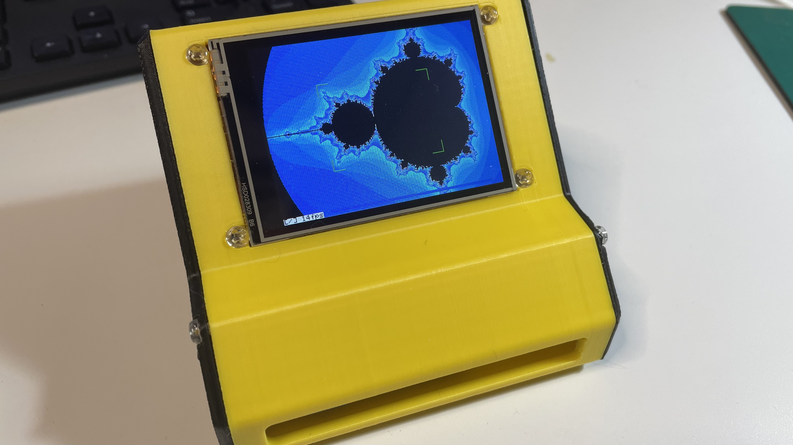

## Spresenseマルチコア マンデルブロ集合描画プログラム

このプログラムは、Spresenseの秘められた力を解放し、抵抗膜式タッチパネルという古き良きインターフェースを通じて、マンデルブロ集合の神秘に触れることができる、そんな魅惑的なアプリケーションです。

#### 用意するもの

| 部品名 | 販売先 | 価格 | 御提供品 |
| --- | --- | --- | --- |
| [SPRESENSEメインボード](https://amzn.to/40xXYeM) | Amazon他 | 6,080円(税込) | 〇 |
| [SPRESENSE拡張ボード](https://amzn.to/40Aaavz) | Amazon他 | 4,500円(税込) | 〇 |
| [2.8インチタッチパネル付き液晶](https://amzn.to/4aCAaLn) | Amazon他 | 1,999円(税込) | 〇 |
| [B-Stem4CM01Display基板](https://www.switch-science.com/products/7996) | スイッチサイエンス | 3,300円(税込) | - |
| 決して負けない強い力 | - | プライスレス | 〇 |

#### タッチパネルを動かす為に

B-Stem4CM01Display基板はとっても良い基板なんだけれど

タッチパネルまでの配線がされていないのね

ここ参照 => [B-Stem4CM01Display にタッチパネルの改造を行うよ](../spresense-bstem-touch/)

に従って改造をします。あ、簡単な半田付けだから大丈夫。

#### タッチパネルの詳細は

抵抗被膜方式やら 静電容量方式に関しては

ここ参照 => [LCD液晶基板ili9341でタッチパネルを使うよっ](../spresense-ili9341-touch/)

**タッチパネル関数や描画関数のライブラリ**

spreLgfxTouchをArduino IDEで検索するか [直接これを](https://github.com/chrmlinux/spreLgfxTouch)

### マルチコア・マルチスレッドが織りなす高速計算のハーモニー

Spresenseの心臓部には、6つのコアが力強く脈打っています。このプログラムでは、その6つのコアを最大限に活用し、マルチコア処理とマルチスレッド処理を融合させることで、マンデルブロ集合の複雑な計算を圧倒的な速度で実行します。

- **Main Core (メインコア)**:
  - プログラム全体のフローを統括します。
  - 画面への描画処理を行い、抵抗膜式タッチパネルからの繊細な入力を感知し、サブコアへのタスク分配を巧みにコントロールします。

[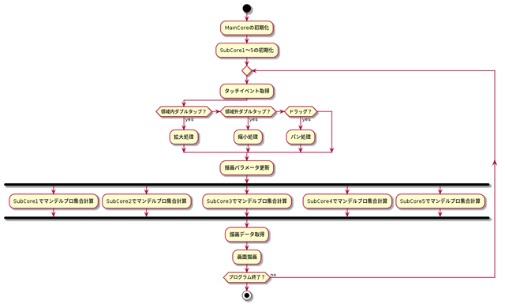](https://camo.elchika.com/2be8e9d60e1593323d085b18ec96c30de14c4f47/68747470733a2f2f706c616e74756d6c2e656c6368696b612e636f6d2f706e672f665042444969443035384e74554f66506a616a5f6b61634e68627476313136644462594961614a346453743544414147326638656a4b71686e496659325157574d6c4c586866464f4c4c5f3163504865596f7541745377507874336c454c536f42534d6d393762544b524b727451314f36703274354c2d367843476c496c4236786750754e48675f6a476b70616136684c42346147634971466e3030654f5073332d3432754737315050784674654359727a4b496f4f7177766f6d43634e453853383357387a6e624b3330555864625962516236536c6c4b703745304d7952374e545268695f6672716432343177734f5443676476795f6661706d464d454a7a7a4b34754768574c6531747a326f4153795a736347367242424f62624f797a427062764a63564454583236563836752d6e6475615f664c714f73565961324d376a4a7632456d7362426b4f4c4b7a2d46635776686b357974525a383843656d6573786f33364e5876344e5862344e58723452576d35796d5a7055427749524b2d6f56467455364a2d463666544a564a69774358554d517247714d4230564e6335514855547643642d5637374945624d4a7633477a4276634d4e6c7136/)

- **Sub Core (サブコア)**:
  - メインコアからの指示を受け、マンデルブロ集合の計算という重責を担います。
  - 複数のスレッドが並列に動作し、複雑な計算を分担することで、驚異的な処理速度を実現します。
  - 計算結果は共有メモリへと書き込まれ、メインコアへと引き継がれます。

[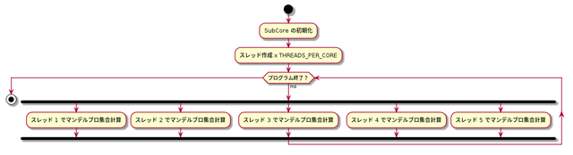](https://camo.elchika.com/08a5d1e231dc795e32d2392db203bc191055083a/68747470733a2f2f706c616e74756d6c2e656c6368696b612e636f6d2f706e672f756f656b49496d67755238414261726f70597a414c4e5a536b4576666e7a6e64532d4f5f78506263704d4e726b366464752d4f725a766b5237705474466a61787672643731384b415848324638355437622d3375304455575536565f38355468686c414370396e4b314f74377054435644777a7a74424a58535646416e79714264637a6a55684168785673552d50654163534b413664647663626d413263647648546230496134316e4d6d35477733446f6e797470746c536c46626e535f6c5a766a4d4663775331704e65766b2d74665838754e4170675568766a6b33544d6a61395955633963376e476d5a416658584a304b704a4158575859626e50674a63664b313235435730486d394e534b622d30473030/)

まるでオーケストラのように、メインコアと5つのサブコア、そして複数のスレッドが協調して動作することで、マンデルブロ集合の神秘を解き明かすための壮大な演奏が始まります。

### 共有メモリ：コア間を繋ぐ架け橋

[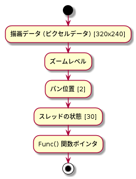](https://camo.elchika.com/1d97e57fe8be8b79c7d4afd333fcec4cc22beeac/68747470733a2f2f706c616e74756d6c2e656c6368696b612e636f6d2f706e672f756f656b49496d6775523977726a5f5f5643686b6e79746a5a766c74463678516877336e6b376441757752725a766b304f676c586d6665417153503631584c363957516e72626e4d5a766a73574f495235706e6b4e6c457555495047384b596d5555425a766972467a6c4f2d74786a4538546538656375644d344e70752d52456e7574686464546a557a5251334a473952385852514c776f586752326f7363426461745479425876786b4563394b337a47426b696b4f664279576930/)

マルチコア処理において、コア間でデータを共有することは不可欠です。このプログラムでは、**共有メモリ** という、コア間を繋ぐ架け橋を利用することで、この課題を解決しています。

- **共有メモリ**:
  - コア間で共有される特別なメモリ領域。
  - マンデルブロ集合の計算結果であるピクセルデータはもちろんのこと、ズームレベルやパン位置といった描画パラメータ、さらには各スレッドの状態情報など、様々なデータが格納されます。

各コアは、この共有メモリにアクセスすることで、まるで手紙をやり取りするように、情報を共有することができます。 例えば、メインコアがタッチパネルからの入力情報（ズームやパン）を共有メモリに書き込むと、サブコアはその情報を読み取って、マンデルブロ集合の再計算を行います。そして、計算結果を再び共有メモリに書き込み、メインコアがその情報を読み取って画面を更新する、といった連携プレイを実現しています。

### ミューテックス：共有メモリへのアクセスの秩序を守る守護者

[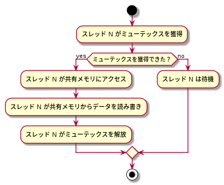](https://camo.elchika.com/191b7f80c8192a97bc5cbe093353c0e0568018fc/68747470733a2f2f706c616e74756d6c2e656c6368696b612e636f6d2f706e672f5a4f7a443265394735384e64526e4c6c67356c384652493738414357444439396d5f536b356235453863584738314b585f493472415839527034357072585077446a506555325f5645565578703734525650564c38452d57347558304f72786434354447304467314f6a326d73436b654f454a69764c5f4a5036366d4a656a686c6e6338344341373244766e65374574524c665336765945705a576c6b50547762736d7231677231367a3031755759762d4a4f2d35367079365066306764354b4143636443696146507558646a686d66617567456759566f53396c44347545504e53566163634d4e5571546675634e784736354d697a44595a636c7446573030/)

しかし、共有メモリへのアクセスには、注意が必要です。複数のスレッドが同時に共有メモリにアクセスしようとすると、データの不整合が発生し、プログラムが予期せぬ動作をする可能性があります。

そこで、このプログラムでは、**ミューテックス** という、共有メモリへのアクセスの秩序を守る守護者を配置しています。

- **ミューテックス**:
  - 共有メモリへのアクセスを制御する門番のような存在。
  - 複数のスレッドが同時に共有メモリにアクセスしようとすると、ミューテックスがそれを防ぎ、1つのスレッドだけがアクセスできるように制御します。

ミューテックスは、共有メモリへのアクセスを順番待ちさせることで、データの整合性を保ち、プログラムの安定動作を保証します。

共有メモリとミューテックスの巧みな連携により、このプログラムは、コア間通信を安全かつ効率的に行い、Spresenseのマルチコア性能を最大限に引き出しています。

### 抵抗膜式タッチパネルが誘う、マンデルブロ集合の旅

抵抗膜式タッチパネル。それは、古き良き技術が生み出す、懐かしさと温かさに満ちたインターフェース。このプログラムでは、抵抗膜式タッチパネルの特性を最大限に活かし、マンデルブロ集合をより直感的に、より深く探求できるよう設計しました。

**ピンチイン・ピンチアウト**

抵抗被膜式タッチパネル最大の弱点

スマホの様に指でこうぐいって出来ないんですよ

でもマンデルブロ集合は作りたひ

そこで考え出したのが矩形を画面に常に表示して

枠内枠外をダブルタッチする事によりそれを実現

[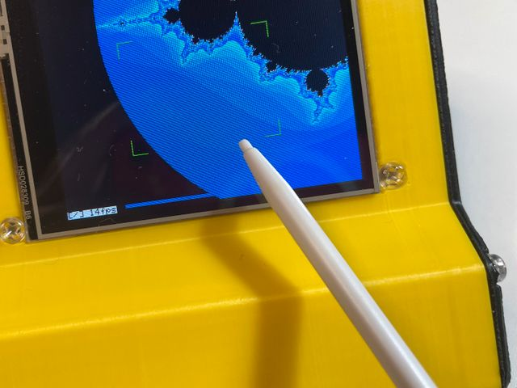](https://camo.elchika.com/3662a76505db53ff09b752f20ab02fc497c2828b/687474703a2f2f73746f726167652e676f6f676c65617069732e636f6d2f656c6368696b612f76312f757365722f38373864346139632d633739622d343839652d383830322d6137626538616332663037302f66306464663938332d613666342d346238312d383538392d616561396131343637356536/)

[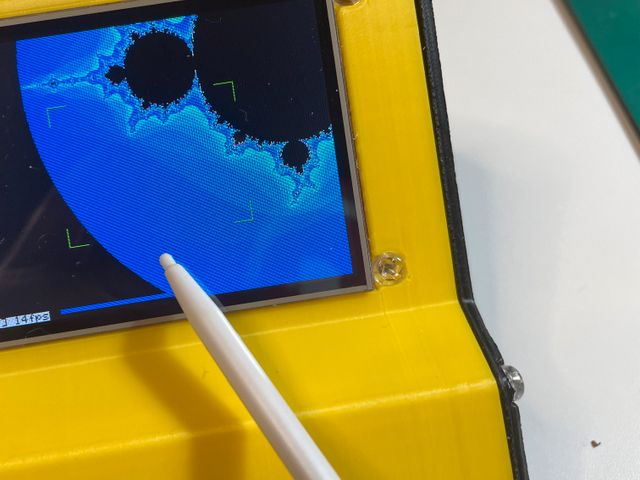](https://camo.elchika.com/9ddd9a189b75e85facf69f193678780260e79079/687474703a2f2f73746f726167652e676f6f676c65617069732e636f6d2f656c6368696b612f76312f757365722f38373864346139632d633739622d343839652d383830322d6137626538616332663037302f31616130316564302d336630362d343438352d383530642d313463636136353935363664/)

- **拡大**: 画面中央に配置された矩形領域。その領域内をダブルタッチすることで、マンデルブロ集合は、まるで宇宙の膨張のように拡大していきます。
- **縮小**: 矩形領域外をダブルタッチすれば、今度は逆に、マンデルブロ集合は収縮し、より広い範囲を俯瞰することができます。
- **パン**: 指先で画面をなぞるようにドラッグすれば、マンデルブロ集合は、まるで生きているかのように滑らかに移動し、隠されたディテールを垣間見ることができます。

抵抗膜式タッチパネルのシンプルな操作性と、マンデルブロ集合の無限の複雑さが織りなすハーモニー。それは、まるで指先で宇宙を操るかのような、未体験の感覚をあなたに提供するでしょう。

[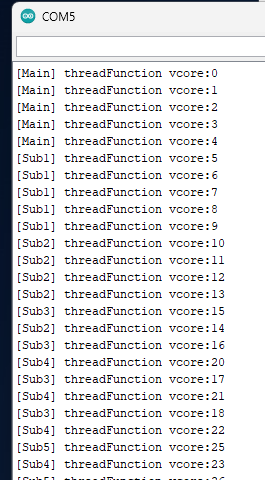](https://camo.elchika.com/9820e438a4249115b4bab792297104d5ab59cfed/687474703a2f2f73746f726167652e676f6f676c65617069732e636f6d2f656c6368696b612f76312f757365722f38373864346139632d633739622d343839652d383830322d6137626538616332663037302f34393432383031372d323962362d346438312d623437342d336636396232336437626261/)

### シンプルなファイル構成と柔軟な関数呼び出し

```c
vCore.ino全コード//==============================
// vCore.ino
// author : chrmlinux03
//==============================
#define VIRTUALCORES_USECNT (30) // 1,6,12,30
#include "Common.hpp"
#ifdef SUBCORE
//------------------------------
// SubCore1..5 (128Kbyte)
//------------------------------
#include "SubCore1..5.hpp"
#else
//------------------------------
// MainCore (640Kbyte)
//------------------------------
#include "spreLGFX.hpp"
#include "spreTouch.hpp"
#include "touchTool.hpp"
#include "Func.hpp"
//#include "Func2.hpp"
#include "MainCore.hpp"

#endif
```

function expandCode(event) {
          var codeBlock = event.currentTarget;
          var triangle = codeBlock.querySelector('.triangle');
          if (!codeBlock.classList.contains('expanded')) {
            codeBlock.classList.add('expanded');
            triangle.classList.add('up');
          }
        }

        function toggleCode(event) {
          var codeBlock = event.currentTarget;
          var triangle = event.currentTarget.querySelector('.triangle');;
          if (codeBlock.classList.contains('expanded')) {
            codeBlock.classList.remove('expanded');
            triangle.classList.remove('up');
          } else {
            expandCode({ currentTarget: codeBlock });
          }
          event.stopPropagation();
        }

```c
SubCore1..5.hpp全コード//==============================
// SubCore15.hpp
// 128Kbyte
//==============================

int core = SUBCORE;

//==============================
// setup
//==============================
void setup(void) {
  randomSeed(millis());
  uint8_t msgid = 0;
  MP.begin();
  MP.Recv(&msgid, &sharedMem);
  MP.Send(msgid, sharedMem);
  MP.RecvTimeout(MP_RECV_POLLING);
  if (THREADS_PER_CORE) {
    for (int vcore = 0; vcore < THREADS_PER_CORE; vcore++) {
      pthread_t pt;
      int* vcorePtr = new int(core * THREADS_PER_CORE + vcore);
      pthread_create(&pt, NULL, threadFunction, (void *)vcorePtr);
    }
  }
}

//==============================
// loop
//==============================
void loop(void) {
  yield();
}
```

function expandCode(event) {
          var codeBlock = event.currentTarget;
          var triangle = codeBlock.querySelector('.triangle');
          if (!codeBlock.classList.contains('expanded')) {
            codeBlock.classList.add('expanded');
            triangle.classList.add('up');
          }
        }

        function toggleCode(event) {
          var codeBlock = event.currentTarget;
          var triangle = event.currentTarget.querySelector('.triangle');;
          if (codeBlock.classList.contains('expanded')) {
            codeBlock.classList.remove('expanded');
            triangle.classList.remove('up');
          } else {
            expandCode({ currentTarget: codeBlock });
          }
          event.stopPropagation();
        }

- **シンプルなファイル構成**: すべてのプログラムファイルを一つのフォルダに集約することで、まるで整理整頓された部屋のように、管理、コンパイル、デプロイが簡単に行えるようになっています。
  
  [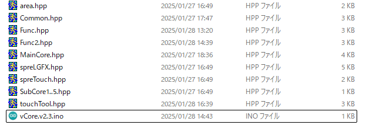](https://camo.elchika.com/266d7032238482aa92b1df9116631a229c81d768/687474703a2f2f73746f726167652e676f6f676c65617069732e636f6d2f656c6368696b612f76312f757365722f38373864346139632d633739622d343839652d383830322d6137626538616332663037302f35316138373534372d386139392d343763642d626631612d376461346464616532393964/)
  
  [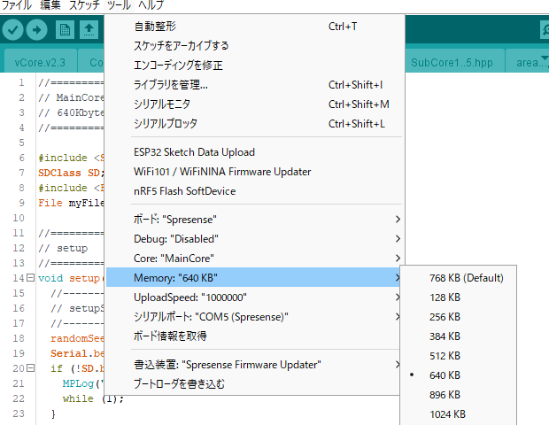](https://camo.elchika.com/8e773d1a7c2d55ce86bc1f9fc3bfa7709b50e9e4/687474703a2f2f73746f726167652e676f6f676c65617069732e636f6d2f656c6368696b612f76312f757365722f38373864346139632d633739622d343839652d383830322d6137626538616332663037302f61613462376461332d656230652d346339372d613064612d373136653439376231616665/)
  
  [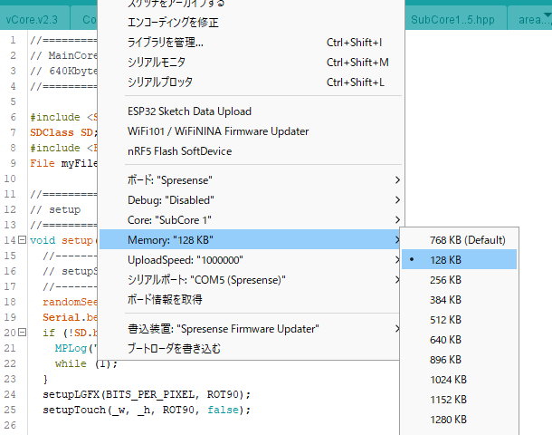](https://camo.elchika.com/6b3e8b3c9cbf14a93c3c6820a55d11f3573eda55/687474703a2f2f73746f726167652e676f6f676c65617069732e636f6d2f656c6368696b612f76312f757365722f38373864346139632d633739622d343839652d383830322d6137626538616332663037302f38313632303833392d333931322d343030352d396339662d396136306466353235633562/)
- **Func関数ポインタ**: 共有メモリに Func 関数ポインタを配置することで、メインコア/サブコアから関数を呼び出すための柔軟な仕組みを提供しています。これは、まるでプログラムの各部分が自由に会話できる共通言語のように、様々な処理を動的に実行することを可能にします。

```c
MainCore.hpp初期化部分//-----------------------------
  // setup sharedMem
  //-----------------------------
  memset(sharedMem, 0x0, sz);
  sharedMem->sz = sz;
  sharedMem->func = func;
  sharedMem->scrn.scrnBytes = sizeof(sharedMem->scrn.scrn);
  sharedMem->scrn.bytesPerVcore = sharedMem->scrn.scrnBytes / VIRTUALCORES_USECNT;
  sharedMem->scrn.heightPerVcore = SCRN_HEIGHT / VIRTUALCORES_USECNT;
  sharedMem->scrn.offx = -2.0;
  sharedMem->scrn.offy = -1.0;
  sharedMem->scrn.zoom = 0.5;
```

function expandCode(event) {
          var codeBlock = event.currentTarget;
          var triangle = codeBlock.querySelector('.triangle');
          if (!codeBlock.classList.contains('expanded')) {
            codeBlock.classList.add('expanded');
            triangle.classList.add('up');
          }
        }

        function toggleCode(event) {
          var codeBlock = event.currentTarget;
          var triangle = event.currentTarget.querySelector('.triangle');;
          if (codeBlock.classList.contains('expanded')) {
            codeBlock.classList.remove('expanded');
            triangle.classList.remove('up');
          } else {
            expandCode({ currentTarget: codeBlock });
          }
          event.stopPropagation();
        }

例えば、`Func.hpp` を差し替えるだけで、マンデルブロ集合の描画アルゴリズムを以下のように変更することができます。

- 単純な白黒の描画から、カラフルなグラデーションを使った描画へ
- マンデルブロ集合の計算回数に応じた色分け
- 距離推定法を用いた滑らかな陰影付け
- 等高線のような表現

また、マンデルブロ集合以外のフラクタル図形 (ジュリア集合など) の描画も、`Func.hpp` を差し替えるだけで実現できます。

このように、`Func` 関数ポインタは、プログラムの拡張性を飛躍的に高める強力なツールです。

**さらに、`Func` 関数ポインタは共有メモリに存在するため、`Func.hpp` の内容を書き換える必要があるのは、Main Coreのみで、Sub Core 1..5 は書き換える必要がありません。**

### 仮想コアとpthread

このプログラムでは、Spresenseの6つの物理コアに加えて、**仮想コア** という概念を導入しています。仮想コアとは、1つの物理コア上で複数のスレッドを動作させることで、あたかも複数のコアがあるかのように振る舞わせる技術です。

仮想コアの数は、`vCore.ino` の冒頭で定義されている `VIRTUALCORES_USECNT` というマクロで設定できます。

```C
#define VIRTUALCORES_USECNT (30) // 1, 16, 12, 30 のいずれかの値を設定可能
```

function expandCode(event) {
          var codeBlock = event.currentTarget;
          var triangle = codeBlock.querySelector('.triangle');
          if (!codeBlock.classList.contains('expanded')) {
            codeBlock.classList.add('expanded');
            triangle.classList.add('up');
          }
        }

        function toggleCode(event) {
          var codeBlock = event.currentTarget;
          var triangle = event.currentTarget.querySelector('.triangle');;
          if (codeBlock.classList.contains('expanded')) {
            codeBlock.classList.remove('expanded');
            triangle.classList.remove('up');
          } else {
            expandCode({ currentTarget: codeBlock });
          }
          event.stopPropagation();
        }

この値を変更することで、1から30までの仮想コアを使用することができます。仮想コア数を増やすことで、より多くのスレッドを並列に実行することができ、マンデルブロ集合の計算をさらに高速化することができます。

**各コアで実行されるpthreadの数は、以下の式で計算されます。**

```
pthreadの数 = VIRTUALCORES_USECNT / REALCORES_MAXCNT
```

function expandCode(event) {
          var codeBlock = event.currentTarget;
          var triangle = codeBlock.querySelector('.triangle');
          if (!codeBlock.classList.contains('expanded')) {
            codeBlock.classList.add('expanded');
            triangle.classList.add('up');
          }
        }

        function toggleCode(event) {
          var codeBlock = event.currentTarget;
          var triangle = event.currentTarget.querySelector('.triangle');;
          if (codeBlock.classList.contains('expanded')) {
            codeBlock.classList.remove('expanded');
            triangle.classList.remove('up');
          } else {
            expandCode({ currentTarget: codeBlock });
          }
          event.stopPropagation();
        }

ここで、`REALCORES_MAXCNT` はSpresenseの物理コア数であり、6です。

したがって、`VIRTUALCORES_USECNT` が30の場合は、各コアで5つのpthreadが実行されます。

### データ型と画面サイズ

プログラム中で使用される主要なデータ型と画面サイズは、以下のマクロで定義されています。

```C
#define FLOAT_T float        // 浮動小数点型 float/double
#define PIXEL_T uint8_t     // 画素のデータ型
#define SCRN_WIDTH  (320)    // 画面の幅
#define SCRN_HEIGHT (240)    // 画面の高さ
```

function expandCode(event) {
          var codeBlock = event.currentTarget;
          var triangle = codeBlock.querySelector('.triangle');
          if (!codeBlock.classList.contains('expanded')) {
            codeBlock.classList.add('expanded');
            triangle.classList.add('up');
          }
        }

        function toggleCode(event) {
          var codeBlock = event.currentTarget;
          var triangle = event.currentTarget.querySelector('.triangle');;
          if (codeBlock.classList.contains('expanded')) {
            codeBlock.classList.remove('expanded');
            triangle.classList.remove('up');
          } else {
            expandCode({ currentTarget: codeBlock });
          }
          event.stopPropagation();
        }

- `FLOAT_T`: マンデルブロ集合の計算に使用する浮動小数点型です。 `double` 型を使用することで、`float` 型に比べて計算精度が向上し、より正確なマンデルブロ集合を描画することができます。
- `PIXEL_T`: 画面の各画素を表すデータ型です。 `uint8_t` 型を使用することで、1画素あたり8ビット (256階調) のグレースケールでマンデルブロ集合を表示することができます。

[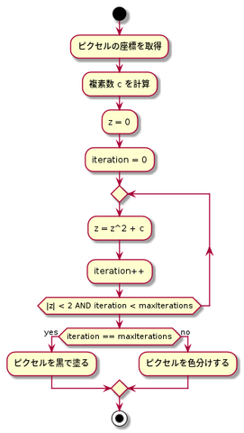](https://camo.elchika.com/67043d784d64bc3ef46aeef4b33d0cbb775992e5/68747470733a2f2f706c616e74756d6c2e656c6368696b612e636f6d2f706e672f756f656b49496d677552397774337062535446776e7173783770556c566a6f75786b636b76537a4d70377053444562665f7849642d7750525372637a4d44422d56436b32507243744132476830434c56684558756c5775614e674c5767733030663344424b65694949704270796f3379656a49327243474942574b356938416745324335524f4c61516e30566862315236775043654a6d5a436f544c4751456367615231486935386d54374648473558646572325263413539756e52683664446250636365383561646f735130654d495a444779314f74417236394461384b654e636b517a374274664355446f76796b6446777567546b5141704d643636586e4e5a7573624979774470746a51376c534546356e75716f3875686f4b7033496b7566427930573030/)

## さあ、無限の宇宙へ漕ぎ出そう

未知の世界への扉を開き、煌めく星々の海を、あなたと旅したい。

このプログラムが、あなたの好奇心を刺激し、探求心を満たす、かけがえのない羅針盤となるように。

## コード(ライブラリ以外を掲載)

```c
Common.hpp//==============================
// Common.hpp
//==============================

#ifndef __COMMON_HPP__
#define __COMMON_HPP__

#include <MP.h>
#include <MPMutex.h>
MPMutex mtx(MP_MUTEX_ID0);
#define MTXENABLE

//------------------------------
// define
//------------------------------
#define REALCORES_MAXCNT (6)
#define THREADS_MAXCNT (6)
#define VIRTUALCORES_MAXCNT (THREADS_MAXCNT * REALCORES_MAXCNT)
#define THREADS_PER_CORE (VIRTUALCORES_USECNT / REALCORES_MAXCNT)

#define FLOAT_T float
#define PIXEL_T uint8_t
#define BITS_PER_BYTE (sizeof(uint8_t) * 8)
#define BYTES_PER_PIXEL (sizeof(PIXEL_T))
#define BITS_PER_PIXEL (BYTES_PER_PIXEL * BITS_PER_BYTE)
#define SCRN_WIDTH (320)
#define SCRN_HEIGHT (240)
#define SCRN_DIM (SCRN_WIDTH * SCRN_HEIGHT)

enum {ST_READY, ST_BUSY, ST_FIN, ST_CNTMAX};

//------------------------------
// struct
//------------------------------
typedef struct {
  uint32_t bytesPerVcore;
  uint32_t heightPerVcore;
  uint32_t scrnBytes;
  FLOAT_T offx;
  FLOAT_T offy;
  FLOAT_T zoom;
  PIXEL_T scrn[SCRN_DIM];
} SCRN_T;

typedef struct {
  uint32_t sz;
  uint8_t stat[VIRTUALCORES_MAXCNT];
  SCRN_T scrn;
  void (*func)(int);
} SHARED_MEM_T;

SHARED_MEM_T *sharedMem;

//------------------------------
// mutex
//------------------------------
#ifdef MTXENABLE
void mtxLock(void) {
  int rtn = 0;
  do {
    rtn = mtx.Trylock();
  } while (rtn != 0);
}
void mtxUnLock(void) {
  mtx.Unlock();
}
#else
void mtxLock(void) {}
void mtxUnLock(void) {}
#endif

//------------------------------
// updStat
//------------------------------
void updStat(int vcore, int stat) {
  mtxLock();
  sharedMem->stat[vcore] = stat;
  mtxUnLock();
}

//------------------------------
// isStat
//------------------------------
uint8_t isStat(int vcore) {
  return sharedMem->stat[vcore];
}

//------------------------------
// threadFunction
//------------------------------
void* threadFunction(void* arg) {
  int* vcorePtr = (int*)arg;
  int vcore = *vcorePtr;

  MPLog("threadFunction vcore:%d\n", vcore);
  while (1) {
    if (isStat(vcore) == ST_READY) {
      updStat(vcore, ST_BUSY);
      sharedMem->func(vcore);
      updStat(vcore, ST_FIN);
    }
    usleep(100);// yield();
  }

  delete vcorePtr;
  return NULL;
}

#endif  // __COMMON_HPP__
```

function expandCode(event) {
          var codeBlock = event.currentTarget;
          var triangle = codeBlock.querySelector('.triangle');
          if (!codeBlock.classList.contains('expanded')) {
            codeBlock.classList.add('expanded');
            triangle.classList.add('up');
          }
        }

        function toggleCode(event) {
          var codeBlock = event.currentTarget;
          var triangle = event.currentTarget.querySelector('.triangle');;
          if (codeBlock.classList.contains('expanded')) {
            codeBlock.classList.remove('expanded');
            triangle.classList.remove('up');
          } else {
            expandCode({ currentTarget: codeBlock });
          }
          event.stopPropagation();
        }

```c
MainCore.hpp//==============================
// MainCore.hpp
// 640Kbyte
//==============================

#include <SDHCI.h>
SDClass SD;
#include <File.h>
File myFile;

//==============================
// setup
//==============================
void setup(void) {
  //-----------------------------
  // setupSystem
  //-----------------------------
  randomSeed(millis());
  Serial.begin(115200);
  if (!SD.begin()) {
    MPLog("ERROR: SD card");
    while (1);
  }
  setupLGFX(BITS_PER_PIXEL, ROT90);
  setupTouch(_w, _h, ROT90, false);

  //-----------------------------
  // malloc
  //-----------------------------
  uint8_t msgid = 10;
  uint32_t sz = sizeof(SHARED_MEM_T);
  sharedMem = (SHARED_MEM_T *)MP.AllocSharedMemory(sz);
  if (!sharedMem) {
    MPLog("Error: out of memory %d\n", sz);
    while (1);
  }

  //-----------------------------
  // setup sharedMem
  //-----------------------------
  memset(sharedMem, 0x0, sz);
  sharedMem->sz = sz;
  sharedMem->func = func;
  sharedMem->scrn.scrnBytes = sizeof(sharedMem->scrn.scrn);
  sharedMem->scrn.bytesPerVcore = sharedMem->scrn.scrnBytes / VIRTUALCORES_USECNT;
  sharedMem->scrn.heightPerVcore = SCRN_HEIGHT / VIRTUALCORES_USECNT;
  sharedMem->scrn.offx = -2.0;
  sharedMem->scrn.offy = -1.0;
  sharedMem->scrn.zoom = 0.5;

  //-----------------------------
  // bootup vcore
  //-----------------------------
  MP.RecvTimeout(MP_RECV_POLLING);
  if (THREADS_PER_CORE) {
    for (int vcore = 0; vcore < VIRTUALCORES_USECNT; vcore++) {
      static bool subcoreStarted[REALCORES_MAXCNT] = {false};
      if (vcore < THREADS_PER_CORE) {
        pthread_t pt;
        int* vcorePtr = new int(vcore);
        pthread_create(&pt, NULL, threadFunction, (void *)vcorePtr);
      } else {
        int core = (vcore / THREADS_PER_CORE);
        if (!subcoreStarted[core]) {
          MP.begin(core);
          subcoreStarted[core] = true;
        }
        void *dmy;
        MP.Send(msgid, sharedMem, core);
        MP.Recv(&msgid, &dmy, core);
      }
    }
  }
}

//==============================
// isRedraw
//==============================
bool isRedraw(void) {
  bool rtn = false;
  int finCnt = 0;
  for (int vcore = 0; vcore < VIRTUALCORES_USECNT; vcore++) {
    if (isStat(vcore) == ST_FIN) finCnt++;
  }
  if (finCnt == VIRTUALCORES_USECNT) rtn = true;
  return rtn;
}

//==============================
// drawStats
//==============================
typedef struct {
  uint16_t fcol;
  uint16_t bcol;
} TCOL_T;
static const TCOL_T tcol[ST_CNTMAX] {
  {TFT_WHITE, TFT_BLUE},
  {TFT_WHITE, TFT_RED},
  {TFT_WHITE, TFT_BLUE}
  
// TFT_WHITE, TFT_RED, TFT_BLUE, TFT_GREEN
};

void drawStats(LGFX_Sprite * dst, int x, int y) {
  int stat = 0, gx, gy;
  int w = 8, h = 4;
  gx = x;
  gy = y;
  for (int vcore = 0; vcore < VIRTUALCORES_USECNT; vcore++) {
    stat = isStat(vcore);
    dst->fillRect(gx, gy, w, h, tcol[stat].bcol);    
    gx += 8;
  }
}

//==============================
// drawScrn
//==============================
void drawScrn(LGFX_Sprite * dst) {
  if (isRedraw()) {
    dst->pushImage(0, 0, _w, _h, sharedMem->scrn.scrn);
    for (int vcore = 0; vcore < VIRTUALCORES_USECNT; vcore++) {
      updStat(vcore, ST_READY);
    }
  }
  touchCtrl(dst);
  drawAst(dst, 0, _h - 8, TFT_BLACK, TFT_WHITE);
  drawStats(dst, 64, _h - 8);
  dst->pushSprite(&lcd, 0, 0);
}

//==============================
// mainCoreFunction
//==============================
void mainCoreFunction(void) {
  int vcore = 0;
  if (isStat(vcore) == ST_READY) {
    updStat(vcore, ST_BUSY);
    sharedMem->func(vcore);
    updStat(vcore, ST_FIN);
  }
}

//==============================
// loop
//==============================
void loop(void) {
  if (!THREADS_PER_CORE) {
    mainCoreFunction();
  }
  drawScrn(&spr);
}
```

function expandCode(event) {
          var codeBlock = event.currentTarget;
          var triangle = codeBlock.querySelector('.triangle');
          if (!codeBlock.classList.contains('expanded')) {
            codeBlock.classList.add('expanded');
            triangle.classList.add('up');
          }
        }

        function toggleCode(event) {
          var codeBlock = event.currentTarget;
          var triangle = event.currentTarget.querySelector('.triangle');;
          if (codeBlock.classList.contains('expanded')) {
            codeBlock.classList.remove('expanded');
            triangle.classList.remove('up');
          } else {
            expandCode({ currentTarget: codeBlock });
          }
          event.stopPropagation();
        }

```c
TouchTool.hpp#ifndef __TOUCH_TOOL_HPP__
#define __TOUCH_TOOL_HPP__

//==============================
// isInCornerArea
//==============================
bool isInCornerArea(int tx, int ty) {
  int x1 = (_w - _hw) / 2;
  int y1 = (_h - _hh) / 2;
  int x2 = x1 + _hw;
  int y2 = y1 + _hh;
  return (tx >= x1 && tx <= x2 && ty >= y1 && ty <= y2);
}

void updZoom(int tx, int ty) {
  const FLOAT_T ZOOM_FACTOR = 2.0f;
  FLOAT_T offs = 1.0f;
  mtxLock();
//  MPLog("ofx:%.2f ofy:%.2f zm:%.2f\n", sharedMem->scrn.offx, sharedMem->scrn.offy, sharedMem->scrn.zoom);
  if (isInCornerArea(tx, ty)) {
//    MPLog("Zooming IN\n");
    sharedMem->scrn.zoom *= ZOOM_FACTOR;
    sharedMem->scrn.offx += offs;
    sharedMem->scrn.offy += offs;
  } else {
//    MPLog("Zooming OUT\n");
    sharedMem->scrn.zoom /= ZOOM_FACTOR;
    sharedMem->scrn.offx -= offs;
    sharedMem->scrn.offy -= offs;
  }
//  MPLog("ofx:%.2f ofy:%.2f zm:%.2f\n", sharedMem->scrn.offx, sharedMem->scrn.offy, sharedMem->scrn.zoom);
  mtxUnLock();
}

//==============================
// updOffset
//==============================
void updOffset(int tx, int ty, int startX, int startY) {
  mtxLock();
  sharedMem->scrn.offx -= ((tx - startX) * (sharedMem->scrn.zoom / _w));
  sharedMem->scrn.offy -= ((ty - startY) * (sharedMem->scrn.zoom / _h));
//  MPLog("ofx:%.2f ofy:%.2f zm:%.2f\n", sharedMem->scrn.offx, sharedMem->scrn.offy, sharedMem->scrn.zoom);
  mtxUnLock();
}

//==============================
// touchCtrl
//==============================
void touchCtrl(LGFX_Sprite *dst) {
  const uint16_t DRAG_THRESHOLD = 10;
  const uint16_t DOUBLE_TAP_THRESHOLD = 300;
  static int16_t startX = 0, startY = 0;
  static int16_t lastX = 0, lastY = 0;
  static uint32_t lastTapTime = 0;
  static bool dragging = false;

  int tx = 0, ty = 0, tz = 0;
  if (isTouch(&tx, &ty, &tz)) {
    unsigned long currentTime = millis();
    if (!dragging) {
      if (abs(tx - lastX) < DRAG_THRESHOLD && abs(ty - lastY) < DRAG_THRESHOLD) {
        if (currentTime - lastTapTime < DOUBLE_TAP_THRESHOLD) {
          //------------------------------
          // doubleTap
          //------------------------------
          updZoom(tx, ty);
          return;
        }
      } else {
        lastTapTime = 0;
      }
      lastTapTime = currentTime;
      startX = tx;
      startY = ty;
      dragging = true;
    } else {
      //------------------------------
      // dragging
      //------------------------------
      updOffset(tx, ty, startX, startY);
    }
    lastX = tx;
    lastY = ty;
  } else {
    if (dragging) {
      dragging = false;
    }
  }
  drawCorner(dst, (_w - _hw) / 2, (_h - _hh) / 2, _hw, _hh, TFT_GREEN);
}

#endif // __TOUCH_TOOL_HPP__
```

function expandCode(event) {
          var codeBlock = event.currentTarget;
          var triangle = codeBlock.querySelector('.triangle');
          if (!codeBlock.classList.contains('expanded')) {
            codeBlock.classList.add('expanded');
            triangle.classList.add('up');
          }
        }

        function toggleCode(event) {
          var codeBlock = event.currentTarget;
          var triangle = event.currentTarget.querySelector('.triangle');;
          if (codeBlock.classList.contains('expanded')) {
            codeBlock.classList.remove('expanded');
            triangle.classList.remove('up');
          } else {
            expandCode({ currentTarget: codeBlock });
          }
          event.stopPropagation();
        }

```c
Func.hpp//==============================
// Func.hpp
//==============================
/*
  void func(int vcore) {
  sharedMem->scrn.scrn[vcore] = (sharedMem->scrn.scrn[vcore] + 1) % 0xff;
  return NULL;
  }
*/
//=============================
// Function1.hpp
// Mandelbrot Visualization
//=============================

// Mandelbrot parameters
static const int maxIterations = 64;

//=============================
// mandelbrot
// Calculate if the point belongs to the Mandelbrot set
//=============================
static int mandelbrot(FLOAT_T real, FLOAT_T imag) {
  FLOAT_T zr = real;
  FLOAT_T zi = imag;
  int iteration = 0;
  while (zr * zr + zi * zi < 4.0f && iteration < maxIterations) {
    FLOAT_T temp = zr * zr - zi * zi + real;
    zi = 2.0f * zr * zi + imag;
    zr = temp;
    iteration++;
  }
  return (FLOAT_T)iteration;
}

//=============================
// func
//=============================
bool isCalc(int vcore) {
  bool rtn = false;
  static FLOAT_T offx[VIRTUALCORES_USECNT] = {0.0};
  static FLOAT_T offy[VIRTUALCORES_USECNT] = {0.0};
  static FLOAT_T zoom[VIRTUALCORES_USECNT] = {0.0};
  if ((offx[vcore] != sharedMem->scrn.offx) ||
      (offy[vcore] != sharedMem->scrn.offy) ||
      (zoom[vcore] != sharedMem->scrn.zoom)) {
    offx[vcore] = sharedMem->scrn.offx;
    offy[vcore] = sharedMem->scrn.offy;
    zoom[vcore] = sharedMem->scrn.zoom;
    rtn = true;
  }
  return rtn;
}

//=============================
// func
//=============================
static void func(int vcore) {
  if (isCalc(vcore)) {
    FLOAT_T offx = sharedMem->scrn.offx;
    FLOAT_T offy = sharedMem->scrn.offy;
    FLOAT_T zoom = sharedMem->scrn.zoom;
    FLOAT_T asp = (FLOAT_T)SCRN_WIDTH / SCRN_HEIGHT;
    uint32_t memPos = vcore * sharedMem->scrn.bytesPerVcore;
    uint32_t heightStart = vcore * sharedMem->scrn.heightPerVcore;
    uint32_t heightEnd = heightStart + sharedMem->scrn.heightPerVcore;
    for (uint32_t y = heightStart; y < heightEnd; y++) {
      for (uint32_t x = 0; x < SCRN_WIDTH; x++) {
        FLOAT_T real = offx + (asp * 1.0f / zoom) * ((FLOAT_T)x / SCRN_WIDTH);
        FLOAT_T imag = offy + (1.0f / zoom) * ((FLOAT_T)y / SCRN_HEIGHT);
        int iterations = mandelbrot(real, imag);
        uint8_t color = (iterations == maxIterations) ? 0 : (iterations * 255 / maxIterations);
        sharedMem->scrn.scrn[memPos] = color;
        memPos++;
      }
    }
  }
}
```

function expandCode(event) {
          var codeBlock = event.currentTarget;
          var triangle = codeBlock.querySelector('.triangle');
          if (!codeBlock.classList.contains('expanded')) {
            codeBlock.classList.add('expanded');
            triangle.classList.add('up');
          }
        }

        function toggleCode(event) {
          var codeBlock = event.currentTarget;
          var triangle = event.currentTarget.querySelector('.triangle');;
          if (codeBlock.classList.contains('expanded')) {
            codeBlock.classList.remove('expanded');
            triangle.classList.remove('up');
          } else {
            expandCode({ currentTarget: codeBlock });
          }
          event.stopPropagation();
        }

### 今後の展望

- さらに高度なタッチ操作 (回転、マルチタッチなど) を実装し、より直感的な操作を実現します。
- パフォーマンスの最適化 (アルゴリズムの改善、アセンブリ言語の利用など) を行い、より高速な描画を実現します。
- GUIを導入することで、設定画面やパラメータ調整などをグラフィカルに行えるようにし、操作性を向上させます。
- カラーマップの変更機能を追加し、マンデルブロ集合をより多彩な表現で描画できるようにします。
- 計算結果の保存機能を実装し、生成した美しい画像を保存できるようにします。

このプログラムが、Spresenseのマルチコア処理能力と抵抗膜式タッチパネルの可能性を最大限に引き出し、マンデルブロ集合の魅力をより多くの人に伝えることができるよう、開発を続けていきます。

### さいごに

お疲れさまでございました。

JAXAさまとかで使ってくれないかしら…。いや、むしろ逆に、JAXAさまが

『このSpresenseアプリ、うちの宇宙ミッションで使いたいんだけど！』

って連絡が来る可能性だってゼロじゃない。そんな日が来るなら、私も宇宙開発の一端を担ったって胸を張れるかもしれないね。

<div class="like-wrap"><div data-lyket-type="like" data-lyket-template="twitter" data-lyket-namespace="linalog" data-lyket-color-icon="#b5e853" data-lyket-color-primary="#b5e853" data-lyket-color-text="#eaeaea" data-lyket-color-secondary="#2b2b2b" data-lyket-id="spresense-mandelbrot"></div></div>
