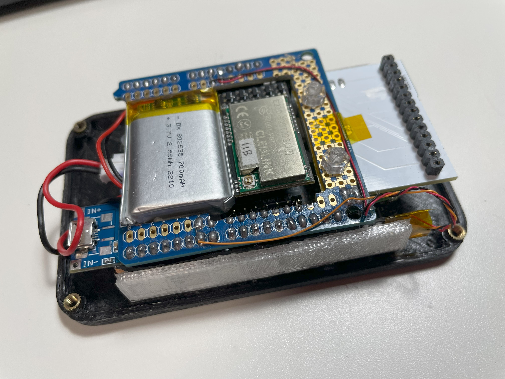
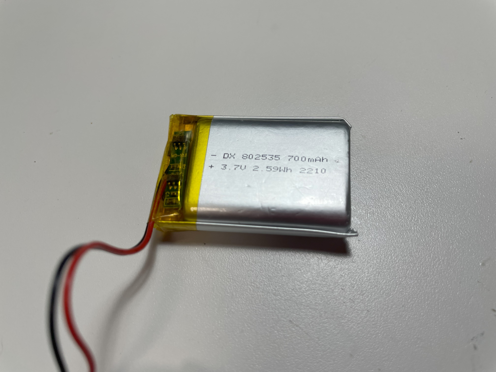
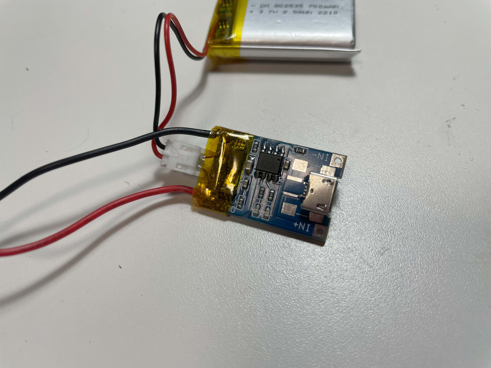
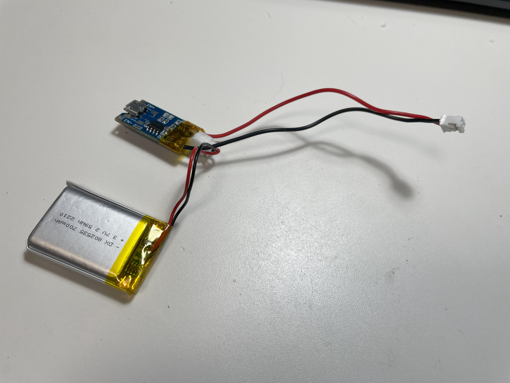
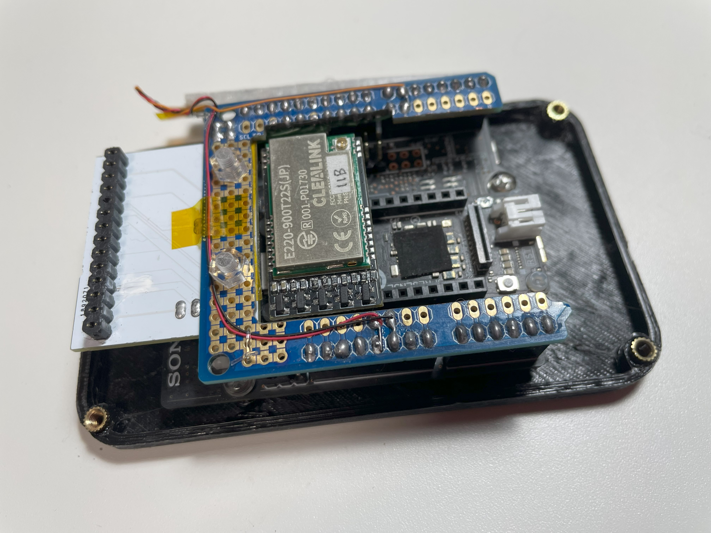
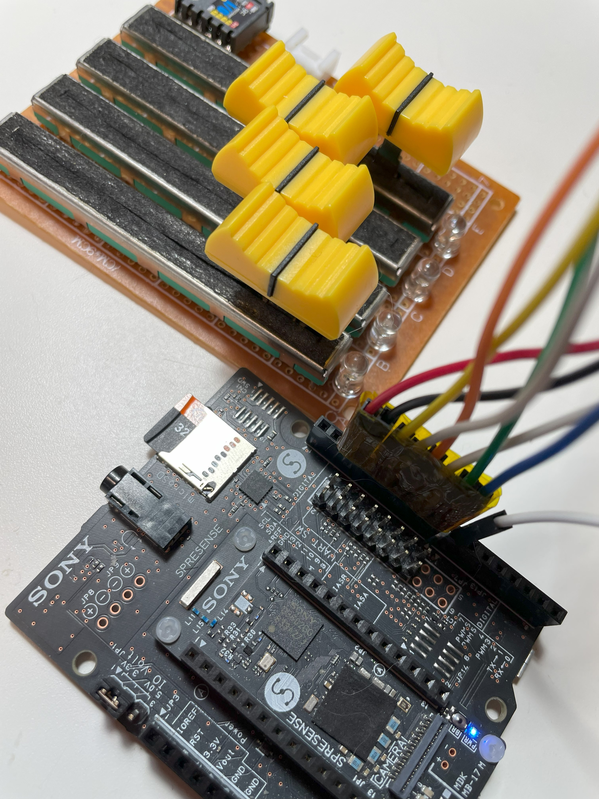

# 【SPRESENSE2023】組込用のSPRESENSEモジュールを作ったよ

2024年1月26日 09:34

# はじめに

こんにちわっ 

リナちゃん　X@chrmlinux03　です

++このページは SPRESENSE2023コンテストで作った部品を紹介するものです
最初に [開発まとめ](../spresense-2023-matome/) をお読みいただければ幸いです++

# 開発を進めていくうちに

全ての製作物が同じ構成で行ける事に気がつく

ぢゃプチ量産ですね

# 用意するもの

| 部品名| 販売先 | 価格 |御提供品|
| -------- | -------- | -------- |-------- |
|[SPRESENSE本基板](https://www.switch-science.com/products/3900)| スイッチサイエンス他 |6,050円|〇|
|[SPRESENSE拡張基板](https://www.switch-science.com/products/3901)| スイッチサイエンス他 |3,850円|〇|
|[LEDミルフィーユ](../spresense-ws2812b/)| 自作 |プライスレス|ー|
|[液晶搭載用基板](../spresense-ili9341-touch/)| 自作 |プライスレス|ー|
|根性| どなたでも |プライスレス|ー|

# 素敵なユニバーサル基板を見つけた(6枚入り)

（X 投稿の埋め込み）

# ヤスリで2時間ずつ毎日コツコツと削り続けた

（X 投稿の埋め込み）

（X 投稿の埋め込み）

# バッテリの共通化

# 液晶基板はどう乗せる？

（X 投稿の埋め込み）

[LCD液晶基板ili9341でタッチパネルを使うよっ](../spresense-ili9341-touch/) でお話した
ディージーチェーンタイプの基板は既にありましたので
パターンをカットして流用しました

# LEDも乗せてバッテリも搭載

# 動かしてみた

（X 投稿の埋め込み）

# 応用例
## SoundSerenity(環境音が8Trackで美しく流れる箱)
👉[SoundSerenity](../spresense-soundserenity/)

## LoRaPager(LoRaを使った簡易メッセンジャーBox)
👉[LoRaPager](../spresense-lorapager/)

## tinyFader(SPRESENSEを簡易ミキサーに~~する~~したかった
👉[tinyMixer](../spresense-tinymixer/)

# 残務と今後の考察

結局 LoRa の対応で 2個となり

色々面倒なんで今後はこれを使って行く予定です

当たり前の話ですが手元にあった液晶がほぼ 2.5mmピッチ14pinのIFになってます

今回のモジュール作成大成功かもしれませんね💕

PCBも作らないとね

（X 投稿の埋め込み）

# さいごに

最初は1個だけの予定でしたが

結局　3個💦

ご清聴ありがとうございました

++このページは SPRESENSE2023コンテストで作った部品を紹介するものです
最初に [開発まとめ](../spresense-2023-matome/) をお読みいただければ幸いです++

