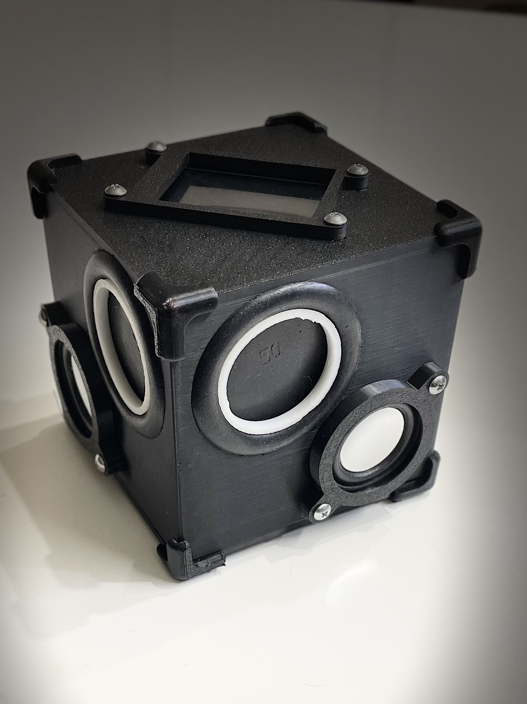
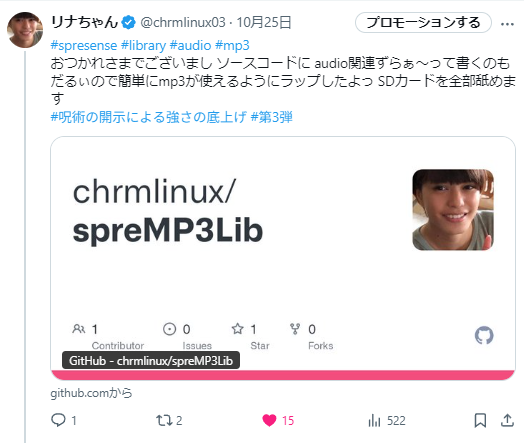
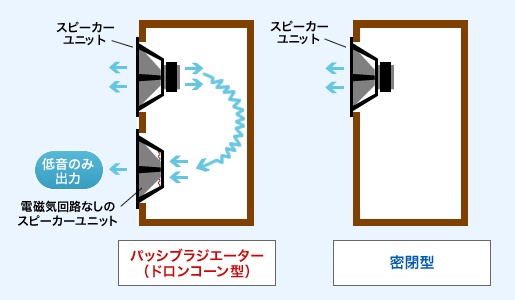
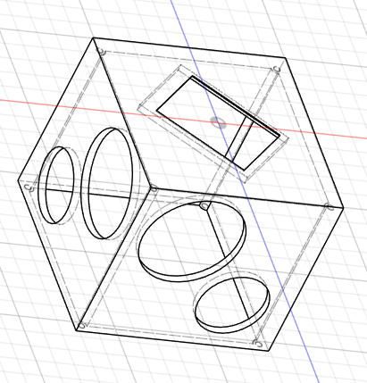

# 【SPRESENSE2024】mp3綺麗に鳴らす【CuB】

2024年12月23日 16:19

# はじめに

クリスマスなので、ちょっとだけ皆さんにチラ見せ！  
詳細はもちろん**後日**お伝えします
# MP3Player?

Spresenseの最大にして最強の機能として、MP3プレイヤーが簡単に作れるという点があります  
まぁ、サンプルを持ってきてSDカードに入れて、BINの中にDSPを入れるという細かい手順はあるのですが…

# じゃあ、作ってみる？

サンプルにはない機能として、SDカード内にあるすべてのMP3を再生する機能があります  
大丈夫です、すでに作ってあります  
<blockquote class="twitter-tweet" data-theme="dark"></blockquote>

# リナちゃんライブラリ

☞ [spreMP3Lib](https://github.com/chrmlinux/spreMP3Lib)

- `void begin(void)`: オーディオシステムを初期化します
- `void loop(void)`: オーディオ再生ループを処理します
- `void fileDir(File dir)`: 指定したディレクトリ内のMP3ファイルをスキャンします
- `void play(char* newFileName)`: 指定したMP3ファイルを再生します
- `void pause(void)`: 再生を一時停止します
- `void resume(void)`: 再生を再開します
- `void next(void)`: 次のトラックを再生します
- `void prev(void)`: 前のトラックを再生します
- `void stop(void)`: 再生を停止します
- `uint16_t getFileCount() const`: 使用可能なトラック数を返します
- `uint16_t setIndex(uint16_t index)`: 現在のトラックインデックスを設定します
- `uint16_t isTrackIndex(void)`: 現在のトラックインデックスを返します
- `bool setDebugMode(bool flag)`: デバッグモードを有効または無効にします
- `char* getFileName(uint16_t index)`: 指定したインデックスのトラックファイル名を返します

# どうせならいい音で聴こう

スピーカーを作る上で大事なことがいくつかあります  
スピーカーは単体で鳴らしても、あまり良い音は出ませんそれを囲うエンクロージャー的な方式が重要です  
Spresenseには実際にアンプが内蔵されており、スピーカーも駆動できるようですが、壊してしまうと大変なので、最初はダイソーの300円アンプなどを使うのが無難です最終的にはもっと良いものに挑戦するかもしれません

# エンクロージャーとか作ってみる？

いくつかのエンクロージャーの種類を紹介します

## **密閉型（Sealed Enclosure）**

- **特徴**: 完全に密閉された箱型エンクロージャー
- **メリット**:
  - 滑らかで正確な低音再生
  - 過渡応答に優れる（低音の立ち上がり・立ち下がりが良い）
  - シンプルな構造で信頼性が高い
- **デメリット**:
  - 低音の量感は控えめ
  - 効率が低く、大音量再生には大出力のアンプが必要
- **用途**: スタジオモニターや正確な音楽再生向け

## **パッシブラジエーター型（Passive Radiator）**

- **特徴**: ポートの代わりに振動板（パッシブラジエーター）を使って低音を補強
- **メリット**:
  - ポートノイズがなく、低音が滑らか
  - バスレフ型と同様の低音増強効果が得られる
- **デメリット**:
  - 設計が複雑でコストが高くなる
  - バスレフ型よりやや効率が低い
- **用途**: 小型スピーカーや高品質なポータブルスピーカー

## **バスレフ型（Bass Reflex）**

- **特徴**: エンクロージャーにポート（ダクト）を設け、低音を増幅
- **メリット**:
  - 密閉型よりも効率が良く、豊かな低音を再生
  - 小型エンクロージャーでも低音を強化可能
- **デメリット**:
  - ポートノイズ（風切り音）が生じる可能性
  - 過渡応答が密閉型ほど良くない
- **用途**: ホームオーディオ、ホームシアター

## **ホーン型（Horn）**

- **特徴**: ホーン形状を使って音響効率を高める方式
  - **バックロードホーン**: ドライバ背面の音を増幅
  - **フロントロードホーン**: ドライバ前面にホーンを設置
- **メリット**:
  - 非常に高い感度と大音量
  - 広がりのある音場
- **デメリット**:
  - エンクロージャーが大型化しがち
  - 設計が難しく、コストが高い
- **用途**: 劇場音響、大規模オーディオシステム

## **トランスミッションライン型（Transmission Line）**

- **特徴**: ドライバ背面の音を長い管で誘導し、位相を整えて増幅
- **メリット**:
  - 滑らかで深い低音
  - ホーン型ほどではないが効率的な低音増強
- **デメリット**:
  - エンクロージャーが非常に大きくなる
  - 設計が複雑
- **用途**: ハイエンドオーディオ、オーディオマニア向け

# じゃあ、パッシブラジエーター型を作ろう

## **パッシブラジエーター型スピーカー（Passive Radiator）**

パッシブラジエーター型スピーカーは、バスレフ型の代わりに使用される設計方式ですポートの代わりに「音を出さない振動板」を使うことで、効率的に低音を増強しつつ、特定の課題を解決しています

出展：サンワサプライ社 (https://www.sanwa.co.jp/product/peripheral/speaker/howto/index.html)

### **基本構造**

- **アクティブドライバー**（メインスピーカーユニット）：音を再生する振動板
- **パッシブラジエーター**：スピーカーキャビネット内の空気圧の変化を受けて振動する音を出さない振動板
- **エンクロージャー**：通常は密閉型またはバスレフ型に似たキャビネットを使用
- **内部空気圧**：アクティブドライバーの動きによる空気圧がパッシブラジエーターを駆動し、低音を増強

### **動作原理**

1. **空気圧の変化**: アクティブドライバーが前後に動くことで、エンクロージャー内の空気圧が変化します
2. **パッシブラジエーターの駆動**: この空気圧変化がパッシブラジエーターを駆動し、外部に低音を放射します
3. **低音の増幅**: パッシブラジエーターの共振周波数が調整されており、低音の量感を増強します

### **メリットとデメリット**

- **メリット**: ポートノイズがない、コンパクトな設計が可能、効率的な低音増強
- **デメリット**: コストが高い、設計が複雑

### **適用例と用途**

- **小型スピーカー**: パッシブラジエーターを使用することで、小型でも豊かな低音が得られる
- **サブウーファー**: 深い低音を提供する大型サブウーファーにも採用
- **高音質設計**: 高価格帯のスピーカーで使用

# 設計する（四角いので「CüB」と命名）

実は他にもいろいろなパッシブラジエーター型スピーカーを作ってありますが今回はSpresense内蔵のものを作り、2.4インチのタッチパネル液晶を組み込んで、さらに便利にします

# せっかくなので音を聞いてみる？
あー著作権がぁ(涙

※これだから音楽系コンテンツは大変大変

# 最後に

今年で3回目となるSpresenseコンテスト、今回も頑張ります
目指せ三連覇！[[2022]](../easylidar/)[[2023]](../spresense-soundserenity/)

