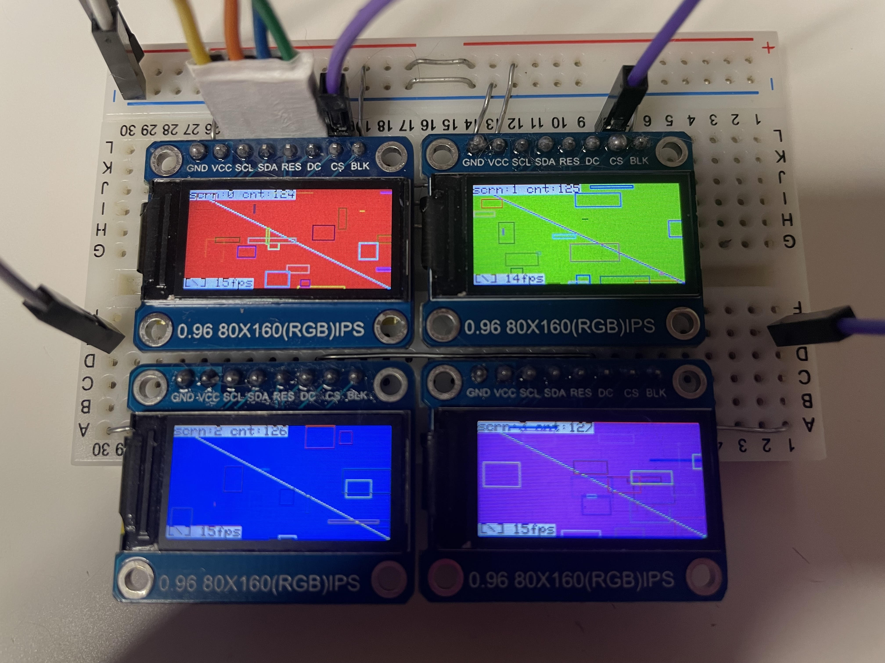

# 【SPRESENSE】複数LCD制御のためのSpresenseとLovyanGFXに関する実験的研究

2024年10月31日 13:30




### 著者: [リナちゃん](https://x.com/chrmlinux03)

---

## 1. **はじめに**

組み込み機器における表示インターフェースとしてLCD（Liquid Crystal Display）の活用は、情報の視覚的なフィードバック提供に欠かせない。しかし、一般的に使用されるLCD制御方法は1枚のLCDへのデータ送信を前提としたものが多く、複数LCDの独立制御を行うには追加の工夫が必要とされる。本研究では、Sony製のSpresenseマイコンボードとLovyanGFXライブラリを活用し、複数LCD制御の実現可能性を検証する。

## 2. **関連研究および背景**

LovyanGFXは、ArduinoやESP32といったマイコンでの高性能なグラフィック表示を可能とするライブラリであり、Spresenseは多機能な処理を可能とするマイコンモジュールである。通常、SPI通信によるLCD制御において、複数のディスプレイの独立動作を実現するには、チップセレクト（CS）ピンの切り替えが用いられる。本研究では、4枚のLCDを独立して制御することを目的とし、CSピンの設定およびデータ送信方法の調整について検討する。

## 3. **実験方法**

本実験では、以下の手順で4枚のLCDを制御する方法を検証する。

### 3.1 **ハードウェアの接続**

SpresenseボードのSPI通信端子に、各LCDのCLK、MOSI、MISO、RST、DCを共有し、CSピンのみ異なるピンに接続する（CS1、CS2、CS3、CS4）。各LCDには、LovyanGFXの設定でCSピンを指定する。

### 3.2 **ソフトウェア設定**

LovyanGFXのインスタンスごとに異なるCSピンを指定し、各LCDが個別にデータを受け取るよう設定する。また、描画内容に関しては異なる内容を表示させ、独立した動作の実現を目指す。

### 3.3 **動作確認**

各LCDの表示内容が独立して動作するかを確認するため、簡単な図形やテキストを異なるパターンで表示し、CSピンの切り替えによる独立制御が可能かを評価する。

## 4. **結果**

本実験では、Spresense上でCSピンの分割による4枚のLCDの独立制御が可能であることが確認された。実験中、CS0を抜いた状態でも他のLCDが正常に動作することが確認されたため、CSピンを切り替えることで複数LCDの制御が安定的に行えることが示唆された。

## 5. **考察**

本研究で得られた結果は、LovyanGFXとSpresenseによる複数LCDの独立制御において、CSピンの**適切**な設定により4枚のLCDの同時制御が可能であることを示唆する。これは、複数のビジュアルフィードバックをリアルタイムで提供する組み込みシステムの設計において重要な知見であり、今後の複数表示システムに応用できる可能性がある。

## 6. **結論**

本研究では、SpresenseとLovyanGFXを用いた4枚のLCDの独立制御を実験的に検証した。CSピンの割り当てを工夫することで、各LCDが独立して制御可能であることが確認され、複数LCDを用いたシステム構築に有用な方法が示された。今後はさらに多数のLCDを利用する場合や、より高度な描画処理に対応するための手法についても検討する。

## 7.**コード**
```cpp
//=================================
//
// st7735S.ino
//
//=================================
#include "spreLGFX.ST7735Sx4.hpp"


//=================================
// drawRandRect
//=================================
void drawRandRect(LGFX_Sprite *dst) {
  for (int i = 0; i < 20; i++) {
    int x = rand() % _w;
    int y = rand() % _h;
    int w = rand() % (_w / 4);
    int h = rand() % (_h / 4);
    uint32_t color = rand() % 0xFFFFFF;
    dst->drawRect(x, y, w, h, color);
  }
}

//=================================
// setup
//=================================
void setup() {
  Serial.begin(115200);
  setupLGFX(DEPTH_8BIT, ROT90);
}

//=================================
// loop
//=================================
void loop() {
  static uint8_t cnt = 0;
  for (int scrn = 0; scrn < SCREEN_MAXCNT; scrn ++) {
    spr.fillScreen(bgs[scrn]);
    spr.drawLine(0, 0, _w, _h, ~bgs[scrn]);
    spr.setCursor(0, 0); spr.printf("scrn:%d cnt:%3d", scrn, cnt);
    drawRandRect(&spr);
    drawScrnAst(&spr, scrn, 0, _h - 8, TFT_BLACK, TFT_WHITE);
    spr.pushSprite(lcd[scrn], 0, 0);
    cnt++;
  }

```
## **参考文献**

-  [Sony Semiconductor Solutions](https://www.sony-semicon.com/) [Spresense](https://developer.sony.com/ja/spresense)
- [Lovyan03](https://x.com/lovyan03)  [LovyanGFX](https://github.com/lovyan03/LovyanGFX)
