# 【SPRESENSE2025】spresense拡張基板に搭載できるラジオモジュールを作ったよっ

2026年1月9日 16:25

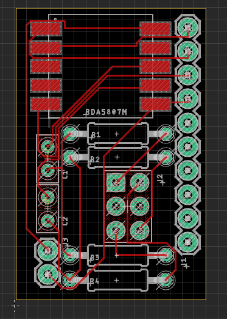

---
## はじめに
spresense拡張基板に搭載できる**FMラジオ基板**を作りました

spresense本体+spresense拡張基板とsw入力基板+アンテナ線(80cm/8cm)でFMラジオが聴けます
RDA5807(以下DSP)のspresense上での扱いがなかなか面白かったので掲載させて頂こうと考えました
製作の途中での副産物も色々掲載させて頂きます
消費電力はヘッドホン端子もしくは スピーカ2個繋げて **40..80mA**程度です
最終的に下記に示すmic入力基板とdspチェック基板を統合するとラジオモジュール基板となりました
mic入力基板は抵抗/コンデンサを良い感じの値にすると色々使えると思います
dspチェック基板は**grove互換**のPIN配置になっているので..使えますね

---
## 分圧回路の定数
mic入力基板の設計についてRDA5807（DSP）からの出力信号はイヤホンを駆動できるレベル（約 $1V_{pp}$）があるため、spresenseのアナログ入力（マイク入力）にそのまま接続すると音が割れてしまいます。そこで、分圧回路を通して適切なレベルまで減衰させています。今回、汎用性も考慮して以下の定数で回路を構成しました。
回路構成と定数入力抵抗 (R1): **4.7kΩ**出力抵抗 (R2):**470Ω**カップリングコンデンサ (C): **10μF**（推奨）設計のポイント減衰比（約 1/11）:この分圧比（約 $-20dB$）により、DSP側のボリュームを最大にしてもSpresense側でクリッピング（音割れ）することなく、ダイナミックレンジを広く保ったまま取り込むことができます。
インピーダンスの整合:後段の抵抗を 470Ω と低めに設定することで、配線からの外来ノイズの影響を抑えつつ、安定した信号をSpresenseへ伝送しています。直流（DC）カット:DSPの出力に含まれる直流成分がSpresenseの内部バイアスに干渉しないよう、直列にコンデンサを挿入しています。$10\mu F$ を使用することで、低音域（カットオフ周波数 約 $3Hz$ 程度）を損なうことなく、クリアな音質を実現しました。
この「mic入力基板」は、抵抗値やコンデンサの値を調整することで、他のオーディオソース（スマホやオーディオプレーヤーなど）をSpresenseに繋ぐ際の汎用的な入力インターフェースとしても活用できます。

---
## 基板
- ラジオモジュール基板
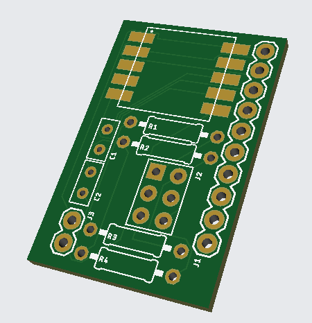
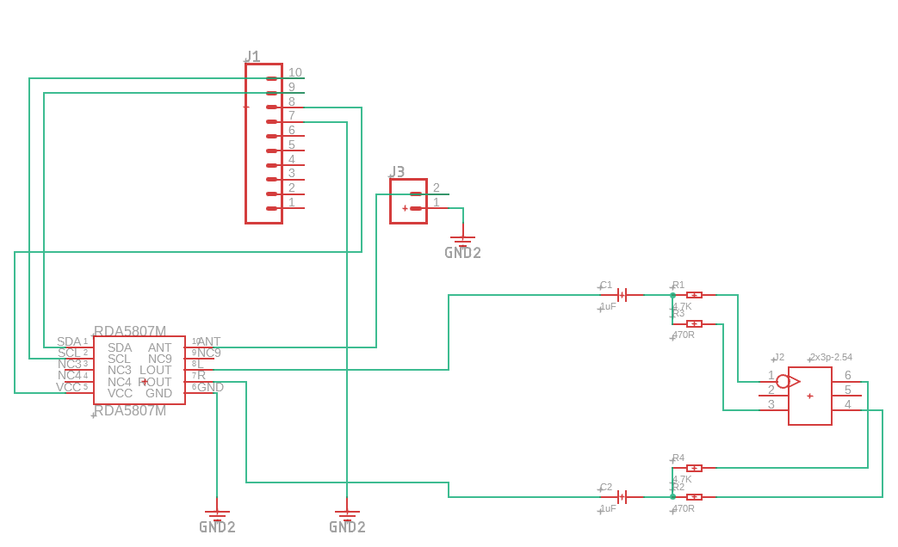
- sw入力基板
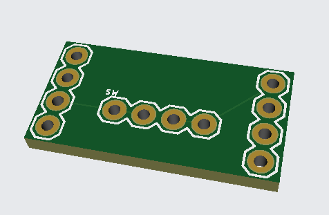
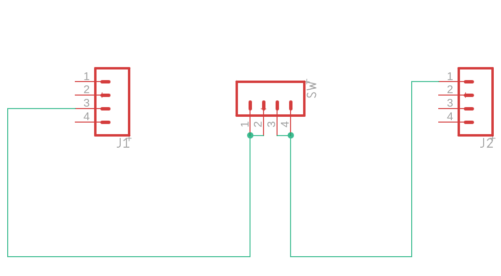
- dspチェック基板
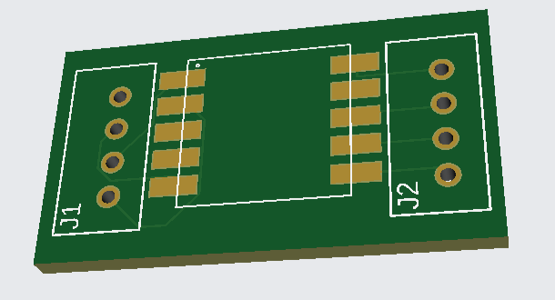
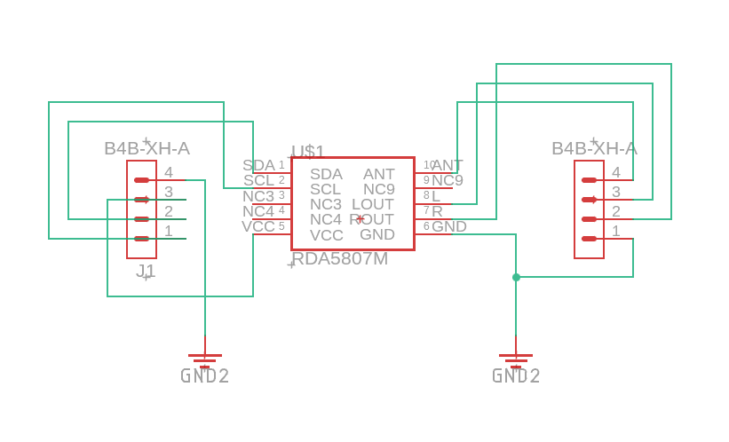
- mic入力基板
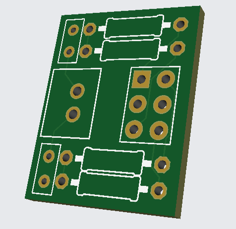
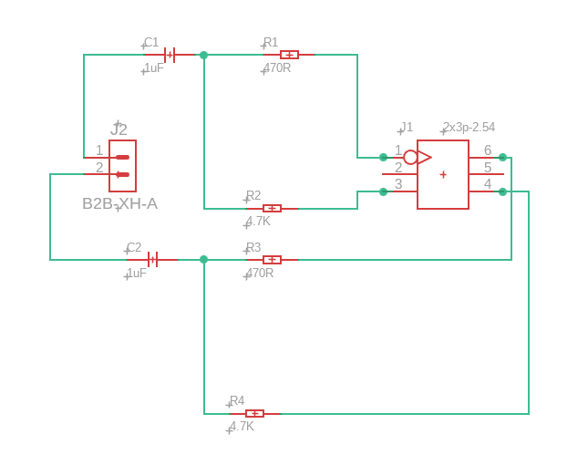

---
## 実装

DSPをi2cで制御しDSPからの出力をspresense拡張基板マイク入力で取り込み
spresense拡張基板イヤホンジャックから音声として出力します
音声出力はspresense拡張基板マイク入力から入った信号をスルーさせる方法(音を鳴らすだけ)と
信号処理できる方法(可視化やエフェクト)の2種類がありますが用途により切り替えて良いと思います
拡張基板/LTE拡張基板の違いにより局選択のロジック/PINが変わるのもあれなんで
ラジオ局初期化やラジオ局選択に使用するためのSWをspresense本体に搭載しようと考えました

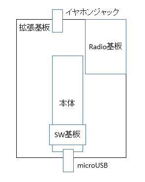
---
## ハードウエア(部品)
あくまでも代表的なものです。細かい部品や手元にありがちな部品は掲載していません
|部品名|販売店|
|----|----|
spresense本体|ご提供品
spresense拡張基板|ご提供品
RDA5807(TEA5767互換モード品)|秋月電子
イヤフォン/SPK|ダイソー
アンテナ線|秋月電子
スイッチ|秋月電子
スルーホール基板|秋月電子
抵抗/コンデンサ等|秋月電子

---
## ソフトウエア
コードは1機能1ファイルとし .h と .cpp を .hpp として記述しています
管理・運用は面倒ですが開発効率は格段にあがります
先頭に spre が付いているモジュールは spresense専用の機能を使っていますので
他に流用される場合にはご注意してポーティングを行って下さい

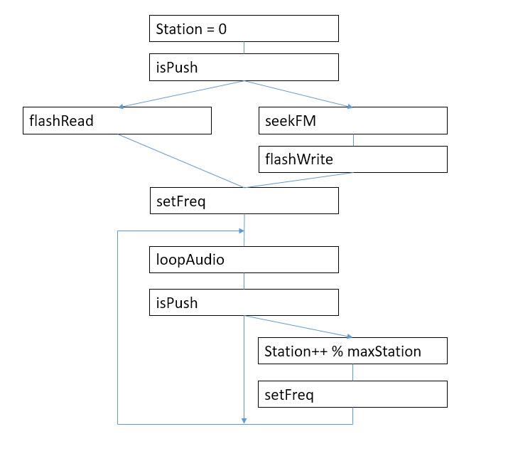
---
### spreLeds.hpp
spresense本体に搭載された led4個を使って**仮想led7個**な感じをシミュレーション出来ます
また良くあるsetupLed/execLed等をinitedで制御しています
#defineされたENABLE_LEDで消費電力を調べてみたのですが
それほど**消費電力**が減る感じではありませんでした
`void leds7(ini level)`
```c++::spreLeds.hpp
//==========================================
//  name          : spreleds.hpp
//  date/author   : 2026/01/09 chrmlinux03
//==========================================

#pragma once

void leds7(int level) {
#ifdef ENABLE_LED
  static bool inited = false;
  if (!inited) {
    pinMode(LED0, OUTPUT);
    pinMode(LED1, OUTPUT);
    pinMode(LED2, OUTPUT);
    pinMode(LED3, OUTPUT);
    inited = true;
  }
  uint8_t pattern = 0;

  switch (level) {
    case 0: pattern = 0b0000; break;
    case 1: pattern = 0b0001; break; // LED0
    case 2: pattern = 0b0011; break; // LED0 + LED1
    case 3: pattern = 0b0010; break; // LED1
    case 4: pattern = 0b0110; break; // LED1 + LED2
    case 5: pattern = 0b0100; break; // LED2
    case 6: pattern = 0b1100; break; // LED2 + LED3
    case 7: pattern = 0b1000; break; // LED3
  }

  digitalWrite(LED0, pattern & 0x01);
  digitalWrite(LED1, pattern & 0x02);
  digitalWrite(LED2, pattern & 0x04);
  digitalWrite(LED3, pattern & 0x08);
#endif
}
```
---
### spreVeAudio.hpp
mic入力基板から入って来た音声を**FrontEnd**を使って spresenseに取り込み
遅延なく**OutputMixer**でイヤフォン端子に出力します
**入って来た音声は signal_processで加工出来ます**
`void setupAudio()`
`void loopAudio()`
```c++::spreVeAudio.hpp
//==========================================
//  name            : spreVeAudio.hpp
//  org             : sample->audio->apps->voice_effector.ino
//  update/author   : 2026/01/09 chrmlinux03
//==========================================
#pragma once

#include <FrontEnd.h>
#include <OutputMixer.h>
#include <MemoryUtil.h>
#include <arch/board/board.h>

FrontEnd *theFrontEnd;
OutputMixer *theMixer;
#define AUDIO_TASK_LEVEL 110
#define VOLIME_DEF -10

static const int32_t channel_num  = AS_CHANNEL_STEREO; // AS_CHANNEL_4CH;
static const int32_t bit_length   = AS_BITLENGTH_16;
static const int32_t frame_sample = 240;
static const int32_t frame_size   = frame_sample * (bit_length / 8) * channel_num;

static const int32_t proc_size  = frame_size;
static uint8_t proc_buffer[proc_size];

bool isCaptured = false;
bool isEnd = false;
bool ErrEnd = false;

//==========================
//  levelMater
//==========================
void levelMater(int16_t* ptr, int size, int channel_num) {
  static float smoothedLevel = 0.0f;
  int32_t peakSum = 0;
  for (int i = 0; i < size / 2; i += channel_num) {
    int16_t l = ptr[i];
    int16_t r = ptr[i + 1];
    int32_t sum = abs((int32_t)l) + abs((int32_t)r);
    if (sum > peakSum) peakSum = sum;
  }
  int targetLevel = map(peakSum, 0, 65534 / 4, 0, 7);
  const float smoothFactor = 0.3f;
  smoothedLevel = smoothedLevel * (1.0f - smoothFactor) + targetLevel * smoothFactor;
  leds7((int)(smoothedLevel + 0.5f));
}

//==========================
//  signal_process
//==========================
void signal_process(int16_t* ptr, int size) {
  levelMater(ptr, size, channel_num);
}

//==========================
//  Frontend/Mixer Callbacks
//==========================
void frontend_attention_cb(const ErrorAttentionParam *param) {
  Serial.println("Attention!");
  if (param->error_code >= AS_ATTENTION_CODE_WARNING) {
    ErrEnd = true;
  }
}

void mixer_attention_cb(const ErrorAttentionParam *param) {
  Serial.println("Attention!");
  if (param->error_code >= AS_ATTENTION_CODE_WARNING) {
    ErrEnd = true;
  }
}

static bool frontend_done_callback(AsMicFrontendEvent ev, uint32_t result, uint32_t sub_result) {
  UNUSED(ev);
  UNUSED(result);
  UNUSED(sub_result);
  return true;
}

static void outputmixer_done_callback(MsgQueId requester_dtq,
                                      MsgType reply_of,
                                      AsOutputMixDoneParam* done_param) {
  UNUSED(requester_dtq);
  UNUSED(reply_of);
  UNUSED(done_param);
  return;
}

static void frontend_pcm_callback(AsPcmDataParam pcm) {
  if (!pcm.is_valid) {
    Serial.println("Invalid data !");
    memset(proc_buffer, 0, frame_size);
  } else {
    if (pcm.size > frame_size) {
      Serial.println("Capture size is too big!");
      pcm.size = frame_size;
    }
    if (pcm.size == 0) {
      memset(proc_buffer, 0, frame_size);
    } else {
      memcpy(proc_buffer, pcm.mh.getPa(), pcm.size);
    }
  }

  if (pcm.is_end) {
    isEnd = true;
  }

  isCaptured = true;
  return;
}

static void outmixer0_send_callback(int32_t identifier, bool is_end) {
  UNUSED(identifier);
  UNUSED(is_end);
  return;
}

//==========================
//  execute_aframe
//==========================
bool execute_aframe() {
  isCaptured = false;
  signal_process((int16_t*)proc_buffer, proc_size);
  AsPcmDataParam pcm_param;

  while (pcm_param.mh.allocSeg(S0_REND_PCM_BUF_POOL, frame_size) != ERR_OK) {
    delay(1);
  }

  pcm_param.is_end = isEnd;
  pcm_param.identifier = OutputMixer0;
  pcm_param.callback = 0;
  pcm_param.bit_length = bit_length;
  pcm_param.size = frame_size;
  pcm_param.sample = frame_sample;
  pcm_param.is_valid = true;

  memcpy(pcm_param.mh.getPa(), proc_buffer, pcm_param.size);

  int err = theMixer->sendData(OutputMixer0,
                               outmixer0_send_callback,
                               pcm_param);

  if (err != OUTPUTMIXER_ECODE_OK) {
    Serial.printf("OutputMixer send error: %d\n", err);
    return false;
  }

  return true;
}

//==========================
//  loopAudio
//==========================
void loopAudio() {
  bool shouldExit = false;

  if (ErrEnd) {
    Serial.println("Error End");
    theFrontEnd->stop();
    shouldExit = true;
  }

  if (!shouldExit && isCaptured) {
    if (!execute_aframe()) {
      Serial.println("Rendering error!");
      shouldExit = true;
    }
  }

  if (!shouldExit && isEnd && !isCaptured) {
    isEnd = false;
    shouldExit = true;
  }

  if (!shouldExit) {
    return;
  }

  board_external_amp_mute_control(true);
  theFrontEnd->deactivate();
  theMixer->deactivate(OutputMixer0);
  theFrontEnd->end();
  theMixer->end();
  exit(1);
}

//==========================
//  setupAudio
//==========================
void setupAudio() {
  initMemoryPools();
  createStaticPools(MEM_LAYOUT_RECORDINGPLAYER);
  memset(proc_buffer, 0, proc_size);

  theFrontEnd = FrontEnd::getInstance();
  theMixer = OutputMixer::getInstance();

  theFrontEnd->begin(frontend_attention_cb);
  theMixer->begin();

  theMixer->create(mixer_attention_cb);
  theFrontEnd->setCapturingClkMode(FRONTEND_CAPCLK_NORMAL);
  theFrontEnd->activate(frontend_done_callback);
  theMixer->activate(OutputMixer0, outputmixer_done_callback);
  usleep(100 * 1000);

  AsDataDest dst;
  dst.cb = frontend_pcm_callback;
  theFrontEnd->init(channel_num, bit_length, frame_sample, AsDataPathCallback, dst);
  theMixer->setVolume(VOLIME_DEF, VOLIME_DEF, VOLIME_DEF); // MIN:-1020 .. MAX:0

  board_external_amp_mute_control(false);
  theFrontEnd->start();
}

//====================================================
// task
//====================================================
//==========================
//  audioTask
//==========================
int audioTask(int argc, char **argv) {
  while (1) {
    loopAudio();
    sched_yield();
  }
  return 0;
}
//==========================
//  setupAudioTask
//==========================
void setupAudioTask() {
  task_create("audioTask", AUDIO_TASK_LEVEL, 1024, audioTask, nullptr);
}
```
---
### spreThAudio.hpp
mic入力基板から入って来た音声を**Through Mode**で spresenseのイヤフォン端子に出力します
**入って来た音声はメモリに残りません**
`void setupAudio()`
```c++::spreThAudio.hpp
//==========================================
//  name            : spreTrAudio.hpp
//  org             : sample->audio->apps->setThrough.ino
//  update/author   : 2026/01/09 chrmlinux03
//==========================================
#pragma once

#define VOLIME_DEF -10

#include <Audio.h>
AudioClass *theAudio;

//================================
// audio_attention_cb
//================================
static void audio_attention_cb(const ErrorAttentionParam *atprm) {
  Serial.println("Attention!");
  if (atprm->error_code >= AS_ATTENTION_CODE_WARNING) {
    exit(1);
  }
}

void loopAudio() {
}

void setupAudio() {
  theAudio = AudioClass::getInstance();
  theAudio->begin(audio_attention_cb);
  int err0 = theAudio->setThroughMode(
               AudioClass::MicIn,      // input
               AudioClass::None,       // i2s_out
               true,                   // sp_out
               0,                      // input_gain 0..21 (x10)
               AS_SP_DRV_MODE_LINEOUT  // sp_drv
             );
  if (err0 != AUDIOLIB_ECODE_OK) {
    Serial.println("Through initialize error");
    exit(1);
  }

  theAudio->setVolume(VOLIME_DEF, VOLIME_DEF, VOLIME_DEF);
  if (err0 != AUDIOLIB_ECODE_OK) {
    Serial.println("Set Volume error");
    exit(1);
  }
  Serial.println("begin through audio");
}
```
---
### i2cDump.hpp
i2cポートscan します
spresense拡張ボード / LTE拡張ボードで i2c のアドレスやポートが変わりますので
ino側で TwoWire* の形でアクセスさせます
`void i2cScan(TwoWire* wire)`
```c++::i2cDump.hpp
//==========================================
//  name          : i2cDump.hpp
//  date/author   : 2026/01/09 chrmlinux03
//==========================================

#pragma once
#include <Wire.h>
#include <stdarg.h>

void SerialPrintf(const char *format, ...) {
  char buffer[128];
  va_list args;
  va_start(args, format);
  vsnprintf(buffer, sizeof(buffer), format, args);
  va_end(args);
  Serial.print(buffer);
}

void i2cScan(TwoWire* wire) {
  uint8_t error = 0;
  int deviceCount = 0;

  SerialPrintf("     -0 -1 -2 -3 -4 -5 -6 -7 -8 -9 -A -B -C -D -E -F\n");

  for (int upper = 0; upper < 8; ++upper) {
    SerialPrintf("%d- :", upper);
    for (int lower = 0; lower < 16; ++lower) {
      int address = (upper << 4) | lower;
      wire->beginTransmission(address);
      error = wire->endTransmission();
      if (error) {
        SerialPrintf(" --");
      } else {
        SerialPrintf(" %02x", address);
        ++deviceCount;
      }
    }
    SerialPrintf("\n");
  }
  SerialPrintf("Number of I2C devices found: %d\n\n", deviceCount);
}
```
出力例

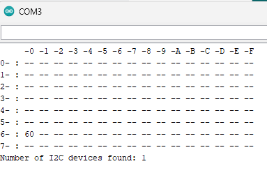

---
### spreIsPush.hpp
spresense本体の下部に搭載した sw基板からの情報を得て
現在ボタンが押されているのか離されているのかを負論理で返します(押された:1 押されてない:0)
またdigitalReadではなく**portInputRegister/digitalPinToBitMask** で高速処理を行います
`inline int isPush()`
```c++::spreIsPush.hpp
//==========================================
//  name          : spreIsPush.hpp
//  date/author   : 2026/01/09 chrmlinux03
//==========================================

#pragma once
#define BTN_PIN 22

inline int isPush() {
  static bool inited = false;
  static volatile uint8_t *inReg;
  static uint8_t mask;
  if (!inited) {
    pinMode(BTN_PIN, INPUT_PULLUP);
    inReg = portInputRegister(digitalPinToPort(BTN_PIN));
    mask = digitalPinToBitMask(BTN_PIN);
    inited = true;
  }
  return !(*inReg & mask);
}
```
---
### spreflash.hpp
DSPで検波出来た内容を spresense flash領域の "/mnt/FREQ_DATA.bin" にwrite/read します
float 4byte * 10 + 2 byte の 42Byte の バイナリデータとなります
```c++
#define FREQ_MAXCNT 10
typedef struct  {
  float freq[FREQ_MAXCNT];
  int cnt = 0;
} FREQ_LIST_T;
```

`int setupFlash()`
`int writeFlash(FREQ_LIST_T *lst)`
`int readFlash(FREQ_LIST_T *lst)`
```c++
//==========================================
//  name          : spreFlash.hpp
//  date/author   : 2026/01/09 chrmlinux03
//==========================================

#pragma once
#include <Flash.h>

#define FILE_FREQ "FREQ_DATA.bin"

int setupFlash() {
  if (!Flash.begin()) {
    return -1;
  }
  return 0;
}

void endFlash() {
}

int writeFlash(FREQ_LIST_T *lst) {
  File f = Flash.open(FILE_FREQ, FILE_WRITE);  
  if (!f) {
    return -1;
  }
  f.seek(0); // <- 重要
  size_t written = f.write((uint8_t*)lst, sizeof(FREQ_LIST_T));
  f.close();
  return (written == sizeof(FREQ_LIST_T)) ? 0 : -2;
}

int readFlash(FREQ_LIST_T *lst) {
  File f = Flash.open(FILE_FREQ, FILE_READ);  
  if (!f) {
    return -1;
  }
  size_t readLen = f.read((uint8_t*)lst, sizeof(FREQ_LIST_T));
  f.close();
  return (readLen == sizeof(FREQ_LIST_T)) ? 0 : -2;
}

```
---
### tinyRadio.hpp
spresense i2c の挙動から
RDA5807をTEA5767互換モード（アドレス0x60）で動作させています
RDA5807純正コマンドと違い TEA5767モードで出来る事は
初期化/周波数設定/検波ステータス状態のみとなります
自動検波/検波周波数取得は新規作成されました
`tinyRadio::void begin(0x60, TwoWire* wire)`
`tinyRadio::void setFreq(float freq)`
`tinyRadio::RADIO_STAT_T getStat()`
`tinyRadio::void seekFM(bool retune)`
`tinyRadio::FREQ_LIST_T& getList()`
```c++::tinyRadio.hpp
//==========================================
//  name          : tinyRadio.hpp
//  date/author   : 2026/01/09 chrmlinux03
//  P mode TEA5767
//==========================================
#pragma once

#include <Arduino.h>
#include <Wire.h>

#define FREQ_MIN  (76.1)
#define FREQ_MAX  (90.0)
#define FREQW_MIN (90.1)
#define FREQW_MAX (94.9)
#define FREQ_MAXCNT (10)

#define DELAY_TUNE (100)
#define uDELAY_SEEK (1)

typedef struct {
  bool stereo;
  uint8_t rssi;
  uint8_t ifcnt;
} RADIO_STAT_T;

typedef struct  {
  float freq[FREQ_MAXCNT];
  int cnt = 0;
} FREQ_LIST_T;

class tinyRadio {
  public:

    tinyRadio(int address = 0x60, TwoWire* wire = &Wire)
      : _address(address), _wire(wire) {}

    bool check() {
      _wire->beginTransmission(_address);
      uint8_t err = _wire->endTransmission();
      return (err == 0);
    }

    void begin() {
      _wire->beginTransmission(_address);
      _wire->write(0x02);
      _wire->write(0xD2);
      _wire->write(0x00);
      _wire->write(0x10);
      _wire->write(0x00);
      _wire->endTransmission();
      delay(DELAY_TUNE);
    }

    void setFreq(float freq) {
      if (freq < FREQ_MIN || freq > FREQW_MAX) return;
      unsigned int freqB = 4 * (freq * 1000000 + 225000) / 32768;
      byte freqH = freqB >> 8;
      byte freqL = freqB & 0xFF;

      _wire->beginTransmission(_address);
      _wire->write(freqH);
      _wire->write(freqL);
      _wire->write(0xD0);
      _wire->write(0x30); // _wire->write(0x10);
      _wire->write(0x00);
      _wire->endTransmission();
    }

    RADIO_STAT_T getStat() {
      RADIO_STAT_T stat = {0};
      _wire->beginTransmission(_address);
      _wire->write(0x0A);
      _wire->endTransmission();
      _wire->requestFrom(_address, (uint8_t)4);
      if (_wire->available() >= 4) {
        uint8_t a = _wire->read();
        uint8_t b = _wire->read();
        uint8_t c = _wire->read();
        uint8_t d = _wire->read();
        stat.rssi   = b & 0x3F;
        stat.stereo = c & 0x80;
        stat.ifcnt  = d & 0x3F;
      }
      delay(DELAY_TUNE);
      return stat;
    }

    void seekFM(bool retune = true) {
      int pos = 0;
      if (retune) {
        _freqs.cnt = 0;
        float freq = FREQ_MIN;
        while (freq <= FREQW_MAX && _freqs.cnt < FREQ_MAXCNT) {
          leds7(pos);
          setFreq(freq);
          delay(DELAY_TUNE);
          delayMicroseconds(uDELAY_SEEK);
          RADIO_STAT_T rSt = getStat();
          if (rSt.stereo && rSt.ifcnt) {
            Serial.printf("%3.1f stereo:%d ifcnt:%d\n", freq, rSt.stereo, rSt.ifcnt);
            _freqs.freq[_freqs.cnt] = freq;
            _freqs.cnt++;
          }
          freq += 0.1;
          pos = (pos + 1) % 8;
        }
      }
    }

    FREQ_LIST_T& getList() {
      return _freqs;
    }

  private:
    int _address;
    TwoWire* _wire;
    FREQ_LIST_T _freqs;
};
```
---
#### seekFMに関して
色々実験し seekFM を掛けると音が鳴りながら検波をするのでは？と考えていたのですが
実際にはそうはいかず rSt.stereo rSt.ifcnt の状態(数値)を吟味する事により**検波**させる事が出来ました
いやぁ　これは長かったです(しみじみ)

```
 setFreq(freq);
 RADIO_STAT_T rSt = getStat();
 if (rSt.stereo && rSt.ifcnt) {
  Serial.printf("%3.1f stereo:%d ifcnt:%d\n", freq, rSt.stereo, rSt.ifcnt);
  _freqs.freq[_freqs.cnt] = freq;
  _freqs.cnt++;
}
```
---
### spreRadio.ino
流れとしては
1. include
2. wire.begin
3. i2cScan
4. radio.begin
5. isPush?
6. scan / load
7. setFreq
8. loop

loop内では lst にある周波数を +1 して次の局にアクセスする事が出来ます
また設置した場所を変更した場合には sw基板上のボタンを押しながら
reset/電源投入する事により FREQ_MIN  (76.1) .. FREQW_MAX (94.9) までを
自動的に検波し flash領域に格納する事が出来ます

```c++::spreRadio.ino
//==========================================
//  spreRadio.ino
//  Main : 384..1280 KB
//  date/author   : 2026/01/09 chrmlinux03
//==========================================

//#define LTE_BOARD
#define ENABLE_LED

//==========================================
// include
//==========================================
#include <Wire.h>
#include "spreLeds.hpp"
#include "spreVeAudio.hpp"
//#include "spreTrAudio.hpp"
#include "spreIsPush.hpp"
#include "tinyRadio.hpp"
#include "i2cDump.hpp"
#include "spreFlash.hpp"

//==========================================
// EXT_BOARD / LTE_BOARD
//==========================================
#ifdef LTE_BOARD
#define WIRE Wire1
#else
#define WIRE Wire
#endif

tinyRadio rda(0x60, &WIRE);
FREQ_LIST_T lst;
int currentIndex = 0;

//==========================================
// setupRadio
//==========================================
void setupRadio() {
  Serial.begin(115200);
  while (!Serial);

  WIRE.begin();
  i2cScan(&WIRE);
  rda.begin();

  //==========================================
  // scan / read flash
  //==========================================
  if (setupFlash() != 0) {
    Serial.println("Flash Init Failed!");
  }
  if (isPush()) {
    Serial.println("Mode: SCAN & WRITE");
    rda.seekFM(true);
    lst = rda.getList();
/*
    // == manual add == >>
    lst.freq[lst.cnt] = 88.7;
    lst.cnt ++;
    // << == manual add ==
*/
    int res = writeFlash(&lst);
  } else {
    Serial.println("Mode: READ from Flash");
    int res = readFlash(&lst);
    if (res != 0) {
      rda.seekFM(true);
      lst = rda.getList();
      writeFlash(&lst);
    } else {
      Serial.println("Read Success!");
    }
  }

  //==========================================
  // play
  //==========================================
  if (lst.cnt > 0) {
    rda.setFreq(lst.freq[currentIndex]);
    for (int i = 0; i < lst.cnt; i++) {
      Serial.printf("Station[%d]: %.1f MHz\n", i + 1, lst.freq[i]);
    }
  } else {
    Serial.println("Station List is Empty.");
  }
}

//==========================================
// setup
//==========================================
void setup() {
  setupRadio();
  setupAudio();
}

//==========================================
// loop
//==========================================
void loop() {
  loopAudio();

  //==========================================
  // change station
  //==========================================
  static bool lastButtonState = false;
  bool currentButtonState = isPush();
  if (currentButtonState == true && lastButtonState == false) {
    if (lst.cnt > 0) {
      currentIndex = (currentIndex + 1) % lst.cnt;
      rda.setFreq(lst.freq[currentIndex]);
      Serial.printf("Station[%d]: %.1f MHz\n", currentIndex + 1, lst.freq[currentIndex]);
    }
  }
  lastButtonState = currentButtonState;
}
```
---
## 応用例
最近 **3DPrinter 作品が多くコンテストとして**はどうなのか外観で魅せるのもなぁと思い
この**カテゴリ**は一個だけ...基本的な構造は変える事無く 1.5V -> 5V 昇圧し印加しスピーカを自作
**単三電池1本で動くFMラジオ** という作品例になります
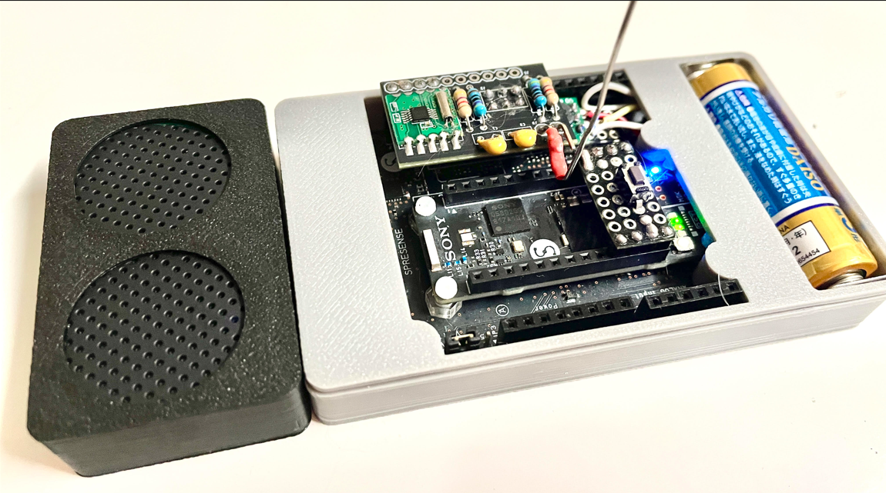
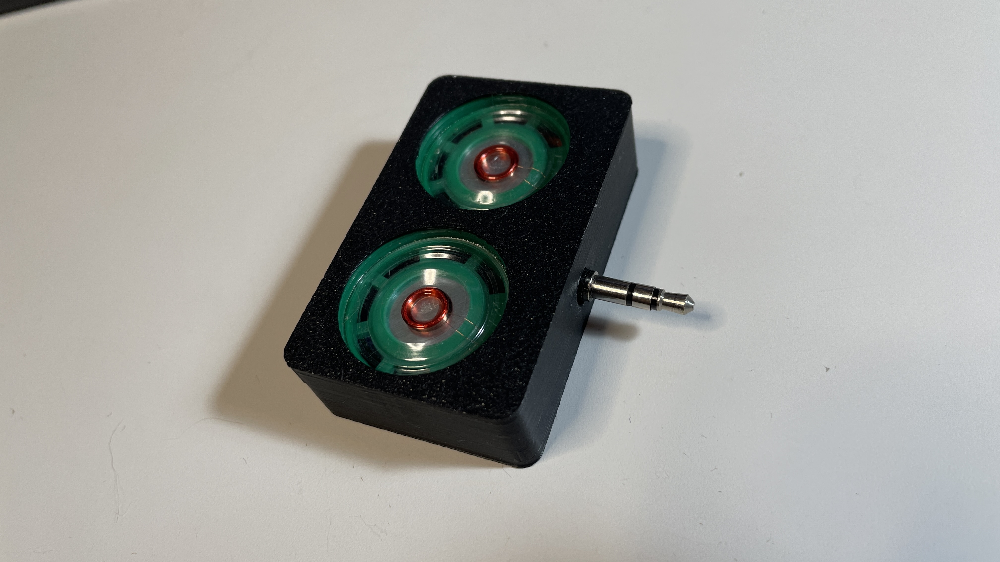

---
## さいごに
ご清聴ありがとうございました
相変わらず長かったです
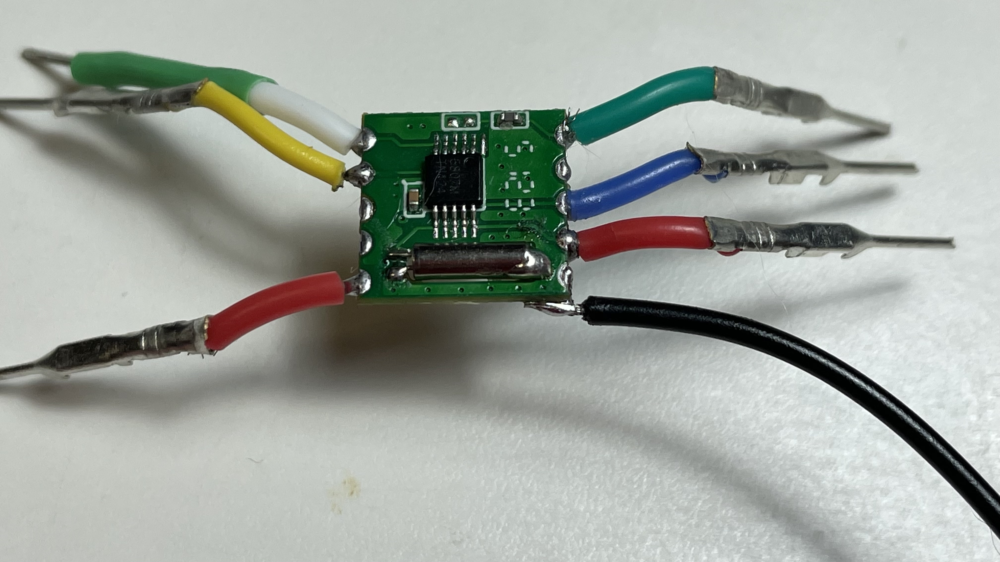
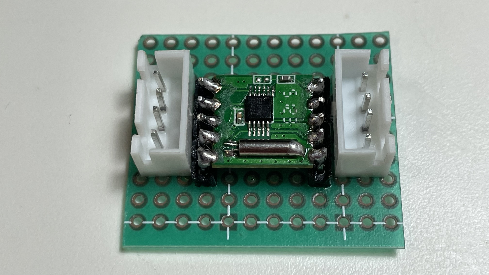
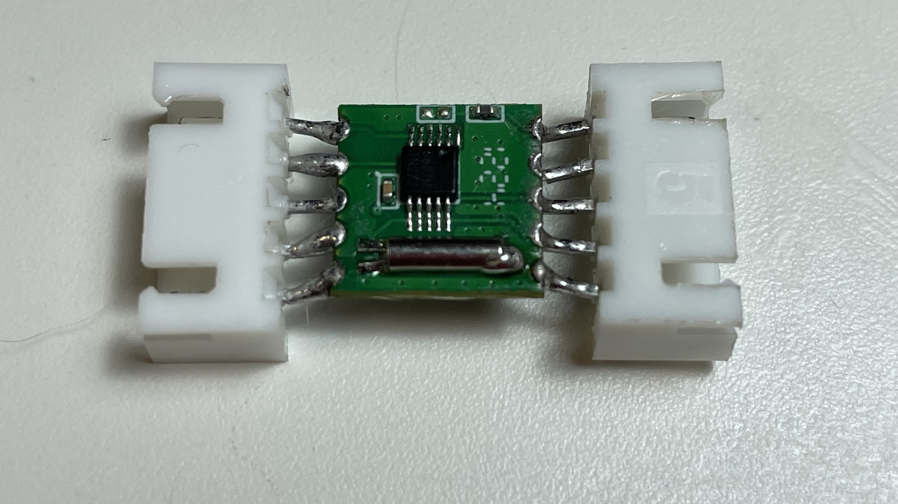
今後も**使えるモジュール**を目指して参ります

<div class="like-wrap"><div data-lyket-type="like" data-lyket-namespace="linalog" data-lyket-color-icon="#b5e853" data-lyket-color-primary="#b5e853" data-lyket-color-text="#eaeaea" data-lyket-color-secondary="#2b2b2b" data-lyket-id="spresense-radio"></div></div>
