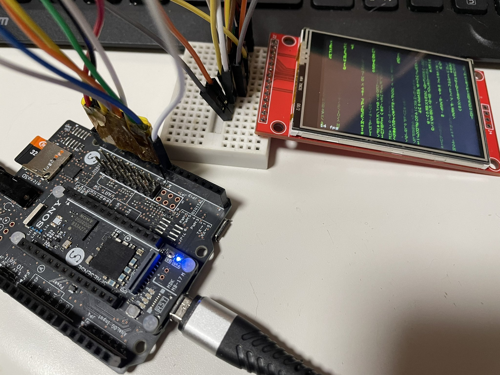
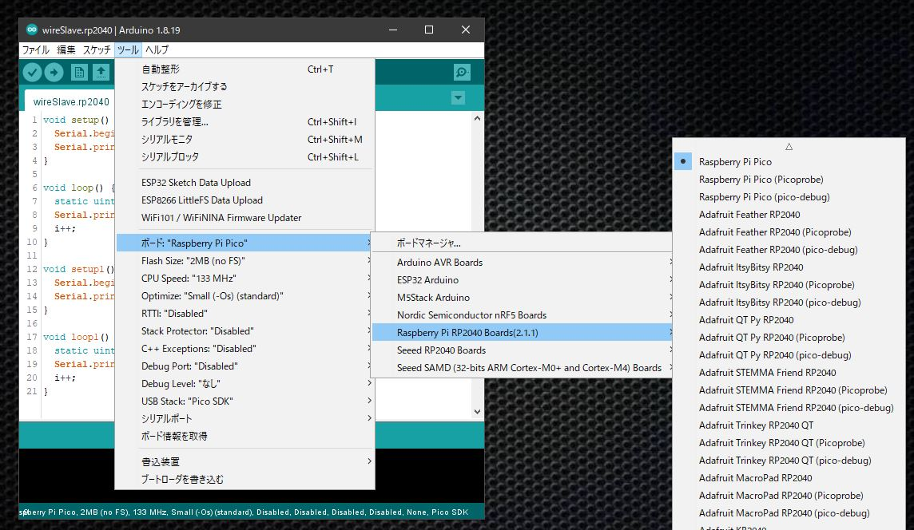
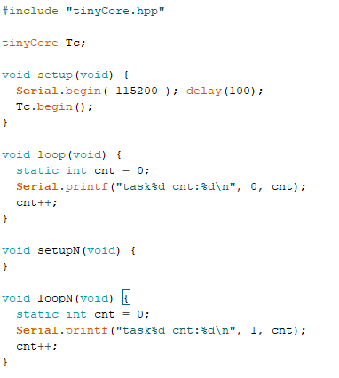
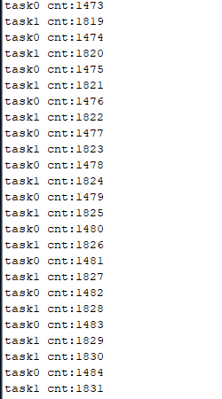

# RP2040のsetup1/loop1が素敵なので SPRESENSE にも実装してみたよっ

2023年12月1日 16:06



# はじめに

お久しぶりです リナちゃん@chrmlinux03 です
SPRESENSE っていうマイコンが数年前から賑わっているんですけど
MultiCore とかの表記がちょっと面倒、さらにtheSD/theAudioとかが MainCore でしか動かないのね
まぁ一個のデバイスを複数のCPUで使うには色々問題が....
でも RP2040の表記方法は楽ですから ここは MultiThread で逃げましょう
音楽を鳴らしながら動画が表示出来ちゃうかも

# RP2040の実行例

++悲しい事に Arduino IDE ボードマネージャー > Rasberry Pi RP2040 Board > Rasberry Pi Pico を選択しないとこの機能は使え無い++

# うーん SPRESENSEで使えるライブラリがあったらなぁ
んぢゃこれ SPRESENSE にも同じような記述方法があれば
Lチカとか楽になりそ
いや劇的に楽になるでそ

# 前提条件
とにかく MainCore だけでささっと書けるけるようなマルチスレッド

# 実装開始
実験的に 2つの TasK を動かしてみる
++ライブラリは、汎用性の高い複数のプログラムを再利用可能な形でひとまとまりにしたものである。ライブラリと呼ぶときは、それ単体ではプログラムとして動作させることはできない、つまり実行ファイルではない場合がある。ライブラリは他のプログラムに何らかの機能を提供するコードの集まりと言える。
wikipedia++

# 完成形

```c++:1st.ino
#include <tinyCore.hpp>
static tinyCore tc;
void setup(void) {
  Serial.begin( 115200 ); while(!Serial);  
  tc.begin();
  // thread0 で実行したい初期化を記述
}
void loop(void) {
  // thread0 で実行したい内容を記述
  delay(1);
}
void setupN(void) {
  // thread1 で実行したい初期化を記述
}
void loopN(void) {
  // thread1 で実行したい内容を記述
  delay(1);
}
```
++**導入方法**
[github tinyCore](https://github.com/chrmlinux/tinyCore)
もしくは ライブラリーマネージャーから 'tinyCore' で検索++
# 動作例

Arduino IDE を使い SPRESENSEでLチカをなさっている方々
さらに上のスーパLチカを目指して
是非こちらをお使いくださいませっ
よろしくお願い申し上げます

