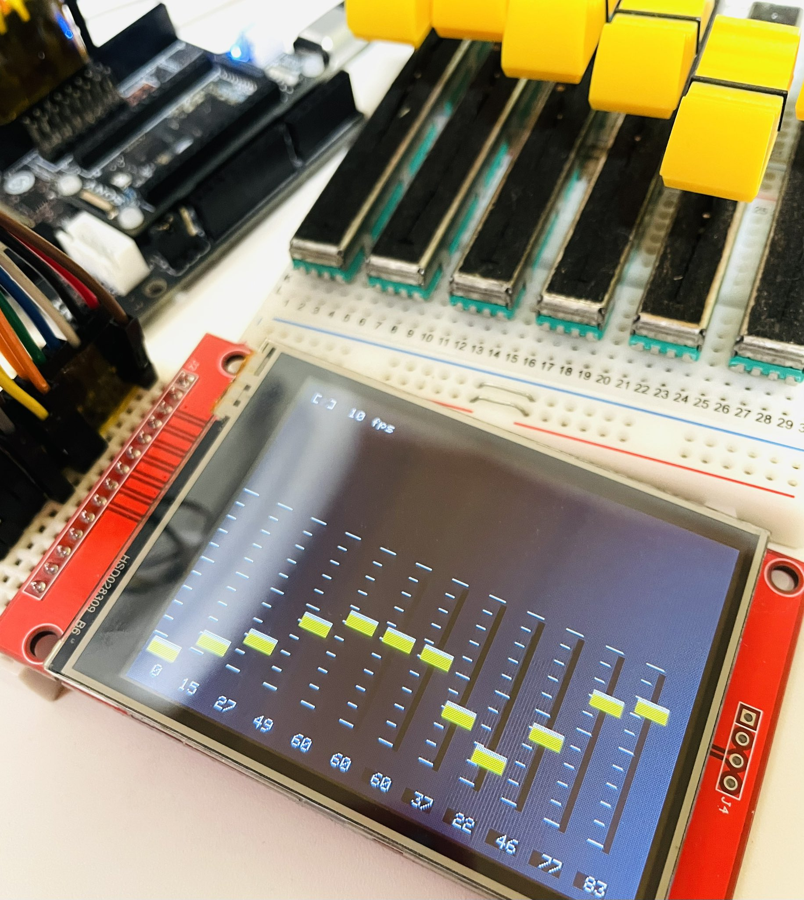
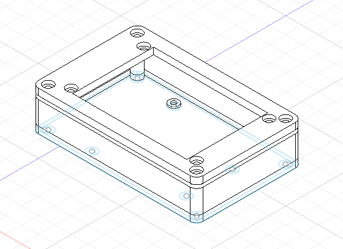
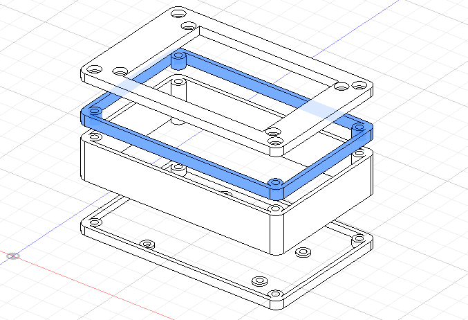
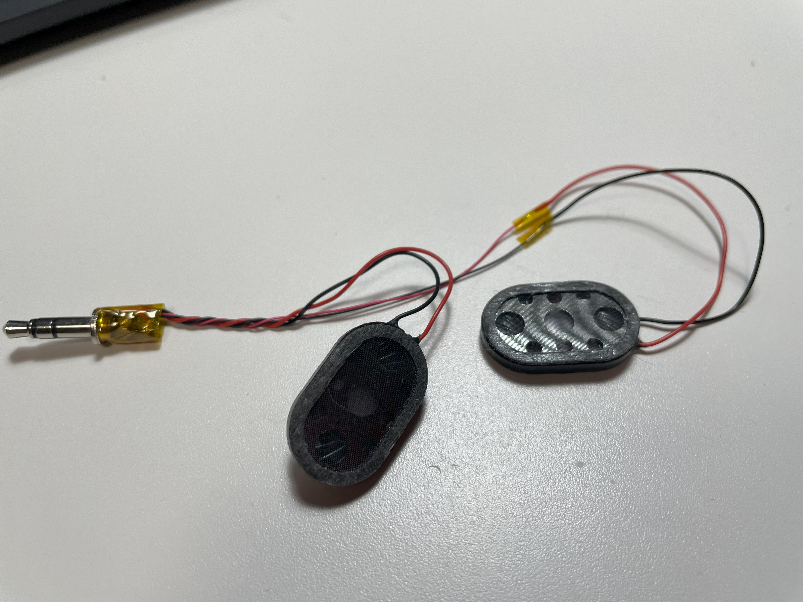
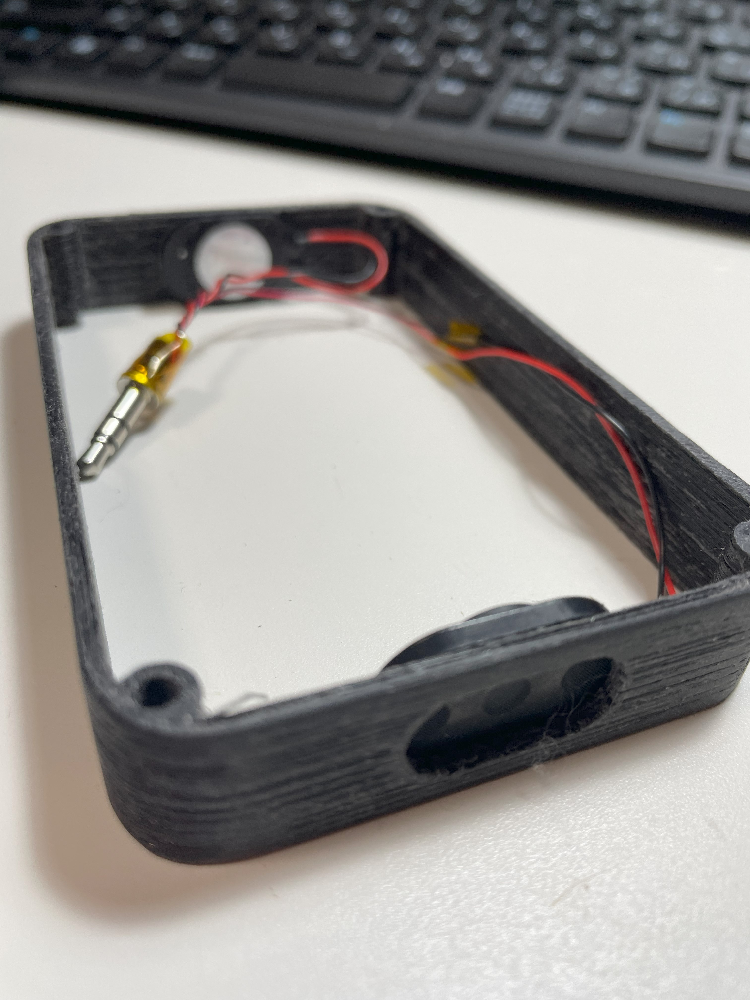
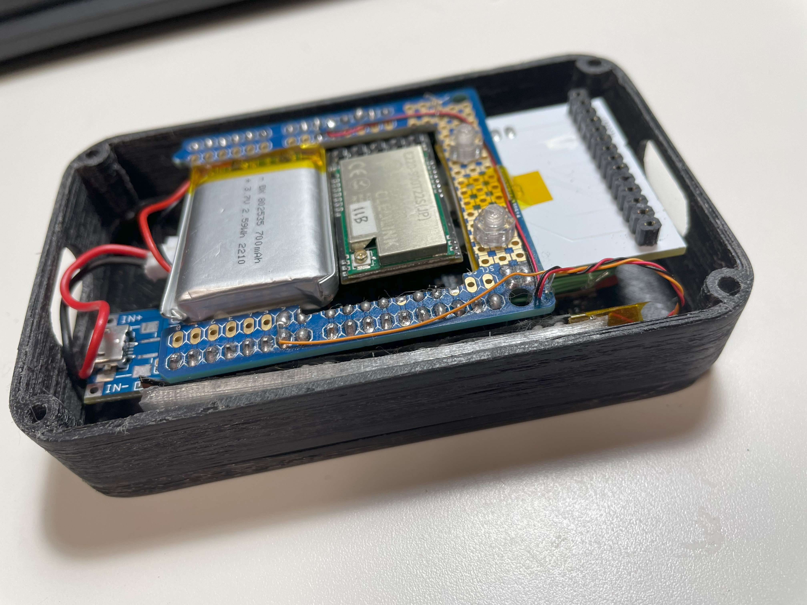
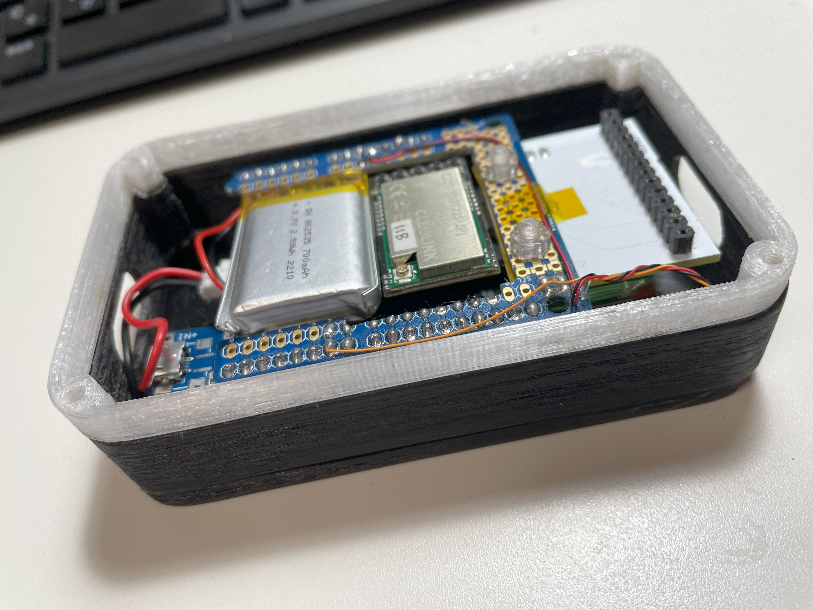
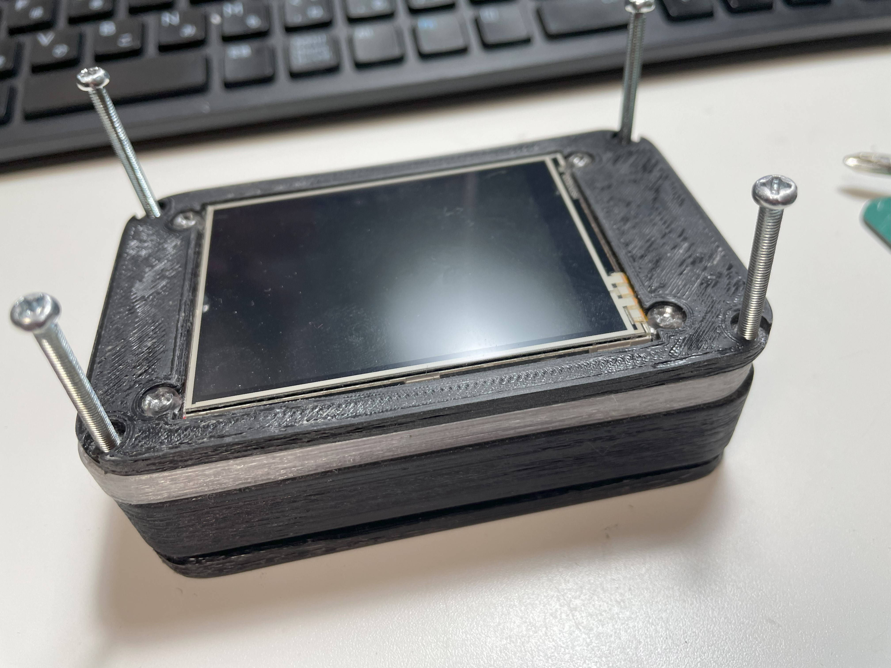

# 【SPRESENSE2023】SoundSerenityを作ったよっ【環境音を8Trackで】

2024年1月26日 09:52



# はじめに
こんにちわっ 

リナちゃん　X@chrmlinux03　です

++このページは SPRESENSE2023コンテストで作った製品を紹介するものです
最初に [開発まとめ](../spresense-2023-matome/) をお読みいただければ幸いです++

# ベッドに入って眠れない日々があった
TVを付けて寝てしまう事も多々あり

でも静かな曲を聴きながら寝入る事もある

って言うかガッツリ寝てるぢゃん💦
# フェーダー状のポテンショメータとの出会い

（X 投稿の埋め込み）

お仕事(センサ屋)でミキサー卓のようなポテンショメータを貰った　👉[ポテンショメータ](https://amzn.to/3ujvfOC)


「おおっ」これは沢山あればミキサーっぽいのが創れる

で、あればこれを複数まとめれば沢山の音がならせるぢゃん💕

（X 投稿の埋め込み）

# 液晶でフェーダー出せるぢゃん


数日後　液晶でフェーダーを作る事に成功　👉[タッチパネルにバーチャルフェーダーを載せたよ](../spresense-virtual-fader/)

今までの苦労は何だったのだろうか。。。。

まぁ他にも作りたいものはあるし（と言う現実逃避発動：逃げ）👉[tinyMixer](../spresense-tinymixer/)

# さまざまな制約
（X 投稿の埋め込み）
（X 投稿の埋め込み）
（X 投稿の埋め込み）
（X 投稿の埋め込み）
（X 投稿の埋め込み）
（X 投稿の埋め込み）
（X 投稿の埋め込み）
（X 投稿の埋め込み）

# シン・プログラマだからなんとかする

（X 投稿の埋め込み）

# Audio DSP はステレオ x 2(4Track)までの制約

前回のコンテストからAudioについてしばらく考えた事がある

- どうやって音がなるのか？（まずはそこから💦）

- 一体何音まで同時出力出来るのか？

- ミキサー構造は一体どうなっているのか？

- Audio0 / Audio1 って何？💦

何もわからないまま無駄に時間だけが経過する

何もわからないまま無駄に sample.ino だけが SSD を圧迫する

ある日突然　自分の理論で音が鳴った


## 全てはここから始まった
（X 投稿の埋め込み）

## 記念すべき日
（X 投稿の埋め込み）

## 何かを決意した
（X 投稿の埋め込み）


# ヒントはここにあった
（X 投稿の埋め込み）
（X 投稿の埋め込み）

# 用意するもの

| 部品名 | 販売先 | 価格 |御提供品|
| -------- | -------- | -------- |-------- |
| 根性     | 誰にでも     |プライスレス|ー|


# ライブラリ等

何故これで音がなるか？に関しては以下を参照

👉[AudioDSPを絶妙にハックしたよ【実践編】](../spresense-audiodsp-jissen/)

# 筐体

## 最初に軽く打ち出し穴位置を修正



## LEDリングも搭載



# 組み立て











# コード
```
//==============================================
//
//  soundSerenity.ino
//----------------------------------------------
//  date/author   : 2024/01/20  @chrmlinux03
//  update/author : 2024/01/28  @chrmlinux03
//
//==============================================
#define PLAYING_FILENAME "044K816.soundSerenity.raw"
const uint8_t numTracks = PLAYING_FILENAME[4] - '0';


#include <spreTools.hpp>
#include <spreAudioLib.hpp>
#include <spreGraphics.hpp>
#include <tinyTouch.hpp>
#include <tinySlider.hpp>
tinySlider sliders[numTracks];
#include <spreSliderSub.hpp>
#include <spreNeo.hpp>
SpreNeo neo;

//==============================================
//
//  setup
//
//==============================================
void setup(void) {
  Serial.begin( 115200 );

  int8_t rotation = ROT270;
  setupGraphics(rotation);
  setupTouch(_w, _h, rotation, false);
  debugAudio = false;
  setupAudio(AUDIO, CLOCK_NORMAL);
  addFile(PLAYING_FILENAME);

  setupSliders(numTracks, _w, _h - 24, 180, 6, 0);

  neo.begin();
  neo.set(LEDKIND_BRESS, 255, 255, 255, 64);
  neo.start();
  setupPlayer(AUDIO0);
  //  setupPlayer(AUDIO1);
}

//==============================================
//
//  loop
//
//==============================================
void loop() {
  neo.update();
  loopPlayer(AUDIO0);
  //  loopPlayer(AUDIO1);

  spr.startWrite();
  spr.clear(TFT_DARKSILVER);

  int tx, ty, tz;
  bool touched = isTouch(&tx, &ty, &tz);
  if (touched) {
    scanSliders();
    readSliders();
  }
  updateSliders();

  static int cnt = 0;
  char ast[4] = "|/-\\";
  spr.setTextColor(TFT_WHITE, TFT_BLACK);
  spr.setCursor(8, 8);
  spr.printf("[%c] %3d fps\n", ast[cnt], getfps());
  cnt = (cnt + 1) % 4;

  spr.pushSprite(&lcd, 0, 0);
  spr.endWrite();
}
```

# 動かしてみた

（X 投稿の埋め込み）

# 残務と今後の考察

現在　Audio0 のみを使用しているので 8Track

これは Audio1 を使えば 16Track は行けるのではないか？

って言うかそこまでいるのかという話である

# さいごに
ご清聴ありがとうございました

まぢでライブラリが出来るまでが長かった💦

++このページは SPRESENSE2023コンテストで作った製品を紹介するものです
最初に [開発まとめ](../spresense-2023-matome/) をお読みいただければ幸いです++

<div class="like-wrap"><div data-lyket-type="like" data-lyket-namespace="linalog" data-lyket-color-icon="#b5e853" data-lyket-color-primary="#b5e853" data-lyket-color-text="#eaeaea" data-lyket-color-secondary="#2b2b2b" data-lyket-id="spresense-soundserenity"></div></div>
