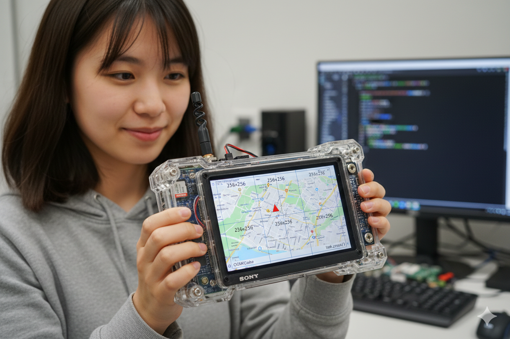
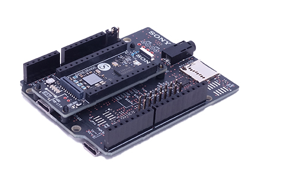
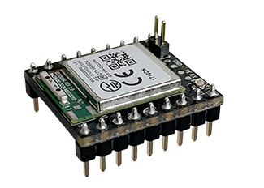
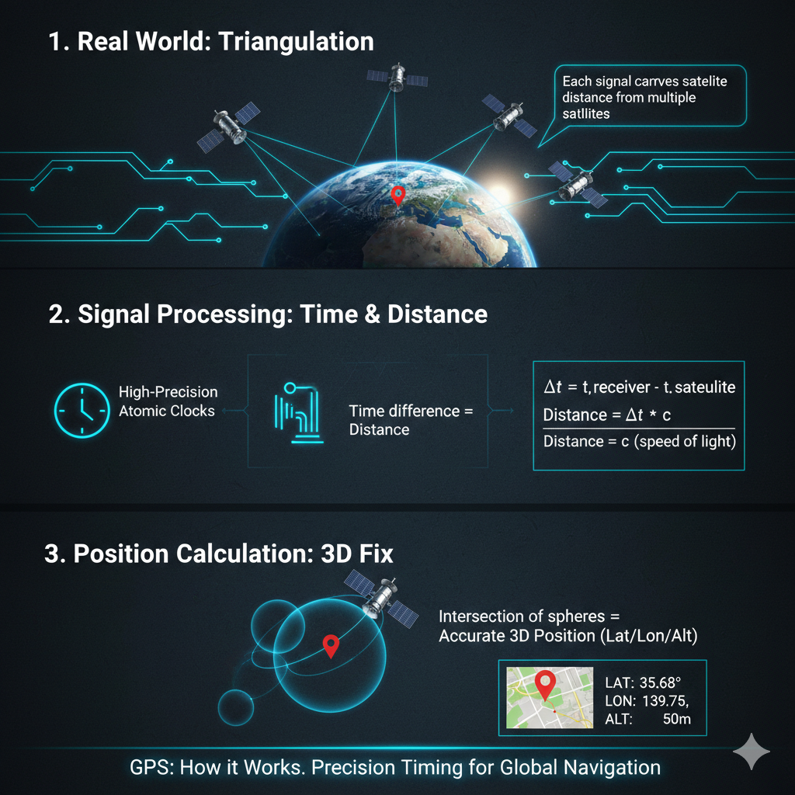
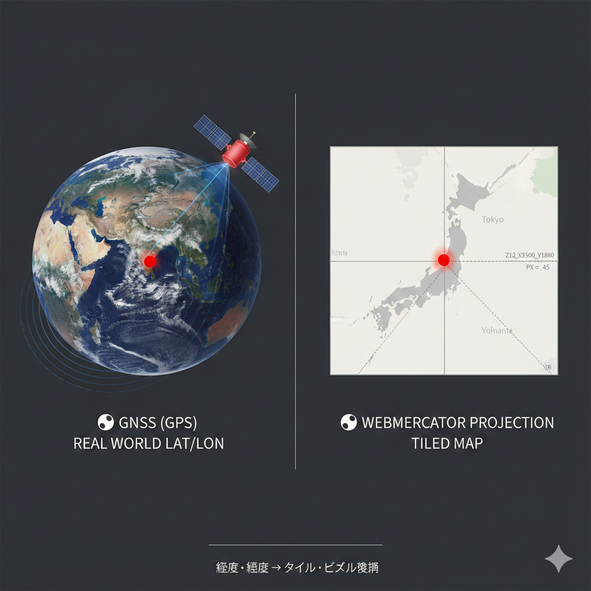
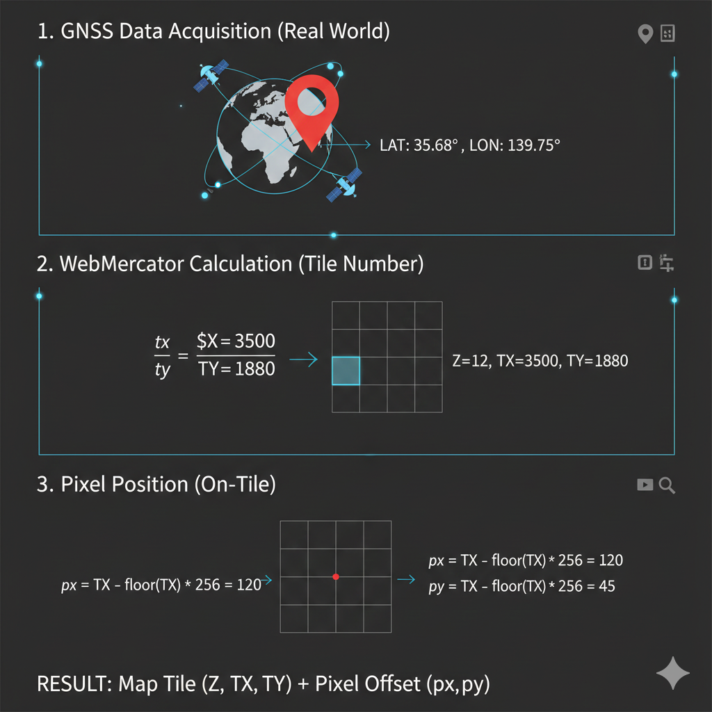
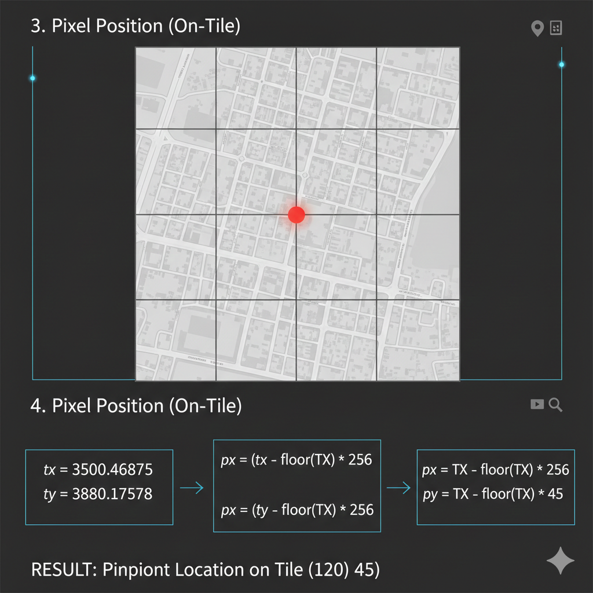
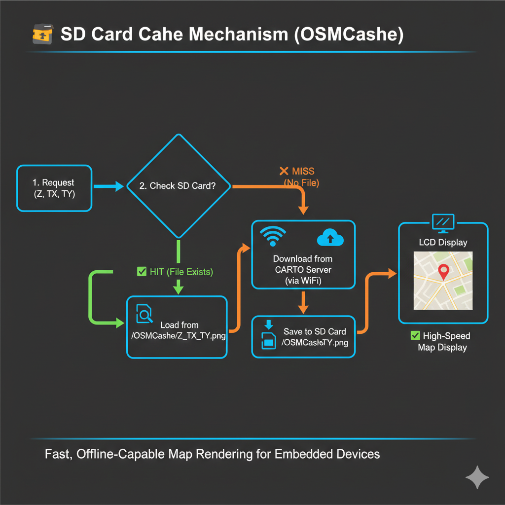
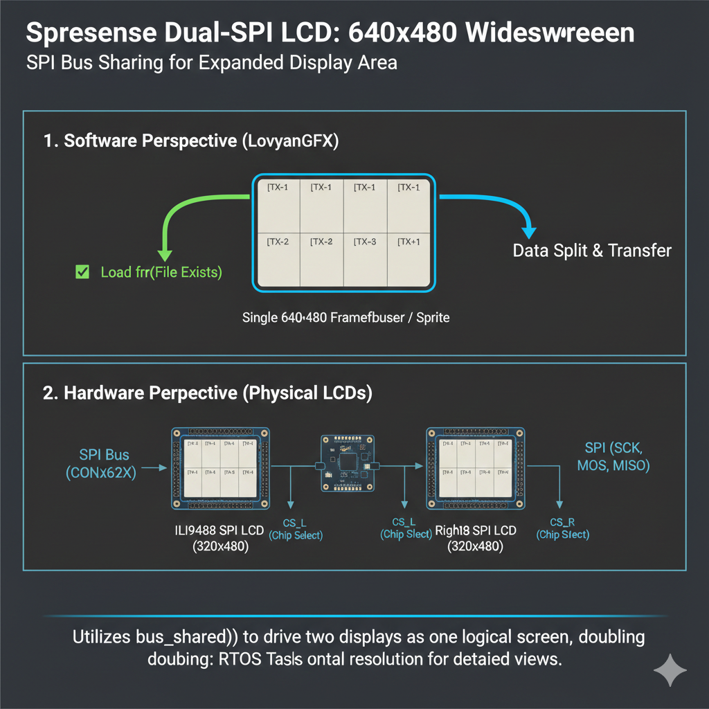

# 【SPRESENSE2025】VGA液晶を搭載しGPS地図を表示したにょ【sprePAD?】

2026年1月28日 01:47




# 概要

Sony Spresense と Spresense WiFi Addon（Telit GS2200）、および LovyanGFX を用いて、OpenStreetMap（CARTO タイル）を表示し、GNSS の現在位置をプロットするマップビューアを実装した。
本稿では以下の内容を扱う。

- WebMercator に基づく OSM タイル計算
- タイルキャッシュ付き地図表示
- SPI 液晶を 2 枚同時に駆動する構成
- Spresense WiFi Addon（GS2200 / UART）でのタイル取得
- task_create() を用いた受信タスク分離

## Spresense とは

Sony Spresense は、GNSS やオーディオ処理を主用途として設計された
高性能マイコンボードである。
主な特徴は以下の通り。
- メイン MCU：CXD5602（ARM Cortex-M4F ×6 コア）
- 高精度 GNSS（GPS / QZSS / SBAS 等）内蔵
- マルチコア・マルチタスク対応
- Arduino IDE / SDK に対応
- SD カード、SPI、I2C、UART など豊富な I/O
- 特に GNSS をハードウェアで内蔵している点が特徴であり、外付け GNSS モジュール無しで測位が可能である。

## Spresense WiFi Addon とは

Spresense WiFi Addon は、Spresense 向けの公式 WiFi 拡張ボードで、
Telit GS2200 WiFi モジュールを搭載している。
主な仕様は以下の通り。
- WiFi モジュール：Telit GS2200
- 接続方式：UART
- 制御方式：AT コマンド
- TCP / UDP / HTTP 通信対応

GS2200 は UART 接続のため、
SPI 接続 WiFi モジュールと異なり 非同期受信処理が重要になる。
本稿では、この特性を踏まえて
task_create() による受信タスク分離を行っている。

## LovyanGFX とは
LovyanGFX は、ESP32 や Spresense などで使用可能な
高速・高機能なお馴染みグラフィックスライブラリである。
主な特徴。
- 多数の LCD コントローラに対応
- SPI / I2C / パラレルなど多様なバス対応
- スプライト（オフスクリーン描画）対応
- バス共有（bus_shared）対応

本実装では以下を活用している。
- SPI バス共有による 複数 LCD 制御
- スプライトを用いた 一括描画 → 分割転送
- PNG 画像の直接描画

| ただしスプライトの幅高さが増えると使用メモリが爆発的に増える、 |
| --- |
| 640x480x2Byteは無謀 |

PNGを扱うと使用メモリが増える


## GNSS とは

GNSS（Global Navigation Satellite System） は、
衛星測位システムの総称である。
代表的なもの。
- GPS（米国）
- QZSS（日本：みちびき）
- SBAS（補強信号）

Spresense には GNSS 受信機が内蔵されており、
外部モジュールなしで高精度な位置情報を取得できる。
本マップビューアでは、GNSS で取得した 緯度・経度を用いてWebMercator 変換を行いOSM タイル上の現在位置を描画している。

ただし衛星の数が増えると内部使用メモリが増える

## OpenStreetMap（CARTO タイル）とは
世界中の地図データをオープンに提供するプロジェクトである。
本実装では、OSM データを元にした
CARTO の light_all タイルを使用している。
|スタイル名称|主な用途|特徴|
|---|---|---|
|light_all|昼間用|明るく清潔感のある配色で、市街地や道路の視認性が高い|
|dark_all|夜間用|黒を基調とした配色。暗い場所での使用や、GNSSのプロットを目立たせるのに最適|
|rastertiles/voyager|カラー表示|地形や公園などが色分けされており、情報量が多い|

### 特徴
- WebMercator 座標系
- 256 × 256 ピクセルの PNG タイル
- ズームレベルごとにタイル分割
利用にあたっては、
以下のクレジット表示が必要となる。
```

  © OpenStreetMap contributors / © CARTO


```

本コードでは、画面下部に常時クレジットを表示している。

## WebMercator とは

WebMercator（Web メルカトル） は、
Web 地図サービスで事実上の標準として使われている
地図投影法（座標変換方式）である。
OpenStreetMap、Google Maps、CARTO など、
ほぼすべてのオンライン地図タイルは WebMercator を採用している。
### 基本的な考え方
#### WebMercator では

- 地球を正方形に正規化
- ズームレベルごとに 2ⁿ × 2ⁿ のタイルに分割
- 各タイルは 256 × 256 ピクセル
というルールで地図を管理する。
#### ズームレベル z のとき
- タイル数：2^z × 2^z
- 原点：左上（北西）
- x：経度方向（東へ増加）
- y：緯度方向（南へ増加）

### 緯度・経度からタイル番号への変換

緯度 lat、経度 lon、ズームレベル z から
タイル座標 (tx, ty) を以下で求める。
```
 n  = 2^z
 tx = (lon + 180) / 360 * n
 ty = (1 - log(tan(lat_rad) + 1 / cos(lat_rad)) / π) / 2 * n
```
ここで lat_rad は緯度をラジアンに変換した値。
tx, ty の 整数部 → タイル番号
tx, ty の 小数部 → タイル内位置

### タイル内ピクセル座標

タイルサイズを 256 ピクセルとすると、
```
 px = (tx - floor(tx)) * 256
 py = (ty - floor(ty)) * 256
```

これにより、
「どのタイルの、どのピクセルが現在位置か」
を正確に求めることができる。
本マップビューアではこの px, py を使い、
中央タイル上に現在位置（赤丸）を描画している。

### WebMercator の特徴と注意点
#### 特徴
- タイル化が容易
- Web 地図と相性が良い
- 実装がシンプル
#### 注意点
- 高緯度ほど面積歪みが大きい
- 緯度 ±85.0511° 付近で制限される

本用途（市街地・移動体表示）では、
実用上ほとんど問題にならない。

### なぜ WebMercator を使うのか
- OSM / CARTO タイルが WebMercator 前提
- 緯度・経度 → ピクセル位置を直接計算可能
- 組み込み環境でも実装しやすい
そのため、本実装では
WebMercator を前提としてタイル計算を行っている。

## タイルキャッシュ付き地図表示とは

### タイルキャッシュとは
ネットワークから取得した地図タイル画像を
ローカルストレージ（SD カードなど）に保存し、再利用する方式である。
オンライン地図を組み込み機器で扱う場合、
通信速度・通信量・安定性が大きな制約になるため、
キャッシュは実用上ほぼ必須となる。

### 地図タイルの基本構造
OSM / CARTO の地図は、
- 256 × 256 ピクセルの PNG 画像
- (zoom, tx, ty) で一意に決まる
という タイル単位で構成されている。
同じズーム・同じタイル番号であれば、
表示内容は常に同一である。
### キャッシュの仕組み
本実装では以下の流れで処理している。
1. 表示に必要なタイルを計算
2. SD カード上に該当ファイルが存在するか確認
3. 存在すれば SD から読み込み描画
4. 存在しなければ WiFi で取得
5. 取得したタイルを SD に保存
6. 次回以降は SD キャッシュを使用


### キャッシュファイル保存形式
```
/OSMCashe/{zoom}_{tx}_{ty}.png
````


###  なぜキャッシュが必要か

- 通信量の削減
同じ場所を表示するたびに
タイルを再ダウンロードする必要がなくなる。
- 表示の高速化
SD カードからの読み出しは
WiFi 経由よりもはるかに高速で安定している。
- 通信切断時でも表示可能
一度取得したエリアであれば、
WiFi が切れても地図表示を継続できる。
- GS2200（UART）との相性
GS2200 は UART 接続のため、
転送速度に限界がある
受信処理が CPU に負荷をかける
キャッシュにより
WiFi 通信回数そのものを減らすことが
安定動作につながる。

### キャッシュまとめ
- Spresenseで安定して動く
- 地図タイルは再利用可能な静的データ
- SD カードに保存することで高速・安定化
- UART 接続 WiFi 環境では特に有効
- 組み込み地図表示では定番の手法

## GPS / WiFi / UART 同時使用に関して
Spresense を用いた本構成では
GNSS（GPS）・WiFi（GS2200）・UART を同時に使用している。
これらはすべて 非同期に動作する要素であり、
組み込み環境では処理の分離を意識しないと
動作不安定やデータ欠損を引き起こしやすい。

### 使用している通信要素
本システムで同時に扱っている要素は以下の通り。
#### GNSS
- Spresense 内蔵
- 衛星データ・測位結果は非同期に更新
#### WiFi（GS2200）
- UART 接続
- AT コマンド制御
- 受信データは断続的に到着
#### UART
- GS2200 通信に使用
- 割り込みベースで受信
-  PCとのデバッグに必要

### 問題になりやすい点
これらを単純に loop() 内で直列処理すると
- GNSS 処理中に UART 受信が滞る
- LCD 描画中に WiFi データを取りこぼす
- SD 書き込み中に受信バッファが溢れる
といった問題が発生しやすい。
特に GS2200 は UART 通信のため受信タイミングを逃すとデータが失われる。
またGNSSは内部的にメモリ取得解放を繰り返すようで
GNSS/WiFi の同時使用は難しい

### 本実装での対策
- WiFi停止コマンドが無いので通信を行わない対応にて逃げた
- WiFi 受信は専用タスクで処理
- task_create() により受信処理を分離
- GNSS 更新と地図更新を分離
- WiFi 使用中は GNSS を一時停止
- 描画処理と通信処理を同時に行わない

これにより
- UART 受信の取りこぼし防止
- GNSS / WiFi の競合回避
- LCD 描画の安定化

### なぜ Spresense で可能なのか
Spresense は以下の特徴を持つ。
- マルチコア構成
- RTOS ベースのタスク管理
- task_create() による並列処理
これにより、
UART 受信のようなリアルタイム性が必要な処理を
他の処理から分離して実行できる。

### デバイス同時使用まとめ
- GPS / WiFi / UART はすべて非同期要素
- 直列処理では不安定になりやすい
- GS2200（UART）は特に受信遅延に弱い
- task_create() による処理分離が有効

# 使用環境
・ボード：Sony Spresense MainCore
・IDE：Arduino IDE 1.8.19
・WiFi：Spresense WiFi Addon（Telit GS2200）
　接続方式：UART
・GNSS：Spresense 内蔵 GNSS
・Display：ILI9488 ×2（SPI）
・描画ライブラリ：LovyanGFX
・Map Tile：OpenStreetMap / CARTO light_all
・ストレージ：SD カード

# システム構成
・画面解像度：320 × 480
・SPI 接続液晶：2 枚
・横方向に連結し 640 × 480 として扱う
・表示タイル数：3 × 2
・中央タイルを基準に地図を描画

# 部品と価格
|部品名|価格|
|---|---|
|spresense本体|ご提供品|
|spresense拡張ボード|ご提供品|
|ILI9488 ×2|1500円程度|
|SDカード(16GB)|500円|
|ハーネス|自作|

# 配線

|spresense CN1|lcd1|lcd2|
|---|---|---|
|VCC|VCC|VCC|
|GND|GND|GND|
|pin13(CLK)|TFT_SCK|TFT_SCK|
|pin12(MISO)|TFT_MISO|TFT_MISO|
|pin11(MOSI)|TFT_MOSI|TFT_MOSI|
|pin10(CS0)|-|-|
|pin9(DC)|TFT_DC|TFT_DC|
|pin8(RST)|-|-|
|pin7|TFT_CS1|-|
|pin6|-|TFT_SC2|

# タイル配置
```
[ tx-1, ty-1 ] [ tx, ty-1 ] [ tx+1, ty-1 ]
[ tx-1, ty   ] [ tx, ty   ] [ tx+1, ty   ]
````
# SPI 液晶を 2 枚同時に扱う構成

Spresense では SPI バスを共有しつつ、CS を分離することで複数 LCD を制御できる。
1 枚のスプライトへ描画後、左右に分割して各 LCD へ転送する。
☞[過去の実験](../spresense-multi-lcd/)

# GS2200 と task_create()
GS2200 は UART 接続の WiFi モジュールであり、HTTP レスポンスは断続的に到着する。
UART 受信を安定させるため、受信処理を task_create() により別タスクとして分離している。

# コード
なにか色々割り込みやらメモリの関係で複数ファイルに分けると作業が進まず
私にしてはかなり珍しく3本の構成となった
## user.hpp
```:user.hpp
//============================================
// fname       : user.hpp
// info            : user wifi ssid/pass
// date/author : 2025/12/25 @chrmlinux03
//============================================
#pragma once
#define WIFI_SSID "YOUR_SSID"
#define WIFI_PASS "YOUR_PASSWORD"
```

```:spreGnssRtcMin.hpp
//============================================
// fname       : spreGnssRtcMin.hpp
// info        : minimal GNSS + RTC wrapper
// date/author : 2025/12/25 @chrmlinux03
//============================================
#pragma once

#include <Arduino.h>
#include <GNSS.h>
#ifdef USE_RTC
#include <RTC.h>
#endif

/*
  GPS      米国         必須
  GLONASS ロシア        都市部で安定
  QZ_L1CA みちびき      日本で効果大
  QZ_L1S  みちびき補強   単独測位不可
  SBAS    補強（MSAS等） 測位精度補正
  BEIDOU  中国          衛星数増
  GALILEO 欧州          精度向上
*/

#define MY_TIMEZONE_IN_SECONDS (9 * 60 * 60)

class spreGnssRtcMin {
  public:
    void begin(int disp = PrintNone) {
      baseLat = 0.0;
      baseLon = 0.0;
#ifdef USE_RTC
      RTC.begin();
#endif
      Gnss.setDebugMode(disp);
      if (Gnss.begin() != 0) {
        while (1);
      }
      Gnss.select(GPS);
    }

    bool addSatellite(SpSatelliteType type) {
      if (type == 0) return false;
      if (type == GPS) return false;
      Gnss.select(type);
      return true;
    }

    void setBase(double lat_, double lon_) {
      baseLat = lat_;
      baseLon = lon_;
    }

    void start(bool cold = true) {
      if (Gnss.start(cold ? COLD_START : HOT_START) != 0) {
        while (1);
      }
    }

    void stop() {
      if (Gnss.stop() != 0) {
        Serial.println("stop error !");  
        while(1);
      }
    }
    
    void end() {
      if (Gnss.end() != 0) {
        Serial.println("end error !");  
        while(1);
      }
    }
    
    bool update(int timeout = -1) {
      return Gnss.waitUpdate(timeout);
    }

    bool getPosition(double &lat, double &lon) {
      SpNavData nav;
      Gnss.getNavData(&nav);

      if (!nav.posDataExist) {
        return false;
      }

      lat = nav.latitude - baseLat;
      lon = nav.longitude - baseLon;
#ifdef USE_RTC
      updateRTC();
#endif
      return true;
    }

    int getSatelliteCount() {
      SpNavData nav;
      Gnss.getNavData(&nav);
      return nav.numSatellites;
    }

#ifdef USE_RTC
    void updateRTC() {
      SpNavData nav;
      Gnss.getNavData(&nav);

      SpGnssTime &t = nav.time;
      if (t.year < 2000) return;

      RtcTime gps(t.year, t.month, t.day,
                  t.hour, t.minute, t.sec,
                  t.usec * 1000);

      gps += MY_TIMEZONE_IN_SECONDS;

      RtcTime now = RTC.getTime();
      int32_t diff = (int32_t)(now - gps);

      if (diff != 0) {
        RTC.setTime(gps);
      }
    }
#endif

  private:
    double baseLat;
    double baseLon;
    SpGnss Gnss;
};
```
```
//
// fname : spreOsmViewer.ino
// update/author : 2026/01/27 @chrmlinux03 (Integrated OSMCashe & Plot)
// 1536 KByte
//
// Map tiles by CARTO,
// data © OpenStreetMap contributors
//

//===============================
// include
//===============================
#include "user.hpp"
#include <SDHCI.h>
SDClass SD;
#include <TelitWiFi.h>
#include "spreGnssRtcMin.hpp"
#define LGFX_USE_V1
#include <LovyanGFX.hpp>

//===============================
// user
//===============================
// TOKYO TOWER
#define LAT_TOP  35.658641
#define LON_TOP 139.745486
#define BASE_ZOOM 15
#define CACHE_DIR "/OSMCashe"

//===============================
// define
//===============================
#define TILE_SIZE 256
#define TILE_COL 3
#define TILE_ROW 2
#define TILE_BUFMAX (60 * 1024)
#define WIFI_BUFMAX (1500)
#define TASK_PRIORITY 120
#define TASK_STACKSIZE (1024 * 8)
#define DEPTH_BIT 16

#define SPI4_SCLK 13
#define SPI4_MISO 12
#define SPI4_MOSI 11
#define SPI4_CS0  10
#define SPI4_DC    9
#define SPI4_RST  -1 // 8
#define SPI4_CS1   7
#define SPI4_CS2   6

#define MEGA (1000 * 1000)
#define PANEL Panel_ILI9488
#define PANEL_WIDTH 320
#define PANEL_HEIGHT 480
#define OSM_COPYRIGHT "(C)OpenStreetMap contributors / (C)CARTO"
enum {ROT0 = 0, ROT90, ROT180, ROT270};

//===============================
// struct
//===============================
typedef struct {
  double lat;
  double lon;
  double rad;
  int zm;
  int tx;
  int ty;
  int px;
  int py;
} TILE_T;

//===============================
// LGFX
//===============================
class LGFX : public lgfx::LGFX_Device {
    lgfx::PANEL _panel_instance;
    lgfx::Bus_SPI _bus_instance;
  public:
    LGFX(int cs_pin) {
      auto cfg_b = _bus_instance.config();
      cfg_b.spi_port = 4;
      cfg_b.freq_write = 20 * MEGA;
      cfg_b.freq_read  = 20 * MEGA;
      cfg_b.pin_sclk = SPI4_SCLK;
      cfg_b.pin_mosi = SPI4_MOSI;
      cfg_b.pin_miso = SPI4_MISO;
      cfg_b.pin_dc   = SPI4_DC;
      _bus_instance.config(cfg_b);
      _panel_instance.setBus(&_bus_instance);
      auto cfg_p = _panel_instance.config();
      cfg_p.pin_cs = cs_pin;
      cfg_p.pin_rst = SPI4_RST;
      cfg_p.panel_width  = PANEL_WIDTH;
      cfg_p.panel_height = PANEL_HEIGHT;
      cfg_p.bus_shared = true;
      _panel_instance.config(cfg_p);
      setPanel(&_panel_instance);
    }
};

//===============================
// work
//===============================
TelitWiFi wifi;
spreGnssRtcMin gps;
LGFX lcd[2] = {
  LGFX(SPI4_CS1),
  LGFX(SPI4_CS2)
};
LGFX_Sprite spr;

TILE_T nt;
volatile static uint8_t memBuf[TILE_BUFMAX];
volatile static uint32_t memCnt = 0;
volatile static bool isDownloading = false;
volatile static bool wifiBusy = false;
volatile static char nowCid = -1;

//===============================
// wifiOn/wifiOff
//===============================
bool wifiOn() {
  static bool inited = false;
  if (!inited) {
    Init_GS2200_SPI_type(iS110B_TypeC);
    TWIFI_Params params;
    params.mode = 0; params.psave = 1;
    if (wifi.begin(params)) return false;
    inited = true;
  }
  if (wifi.activate_station((char*)WIFI_SSID, (char*)WIFI_PASS)) return false;
  wifiBusy = true;
  return true;
}
void wifiOff() {
  wifiBusy = false;
}

//===============================
// map_receiver_task
//===============================
static int map_receiver_task(int argc, char *argv[]) {
  unsigned long lastTime = millis();
  uint8_t rBuf[WIFI_BUFMAX] = {0};
  memCnt = 0;
  while (isDownloading) {
    if (wifi.available()) {
      int len = wifi.read(nowCid, rBuf, sizeof(rBuf));
      if (len > 0) {
        memcpy((void*)&memBuf[memCnt], rBuf, len);
        memCnt += len;
        WiFi_InitESCBuffer();
        lastTime = millis();
      }
    } else {
      if (memCnt > 0 && (millis() - lastTime > 800)) break;
      usleep(1000);
    }
  }
  isDownloading = false;
  return 0;
}

//===============================
// drawPngFromMem
//===============================
static const uint8_t pngSig[8] = {
  0x89, 'P', 'N', 'G', 0x0D, 0x0A, 0x1A, 0x0A
};
void drawPngFromMem(int x, int y) {
  if (memCnt < sizeof(pngSig)) return;

  for (size_t i = 0; i <= memCnt - sizeof(pngSig); i++) {
    if (memcmp(&memBuf[i], pngSig, sizeof(pngSig)) == 0) {
      spr.drawPng((uint8_t*)&memBuf[i], memCnt - i, x, y);
      return;
    }
  }
}

//===============================
// updateLcd
//===============================
void updateLcd() {
  int startX = (spr.width()  - (TILE_SIZE * TILE_COL)) / 2;
  int startY = (spr.height() - (TILE_SIZE * TILE_ROW)) / 2;

  int cx = startX + TILE_SIZE + nt.px;
  int cy = startY + TILE_SIZE + nt.py;

  spr.fillCircle(cx, cy,  8, TFT_RED);
  spr.drawCircle(cx, cy, 10, TFT_WHITE);

  drawFreeMem(&spr, 0, spr.height() - 8);
  drawCopyRight(&spr, OSM_COPYRIGHT, PANEL_WIDTH, spr.height() - 8);

  for (int i = 0; i < 2; i++) {
    lcd[i].startWrite();
    spr.pushSprite(&lcd[i], -(i * PANEL_WIDTH), 0);
    lcd[i].endWrite();
  }
}

//===============================
// calculateTile
//===============================
void calculateTile(TILE_T *t) {
  double lat_rad = t->lat * M_PI / 180.0;
  double n = pow(2, t->zm);

  double xf = (t->lon + 180.0) / 360.0 * n;
  double yf = (1.0 - log(tan(lat_rad) + 1.0 / cos(lat_rad)) / M_PI) / 2.0 * n;

  t->tx = (int)xf;
  t->ty = (int)yf;

  t->px = (int)((xf - t->tx) * TILE_SIZE);
  t->py = (int)((yf - t->ty) * TILE_SIZE);
}

//===============================
// readMap
//===============================
void readMap(TILE_T val) {
  calculateTile(&val);
  nt = val;
  if (!SD.exists(CACHE_DIR)) SD.mkdir(CACHE_DIR);

  int baseTX = nt.tx - 1;
  int baseTY = nt.ty - 1;
  int startX = (spr.width() - (TILE_SIZE * TILE_COL)) / 2;
  int startY = (spr.height() - (TILE_SIZE * TILE_ROW)) / 2;

  for (int row = 0; row < TILE_ROW; row++) {
    for (int col = 0; col < TILE_COL; col++) {
      int tx = baseTX + col;
      int ty = baseTY + row;
      char f[64]; snprintf(f, sizeof(f), "%s/%d_%d_%d.png", CACHE_DIR, nt.zm, tx, ty);
      int posX = startX + col * TILE_SIZE;
      int posY = startY + row * TILE_SIZE;

      if (SD.exists(f)) {
        File data = SD.open(f, FILE_READ);
        memCnt = data.read((uint8_t*)memBuf, TILE_BUFMAX);
        data.close();
        drawPngFromMem(posX, posY);
      } else if (wifiOn()) {
        nowCid = wifi.connect((char*)"a.basemaps.cartocdn.com", (char*)"80");
        if (nowCid != -1) {
          String path = "/light_all/" + String(nt.zm) + "/" + String(tx) + "/" + String(ty) + ".png";
          String req = "GET " + path + " HTTP/1.1\r\nHost: a.basemaps.cartocdn.com\r\nConnection: close\r\n\r\n";
          wifi.write(nowCid, (uint8_t*)req.c_str(), req.length());
          isDownloading = true;
          task_create("m_rx", TASK_PRIORITY, TASK_STACKSIZE, (main_t)map_receiver_task, NULL);
          while (isDownloading) delay(10);
          drawPngFromMem(posX, posY);
          File data = SD.open(f, FILE_WRITE);
          if (data) {
            data.write((uint8_t*)memBuf, memCnt);
            data.close();
          }
        }
      }
    }
  }
  wifiOff();
}

//===============================
// setupGPX/stopGPS
//===============================
void stopGps() {
  gps.stop();
  gps.end();
}
void setupGps(bool mode) {
  gps.begin();
  gps.addSatellite(QZ_L1CA);
  gps.addSatellite(QZ_L1S);
  gps.addSatellite(SBAS);
  gps.start(mode);
}

//===============================
// drawCopyRight
//===============================
String formatComma(unsigned long val) {
  String s = String(val);
  for (int i = s.length() - 3; i > 0; i -= 3) s = s.substring(0, i) + "," + s.substring(i);
  return s;
}
void drawCopyRight(LGFX_Sprite *dst, const char* msg, int x, int y) {
  dst->setTextColor(TFT_BLACK, TFT_WHITE);
  dst->setFont(&fonts::Font0);
  dst->setTextSize(1);
  dst->setCursor(x, y);
  dst->printf(" %s ", msg);
}
void drawFreeMem(LGFX_Sprite *dst, int x, int y) {
  dst->setTextColor(TFT_BLACK, TFT_WHITE);
  dst->setFont(&fonts::Font0);
  dst->setTextSize(1);
  dst->setCursor(x, y);
  dst->printf(" %s BytesFree", formatComma(mallinfo().fordblks).c_str());
}

//===============================
// setup/loop
//===============================
void setup() {
  Serial.begin(115200);
  while (!Serial);
  if (!SD.begin()) {
    Serial.println("SDCARD ERROR");
    while (1);
  }
  for (int i = 0; i < 2; i++) {
    lcd[i].init();
    lcd[i].clear(TFT_BLACK);
  }
  spr.setColorDepth(DEPTH_BIT);
  spr.createSprite(PANEL_WIDTH * 2, PANEL_HEIGHT);
  spr.setRotation(ROT0);
  if (!wifiBusy) {
    nt.lat = LAT_TOP;
    nt.lon = LON_TOP;
    nt.zm = BASE_ZOOM;
    readMap(nt);
    updateLcd();
    setupGps(COLD_START);
  }
}

void loop() {
  double lat, lon;
  Serial.printf("sats %d\n", gps.getSatelliteCount());
  if (gps.update() && gps.getPosition(lat, lon)) {
    if (!wifiBusy) {
      stopGps();
      nt.lat = lat;
      nt.lon = lon;
      readMap(nt);
      updateLcd();
      setupGps(HOT_START);
    }
  }
}
```
# 実機
<blockquote class="twitter-tweet" data-theme="dark"><a href="https://twitter.com/chrmlinux03/status/2014982705122041960"></a></blockquote>
<script async src="https://platform.twitter.com/widgets.js" charset="utf-8"></script>

# まとめ
・GS2200 は UART 接続
・HTTP 受信は非同期
・task_create() による分離が安定動作に必須
・最初は簡単に進んだが、GNSS連結から大変でした

ご清聴ありがとうございました

<div class="like-wrap"><div data-lyket-type="like" data-lyket-template="twitter" data-lyket-namespace="linalog" data-lyket-color-icon="#b5e853" data-lyket-color-primary="#b5e853" data-lyket-color-text="#eaeaea" data-lyket-color-secondary="#2b2b2b" data-lyket-id="spresense-sprepad"></div></div>
