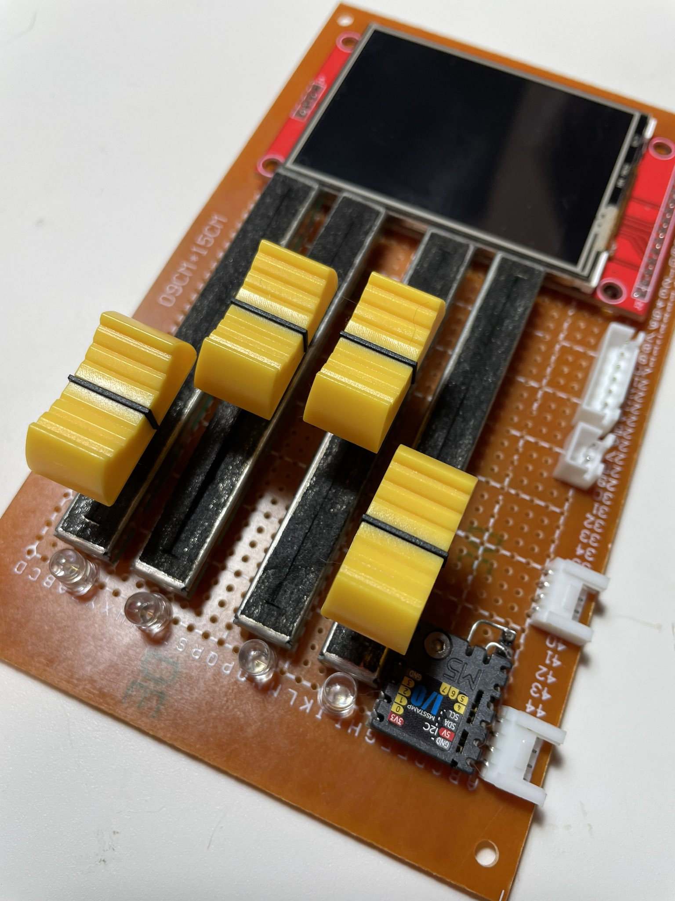
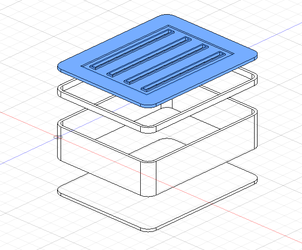
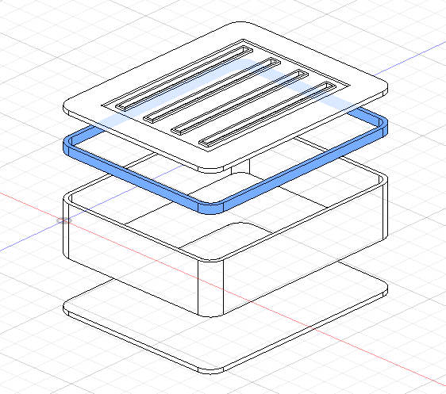
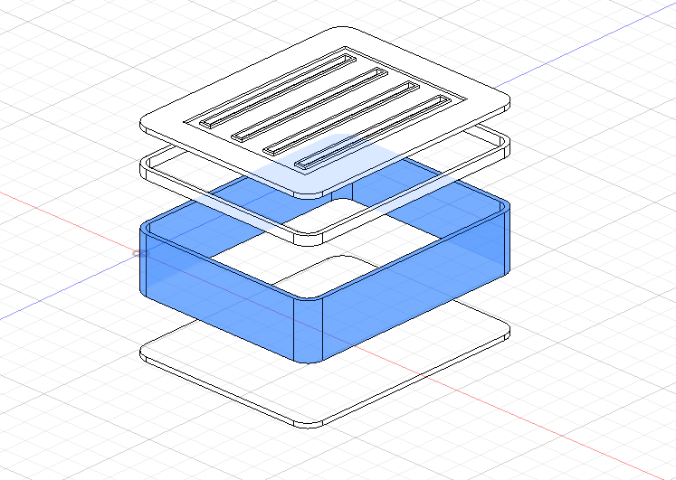
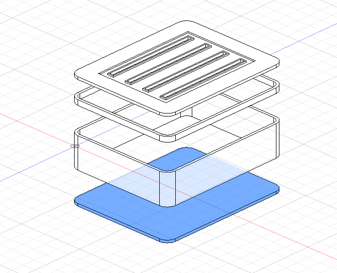
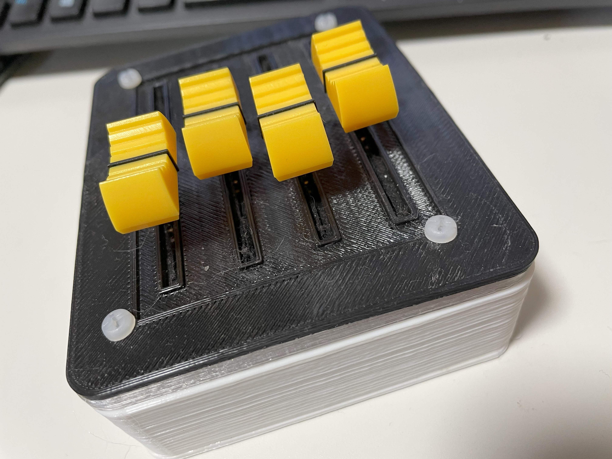

# 【SPRESENSE2023】tinyMixer【簡易ミキサー】

2024年1月26日 09:45

こんにちわっ 

リナちゃん　X@chrmlinux03　です

++このページは SPRESENSE2023コンテストで作った部品を紹介するものです
最初に [開発まとめ](../spresense-2023-matome/) をお読みいただければ幸いです++

# はじめは SoundSerenity用の部品だった

お仕事の中で フェーダー状のポテンショメータを扱う機会があった

いい感じのBカーブなので密林で購入して置いた

「これはフェーダーになるんぢゃね？」

とか考えていたら　👉[タッチパネルにバーチャルフェーダーを載せたよ](../spresense-virtual-fader/)　が出来ちゃったのでこちらに流用💦

まぁ捨てる神あれば拾う神ありっていう事

# 用意するもの
|  部品名 |  販売先  |価格|御提供品|
|-|-|-|-|
|  [ストレートスライドポテンショメーター](https://amzn.to/3SyNtFi) |  Amazon  |739円(5個)|ー| 
|[B-stem 4CM01 SPRESENSE用4chマイク基板](https://www.switch-science.com/products/7996)|スイッチサイエンス|3,300円|ー|
|超小型 3W D級ステレオアンプモジュール　HW-104| 持ってた  |100円x2|ー| 
|  ちょっと大きめなスルーホール基板 |  持ってた  |プライスレス|ー| 

液晶基板は、👉[B-Stem4CM01Display にタッチパネルの改造を行うよ](../spresense-bstem-touch/)　で使ったのでマイク基板だけを使う

# 配線

HW-104 は 1個がステレオ対応なので L/R をマイク入力の前に入れて2個あれば4ch分を確保できる
あーそうそうライン入力だと下がるのねだからHW-104で対応٩(ˊᗜˋ*)و

# ケース

LEDが光る所は今回のプロジェクトで共通のものとして

挟み込む事で実現した　👉[WS2812B を使った流れるような効果を](../spresense-ws2812b/)　を使って光を上方向だけに「ぼぅ」っと光らせます

# 印刷物

まずは最初に**大枠だけ印刷**して**手作業**で**実機合わせ**で穴をあけて

それを３DCADに持っていくスタイルです

# 残務と今後の考察

ちょっとねソフトが間に合わない感じ💦

まぁ最後の最後までやってみますね

through　で入力されちゃうとエフェクト掛けられないから

取り込んで 👉[AudioDSPを絶妙にハックしたよ【実践編】](../spresense-audiodsp-jissen/) で出力させる(予定)

# さいごに
++このページは SPRESENSE2023コンテストで作った部品を紹介するものです
最初に [開発まとめ](../spresense-2023-matome/) をお読みいただければ幸いです++

