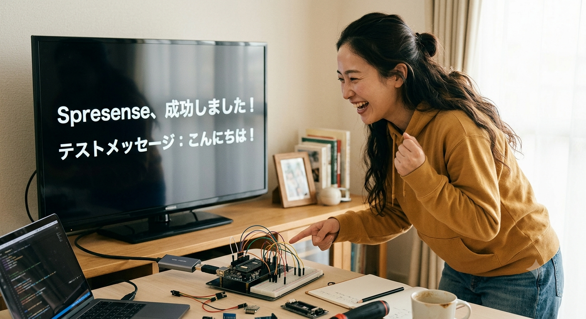

# [SPRESENSE 2026]TVに出力したにょ[CVBS]

2026年6月10日 12:22



# CVBS on SPRESENSE ― 5年越しのアナログビデオ出力

## はじめに

<blockquote class="twitter-tweet" data-theme="dark"><a href="https://twitter.com/chrmlinux03/status/2070466783199510853"></a></blockquote>
<script async src="https://platform.twitter.com/widgets.js" charset="utf-8"></script>
<blockquote class="twitter-tweet" data-theme="dark"><a href="https://twitter.com/chrmlinux03/status/2069643089489309906"></a></blockquote>
<script async src="https://platform.twitter.com/widgets.js" charset="utf-8"></script>

SPRESENSE で CVBS（コンポジットビデオ）信号を生成し、ブラウン管テレビやアナログモニターに映像を映すことに成功しました。

「SPRESENSE  CVBS」をキーワードに検索しても、日本語・英語問わずまとまった実装例が見当たりません。おそらく**世界初の実装**です。

この記事では、実装に至るまでの経緯と、コードの仕組みを解説します。

---

## ここまで 5年かかった ― CVBS on SPRESENSE

最初にSPRESENSE（Sony の ARM Cortex-M4F マイコンボード）でアナログビデオ出力に挑戦し始めたのは約5年前のことです。

### なぜ難しいのか

CVBS（NTSC）信号には厳格なタイミング要件があります。

| 項目 | 値 |
|------|-----|
| 水平周波数 | 15.734 kHz |
| 垂直周波数 | 59.94 Hz |
| 総ライン数 | 262ライン（フレームあたり） |
| 水平周期 | 約 63.5 µs |

1ラインごとに同期パルス・映像信号を**マイクロ秒単位の精度**で生成し続けなければなりません。割り込みの遅延やキャッシュの影響で信号が乱れ、何度も画面が崩れてきました。

### ブレークスルー

SPRESENSE のタイマー割り込みを `60 µs` 固定で刻むことで **16.09 kHz** の安定した水平同期を実現。さらに ARM の **インラインアセンブリ NOP ループ**で映像ピクセルのタイミングを精密に合わせることで、ついに安定した映像出力を達成しました。

---

## アーキテクチャ ― MainCore / SubCore1

SPRESENSE の最大の特徴の一つが**マルチコア（MP）機能**です。本実装ではこれを最大限に活用しています。

| 要素 | 役割・接続先 |
| --- | --- |
| SPRESENSE | MainCore と SubCore1 を内蔵 |
| MainCore | CVBS信号 生成専念。共有VRAM を介して出力 |
| SubCore1 | シリアル 通信など |
| 共有VRAM | MainCore の出力が通る共有メモリ |
| D6: SYNC_PIN | SPRESENSE から RCA端子への接続ピン |
| D7: VIDEO_PIN | SPRESENSE から RCA端子への接続ピン |
| RCA端子 | D6: SYNC_PIN / D7: VIDEO_PIN を受ける |

### MainCore（SubCore1.hpp / CVBS信号生成）

MainCore はビデオ信号生成に**完全に専念**します。`loop()` は 1ライン分の処理を延々と繰り返すだけです。

```cpp
void loop() {
  int line;
  WAIT_LINE(line);    // タイマー割り込みで次のラインを待つ
  PROCESS_LINE(line); // そのラインの信号を出力
}
```

### SubCore1（MainCore.hpp）

SubCore1 はシリアル通信など MainCore を邪魔しない処理を担当します。現在はシンプルに `MP.begin(1)` で起動するのみです。

```cpp
void setup() {
  Serial.begin(115200);
  MP.begin(1);
}
```

### ビルド振り分け

エントリポイント `3rd03.ino` は `#ifdef SUBCORE` でコアを自動判別します。1つのスケッチで MainCore / SubCore1 両方をビルドできる、SPRESENSE らしいスマートな構成です。

```cpp
#ifdef SUBCORE
#include "SubCore1.hpp"
#else
#include "MainCore.hpp"
#endif
```

---

## マクロ多用 ― タイミングを守るための設計

CVBS 生成でもっとも重要なのは**タイミングの正確さ**です。関数呼び出しのオーバーヘッドすら信号の乱れにつながるため、本実装はクリティカルな処理をすべてマクロで記述しています。

### ポート直接操作

`digitalWrite()` は遅すぎます。`portOutputRegister()` でポートアドレスを直接取得し、1命令で出力します。

```cpp
volatile uint8_t *portSync  = portOutputRegister(digitalPinToPort(SYNC_PIN));
volatile uint8_t *portVideo = portOutputRegister(digitalPinToPort(VIDEO_PIN));

#define SYNC_LO  (*portSync  = 0)
#define SYNC_HI  (*portSync  = 1)
#define VIDEO_LO (*portVideo = 0)
#define VIDEO_HI (*portVideo = 1)
```

### NOP ディレイ（インラインアセンブリ）

C の `delayMicroseconds()` では精度が足りません。ARM の `nop` 命令を正確なループで刻みます。

```cpp
#define NOP_DELAY(n) do { \
    uint32_t count = (n); \
    __asm__ volatile ( \
      "1: nop \n\t" \
      "subs %0, %0, #1 \n\t" \
      "bgt 1b" \
      : "+r"(count) : : "cc" \
    ); \
  } while (0)
```

### 1バイト 8ビット展開マクロ

1ピクセル = 1ビットの映像データをピンに送り出します。ループを使わず**8ビットをマクロで完全展開**することで、毎ビット同じサイクル数を保証します。

```cpp
#define VIDEO_BIT(b, bit) (*portVideo = (((b) & (bit)) ? 1 : 0))

#define SEND_BYTE(b) do { \
    VIDEO_BIT(b, 0x80); VIDEO_BIT(b, 0x40); \
    VIDEO_BIT(b, 0x20); VIDEO_BIT(b, 0x10); \
    VIDEO_BIT(b, 0x08); VIDEO_BIT(b, 0x04); \
    VIDEO_BIT(b, 0x02); VIDEO_BIT(b, 0x01); \
  } while(0)
```

### ライン種別の振り分け

262ライン全体を NTSC 規格どおりに振り分けます。

```cpp
#define PROCESS_LINE(line) do { \
    if      ((line) < 3)           { DO_EQUALIZING;       } \  // 等化パルス
    else if ((line) < 6)           { DO_VSYNC;            } \  // 垂直同期
    else if ((line) < 9)           { DO_EQUALIZING;       } \  // 等化パルス
    else if ((line) < 21)          { DO_BLANK;            } \  // ブランク
    else if ((line) < 21 + VRAM_H) { DO_VIDEO((line)-21); } \  // 映像
    else                           { DO_BLANK;            } \  // ブランク
  } while(0)
```

### VRAM 構成

```
解像度:  192 × 168 ピクセル（1bit/pixel）
VRAM:    24 バイト × 168 ライン = 4,032 バイト
```

`volatile` 修飾された共有 VRAM を MainCore / SubCore1 の両コアから参照できます。

### 3×5 ピクセルフォント（Font35.hpp）

テキスト表示用に 3×5 の極小フォントを自作しています。1文字を `uint16_t` 15ビットで表現するコンパクトな設計です。

```cpp
static const uint16_t font3x5[94] = {
  ...
  0b111101111101101,  // 'A'
  0b110101110101110,  // 'B'
  ...
};
```

---

## 実際の画像

映像出力の画面キャプチャです。

<blockquote class="twitter-tweet" data-theme="dark"><a href="https://twitter.com/chrmlinux03/status/2064546991183720490"></a></blockquote>
<script async src="https://platform.twitter.com/widgets.js" charset="utf-8"></script>
<blockquote class="twitter-tweet" data-theme="dark"><a href="https://twitter.com/chrmlinux03/status/2065255004055961638"></a></blockquote>
<script async src="https://platform.twitter.com/widgets.js" charset="utf-8"></script>
画面には以下が表示されています。

```
CVBS ON SPRESENSE
[0] 192 X 168
```

カウンタ（`[0]`〜`[9]`）がインクリメントされ、映像が**リアルタイムで更新**されていることを確認できます。

---

## さいごに

5年越しの挑戦がようやく実を結びました。

SPRESENSE の強みである**マルチコア・高精度タイマー・ARM Cortex-M4F の速度**を組み合わせることで、外部チップなしの純粋なソフトウェア CVBS 生成を実現できました。

今後の展望としては以下を考えています。

- グレースケール対応（抵抗ラダーによる多値出力）
- SubCore1 からの動的描画
- PAL 対応

コードは近日 GitHub と elchika に公開予定です。何か質問があればコメントどうぞ！
いつもご清聴ありがとうございます

---

<div class="like-wrap"><div data-lyket-type="like" data-lyket-template="twitter" data-lyket-namespace="linalog" data-lyket-color-icon="#b5e853" data-lyket-color-primary="#b5e853" data-lyket-color-text="#eaeaea" data-lyket-color-secondary="#2b2b2b" data-lyket-id="spresense-tv-cvbs"></div></div>
