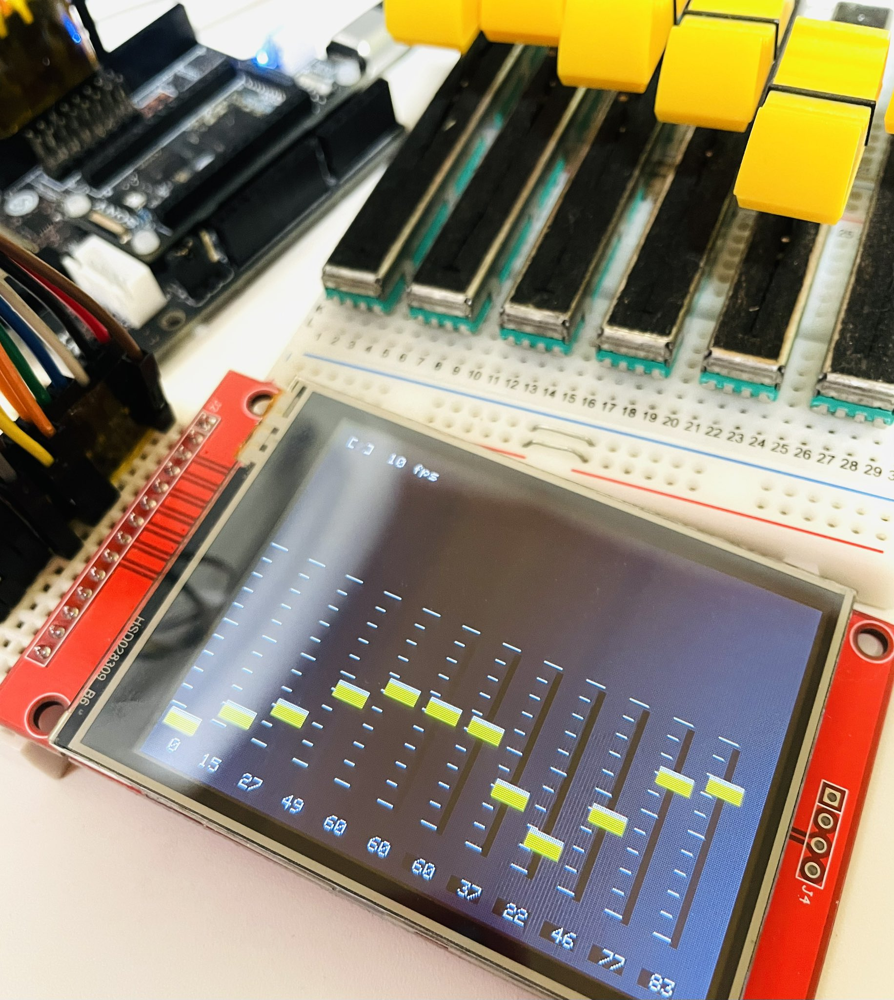
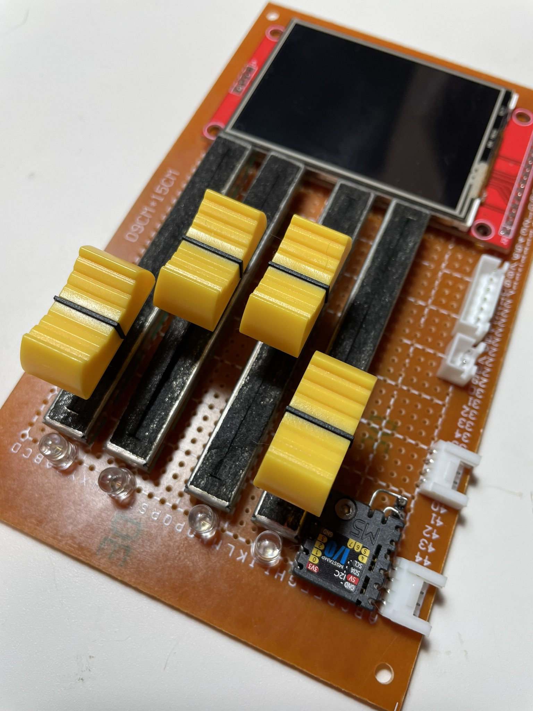

# 【SPRESENSE2023】タッチパネルにバーチャルフェーダーを載せたよっ

2024年1月26日 09:41



# はじめに

こんにちわっ 

リナちゃん　X@chrmlinux03　です

++このページは SPRESENSE2023コンテストで作った部品を紹介するものです
最初に [開発まとめ](../spresense-2023-matome/) をお読みいただければ幸いです++

最初の頃は物理的なフェーダーを乗せるつもりでした💦

でも**でかい**のよね...



神さまは時々**粋な計らい**をされるのですが

時には**無駄なこと**もさせます

（X 投稿の埋め込み）


# 用意するもの
| 部品名 | 販売先 | 価格 | 御提供品 |
|-|-|-|-|
| 気合 |誰でも|プライスレス|ー|

# これ液晶でフェーダー作りたいよね
液晶の制御が出来る

タッチパネルが制御できる

となると....大きかった物理的なフェーダを

液晶に実際に乗せたくなるのが心情

果たして動くのか(操作できるのか)

# ライブラリ作成
```c++:tinySlider.hpp
#ifndef __TINYSLIDER_HPP__
#define __TINYSLIDER_HPP__

extern uint16_t _tx, _ty, _tz;
#define TFT_DARKSILVER ((uint32_t)0x222222)

class tinySlider {
  public:
    tinySlider() {}
    ~tinySlider() {}

    void draw(LGFX_Sprite *spr) {
      int ypos = y - length;
      float yspc = (float)(length - 10) / 10.0;
      spr->fillRect(x, ypos, width, length, TFT_DARKSILVER);
      for (int i = 0; i <= 10; i++) {
        int yline = (yspc / 4) + ypos + (i * yspc);
        int lineLength = (i % 5 == 0) ? 10 : 5;
        spr->drawLine(x, yline, x + lineLength, yline, TFT_WHITE);
      }
      int lineX = x + width / 2 - 2;
      spr->fillRect(lineX, ypos + 5, 4, length - 10, TFT_BLACK);

      int16_t handleY = map(value, 0, 100, y - 5, y - length + 5);
      spr->fillRect(x + 2, handleY, width - 4, 10, TFT_YELLOW);
      spr->fillRect(x + 2, handleY, width - 4, 2, TFT_WHITE);
      spr->setTextColor(TFT_WHITE, TFT_BLACK);
      spr->setCursor(x, y + 10);
      spr->printf("%3d", value);
    }

    void setParams(int16_t newX, int16_t newY, int16_t newLength, int16_t newWidth, int16_t newValue) {
      x = newX;
      y = newY;
      length = newLength;
      width = newWidth;
      value = newValue;
    }

    bool isTouched(void) {
      int16_t touchX = _tx;
      int16_t touchY = _ty;
      return (touchX >= x && touchX <= x + width && touchY >= y - length + 5 && touchY <= y - 5);
		}

    bool hasValueChanged() {
      return value != lastValue;
    }

    void setValue(void) {
      lastValue = value;
      value = map(_ty, y - length + 5, y - 5, 100, 0);
	    if (value <= 5) value = 0;
      if (value >= 95) value = 100;
    }

    int16_t getValue(void) {
      return value;
    }

    int16_t getScale(void) {
      return fmap(value, 0, 100, SCALE_MIN, SCALE_MAX);
    }

  private:
    int16_t x, y, length, width;
    int16_t value = 0;
    int16_t lastValue = -1;

};

#endif

```
```c++:spre.sliderSub.hpp

//==============================================
//
//  scanSliders
//
//==============================================
void scanSliders(void) {
  for (int i = 0; i < numTracks; i++) {
    if (sliders[i].isTouched()) sliders[i].setValue();
  }
}

//==============================================
//
// readSliders
//
//==============================================
void readSliders(void) {
  for (int i = 0; i < numTracks; i++) {
    trackVolume[i] =
      fmap(sliders[i].getValue(),
           SCALE_MIN,
           (float)PERCENT_MAX,
           SCALE_MIN,
           SCALE_MAX);
  }
}

//==============================================
//
// updateSliders
//
//==============================================
void updateSliders(void) {
  for (int i = 0; i < numTracks; i++) {
    if (sliders[i].hasValueChanged()) sliders[i].draw(&spr);
    sliders[i].draw(&spr);
  }
}

//==============================================
//
// setupSliders
//
//==============================================
void setupSliders(
  int newNum,
  int newWidth,
  int newBaseY,
  int newLength,
  int newSpc,
  int newValue) {
  int pitch = (newWidth / newNum);
  int width = pitch - newSpc - newSpc;

  for (int i = 0; i < numTracks; i++) {
    sliders[i].setParams(
      ((pitch - width) / 2) + pitch * i,
      newBaseY,
      newLength,
      width,
      newValue);
  }
  scanSliders();
  readSliders();
  updateSliders();
}

```
# ライブラリ説明
スライダーは下が0% 上が100% のイメージで作成してます

黄色いスライダーをつまんで「グッ」っと上下引っ張ると

良い感じで移動出来て下の数字が[0..100]に変化します

但し 下の方上の方は 抵抗被膜式タッチパネルの特性上

うまく摘まめない事がありました

そこでメソッドの中で 5よりも小さければ0

95よりも大きければ100 という謎の縛りを搭載しました

```c++:
    void setValue(void) {
      lastValue = value;
      value = map(_ty, y - length + 5, y - 5, 100, 0);
	    if (value <= 5) value = 0;
      if (value >= 95) value = 100;
    }
```

変化した内容は getValue() で取得出来ます

```c++:
    int16_t getValue(void) {
      return value;
    }
```

# 使い方
class で欲しい分のフェーダを作成して
それを回数分回す事でうまい具合に値が取得出来ています
固定だとちょっと使いにくい感じでしたっ

```c++:sample.ino

const uint8_t numTracks = 4;
#include <spre.Graphics.hpp>
#include <spre.Touch.hpp>
#include <tinySlider.hpp>
tinySlider sliders[numTracks];
#include <spre.sliderSub.hpp>

void setup(void) {
  Serial.begin( 115200 );
  int8_t rotation = ROT270;
  setupGraphics(rotation);
  setupTouch(_w, _h, rotation, false);
  setupSliders(numTracks, _w, _h - 24, 180, 6, 0);
}

void loop() {
  spr.startWrite();
  spr.clear(TFT_DARKSILVER);
  bool touchDetected = isTouch(&_tx, _&ty);
  if (touchDetected) {
    scanSliders();
    readSliders();
  }
  updateSliders();
  static int cnt = 0;
  char ast[4] = "|/-\\";
  spr.setTextColor(TFT_WHITE, TFT_BLACK);
  spr.setCursor(8, 8);
  spr.printf("[%c] %3d fps\n", ast[cnt], getfps());
  cnt = (cnt + 1) % 4;
  spr.pushSprite(&lcd, 0, 0);
  spr.endWrite();
}

```


# 応用例
このモジュール群は以下で使ってます是非ご参照くださいませ٩(ˊᗜˋ*)و

## SoundSerenity(環境音が8Trackで美しく流れる箱)
👉[SoundSerenity](../spresense-soundserenity/)


# 残務と今後の考察
抵抗被膜式のタッチパネルの感度がちょこっとだけ悪い

これは是非 静電容量式のタッチパネルで...

あ...それがスマホか💦
# さいごに
半田付けがいいのか？プログラムがいいのか考えてたら？

両方を作ってしまいました(謎

ご清聴ありがとうございました

++このページは SPRESENSE2023コンテストで作った部品を紹介するものです
最初に [開発まとめ](../spresense-2023-matome/) をお読みいただければ幸いです++

<div class="like-wrap"><div data-lyket-type="like" data-lyket-template="twitter" data-lyket-namespace="linalog" data-lyket-color-icon="#b5e853" data-lyket-color-primary="#b5e853" data-lyket-color-text="#eaeaea" data-lyket-color-secondary="#2b2b2b" data-lyket-id="spresense-virtual-fader"></div></div>
