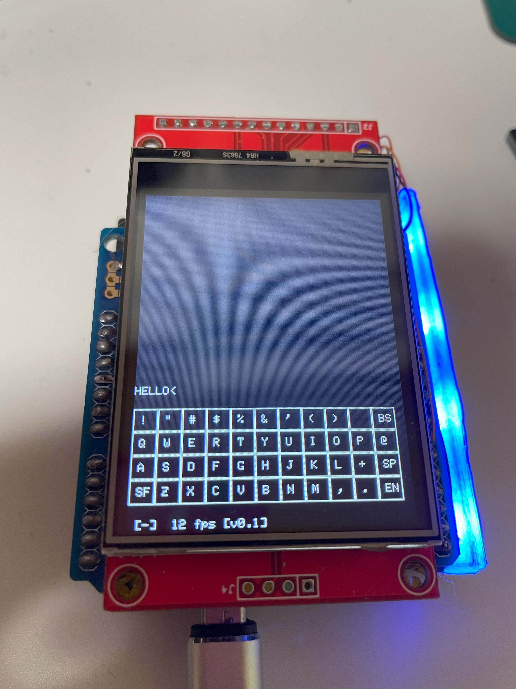


# 【SPRESENSE2023】タッチパネルにバーチャルキーボードを載せたよっ

2024年1月26日 09:40



# はじめに

こんにちわっ 

リナちゃん　X@chrmlinux03　です

++このページは SPRESENSE2023コンテストで作った部品を紹介するものです
最初に [開発まとめ](../spresense-2023-matome/) をお読みいただければ幸いです++

# 用意するもの
| 部品名 | 販売先 | 価格 | 御提供品|
|-|-|-|-|
|パンとコーヒー |ファミマ|300円|ー|

# これキー入力したいよね
スライダーが出来た所で
「あ、バーチャルキーボード作れそう」って事で作ってみた

# ライブラリ作成
```c++:tinyTouchVrKey.hpp
#ifndef __TOUCH_VRKEY_HPP__
#define __TOUCH_VRKEY_HPP__

#include <Arduino.h>

class TouchVrKey {
  public:
    TouchVrKey() {}
    ~TouchVrKey() {}

    void begin(int16_t bw, int16_t bh, int16_t bx, int16_t by) {
      _bw = bw;
      _bh = bh;
      _bx = bx;
      _by = by;
    }

    void scan(LGFX_Sprite *spr, uint16_t col) {
      int tx, ty, tz;
      if (isTouch(&tx, &ty, &tz)) {
        unsigned long currentMillis = millis();
        if (currentMillis - lastTouchTime >= debounceDelay) {
          lastTouchTime = currentMillis;
          for (int i = 0; i < _tcRow; i++) {
            for (int j = 0; j < _tcClm; j++) {
              int gx = _bx + (j * _bw);
              int gy = _by + (i * _bh);
              if (tx >= gx && tx < gx + _bw && ty >= gy && ty < gy + _bh) {
                handleKeyInput(spr, i, j);
                spr->fillRect(gx, gy, _bw, _bh, col);
                break;
              }
            }
          }
        }
      }
      draw(spr, col);
    }

    void getData(uint8_t *data, uint16_t *dataCnt) {
      memcpy(data, inputBuffer, inputIndex);
      *dataCnt = inputIndex;
      memset(inputBuffer, 0x0, sizeof(inputBuffer));
      inputIndex = 0;
    }

    bool isEnter() const {
      return enter;
    }

    void resetEnter() {
      enter = false;
    }

  private:
    void draw(LGFX_Sprite *spr, uint16_t col) {
      spr->setTextColor(col);
      for (int i = 0; i < _tcRow; i++) {
        for (int j = 0; j < _tcClm; j++) {
          int gx = _bx + (j * _bw);
          int gy = _by + (i * _bh);
          spr->drawRect(gx, gy, _bw, _bh, col);
          spr->setCursor(gx + 6, gy + 6);
          printKey(spr, i, j);
        }
      }
      spr->setCursor(_bx, _by - _bh);
      spr->printf("%s<", inputBuffer);
    }

    void printKey(LGFX_Sprite *spr, int row, int clm) {
      const char *key = _tcKey[row][clm][0];
      if (strcmp(key, "sp") == 0) {
        spr->printf("%s", "SP");
      } else if (strcmp(key, "bs") == 0) {
        spr->printf("%s", "BS");
      } else if (strcmp(key, "sf") == 0) {
        spr->printf("%s", "SF");
      } else if (strcmp(key, "en") == 0) {
        spr->printf("%s", "EN");
      } else {
        const char *upperChar = _tcKey[row][clm][1];
        if (upperChar != nullptr && isUpperCase) {
          spr->printf("%s", upperChar);
        } else {
          spr->printf("%s", key);
        }
      }
    }

    void handleKeyInput(LGFX_Sprite *spr, int row, int clm) {
      const char *key = _tcKey[row][clm][0];

      if (strcmp(key, "en") == 0) {
        enter = true;
        printInput();
      } else if (strcmp(key, "sf") == 0) {
        toggleShift();
      } else if (strcmp(key, "bs") == 0) {
        inputKey(key);
      } else {
        if (isUpperCase) {
          inputKey(_tcKey[row][clm][1]);
        } else {
          inputKey(key);
        }
      }
    }

    void toggleShift() {
      isUpperCase = !isUpperCase;
    }

    void inputKey(const char *key) {
      if (inputIndex < sizeof(inputBuffer) - 1) {
        if (strcmp(key, "bs") == 0) {
          if (inputIndex > 0) {
            inputIndex--;
            inputBuffer[inputIndex] = '\0';
          }
        }
        else if (strcmp(key, "sp") == 0) {
          inputKey(" ");
        }
        else {
          if (isUpperCase && key[1] != '\0') {
            inputBuffer[inputIndex++] = key[1];
          } else {
            inputBuffer[inputIndex++] = key[0];
          }
          inputBuffer[inputIndex] = '\0';
        }
      }
    }

    void printInput() {
    }

  private:
    static const int inputBufferMax = 200 + 1;
    uint8_t inputBuffer[inputBufferMax];
    int inputIndex = 0;
    static const int _tcRow = 4;
    static const int _tcClm = 11;
    static const int _tcSft = 2;
    uint8_t _bw;
    uint8_t _bh;
    uint16_t _bx;
    uint16_t _by;
    bool enter = false;
    const char *_tcKey[_tcRow][_tcClm][_tcSft] = {
      {{"1", "!"}, {"2", "\""}, {"3", "#"}, {"4", "$"}, {"5", "%"}, {"6", "&"}, {"7", "'"}, {"8", "("}, {"9", ")"}, {"0", " "}, {"bs", nullptr}},
      {{"q", "Q"}, {"w", "W"}, {"e", "E"}, {"r", "R"}, {"t", "T"}, {"y", "Y"}, {"u", "U"}, {"i", "I"}, {"o", "O"}, {"p", "P"}, {"@", "@"}},
      {{"a", "A"}, {"s", "S"}, {"d", "D"}, {"f", "F"}, {"g", "G"}, {"h", "H"}, {"j", "J"}, {"k", "K"}, {"l", "L"}, {";", "+"}, {"sp", nullptr}},
      {{"sf", "SF"}, {"z", "Z"}, {"x", "X"}, {"c", "C"}, {"v", "V"}, {"b", "B"}, {"n", "N"}, {"m", "M"}, {",", ","}, {".", "."}, {"en", "EN"}},
    };
    bool isUpperCase = false;
    unsigned long lastTouchTime = 0;
    const unsigned long debounceDelay = 200;
};

#endif // __TOUCH_VRKEY_HPP__

```

30% キーボードを作りたかったのですが　抵抗被膜式タッチパネルでは

キーを切り替える事が意外に難しいと判断し

11個 x 4段に色々仕込みました

色々自分で作ってみるのも面白いかも٩(ˊᗜˋ*)و

| キー名称 |説明 |効果| 
|-|-|-|
| SF | シフトキー |a -> A等のトグル|
| BS | バックスペース |一文字削除|
|SP|スペースキー|空白|
|EN|エンター|改行キー|

```
const char *_tcKey[_tcRow][_tcClm][_tcSft] = {
      {{"1", "!"}, {"2", "\""}, {"3", "#"}, {"4", "$"}, {"5", "%"}, {"6", "&"}, {"7", "'"}, {"8", "("}, {"9", ")"}, {"0", " "}, {"bs", nullptr}},
      {{"q", "Q"}, {"w", "W"}, {"e", "E"}, {"r", "R"}, {"t", "T"}, {"y", "Y"}, {"u", "U"}, {"i", "I"}, {"o", "O"}, {"p", "P"}, {"@", "@"}},
      {{"a", "A"}, {"s", "S"}, {"d", "D"}, {"f", "F"}, {"g", "G"}, {"h", "H"}, {"j", "J"}, {"k", "K"}, {"l", "L"}, {";", "+"}, {"sp", nullptr}},
      {{"sf", "SF"}, {"z", "Z"}, {"x", "X"}, {"c", "C"}, {"v", "V"}, {"b", "B"}, {"n", "N"}, {"m", "M"}, {",", ","}, {".", "."}, {"en", "EN"}},
    };
```
# 応用例
このモジュール群は以下で使ってます是非ご参照くださいませ٩(ˊᗜˋ*)و

👉[LoRaPager](../spresense-lorapager/)


# 残務と今後の考察
キーを押すのにテクニックが必要とか

でも何事もやってみないと分からないことだらけのこの人生

やはり横長の画面で使った方がいいかも💦

linux のコンソールみたいで良いですね(棒)
# さいごに
ご清聴ありがとうございました

押しにくい～💦

++このページは SPRESENSE2023コンテストで作った部品を紹介するものです
最初に [開発まとめ](../spresense-2023-matome/) をお読みいただければ幸いです++


<div class="like-wrap"><div data-lyket-type="like" data-lyket-template="twitter" data-lyket-namespace="linalog" data-lyket-color-icon="#b5e853" data-lyket-color-primary="#b5e853" data-lyket-color-text="#eaeaea" data-lyket-color-secondary="#2b2b2b" data-lyket-id="spresense-virtual-keyboard"></div></div>
