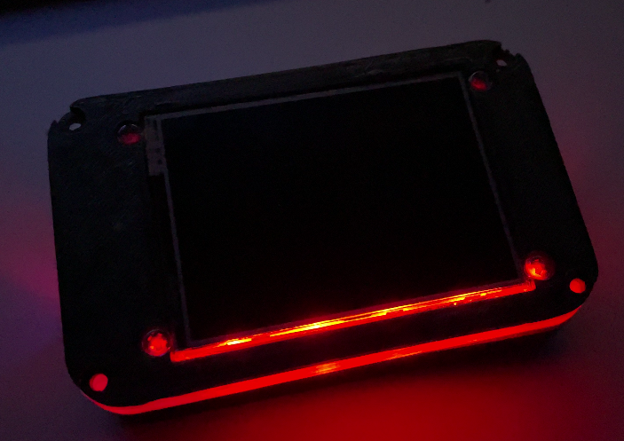
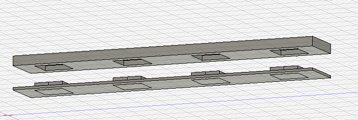
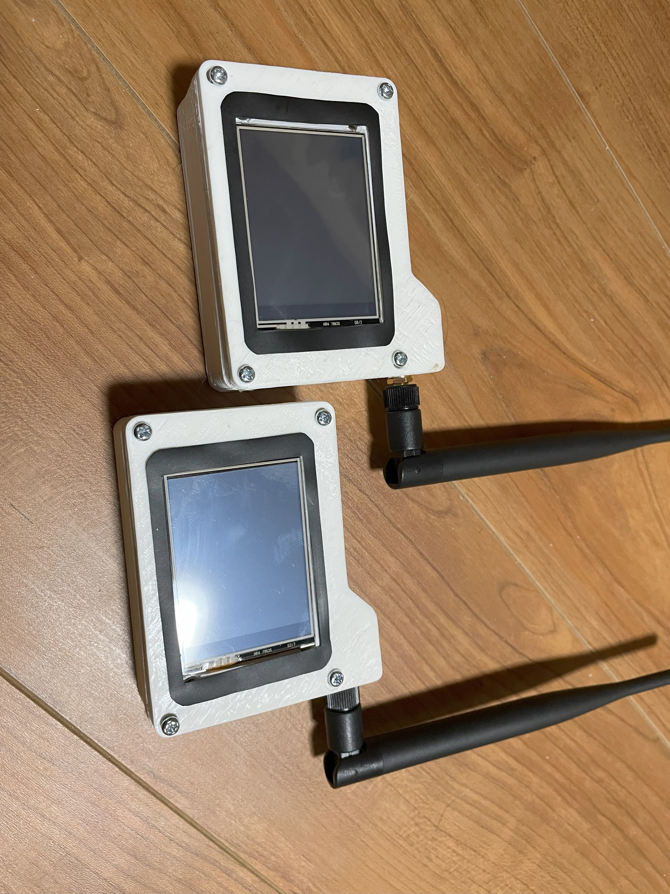
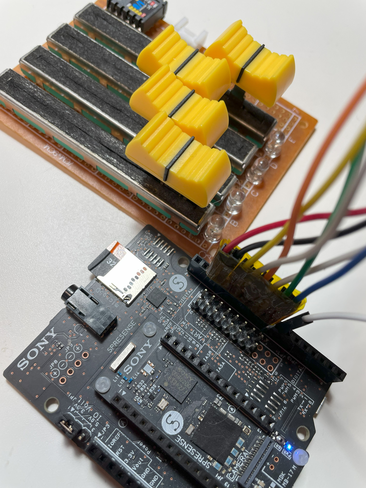

# 【SPRESENSE2023】WS2812B で流れるような光効果を～

2024年1月26日 09:31



# はじめに

こんにちわっ 

リナちゃん　X@chrmlinux03　です

++このページは SPRESENSE2023コンテストで作った部品を紹介するものです
最初に [開発まとめ](../spresense-2023-matome/) をお読みいただければ幸いです++

# 用意するもの
|部品名|販売先|価格|御提供品|
| --------| -------- | -------- | -------- | 
|WS2812B(4LED)|どこでも|時価|ー|
|LEDカバー|自作|プライスレス|ー|
|アルミテープ|ダイソー|110円|ー|
|両面テープ|ダイソー|110円|ー|
|セロテープ|ダイソー|110円|ー|

# 本基板上のLEDぢゃ寂しい
SPRESENSE のデバックに欠かせないものはLED

本基板上に4個のLEDは搭載されているので

何かの flag が立った瞬間に確認する事は可能

でも 白だけなのとケースに被せると見えないんですよね💦

# ぢゃWS2812Bで
手っ取り早く WS2812B であれば VCC / GND / SIG の3本で光らせる事が出来ます

しかもフルカラーで

# え？沢山繋げないの？
WS2812B の文献を漁って行くと困った記述が

本基板の5V には繋がないでね💦

<blockquote class="twitter-tweet" data-theme="dark"><a href="https://twitter.com/chrmlinux03/status/1735198681090097539"></a></blockquote>
<script async src="https://platform.twitter.com/widgets.js" charset="utf-8"></script>

# ぢゃ4個くらいで
沢山繋ぐとそれは電力を食います

でも 4個くらいなら問題ないかも

なら 255(最高輝度)ではなく 32 とか 64 くらいならワンチャン💦

# 回路図

| 基板側 | WS2812B側 |
| -------- | -------- | 
| D6 | SIG | 
| VCC | VCC | 
| GND | GND | 

D7 はすでにタッチパネルで使っているので
素直に D6 に設置

# うーんLEDが見えちゃうなぁ
それでなくても LED間が長いのでLEDが丸見えです

# 音が曲げられるなら光も曲げられるでそ

（X 投稿の埋め込み）
（X 投稿の埋め込み）

システムの基本は「どうなってるか分からないけど実際に動いている感」

3DPrinter でアダプタを設計しWS2812B に被せるとちょっと良い感じ

だけどこれケース付けたら透けるよね

って事で セロテープ+アルミテープ+セロテープ　でショートしないように絶縁処理を行い

ミルフィーユ状の謎の積層を完了する

| 積層名 |
|-| 
|セロテープ| 
|アルミテープ|
|セロテープ|
|WS2812B|
|両面テープ|

また　**ある考えから** ５方向の光道を 1方からだけにする為に

ミルフィーユの上だけを残しまたアルミテープで光遮作業を行う

さらに　残った１方を乱反射させる為にヤスリで磨きまくる



下：WS2812B
上：LEDカバー

# 4個ぢゃ寂しいので仮想LEDを点灯しよう
出来上がったミルフィーユには4個のLEDが搭載されている

LEDKIND_RIGHTSTAR　で光が流れる感じにすると

確かに LEDが流れる....

うーん　仮想的に LED増やすとかできないかな？

唐突に smoothStarという謎の関数が出来上がった💦

```c++:抜粋
void smoothStar(uint8_t red, uint8_t green, uint8_t blue, uint32_t period, int virtualLEDs, int dir) {

input
 red:赤の色味 0..255
 green:緑の色味 0..255
 blue:青の色味 0..255
 period:点灯時間 msec
 virtualLEDs:仮想的に再現させるLED数
 dir:方向
```

## 仮想的にLEDを増やす仕組み
原理は簡単である

輝度だけで4個のLEDを考えると
```
0, 0,0,0
255, 0, 0, 0
0, 255, 0, 0
0, 0, 255, 0
0, 0, 0, 255
```

これを仮想的に8個のLEDを考えると
```
0, 0, 0, 0
128, 0, 0, 0
255,0,0,0
128,128,0,0
0, 255, 0, 0
0,128,128,0
0,0,255,0
0,0,128,128
0,0,0,255
```

これを仮想的に16個のLEDを考えると

:

:

## エフェクトの種類
エフェクトは以下の5個

しかもclass内で輝度を調整しているので

ピンクっぽい色が流れるやら

やり放題である

 set(LEDKIND_BRESS, 0, 0, 128, 60);
 
```
enum {
  LEDKIND_BRESS = 0,        // 息使いのような光
  LEDKIND_LEFTSTAR,         // 左に光が流れる
  LEDKIND_RIGHTSTAR,         // 右に光が流れる
  LEDKIND_SMOOTHLEFT,         // 仮想的なLEDが左に流れる
  LEDKIND_SMOOTHRIGHT,         // 仮想的なLEDが右に流れる
};
```
# ライブラリ
```c++:spre.Neo.hpp

//=====================================================
// Class: SpreNeo
// The SpreNeo class is designed to control and manage
// LED lighting effects on a NeoPixel strip, offering a
// variety of visual patterns. The class provides an
// interface for initiating, stopping, and updating
// different LED effects. It encapsulates functions for
// two specific effects: the breathing effect
// (breatheEffect) and the shooting star effect
// (shootingStar). These effects are applied to
// NeoPixels, producing dynamic and visually appealing
// illumination.
// The class uses a structure (RGB_T) to represent RGB
// color values and another structure (LED_T) to store
// parameters related to the LED effects, such as the
// type of effect, time parameters, and color values.
// The LED effect types are defined as constants
// (LEDKIND_BRESS, LEDKIND_LEFTSTAR, and LEDKIND_RIGHTSTAR).
//-----------------------------------------------------
// date/author    : 2024/01/19 @chrmlinux03
// update/author  : 2024/01/19 @chrmlinux03
//=====================================================
/*  example

  #include <Spre.neo.hpp>

  SpreNeo neo;

  void setup(void) {
  neo.begin();
  neo.set(LEDKIND_RIGHTSTAR, 0, 0, 128, 60);
  neo.start();
  }

  void loop(void) {
  neo.update();
  }

*/

#ifndef __SPRE_NEO_HPP__
#define __SPRE_NEO_HPP__

#include <Arduino.h>
#include <SpresenseNeoPixel.h>

//------------------------------------------------------------
// NeoPixel Configuration
//------------------------------------------------------------
const uint16_t neoPin = 6;   // Pin number to which NeoPixels are connected
const uint16_t neoNum = 4;   // Number of NeoPixels in the strip
SpresenseNeoPixel<neoPin, neoNum> npx;  // NeoPixel instance

//------------------------------------------------------------
// LED Effect Types
//------------------------------------------------------------
enum {
  LEDKIND_BRESS = 0,        // Breathing effect
  LEDKIND_LEFTSTAR,         // Shooting star effect from left
  LEDKIND_RIGHTSTAR,         // Shooting star effect from right
  LEDKIND_SMOOTHLEFT,         // Shooting star effect from left
  LEDKIND_SMOOTHRIGHT,         // Shooting star effect from right
};

//------------------------------------------------------------
// RGB Color Structure
//------------------------------------------------------------
typedef struct {
  uint8_t r;   // Red component
  uint8_t g;   // Green component
  uint8_t b;   // Blue component
} RGB_T;

//------------------------------------------------------------
// LED Effect Parameters Structure
//------------------------------------------------------------
typedef struct {
  bool enable;    // Flag to enable or disable the LED effect
  int8_t kind;    // Type of LED effect (LEDKIND_BRESS, LEDKIND_LEFTSTAR, LEDKIND_RIGHTSTAR)
  int32_t tm;     // Time parameter for the LED effect
  RGB_T rgb;      // RGB color values for the LED effect
} LED_T;

//------------------------------------------------------------
// Volatile instance to store LED parameters
//------------------------------------------------------------
volatile LED_T _ledt;

class SpreNeo {
  public:
    //------------------------------------------------------------
    // Constructor: SpreNeo
    //   Input: None
    //   Output: None
    //   Description: Initializes a new instance of the SpreNeo class.
    //------------------------------------------------------------
    SpreNeo() {}

    //------------------------------------------------------------
    // Destructor: ~SpreNeo
    //   Input: None
    //   Output: None
    //   Description: Destroys an instance of the SpreNeo class.
    //------------------------------------------------------------
    ~SpreNeo() {}

    //-----------------------------------------------------
    // breatheEffect function
    //   Input: red, green, blue, msec
    //   Output: None
    //   Description: Implements the breathe effect on NeoPixels.
    //-----------------------------------------------------
    void breatheEffect(uint8_t red, uint8_t green, uint8_t blue, uint32_t msec) {
      static float phase = 0.0;
      static unsigned long preTm = 0;
      unsigned long tm = millis();
      if (tm - preTm >= msec) {
        preTm = tm;
        float brt = 0.5 + 0.5 * sin(phase);
        uint8_t r = (uint8_t)(brt * red);
        uint8_t g = (uint8_t)(brt * green);
        uint8_t b = (uint8_t)(brt * blue);

        for (int i = 0; i < neoNum; i++) {
          npx.set(i, r, g, b);
        }
        npx.show();
        phase += 0.1;
      }
    }

    //-----------------------------------------------------
    // shootingStar function
    //   Input: red, green, blue, direc, waitTime
    //   Output: None
    //   Description: Implements the shooting star effect on NeoPixels.
    //-----------------------------------------------------
    void shootingStar(uint8_t red, uint8_t green, uint8_t blue, int direc, uint32_t waitTime) {
      static uint16_t startPos = (direc == 1) ? 0 : neoNum - 1;
      static unsigned long previousMillis = 0;
      unsigned long currentMillis = millis();
      if (currentMillis - previousMillis >= waitTime) {
        previousMillis = currentMillis;
        npx.clear();
        for (int i = -2; i <= 3; i++) {
          int pos = startPos + i * direc;
          if (pos >= 0 && pos < neoNum) {
            float distance = abs(startPos - pos);
            float brt = max(1.0 - 0.9 * distance, 0.0);
            uint8_t r = red;
            uint8_t g = green;
            uint8_t b = blue;
            r = (uint8_t)(r * brt);
            g = (uint8_t)(g * brt);
            b = (uint8_t)(b * brt);
            npx.set(pos, r, g, b);
          }
        }
        npx.show();
        startPos += direc;
        if (startPos >= neoNum || startPos < 0) {
          startPos = (direc == 1) ? 0 : neoNum - 1;
        }
      }
    }

    //-----------------------------------------------------
    // smoothStart function with virtual LEDs
    //   Input: red, green, blue, period, virtualLEDs, dir
    //   Output: None
    //   Description: Implements a smooth start effect on virtual LEDs using a sine wave.
    //-----------------------------------------------------
    void smoothStar(uint8_t red, uint8_t green, uint8_t blue, uint32_t period, int virtualLEDs, int dir) {
      static float phase = 0.0;
      static uint32_t previousMillis = 0;

      for (int i = 0; i < virtualLEDs; i++) {
        // Calculate brightness based on the sine wave with the specified period
        float brightness = 0.5 * sin(phase - dir * i * 2 * PI / virtualLEDs) + 0.5;

        uint8_t r, g, b;
        r = (uint8_t)(red * brightness);
        g = (uint8_t)(green * brightness);
        b = (uint8_t)(blue * brightness);

        // Map virtual LED to physical LED
        int physicalLED = map(i, 0, virtualLEDs - 1, 0, neoNum);
        npx.set(physicalLED, r, g, b);
      }

      if (millis() - previousMillis >= period) {
        // Change the phase of the sine wave every period
        phase += 0.05; // Adjust to an appropriate value

        npx.show();
        previousMillis = millis();
      }
    }
    
    //-----------------------------------------------------
    // begin function
    //   Input: None
    //   Output: None
    //   Description: Initializes the SpreNeo instance by stopping any ongoing effects and setting a default effect.
    //-----------------------------------------------------
    void begin() {
      npx.framerate(60);
      stop();
      set(LEDKIND_BRESS, 0, 0, 128, 60);
    }

    //-----------------------------------------------------
    // start function
    //   Input: None
    //   Output: None
    //   Description: Starts the LED effect.
    //-----------------------------------------------------
    void start() {
      _ledt.enable = true;
    }

    //-----------------------------------------------------
    // stop function
    //   Input: None
    //   Output: None
    //   Description: Stops the LED effect.
    //-----------------------------------------------------
    void stop() {
      _ledt.enable = false;
    }

    //-----------------------------------------------------
    // set function
    //   Input: kind, r, g, b, tm
    //   Output: None
    //   Description: Sets the LED effect parameters.
    //-----------------------------------------------------
    void set(uint8_t kind, uint8_t r, uint8_t g, uint8_t b, uint8_t tm) {
      _ledt.kind = kind;
      _ledt.rgb.r = r;
      _ledt.rgb.g = g;
      _ledt.rgb.b = b;
      _ledt.tm = tm;
    }

    //-----------------------------------------------------
    // update function
    //   Input: None
    //   Output: None
    //   Description: Updates the LED effect based on the set parameters.
    //-----------------------------------------------------
    void update(void) {
      if (_ledt.enable) {
        switch (_ledt.kind) {
          case LEDKIND_BRESS:
            breatheEffect(_ledt.rgb.r, _ledt.rgb.g, _ledt.rgb.b, _ledt.tm);
            break;
          case LEDKIND_LEFTSTAR:
            shootingStar(_ledt.rgb.r, _ledt.rgb.g, _ledt.rgb.b, 1, _ledt.tm);
            break;
          case LEDKIND_RIGHTSTAR:
            shootingStar(_ledt.rgb.r, _ledt.rgb.g, _ledt.rgb.b, -1, _ledt.tm);
            break;
          case LEDKIND_SMOOTHLEFT:
            smoothStar(_ledt.rgb.r, _ledt.rgb.g, _ledt.rgb.b, _ledt.tm, 24, 1);
            break;
          case LEDKIND_SMOOTHRIGHT:
            smoothStar(_ledt.rgb.r, _ledt.rgb.g, _ledt.rgb.b, _ledt.tm, 24, -1);
            break;
          default:
            break;
        }
      }
    }

  private:
};

#endif // __SPRE_NEO_HPP__

```

# 動かしてみる

（X 投稿の埋め込み）
@

# 応用例
このモジュール群は以下で使ってます是非ご参照くださいませ٩(ˊᗜˋ*)و

## SoundSerenity(環境音が8Trackで美しく流れる箱)
👉[SoundSerenity](../spresense-soundserenity/)


## LoRaPager(LoRaを使った簡易メッセンジャーBox)
👉[LoRaPager](../spresense-lorapager/)



## tinyFader(SPRESENSEを簡易ミキサーに~~する~~したかった
👉[tinyMixer](../spresense-tinymixer/)



# 残務と今後の考察
面白いものが出来たのは出来たのですが

やってる事が地味過ぎて...

これらは後でライブラリ登録しようかと考えております

# さいごに

ちょっとドキュメント作業に疲れてきた💦

ご清聴ありがとうございました

++このページは SPRESENSE2023コンテストで作った部品を紹介するものです
最初に [開発まとめ](../spresense-2023-matome/) をお読みいただければ幸いです++

