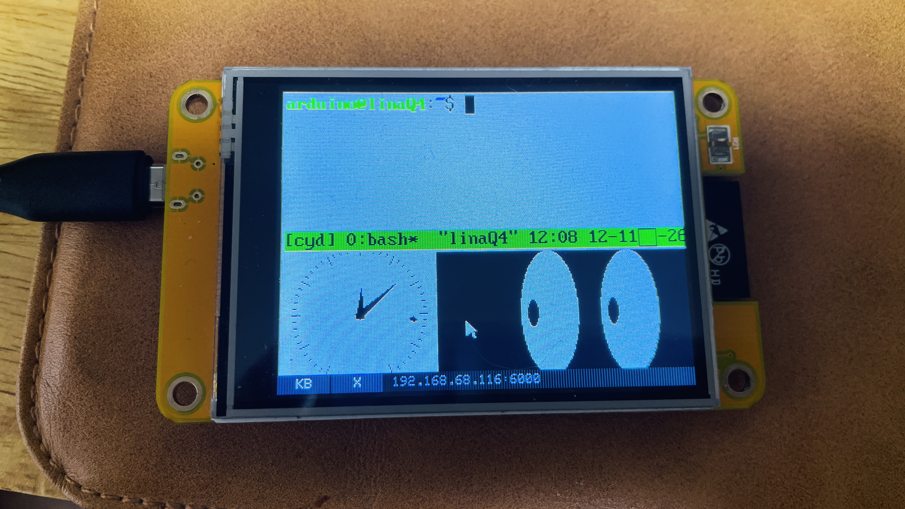

# [cyd] $7の液晶付きマイコンに x11 を載せてみた[3分ハッキング別冊]

2026年11月19日 10:46



# x11jCyd.5-2（tinyX11）

ESP32 搭載のタッチパネル液晶「CYD（ESP32-2432S028）」の上で動く、小型の X11 サーバ兼シンクライアントの実装解説です。X サーバとしての描画機能に加え、画面上にターミナルを持ち、そこから Wi-Fi 接続、SSH ログイン、UART コンソール、BLE キーボードの利用までを本機だけで完結させます。

本書はソースコード（x11jCyd.5-2、2026-11-19 時点）をもとに、構成・仕様・設計上の割り切り・メモリ対策を詳細に記述したものです。数値や仕様はすべてコードから確認しています。コメントと実装が食い違う箇所については、実装（コード）の内容を正として記載し、その旨を注記しています。

---

## 1. 概要

### 1.1 このプログラムが行うこと

- **X11 サーバ**：TCP 6000 番ポート（ディスプレイ :0）で待ち受け、ネットワーク上のマシンで起動した X クライアント（xterm、xeyes など）の画面を本機の液晶に描画します。同時接続は最大 3 クライアントです。
- **ターミナル画面**：53 桁 × 18 行のテキストターミナルを内蔵します。日本語（UTF-8）表示に対応します。
- **ローカルシェル**：ターミナル上に `x11>` プロンプトの小さなシェルがあり、Wi-Fi 接続や SSH ログインなどの設定をすべて実行時に画面から行います。ソースコード内に Wi-Fi や SSH の設定は含まれていません。
- **SSH クライアント**：ローカルシェルからリモートマシンへログインできます。ログイン直後に `export DISPLAY=<本機のIP>:0` が自動で送られるため、そのシェルから起動した X プログラムは本機の X サーバに表示されます。
- **UART コンソール**：Wi-Fi を使わず、P1 コネクタの TX/RX に有線で接続した相手（Arduino Uno Q など）のシリアルコンソールとしても使えます。
- **BLE キーボード**：本機が BLE HID ホストになり、Bluetooth キーボードから入力できます。

### 1.2 画面の考え方

画面は「X ビュー」と「ターミナルビュー」の 2 つを切り替えて使います。ターミナルは画面（ビュー）であり、ローカルシェル・SSH セッション・UART コンソールは、そのターミナルの中で動くものです。X クライアントはビューを切り替えても動き続け、X ビューに戻ると再描画されます。

---

## 2. 動作環境とビルド条件

| 項目 | 内容 |
| --- | --- |
| 対象ボード | CYD（ESP32-2432S028、ESP32 + ILI9341 320×240 横向き + XPT2046 抵抗膜タッチ） |
| フレームワーク | Arduino IDE（ESP32 ボードパッケージ） |
| パーティション | Huge APP（3MB APP / 1MB SPIFFS）を想定（.ino 先頭コメント）。フラッシュは 4MB |
| 必須ライブラリ | LovyanGFX、LibSSH-ESP32、NimBLE-Arduino 2.x（動作確認 API は 2.5.2） |
| 同梱ファイル | スケッチフォルダ直下に全ファイルを置く（サブフォルダ不可）。`tmtj.c` は C 言語ファイルとして一緒にビルドされる |

注意点：

- NimBLE-Arduino の削減設定（後述 13.2）はライブラリ側の `src/nimconfig.h` を書き換える方式です。**ライブラリを更新すると上書きされて削減が消えます**。更新後は削減済みファイルの再適用が必要です。

---

## 3. ファイル構成

全 21 ファイル、約 27,000 行（うち約 17,400 行はフォントデータ）です。実装はヘッダオンリー構成で、`.ino` から include されたファイルがそのまま 1 つの翻訳単位になります。各ヘッダの関数はすべて `static` のため、include はスケッチからのみに限ります（複数ファイルから include すると状態が複製されます）。

| ファイル | 行数 | 役割 |
| --- | --- | --- |
| `x11jCyd.5.ino` | 143 | スケッチ本体。初期化と `loop()` の呼び出し順、Wi-Fi 接続時のコールバック |
| `LGFX_config.h` | 146 | LovyanGFX の構成。ILI9341（VSPI、書込 40 MHz）と XPT2046 タッチ（HSPI、1 MHz）のピン・パラメータ |
| `x11_core.hpp` | 794 | 共通基盤。定数、リソース表（ウィンドウ/GC/フォント/ピックスマップ/アトム）、色変換、送受信ヘルパ、クリッピング計算、描画スコープ |
| `x11_setup.hpp` | 242 | 接続セットアップのハンドシェイクとサーバ情報の応答 |
| `x11_server.hpp` | 421 | リクエストの振り分け（ディスパッチ）、複数クライアントの管理、サーバの on/off |
| `x11_window.hpp` | 533 | ウィンドウ系リクエスト（生成/破棄/マップ/設定変更/属性/ジオメトリ/ClearArea）と再描画・Expose |
| `x11_draw.hpp` | 770 | 描画系リクエスト（GC、ピックスマップ、PutImage、CopyArea、Poly 系、円弧） |
| `x11_font.hpp` | 465 | X 側フォント（東雲 12）とテキスト描画、フォント系リクエスト |
| `x11_misc.hpp` | 494 | その他のリクエスト（アトム、プロパティ、ポインタ問い合わせ、色、QueryTree など） |
| `x11_input.hpp` | 471 | キーボード入力。キーマップ、KeyPress/KeyRelease イベント、フォーカス管理、キー注入 API |
| `x11_pointer.hpp` | 387 | タッチを X のポインタイベントに変換（タップ/ドラッグ/長押し） |
| `x11_cursor.hpp` | 259 | X ビューのソフトウェアマウスカーソル（11×16 矢印） |
| `x11_vkbd.hpp` | 682 | 画面下部のステータスバーとタッチキーボード、ビューの切替 |
| `x11_term.hpp` | 514 | ターミナルビュー。tmtj の画面を東雲 12 で描画し、キーをセッションへ振り分ける |
| `tmtj.c` / `tmtj.h` | 593 / 163 | ターミナルエミュレータ（libtmt の改造版。UTF-8 と全角文字に対応） |
| `x11_shell.hpp` | 1048 | ローカルシェル。コマンド解釈、Wi-Fi/SSH の状態管理、NVS の読み書き |
| `x11_ssh.hpp` | 420 | SSH クライアント。専用タスクで libssh を動かし、ストリームバッファでメインループと接続 |
| `x11_uart.hpp` | 136 | UART コンソール。Serial2 を P1 コネクタのピンに割り当て |
| `x11_btkbd.hpp` | 996 | BLE キーボード（NimBLE HID ホスト）。スキャン/接続/ペアリング/キー変換 |
| `x11_shino12.hpp` | 17461 | 東雲ゴシック 12 ドットのフォントデータ（半角 192 字 + 全角 6879 字）と検索関数 |

---

## 4. 全体構成

### 4.1 起動順序（setup()）

1. シリアル（115200 bps）と液晶を初期化し、画面を横向き（ROT90）に設定します。
2. ステータスバー（`x11VkBegin`）、タッチ入力（`x11TouchBegin`）、ターミナル（`x11TermBegin`）を初期化し、ターミナルビューで開始します。
3. **SSH タスクをこの時点で生成します**。大きなスタックを持つタスクは、ヒープが断片化していない起動直後でないと確保できないためです。タスクは要求があるまで眠っています。
4. ローカルシェルを開始します（`x11ShellBegin`）。保存済み Wi-Fi があれば、3 秒のカウントダウンの後に自動接続します（キー入力で中止可能）。

### 4.2 loop() の構成

`loop()` は次の 4 つを順に呼び続けます。

| 呼び出し | 内容 |
| --- | --- |
| `x11ServerPoll()` | X クライアントの受け付けとリクエスト処理、タッチ入力のポーリング |
| `x11TermPoll()` | SSH / UART から届いたデータをターミナルへ流し、変更行を再描画 |
| `x11BtkbdPoll()` | BLE キーボードのレポート処理、キーリピート、メッセージ表示 |
| `x11ShellPoll()` | ローカルシェルの状態遷移（Wi-Fi 接続待ち、SSH 終了検出など） |

### 4.3 タスク構成

| タスク | スタック | 役割 |
| --- | --- | --- |
| メインループ（Arduino loop） | ― | X サーバ、描画、ターミナル、シェル |
| SSH タスク | 20 KB（`X11_SSH_STACK`） | libssh のセッション全体（接続〜切断）。起動時に生成し常駐、通知で起床 |
| BLE ワーカータスク | 8 KB（`X11_BT_STACK`） | スキャン/接続/ペアリングなど時間のかかる BLE 操作。ジョブごとに生成し、終わると消滅 |

---

## 5. 画面レイアウトとタッチ UI

### 5.1 レイアウト

画面は 320×240 ピクセルです。下端に常にステータスバー（14 px）が表示され、その上がメイン領域です。タッチキーボードを開くと、ステータスバーの上に 5 行 × 20 px のキーボードが現れ、メイン領域はその分低くなります。

```
+------------------------------+
|  メイン領域（X ビュー /       |
|  ターミナルビュー）            |
+------------------------------+
|  タッチキーボード（開いた時のみ、5行） |
+------------------------------+
| [KB][X ] 192.168.x.x:6000 H:87K |  ステータスバー（常時）
+------------------------------+
```

function expandCode(event) {
          var codeBlock = event.currentTarget;
          var triangle = codeBlock.querySelector('.triangle');
          if (!codeBlock.classList.contains('expanded')) {
            codeBlock.classList.add('expanded');
            triangle.classList.add('up');
          }
        }

        function toggleCode(event) {
          var codeBlock = event.currentTarget;
          var triangle = event.currentTarget.querySelector('.triangle');;
          if (codeBlock.classList.contains('expanded')) {
            codeBlock.classList.remove('expanded');
            triangle.classList.remove('up');
          } else {
            expandCode({ currentTarget: codeBlock });
          }
          event.stopPropagation();
        }

- ステータスバー左端の **[KB]** ボタンでキーボードを開閉し、次のボタンで X ビューとターミナルビューを切り替えます（表示は現在のビュー名）。
- 中央には自機の IP アドレスとポート（`:6000`）、右端には空きヒープ（KB 単位、`H:87K` の形式）が表示されます。
- X クライアントが描ける範囲は `x11DrawLimitH` で制限され、ステータスバーやキーボードの領域には描けません。ターミナルビュー表示中はこの値が 0 になり、X クライアントは一切描画できません（処理自体は継続します）。

注記：ヒープ表示の 1 秒ごとの自動更新（`x11VkHeapTick()`）は、現行の .ino の `loop()` から呼ばれていません。表示値はステータスバーの再描画時（ビュー切替や Wi-Fi 接続時など）に更新されます。

### 5.2 タッチキーボード

- 2 ページ構成です。ページ 0 は英字と数字、ページ 1 は記号・F1〜F12・編集キーとカーソルキーです。最下段（Ctrl、Esc、Tab、Sym、Space、矢印）は両ページ共通です。
- **Shift と Ctrl はワンショット**です。タップするとラッチされ（青く表示）、次の 1 キーにだけ効いて解除されます。「Ctrl をタップ → c をタップ」で Ctrl+C が送れます。
- キーは指を離した時点で確定します。押したまま別のキーへ滑らせるとキャンセルされます。
- 送られたキーは、ターミナルビューではターミナル（セッションまたはローカルシェル）へ、X ビューでは X クライアントへ配送されます。

### 5.3 ビュー切替時の再描画

- X ビューからターミナルビューへ：ターミナルが全画面を描き直します。
- ターミナルビューから X ビューへ：キーボードやターミナルが覆っていた領域について、各ウィンドウの背景を塗り直し、Exposure を選択したウィンドウへ Expose イベントを送ってクライアント自身に再描画させます。
- キーボードを閉じた時も同様に、覆われていた帯状の領域だけが再描画されます。

---

## 6. X サーバ

### 6.1 接続セットアップ

- 対応は**リトルエンディアン（'l'）クライアントのみ**です。ビッグエンディアンはセットアップ失敗を返して切断します。
- 認証情報は読み捨てるだけで、検証はしません。
- 応答するサーバ情報は次のとおりです。

| 項目 | 値 |
| --- | --- |
| プロトコル | X11 R11.0 |
| ベンダ名 | `tinyX11` |
| スクリーン | 1 面、320×240 ピクセル（物理サイズはダミー値 50×40 mm） |
| ルートウィンドウ | ID `0x100`、深さ 24 |
| ビジュアル | TrueColor（クラス 4）、RGB マスク `0xFF0000 / 0x00FF00 / 0x0000FF`、256 エントリ |
| ピックスマップ形式 | 深さ 1（1 bpp）と深さ 24（32 bpp） |
| 最大リクエスト長 | 1024 ワード（4 KB）。クライアントはこれに合わせて大きなリクエストを分割する |
| キーコード範囲 | 8〜255 |

- 色はすべて 24 ビット `0xRRGGBB` で扱い、LovyanGFX への変換は `x11Color()` の 1 箇所だけに集約されています。

### 6.2 クライアントとリソース

- 同時接続は最大 3 クライアントです。満杯の場合はセットアップ失敗（"Too many clients"）で丁寧に断ります。
- 各クライアントにはリソース ID の範囲（ベース = スロット番号 + 1 を 21 ビットシフト、マスク `0x1FFFFF`）を割り当てます。ID から所有クライアントが分かるため、複数クライアントのイベント配送や、切断時のリソース解放が ID だけで完結します。
- 最初のクライアントが接続した時点で、全リソース表と画面を初期化します。クライアントが切断すると、そのクライアントのトップレベルウィンドウを画面から消し、所有リソースをすべて解放します。全クライアントが去ると画面は黒でクリアされます。
- リソース表の上限は次のとおりです。上限を超える生成には BadAlloc を返します。

| リソース | 上限 | 備考 |
| --- | --- | --- |
| ウィンドウ | 32 | ルートウィンドウは表の外に保持 |
| GC | 32 |  |
| フォント | 16 | 実体は単一フォント（6.7） |
| ピックスマップ | 4 | 深さ 1 のみ実データを保持（最大 2048 バイト/個、動的確保） |
| アトム | 定義済み 68 + 動的 64 | 名前は最大 63 文字 |

- 1 回のポーリングで 1 クライアントにつき最大 16 リクエストまで処理し、1 つのクライアントがループを占有しないようにしています。

### 6.3 実装済みリクエスト

番号は X11 のオペコードです。

| 分類 | オペコードとリクエスト |
| --- | --- |
| ウィンドウ | 1 CreateWindow、2 ChangeWindowAttributes、3 GetWindowAttributes、4 DestroyWindow、8 MapWindow、9 MapSubwindows、10 UnmapWindow、12 ConfigureWindow、14 GetGeometry、15 QueryTree、61 ClearArea |
| アトム・プロパティ・選択 | 16 InternAtom、17 GetAtomName、20 GetProperty（常に空の応答。後述）、23 GetSelectionOwner（常に None） |
| ポインタ・フォーカス | 38 QueryPointer、40 TranslateCoordinates、42 SetInputFocus、43 GetInputFocus、44 QueryKeymap（常に空） |
| GC・ピックスマップ | 53 CreatePixmap、54 FreePixmap、55 CreateGC、56 ChangeGC、60 FreeGC |
| 描画 | 62 CopyArea、64 PolyPoint、65 PolyLine、66 PolySegment、67 PolyRectangle、68 PolyArc、69 FillPoly、70 PolyFillRectangle、71 PolyFillArc、72 PutImage |
| 色 | 84 AllocColor、85 AllocNamedColor、91 QueryColors、92 LookupColor |
| フォント・テキスト | 45 OpenFont、46 CloseFont、47 QueryFont、48 QueryTextExtents、49 ListFonts、50 ListFontsWithInfo、74 PolyText8、75 PolyText16、76 ImageText8、77 ImageText16 |
| サーバ情報 | 97 QueryBestSize（要求値をそのまま返す）、98 QueryExtension（常に「なし」）、99 ListExtensions（常に空）、101 GetKeyboardMapping、119 GetModifierMapping |

ウィンドウ属性のうち実際に効くのは、背景ピクセル、境界ピクセル、override-redirect、イベントマスクの 4 つです。それ以外は受け付けて無視します。GC の値で効くのは前景色、背景色、フォント、graphics-exposures の 4 つです。

### 6.4 未実装リクエストの扱い

クライアントを固まらせないことが方針です。

- **返信が必要な未実装リクエスト**（GetImage、GrabPointer など）には Implementation エラーを返し、クライアントが待ち続けにならないようにします。
- **拡張オペコード（128 以上）** には Request エラーを返します。拡張は 1 つも広告していないため、通常は来ません。
- **返信が不要な未実装リクエスト**（ChangeProperty、ChangeKeyboardMapping など）は黙って無視します。ここでエラーを返すと Xlib がクライアントを終了させてしまうためです。

### 6.5 描画の仕組みと割り切り

- すべての描画は `X11DrawScope` を通ります。対象ウィンドウの可視領域（祖先ウィンドウの内側と画面で切り取った矩形）を LovyanGFX のクリップ矩形に設定し、描画後に解除します。InputOnly ウィンドウ、未マップのウィンドウ、完全に隠れたウィンドウへの描画は行いません。
- **画面の読み戻しはできません**。この制約が次の割り切りを生みます。
  - ウィンドウ間の CopyArea（スクロールなど）はコピーせず、GC の graphics-exposures が有効なら GraphicsExpose イベントを送ってクライアントに再描画させます。xterm は自身の画面バッファから該当行を描き直すため、この方式で正しくスクロールします。
  - 深さ 1 のピックスマップからウィンドウへの CopyArea は、ピックスマップのビットを GC の前景色/背景色で描きます。深さ 24 のピックスマップは内容を保持しないため、背景色で塗るだけです。
- PutImage は、深さ 1 ピックスマップへのビットマップ書き込みと、ウィンドウへの 32 bpp ZPixmap（メモリ順 B,G,R,X）に対応します。後者は 64 ピクセル単位の区切りで `pushImage` します。leftPad が 0 でない形式は未対応です。
- FillPoly は最初の頂点からの三角形ファンで塗るため、正しく塗れるのは凸多角形だけです。頂点は最大 128 です。
- 円弧は、全周の場合は LovyanGFX の楕円描画を使い、部分円弧の塗りつぶしはピクセル単位の判定、輪郭は約 5 度ごとの線分近似で描きます。

### 6.6 色

- AllocColor は RGB 値からピクセル値をそのまま計算して返します（TrueColor のため割り当ては自明です）。
- 名前による色解決（AllocNamedColor / LookupColor）は rgb.txt の部分集合です。基本 20 色（black、white、red など）に加え、`grayNN` / `greyNN`（NN は 0〜100）と、red/green/blue/yellow/magenta/cyan の 6 系統についての `1`〜`4` のシェード（例：red3）に対応します。大文字小文字と空白は無視します。未知の名前には Name エラーを返します。

### 6.7 フォントとテキスト（X 側）

- X 側のフォントは**ターミナルと同じ東雲ゴシック 12 ドット**です。半角（ASCII と JIS X 0201）は 6×12、全角（JIS X 0208）は 12×12 で、文字列の幅は文字ごとの幅の合計になります。
- クライアントが開くフォント名はすべてこのフォントに割り当てられます。ListFonts が返す名前は XLFD 名 `-shinonome-gothic-medium-r-normal--12-120-75-75-c-60-iso10646-1` と別名 `fixed` の 2 つで、パターンに関係なくこの 2 つを返します。xterm のように "fixed" や長い XLFD 名を指定するクライアントでもそのまま使えます。
- テキスト描画は LovyanGFX のフォントではなく、自前のビットマップを `drawBitmap` で描きます。PolyText 系は前景のみ、ImageText 系は背景を塗ってから前景を描きます。グリフのない文字は `?` で描かれ、制御文字は描かれません。
- 16 ビット系（PolyText16 など）の文字コードは Unicode コードポイントとして解釈します。ASCII は半角グリフ、JIS X 0208 の文字は全角グリフで描かれるため、**X クライアントから送られた日本語テキストも表示できます**。
- 妥協点：QueryFont の応答で広告する文字範囲は ASCII（0x20〜0x7E）のみです。全範囲を広告すると 65536 個の CHARINFO（約 786 KB の応答）が必要になり現実的でないためです。幅の最小/最大は半角 6 / 全角 12 を正しく報告します。広告範囲を厳密に守るクライアントは日本語を送ってこない場合がありますが、送られてきたテキストは正しく描画されます。

### 6.8 入力：キーイベントとフォーカス

- キーマップは US 配列で、キーコード 8 から始まる 77 キー（通常/Shift の 2 列）です。GetKeyboardMapping と GetModifierMapping（Shift、Control、Mod1=Alt）に正しく応答します。
- キーイベントの配送先は、入力フォーカスが指定したウィンドウ（または PointerRoot の場合はポインタ直下の最も深いウィンドウ）から祖先をたどり、KeyPress を選択した最初のウィンドウです。所有クライアントの接続へ、その接続のシーケンス番号で送ります。xeyes のようなキー入力を受けないアプリにキーが漏れることはありません。
- フォーカスが変わると FocusIn / FocusOut を送ります。xterm はフォーカス中だけカーソルを塗りつぶし表示にするため、この通知が効きます。
- キー注入 API（`x11InjectChar` など）が入力源との境界です。タッチキーボード、BLE キーボードはすべてこの API を経由します。制御文字は Ctrl+文字のキーイベントに変換されます（Xlib 側が制御文字化します）。

### 6.9 ポインタ（タッチ）

X ビューでのタッチ操作は次のジェスチャです。ポーリング間隔は 10 ms です。

| 操作 | 動作 |
| --- | --- |
| タップ | 左クリック（ボタン 1 の Press + Release） |
| ドラッグ（6 px 以上の移動） | ボタン 1 を押したまま移動（MotionNotify） |
| 長押し（約 0.6 秒） | 右ボタン（ボタン 3）を押下し、指を離すまで保持 |

- ポインタ位置は指を離した場所に留まります。PointerRoot フォーカス時は、この位置がキー配送先の決定にも使われます。
- ボタン押下中は、その Press を受けたウィンドウへ暗黙のグラブとしてイベントを送り続けます。
- 抵抗膜パネルの読み取りは瞬間的に途切れることがあるため、空読み 3 回で初めて「指が離れた」と判定します。
- 未実装：EnterNotify / LeaveNotify、中央ボタン、明示的なポインタグラブ。

### 6.10 ソフトウェアマウスカーソル

- X ビューでは、ポインタ位置に 11×16 ピクセルの矢印カーソル（左上がホットスポット）を描きます。ターミナルビューと、クライアント未接続時は表示しません。
- 消去は「背景の塗り直し + Expose」方式です。カーソルが覆っていた矩形について、各ウィンドウの背景を重なり順に塗り直し、Exposure を選択したウィンドウには Expose を送ってクライアントに最新内容を描き直させます。ピクセルの保存/復元（readRect 方式）は、実機でクライアントの描画と合わなかったため採用していません。再描画方式は内容が古くなることがなく、常に自己修復します。
- チラつきを防ぐ規律として、**画面が変わるのはカーソルが消えている間だけ**とし、カーソルを消すのは「何かが変わる直前」に限ります。サーバは処理するリクエスト 1 件ごとの直前にカーソルを消し、入力ポーリングの後にポインタへ追随して戻します。アイドル時のポーリングでは画面に一切触らないため、静止したカーソルはチラつきません。

---

## 7. ターミナル

### 7.1 tmtj（libtmt の改造版）

ターミナルのエミュレーションは libtmt（deadpixi/libtmt）を改造した `tmtj.c / tmtj.h` が担います。原版と同名の API（`tmt_open`、`tmt_write` など）を保ち、原版の `tmt.c` とは一緒にビルドできません。主な改造点は次の 3 つです。

1. **UTF-8 デコーダ内蔵**：原版 libtmt は `mbrtowc()` に依存しますが、ESP32 の newlib には UTF-8 ロケールがなく日本語が化けるため、バイト列を直接デコードする自前のデコーダに置き換えました。不正なシーケンスは代替文字（U+FFFD）になります。エスケープシーケンスの途中ではデコード状態はリセットされます。
2. **全角文字の 2 セル表現**：幅 2 の文字は開始セルに文字を置き、右隣のセルにマーカー `TMT_WIDE_TAIL`（0xFFFE）を置きます。セルが上書きされる時は、片割れが残らないよう相方を空白化します（unpair 処理）。行末に 1 セルしか残っていない場合は、先に改行してから書きます。
3. **`tmt_wcwidth()`**：文字のセル幅（0 / 1 / 2）を返す自前の実装です。結合文字とゼロ幅文字は 0（保存されず表示されません）、東アジアの全角文字群は 2、それ以外は 1 です。

エスケープシーケンスの解釈は原版 libtmt の範囲（ANSI / VT100 のサブセット）で、SGR（色 8 色、太字、下線、点滅、反転、不可視）、画面・行の消去、文字の挿入・削除、スクロールなどに対応します。カーソル位置問い合わせ（DSR）には `\033[<行>;<列>R` で応答し、この応答はコールバック経由で接続中のセッション（SSH または UART）へ返送されます。スクロール領域の指定など、原版が持たない機能は未対応です。

### 7.2 画面と描画

| 項目 | 値 |
| --- | --- |
| 桁数 × 行数 | 53 桁 × 18 行（セル 6×12 px、画面 320 px ÷ 6、ステータスバーを除く 226 px ÷ 12 で算出） |
| フォント | 東雲ゴシック 12 ドット（パブリックドメイン）。半角は JIS X 0201、全角は JIS X 0208 の 6879 字 |
| 色 | 8 色パレット + デフォルト色。太字はデフォルト前景を白（0xFFFFFF）で表示 |
| カーソル | 該当セルの反転表示。全角文字の後半セルにある場合は文字全体を反転 |

- 描画は行単位の差分更新です。背景は同じ色のランごとにまとめて塗り、グリフはその上に `drawBitmap` で重ねます（前景ピクセルだけが描かれるため、下の色は消えません）。
- **全角文字の送りは 11 px**（`X11_TERM_WIDE_ADV`）です。グリフ自体は 12 px 幅で描きますが、東雲の全角グリフは右端 1 列が空白のため、送りを 1 ドット詰めることで全角文字列が自然な詰め具合になります。右端 1 列は次のセルに重なりますが、前景のみの描画なので実害はありません。この詰めに合わせて、各セルのピクセル位置は行ごとに計算する方式（cellX テーブル）になっています。
- タッチキーボードを開くとメイン領域が低くなります。ターミナル自体のサイズ（53×18）は変えず、**カーソル行が常に見えるように表示開始行をスクロール**させます。
- X ビュー表示中はターミナルの再描画を行いません（変更行の dirty は掃除され、ターミナルビューに戻った時に全描画されます）。

### 7.3 キーの配送と変換

タッチキーボードと BLE キーボードのキーは、まずターミナル層（`x11TermSendKey`）に届き、次の優先順で配送されます。

1. SSH セッションが接続中なら SSH へ
2. UART コンソールが開いていれば UART へ（ただし Ctrl+] はセッション終了として横取りし、配線へは送りません）
3. どちらでもなければローカルシェルへ

キーからバイト列への変換は、リモート側の端末タイプ `ansi` に合わせたもの（libtmt の `TMT_KEY_*` 定義）です。主なものは、Enter = CR、Backspace = DEL（0x7F、Linux の pty の消去文字に合わせたもの）、矢印 = `ESC [ A/B/C/D`、F1〜F10 = `ESC O P`〜、F11 = `ESC [ 23 ~`、F12 = `ESC [ 24 ~`、Delete = `ESC [ 3 ~` です。Ctrl との組み合わせは文字コードを制御コード化します（Ctrl+A〜Z、Ctrl+[ = ESC など）。

### 7.4 ターミナルの制限

- 色は 8 色まで（256 色や TrueColor の SGR は解釈されません）。
- スクロール領域、タブストップのカスタマイズ、マウス報告には対応しません。
- JIS X 0208 / JIS X 0201 の範囲外の文字はグリフがなく `?` で表示されます。
- 幅が曖昧な文字（矢印、図形文字など）は 1 セル扱いとなり、全角グリフは左半分だけがセルに収まって表示されます。
- 結合文字は表示されません。
- リモート側では、端末タイプ `ansi` と UTF-8 ロケール（`LANG=ja_JP.UTF-8` または `C.UTF-8`）の使用が前提です。

---

## 8. ローカルシェル

起動するとターミナルに `tinyX11 shell. Type 'help'.` と表示され、`x11>` プロンプトでコマンドを受け付けます。

### 8.1 コマンド一覧

| コマンド | 動作 |
| --- | --- |
| `wifi <SSID>` | 指定 SSID へ接続。パスワードを聞き、接続成功時に NVS へ保存します（空入力でオープンなネットワーク） |
| `wifi` | 保存済み Wi-Fi へ再接続します |
| `ssh user@host [-p port] [-s]` | SSH ログイン。ログイン成功時に接続先を保存します。`-s` を付けるとパスワードも保存します |
| `ssh` | 保存済みの接続先へログイン。保存済みパスワードがあればそれを使い、なければ聞きます |
| `ssh -s` | 保存済みの接続先へ、パスワードを聞いてログインし、成功したら保存します |
| `uart [baud]` | UART コンソールを開きます（後述 11 章）。ボーレートの既定値は後述の注記を参照 |
| `btkbd on\|off\|scan\|connect <n>\|forget` | BLE キーボードの操作（後述 12 章）。引数なしで状態表示 |
| `x11 on\|off` | X サーバの有効/無効。`off` は全クライアントを切断し、リクエストバッファを解放します。引数なしで状態表示 |
| `forget` | 保存した Wi-Fi、SSH 接続先、SSH パスワード、ホストキーをすべて消去します（BLE キーボードの保存も対象。BLE のボンドは `btkbd forget` 側） |
| `forget password` | 保存した SSH パスワードだけを消去します |
| `forget hostkey` | 保存したホストキーだけを消去します |
| `status` | Wi-Fi の状態と IP、保存済み Wi-Fi / SSH 接続先、UART の状態、X サーバの状態、BLE キーボードの状態、空きヒープを表示します |
| `clear` | ターミナル画面を消去します |
| `help` | コマンドの一覧を表示します |

### 8.2 状態遷移

シェルは次の状態を持ち、`x11ShellPoll()` が遷移を進めます。

| 状態 | 意味 |
| --- | --- |
| PROMPT | コマンド行の入力中 |
| PASSWORD | パスワード入力中（表示は `*`、最大 63 文字） |
| AUTO_WAIT | 起動時の自動接続カウントダウン中（何かキー入力で中止） |
| WIFI_WAIT | Wi-Fi 接続の完了待ち（タイムアウト 20 秒） |
| SSH | SSH セッションの接続中または接続済み |
| UART | UART コンソールを開いている |
| BT | BLE キーボードのバックグラウンドジョブ実行中 |

Ctrl+C は、行入力・パスワード入力・Wi-Fi 接続待ち・BLE ジョブをキャンセルします。SSH セッション中の Ctrl+C はシェルではなくセッション側へ送られます。

セッションが終わると、色のリセットとカーソル表示（`ESC [0m`、`ESC [?25h`）をターミナルへ送ってからプロンプトに戻ります。保存済みパスワードでログインできなかった場合は、`Login failed. Wrong saved password? Run: ssh -s` と表示して再設定を促します。

### 8.3 起動時の自動接続

保存済み Wi-Fi がある場合、起動直後に `Wi-Fi "<SSID>" in 3 s (any key cancels):` と表示して 3 秒カウントダウンし、自動で接続します。いずれかのキーで中止できます。SSH の自動接続は行いません。

### 8.4 行編集と履歴

- 使える編集キーは、文字入力、Backspace、Ctrl+C（中止）、Ctrl+U（行消去）、上下キー（履歴）です。行の途中へのカーソル移動はできません。
- 履歴は最大 8 件、RAM 上にのみ保持され、再起動で消えます。空行と直前と同一のコマンドは登録されません。パスワードは履歴に入りません。
- 制限：プロンプト（5 文字）より長い行は 1 画面行に収まらないことがあり、その場合の履歴呼び出しや行消去の再描画は崩れることがあります（libtmt が前行へカーソルを戻さないため）。

---

## 9. 設定の保存（NVS）

設定は ESP32 の NVS（不揮発ストレージ）に保存されます。用途ごとに名前空間が分かれています。

### 9.1 名前空間 `x11cfg`（シェルと BLE キーボードで共用）

| キー | 型 | 内容 | 書かれるタイミング |
| --- | --- | --- | --- |
| `ssid` | 文字列 | Wi-Fi の SSID（最大 32 文字） | `wifi <SSID>` の接続成功時 |
| `wpass` | 文字列 | Wi-Fi のパスワード（最大 63 文字） | 同上 |
| `suser` | 文字列 | SSH のユーザ名 | SSH ログイン成功時 |
| `shost` | 文字列 | SSH のホスト名/IP（最大 63 文字） | 同上 |
| `sport` | u16 | SSH のポート | 同上 |
| `spass` | 文字列 | SSH のパスワード | `ssh -s` でのログイン成功時のみ |
| `bkaddr` | 文字列 | 保存した BLE キーボードのアドレス | キーボード接続成功時 |
| `bktype` | u8 | 同アドレスの種別 | 同上 |

### 9.2 名前空間 `x11ssh`（ホストキー）

SSH のホストキーは初回接続時に信頼する方式（TOFU、Trust On First Use）です。サーバ公開鍵の SHA256 フィンガープリント（16 進文字列）を保存し、次回以降に異なる鍵が提示されたら接続を拒否します。

- キー名は `hk` + 「ホスト:ポート」文字列の FNV-1a ハッシュ 8 桁（16 進）です。
- 保存先はホストごとに 1 エントリです。鍵が変わった正規の事情がある場合は `forget hostkey` で消去してから接続し直します。

### 9.3 保存の規則

- Wi-Fi の設定は、**接続に成功した時だけ**保存されます。`wifi`（引数なし）の再接続や起動時の自動接続では再保存しません。
- SSH の接続先は、**ログインに成功した時だけ**保存されます。
- SSH パスワードは `-s` を付けたログインが成功した時だけ保存されます。接続先が変わったログインを `-s` なしで行うと、旧接続先の保存パスワードは破棄されます（別の接続先のパスワードが残って誤用されるのを防ぐためです）。
- パスワードは使用後、RAM 上のバッファから消去されます（Wi-Fi パスワード、SSH の入力中・保存待ち・セッション内の各コピーとも対象です）。

### 9.4 セキュリティ上の注意

- **NVS は暗号化されていません**。フラッシュを読み出せる者には、Wi-Fi パスワードと保存した SSH パスワードが読めます。これは実装コメントにも明記されている既知の割り切りです。
- SSH の認証はパスワード認証のみです。公開鍵認証には対応していません。
- Wi-Fi ライブラリ自身の NVS 保存は無効化（`WiFi.persistent(false)`）し、設定は `x11cfg` に一元化しています。

---

## 10. SSH クライアント

- ライブラリは LibSSH-ESP32（libssh の ESP32 移植）です。セッションは専用の FreeRTOS タスクの中で動き、接続処理のように数秒ブロックする処理がメインループを止めないようになっています。
- メインループとの受け渡しは 2 つのストリームバッファです（受信 4096 バイト、送信 256 バイト）。ステータスメッセージ（接続中、認証失敗など）も受信ストリームにテキストとして流れるため、そのままターミナルに表示されます。
- 接続の流れ：TCP 接続（タイムアウト 15 秒）→ ホストキーの検証（9.2）→ パスワード認証 → PTY の確保（端末タイプ `ansi`、サイズ 53×18）→ シェル開始 → **`export DISPLAY=<自機IP>:0` を自動で打ち込み**ます。
- セッション中はノンブロッキングで読み書きをポンプします。リモート側の終了やエラーでセッションは終わり、自動再接続はしません。
- 切断後、診断として `[ssh] stack min free: N bytes`（そのセッションでのスタック最小残量）が表示されます。スタックサイズの調整に使う値です。
- ホスト名は名前解決されます（`gethostbyname` 相当は libssh 側の解決に依存）。

---

## 11. UART コンソール

Wi-Fi を介さず、有線のシリアルで相手のコンソールを開く機能です。想定する相手は Arduino Uno Q（MCU の Serial1、D0/D1 ピン）や、その他の 3.3 V UART 機器です。

### 11.1 配線

CYD の P1 コネクタ（基板の TX/RX ヘッダ）を使います。両側とも 3.3 V ロジックのためレベル変換は不要です。

| CYD（P1） | 相手 |
| --- | --- |
| TX（GPIO1） | RX |
| RX（GPIO3） | TX |
| GND | GND |

相手が自前で給電されている場合は、P1 の電源線は繋ぎません。

### 11.2 動作

- ポートは Serial2 を GPIO1/GPIO3 にリマップして使います。GPIO1/GPIO3 は UART0（USB シリアルの CH340）と共用のため、コンソールを開く時に `Serial.end()` で UART0 を止め、閉じる時に再開します。
- 終了は **Ctrl+]** です。配線そのものに切断の概念がないため、これが唯一の終了方法です。Ctrl+] のバイトは相手へ送られません。
- SSH と違い、タスクもストリームバッファも持ちません。UART の読み書きはブロックしないため、メインループが直接扱います。
- 書式は 8N1 固定です。ボーレートは `uart [baud]` で 1200〜921600 の範囲で指定できます。

注記：ボーレートの既定値は、現行コードでは `x11_uart.hpp` の `BRATE` で **921600** です（シェルと UART のコメントには 115200 と残っている箇所がありますが、実装はこちらです）。USB シリアルの再開（`x11UartClose`）も同じ `BRATE` で行われます。ただしスケッチの `setup()` の初期 `Serial.begin()` は 115200 のままです。

### 11.3 注意点

- **配線したまま USB を挿さないでください**。CH340 が GPIO3 を駆動し、相手の TX と競合します。常設する場合は P1 の VIN など USB 以外から給電してください。
- 起動時に ROM が UART0 へ出すブートメッセージは GPIO1 からも流れるため、相手側に一度だけ見えます。
- Uno Q は MCU のリセットのたびに Zephyr のブートメッセージを Serial1 へ出します。これはコンソール上にそのまま現れます。

---

## 12. BLE キーボード

本機が BLE の HID ホスト（セントラル）になり、Bluetooth キーボードから入力を受けます。ライブラリは NimBLE-Arduino 2.x（Bluedroid は使いません）です。

### 12.1 コマンドと動作

| コマンド | 動作 |
| --- | --- |
| `btkbd on` | NimBLE を起動して接続します。保存済みキーボードがあればそれへ、なければ 5 秒スキャンし、見つかった HID キーボードが 1 台だけなら自動接続します（複数あれば一覧を表示） |
| `btkbd off` | 切断し NimBLE を停止してヒープを返します |
| `btkbd scan` | 5 秒スキャンして一覧表示（HID らしい機器を先頭に `*` 付きで、電波の強い順） |
| `btkbd connect <n>` | 直近のスキャン結果の n 番へ接続し、保存します |
| `btkbd forget` | 保存したキーボードと BLE のボンドをすべて消去します |
| `btkbd`（引数なし） | 状態表示（`status` コマンドにも含まれます） |

- スキャンや接続などの時間のかかる処理は、短命のワーカータスク（スタック 8 KB）で実行され、X サーバとターミナルはその間も動き続けます。Ctrl+C でジョブを中止できます。
- ワーカーや NimBLE コールバックからのメッセージはキューに溜められ、メインループが `bt:` の接頭辞付きでターミナルに表示します。SSH/UART セッション中は画面へは出さず、USB シリアル側にだけ出します。プロンプトの入力行の途中に割り込んだ場合は、行を消してから表示し、表示後にプロンプトと入力途中の文字列を描き直します。

### 12.2 ペアリング

本機は表示専用デバイス（Display Only）として振る舞います。キーボード側がパスキー入力を求める場合、6 桁の数字がターミナルに表示されるので、それをキーボードで打って Enter を押します。ボンド情報は NimBLE が NVS に保持します。

### 12.3 キーの扱い

- HID の入力レポート（Boot Keyboard 形式、8 バイト）は NimBLE タスクでキューに入れられ、メインループでキーイベントに変換されます。タッチキーボードと同じ経路（`x11VkSendKey`）を通るため、ターミナルビューでも X ビューでも同じように効きます。
- キーマップは US 配列です。Shift、Ctrl、Alt が使えます。Alt は、ターミナルビューでは「ESC を前置」、X ビューでは Alt モディファイアとして送られます。Caps Lock は英字に効きます。テンキーは Num Lock オンとして扱います。
- BLE HID には自動リピートがないため、ソフトウェアリピートを実装しています（押し始めから 500 ms 後に、40 ms 間隔で繰り返し）。

---

## 13. メモリ設計

本機の実用上の上限はフラッシュではなく **ヒープ（RAM）** です。Wi-Fi、X サーバ、SSH、BLE を全部同時に動かすと、空きヒープは約 13 KB まで減ります（実機実測）。しかも SSH の鍵交換や NimBLE の初期化は「合計の空き」ではなく「最大の連続空きブロック」を必要とするため、断片化したヒープでは総量が足りても失敗します。この制約が以下の設計を決めています。

### 13.1 対策一覧

| 対策 | 内容 | 場所 |
| --- | --- | --- |
| X リクエストバッファの動的確保 | 4 KB のバッファをヒープに置き、**X クライアントが接続している間だけ**確保する。未接続時は解放し、SSH と BLE の初期化ピークに連続空きを残す | `x11_core.hpp`（`X11_MAX_REQUEST_WORDS` = 1024）、`x11_server.hpp` |
| ピックスマップの動的確保 | 深さ 1 のビットマップ（最大 2048 バイト）を CreatePixmap の時にだけ確保し、FreePixmap・クライアント切断・状態リセットで解放する | `x11_core.hpp`、`x11_draw.hpp` |
| テーブルの縮小 | ウィンドウ表と GC 表を各 32 エントリに抑え、静的確保を削減 | `x11_core.hpp` |
| SSH タスクスタックの実測と削減 | 40 KB 級から、実測ピーク（約 12.9 KB）に基づき 20 KB へ削減し、約 20 KB をヒープへ返却 | `x11_ssh.hpp`（`X11_SSH_STACK` = 20480） |
| SSH タスクの起動時生成 | 大きなスタックのタスクはヒープが断片化する前に作り、常駐させる | `x11jCyd.5.ino` |
| NimBLE の削減設定 | ライブラリの `nimconfig.h` を書き換え：接続数 1、ボンド 1、CCCD 4、MSYS1 ブロック数 6、ペリフェラル/ブロードキャスタの役割を無効化 | NimBLE-Arduino ライブラリ側 |
| `x11 off` コマンド | X サーバを止め、全クライアント切断とバッファ解放を行う手動の逃がし道。現在の構成では通常は不要 | `x11_shell.hpp`、`x11_server.hpp` |

注記：`x11_server.hpp` と `x11_shell.hpp` のコメントには、リクエストバッファについて「16 KB」と残っている箇所があります。実際の確保サイズは `X11_REQUEST_BUF_SIZE` = 1024 ワード × 4 = **4 KB** です（.ino 先頭の Memory notes の記載が正しい内容です）。

### 13.2 実測値（2026-11-16、実機）

| 項目 | 値 |
| --- | --- |
| Wi-Fi + X + SSH 全動作時の空きヒープ | 約 13 KB |
| SSH セッション（鍵交換含む）のスタック使用ピーク | 約 12.9 KB（20 KB 中） |
| 全機能同時動作 | Wi-Fi + X サーバ + SSH + BLE キーボード + xeyes の同時動作を実機で確認済み |

### 13.3 効かない対策（確認済み）

- 表示の 2 色化は RAM の削減になりません。本機にはフレームバッファがなく、描画は都度 SPI へ送る方式のためです。
- フォントデータは `static const` でフラッシュ上にあり、ヒープは消費しません。日本語フォントの有無は SSH や BLE の成否とは無関係です。

---

## 14. 制限事項まとめ

- X サーバ：リトルエンディアンのクライアントのみ。拡張プロトコルは一切なし。プロパティは保存されず GetProperty は常に空。画面の読み戻し（GetImage）とウィンドウ間 CopyArea の実コピーは不可。クライアント定義カーソルは未実装（内蔵の矢印のみ）。
- X フォント：単一フォントのみ。QueryFont の広告範囲は ASCII のみ（描画自体は全角対応）。
- ターミナル：53×18 固定、8 色、スクロール領域とマウス報告はなし。JIS X 0208 / 0201 の範囲外は `?` 表示。
- SSH：パスワード認証のみ。ホストキーは TOFU 方式。自動再接続なし。NVS のパスワードは平文。
- UART：P1 使用中は USB シリアルと競合する使い方（配線したままの USB 接続）は不可。
- BLE キーボード：US 配列のみ。NimBLE は on の間だけヒープを消費する。
- 全体：Wi-Fi + X + SSH + BLE の同時動作時は空きヒープが約 13 KB しかなく、新たな大きな確保を伴う機能追加には注意が必要です。

---

## 付録：ファイル別リファレンス

### x11jCyd.5.ino

- `setup()`：液晶と UI の初期化、SSH タスクの生成、シェルの開始。
- `onWifiUp()`：Wi-Fi 接続成功時のコールバック。X サーバの待ち受けを初回だけ開始し、ステータスバーを再描画します。
- `x11ShellServerControl()`：シェルの `x11 on/off` から呼ばれる実処理（.ino が持つサーバと表示を渡す）。

### LGFX_config.h

- `LGFX` クラス：ILI9341（VSPI、書込 40 MHz、読込 16 MHz、3 線 SPI）と XPT2046（HSPI、1 MHz）の構成。タッチの生値範囲は標準的な値（X 300〜3900、Y 200〜3700）で、個体ごとの校正は未実施という前提のコメント付きです。`offset_rotation` は 6。
- XIAO ESP32C3 向けの分岐（タッチなし、ILI9341）も残っていますが、本スケッチはタッチ必須（`#error` でチェック）です。

### x11_core.hpp

- 主要定数：`X11_MAX_CLIENTS` = 3、`X11_MAX_REQUEST_WORDS` = 1024、`X11_PIXMAP_MAX_BYTES` = 2048、ルート ID `0x100`。
- `x11Color()`：24 ビットピクセルから LovyanGFX の色への唯一の変換点。
- `x11ReadExact()` / `x11SendBytes()`：タイムアウト付きの確実な送受信。
- `X11DrawScope`：描画対象の可視矩形をクリップに設定する RAII スコープ。
- `x11ResetState()` / `x11FreeClientResources()`：全体リセットとクライアント単位の解放。

### x11_setup.hpp

- `x11HandleSetup()`：12 バイトのセットアップ要求を読み、認証データを読み捨て、`x11SendSetupSuccess()` で 6.1 の内容を返します。
- `x11RejectClient()`：満杯時などに、要求を読んでから失敗応答を返して切断します。

### x11_server.hpp

- `x11HandleRequest()`：オペコードの振り分け表そのもの。
- `x11ServerPoll()`：バッファの確保/解放の判断、受け付け、各クライアント最大 16 件の処理、カーソルの非表示/復帰、入力ポーリングの呼び出し。
- `x11ServerStart()` / `x11ServerStop()`：`x11 on/off` の実体。待ち受けソケットは閉じません（off の間は接続されても応答しません）。

### x11_window.hpp

- `x11PaintTree()`：ウィンドウと子孫の背景描画 + Expose 送信。
- `x11EraseRegion()`：消えるウィンドウの跡を親の背景で塗り、親へ Expose を送ります。

### x11_draw.hpp

- GC の既定値は X11 仕様どおり（前景 0、背景 1）。Xlib は既定値と等しい値を CreateGC で省略するため、この既定値の再現が必須です。
- 円弧の内部実装（`x11FillArc` / `x11DrawArc`）は 6.5 のとおりです。

### x11_font.hpp

- `x11DrawGlyph()`：コードポイントから半角/全角グリフを選び `drawBitmap` で描く中心関数。ない場合は `?`。
- `X11_FONT_XLFD` / `X11_FONT_ALIAS`：ListFonts が返す 2 つの名前。

### x11_misc.hpp

- 色名表 `X11_COLOR_NAMES`（20 色）とシェード表。`x11LookupColorName()` が空白除去・小文字化して照合します。
- GetProperty は常に「形式 0、型 None、データなし」を返します。プロパティを保存する仕組みはありません。

### x11_input.hpp

- `X11_KEYS[]`：77 キーのキー表（キーコード = 8 + 添字）。
- `x11FindEventWindow()`：フォーカスとイベントマスクから配送先を決める中心関数。
- 注入 API：`x11InjectKeySym()`、`x11InjectKeyTap()`、`x11InjectCtrlTap()`、`x11InjectChar()`。

### x11_pointer.hpp

- 状態機械（IDLE / PENDING / DRAG / RIGHT / UI）でジェスチャを判定します。UI 領域（ステータスバーとキーボード）へのタッチは `x11_vkbd.hpp` へ渡されます。
- 定数：ポーリング 10 ms、長押し 600 ms、ドラッグ判定 6 px、離脱判定 3 回。

### x11_cursor.hpp

- カーソル図柄 `X11_CURSOR_ROWS`（11×16）。`x11CursorHide()` が背景再描画 + Expose、`x11CursorPostPoll()` が追随と再表示を担います。

### x11_vkbd.hpp

- レイアウト定数：ステータスバー 14 px、キー行 20 px × 5 行、キー幅単位 8 px、バー上のボタン幅 40 px。
- `x11VkAreaH()` がメイン領域の高さを返し、`x11VkUpdateLimit()` がそれを `x11DrawLimitH` に反映します。
- ターミナルとの接続は関数ポインタ（`x11VkTermRedrawFn`、`x11VkTermKeyFn`）で、x11_term.hpp が登録します。

### x11_term.hpp

- 定数：`X11_TERM_FONT_PX` = 12、`X11_TERM_WIDE_ADV` = 11、パレット `X11_TERM_PALETTE`。
- `x11TermDrawRow()`：背景ラン描画 + グリフ描画。cellX テーブルで全角の詰めを実現します。
- `x11TermCallback()`：tmtj からの通知（更新、カーソル表示切替、DSR 応答の返送）。
- フォントサイズを変える場合は、対応する東雲ヘッダ（14 / 16 ドット版）を include し `X11_TERM_FONT_PX` を変える設計です（現行は 12 ドット版のみ同梱）。

### tmtj.c / tmtj.h

- 公開 API：`tmt_open`、`tmt_close`、`tmt_resize`、`tmt_write`、`tmt_screen`、`tmt_cursor`、`tmt_clean`、`tmt_reset`、`tmt_wcwidth`。
- 定数：`TMT_WIDE_TAIL` = 0xFFFE、`TMT_INVALID_CHAR` = 0xFFFD、`TMT_KEY_*` は ansi 端末向けのキーシーケンス。

### x11_shell.hpp

- 状態 `X11ShMode` と、Wi-Fi/SSH の進行管理、NVS アクセス関数群（`x11ShLoadWifi`、`x11ShSaveTarget`、`x11ShRememberLogin` など）。
- 定数：プロンプト `x11>`、行バッファ 96 バイト、パスワード最大 63 文字、履歴 8 件、Wi-Fi タイムアウト 20 秒、自動接続カウントダウン 3 秒。

### x11_ssh.hpp

- 定数：`X11_SSH_STACK` = 20480、受信バッファ 4096、送信バッファ 256、接続タイムアウト 15 秒、端末タイプ `ansi`、NVS 名前空間 `x11ssh`。
- `x11SshVerifyHostKey()`：SHA256 フィンガープリントによる TOFU 検証。
- `x11SshSendDisplay()`：ログイン直後の DISPLAY 自動設定。

### x11_uart.hpp

- 定数：`BRATE` = 921600（既定ボーレート兼 USB シリアル再開時の速度）、RX = GPIO3、TX = GPIO1。
- `x11UartOpen()` / `x11UartClose()`：Serial.end() / Serial.begin() を含む開閉処理。

### x11_btkbd.hpp

- 定数：デバイス名 `tinyX11`、スキャン 5 秒、接続タイムアウト 10 秒、ワーカースタック 8 KB、リピート開始 500 ms / 間隔 40 ms、発見リスト最大 12 件。
- `x11BtBaseKeysym()` / `x11BtShiftKeysym()`：HID usage から keysym への US 配列変換。
- NVS キー：`x11cfg` 名前空間の `bkaddr` / `bktype`。

### x11_shino12.hpp

- データ：半角 `X11_SHINO_HAN[192][12]`（6×12、12 バイト/字）、全角ビットマップ列と Unicode→全角の対応表（6879 字、24 バイト/字）。
- 検索：`x11ShinoHan()`（ASCII、JIS X 0201 かな、U+00A5 の特例）、`x11ShinoZen()`（対応表を二分探索）。
- 生成元：東雲フォント 0.9.11（/efont/、パブリックドメイン）の 12 ドット版。Unicode→JIS X 0208 の変換は JIS X 0208 表の逆引きによります。

---
