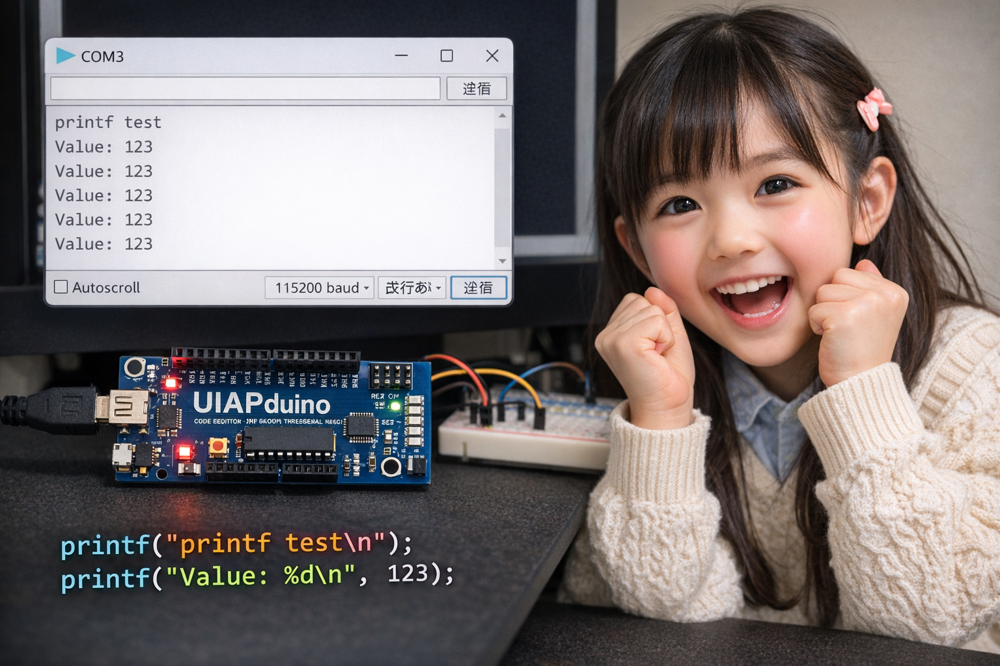

# 【UIAPduino】printf を実装するにょ【290円マイコン基板】

2026年3月18日 13:17



# UIAPduino（CH32V003）をUSBだけでPythonから出力を見る方法

USBケーブル1本だけで、追加のハードウェアなしにPythonからUIAPduinoの出力を確認する方法です。

## 背景

UIAPduino（CH32V003）はUSB HIDデバイスとして動作するため、通常の`Serial.print()`によるUSBシリアル通信（CDC）が使えません。また、Arduino IDEのシリアルモニタも使えません。

そこで、`rv003usb`ライブラリの`demo_terminal`を使い、USB HID経由でPythonから出力を受け取る方法を紹介します。

## 必要なもの

- UIAPduino Pro Micro CH32V003
- USBケーブルのみ（追加ハード不要）
- Windows + WSL2（Ubuntu 22.04）

## 手順

### 1. WSL側の準備

```bash
sudo apt update
sudo apt install -y gcc-riscv64-unknown-elf libnewlib-dev libudev-dev libusb-1.0-0-dev
pip install hidapi
```

### 2. rv003usbをクローン・ビルド

```bash
cd ~
git clone --recurse-submodules https://github.com/YuukiUmeta-UIAP/rv003usb.git
cd rv003usb/demo_terminal
```

`demo_terminal.c` の以下の行をコメントアウトします。この行があるとデバッガ接続待ちで止まってしまいます。

```bash
sed -i 's/while (!DidDebuggerAttach());/\/\/while (!DidDebuggerAttach());/' demo_terminal.c
```

ビルドしてWindowsにコピーします。

```bash
make
cp demo_terminal.bin /mnt/c/Users/ユーザー名/demo_terminal.bin
```

### 3. UIAPduinoに書き込み

ボタンを押しながらUSBを挿し、すぐにPowerShellで実行します。

```powershell
& "C:\Users\ユーザー名\AppData\Local\Arduino15\packages\UIAP\tools\minichlink-2982dfd\1.0.0\minichlink.exe" -w "C:\Users\ユーザー名\demo_terminal.bin" flash -b
```

成功すると以下のように表示されます。

```
Found UIAPduino Pro Micro CH32V003 V1.4 Bootloader
Halting Boot Countdown
Interface Setup
Image written.
Booting
```

### 4. USBをWSLにアタッチ

書き込み後、UIAPduinoを一度抜いて普通に挿し直します（ボタンなし）。

管理者PowerShellで確認します。

```powershell
usbipd list
```

`1209:d003` のBUSIDを確認して：

```powershell
usbipd bind --busid X-X
usbipd attach --wsl --busid X-X
```

WSL側で認識されているか確認します。

```bash
lsusb | grep 1209
# Bus 001 Device 005: ID 1209:d003 Generic RV003 Custom Device
```

### 5. Pythonで読む

```python
import subprocess

proc = subprocess.Popen(
    ['../ch32v003fun/minichlink/minichlink', '-kT', '-c', '0x1209d003'],
    stdout=subprocess.PIPE,
    stderr=subprocess.DEVNULL,
    text=True
)

for line in proc.stdout:
    print(line, end='', flush=True)
```

実行すると以下のようにカウントアップが表示されます。

```
-1133[]
+1134
-1135[]
+1136
...
```

### 6. 自分のコードでprintfを使う

`demo_terminal.c` の `while(1)` の中を書き換えるだけです。

```c
while(1) {
    printf("count: %lu\n", count++);
    Delay_Ms(1000);
}
```

変更したら以下の手順を繰り返します。

1. `make` でビルド
2. `cp demo_terminal.bin /mnt/c/Users/ユーザー名/demo_terminal.bin` でコピー
3. PowerShellでボタン押しながら書き込み
4. 普通に挿し直してWSLにアタッチ
5. Pythonで受信

## 仕組み

`rv003usb`の`demo_terminal`はCH32V003内蔵のDebug Module（DM）の`DMDATA0/1`レジスタを経由して`printf`の出力をUSB HIDパケットとして送信します。`minichlink -kT`コマンドがそのHIDパケットを受け取ってターミナルに表示します。PythonはそのminichiinkをサブプロセスとしてSTDOUTを読み取ります。

## 注意点

- UIAPduinoをWSLにアタッチするには`usbipd`が必要です（管理者権限が必要）
- 書き込みのたびに「ボタン押しながら挿す→Windowsで書き込み→普通に挿し直す→WSLにアタッチ」の手順が必要です
- `demo_terminal`はFlash 26.93%、RAM 4.88%と軽量です

## 参考

- [YuukiUmeta-UIAP/rv003usb](https://github.com/YuukiUmeta-UIAP/rv003usb)
- [UIAPduino公式サイト](https://www.uiap.jp/en/uiapduino/pro-micro/ch32v003/v1.4)

<div class="like-wrap"><div data-lyket-type="like" data-lyket-template="simple" data-lyket-namespace="linalog" data-lyket-color-icon="#b5e853" data-lyket-color-primary="#b5e853" data-lyket-color-text="#eaeaea" data-lyket-color-secondary="#2b2b2b" data-lyket-id="uiapduino-printf"></div></div>
