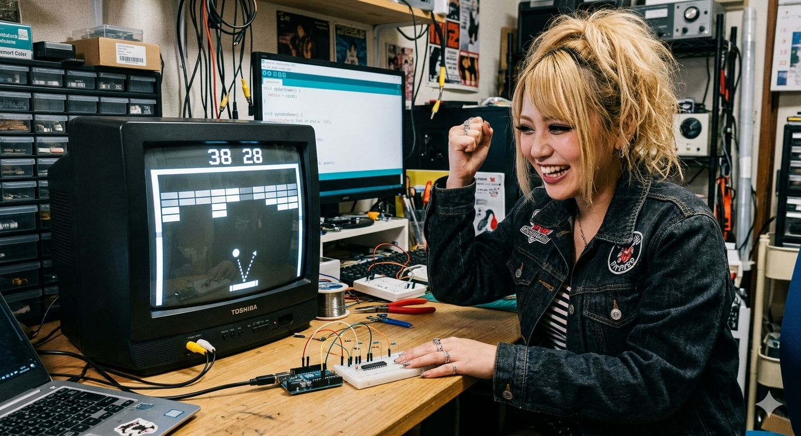

# 【UIAPduino】VIDEO信号を出したにょ①【290円マイコン基板】

2026年3月25日 12:41



# 抵抗2本で「映像」は作れるか？NTSC信号の物理レイヤ【連載①】
マイコンでビデオ信号を作るということは、ソフトウェアで**高精度な可変電圧源**をシミュレートすることと同義です。

## 1. 信号の三値論理（0V / 0.3V / 1.0V）
NTSCコンポジット信号は、単なるON/OFFのデジタル信号ではありません。以下の3つの電圧状態を、GPIOの組み合わせ（簡易抵抗DAC）で作り出します。

同期 (Sync): 0V
PC4をLOW、SPI（PC6）もLOWにする。
黒 (Black): 約0.3V
PC4をHIGH、SPIをLOWにする。この0.3Vが「映像の基準（ペデスタルレベル）」となります。
白 (White): 約1.0V
PC4をHIGH、SPIをHIGH（1）にする。
この「0.3V」という中途半端な電圧を、1kΩと470Ωの分圧で作るのがこの回路のキモです。

## 2. 時間軸の解像度：1クロックの重み
CH32V003を48MHzで動かしている場合、1クロックは約 20.8ns です。
NTSCの1行（水平走査期間）は 63.5μs ですが、テレビの同期回路は非常にシビアです。

水平同期パルス (4.7μs ± 0.1μs)

もし処理の都合でこのパルスが 5.0μs に伸びたり、4.4μs に縮んだりすると、テレビ側は「水平周波数が狂った」と判断し、画面を暗転させたり（信号ロスト）、表示位置を左右にガタつかせたりします。

ジッタの排除

C言語の for ループは、ループの終端で「条件比較」と「ジャンプ」を行います。このジャンプ命令が実行されるタイミングが、直前の命令の並びやパイプラインの状態によって1〜2クロック変動するだけで、画面には「波」となって現れます。

## 3. 難所：SPIとDMAの「同期」
映像データ（ドット）を出すにはSPIを使いますが、ここに落とし穴があります。

バックポーチの固定: 水平同期パルスが終わってから映像を出し始めるまでの「待ち時間」が1クロックでもズレると、画面全体が左右に微振動します。

DMAのバス競合: DMAがVRAMからデータを読み出す際、もしCPUが別のメモリ操作をしていると、DMAの読み出しが1クロック待たされることがあります。これが「ドットの泣き（太さが変わる）」の原因です。

対策: 描画中は while(DMA1_Channel3->CNTR > 0); でCPUをビジーウェイトさせ、バスをDMAに明け渡すのが最も安定します。

## 4. 垂直同期 (VSync) の「嘘」
実は、今回実装しているのは厳密なNTSC（インターレース）ではなく**ノンインターレース（プログレッシブ）** という、ファミコンなどのレトロゲーム機で使われていた手法です。

通常、NTSCは1フレームを「奇数フィールド」と「偶数フィールド」の2回に分けて送りますが、マイコンでは面倒なので、常に同じタイミングの同期パルスを送り続けます。

テレビ側はこれを「240p」というプログレッシブ信号として解釈し、ビシッと安定した静止画として表示してくれます。

# 実機
（X 投稿の埋め込み）

# コード抜粋
```
  noInterrupts();
    while (1) {
        gameLoop(); 
        updateGame();

        for(int i=0; i<3; i++){ syncStart(); DELAY_CYCLES(1400); *GPIO_C_BSHR=(1<<(4+16)); DELAY_CYCLES(25); *GPIO_C_BSHR=(1<<4); }
        for(int i=0; i<3; i++){ while(!(TIM2->INTFR&TIM_UIF)); TIM2->INTFR=0; *GPIO_C_BSHR=(1<<(4+16)); DELAY_CYCLES(1350); *GPIO_C_BSHR=(1<<4); DELAY_CYCLES(100); *GPIO_C_BSHR=(1<<(4+16)); DELAY_CYCLES(1350); *GPIO_C_BSHR=(1<<4); }
        for(int i=0; i<3; i++){ syncStart(); DELAY_CYCLES(1400); *GPIO_C_BSHR=(1<<(4+16)); DELAY_CYCLES(25); *GPIO_C_BSHR=(1<<4); }

        for (int line = 9; line < 100; line++) {
            syncStart();
            DELAY_CYCLES(400); 
        }
        
        for (int line = 0; line < VRAM_H; line++) {
            syncStart();
            DELAY_CYCLES(220);
           
            DMA1_Channel3->CFGR &= ~0x01;
            DMA1_Channel3->MADDR = (uint32_t)&vram[line * VRAM_W];
            DMA1_Channel3->CNTR = VRAM_W;
            DMA1_Channel3->CFGR |= 0x01;
            
            while(DMA1_Channel3->CNTR > 0);
            DELAY_CYCLES(20);
            SPI1->DATAR = 0x00; // 黒固定
        }
        
        for (int line = 100 + VRAM_H; line < 262; line++) {
            syncStart();
            DELAY_CYCLES(400);
        }
    }
}

```
# まとめ：マイコンから見たビデオ信号
ビデオ信号を作るということは、マイコンを**ナノ秒単位で正確に電圧を切り替える精密機械** として扱う作業です。ロジックの正しさよりも**いかにCPUの気まぐれ（実行サイクルの変動）を抑え込むか**　が全てと言っても過言ではありません。

# 次回予告
左右のげじげじを止めたいなぁと
i2c で通信出来れば夢のvideoコンバータに....(夢
