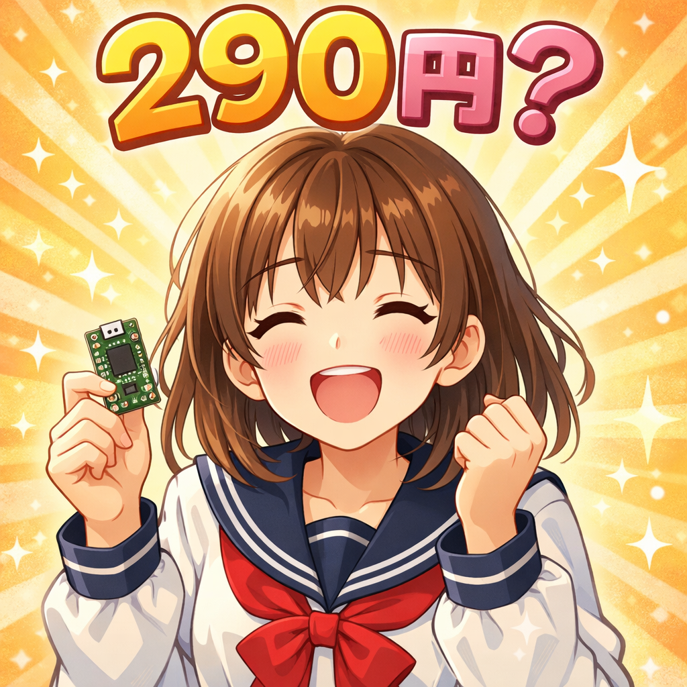

# 【UIAPduino】普通に使えるっぽいにょ【290円マイコン基板】

2026年3月7日 17:56



# CH32V003（290円マイコン基板）で滑らかに動くMatrix型「Text Rain」エフェクト
CH32V003（RAMわずか2KB）の超低リソース環境で、**マトリックス風の文字が尾を引いて落ちるエフェクト**を実装しました。  
SSD1306（128×64）のI2C OLEDを使い、**画面全体バッファを持たずに**動作しています。

---

## 主な工夫ポイント

1. **ページ・バッファ方式**による極端なRAM節約  
   → 通常128×64＝1024バイト必要な画面バッファを **128バイト（1ページ分）** だけに削減  
   → RAMの半分近くを文字オブジェクトや演出に回せるようになった

2. **擬似階調ディザリング**で尾のフェード表現  
   二値（白黒）ディスプレイでも、先頭は100%、後ろに行くほど間引いて薄く見せることで  
   「奥行き感・消えていく雰囲気」を再現

3. **3×5ドットフォント**＋軽量実装  
   メモリを食わない最小限のフォントで、数字・大文字・記号を表現

---

## Arduino Uno とのスペック対比（2026年現在）

| 項目 | CH32V003 | Arduino Uno (ATmega328P) | 判定 |
|------|----------|--------------------------|----------|
| コア | 32bit RISC-V (QingKe V2A) | 8bit AVR | CH32V003の方が現代的・高速 |
| クロック速度 | 最大48 MHz | 16 MHz | 約3倍高速 |
| Flash (プログラム) | 16 KB | 32 KB (うち0.5KBブートローダー) | Unoの方が容量多いがCH32は激安 |
| RAM (SRAM) | 2 KB | 2 KB | **同じ**！ここがこのプロジェクトの肝 |
| EEPROM | なし（代わりにUser Option Bytes） | 1 KB | Uno有利だが不要なケースも多い |
| 価格（単品・量産目安） | 約10〜25円（$0.07〜0.15） | 約500〜800円（$3〜5） | **10〜50倍の価格差** |
| アーキテクチャ | RISC-V (オープン) | AVR (独自) | 将来性・コミュニティでRISC-Vが強い |
| 開発環境 | Arduino Core対応（WCH公式） | 公式Arduino IDE（超充実） | Unoのエコシステムは圧倒的 |
| 低レイヤー制御のしやすさ | 非常に軽量・直感的 | 標準ライブラリ依存になりがち | このText Rainのような最適化に向く |
| 消費電力 | 非常に低い（Sleep/Standby対応） | やや高め | バッテリー駆動向き |

> **同じ2KB RAMで3倍速・1/30価格**というCH32V003は、制約を逆手に取った「超軽量演出」に向いていると言えます。

---

## スペック概要（Text Rainプロジェクト）

| 項目 | 内容 |
|------|------|
| MCU | CH32V003 (RISC-V, 48MHz, RAM 2KB) |
| ディスプレイ | SSD1306 128×64 I2C OLED |
| 同時落下オブジェクト | 最大12本 |
| 1本あたりの尾の長さ | 8文字 |
| 使用RAM（描画部分） | **128バイト** のみ |
| フォント | 3×5ドット（自作配列） |
| 文字セット | 0-9, A-Z, +, *, :, スペース |

---

## 実装の肝：ページ・バッファ方式

```
通常の書き方（Adafruit_SSD1306など）
└─ uint8_t displayBuffer[1024];  ← 約50%のRAMを食う

本実装（CH32V003向け）
└─ uint8_t oled_buf[128];        ← 1ページ（8行分）だけ
   ↓
   for(page = 0; page < 8; page++) {
     memset(oled_buf, 0, 128);
     // 該当ページに描画したいドットを計算
     // I2Cで1ページ分だけ送信
   }
```

→ **RAM使用量を1/8に圧縮**でき、他の変数やオブジェクトに余裕が生まれた。

---

## ディザリングによる擬似階調の実装例

```cpp
uint8_t d = (j == 0) ? 4          // 先頭：100%
           : (j < 3) ? 3          // 2〜3文字目：約50%
           : (j < 6) ? 2          // 4〜6文字目：約25%
           : 1;                   // 最後の方：約6%

if      (density >= 4) draw = true;
else if (density == 3) draw = ((px_abs + py) % 2 == 0);
else if (density == 2) draw = (px_abs % 2 == 0 && py % 2 == 0);
else                   draw = (px_abs % 4 == 0 && py % 4 == 0);
```

これで尾が自然に薄れていく視覚効果が生まれます。

---

## 全部入りコード（uiapTextRain.ino）

```cpp
#include <Wire.h>

/* --- 設定 --- */
#define OLED_ADDR  0x3C
#define OLED_W     128
#define OLED_H     64
#define OLED_PAGES 8
#define MAX_DROPS  12   // 同時に降る雨の数
#define TAIL_LEN   8    // 1つの雨に含まれる文字数

/* --- 構造体・変数 --- */
static uint8_t oled_buf[128];   // 1ページ分のバッファ (128バイト)
static uint8_t current_page = 0;

struct Drop {
  int16_t x, y;
  uint8_t speed;
  char    chars[TAIL_LEN];
};
static struct Drop drops[MAX_DROPS];

const char charset[] = "0123456789ABCDEFGHIJKLMNOPQRSTUVWXYZ+*:";

/* --- 3x5ドットフォントデータ --- */
static const uint8_t FONT3x5[][5] = {
  {0b111,0b101,0b101,0b101,0b111}, // 0
  {0b010,0b110,0b010,0b010,0b111}, // 1
  {0b111,0b001,0b111,0b100,0b111}, // 2
  {0b111,0b001,0b111,0b001,0b111}, // 3
  {0b101,0b101,0b111,0b001,0b001}, // 4
  {0b111,0b100,0b111,0b001,0b111}, // 5
  {0b111,0b100,0b111,0b101,0b111}, // 6
  {0b111,0b001,0b010,0b010,0b010}, // 7
  {0b111,0b101,0b111,0b101,0b111}, // 8
  {0b111,0b101,0b111,0b001,0b111}, // 9
  {0b010,0b101,0b111,0b101,0b101}, // A
  {0b110,0b101,0b110,0b101,0b110}, // B
  {0b111,0b100,0b100,0b100,0b111}, // C
  {0b110,0b101,0b101,0b101,0b110}, // D
  {0b111,0b100,0b111,0b100,0b111}, // E
  {0b111,0b100,0b111,0b100,0b100}, // F
  {0b111,0b100,0b101,0b101,0b111}, // G
  {0b101,0b101,0b111,0b101,0b101}, // H
  {0b111,0b010,0b010,0b010,0b111}, // I
  {0b001,0b001,0b001,0b101,0b111}, // J
  {0b101,0b101,0b110,0b101,0b101}, // K
  {0b100,0b100,0b100,0b100,0b111}, // L
  {0b101,0b111,0b111,0b101,0b101}, // M
  {0b101,0b111,0b111,0b111,0b101}, // N
  {0b111,0b101,0b101,0b101,0b111}, // O
  {0b111,0b101,0b111,0b100,0b100}, // P
  {0b111,0b101,0b101,0b111,0b001}, // Q
  {0b110,0b101,0b110,0b101,0b101}, // R
  {0b111,0b100,0b111,0b001,0b111}, // S
  {0b111,0b010,0b010,0b010,0b010}, // T
  {0b101,0b101,0b101,0b101,0b111}, // U
  {0b101,0b101,0b101,0b010,0b010}, // V
  {0b101,0b101,0b111,0b111,0b101}, // W
  {0b101,0b101,0b010,0b101,0b101}, // X
  {0b101,0b101,0b010,0b010,0b010}, // Y
  {0b111,0b001,0b010,0b100,0b111}, // Z
  {0b010,0b010,0b000,0b010,0b000}, // :
  {0b101,0b010,0b101,0b000,0b000}, // *
  {0b010,0b111,0b010,0b000,0b000}, // +
  {0b000,0b000,0b000,0b000,0b000}  // space
};

static int8_t _font_idx(char c) {
  if (c >= '0' && c <= '9') return c - '0';
  if (c >= 'A' && c <= 'Z') return c - 'A' + 10;
  if (c >= 'a' && c <= 'z') return c - 'a' + 10;
  if (c == ':') return 36;
  if (c == '*') return 37;
  if (c == '+') return 38;
  return 39;
}

/* --- OLED 低レイヤ制御 --- */
static void _oled_cmd(uint8_t cmd) {
  Wire.beginTransmission(OLED_ADDR);
  Wire.write(0x00);
  Wire.write(cmd);
  Wire.endTransmission();
}

void oled_init() {
  Wire.begin();
  Wire.setClock(400000);
  delay(100);
  const uint8_t init_cmds[] = {
    0xAE, 0xD5, 0x80, 0xA8, 0x3F, 0xD3, 0x00, 0x40,
    0x8D, 0x14, 0x20, 0x00, 0xA1, 0xC8, 0xDA, 0x12,
    0x81, 0xCF, 0xD9, 0xF1, 0xDB, 0x40, 0xA4, 0xA6, 0xAF
  };
  for (uint8_t i = 0; i < sizeof(init_cmds); i++) _oled_cmd(init_cmds[i]);
}

/* --- 描画ロジック (ディザリング対応) --- */
void oled_char3x5_dim(int16_t x, int16_t y, char c, uint8_t density) {
  int8_t idx = _font_idx(c);
  for (uint8_t row = 0; row < 5; row++) {
    uint8_t rowbits = FONT3x5[idx][row];
    int16_t py = y + row;
    if (py < 0 || py >= OLED_H || (py >> 3) != current_page) continue;

    for (uint8_t px = 0; px < 3; px++) {
      if (rowbits & (1 << (2 - px))) {
        int16_t px_abs = x + px;
        if (px_abs < 0 || px_abs >= OLED_W) continue;
        bool draw = false;
        if      (density >= 4) draw = true;                                    // 先頭文字：ディザなし
        else if (density == 3) draw = ((px_abs + py) % 2 == 0);               // 50%
        else if (density == 2) draw = (px_abs % 2 == 0 && py % 2 == 0);       // 25%
        else                   draw = (px_abs % 4 == 0 && py % 4 == 0);       // 6%
        if (draw) oled_buf[px_abs] |= (1 << (py & 7));
      }
    }
  }
}

void init_drop(uint8_t i) {
  drops[i].x     = random(0, OLED_W - 4);
  drops[i].y     = random(-120, 0);
  drops[i].speed = random(2, 4);
  for (uint8_t j = 0; j < TAIL_LEN; j++)
    drops[i].chars[j] = charset[random(0, sizeof(charset) - 1)];
}

void setup() {
  oled_init();
  randomSeed(analogRead(0));
  for (uint8_t i = 0; i < MAX_DROPS; i++) init_drop(i);
}

void loop() {
  // 文字の落下更新
  for (uint8_t i = 0; i < MAX_DROPS; i++) {
    drops[i].y += drops[i].speed;
    if (drops[i].y > OLED_H + (TAIL_LEN * 8)) init_drop(i);
    // 先頭文字をたまに変化させる
    if (random(0, 100) < 15)
      drops[i].chars[0] = charset[random(0, sizeof(charset) - 1)];
  }

  // ページごとの描画ループ
  current_page = 0;
  do {
    memset(oled_buf, 0, 128);
    for (uint8_t i = 0; i < MAX_DROPS; i++) {
      for (uint8_t j = 0; j < TAIL_LEN; j++) {
        int16_t char_y = drops[i].y - (j * 7);
        if (char_y > -6 && char_y < OLED_H) {
          uint8_t d = (j == 0) ? 4 : (j < 3 ? 3 : (j < 6 ? 2 : 1));
          oled_char3x5_dim(drops[i].x, char_y, drops[i].chars[j], d);
        }
      }
    }

    // I2C転送
    _oled_cmd(0xB0 | current_page);
    _oled_cmd(0x00);
    _oled_cmd(0x10);
    Wire.beginTransmission(OLED_ADDR);
    Wire.write(0x40);
    for (uint8_t x = 0; x < 128; x++) Wire.write(oled_buf[x]);
    Wire.endTransmission();

    current_page++;
  } while (current_page < OLED_PAGES);

  delay(5);
}
```
## 実機
<blockquote class="twitter-tweet" data-theme="dark"><a href="https://twitter.com/chrmlinux03/status/2030201173966504169"></a></blockquote>
<script async src="https://platform.twitter.com/widgets.js" charset="utf-8"></script>
## まとめ
書込み方が昔のマイコン...
ボタンを押しながら電源投入 -> 1秒待つ -> ボタン離す -> 書込み開始

いつもご清聴ありがとうございます
ボタン押しすぎて指が痛い(謎

<div class="like-wrap"><div data-lyket-type="like" data-lyket-template="twitter" data-lyket-namespace="linalog" data-lyket-color-icon="#b5e853" data-lyket-color-primary="#b5e853" data-lyket-color-text="#eaeaea" data-lyket-color-secondary="#2b2b2b" data-lyket-id="uiapduino"></div></div>
