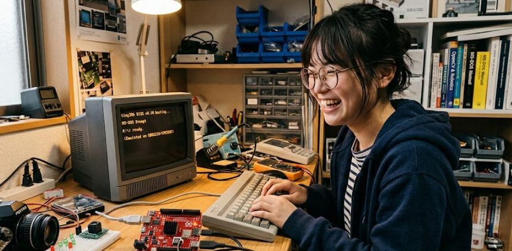

# 【unoQ】tiny386でFreeDos動かしたにょ【小さなLinux機】

2026年3月2日 06:44



# tiny386 on Arduino Uno Q 完全レシピ

## 前作
[第一章 初期化](../unoq-setup/)
[第二章 QRB/MCU通信](../unoq-qrb-stm32/)
[第三章 デスクトップを液晶に](../unoq-x11-lcd/)
[第四章 ROS2を簡単に](../unoq-ros2/)
[第五章 Windowsを動かす](../unoq-windows/)

> **世界初！Arduino Uno Q 上で tiny386 を動かす手順書**  
> WSL2 (Ubuntu 22.04) + Arduino Uno Q (LinaQ) で確認済み

---

## 前提環境

- Windows PC + WSL2 (Ubuntu 22.04 Jammy)
- Arduino Uno Q (LinaQ) ※IPアドレスは適宜変更
- Windows に xrdp クライアント（リモートデスクトップ）使用可能なこと

---

## Step 1: WSL2側の準備

```bash
# 必要パッケージのインストール
sudo apt update
sudo apt install gcc make git gcc-aarch64-linux-gnu \
  libslirp-dev python-is-python3

# ARM64マルチアーチ有効化
sudo dpkg --add-architecture arm64

# sources.listにARM64リポジトリを追加
sudo sed -i 's/deb http:\/\/archive.ubuntu.com/deb [arch=amd64,i386] http:\/\/archive.ubuntu.com/g' /etc/apt/sources.list
sudo sed -i 's/deb http:\/\/security.ubuntu.com/deb [arch=amd64,i386] http:\/\/security.ubuntu.com/g' /etc/apt/sources.list

echo "
deb [arch=arm64] http://ports.ubuntu.com/ubuntu-ports jammy main restricted universe multiverse
deb [arch=arm64] http://ports.ubuntu.com/ubuntu-ports jammy-updates main restricted universe multiverse
deb [arch=arm64] http://ports.ubuntu.com/ubuntu-ports jammy-security main restricted universe multiverse" | sudo tee -a /etc/apt/sources.list

sudo apt update
sudo apt install libslirp-dev:arm64 libsdl1.2-dev:arm64
```

---

## Step 2: tiny386のクロスコンパイル（ARM64向け）

```bash
# tiny386をクローン
git clone https://github.com/hchunhui/tiny386.git
cd tiny386

# ARM64用シンボリックリンク作成
sudo ln -s /usr/lib/aarch64-linux-gnu/libSDL-1.2.so.0 \
  /usr/lib/aarch64-linux-gnu/libSDL.so

# ARM64用pkg-config作成
sudo mkdir -p /usr/lib/aarch64-linux-gnu/pkgconfig
sudo tee /usr/lib/aarch64-linux-gnu/pkgconfig/sdl.pc << 'EOF'
prefix=/usr
exec_prefix=${prefix}
libdir=${prefix}/lib/aarch64-linux-gnu
includedir=${prefix}/include
Name: sdl
Description: Simple DirectMedia Layer
Version: 1.2.15
Libs: -L${libdir} -lSDL
Cflags: -I${includedir}/SDL -D_REENTRANT
EOF

# MakefileのライブラリパスをARM64向けに修正
sed -i 's|LIBS_SDL_ = `${SDL_CONFIG} --libs` ${LIBS}|LIBS_SDL_ = -L/usr/lib/aarch64-linux-gnu -lSDL -lslirp -lm|' Makefile
sed -i 's|LIBS_ = -lm ${SLIRP_LIB}|LIBS_ = -L/usr/lib/aarch64-linux-gnu -lm -lslirp|' Makefile

# ARM64向けクロスコンパイル
make CC=aarch64-linux-gnu-gcc USE_SDL=y tiny386

# 確認（ARM aarch64 と表示されればOK）
file tiny386
```

---

## Step 3:  パッチ済みSeaBIOSのビルド（最重要！）

> **標準のseabiosでは必ずクラッシュします。**  
> tiny386リポジトリに含まれる専用パッチを必ず適用してください。

```bash
cd ~/tiny386

# seabiosのソースを取得
git clone https://git.seabios.org/seabios.git seabios_src
cd seabios_src

# ★★★ 最重要！tiny386専用パッチを適用 ★★★
git apply ../seabios/patch

# tiny386専用configをコピー
cp ../seabios/config .config

# pythonが必要な場合
sudo apt install python-is-python3

# ビルド
make

# 確認
ls out/bios.bin out/vgabios.bin
cd ~/tiny386
```

### パッチの内容（参考）
- フロッピードライバの独自実装（emulink対応）
- APMシャットダウンの修正
- 割り込みベクタ（0x78〜0xff）の初期化追加
- VGA ROMの初期化修正
- デバッグ出力ポートの修正

---

## Step 4: FreeDOSイメージの取得

```bash
cd ~/tiny386

# HDDイメージ（フルインストール用）
wget https://www.ibiblio.org/pub/micro/pc-stuff/freedos/files/distributions/1.3/official/FD13-FullUSB.zip
unzip FD13-FullUSB.zip

# フロッピーイメージ（インストールメディア）
wget https://www.ibiblio.org/pub/micro/pc-stuff/freedos/files/distributions/1.3/official/FD13-FloppyEdition.zip
unzip FD13-FloppyEdition.zip

# 確認
ls 144m/
# x86BOOT.img x86DSK1.img x86DSK2.img ... が存在すればOK
```

---

## Step 5: Uno Qへ転送

```bash
# バイナリとBIOSとイメージをUno Qに転送
scp ~/tiny386/tiny386 arduino@linaQ.local:~/
scp ~/tiny386/seabios_src/out/bios.bin arduino@linaQ.local:~/
scp ~/tiny386/seabios_src/out/vgabios.bin arduino@linaQ.local:~/
scp ~/tiny386/FD13FULL.img arduino@linaQ.local:~/
scp ~/tiny386/144m/x86BOOT.img arduino@linaQ.local:~/
scp ~/tiny386/144m/x86DSK1.img arduino@linaQ.local:~/
scp ~/tiny386/144m/x86DSK2.img arduino@linaQ.local:~/
```

---

## Step 6: Uno Q側のセットアップ

```bash
# SSH接続
ssh arduino@linaQ.local

# 依存ライブラリのインストール
sudo apt install libsdl1.2debian libslirp0

# xrdp + デスクトップ環境のインストール
sudo apt install xrdp xfce4 xfce4-goodies

# xfce4をデフォルトセッションに設定
echo "xfce4-session" > ~/.xsession
chmod +x ~/.xsession

# xrdpを有効化
sudo systemctl enable xrdp
sudo systemctl start xrdp

# 実行権限付与
chmod +x ~/tiny386
```

---

## Step 7: config.iniの作成と起動

```bash
# Uno Q上でconfig.iniを作成
cat > ~/config.ini << 'EOF'
[pc]
bios = bios.bin
vga_bios = vgabios.bin
mem_size = 32M
vga_mem_size = 2M
fill_cmos = 1
fda = x86BOOT.img
hda = FD13FULL.img

[cpu]
gen = 3
fpu = 0
EOF
```

**Windows側からRDPで接続：**
- `Win + R` → `mstsc` → `linaQ.local` に接続
- ユーザー名: `arduino` でログイン

**xfce4のターミナルで起動：**
```bash
DISPLAY=:10.0 ./tiny386 config.ini
```

---

## Step 8: FreeDOSインストール操作

1. tiny386ウィンドウが表示される
2. `Ctrl + ]` でキーボード/マウスをグラブ
3. インストーラーの質問に `Y` で回答
4. ディスク交換要求（`Insert diskette #2`）が出たら：
   - `Ctrl + [` でOSDメニューを開く
   - `fda` を `x86DSK1.img` → `x86DSK2.img` と順に切り替える

---

## トラブルシューティング

| 症状 | 原因 | 対処 |
|------|------|------|
| `call_isr error0 104 0` でクラッシュ | 標準seabiosを使用 | **パッチ済みseabiosを使う（Step 3）** |
| `Segmentation fault` | libcacaの問題 | `SDL_VIDEODRIVER=x11` を指定 |
| 画面が真っ黒のまま | DISPLAY未設定 | `DISPLAY=:10.0` を指定 |
| `libSDL not found` | ARM64用シンボリックリンク未作成 | Step 2のリンク作成を実行 |
| `lSDL.img: No such file or directory` | imgの大文字/小文字 | ファイル名を小文字`.img`で統一 |

---

## ポイントまとめ

| 項目 | 内容 |
|------|------|
| **最重要** | 標準seabiosではなくパッチ済みseabiosが必須 |
| **画面表示** | xrdp経由でWindowsのRDPから接続、`DISPLAY=:10.0` |
| **クロスコンパイル** | WSL2でARM64向けにビルド |
| **ライブラリ** | ARM64マルチアーチでlibSDL・libslirpをインストール |

---
## さいごに
いつもご清聴ありがとうございます
え？qemu で良くないの？速度もそっちの方が速いんでしょ？
いいんです、エンジニアはロマンですからっ
（X 投稿の埋め込み）

## 参考

- tiny386: https://github.com/hchunhui/tiny386
- FreeDOS: https://www.freedos.org/
- Arduino Uno Q: https://store.arduino.cc/

---

*2026年3月 Arduino Uno Q (LinaQ) にて動作確認*  
*世界初 tiny386 on Arduino Uno Q *

<div class="like-wrap"><div data-lyket-type="like" data-lyket-template="simple" data-lyket-namespace="linalog" data-lyket-color-icon="#b5e853" data-lyket-color-primary="#b5e853" data-lyket-color-text="#eaeaea" data-lyket-color-secondary="#2b2b2b" data-lyket-id="unoq-freedos"></div></div>
